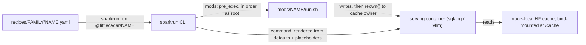

# Repository Guidelines

Registry of **sparkrun** deployment recipes for Little Cedar Group's 6-node DGX Spark cluster
(GB10 Blackwell, 128 GB unified LPDDR5X, 200 GbE CX7 RoCE). The tree is git-distributed to the
cluster and to third parties, and is consumed by the `sparkrun` CLI as the `littlecedar` registry
(`Trusted=yes`, so recipe mods run unprompted at launch). There is no compiled application here:
the "source" is recipe YAML, bash mods, and stdlib-only Python tools and guards.

Counts in this document were verified 2026-10-15 against the working tree; the recipe, guard-module,
suite and strict-validate counts were re-measured **2026-10-22** at `9cceeea` (66 tracked recipes,
38 importable guard modules, 928 tests, 18/66 strict).
Facts drift — re-measure (`git ls-files 'recipes/*/*.yaml'`, test discovery) before trusting a number;
the working tree can carry in-flight drafts that git does not, so `ls recipes/*/*.yaml` overcounts.

## Project Overview

- **Recipes** (`recipes/`, 66 tracked files in 12 family dirs, tracked = on-disk as measured 2026-10-22) — v2 recipe definitions consumed by
  `sparkrun run @littlecedar/<filename-minus-.yaml>` on the cluster.
- **Mods** (`mods/`, 5 shared + `mod-template`; single-lane mods live in `recipes/<lane>/mods/`) —
  pre-launch container hooks that patch or stage files inside the serving image before the engine
  execs.
- **Benchmarking** (`benchmarking/`, 35 profiles: 32 `llama-benchy`, `standard-suite.yaml`, and the
  `pooling-ladder-{embed,rerank}.yaml` pair; plus an index README) — the curated
  profile library used by `sparkrun benchmark performance`.
- **Tuning** (`tuning/`) — only `README.md` is tracked; Triton MoE tuning configs are generated at
  runtime by `sparkrun tune` and no recipe references a vendored config.
- **Tests/tools** (`tests/`, `tools/`) — artifact guards and measurement CLIs; intentionally
  stdlib-only so they run on a head node, in a container, or on a laptop with no venv.

## Architecture & Data Flow



Load-bearing contracts:

- **`defaults:` reaches the engine only through a `{placeholder}`** in `command:` (or in another
  default's value, or an `env:` value), a runtime flag map / `BASE_CONSUMED_CONFIG_KEYS` entry, or an
  internal (`_`-prefixed) / `overrides[].when.config` key — `sparkrun/core/launcher.py:814-899`, with
  the consumed set assembled at `:870`. Anything else is a warning (`unmapped-config-key`) and a
  silent drop at the engine. Never delete a placeholder to silence a warning, and never add a default
  nothing consumes. An unknown **top-level** key is worse: it is swept into `runtime_config`
  (`sparkrun/core/recipe.py:1264-1270`), where only a by-name consumer reads it, and draws
  `misplaced-config-key` or `unknown-top-level-key` (`sparkrun/core/validation.py:1176-1272`). The full
  41-key rule set is in [`recipes/MECHANICS.md`](recipes/MECHANICS.md).
- **`command:` is YAML folded `>`** (all 66 tracked recipe files). JSON-shaped defaults must keep their shell
  quotes inside the fold — `limit_mm_per_prompt: >-` with `'{"image": 4, "video": 1}'` — or
  word-splitting hands the engine four arguments.
- **`mods:` is an ordered dependency chain, not a set.** Recipe comments
  (`ORDER MATTERS`, `keep the config mod first`, `Must run LAST`) are load-bearing; reordering a
  labquant/EXL3 chain yields a tree that boots, answers, and is numerically wrong.
- **Mods run as root** in the container and must `reown()` anything created under `/cache/runtime` to
  the cache mount's UID/GID, or downstream user processes fail on root-owned leftovers. A non-zero
  mod exit tears the whole launch down, so transient failures log and continue.
- **Each runner node has its own HF cache** at `${WOPR_USER_CACHE}/huggingface` mounted at `/cache`.
  There is no shared `/cache/models`; sparkrun distributes every model to each serving node.

## Key Directories

| Path | Contents |
|---|---|
| `recipes/cybersec/` (9), `recipes/decision/` (11), `recipes/ds4/` (2), `recipes/embed/` (2), `recipes/explore/` (13), `recipes/glm/` (2), `recipes/ifm/` (3), `recipes/media/` (8), `recipes/ornith/` (6), `recipes/qwen3/` (3), `recipes/qwen4/` (5), `recipes/rerank/` (2) | Recipes by model family, each lane keeping one `README.md`, with lane state and constraints in `attic/<lane>/AGENTS.md`. The Decision lane (11 arms: JEV-9B/27B, clef-flash, the CPU `vllm-srun` Kai/Sol/Nox/d3-edge set plus the Sol-2B GGUF llama.cpp arm, plus the `kev` and `laya` CPU serves), the Explore lane (thirteen arms — the 2026-10-19 keeper sweep plus the Mellum `mmap` probe committed 2026-10-22: Ling-3.0-flash, Kolibri-1 APEX 24bpw GGUF, Mellum2.1 Q4_K_M (plus its `mmap` variant and an MTP probe), the Poolside Laguna M1 TP=2/Laguna-S 2.1/Laguna-XS 2.1 set, the Nemotron-3.5-Lightning 30B-A3B NVFP4 arm booted 2026-10-21 — the lane's fastest single-node C1 at 20.1 GiB — and the Spark-X2.6-4B pair (bf16 accuracy control + FP8 fast tier, with an INT8 `zz-` probe rejected at the kernel level); the retired arms moved to `attic/explore/`), the Media lane (eight recipes split out of Explore/Decision 2026-10-22: drama-3 TTS, Kokoro TTS, Qwen-Image 2.1 Diffusers script plus its 4-step variant, the LTX-2.5 22B T2V ComfyUI script and runbook, the humanizer Q6_K rewriter, plus `zz-` probes for MiniMax-H3 and pyannote diarization) and the Cybersec lane (nine arms: six SGLang plus two vLLM-route companions plus the OrcaCyber llama.cpp probe) and the GLM lane (two TP=4 EXL3 TensorFold arms, both boot-verified 2026-10-18) carry `README.md` lane docs. The Qwen3-VL embedding/reranking pairs moved out of `recipes/qwen3/` into `recipes/embed/` and `recipes/rerank/` on 2026-10-10 (`tests/test_qwen3_vl_embeddings.py` still guards all four); the qwen3 no-spec control recipe was retired to `attic/qwen3/` with its metrics moved into `attic/qwen3/AGENTS.md` |
| `recipes/glm/` | Two TP=4 EXL3 TensorFold arms, both boot-verified on `.30`–`.33` on 2026-10-18: `glm-5.3-flash-exl3-tp4-1m-tensorfold-sglang.yaml` (Flash 4bpw) and `glm-5.3-exl3-3bpw-tp4-1m-tensorfold-sglang.yaml` (full 753B 3.0bpw, over a vendored engine image), each with a lane-local launcher mod under `recipes/glm/mods/`. Receipts and revision pins live in `README.md`; `GLM-5.3-RECOMMENDATIONS.md` and the earlier `glm-5.3-flash-nvfp4-dflash-vllm.yaml` remain archived to `attic/glm/` (proven-negative on the pinned public image, 2026-10-13) |
| `attic/` | Tracked recipe/doc archive: 5 retired EXL3 vLLM recipes (+ tuning configs) and their EXL3 patch/cache mods in `attic/ds4/`, 30 arms, the closed input-scale mod, 9 archived benchmark profiles, + `ARMS-MANIFEST.md` in `attic/qwen4/`, the withdrawn K2-Horizon MoVA sub-lane (4 arms + its gate mod + guard + the RoCE env mod) in `attic/ifm/` plus three retired IFM 7B arms (plain and NGRAM `k2-horizon-7b-fp8-*`, and the UNO tree probe `zz-k2-horizon-7b-uno-tree-sglang.yaml`) in `attic/ifm/arms/` — 7 recipe files in that directory, counted 2026-10-21, the retired qwen3 no-spec control recipe, its spec-metrics guard mod, and 3 archived benchmark profiles in `attic/qwen3/` (metrics in `attic/qwen3/AGENTS.md` §6), `attic/ornith/`, `attic/explore/` (14 archived Explore arms + `ARMS-MANIFEST.md`), `attic/glm/` (1 archived arm + `ARMS-MANIFEST.md`). Not served by the registry, but referenced by tests, benchmarks, and tools |
| `mad-science/` | Research notes — claim traces and experiments, not recipes and not shipped. Index in `mad-science/README.md`; owner questions live in `mad-science/QUESTIONS.md`. Not served by the registry |
| `mods/` | Shared mods only (used by ≥2 lanes): 5 + `mod-template/`, the authoritative harness. A mod relevant to a single lane lives at `recipes/<lane>/mods/<mod>/` |
| `tests/` | 38 importable guard modules, plus one tracked `*.sync-conflict-*.py` fixture that the conflict-copy guard expects |
| `tools/` | 23 stdlib CLIs (bfcl-eval, pooling-bench, needle-haystack, quality-battery, jev-decision-bench, decision-tandem, decision-ensemble, decision-ladder, cache-audit, build-dsv41-*, gate-37111, qwen4-quality-eval, safe_text, synthetic_png, eval-suite, agentic-horizon-probe, horizon-analyze, refresh-sweep) |
| `plugins/` | One module, `pooling_bench_framework.py`: the out-of-tree sparkrun `BenchmarkingPlugin` that drives `tools/pooling-bench.py` for a `framework: pooling-bench` profile (the pooling lanes' only profile-shaped measurement path). Not a registry asset and not stdlib-only — it imports `sparkrun` by definition and is loaded only *inside* a sparkrun process via `plugins.paths` (`tools/README.md` §plugins/). |
| `benchmarking/` | 35 profiles (32 llama-benchy + `standard-suite.yaml`, the one `tool-eval-bench` profile, + the 2-profile `pooling-bench` ladder) + README index (flat, recipe-agnostic); the families stranded by the lane cuts live in `attic/qwen4/profiles/` and `attic/qwen3/profiles/` |
| `.sparkrun/registry.yaml` | Registry manifest: `recipes: recipes`, `tuning: tuning`, `benchmarks: benchmarking`, `mods: mods` |
| `.local/` | Git-ignored: `CONFIDENTIAL.md` (defines `${WOPR_*}` cluster vars), `sparkrun-home/` (HOME override) |
| `.omp/skills/` | Tracked **omp skills for recipe work only** (research, author, publish, benchmark, test, verify, retire, index): one `SKILL.md` per skill, discovered natively at *project* scope when this repo is the working directory (no symlinks or config needed). Cluster-ops, monitoring, gateway, evidence-store and session-workflow skills deliberately stay user-global in `~/.omp/agent/managed-skills/`. Discovery is startup-time, so an edit applies at the next session start. `learn`/`manage_skill` still write to the global root — a new recipe skill must be moved here by hand. |

## Development Commands

```bash
uv sync                        # netifaces has no wheel — builds from sdist, needs a C toolchain
mkdir -p .local/sparkrun-home  # fresh clone; git-ignored
sparkrun --version             # requires >= 0.3.8 (0.4.0 verified locally)
```

**Every `sparkrun` call needs the HOME override**, otherwise it dies on
`PermissionError: ~/.config/sparkrun/registries.yaml` before reading any recipe:

```bash
H=$PWD/.local/sparkrun-home
HOME="$H" sparkrun recipe validate recipes/qwen4/qwen3.8-flash-next-nvfp4-labquant-sglang.yaml
```

**A bump boot must pass the recipe file path, never a registry-qualified ref.**
`@littlecedar/<name>` resolves the *published* registry clone, not the worktree, so a recipe
whose `container:` line was just edited still launches the previous image. Measured
2026-10-22: with the worktree at `v0.5.22@sha256:e3a4f060…`,
`sparkrun run @littlecedar/ornith-1.5-35b-a3b-nvfp4-dflash2-sglang` booted
`v0.5.21@sha256:b1259f3e…` (its launch log's `Image:` and `Distributing image` lines name the old
digest, and the engine reported `sglang: 0.5.21`) while the same command with
`recipes/ornith/ornith-1.5-35b-a3b-nvfp4-dflash2-sglang.yaml` booted the new one.
Use a registry ref only when the published copy is what you mean to serve.

**And extend that to the pin itself: commit before you boot, re-tag after a pull.** Two ways a bump
campaign silently measures the previous engine, both hit on 2026-10-22. (1) `docker pull
repo:tag@sha256:…` stores the image **untagged** — a peer's `docker image prune` on the shared fleet
then deletes the very build you pulled, so re-tag it at once (`docker tag lmsysorg/sglang@sha256:e3a4f060…
lmsysorg/sglang:v0.5.22`). (2) This repo is syncthing-shared: a peer's `git pull`/`checkout` in
another clone reverts your **uncommitted** `container:` edit in place, and the next boot launches the
previous image. Commit the pin before the first boot, and assert it before every boot with
`grep -q <new digest> "$f" || exit 3`.

The repo-mandated gate after every edit:

```bash
set -e
H=$PWD/.local/sparkrun-home
uv run python -B -m unittest discover -s tests
for f in recipes/*/*.yaml; do HOME="$H" sparkrun recipe validate "$f" >/dev/null; done
for s in mods/*/*.sh recipes/*/mods/*/*.sh; do bash -n "$s"; done
for p in mods/*/*.py recipes/*/mods/*/*.py tools/*.py plugins/*.py; do uv run python -m py_compile "$p"; done
find mods recipes tools tests plugins -name __pycache__ -type d -exec rm -rf {} +
```

- **Plain `validate` is the gate, not `--strict`**: all 66 tracked recipes pass plain; 18/66 fail
  strict on accepted findings (re-measured 2026-10-22 at `9cceeea`; the same 18 files listed below).
  Seventeen carry `unpinned-model-revision` —
  the pin never reaches the engine as `--revision` — and one carries `deprecated-topology` instead:

  | Recipe | Findings |
  |---|---|
  | `cybersec/deepseek-v4.1-flash-abliterated-cyber-tp2-tensorfold-sglang.yaml` | `unpinned-model-revision`, `recipe-metadata`, `restated-managed-path` |
  | `decision/kev-0.8b-decision-serve.yaml` | `unpinned-model-revision`, `inline-script` |
  | `decision/laya-decision-serve.yaml` | `unpinned-model-revision`, `inline-script` |
  | `media/kokoro-82m-tts-cpu.yaml` | `unpinned-model-revision` |
  | `media/zz-pyannote-community-1-diarization-cpu.yaml` | `unpinned-model-revision`, `inline-script`, `restated-managed-path` |
  | `embed/qwen3-vl-embedding-2b-vllm-b12x.yaml` | `unpinned-model-revision` |
  | `embed/qwen3-vl-embedding-8b-awq-4bit-vllm-b12x.yaml` | `unpinned-model-revision` |
  | `ds4/deepseek-v4.1-flash-knapcio-tp4-1m-sglang.yaml` | `unpinned-model-revision` |
  | `ds4/deepseek-v4.1-flash-tensorfold-tp2-1m-sglang.yaml` | `unpinned-model-revision`, `recipe-metadata` |
  | `glm/glm-5.3-exl3-3bpw-tp4-1m-tensorfold-sglang.yaml` | `unpinned-model-revision`, `recipe-metadata` (`model_dtype: exl3`) |
  | `glm/glm-5.3-flash-exl3-tp4-1m-tensorfold-sglang.yaml` | `unpinned-model-revision`, `recipe-metadata` (`model_dtype: exl3`) |
  | `ornith/littlecedar-ornith-1.5-397b-nvfp4-mtp-graft-vllm.yaml` | `unpinned-model-revision` |
  | `qwen3/qwen3.8-27b-mlx4bit-tensorfold-sglang.yaml` | `unpinned-model-revision` |
  | `qwen3/qwen3.8-27b-nvfp4-dflash2-sglang.yaml` | `deprecated-topology` (`cluster_only`), `restated-managed-path` |
  | `qwen4/qwen3.8-flash-next-nvfp4-solo-vllm-b12x.yaml` | `unpinned-model-revision` |
  | `qwen4/zz-qwen38-next-vllm-tp2-pinned.yaml` | `unpinned-model-revision`, 2× `restated-platform-env` |
  | `rerank/qwen3-vl-reranker-2b-vllm-b12x.yaml` | `unpinned-model-revision` |
  | `rerank/qwen3-vl-reranker-8b-vllm-b12x.yaml` | `unpinned-model-revision` |

  These arms either pass the prepared path through `{model}` or serve a model set baked into the image
  (`kokoro`), so the missing `--revision` does not select a different artifact;
  `unpinned-model-revision` is the known false positive the lanes document, not a boot risk
  (`sparkrun/core/validation.py:837-914`). Never edit a recipe merely to clear a `suggestion` (such as
  deliberate `/cache/runtime` paths flagged `restated-managed-path`) or a documented, deliberate
  warning.
  The four embed/rerank pins added 2026-10-22 are the same class: `{model}` renders to the prepared
  snapshot there too, so the pin selects the bytes and the engine never resolves a ref.
- `py_compile` leaves `__pycache__/`; the suite's own child processes may recreate it even under
  `-B`, so keep the cleanup line.

Render before launching; `-n` alone errors with `No hosts specified`:

```bash
HOME="$H" sparkrun run <recipe> -H <node> -n            # print the rendered command
HOME="$H" sparkrun run <recipe> -H <node> -n | grep -- '--your-flag'
```

`-o key=value` overrides recipe defaults and `-b key=value` passes benchmark args (both repeatable);
`-v`/`-vv`/`-vvv`, `-q` for scripting. Lifecycle: `sparkrun status` → task IDs, `sparkrun logs <id>`,
`sparkrun stop <id>` (**no `sparkrun stop all`**).

```bash
HOME="$H" sparkrun benchmark performance <recipe> -H <node> --profile benchmarking/<name>.yaml \
  --output out.yaml          # flags: --solo --skip-run --no-stop --fresh --resume --timeout
HOME="$H" sparkrun tune sglang <recipe> -H <host>   # or: tune vllm
```

The embed/rerank lanes are hostile to that command — a pooling engine has no
`/chat/completions`, so `llama-benchy` fails its first task and the run ends
`Error: Benchmark incomplete` (measured 2026-10-15). Their ladder is
`sparkrun benchmark pooling <recipe> --profile <pooling profile>` (or `benchmark run`, which
takes the framework from the profile) once the repo's `plugins/` dir is on `plugins.paths`;
read `tools/README.md` §pooling-bench.py + §plugins/ before re-deriving which command owns a
pooling number.

Remote GPU work is SSH to `${WOPR_HEAD_NODE}` as `${WOPR_USERNAME}`; run `sparkrun` from
`${WOPR_RUN_FROM_DIR}` with in-progress recipes symlinked from `${WOPR_SRC_DIR}`. Cluster mod
delivery needs `--transfer-mode local` (hidden option; `auto|local|push|delegated|pull`; persist
with `sparkrun cluster update <name> --transfer-mode local`), else the node clones the registry
itself and an unpushed mod is invisible.

### Node hygiene — clean up after yourself (a rule)

The nodes are a shared machine set: `$HOME` and `/tmp` on every node are not scratch storage, and this
registry is distributed to third parties. **After a recipe build, boot-test or benchmark campaign,
remove what the session created** — a leftover is anything undocumented, unknown or temporary:

- Delete session logs and ad-hoc output from `$HOME` (`*.log`, `*.out`, one-off output dirs) and from
  `/tmp` on **every** node touched, not just the head.
- Receipts are not leftovers. The documented locations are `~/benchmarks/<lane>-<date>/` on the head
  and `.scratch/<lane>/…` locally, and a receipt a doc cites by name or path stays. **Before deleting
  anything on a node, grep the repo for the basename** — worker-side paths are cited too. The
  2026-10-14 clean-up destroyed the qwen4 argv/memory traces this way; the loss is recorded in
  `attic/qwen4/AGENTS.md`.
- **A path a harness names on purpose is not litter.** `.scratch/q4/capture-serve-argv.sh` writes
  `$HOME/serve_argv/<tag>_<node>.txt` on the *worker* precisely because it outlives `/tmp` reaping, and
  `launch.sh` arms `mem_watch.sh` into `$HOME/mem_watch/` on every run. Such output is citable
  evidence-in-waiting: **harvest it into the receipt root (`~/benchmarks/<lane>-<date>/` or
  `.scratch/<lane>/`) before removing anything**, and never sweep the harness's own directory as
  scratch — that is what destroyed the §19q traces, and the harness is still armed, so the next
  undiscriminating sweep would destroy the replacements too.
- No leftover containers or orphan volumes (`docker ps -aq` and `docker volume ls -q` both empty).
  Remove images for retired lanes, but keep any image a shipped recipe or an `attic/` doc names.
- `sparkrun`'s runtime cache (`${WOPR_USER_CACHE}/sparkrun/runtime-cache/<runtime>/<model_dir>`) is a
  cache, not litter: entries are rebuilt on the next boot. **Triage it by provenance, not by name.** A
  tree records the mods that produced it in its own `modlogs/`, so the owning recipe is identifiable:
  a tree whose `<model>` a shipped recipe names and whose mod set matches that recipe's `mods:` is
  load-bearing; a tree whose model no shipped recipe names — or whose mods match none — is a
  retired/attic variant. `.sparkrun-last-used` gives recency, and **a tree touched in the last ~72 h is
  in use whatever its provenance**. Measured 2026-10-14: ~604 GB of a ~3.1 TB fleet runtime-cache was
  retired-variant material; the ~7 TB HF cache was **not** litter — 63 of 65 cached repo-entries are
  consumed by a shipped recipe or a shipped mod (draft models live in `speculative_draft_model:` and in
  `command:`, not only in `model:`).
- The HF cache is pruned with `hf cache rm model/<org>/<name>` — never `rm -rf` a `models--*` directory,
  which orphans blobs — and only for repos no shipped recipe or mod references.
- **Traps, all hit on 2026-10-14:** a listing-derived path is relative, so `rm <name>` against the wrong
  `cwd` deletes nothing and still prints success — build absolute paths, capture stderr, and re-count
  (`13 → 1`, not "looks clean"); cache internals are frequently **root-owned** (the containers wrote
  them) so `rm -rf` needs `sudo -n`; and `uv cache clean` removes the archive a pinned
  `_SPARKRUN_COMPLETE` path in `.bashrc` points at — repoint it at `~/.local/bin/sparkrun`.
- After a re-pin or an `attic/` move, sweep `${WOPR_RUN_FROM_DIR}` for dangling symlinks and remove
  them.
- Document what stays as well as what goes: a node file nothing documents is the defect this rule
  exists to prevent.
- **`.30`–`.33` are the fleet's own inference nodes, not a measurement surface — but `.30` is still the
  control node, and driving the cluster from it is expected.** Orchestrating there (ssh, `sparkrun`
  launches, config, inspection) is normal work; what is forbidden is executing **workloads** on
  `.30`–`.33` — no research boot, benchmark cell, load or restart may run there beyond what the
  operators themselves placed. A cell on ranks that also serve the model the agents run on measures a
  box answering its own requests, and probing that live serve spends the owner's production headroom.
  **Reading is fine, loading is not**: `sparkrun status`, `docker ps`/`inspect` and log reads on `.30`
  are legitimate control-plane work; a `curl` to `/v1/chat/completions` and any benchmark client
  pointed at `:8000` are not. Constrain the launch so no rank lands there — a research boot or cell
  names `.34`/`.35` explicitly with `-H` and their real IPs (dot-aliases like `.34` crash sparkrun
  0.4.2 in `socket.getaddrinfo`), and a launch that would place a rank on a fenced node, or that needs
  four ranks, is a question for the owner, not a default.
- **Never remove containers by list expansion on a shared node.** `docker rm -f $(docker ps -aq)`,
  `… | xargs rm -f` and `docker container prune` delete every container on the node, ours or anyone
  else's, stopped or running — the same class of mistake as a blanket `git checkout` on the head, and
  measured on `.30` at 04:16 and 04:18 ET (08:16 and 08:18 UTC) on 2026-10-22. Remove only ids you
  created and can name, and prefer `sparkrun stop <task-id>`, which cleans up the launcher's own
  containers.

**Bodies above 60 GB are node-local, never staged on the head.** A model body larger than 60 GB is
downloaded on the target node (`HF_HOME=~/.cache/huggingface hf download <repo>`), or copied
node-to-node from a node that already has it, and launched with `--offline`; the control staging path is
for bodies ≤ 60 GB only. The head's free space is shared by every concurrent session, a single 78 GB
staged body consumes nearly all of it, and the node-local route carries no shared-resource race — so the
threshold is a property of the body, not of current free space. Measured 2026-10-22: two staged bodies
drove the head to 24 GB free; after the clean-up it holds 141 GB and two concurrent 80 GB stages would
still refill it.

**An image is protected by any tree reference, and the allowlist is rebuilt per host.** An image stays if
its `RepoDigest` — or its `repo:tag` — appears anywhere in `recipes/`, `attic/`, `mods/`, `tools/`,
`benchmarks/`, `plugins/` or `mad-science/`, **including `container:` pins inside a recipe's `defaults:`
block, not only an `image:` in prose**; regenerate that list with `git grep` against the current tree on
every host that prunes, and never carry one host's list to another. Measured 2026-10-22: the head
clean-up deleted `vllm/vllm-openai:v0.32.0@sha256:befccf0e…` (image `4ceb6c60eed2`) as unattributed
because the match ran on image ID/`RepoDigest` against a list built from `image:`-style lines while the
live citation was a `container:` pin — `recipes/media/qwen-image-2.1-turbo-7b-bf16-diffusers-script.yaml:19`
and `recipes/explore/poolside-laguna-xs-2.1-nvfp4-dflash-vllm.yaml:7`. It has since been re-pulled **by
digest** on the head and re-tagged `vllm/vllm-openai:v0.32.0` (`RepoDigest` verified `befccf0e…`,
24.4 GB), so it is present: do not conclude the head is missing it by accident.

**Never `git checkout`, `git restore`, `git reset` — or a `for f in $(git diff --name-only)` loop — on the
`<head-node>` clone.** The head is the syncthing *source of truth*, so a checkout there propagates HEAD bytes
back into every copy and resets a file another session is writing: a blanket `git checkout HEAD -- $f` loop
before a `pull --ff-only` destroyed uncommitted item text on 2026-10-22. If the head's pull is blocked by a
dirty file, leave it dirty and report it; commit here with explicit pathspecs and push.

**Never `git add` in one command and commit in another.** The shared index accumulates other sessions'
staged entries between them, so the commit publishes work whose message does not describe it — measured
twice in one session: `bf6ab39` swept 24 staged `recipes/{explore,decision} → recipes/media/` renames and
`d913fcc` swept 33 already-staged foreign paths. Commit in a single command that names the paths —
`git commit -m "<msg>" -- <paths>` or `git commit -o <paths>` — so only those paths are taken. If the index
already holds entries that are not yours, neither clear nor include them: stage your own hunks only (a
filtered `git apply --cached`, or the throwaway `GIT_INDEX_FILE` + `write-tree`/`commit-tree` route) and
check `git diff --cached --stat` immediately before committing. Never revert or force-push another
session's misattributed commit: the bytes are intact, and rewriting shared history is worse than a wrong
message.

**`fatal: unable to read <blob>` is a stale index entry, not a dead repository.** A synced `.git/index` can
reference an object that never arrived, and then every `git status` dies. Rebuild the index from HEAD with
`git read-tree HEAD`: it rewrites the index only, so the worktree and every uncommitted edit survive. Do not
`reset --hard`, and do not restore from a backup.

## Code Conventions & Common Patterns

**Prose is American English — always `license`, `licenses`.** Never the British `-ce` noun form. It applies to
every tracked word this registry writes: READMEs, lane docs, `mad-science/` notes, recipe comments and
`description:` prose, and `attic/` archives (they ship to third parties too). Identifiers are exempt —
keep a repo id's own spelling (the LTX release id `ltx-2.x-community-license-agreement`,
`SPDX-License-Identifier` headers, a card's `license:` field) exactly as its owner wrote it.

**`mad-science/STATUS.md` is a table-only board.** Every entry is a row carrying its evidence and date, never a
paragraph — the context belongs in the lane doc the row cites.

**Owner questions live in `mad-science/QUESTIONS.md`.** It is the single home for them: one table row per
question, with its status, its `path:line` provenance and the date it was asked, grouped by subject. `mad-science/TODO.md`
holds work and its `# DECISIONS` block the decisions already taken, so a question never stays buried in a lane
README, a board cell or a commit body — it either lands as a row there or it does not exist. A row the owner
answered keeps its answer, so the question is not re-opened.

### Recipes

- **Name = filename minus `.yaml`; a `name:` key is banned.** The v1 topology keys are deprecated:
  `mode` is derived from the node range, `solo_only`/`cluster_only` rewrite it, and all three draw
  `deprecated-topology` when written (one straggler:
  `recipes/qwen3/qwen3.8-27b-nvfp4-dflash2-sglang.yaml:8`, `cluster_only: false` — a no-op, so delete
  the key). Use `min_nodes`/`max_nodes`.
- Filename grammar `<model>-<size>-<quant>-<feature>-<runtime>[-<backend>].yaml` is followed loosely.
  The only backend suffix is `-b12x`; `zz-` marks a non-shippable probe arm; versions keep their dots
  (`qwen3.8-`, `deepseek-v4.1-`). File by **model family**, not filename prefix — `qwen3.8-flash-next-*`
  lives in `recipes/qwen4/`; contributor prefixes (`eugr-`, `ursuciprian-`) exist only in `attic/`.
- `{model}` in `command:` resolves to the prepared in-container snapshot path on a launch
  (`sparkrun/models/runtime.py:45-46`), so prefer it for the model argument. Some shipped arms hardcode that
  exact path instead (the decision JEV pair and the Poolside Laguna pair), which the launcher
  validator accepts when it matches byte-for-byte (`sparkrun/models/runtime.py:86-87`); either way the served
  id comes from `--served-model-name {served_model_name}`, never from `{model}`. No host bind-mount
  paths — ship a mod (`volumes:` appears in 0 recipes).
- Pin the checkpoint with top-level **`model_revision:`** (66 recipes — every tracked one, measured
  2026-10-22), never `revision:` — an
  unknown top-level key is silently absorbed into `runtime_config` and does nothing (the labquant lane
  records the defect: `recipes/qwen4/README.md` §"Pin key trap", `attic/qwen4/AGENTS.md`).
- **`description:` is a top-level key**, never nested under `metadata:` — sparkrun reads the top-level
  form and folds it back into metadata on export (the shipped set moved 2026-10-18; `attic/` stays
  frozen), while `recipe list`/`search` read only the top-level form
  (`sparkrun/core/recipe.py:2744`). Do not move `maintainer:` with it: the constructor reads that one
  metadata-only (`sparkrun/core/recipe.py:1261-1262`).
- `runtime:` may be inferred from a `command:` hint (one recipe omits it). Digest-pin `container:`
  when the lane depends on exact upstream code.
- Update the root `README.md` (index + emoji flag table: ✨ official, 🌲 lcg_favorite, 🚀 fast, 🚚
  large_context, …) when adding a shipped recipe, and the lane's `README.md`, keeping design and
  research prose in `attic/<lane>/`.
- **Non-commercial weights ship as eval-only arms.** An arm whose weights carry a non-commercial or
  otherwise restricted license may land in `recipes/`, presented as **eval-only** rather than as a
  production default. Two things are then mandatory: the license banner in the recipe itself (the `#`
  block drama-3 and the Qwen-Image script arm carry) and an explicit non-commercial note where an
  operator reads it (the recipe's `description:` and the lane `README.md`). The precedent is
  `fishaudio/drama-3` and the Qwen Research License image arm; the ruling that opened the class is
  `mad-science/QUESTIONS.md` `#11` (owner, 2026-10-22), so a *new* license class still goes to that
  register first — this paragraph permits eval-only shipping, it does not decide whether a given
  license allows it.

### Recipe comments

**A recipe is a runnable artifact, not a research record — and its comments are no exception.** A
shipped recipe's `#` comments are stripped to a minimum: a comment survives **only if it is crucial to
a surprising, novel, or confusing property of that recipe** — a knob interaction, a silent-failure
footgun, a required ordering or pairing, a client contract the value itself does not show.

Test to keep one: *would an operator who knows sparkrun but not this model get this wrong without the
note?* If yes, keep it to one or two short lines, immediately beside the value it governs. Anything
else — history (dates, boot IDs, commit hashes), measured numbers, A/B narratives, provenance or
"why we chose it" essays, alternative-arm comparisons, cross-document references, general
model/engine exposition — does not belong in the YAML; move it to the lane:

- **Recipe-relevant but not crucial** (how to run or configure the arm: a knob's effect, a required
  mod pairing, a client-side contract) → the lane's `README.md`, under that recipe's section.
- **History and evidence** → the lane's attic, `attic/<lane>/AGENTS.md`, under a
  `## Recipe comment archive (YYYY-MM-DD)` heading, keyed by recipe filename.

```yaml
# KEEP — a surprising property an operator would get wrong:
  max_num_seqs: 48   # the mamba state pool silently clamps this; the literal is not the granted
                     # concurrency (grep "capped to" in the serve log)
  cpu_mask: 5-9      # GB10 big.LITTLE: 5-9/15-19 are the fast cluster; do not span clusters

# MOVE — history/evidence, not a property of the value:
#   "measured 2026-09-19, 8 boots interleaved, ratio 1.213 [1.156,1.279], pooled +22.5%…"
#   -> the lane README (if it explains running the arm) or attic/<lane>/AGENTS.md, with its receipt
```

Guards strip whole-line comments before matching, so stripping is guard-safe; they *do* assert on
`metadata.description` prose, which must stay accurate and is not a comment. A `#` mid-command would
truncate the launch line at the shell, so comments stay out of a folded `command:` block — with one
tracked exception: the qwen3 TensorFold arm's *terminal* in-fold comment
(`recipes/qwen3/qwen3.8-27b-mlx4bit-tensorfold-sglang.yaml`), which must name `--served-model-name`
because sparkrun skips its own flag append only when that text already appears in the rendered command
(the comment is line-terminal, so the shell swallows it). The ds4/ifm `test_no_hash_inside_command_block`
guards are lane-scoped, not repo-wide. Archived recipes under `attic/` are frozen provenance: leave
their comments verbatim.

### Mods

- **`mods/` holds shared mods only** — a mod used by ≥2 lanes. A mod relevant to a single lane lives
  in that lane's directory, `recipes/<lane>/mods/<mod>/`, and MUST be referenced **unscoped** as
  `mods/<name>`: sparkrun resolves it adjacent to the recipe (`core/mods.py` rule 2). `@littlecedar/mods/<name>`
  is broken there — a `@registry/` ref resolves only from the registry clone's top-level `mods/`.
- **Copy `mods/mod-template/run.sh`** — there is no shared library, because sparkrun ships only the
  mod's own directory (`mods/common.sh` would not exist at launch). Keep the SPDX header
  (`AGPL-3.0-or-later`; one Apache-2.0 port from a contributor) and `set -euo pipefail`.
- Harness: `MOD_NAME`/`MOD_DESCRIPTION`/`MOD_MAINTAINER` exports; `MOD_TIMEOUT` (default 180),
  `MOD_CACHEDIR` (`/cache/runtime`), `MOD_LOGDIR` (`/cache/runtime/modlogs`), `UV_LINK_MODE=copy`,
  UID/GID inferred via `stat -c '%u' /cache/runtime`, `reown()`, `log`/`log_var`/`log_cmd`, log
  rotation (prior run gzipped). All knobs are `${VAR:-default}`.
- **Fail closed.** Unknown state → `die`, never a quiet default. Assert numeric contracts
  (`EXPECTED_NARROW = 72`, …) and refuse to patch when anchors are missing rather than guessing.
- **Idempotence from content, not timestamps**: read markers/sentinels or `--check` the real
  artifact. Writes are `tmp` + `os.replace` (restore original owner/mode); `unlink` a symlink before
  writing, because writing through one rewrites the node's HF snapshot.
- Do not import the runtime engine from a pre_exec mod (import/JIT side effects); locate target files
  by filesystem search. A fetch that can outlive the 600 s hook timeout must detach.
- New mods get a `README.md`, and a guard test when the mod makes a safety claim
  (see `tests/test_drop_caches_mod.py`).

### Evidence-grade *lane* prose (do not "tidy" these)

The `VERIFIED`/`LIKELY`/`SPECULATIVE` vocabulary, upstream citations at `file.py:line` against a
pinned commit, dates on hardware claims, measured numbers with provenance, and negative results
belong to the **lane's** documentation — `recipes/<lane>/README.md` and `attic/<lane>/AGENTS.md` (the
recipe-comment archive) — not to the recipe YAML, which keeps only the crucial set above. Tidying
them as noise, or writing a confident claim with no citation, violates the main convention. Recipe
prose documents forbidden strings, so any text-scanning guard must strip whole-line comments before
matching.

### Git, secrets, and the second writer

- Commit subjects: imperative, capitalized, no trailing period (~87% of the last 200), no
  Conventional Commits (1/200), backticked identifiers, typically 60–90 chars. Bodies are
  multi-paragraph prose (~72 col): what broke → mechanism cited to `file.py:line` or a boot ID →
  what changed → what is (and is not) verified → pointer to the evidence doc. No trailers.
- PRs target `main` from `<contributor>/<kebab-topic>` forks; upstream syncs land as
  `Merge branch 'spark-arena:main' into main`.
- This working tree is syncthing-shared with a **live second writer**: `git add` explicit pathspecs
  only — never `git add -A`, directory adds, or bare globs — and review `git diff --cached --stat`
  first.
- Journal/work docs are git-ignored by design (`**/*JOURNAL.md`, `**/*-WORK.md`,
  `**/*-WORK-ARCHIVE.md`, `.local/`) because they hold internal IPs and this registry is distributed
  to third parties. Never `git add -f` them; keep hostnames/IPs out of tracked files.

## Important Files

- `.sparkrun/registry.yaml` — registry manifest (`littlecedar`; the `eugr` fallback registry comes
  from sparkrun itself, not from here).
- `pyproject.toml` — dependencies only (`jinja2`, `netifaces`); no `[build-system]`, no `[tool.*]`.
- `mods/mod-template/run.sh` — authoritative mod harness.
- `README.md` — recipe index and flag taxonomy; `attic/<family>/AGENTS.md` carry lane
  state, constraints, and runbooks (e.g. `attic/qwen4/AGENTS.md`, `attic/ds4/AGENTS.md`).
- `benchmarking/README.md` — profile index plus two rules learned expensively: printed `tg t/s` is
  an aggregate across streams, and results must be read from `runs/*.json` (the printed table has no
  header and shows only the decode row), selecting the phase via `is_context_prefill_phase`.
- `tools/README.md` — tool index; documents all 19 tools (`safe_text.py` added 2026-10-07, the
  standard-suite trio 2026-10-15, `refresh-sweep.py` 2026-10-22; the three before `safe_text.py`
  describe behaviour and caveats only — this repo records measured results next to the arm that
  produced them, e.g. `attic/qwen4/status/*.md`), plus §plugins/ for the out-of-tree pooling
  `BenchmarkingPlugin` that lives in `plugins/` — including why a registry cannot ship one and the
  exact command that carries a pooling number.
- `.local/CONFIDENTIAL.md` — git-ignored definition of the `${WOPR_*}` variables these docs refer to.

## Runtime/Tooling Preferences

- **Python ≥ 3.12 via `uv`** (local venv is 3.14.7, uv 0.12.23). Run Python as
  `uv run python -B ...`. Only runtime deps are `jinja2` and `netifaces` (the latter sdist-only).
- **`sparkrun` 0.4.2-alpha+g36d8a44** is the installed build this registry is verified against,
  on PATH outside uv (`uv tool install sparkrun` if missing); all invocations require the
  `HOME="$PWD/.local/sparkrun-home"` override. Schema citations in
  [`recipes/MECHANICS.md`](recipes/MECHANICS.md) are line numbers in that installed package,
  re-derived for 0.4.2 on 2026-10-21 for the sections its header lists; a cite outside that list
  still carries 0.4.0-alpha+g29f53fb numbering until it is re-derived.
- **No npm/node tooling.** `package-lock.json` is a 6-line empty stub and no `package.json` exists —
  never run `npm`.
- **Three GitHub workflows, no pre-commit, no formatters or linters.** `.github/workflows/` holds
  `gate.yml` (the gate below, on push to `main`, on every PR, and by `workflow_dispatch`),
  `refresh-sweep.yml` (nightly pin/recipe drift sweep) and `llamacpp-engine.yml` (weekly upstream
  llama.cpp report). The gate runs **x86-side checks only** on `ubuntu-latest` — the suite, text
  `sparkrun recipe validate`, `bash -n`, `py_compile` — because nothing in CI boots an engine.
  Two checks cannot run on a hosted runner and degrade visibly rather than silently:
  `uv sync` (netifaces builds from its sdist and needs a C toolchain — if that fails the sync step
  is tolerated and the stdlib suite plus `py_compile` run on the runner's own `python3`) and
  `sparkrun recipe validate` (prints `SKIPPED: sparkrun not installable in CI`). The one arm64 job
  (`llamacpp-engine.yml` `build`, sm_121 image build) is `workflow_dispatch`-only and runs on
  GitHub's own arm64 runner, `ubuntu-24.04-arm` — nothing to register, no repository variable to
  set. A hosted runner is enough because no GPU is needed at build time: `nvcc` comes from
  `nvidia/cuda:13.0.1-devel-ubuntu24.04` and the arch gate is `cuobjdump` on the linked binary (it
  links `libcuda.so.1` but never loads it). That runner has only ~14 GB free on `/`, so one step
  prunes toolchains a Docker build cannot use and fails with an `::error::` under 20 GB rather than
  letting the link die on ENOSPC. There is still no pytest/ruff/black/mypy configuration
  anywhere (`.ruff_cache/` on disk is leftover) and no pre-commit: linting is syntax checks only —
  `bash -n`, `py_compile`, `sparkrun recipe validate`.
- **CI never fails a run for finding drift — the report is the signal.** Drift is this registry's
  normal state, so `refresh-sweep.yml` always exits 0: the counts and the drift table go to the run
  summary, the report is uploaded as an artifact, and one open issue labelled `pin-drift` is
  updated in place (exit 2, "could not run", also adds `sweep-broken` so it stands out in the issue
  list). `exit_code_on_drift: true` on a manual dispatch is the only way to make drift fail a run,
  and its default is `false`. `llamacpp-engine.yml`'s report job is likewise report-only: API
  errors print as `ERROR:` lines and never turn the run red. Neither workflow edits recipes — even
  the sweep's manual `apply: true` mode only rewrites the runner's throwaway tree, prints the
  per-arm boot checklist and stops (no commit, no push). A pin change is still boot-gated by lane
  policy, on hardware a hosted runner does not have. **Issues are enabled** — owner decision
  2026-10-22 (`mad-science/QUESTIONS.md` `#10`), applied as
  `gh api -X PATCH repos/littlecedar/sparkrun-recipe-registry -f has_issues=true` returning
  `has_issues: true` — so the sweep's `hasIssuesEnabled` check passes and it maintains its single
  `pin-drift` issue **in place**, one row that is updated rather than re-created. If the tracker is
  ever turned off again, the sweep still degrades cleanly: it prints
  `SKIPPED: repository issues are disabled` and leaves the run summary as the signal.
  **A deliberate hold is declared, never silenced**: `tools/refresh-sweep-accepted.json` lists
  the pinnings that are correct as frozen
  (each with a `reason` and a `since`), an accepted row is still printed and does not count as
  gating drift, and an entry that matches no row is `stale-acceptance` and does gate — so a hold
  that was fixed cannot linger.
  **Where the daily drift signal lands, in order** — a green run is not a subscription, so read
  these and not the run's colour: (1) the run summary's **first line is a stable marker**,
  `pin-drift: <n> rows (<m> accepted) | exit <code> | <recipe/pin/build-input counts> | generated
  <ts>`, written by `.github/scripts/sweep-marker.py`; find the run with
  `gh run list --workflow refresh-sweep.yml --limit 1` and grep `^pin-drift:` in its log or page.
  (2) the artifact **`refresh-sweep`** is the retained copy — `sweep.md` + `sweep.json`, retention
  **90 days** — fetched with `gh run download <run-id> --name refresh-sweep`; that file, not a
  re-run, is where a session should read the full drift table. (3) the single `pin-drift` issue,
  **live since 2026-10-22** and updated in place; if the tracker is ever disabled the sweep prints
  `SKIPPED: repository issues are disabled` and this leg greys out, leaving (1) and (2).
  `exit_code_on_drift: true` re-arms a red run if a human ever wants the page.
- **CI never bumps a model pin, and `--apply` is container-only.** The sweep's `--apply` rewrites
  only `container:` lines whose tag resolves to a newer digest, refuses a non-empty
  `git status --porcelain`, and never touches a `model_revision:`; a model re-pin stays a boot-gated
  lane decision (see `tools/README.md` §refresh-sweep.py). Do not expect CI to move a pin, and do
  not treat its drift report as a request to.
- `tests/` and `tools/` must stay **stdlib-only** (parse recipes as text; no PyYAML). Never add a
  dependency there. `plugins/` is the one tree that imports `sparkrun`, by definition: a module
  there is loaded *inside* a sparkrun process, so it is not runnable standalone and not a tool.
- Mods are bash + stdlib Python; in-container installs use
  `pip install --force --break-system-packages` or `uv pip install` with `UV_LINK_MODE=copy`.

## Testing & QA

- Framework: stdlib `unittest`. `uv run python -B -m unittest discover -s tests -v` — **928 tests,
  all passing 2026-10-22 (2 skipped:** the IFM research docs absent on a fresh clone and the
  qwen3-VL validation guard, which runs only where `sparkrun` is importable or on PATH; the
  pooling guard's real-`sparkrun` case runs here now that `sparkrun` is on the workstation, which is
  why this count is 2 skips and not the 3 recorded earlier the same day). The
  count is a snapshot taken as the lanes land guards; a session that adds tests re-measures it.
  The K2 MoVA-36B lane's 64-test guard lives in
  `attic/ifm/` and is no longer auto-discovered; it runs there as
  `uv run python -B -m unittest attic.ifm.test_ifm_36b_recipes`. Single module: `uv run python -B -m unittest tests.test_ds4_recipes`;
  single case: `uv run python -B -m unittest tests.test_ds4_recipes.RecipeStructure.test_recipes_exist`.
  The suite needs no HOME override (its one `sparkrun` call sets HOME itself and skips when sparkrun
  is absent); an offline variant exists: `uv run --offline python -B -m unittest discover -s tests`.
- **`COOP.md` ledgers are working files, not registry content.** The two that had been committed
  (`attic/qwen4/COOP.md`, `recipes/ifm/COOP.md`, the latter a 2026-10-07 reconstruction) were
  **removed from git on 2026-10-10** and `**/COOP.md` is now git-ignored, so a fresh clone cannot
  re-introduce one. Their durable content lives in the lanes' `README.md` and `attic/<lane>/AGENTS.md`/
  `NOTES.md` (and the recipe comments); the guard that required the ifm copy was dropped with it.
  Untracked lane copies on a working tree, like `recipes/qwen3/COOP.md`, are a live writer's scratch.
- `tests/*.sync-conflict-*.py` (22 tests) is **skipped** because discover rejects dashed module
  names before it can report them, and it is tracked in git — do not delete it.
- **A syncthing conflict copy is a launchable artifact, not litter.** `.gitignore:19`
  (`**/*.sync-conflict-*`) keeps such a file out of git while it still lands on disk, and sparkrun
  reads the working tree: a copy under `recipes/` is a runnable recipe, one under a lane's `mods/`
  changes what a recipe ships, and one under `.github/workflows/` becomes another workflow (a second
  nightly sweep, measured 2026-10-22). `tests/test_no_sync_conflict_copies.py` walks `recipes/`,
  `mods/`, `tools/`, `tests/`, `benchmarking/`, `plugins/`, `tuning/`, `.sparkrun/` and `.github/`
  and allows exactly one path — the tracked `test_qwen3_vl_embeddings` fixture just above. Delete a
  copy the moment it appears; never `git add` it, and never leave it where a launch can see it.
- Guards are over shipped artifacts, not units: recipes parsed as text with a hand-rolled YAML
  subset parser, mod `run.sh` sliced/executed in temp dirs (the `<<'TPL'` heredoc is executed by
  `tests/test_qwen3_vl_embeddings.py`), tools imported by path. Design rules: **every guard needs a
  proven negative control** (166 control tests in 24 `NegativeControls` classes, re-measured
  2026-10-22); an empty or missing parse must raise, never return `[]` or pass vacuously; text scans
  strip whole-line comments and anchor with `(?m)^`.
- Dash-named tools (`tools/pooling-bench.py`, `tools/needle-haystack.py`) are imported via
  `importlib.util.spec_from_file_location` with the module registered in `sys.modules` **before**
  `exec_module`, or `@dataclass` fails.
- Mod-local harnesses are standalone scripts, not unittest; exit 2 means the harness could not run
  and is never a verdict on the patch:
  - `uv run python attic/qwen3/mods/fix-sglang-spec-metrics-empty-verify/test_spec_metrics_guard.py <tokenizer_manager.py>`
    (0 = patched, 1 = unpatched/crashes).
  - `uv run python attic/ifm/mods/patch-sglang-k2-horizon-fp8/test_k2_fp8_guard.py <srt/models/xllm.py>`
    (0 = fully patched, 1 = stock or gate-only).
- No coverage tooling and no coverage expectation; a guard is judged by its negative control, not by
  lines executed. Tests that pin wording, copies, or incidental defaults are deleted, not updated.