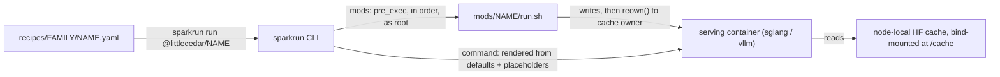

# Repository Guidelines

Registry of **sparkrun** deployment recipes for Little Cedar Group's 6-node DGX Spark cluster
(GB10 Blackwell, 128 GB unified LPDDR5X, 200 GbE CX7 RoCE). The tree is git-distributed to the
cluster and to third parties, and is consumed by the `sparkrun` CLI as the `littlecedar` registry
(`Trusted=yes`, so recipe mods run unprompted at launch). There is no compiled application here:
the "source" is recipe YAML, bash mods, and stdlib-only Python tools and guards.

Counts in this document were verified 2026-10-15 against the working tree; the recipe, guard-module,
suite and strict-validate counts were re-measured 2026-10-18 (38 recipes, 24 guard modules, 648 tests,
6/38 strict).
Facts drift — re-measure (`ls recipes/*/*.yaml`, test discovery) before trusting a number.

## Project Overview

- **Recipes** (`recipes/`, 38 files in 11 family dirs) — v2 recipe definitions consumed by
  `sparkrun run @littlecedar/<filename-minus-.yaml>` on the cluster.
- **Mods** (`mods/`, 5 shared + `mod-template`; single-lane mods live in `recipes/<lane>/mods/`) —
  pre-launch container hooks that patch or stage files inside the serving image before the engine
  execs.
- **Benchmarking** (`benchmarking/`, 35 profiles: 32 `llama-benchy`, `standard-suite.yaml`, and the
  `pooling-ladder-{embed,rerank}.yaml` pair; plus an index README) — the curated
  profile library used by `sparkrun benchmark performance`.
- **Tuning** (`tuning/`) — only `README.md` is tracked; Triton MoE tuning configs are generated at
  runtime by `sparkrun tune` and no recipe references a vendored config.
- **Tests/tools** (`tests/`, `tools/`) — artifact guards and measurement CLIs; intentionally
  stdlib-only so they run on a head node, in a container, or on a laptop with no venv.

## Architecture & Data Flow



Load-bearing contracts:

- **`defaults:` reaches the engine only through a `{placeholder}`** in `command:` (or a runtime flag
  map / internal key). `sparkrun/core/launcher.py:683` `report_unmapped_config_keys` otherwise warns
  `unmapped-config-key`. Never delete a placeholder to silence a warning, and never add a default
  nothing consumes — sparkrun renders unmapped defaults silently.
- **`command:` is YAML folded `>`** (38/38 recipes). JSON-shaped defaults must keep their shell
  quotes inside the fold — `limit_mm_per_prompt: >-` with `'{"image": 4, "video": 1}'` — or
  word-splitting hands the engine four arguments.
- **`mods:` is an ordered dependency chain, not a set.** Recipe comments
  (`ORDER MATTERS`, `keep the config mod first`, `Must run LAST`) are load-bearing; reordering a
  labquant/EXL3 chain yields a tree that boots, answers, and is numerically wrong.
- **Mods run as root** in the container and must `reown()` anything created under `/cache/runtime` to
  the cache mount's UID/GID, or downstream user processes fail on root-owned leftovers. A non-zero
  mod exit tears the whole launch down, so transient failures log and continue.
- **Each runner node has its own HF cache** at `${WOPR_USER_CACHE}/huggingface` mounted at `/cache`.
  There is no shared `/cache/models`; sparkrun distributes every model to each serving node.

## Key Directories

| Path | Contents |
|---|---|
| `recipes/cybersec/` (7), `recipes/decision/` (4), `recipes/ds4/` (2), `recipes/embed/` (2), `recipes/explore/` (8), `recipes/glm/` (1), `recipes/ifm/` (2), `recipes/ornith/` (4), `recipes/qwen3/` (3), `recipes/qwen4/` (3), `recipes/rerank/` (2) | Recipes by model family, each lane keeping one `README.md`, with lane state and constraints in `attic/<lane>/AGENTS.md`. The Decision lane (JEV-9B, clef-flash, and the CPU `vllm-srun` Kai/Sol arms), the Explore lane (Ling-3.0-flash + Kolibri-1, re-ranked 2026-10-13 by the owner's accuracy criterion; plus the 2026-10-14 Poolside Laguna-XS/S and humanizer-12b arms and the 2026-10-15 Mellum2.1 arm, joined on 2026-10-17 by the lane's llama.cpp arm — the registry's first `runtime: llama-cpp` recipe, Mellum's Q4_K_M GGUF) and the Cybersec lane (seven abliterated / cybersecurity-unlocked arms: five SGLang arms plus the two 2026-10-15 vLLM-route companions) and the GLM lane (its one TP=4 EXL3 arm, boot-deferred) carry `README.md` lane docs. The Qwen3-VL embedding/reranking pairs moved out of `recipes/qwen3/` into `recipes/embed/` and `recipes/rerank/` on 2026-10-10 (`tests/test_qwen3_vl_embeddings.py` still guards all four); the qwen3 no-spec control recipe was retired to `attic/qwen3/` with its metrics moved into `attic/qwen3/AGENTS.md` |
| `recipes/glm/` | One new arm in the lane — `glm-5.3-flash-exl3-tp4-1m-tensorfold-sglang.yaml` plus its lane-local `mods/tensorfold-glm-exl3-launcher`, digest-pinned to the pre-built TensorFold engine, **boot deferred** (TP=4; needs `.30`–`.33`); no index row until a boot receipt. TensorFold runbook notes live in `README.md`; `GLM-5.3-RECOMMENDATIONS.md` and the earlier `glm-5.3-flash-nvfp4-dflash-vllm.yaml` remain archived to `attic/glm/` (proven-negative on the pinned public image, 2026-10-13) |
| `attic/` | Tracked recipe/doc archive: 5 retired EXL3 vLLM recipes (+ tuning configs) and their EXL3 patch/cache mods in `attic/ds4/`, 29 arms, the closed input-scale mod, 9 archived benchmark profiles, + `ARMS-MANIFEST.md` in `attic/qwen4/`, the withdrawn K2-Horizon MoVA sub-lane (4 arms + its gate mod + guard + the RoCE env mod) in `attic/ifm/` plus two retired IFM 7B arms (plain and NGRAM, both `k2-horizon-7b-fp8-*`) in `attic/ifm/arms/`, the retired qwen3 no-spec control recipe, its spec-metrics guard mod, and 3 archived benchmark profiles in `attic/qwen3/` (metrics in `attic/qwen3/AGENTS.md` §6), `attic/ornith/`, `attic/explore/` (2 archived Explore arms + `ARMS-MANIFEST.md`), `attic/glm/` (1 archived arm + `ARMS-MANIFEST.md`). Not served by the registry, but referenced by tests, benchmarks, and tools |
| `mad-science/` | Research notes — claim traces and experiments, not recipes and not shipped. Index in `mad-science/README.md`. Not served by the registry |
| `mods/` | Shared mods only (used by ≥2 lanes): 5 + `mod-template/`, the authoritative harness. A mod relevant to a single lane lives at `recipes/<lane>/mods/<mod>/` |
| `tests/` | 25 importable guard modules, one skipped `*.sync-conflict-*.py` |
| `tools/` | 18 stdlib CLIs (bfcl-eval, pooling-bench, needle-haystack, quality-battery, jev-decision-bench, decision-tandem, decision-ensemble, decision-ladder, cache-audit, build-dsv41-*, gate-37111, qwen4-quality-eval, safe_text, synthetic_png, eval-suite, agentic-horizon-probe, horizon-analyze) |
| `plugins/` | One module, `pooling_bench_framework.py`: the out-of-tree sparkrun `BenchmarkingPlugin` that drives `tools/pooling-bench.py` for a `framework: pooling-bench` profile (the pooling lanes' only profile-shaped measurement path). Not a registry asset and not stdlib-only — it imports `sparkrun` by definition and is loaded only *inside* a sparkrun process via `plugins.paths` (`tools/README.md` §plugins/). |
| `benchmarking/` | 35 profiles (32 llama-benchy + `standard-suite.yaml`, the one `tool-eval-bench` profile, + the 2-profile `pooling-bench` ladder) + README index (flat, recipe-agnostic); the families stranded by the lane cuts live in `attic/qwen4/profiles/` and `attic/qwen3/profiles/` |
| `.sparkrun/registry.yaml` | Registry manifest: `recipes: recipes`, `tuning: tuning`, `benchmarks: benchmarking`, `mods: mods` |
| `.local/` | Git-ignored: `CONFIDENTIAL.md` (defines `${WOPR_*}` cluster vars), `sparkrun-home/` (HOME override) |
| `.omp/skills/` | Tracked **omp skills for recipe work only** (research, author, publish, benchmark, test, verify, retire, index): one `SKILL.md` per skill, discovered natively at *project* scope when this repo is the working directory (no symlinks or config needed). Cluster-ops, monitoring, gateway, evidence-store and session-workflow skills deliberately stay user-global in `~/.omp/agent/managed-skills/`. Discovery is startup-time, so an edit applies at the next session start. `learn`/`manage_skill` still write to the global root — a new recipe skill must be moved here by hand. |

## Development Commands

```bash
uv sync                        # netifaces has no wheel — builds from sdist, needs a C toolchain
mkdir -p .local/sparkrun-home  # fresh clone; git-ignored
sparkrun --version             # requires >= 0.3.8 (0.4.0 verified locally)
```

**Every `sparkrun` call needs the HOME override**, otherwise it dies on
`PermissionError: ~/.config/sparkrun/registries.yaml` before reading any recipe:

```bash
H=$PWD/.local/sparkrun-home
HOME="$H" sparkrun recipe validate recipes/qwen4/qwen3.8-flash-next-nvfp4-labquant-sglang.yaml
```

The repo-mandated gate after every edit:

```bash
set -e
H=$PWD/.local/sparkrun-home
uv run python -B -m unittest discover -s tests
for f in recipes/*/*.yaml; do HOME="$H" sparkrun recipe validate "$f" >/dev/null; done
for s in mods/*/*.sh recipes/*/mods/*/*.sh; do bash -n "$s"; done
for p in mods/*/*.py recipes/*/mods/*/*.py tools/*.py plugins/*.py; do uv run python -m py_compile "$p"; done
find mods recipes tools tests plugins -name __pycache__ -type d -exec rm -rf {} +
```

- **Plain `validate` is the gate, not `--strict`**: all 38 pass plain; 6/38 fail strict on
  accepted findings (re-measured 2026-10-18) — `recipes/qwen3/qwen3.8-27b-nvfp4-dflash2-sglang.yaml`
  (`cluster_only`, deprecated for v2, plus a `restated-managed-path` suggestion) and five launcher
  arms whose `model_revision` is pinned but never handed to the engine as `--revision`
  (`recipes/ds4/deepseek-v4.1-flash-knapcio-tp4-1m-sglang.yaml`,
  `recipes/ds4/deepseek-v4.1-flash-tensorfold-tp2-1m-sglang.yaml` (pinned to the 1017 refresh on
  2026-10-18),
  `recipes/qwen3/qwen3.8-27b-mlx4bit-tensorfold-sglang.yaml`,
  `recipes/cybersec/deepseek-v4.1-flash-abliterated-cyber-tp2-tensorfold-sglang.yaml`, and the
  boot-deferred `recipes/glm/glm-5.3-flash-exl3-tp4-1m-tensorfold-sglang.yaml`) — for those
  the launcher receives `{model}` as a prepared snapshot path, so the refs/-entry
  `unpinned-model-revision` warning is the known false positive the lanes document, not a boot risk.
  Never edit a
  recipe merely to clear a `suggestion` (e.g. deliberate `/cache/runtime` paths flagged
  `restated-managed-path`).
- `py_compile` leaves `__pycache__/`; the suite's own child processes may recreate it even under
  `-B`, so keep the cleanup line.

Render before launching; `-n` alone errors with `No hosts specified`:

```bash
HOME="$H" sparkrun run <recipe> -H <node> -n            # print the rendered command
HOME="$H" sparkrun run <recipe> -H <node> -n | grep -- '--your-flag'
```

`-o key=value` overrides recipe defaults and `-b key=value` passes benchmark args (both repeatable);
`-v`/`-vv`/`-vvv`, `-q` for scripting. Lifecycle: `sparkrun status` → task IDs, `sparkrun logs <id>`,
`sparkrun stop <id>` (**no `sparkrun stop all`**).

```bash
HOME="$H" sparkrun benchmark performance <recipe> -H <node> --profile benchmarking/<name>.yaml \
  --output out.yaml          # flags: --solo --skip-run --no-stop --fresh --resume --timeout
HOME="$H" sparkrun tune sglang <recipe> -H <host>   # or: tune vllm
```

The embed/rerank lanes are hostile to that command — a pooling engine has no
`/chat/completions`, so `llama-benchy` fails its first task and the run ends
`Error: Benchmark incomplete` (measured 2026-10-15). Their ladder is
`sparkrun benchmark pooling <recipe> --profile <pooling profile>` (or `benchmark run`, which
takes the framework from the profile) once the repo's `plugins/` dir is on `plugins.paths`;
read `tools/README.md` §pooling-bench.py + §plugins/ before re-deriving which command owns a
pooling number.

Remote GPU work is SSH to `${WOPR_HEAD_NODE}` as `${WOPR_USERNAME}`; run `sparkrun` from
`${WOPR_RUN_FROM_DIR}` with in-progress recipes symlinked from `${WOPR_SRC_DIR}`. Cluster mod
delivery needs `--transfer-mode local` (hidden option; `auto|local|push|delegated|pull`; persist
with `sparkrun cluster update <name> --transfer-mode local`), else the node clones the registry
itself and an unpushed mod is invisible.

### Node hygiene — clean up after yourself (a rule)

The nodes are a shared machine set: `$HOME` and `/tmp` on every node are not scratch storage, and this
registry is distributed to third parties. **After a recipe build, boot-test or benchmark campaign,
remove what the session created** — a leftover is anything undocumented, unknown or temporary:

- Delete session logs and ad-hoc output from `$HOME` (`*.log`, `*.out`, one-off output dirs) and from
  `/tmp` on **every** node touched, not just the head.
- Receipts are not leftovers. The documented locations are `~/benchmarks/<lane>-<date>/` on the head
  and `.scratch/<lane>/…` locally, and a receipt a doc cites by name or path stays. **Before deleting
  anything on a node, grep the repo for the basename** — worker-side paths are cited too. The
  2026-10-14 clean-up destroyed the qwen4 argv/memory traces this way; the loss is recorded in
  `attic/qwen4/AGENTS.md`.
- **A path a harness names on purpose is not litter.** `.scratch/q4/capture-serve-argv.sh` writes
  `$HOME/serve_argv/<tag>_<node>.txt` on the *worker* precisely because it outlives `/tmp` reaping, and
  `launch.sh` arms `mem_watch.sh` into `$HOME/mem_watch/` on every run. Such output is citable
  evidence-in-waiting: **harvest it into the receipt root (`~/benchmarks/<lane>-<date>/` or
  `.scratch/<lane>/`) before removing anything**, and never sweep the harness's own directory as
  scratch — that is what destroyed the §19q traces, and the harness is still armed, so the next
  undiscriminating sweep would destroy the replacements too.
- No leftover containers or orphan volumes (`docker ps -aq` and `docker volume ls -q` both empty).
  Remove images for retired lanes, but keep any image a shipped recipe or an `attic/` doc names.
- `sparkrun`'s runtime cache (`${WOPR_USER_CACHE}/sparkrun/runtime-cache/<runtime>/<model_dir>`) is a
  cache, not litter: entries are rebuilt on the next boot. **Triage it by provenance, not by name.** A
  tree records the mods that produced it in its own `modlogs/`, so the owning recipe is identifiable:
  a tree whose `<model>` a shipped recipe names and whose mod set matches that recipe's `mods:` is
  load-bearing; a tree whose model no shipped recipe names — or whose mods match none — is a
  retired/attic variant. `.sparkrun-last-used` gives recency, and **a tree touched in the last ~72 h is
  in use whatever its provenance**. Measured 2026-10-14: ~604 GB of a ~3.1 TB fleet runtime-cache was
  retired-variant material; the ~7 TB HF cache was **not** litter — 63 of 65 cached repo-entries are
  consumed by a shipped recipe or a shipped mod (draft models live in `speculative_draft_model:` and in
  `command:`, not only in `model:`).
- The HF cache is pruned with `hf cache rm model/<org>/<name>` — never `rm -rf` a `models--*` directory,
  which orphans blobs — and only for repos no shipped recipe or mod references.
- **Traps, all hit on 2026-10-14:** a listing-derived path is relative, so `rm <name>` against the wrong
  `cwd` deletes nothing and still prints success — build absolute paths, capture stderr, and re-count
  (`13 → 1`, not "looks clean"); cache internals are frequently **root-owned** (the containers wrote
  them) so `rm -rf` needs `sudo -n`; and `uv cache clean` removes the archive a pinned
  `_SPARKRUN_COMPLETE` path in `.bashrc` points at — repoint it at `~/.local/bin/sparkrun`.
- After a re-pin or an `attic/` move, sweep `${WOPR_RUN_FROM_DIR}` for dangling symlinks and remove
  them.
- Document what stays as well as what goes: a node file nothing documents is the defect this rule
  exists to prevent.

## Code Conventions & Common Patterns

**Prose is American English — always `license`, `licenses`.** Never the British `-ce` noun form. It applies to
every tracked word this registry writes: READMEs, lane docs, `mad-science/` notes, recipe comments and
`description:` prose, and `attic/` archives (they ship to third parties too). Identifiers are exempt —
keep a repo id's own spelling (the LTX release id `ltx-2.x-community-license-agreement`,
`SPDX-License-Identifier` headers, a card's `license:` field) exactly as its owner wrote it.

### Recipes

- **Name = filename minus `.yaml`; a `name:` key is banned.** `cluster_only:` is deprecated (one
  straggler: `recipes/qwen3/qwen3.8-27b-nvfp4-dflash2-sglang.yaml:5`).
- Filename grammar `<model>-<size>-<quant>-<feature>-<runtime>[-<backend>].yaml` is followed loosely.
  The only backend suffix is `-b12x`; `zz-` marks a non-shippable probe arm; versions keep their dots
  (`qwen3.8-`, `deepseek-v4.1-`). File by **model family**, not filename prefix — `qwen3.8-flash-next-*`
  lives in `recipes/qwen4/`; contributor prefixes (`eugr-`, `ursuciprian-`) exist only in `attic/`.
- Always `{model}` in `command:`, never a literal repo id. No host bind-mount paths — ship a mod
  (`volumes:` appears in 0 recipes).
- Pin the checkpoint with top-level **`model_revision:`** (30 recipes), never `revision:` — an
  unknown top-level key is silently absorbed into `runtime_config` and does nothing (the labquant lane
  records the defect: `recipes/qwen4/README.md` §"Pin key trap", `attic/qwen4/AGENTS.md`).
- **`description:` is a top-level key**, never nested under `metadata:` — sparkrun reads the top-level
  form and folds it back into metadata on export (all 59 shipped recipes moved 2026-10-18; `attic/`
  stays frozen). Do not move `maintainer:` with it: the constructor reads that one metadata-only.
- `runtime:` may be inferred from a `command:` hint (one recipe omits it). Digest-pin `container:`
  when the lane depends on exact upstream code.
- Update the root `README.md` (index + emoji flag table: ✨ official, 🌲 lcg_favorite, 🚀 fast, 🚚
  large_context, …) when adding a shipped recipe, and the lane's `README.md`, keeping design and
  research prose in `attic/<lane>/`.

### Recipe comments

**A recipe is a runnable artifact, not a research record — and its comments are no exception.** A
shipped recipe's `#` comments are stripped to a minimum: a comment survives **only if it is crucial to
a surprising, novel, or confusing property of that recipe** — a knob interaction, a silent-failure
footgun, a required ordering or pairing, a client contract the value itself does not show.

Test to keep one: *would an operator who knows sparkrun but not this model get this wrong without the
note?* If yes, keep it to one or two short lines, immediately beside the value it governs. Anything
else — history (dates, boot IDs, commit hashes), measured numbers, A/B narratives, provenance or
"why we chose it" essays, alternative-arm comparisons, cross-document references, general
model/engine exposition — does not belong in the YAML; move it to the lane:

- **Recipe-relevant but not crucial** (how to run or configure the arm: a knob's effect, a required
  mod pairing, a client-side contract) → the lane's `README.md`, under that recipe's section.
- **History and evidence** → the lane's attic, `attic/<lane>/AGENTS.md`, under a
  `## Recipe comment archive (YYYY-MM-DD)` heading, keyed by recipe filename.

```yaml
# KEEP — a surprising property an operator would get wrong:
  max_num_seqs: 48   # the mamba state pool silently clamps this; the literal is not the granted
                     # concurrency (grep "capped to" in the serve log)
  cpu_mask: 5-9      # GB10 big.LITTLE: 5-9/15-19 are the fast cluster; do not span clusters

# MOVE — history/evidence, not a property of the value:
#   "measured 2026-09-19, 8 boots interleaved, ratio 1.213 [1.156,1.279], pooled +22.5%…"
#   -> the lane README (if it explains running the arm) or attic/<lane>/AGENTS.md, with its receipt
```

Guards strip whole-line comments before matching, so stripping is guard-safe; they *do* assert on
`metadata.description` prose, which must stay accurate and is not a comment. A `#` mid-command would
truncate the launch line at the shell, so comments stay out of a folded `command:` block — with one
tracked exception: the qwen3 TensorFold arm's *terminal* in-fold comment
(`recipes/qwen3/qwen3.8-27b-mlx4bit-tensorfold-sglang.yaml`), which must name `--served-model-name`
because sparkrun skips its own flag append only when that text already appears in the rendered command
(the comment is line-terminal, so the shell swallows it). The ds4/ifm `test_no_hash_inside_command_block`
guards are lane-scoped, not repo-wide. Archived recipes under `attic/` are frozen provenance: leave
their comments verbatim.

### Mods

- **`mods/` holds shared mods only** — a mod used by ≥2 lanes. A mod relevant to a single lane lives
  in that lane's directory, `recipes/<lane>/mods/<mod>/`, and MUST be referenced **unscoped** as
  `mods/<name>`: sparkrun resolves it adjacent to the recipe (`core/mods.py` rule 2). `@littlecedar/mods/<name>`
  is broken there — a `@registry/` ref resolves only from the registry clone's top-level `mods/`.
- **Copy `mods/mod-template/run.sh`** — there is no shared library, because sparkrun ships only the
  mod's own directory (`mods/common.sh` would not exist at launch). Keep the SPDX header
  (`AGPL-3.0-or-later`; one Apache-2.0 port from a contributor) and `set -euo pipefail`.
- Harness: `MOD_NAME`/`MOD_DESCRIPTION`/`MOD_MAINTAINER` exports; `MOD_TIMEOUT` (default 180),
  `MOD_CACHEDIR` (`/cache/runtime`), `MOD_LOGDIR` (`/cache/runtime/modlogs`), `UV_LINK_MODE=copy`,
  UID/GID inferred via `stat -c '%u' /cache/runtime`, `reown()`, `log`/`log_var`/`log_cmd`, log
  rotation (prior run gzipped). All knobs are `${VAR:-default}`.
- **Fail closed.** Unknown state → `die`, never a quiet default. Assert numeric contracts
  (`EXPECTED_NARROW = 72`, …) and refuse to patch when anchors are missing rather than guessing.
- **Idempotence from content, not timestamps**: read markers/sentinels or `--check` the real
  artifact. Writes are `tmp` + `os.replace` (restore original owner/mode); `unlink` a symlink before
  writing, because writing through one rewrites the node's HF snapshot.
- Do not import the runtime engine from a pre_exec mod (import/JIT side effects); locate target files
  by filesystem search. A fetch that can outlive the 600 s hook timeout must detach.
- New mods get a `README.md`, and a guard test when the mod makes a safety claim
  (see `tests/test_drop_caches_mod.py`).

### Evidence-grade *lane* prose (do not "tidy" these)

The `VERIFIED`/`LIKELY`/`SPECULATIVE` vocabulary, upstream citations at `file.py:line` against a
pinned commit, dates on hardware claims, measured numbers with provenance, and negative results
belong to the **lane's** documentation — `recipes/<lane>/README.md` and `attic/<lane>/AGENTS.md` (the
recipe-comment archive) — not to the recipe YAML, which keeps only the crucial set above. Tidying
them as noise, or writing a confident claim with no citation, violates the main convention. Recipe
prose documents forbidden strings, so any text-scanning guard must strip whole-line comments before
matching.

### Git, secrets, and the second writer

- Commit subjects: imperative, capitalized, no trailing period (~87% of the last 200), no
  Conventional Commits (1/200), backticked identifiers, typically 60–90 chars. Bodies are
  multi-paragraph prose (~72 col): what broke → mechanism cited to `file.py:line` or a boot ID →
  what changed → what is (and is not) verified → pointer to the evidence doc. No trailers.
- PRs target `main` from `<contributor>/<kebab-topic>` forks; upstream syncs land as
  `Merge branch 'spark-arena:main' into main`.
- This working tree is syncthing-shared with a **live second writer**: `git add` explicit pathspecs
  only — never `git add -A`, directory adds, or bare globs — and review `git diff --cached --stat`
  first.
- Journal/work docs are git-ignored by design (`**/*JOURNAL.md`, `**/*-WORK.md`,
  `**/*-WORK-ARCHIVE.md`, `.local/`) because they hold internal IPs and this registry is distributed
  to third parties. Never `git add -f` them; keep hostnames/IPs out of tracked files.

## Important Files

- `.sparkrun/registry.yaml` — registry manifest (`littlecedar`; the `eugr` fallback registry comes
  from sparkrun itself, not from here).
- `pyproject.toml` — dependencies only (`jinja2`, `netifaces`); no `[build-system]`, no `[tool.*]`.
- `mods/mod-template/run.sh` — authoritative mod harness.
- `README.md` — recipe index and flag taxonomy; `attic/<family>/AGENTS.md` carry lane
  state, constraints, and runbooks (e.g. `attic/qwen4/AGENTS.md`, `attic/ds4/AGENTS.md`).
- `benchmarking/README.md` — profile index plus two rules learned expensively: printed `tg t/s` is
  an aggregate across streams, and results must be read from `runs/*.json` (the printed table has no
  header and shows only the decode row), selecting the phase via `is_context_prefill_phase`.
- `tools/README.md` — tool index; documents all 18 tools (`safe_text.py` added 2026-10-07 and the
  standard-suite trio 2026-10-15; the three before `safe_text.py` describe behaviour and caveats only
  — this repo records measured results next to the arm that produced them, e.g.
  `attic/qwen4/status/*.md`), plus §plugins/ for the out-of-tree pooling `BenchmarkingPlugin` that
  lives in `plugins/` — including why a registry cannot ship one and the exact command that carries
  a pooling number.
- `.local/CONFIDENTIAL.md` — git-ignored definition of the `${WOPR_*}` variables these docs refer to.

## Runtime/Tooling Preferences

- **Python ≥ 3.12 via `uv`** (local venv is 3.14.7, uv 0.12.23). Run Python as
  `uv run python -B ...`. Only runtime deps are `jinja2` and `netifaces` (the latter sdist-only).
- **`sparkrun` CLI v0.3.8+** on PATH outside uv (`uv tool install sparkrun` if missing); all
  invocations require the `HOME="$PWD/.local/sparkrun-home"` override.
- **No npm/node tooling.** `package-lock.json` is a 6-line empty stub and no `package.json` exists —
  never run `npm`.
- **No CI, no pre-commit, no formatters or linters**: no `.github/`, no CI provider configs, no
  pytest/ruff/black/mypy configuration anywhere (`.ruff_cache/` on disk is leftover). Linting is
  syntax checks only: `bash -n`, `py_compile`, `sparkrun recipe validate`.
- `tests/` and `tools/` must stay **stdlib-only** (parse recipes as text; no PyYAML). Never add a
  dependency there. `plugins/` is the one tree that imports `sparkrun`, by definition: a module
  there is loaded *inside* a sparkrun process, so it is not runnable standalone and not a tool.
- Mods are bash + stdlib Python; in-container installs use
  `pip install --force --break-system-packages` or `uv pip install` with `UV_LINK_MODE=copy`.

## Testing & QA

- Framework: stdlib `unittest`. `uv run python -B -m unittest discover -s tests -v` — **648 tests,
  all passing 2026-10-18 (2 skipped: the IFM research docs absent on a fresh clone, and the
  pooling guard's real-`sparkrun` case, which runs only where sparkrun is importable)**. The
  count is a snapshot taken as the lanes land guards; a session that adds tests re-measures it.
  The K2 MoVA-36B lane's 64-test guard lives in
  `attic/ifm/` and is no longer auto-discovered; it runs there as
  `uv run python -B -m unittest attic.ifm.test_ifm_36b_recipes`. Single module: `uv run python -B -m unittest tests.test_ds4_recipes`;
  single case: `uv run python -B -m unittest tests.test_ds4_recipes.RecipeStructure.test_recipes_exist`.
  The suite needs no HOME override (its one `sparkrun` call sets HOME itself and skips when sparkrun
  is absent); an offline variant exists: `uv run --offline python -B -m unittest discover -s tests`.
- **`COOP.md` ledgers are working files, not registry content.** The two that had been committed
  (`attic/qwen4/COOP.md`, `recipes/ifm/COOP.md`, the latter a 2026-10-07 reconstruction) were
  **removed from git on 2026-10-10** and `**/COOP.md` is now git-ignored, so a fresh clone cannot
  re-introduce one. Their durable content lives in the lanes' `README.md` and `attic/<lane>/AGENTS.md`/
  `NOTES.md` (and the recipe comments); the guard that required the ifm copy was dropped with it.
  Untracked lane copies on a working tree, like `recipes/qwen3/COOP.md`, are a live writer's scratch.
- `tests/*.sync-conflict-*.py` (22 tests) is **skipped** because discover rejects dashed module
  names before it can report them, and it is tracked in git — do not delete it.
- Guards are over shipped artifacts, not units: recipes parsed as text with a hand-rolled YAML
  subset parser, mod `run.sh` sliced/executed in temp dirs (the `<<'TPL'` heredoc is executed by
  `tests/test_qwen3_vl_embeddings.py`), tools imported by path. Design rules: **every guard needs a
  proven negative control** (46 control tests live in `NegativeControls` classes); an empty or
  missing parse must raise, never return `[]` or pass vacuously; text scans strip whole-line comments
  and anchor with `(?m)^`.
- Dash-named tools (`tools/pooling-bench.py`, `tools/needle-haystack.py`) are imported via
  `importlib.util.spec_from_file_location` with the module registered in `sys.modules` **before**
  `exec_module`, or `@dataclass` fails.
- Mod-local harnesses are standalone scripts, not unittest; exit 2 means the harness could not run
  and is never a verdict on the patch:
  - `uv run python attic/qwen3/mods/fix-sglang-spec-metrics-empty-verify/test_spec_metrics_guard.py <tokenizer_manager.py>`
    (0 = patched, 1 = unpatched/crashes).
  - `uv run python attic/ifm/mods/patch-sglang-k2-horizon-fp8/test_k2_fp8_guard.py <srt/models/xllm.py>`
    (0 = fully patched, 1 = stock or gate-only).
- No coverage tooling and no coverage expectation; a guard is judged by its negative control, not by
  lines executed. Tests that pin wording, copies, or incidental defaults are deleted, not updated.