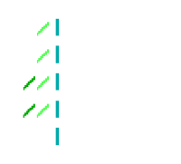

<p align="center">

</p>
<h2 align="center">Little Cedar Group Inference Recipes for NVIDIA DGX Spark</h2>
<p align="center">
   <a href="https://spark-arena.com"></a>  
   <a href="https://github.com/spark-arena/sparkrun"></a>
   <a href="https://sparkrun.dev"></a>
   <!-- <a href="https://recipes.sparkrun.dev"></a> -->
</p>

---
This is the **Little Cedar Group recipe registry** for [Sparkrun][sparkrun] from the [Little Cedar Group][littlecedar] team.

- [Little Cedar Group][littlecedar] — our resilience-focused technology company
- [Mad Science](mad-science/README.md) — Our autoresearch experiments and findings.
- [Spark Arena][spark-arena] — community benchmarking hub
- [Sparkrun][sparkrun] — our favorite tool for AI workload management
- [Sparkrun Docs][sparkrun-docs] — full Sparkrun documentation
<!-- - [Sparkrun Recipe Explorer][sparkrun-recipe-explorer] — browse and filter all recipes -->

---

# Contents
- [Install Our Registry](#install-the-registry)
- [Run Our Recipes](#run-little-cedar-groups-recipes)
- [Our Recipe Format](#recipe-format)
- [Recipe Flags](#recipe-flags)
- [Little Cedar Sparkrun Recipes](#little-cedar-sparkrun-recipes)
  - [DeepSeek V4](#deepseek-v4)
  - [Ornith 1.5](#ornith-15)
  - [Embed](#embed)
  - [Rerank](#rerank)
  - [Qwen 3x](#qwen-3x)
  - [Qwen 4x](#qwen-4x)
  - [IFM K2-Horizon](#ifm-k2-horizon)
  - [GLM 5.3](#glm-53)
  - [Decision](#decision)
  - [Media](#media)
  - [Explore](#explore)
  - [Cybersec](#cybersec)
- [CI](#ci)
- [License Policy](#license-policy)
- [Mechanics](#mechanics)
- [References](#references)

# Install the Registry

You can install our registry in Sparkrun like this:
```bash
sparkrun registry add @littlecedar https://github.com/littlecedar/sparkrun-registry
```
After reviewing the recipes you'd like to run, it is recommended to trust our registry like this:
```bash
sparkrun registry trust @littlecedar
```

# Run Little Cedar Group's Recipes

> [!IMPORTANT]
> Recipes flagged with `📜` require the operator to accept the upstream model repository release on Hugging Face's website. Downloads require setting `HF_TOKEN` after accepting the release. See [License Policy](#license-policy) for more information about licensing.

Our recipes are accessed with the `@littlecedar` prefix.

```bash
# List available recipes
sparkrun list @littlecedar

# Run a recipe
sparkrun run @littlecedar/our-awesome-recipe

# Check VRAM requirements before launching
sparkrun show @littlecedar/our-awesome-recipe
# or
sparkrun recipe vram @littlecedar/our-awesome-recipe
```

# Recipe Format

Our recipes follow the standard Sparkrun recipe schema with some additional metadata and formatting divergences, for example we use YAML `>` instead of `|` for readability and resilience. See
the [recipe authoring docs](https://sparkrun.dev/recipes/format/) for the full specification.

# Recipe Flags

Flags indicate characteristics of the model, runtime, mods, and recipe, and are added by us to `metadata.tags:` in the recipe's YAML.

| Flag | Tag           | Description                              |
|:-----|:--------------|:-----------------------------------------|
| ✨   | official      | Uses official weights                    |
| 🌲   | lcg_favorite  | Little Cedar Group:tm: Favorite          |
| 🚀   | fast          | C1 throughput > 50 (decode t/s; u/s pooling) |
| 🐢   | slow          | C1 Slow: < 40 t/s (any node count)       |
| 🚚   | large_context | Large context (>= 512k tokens)           |
| 🔧   | tools         | Excellent tool use                       |
| 🧠   | reasoning     | Excellent reasoning capability           |
| 🦾   | agent         | Excellent agentic capability             |
| ⚖   | judge         | Judgement model                          |
| 🚮   | classifier    | Classification model                     |
| 🖥   | cpu           | CPU-only runtime model                   |
| 🤏   | smol          | Small model                              |
| 1    | single_user   | Low concurrency, single-user recommended |
| 👀   | vision        | Model has vision capability              |
| 👂   | listening     | Model has listening capability           |
| 🗺   | world         | Model has world-aware capability         |
| 👄   | speech        | Model has speech generation capability   |
| 📸   | image         | Model has image generation capability    |
| 🎥   | video         | Model has video generation capability    |
| 🎼   | audio         | Model has audio generation capability    |
| 📶   | embedding     | Model has embedding capability           |
| 🔃   | reranking     | Model has reranking capability           |
| 🏴   | uncensored    | Uncensored model                         |
| 📜   | license       | Gated, non-commercial, or `other`        |
| 🚩   | dangerous     | Dangerous and may crash your Sparks!     |    
| 💀   | broken        | Currently broken                         |

# Little Cedar Sparkrun Recipes

_Brought to you by Little Cedar Group._

These are the recipes we are using in the office on our humble 6-node DGX Spark cluster.

## DeepSeek V4

| Recipe                                       | Flags | C1 t/s | C2 t/s | C5 t/s | C10 t/s |  Size |  Mem% | TP | Model Cards                                                      |
|:---------------------------------------------|:------|-------:|-------:|-------:|--------:|------:|------:|---:|:-----------------------------------------------------------------|
| deepseek-v4.1-flash-knapcio-tp4-1m-sglang    | ✨🚀🚚🌲👀  |   67.2 |   89.9 |  113.4 |   115.4 | 510GB |   78% |  4 | [Model][deepseek-ai/DeepSeek-V4.1-Flash-1017]                    |
| deepseek-v4.1-flash-tensorfold-tp2-1m-sglang | 🚀🚚1👀  |   66.4 |   47.8 |   44.8 |    48.4 | 385GB | 84%\* |  2 | [Model][LibertAIDAI/DeepSeek-V4.1-Flash-1017-EXL3-2.9bpw]        |

* _`*` Mem% = the engine's boot-log allocator ceiling (107.8 GiB of 128 GB); this recipe sets no util._
* _The **tensorfold** row's C2/C5/C10 are the **0.6.3 engine's** 2026-10-18 5-run ladder (`ds4-1017-ab-interleaved-20261018`). The shipped image was bumped to the v0.6 engine on 2026-10-21; on the depth-0 profile (c1/c4/c8/c16, 3 runs/cell, 3 boots per arm) it reads **64.5 / 51.2 / 52.5 / 53.2** t/s against the 0.6.3 control's 64.7 / 46.1 / 41.5 / 42.3 — c8 **+26.5 %**, c16 **+25.7 %** with the treatment's worst boot above the control's best, c1 flat, c4 +10.9 % with overlapping ranges — and cold prefill **2,077** t/s @ 32k / **2,073** @ 131k (+24.6 % / +39.5 %). `~/benchmarks/ds4-v06-ab-20261021/REPORT.md`; lane [`recipes/ds4/README.md`](recipes/ds4/README.md#deepseek-v41-flash-tensorfold-tp2-1m-sglang)._
* _The knapcio row's **C2/C5/C10 are the lane's first** (2026-10-18, 5 runs/cell, `benchmarking/concurrency-ladder.yaml`, decode rows only): boot A 89.89 ± 3.57 / 113.44 ± 6.84 / 115.36 ± 6.62 and boot C 86.40 ± 3.59 / 108.78 ± 14.19 / 116.27 ± 6.22 t/s (sample sd, n=5; the receipt JSON's own `tg_throughput.std` is the population sd, 0.894× these) — `~/benchmarks/tp4-20261018/`, deployment `a2e141223b52793c_7afff0589a33` (three boots under one id). Its C1 cell is the **pool of four takes** (69.65 n=5, 66.40 n=10, 64.16 n=5, 69.28 n=5) = 67.18 ± 6.97, CV 10.4 %, range 56.4-87.9; against the V4.1 baseline's 59.21 ± 3.54 that is +13.5 % in the means with overlapping intervals, so a v2.4-vs-1017 C1 delta is still not established — and the earlier single-boot 81.0 is 2.0 σ above the pool's mean. Ladder shape and the DSpark γ=3 negative: `recipes/ds4/README.md` §"Measured", `attic/ds4/AGENTS.md` §12.18._
* _The knapcio row's cells are the **v2.3 serve line** (0.80 static / 4096 chunks / 9.4M pin). The shipped **v2.4 line** (0.78 / 8192 / 6.85M pin, `--prefill-decode-interval` off) measured C2 88.35 / 82.02, C5 131.83 / 130.97, C10 123.49 / 119.79 t/s on two single boots — C5 +18 %, C10 +3-7 %, C2 inside the v2.3 cells' spread; every C1 cell there is cold-contaminated (first run 19-39 t/s), so the pooled C1 stands and the row keeps the v2.3 cells. The interleave flag costs 17-28 % of ladder throughput and ships off; at 6.85M the engine reports `max_total_num_tokens=6849792` with no clamp. `~/benchmarks/ds4-v24-line-20261018/`; method in [`recipes/ds4/README.md`](recipes/ds4/README.md) §"Measured: the v2.4 serve line"._

## Ornith 1.5

| Recipe                                           | Flags   | C1 t/s | C2 t/s | C5 t/s | C10 t/s |                 Size | Mem% | TP | Model Cards                                                                                                                                                                                                                |
|:-------------------------------------------------|:--------|-------:|-------:|-------:|--------:|---------------------:|-----:|---:|:---------------------------------------------------------------------------------------------------------------------------------------------------------------------------------------------------------------------------|
| littlecedar-ornith-1.5-397b-nvfp4-mtp-graft-vllm | 🌲👀🧠🦾🔧   |  41.86 |      — |      — |       — |                251GB |  80% |  4 | [Model][littlecedar/Ornith-1.5-397B-NVFP4-MTP-Graft]                                                                                                                                                                       |
| ornith-1.5-35b-a3b-nvfp4-dflash2-sglang          | ✨🚀🌲👀🧠🦾🔧 |  101.8 |  153.1 |  217.4 |   244.2 | 23.5GB + 1.1GB draft |  85% |  1 | [Model][ornith-ai/Ornith-1.5-35B-A3B-NVFP4] [Draft][jzinno/Ornith-1.5-35B-A3B-DFlash2]                                                                                                                                     |
| ornith-1.5-9b-nvfp4-dflash-sglang                | ✨🚀🤏👀🧠🦾🔧 |     55 |  101.1 |  159.0 |   148.9 |  8.8GB + 2.6GB draft |  85% |  1 | [Model][ornith-ai/Ornith-1.5-9B-NVFP4] [Draft][ornith-ai/Ornith-1.5-9B-DFlash]                                                                                                                                             |
| ornith-1.5-35b-a3b-nvfp4-yarn-1m-sglang         | ✨🚚👀🧠🦾🔧 |      — |      — |      — |       — |               23.5GB |  85% |  1 | [Model][ornith-ai/Ornith-1.5-35B-A3B-NVFP4]  |

* _Ornith ladder cells are @ d0, pp 2048, tg 128, n=5, decode rows read from each receipt's `--output` file._
* _The **35B** row is the 2026-10-16 re-run — `~/benchmarks/ornith-35b-suite-20261016/ornith35b-ladder.json`, per-stream 101.8 / 79.8 / 54.5 / 34.2 t/s, ttfr 303 / 582 / 1208 / 1973 ms (the 2026-10-15 pass read C2/C5/C10 158.2 / 220.4 / 249.9, i.e. within 3 %)._
* _The **9B** row's C1–C10 are the 2026-10-15 pass — `bench_92725c90d298`, `~/benchmarks/ornith-9b-ladder-20261015/perf-ladder.yaml`, same-boot C1 58.0. Its quality cells are the 2026-10-18 suite on a separate boot, `~/benchmarks/ornith-9b-suite-20261018/` (`summary.json`, `bfcl.json`)._
* _The **YaRN** row is the long-context arm and has **no ladder (no C1)** — it is depth-gated, not speed-gated, so its performance cells stay `—` by design. It earns the row on the pre-registered needle gate, now 6/6 across boots: 262,144 control / 512k / 768k PASS 3/3 and 1M at depth 10 % (977,427), 50 % (977,487) and 90 % (977,975, 1,891 s, 2026-10-19) — all ≥95 % fill. The depth-90 % rung failed twice before it passed (serve-side exit mid-prefill, mechanism unlogged), so the 1M path is measured but not reliable; `recipes/ornith/README.md` §The YaRN 1M arm._

## Embed

| Recipe                                   | Flags | C1 u/s | C2 u/s | C5 u/s | C10 u/s |   Size | Mem% |            API | TP | Model Cards                                    |
|:-----------------------------------------|:------|-------:|-------:|-------:|--------:|-------:|-----:|---------------:|---:|:-----------------------------------------------|
| qwen3-vl-embedding-2b-vllm-b12x          | 🌲👀📶🤏 |   38.2 |   45.5 |   85.2 |   102.4 | 4.26GB |  25% | /v1/embeddings |  1 | [Model][Qwen/Qwen3-VL-Embedding-2B]            |
| qwen3-vl-embedding-8b-awq-4bit-vllm-b12x | 🌲👀📶🤏 |   15.9 |      — |      — |       — | 6.01GB |  30% | /v1/embeddings |  1 | [Model][gonuit/Qwen3-VL-Embedding-8B-AWQ-4bit] |

* _The 2B row's C1–C10 are 2026-10-16 units/s from `benchmarking/pooling-ladder-embed.yaml` (c 1/2/5/10, 100 requests, ~256-token inputs, 5 warmups, salted, `-b dimension_check=2048`) — `~/benchmarks/pins-20261016/embed2b-ladder.json`. That is **not** the 8B row's shape, so the two rows' cells are not comparable._
* _C1 from the lane's `.scratch/embed/csweep8b-order1-c1.json` receipt._

## Rerank

| Recipe                         | Flags | C1 u/s | C2 u/s | C5 u/s | C10 u/s |   Size | Mem% |       API | TP | Model Cards                        |
|:-------------------------------|:------|-------:|-------:|-------:|--------:|-------:|-----:|----------:|---:|:-----------------------------------|
| qwen3-vl-reranker-2b-vllm-b12x | 🚀🌲👀🔃🤏 |  100.6 |      — |      — |       — | 4.27GB |  30% | /v1/score |  1 | [Model][Qwen/Qwen3-VL-Reranker-2B] |
| qwen3-vl-reranker-8b-vllm-b12x | 🌲👀🔃🤏  |      — |      — |      — |       — | 17.6GB |  30% | /v1/score |  1 | [Model][Qwen/Qwen3-VL-Reranker-8B] |

* _C1 from the lane's `.scratch/embed/conc-1.json` receipt._

## Qwen 3x

| Recipe                                | Flags | C1 t/s | C2 t/s | C5 t/s | C10 t/s |                 Size |  Mem% | TP | Model Cards                                                                                                                                                                                                   |
|:--------------------------------------|:------|-------:|-------:|-------:|--------:|---------------------:|------:|---:|:--------------------------------------------------------------------------------------------------------------------------------------------------------------------------------------------------------------|
| qwen3.8-27b-nvfp4-dflash2-sglang      | 🌲👀   |   33.8 |   57.4 |   89.5 |   100.9 | 21.9GB + 3.9GB draft |   85% |  1 | [Model][RadixArk/Qwen3.8-27B-NVFP4] [Draft][z-lab/Qwen3.8-27B-DFlash2]                                                                                                                                        |
| qwen3-coder-next-int4-autoround-vllm  | 🌲🚀    |   70.4 |  114.0 |  177.1 |   249.5 |               43.6GB |   85% |  1 | [Model][Intel/Qwen3-Coder-Next-int4-AutoRound]                                                                                                                                                                |
| qwen3.8-27b-mlx4bit-tensorfold-sglang | 👀     |   44.8 |   57.7 |   64.4 |    65.6 | 16.1GB + 3.9GB draft | 30%\* |  1 | [Model][TensorFold/Qwen3.8-27B-MLX-4bit] [Draft][z-lab/Qwen3.8-27B-DFlash2]                                                                                                                                   |

* _The **TensorFold** row's bfcl cell is the 2026-10-18 re-run at `--bfcl-max-tokens 4096` — 88.2 % (1094/1240), `~/benchmarks/qwen3-tf-tools4096-20261018/`; the 85.7 % it replaces was the same arm at bfcl-eval's 512-token default, `~/benchmarks/qwen3-tf-tools-20261017/`. The id-level gain/loss split is in `recipes/qwen3/README.md`._
* _`*` no recipe util — the engine's 37.77 GiB startup estimate of 128 GB._
* _The `qwen3.8-27b-nvfp4-dflash2` row mixes boots: its **C1 33.8** is the arm's pre-loader-fix single-point reference (2026-10-15) and C2/C5/C10 are the 2026-10-17 re-measure, within noise of the shipped-boot ladder the lane doc also holds (31.7 / 54.3 / 95.5 / 94.5, `bench_017bdc06394d`)._

## Qwen 4x

| Recipe                                           | Flags | C1 t/s | C2 t/s | C5 t/s | C10 t/s |  Size | Mem% | TP | Model Cards                                                                                                                     |
|:-------------------------------------------------|:------|-------:|-------:|-------:|--------:|------:|-----:|---:|:--------------------------------------------------------------------------------------------------------------------------------|
| qwen3.8-flash-next-nvfp4-labquant-sglang         | 🌲👀   |   39.9 |   69.4 |   95.0 |   104.5 | 106GB |  80% |  2 | [Model][local-inference-lab/Qwen3.8-Flash-Next-NVFP4]                                                                           |
| qwen3.8-flash-next-nvfp4-solo-vllm-b12x          | 🌲     |   33.9 |  55.49 |  64.61 |   62.04 | 106GB |  80% |  1 | [Model][local-inference-lab/Qwen3.8-Flash-Next-NVFP4]                                                                           |
| qwen3.8-flash-next-nvfp4-labquant-highcon-sglang | 🌲👀   |      — |      — |      — |       — | 106GB |  80% |  2 | [Model][local-inference-lab/Qwen3.8-Flash-Next-NVFP4]                                                                           |

* _The solo TP=1 row's **C1 33.9** is the 2026-10-14 decode-triage C1 (33.92 ± 1.73, pre-pin); **C2/C5/C10 are the 2026-10-18 ladder** (`bench_6b35f675861a`, receipt `~/benchmarks/ladders-solo-20261018/`), whose same-boot C1 is 34.04 — inside that cell's ±2.84. C10 (62.04) sits below C5 (64.61) because `max_num_seqs: 8` binds at ten streams, not because the KV pool is short._
* _The labquant TP=2 ladder is **39.90 ± 1.48 / 69.45 ± 7.85 / 94.98 ± 8.97 / 104.45 ± 3.00 t/s** @ d0, n=5 per cell (`bench_684c21a7cd8a`, receipt `~/benchmarks/qwen4-tp2-20261018/b1-cutlass-concurrency-ladder.{yaml,json}`, decode rows of the `--output` file). Its same-boot C1 reproduces the 2026-10-14 baseline (40.32 ± 1.94) inside the cell σ; per-request decode falls 39.90 → 15.78 t/s by c10 while the aggregate keeps rising._

## IFM K2-Horizon

| Recipe                           | Flags | C1 t/s | C2 t/s | C5 t/s | C10 t/s |                   Size | Mem% | TP | Model Cards                                                                                                                                                                        |
|:--------------------------------|:------|-------:|-------:|-------:|--------:|-----------------------:|-----:|---:|:-----------------------------------------------------------------------------------------------------------------------------------------------------------------------------------|
| k2-horizon-0.9b-bf16-sglang      | ✨🚀🤏🧠🔧 |   77.6 |  181.6 |  317.6 |   503.9 |                 2.16GB |  85% |  1 | [Model][IFM/K2-Horizon-0.9B]                                                                                                                                                       |
| k2-horizon-7b-fp8-uno-sglang     | 🤏🧠🔧🦾 |   32.4 |   56.1 |   94.0 |   126.0 | 11.1GB + 1.4GB adapter |  82% |  1 | [Model][IFM/K2-Horizon-7B-FP8]                                                                                                                                                     |
| k2-horizon-0.9b-bf16-uno-sglang  | ✨🚀🤏🧠🔧 |  123.2 |  205.2 |  388.4 |   534.3 | 2.16GB + 224MB adapter |  82% |  1 | [Model][IFM/K2-Horizon-0.9B] [Uno][IFM/K2-Horizon-0.9B-Uno]                                                                                                                        |

* _The 7B row's fp8-KV gate is an accuracy pass, not a throughput claim: it ran at `attention_backend: triton`, because the shipped `fa4` asserts Q/K dtype equality and cannot serve bf16 queries into an fp8 cache, with a same-backend bf16-KV control beside it — `~/benchmarks/sweep2-20261018/` (`ifm-7b-fp8kv/`, `ifm-7b-ctl/`). The row's C1–C10 are the fa4 arm. Its standard suite was measured on the shipped fa4/bf16 line (2026-10-19): house 36/37, needle 3/3 at 32k and 131k, ARC 90.5 %, GSM8K 94.5 %, tools 87.1 % — `~/benchmarks/ifm-7b-uno-shipped-20261019/`._
* _The **0.9B UNO** row is one boot (2026-10-18): C1 cells `bench_a42c59ba1ec8`, ladder `bench_ddb8a41a69d3`, decode rows only, receipt `~/benchmarks/ifm-09b-uno-20261018/`. Its control is the same recipe booted on the same node with `-o attention_backend=fa4` (`control-fa4-*`): 79.0 / 68.0 at C1 and 78.6 / 178.8 / 343.3 / 500.1 on the ladder, against the recorded flashinfer base's 80.4 / 181.6 / 317.6 / 503.9 — fa4-vs-flashinfer is a wash (−1.7 %), so the gain is UNO's. The ARC cell (+11 items, ≈1.8 SE) is **not claimed as an improvement**: it came with more truncations than the base and is most likely verify-batch numerics; settling it needs an item-level diff against a same-window plain-fa4 control, which was not taken._

## GLM 5.3

| Recipe                                           | Flags   | C1 t/s | C2 t/s | C5 t/s | C10 t/s |                 Size |  Mem% | TP | Model Cards                                                                                                                                                                                                                |
|:-------------------------------------------------|:--------|-------:|-------:|-------:|--------:|---------------------:|------:|---:|:---------------------------------------------------------------------------------------------------------------------------------------------------------------------------------------------------------------------------|
| glm-5.3-flash-exl3-tp4-1m-tensorfold-sglang      | 🚚🚀🧠🔧👀   |   83.0 |  102.4 |   79.5 |    73.4 |  176GB + 2.3GB draft | 41%\* |  4 | [Model][Mia-AiLab/GLM-5.3-Flash-EXL3-4bpw-TensorFold] [Draft][incoai/GLM-5.3-Flash-DFlash2]                                                                                                                                |
| glm-5.3-exl3-3bpw-tp4-1m-tensorfold-sglang      | 🚚🧠🔧      |   31.7 |   25.3 |    —   |    —   |       273GB | 94%\* |  4 | [Model][bertholomus/GLM-5.3-EXL3-3.0bpw]                                                                                                                                                                                   |

* _`*` no recipe util — the engine's own startup estimate (rank 0 52.03 GiB within a 90.04 GiB ceiling; workers 50.23 GiB within 90.72-91.02 GiB)._
* _This row is the recipe's **first boot** — the lane was boot-deferred until 2026-10-18 (task `b55c050475ff4b3a_7afff0589a33`), and the recipe now carries a receipt, so it qualifies for an index row. Ladder `--skip-run` on that serve, d0 pp2048 tg128, 5 runs/cell; `±` (sample sd, n=5): C1 17.74, C2 24.01, C5 11.34, C10 8.44. C1's five runs ramp (111.3 / 84.4 / 77.6 / 79.2 / 62.6), so ex-first it is 76.0 ± 9.3. Aggregate tg peaks at C2 and falls with concurrency — the `--parallel 8` / DFlash2 verify-window shape, not a throughput claim. **Still unproven:** a quality battery through this path (the trial's 37/37 does not transfer) and any second boot. Receipts `~/benchmarks/tp4-20261018/glm-*`; method in [`recipes/glm/README.md`](recipes/glm/README.md) §"Boot receipt". The rest of the lane is runbooks plus one archived arm — [`recipes/glm/README.md`](recipes/glm/README.md), [`attic/glm/`](attic/glm/ARMS-MANIFEST.md)._
* _3.0bpw row: first boot only; c5/c10 were not run, so those cells stay empty. `94%` is the engine's own startup estimate, 96.27 GiB of a 102.86 GiB ceiling. The 2026-10-13 runbook's 35.7 t/s was an editable install of the same engine commit, not this image; receipts `~/benchmarks/glm-3bpw-boot-20261018/`._

## Decision

| Recipe                      | Flags | Accuracy | C1 req/s | C2 req/s | C5 req/s | C10 req/s |   Size | Mem% |             API | TP | Model Cards                            |
|:----------------------------|:------|---------:|---------:|---------:|---------:|----------:|-------:|-----:|----------------:|---:|:---------------------------------------|
| jev-9b-decision-vllm        | 🤏🚮    |    67.0% |      7.6 |        — |        — |         — | 18.4GB |  92% | /v1/completions |  1 | [Model][autotrust/JEV-9B]              |
| clef-flash-decision-sglang  | 🤏🚮    |    70.3% |      4.9 |        — |        — |         — | 19.1GB |  82% |   /v1/systemone |  1 | [Model][Cloudflare/clef-flash]         |
| kai-0.6b-decision-vllm-srun | 🤏🖥🚮   |    47.5% |        — |        — |        — |         — |  1.5GB |    — |   /v1/systemone |  1 | [Model][vllm-sr/Decision-2.0-Kai-0.6B] |
| sol-2b-decision-vllm-srun   | 🤏🖥🚮   |      55% |        — |        — |        — |         — |  4.8GB |    — |   /v1/systemone |  1 | [Model][vllm-sr/Decision-2.0-Sol-2B]   |
| nox-4b-decision-vllm-srun   | 🤏🖥🚮   |    67.8% |    0.044 |    0.044 |        — |         — |  9.7GB |    — |   /v1/systemone |  1 | [Model][vllm-sr/Decision-2.0-Nox-4B]   |
| sol-2b-decision2-gguf-llamacpp | 🤏🚮  |    55.0% |     5.2 |      5.4 |      5.4 |       5.4 |  2.0GB |    — |   /v1/systemone |  1 | [Model][vllm-sr/Decision-2.0-Sol-2B-GGUF] |

* _Mem% is what the launches served at: neither recipe renders a util flag, so vLLM ran at `--gpu-memory-utilization=0.92` and SGLang at `mem_fraction_static=0.82` (the arms' serve logs)._
* _The two `srun` arms are CPU-only (`--device cpu`), so no device cap applies._

## Media

Generation and tooling arms — speech synthesis, speaker diarization, image and video generation, and a
text rewriter — split out of Explore and Decision on 2026-10-22 (lane doc and why-notes:
[`recipes/media/README.md`](recipes/media/README.md)). None is a chat arm, so the t/s ladder does not
apply: the rate column is the arm's own task rate and every `—` cell is by design, not a missing
measurement.

| Recipe                                        | Flags  | Task rate                            |  Size  | Mem% |             API | TP | Model Cards                            |
|:----------------------------------------------|:-------|:-------------------------------------|-------:|-----:|----------------:|---:|:---------------------------------------|
| qwen-image-2.1-turbo-7b-bf16-diffusers-script | 🐢📜1  | 0.088 img/s (11.3–11.4 s @1024²)     | 32.5GB | 29%\* |   POST /generate |  1 | [Model][Qwen/Qwen-Image-2.1-Turbo]     |
| ltx-2.5-22b-nvfp4-t2v-comfyui-script          | 🎥1    | 78.1 s/clip warm (100.13 s cold)     | 36.9GB | 69%\* |   POST /generate |  1 | [Model][Lightricks/LTX-2.5]            |
| drama-3-35b-a3b-fp8-vllm-omni-tts             | 👄🎼📜1 | RTF 0.848 @ 4.6 s audio              | 36.9GB |    — | /v1/audio/speech |  1 | [Model][fishaudio/drama-3]             |
| kokoro-82m-tts-cpu                            | 🤏🖥👄  | RTF 0.588–0.601 (1.66–1.70x realtime) | 0.31GB |    — | /v1/audio/speech |  1 | [Model][hexgrad/Kokoro-82M]            |
| humanizer-12b-q6k-llamacpp                    | ✍️      | C1 17.92 t/s (`/v1/completions`)     | 10.03GB |   — |   /v1/completions |  1 | [Model][jialinyyzz/humanizer-GGUF]     |

* _`*` no recipe util — qwen-image is peak reserved memory (37.68 GiB of 128 GB); LTX is `MemTotal − MemAvailable` of the unified pool at 84.0 GiB of 121, not a reserved figure._
* _`📜` Qwen-Image is NON-COMMERCIAL (`qwen-research`, eval-only under the lane banner); drama-3 is revenue-gated (Fish Audio Community License, commercial use only below USD 500k/yr)._
* _The **LTX-2.5** row is its first boot (2026-10-21, `.35`, clock-capped at 2200 MHz): 1344×768 / 121 frames / 24 fps warm **78.1 s/clip** (cold, model load in, 100.13 s), peak **84.0 GiB** of 121 = the `69%` cell. Output ffprobe: h264 1344×768, 121 frames, 24 fps, 5.0417 s + AAC stereo 5.010 s. The repo is `gated: auto` — the mod fails closed without a per-node `HF_TOKEN`, and the license is `ltx-2.x-community-license-agreement` (free below a $10M-revenue Commercial Entity). Receipt `~/benchmarks/ltx25-recipe-20261021/`; lane section [`recipes/media/README.md`](recipes/media/README.md#ltx-25-22b-nvfp4-t2v-comfyui-script)._
* _The **drama-3** row is its first measured boot (2026-10-22, `.34`, two boots): warm RTF **0.848 ± 0.015** at ~4.6 s of audio and **0.813** at 28.7 s, streaming TTFA **0.646 s**, 44.1 kHz mono 16-bit out, TTR 437.0 s cold / 417.0 s warm. **Pass a `seed`**: seeded takes are byte-identical (10/10) and length scales with input, while unseeded one 13-word sentence returns 4.2–7.7 s (σ 0.93, n=10). Intelligibility is unmeasured — the owner's ears decide it, and `zz-pyannote` covers who-spoke-when only. Receipt `~/benchmarks/drama-20261022/`; lane section [`recipes/media/README.md`](recipes/media/README.md#drama-3-35b-a3b-fp8-vllm-omni-tts)._
* _The **Kokoro** row: no accuracy score (the instrument has no TTS pass) and no ladder (single-request server). 0.31GB is the ONNX weight set — the process costs **1.55 GiB** measured RSS, which is what a co-location budget counts. Boot-verified 2026-10-19 on `.34`: HTTP-ready 14.4 s, RTF 0.588-0.601 on the A725 set; `recipes/media/README.md` §kokoro-82m-tts-cpu._
* _The **humanizer-12b** row is the lane's only non-chat arm (`✍️` text rewriting, off-brief for the four axes): no C2/C5/C10 (single-request rewriter) and no accuracy battery — its quality cell is a **rewrite-fidelity** score instead, 0 genuine fact errors across the archived bf16 arm's own 40-rewrite instrument vs that baseline's 1. C1 17.92 ± 0.04 @ d0 pp999 tg128, n=5 decode rows, `--skip-run` on the boot (`bench_5575691dd5bc`); the 7.63 GB Q4_K_M tier is 3.05× faster (23.18) and **measured-rejected** (2 fact errors). Receipts `~/benchmarks/humanizer-20261022-q6k/`; lane section [`recipes/media/README.md`](recipes/media/README.md#humanizer-12b-q6k-llamacpp)._
* _Not indexed yet: `zz-minimax-h3` (t2va, never booted), `zz-pyannote-community-1` (the drama intelligibility instrument, never booted) and `zz-qwen-image-…-4step` (a probe of the shipped Qwen-Image arm's `sigmas` path). No row is given to an arm with no receipt._

## Explore

| Recipe                                        | Flags |      C1 t/s | C2 t/s | C5 t/s | C10 t/s |                 Size |  Mem% |                  API | TP | Model Cards                                                                                                                                                                                                                                                              |
|:----------------------------------------------|:------|------------:|-------:|-------:|--------:|---------------------:|------:|---------------------:|---:|:-------------------------------------------------------------------------------------------------------------------------------------------------------------------------------------------------------------------------------------------------------------------------|
| ling-3.0-flash-int4-dspark-sglang             | 🧠     |        45.5 |   66.2 |  100.2 |    85.9 |   77GB + 2.7GB draft |   80% | /v1/chat/completions |  1 | [Model][inclusionAI/Ling-3.0-flash-int4] [Draft][inclusionAI/Ling-3.0-flash-dspark]                                                                                                                                                                                      |
| kolibri-1-apex-24bpw-llamacpp                 | 🚀🧠🔧   |       63.24 |  113.4 |   98.3 |    78.6 |               22.7GB |     — | /v1/chat/completions |  1 | [Model][Myric/Kolibri-1-APEX-GGUF]                                                                                                                                                                                                                                       |
| poolside-laguna-xs-2.1-nvfp4-dflash-vllm      | ✨🚀🧠🔧   |        55.3 |   83.1 |  133.7 |   141.3 | 21.6GB + 0.9GB draft |   55% | /v1/chat/completions |  1 | [Model][poolside/Laguna-XS-2.1-NVFP4] [Draft][poolside/Laguna-XS-2.1-DFlash]                                                                                                                                                                                             |
| nemotron-3.5-lightning-30b-a3b-nvfp4-vllm      | ✨🚀🧠🔧   |       63.27 |   90.8 |  122.3 |   144.2 |               20.1GB |   85% | /v1/chat/completions |  1 | [Model][nvidia/NVIDIA-Nemotron-3.5-Lightning-30B-A3B-NVFP4] |
| mellum2.1-12b-a2.5b-q4km-thinking-llamacpp    | ✨🚀🧠🔧   |       111.9 |  151.1 |  208.0 |   146.4 |               8.07GB |     — | /v1/chat/completions |  1 | [Model][JetBrains/Mellum2.1-12B-A2.5B-Thinking-GGUF]                                                                                                                                                                                                                     |

* _The **Nemotron-3.5-Lightning** row is its first boot (2026-10-21, `.35`, manual docker, no new image):
  TTR ≈ 6 min in, 20.10 GiB of NVFP4 weights, `max_model_len 32768`, KV 10,703,667 tokens = 326.65×, C1 63.27 ± 0.65
  at d0 pp2048/tg128. House **37/37** — the first pass at `--max-tokens 1024` read 36/37 because the greedy `big-1`
  answer was truncated mid-number; at 2048 the same request answers `1111111110` after 1,018 reasoning tokens. Budget
  ≥1536 completion tokens for any thinking arm on this instrument. Tool calling passes
  (`get_weather` with populated arguments). Receipt `~/benchmarks/reasoning-candidates-20261021/`; lane section
  [`recipes/explore/README.md`](recipes/explore/README.md#nemotron-35-lightning-30b-a3b-nvfp4-vllm)._
* _The two llama.cpp rows render no util, so their Mem% is `—`: llama.cpp sizes its own pool from `--ctx-size`/`--parallel`. **The Mellum row's bfcl cell is the 4096-budget leg** (`--bfcl-max-tokens 4096`, `~/benchmarks/mellum-gguf-tools4096-20261017/`): at the pre-`3ac9581` 512 default the same arm scored 73.5 %, with 179 of the two parallel categories' 400 questions cut to no call at all; at 4096 only six are cut and the residual loss there is multi-call shape, not budget._
* _The **ling** row's C2/C5/C10 are the 2026-10-18 ladder @ d0 pp2048 tg128 n=5, decode rows only (`bench_7c46291e9bbb`, `~/benchmarks/ladders-solo-20261018/`), whose same-boot C1 is 49.7 ± 6.0 — inside the C1 σ the row quotes. Ling's 262k needle cell is 2/3: two instrument artifacts (the suite's 900 s per-request cap, needle-haystack's 64-token default) plus one genuine depth-90 miss, so it supersedes the earlier 262k PASS._
* _The **APEX-24bpw** row is one boot, decode rows only (`is_context_prefill_phase: false`): ladder `bench_d165fa4b0bea` + triage `bench_a0ecb791dfe6` in `~/benchmarks/kolibri-gguf-20261018/`, whose same-boot C1s are 63.83 / 63.24._
* _**2026-10-19 selection:** five measured chat arms remain — accuracy leader (ling), smallest 262k with measured headroom (APEX-24bpw), best 262k aggregate at c10 (Laguna-XS), fastest/smallest GGUF (Mellum Q4_K_M), and the 2026-10-21 Lightning boot (fastest single-node C1 in the lane at 20.1 GiB). Ten measured arms were retired to [`attic/explore/`](attic/explore/) with one receipt per arm in [`ARMS-MANIFEST.md`](attic/explore/ARMS-MANIFEST.md); the media-gen, TTS and text-rewriter arms moved to the [Media](#media) lane on 2026-10-22; the lane's full 17-row decision table is in [`recipes/explore/README.md`](recipes/explore/README.md#selection-2026-10-19)._
* _A **Kolibri-1 1M constant-state** arm was measured 2026-10-18 (`~/benchmarks/kolibri-state-20261018/`) and gets **no row**: it is not a recipe. That release is PolyForm-Noncommercial-1.0.0, so the arm was eval-only — nothing entered `recipes/` or `mods/`. Result: a 999,155-token needle passes in 829.7 s with GPU KV at 0.2 % of a 10.63 M-token pool (the plugin patches FlashInfer fp8 KV on SM121 cleanly), but the real per-request cost is a **10.44 GiB host archive per 1M request** — ~54× the release's billed 0.208 GB — so concurrency at 1M is 1._

## Cybersec

| Recipe                                                      | Flags | C1 t/s | C2 t/s | C5 t/s | C10 t/s |                 Size |  Mem% | TP | Model Cards                                                                                                                                                               |
|:------------------------------------------------------------|:------|-------:|-------:|-------:|--------:|---------------------:|------:|---:|:--------------------------------------------------------------------------------------------------------------------------------------------------------------------------|
| qwen3.8-27b-uncensored-nvfp4-sglang                         | 👀🏴📜  |   10.2 |  19.67 |  41.12 |   75.77 |               24.7GB |   85% |  1 | [Model][orcarouter/Qwen3.8-27B-Uncensored-NVFP4]                                                                                                                          |
| qwen3.8-27b-uncensored-nvfp4-nextn-sglang                   | 👀🏴📜  |  14.72 |      — |      — |       — |               24.7GB |   85% |  1 | [Model][orcarouter/Qwen3.8-27B-Uncensored-NVFP4]                                                                                                                          |
| qwen3.8-27b-ablit-cyber-unlock-nvfp4-dflash2-sglang         | 👀🏴📜  |   33.3 |   49.4 |   84.6 |    92.9 | 20.6GB + 3.9GB draft |   85% |  1 | [Model][sakamakismile/Qwen3.8-27B-AEON-ULTIMATE-UNCENSORED-NVFP4] [Draft][z-lab/Qwen3.8-27B-DFlash2]                                                                      |
| deepseek-v4.1-flash-abliterated-cyber-tp2-tensorfold-sglang | 🚀🚚1🏴📜 |   67.0 |   53.0 |   47.8 |    46.8 |          119GB graft | 85%\* |  2 | [Model][drowzeys/DeepSeek-V4.1-Flash-Abliterated-Cybersecurity-Unleashed]                                                                                                 |
| orcacyber-nano-1.0-15.7g-gguf-llamacpp                      | 👀🏴📜  |   25.6 |    —   |    —   |     —   | 15.7GB + 0.9 mmproj  |   —   |  1 | [Model][orcarouter/OrcaCyber-Nano-1.0]                                                                                                                                    |

* _`*` no recipe util — the arm's documented `≤ 0.85` ceiling._ 
* _`📜` every arm in this lane is gated on the Hub (`gated: auto`): each node needs an `HF_TOKEN` with that repo's release accepted._ 
* _The AEON row's **C1 33.3** is its earlier single-point figure — **C2/C5/C10 are the 2026-10-17 ladder** (`bench_3ee8fda63ada`), the lane's first._
* _The uncensored-27B row's **C1 10.2** is its earlier decode-triage C1 (`bench_edd91a07aee4`); **C2/C5/C10 are the 2026-10-18 ladder** (`bench_4c30a992c771`, receipt `~/benchmarks/ladders-solo-20261018/`), same-boot C1 9.75 — 4.4 % below the triage figure, outside that cell's ±0.24 but one boot. It climbs to c10 because 358,261 fp8 KV tokens carry ten concurrent 2048/128 requests with no queueing._
* _The **NEXTN** row is the plain arm's checkpoint with SGLang spec decode on its own BF16 MTP head — one boot 2026-10-18, `~/benchmarks/cybersec-nextn-20261018/` (`cells.json` decode rows, `bench_cab845506821`). Its control is the same recipe without the speculative block (`bench_edd91a07aee4` / the 2026-10-14 arm-1 triage), so C1 is cross-boot; accept len 2.774 at c=1 (n=39 decode-batch lines, min 1.80). The one capability cost is the scheduler budget: `max_total_num_tokens` 167,985, i.e. the served context is **below** the advertised 262,144 — attributed to the draft pool only **unverified**, because the control's boot log was not retained. For scale, the DFlash2 sibling's ceiling is 30.2–33.8 t/s, so this arm reaches ~44–49 % of it on a different body._
* _The **OrcaCyber** row is its first boot (2026-10-22, `.35`, task `f5f1433d7dd0b74e_a4bf874feb5a`), the lane's only llama.cpp arm, and the only arm here whose speed comes mostly from speculative decode: **25.62 ± 2.31 t/s** at C1 (d0, pp 2048, tg 128, n=5, `bench_2e3d1141622c`, ttfr 2,399 ms) while the serve log's own counters read MTP acceptance **0.40–0.86 / mean len 2.19–3.57** — a ~17 t/s weight-streaming roofline for 27.32B dense at 4.60 bpw, so the MTP head is what carries it past that. `Mem%` is `—` because llama.cpp sizes its own pool from `--ctx-size`/`--parallel`, and `Size` is the 15.7G GGUF tier plus its 0.93 GB F16 `mmproj`. **C2/C5/C10 and the 13G tier are unmeasured** — one warm cell was this boot's budget, and the 13G tier (`:Mix-13G`, 3.80 bpw) is that A/B control, never the default. TTR **30.29 s** warm (image pin and weights already resident). Receipt `~/benchmarks/orcacyber-nano-20261022/`; lane section [`recipes/cybersec/README.md`](recipes/cybersec/README.md#orcacyber-nano-10-157g-gguf-llamacpp)._

# CI

Three GitHub workflows in [`.github/workflows/`](.github), none of which boots an engine. **No
workflow fails a run for finding drift**: the report and the issue are the signal.

| Workflow | Trigger | What it does |
|---|---|---|
| `gate.yml` | push to `main`, every PR, manual | the repo gate: `uv sync --frozen`, `uv run python -B -m unittest discover -s tests`, `sparkrun recipe validate` over `recipes/*/*.yaml`, `bash -n` on every mod script, `py_compile` over `tools/`, `plugins/` and mod Python. Two hosted-runner gaps degrade visibly instead of silently: if `uv sync` fails (netifaces builds from its sdist) the stdlib suite and `py_compile` run on the runner's `python3`, and an unavailable CLI prints `SKIPPED: sparkrun not installable in CI` |
| `refresh-sweep.yml` | daily 06:17 UTC, manual | `tools/refresh-sweep.py --exit-code --accept-file tools/refresh-sweep-accepted.json`: **exit 0 = clean, 1 = pin drift, 2 = could not run**. The job always succeeds — the counts and drift table go to the run summary and the report is uploaded as an artifact — and either non-zero code opens or updates one issue labelled `pin-drift`, titled for the case, with the report in the body; exit 2 also labels it `sweep-broken`. **This repository has Issues disabled**, so the tracker path prints `SKIPPED: repository issues are disabled` and the run summary is the signal until a maintainer enables issues. Deliberate holds are declared in the accept file and neither gate nor get applied — but an entry that matches nothing is `stale-acceptance` and does gate. `exit_code_on_drift: true` on a manual dispatch is the only way to make drift fail the run, and it defaults to `false`. A manual `apply: true` run prints the per-arm boot checklist and stops — it never commits or pushes |
| `llamacpp-engine.yml` | weekly, manual | reports our pinned llama.cpp refs against upstream head (with `behind_by`), upstream releases, and the feature gates the stock-upstream image needs; API errors print as `ERROR:` lines and never fail the run. Its arm64 GB10 image build is manual-only and runs on GitHub's own `ubuntu-24.04-arm` runner — no GPU is needed to build (nvcc compiles, `cuobjdump` proves sm_121) and nothing has to be self-hosted |

CI validates artifacts; it never bumps a model pin and it never pages anyone for drift. Recipe and
pin changes stay boot-gated by lane policy — and a pin edit has to satisfy the daily sweep too:
either move the pin, or retire the hold that covered it in `tools/refresh-sweep-accepted.json`,
because a hold that matches nothing is reported as `stale-acceptance` and does gate.

# License Policy

The registry carries **recipes and mods, not weights**: recipes ship repo ids, revisions and wiring, and each
downloader fetches the checkpoint from the Hub under that repo's own terms. **Third-party-downloadable** means
fetchable from a public Hub repo on those terms, with the registry shipping only the recipe (with an flag indicating special licensing). Derivatives of third-party bases are carried when their own
license permits redistribution. Where the registry only *references* upstream work (for example, the ds4 graft mod fetches
the author's script at a pinned revision) it redistributes nothing. Vendored images and mods stay under
their upstream licenses. Non-commercial and gated checkpoints are carried only where their license allows the
intended use. 

# Mechanics

See [MECHANICS.md](recipes/MECHANICS.md) for the sparkrun command-template rules every recipe author needs.

# References

* https://spark-arena.com

<!-- Links -->
[littlecedar]: https://littlecedar.net
[sparkrun]: https://sparkrun.dev
[sparkrun-docs]: https://sparkrun.dev/getting-started/quick-start/
[sparkrun-recipe-explorer]: https://recipes.sparkrun.dev
[spark-arena]: https://spark-arena.com
[RadixArk/Qwen3.8-27B-NVFP4]: https://huggingface.co/RadixArk/Qwen3.8-27B-NVFP4
[local-inference-lab/Qwen3.8-Flash-Next-NVFP4]: https://huggingface.co/local-inference-lab/Qwen3.8-Flash-Next-NVFP4
[Qwen/Qwen3-VL-Embedding-2B]: https://huggingface.co/Qwen/Qwen3-VL-Embedding-2B
[gonuit/Qwen3-VL-Embedding-8B-AWQ-4bit]: https://huggingface.co/gonuit/Qwen3-VL-Embedding-8B-AWQ-4bit
[Qwen/Qwen3-VL-Reranker-2B]: https://huggingface.co/Qwen/Qwen3-VL-Reranker-2B
[Qwen/Qwen3-VL-Reranker-8B]: https://huggingface.co/Qwen/Qwen3-VL-Reranker-8B
[littlecedar/Ornith-1.5-397B-NVFP4-MTP-Graft]: https://huggingface.co/littlecedar/Ornith-1.5-397B-NVFP4-MTP-Graft
[ornith-ai/Ornith-1.5-35B-A3B-NVFP4]: https://huggingface.co/ornith-ai/Ornith-1.5-35B-A3B-NVFP4
[jzinno/Ornith-1.5-35B-A3B-DFlash2]: https://huggingface.co/jzinno/Ornith-1.5-35B-A3B-DFlash2
[IFM/K2-Horizon-0.9B]: https://huggingface.co/IFM/K2-Horizon-0.9B
[IFM/K2-Horizon-7B-FP8]: https://huggingface.co/IFM/K2-Horizon-7B-FP8
[IFM/K2-Horizon-0.9B-Uno]: https://huggingface.co/IFM/K2-Horizon-0.9B-Uno
[Intel/Qwen3-Coder-Next-int4-AutoRound]: https://huggingface.co/Intel/Qwen3-Coder-Next-int4-AutoRound
[littlecedar/DeepSeek-V4.1-Flash-EXL3-2.9bpw-with-engram]: https://huggingface.co/littlecedar/DeepSeek-V4.1-Flash-EXL3-2.9bpw-with-engram
[LibertAIDAI/DeepSeek-V4.1-Flash-1017-EXL3-2.9bpw]: https://huggingface.co/LibertAIDAI/DeepSeek-V4.1-Flash-1017-EXL3-2.9bpw
[autotrust/JEV-9B]: https://huggingface.co/autotrust/JEV-9B
[Cloudflare/clef-flash]: https://huggingface.co/Cloudflare/clef-flash
[inclusionAI/Ling-3.0-flash-int4]: https://huggingface.co/inclusionAI/Ling-3.0-flash-int4
[inclusionAI/Ling-3.0-flash-dspark]: https://huggingface.co/inclusionAI/Ling-3.0-flash-dspark
[vllm-sr/Decision-2.0-Kai-0.6B]: https://huggingface.co/vllm-sr/Decision-2.0-Kai-0.6B
[vllm-sr/Decision-2.0-Sol-2B]: https://huggingface.co/vllm-sr/Decision-2.0-Sol-2B
[vllm-sr/Decision-2.0-Nox-4B]: https://huggingface.co/vllm-sr/Decision-2.0-Nox-4B
[vllm-sr/Decision-2.0-Sol-2B-GGUF]: https://huggingface.co/vllm-sr/Decision-2.0-Sol-2B-GGUF
[Myric/Kolibri-1-APEX-GGUF]: https://huggingface.co/Myric/Kolibri-1-APEX-GGUF
[deepseek-ai/DeepSeek-V4.1-Flash]: https://huggingface.co/deepseek-ai/DeepSeek-V4.1-Flash
[deepseek-ai/DeepSeek-V4.1-Flash-1017]: https://huggingface.co/deepseek-ai/DeepSeek-V4.1-Flash-1017
[orcarouter/Qwen3.8-27B-Uncensored-NVFP4]: https://huggingface.co/orcarouter/Qwen3.8-27B-Uncensored-NVFP4
[orcarouter/OrcaCyber-Nano-1.0]: https://huggingface.co/orcarouter/OrcaCyber-Nano-1.0
[sakamakismile/Qwen3.8-27B-AEON-ULTIMATE-UNCENSORED-NVFP4]: https://huggingface.co/sakamakismile/Qwen3.8-27B-AEON-ULTIMATE-UNCENSORED-NVFP4
[drowzeys/DeepSeek-V4.1-Flash-Abliterated-Cybersecurity-Unleashed]: https://huggingface.co/drowzeys/DeepSeek-V4.1-Flash-Abliterated-Cybersecurity-Unleashed
[poolside/Laguna-XS-2.1-NVFP4]: https://huggingface.co/poolside/Laguna-XS-2.1-NVFP4
[poolside/Laguna-XS-2.1-DFlash]: https://huggingface.co/poolside/Laguna-XS-2.1-DFlash
[Qwen/Qwen-Image-2.1-Turbo]: https://huggingface.co/Qwen/Qwen-Image-2.1-Turbo
[nvidia/NVIDIA-Nemotron-3.5-Lightning-30B-A3B-NVFP4]: https://huggingface.co/nvidia/NVIDIA-Nemotron-3.5-Lightning-30B-A3B-NVFP4
[Lightricks/LTX-2.5]: https://huggingface.co/Lightricks/LTX-2.5
[JetBrains/Mellum2.1-12B-A2.5B-Thinking-GGUF]: https://huggingface.co/JetBrains/Mellum2.1-12B-A2.5B-Thinking-GGUF
[jialinyyzz/humanizer-GGUF]: https://huggingface.co/jialinyyzz/humanizer-GGUF
[fishaudio/drama-3]: https://huggingface.co/fishaudio/drama-3
[hexgrad/Kokoro-82M]: https://huggingface.co/hexgrad/Kokoro-82M
[ornith-ai/Ornith-1.5-9B-NVFP4]: https://huggingface.co/ornith-ai/Ornith-1.5-9B-NVFP4
[ornith-ai/Ornith-1.5-9B-DFlash]: https://huggingface.co/ornith-ai/Ornith-1.5-9B-DFlash
[TensorFold/Qwen3.8-27B-MLX-4bit]: https://huggingface.co/TensorFold/Qwen3.8-27B-MLX-4bit
[z-lab/Qwen3.8-27B-DFlash2]: https://huggingface.co/z-lab/Qwen3.8-27B-DFlash2
[Mia-AiLab/GLM-5.3-Flash-EXL3-4bpw-TensorFold]: https://huggingface.co/Mia-AiLab/GLM-5.3-Flash-EXL3-4bpw-TensorFold
[incoai/GLM-5.3-Flash-DFlash2]: https://huggingface.co/incoai/GLM-5.3-Flash-DFlash2
[bertholomus/GLM-5.3-EXL3-3.0bpw]: https://huggingface.co/bertholomus/GLM-5.3-EXL3-3.0bpw
