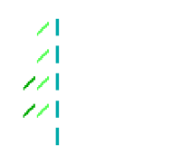

<p align="center">

</p>
<h2 align="center">Little Cedar Group Inference Recipes for NVIDIA DGX Spark</h2>
<p align="center">
   <a href="https://spark-arena.com"></a>  
   <a href="https://github.com/spark-arena/sparkrun"></a>
   <a href="https://sparkrun.dev"></a>
</p>

---
**Little Cedar Group recipe registry** for [Sparkrun][sparkrun] — recipes we run on our 6-node DGX Spark cluster.

[Little Cedar Group][littlecedar] · [Spark Arena][spark-arena] · [Sparkrun docs][sparkrun-docs] · [Mad Science](mad-science/README.md) · [Testing Methodology](mad-science/METHODOLOGY.md)

# Install the Registry

```bash
sparkrun registry add @littlecedar https://github.com/littlecedar/sparkrun-registry
sparkrun registry trust @littlecedar   # after reviewing the recipes
```

# Run Little Cedar Group's Recipes

> [!IMPORTANT]
> A `📜` recipe needs the upstream model release accepted on Hugging Face and `HF_TOKEN` set; see [License Policy](#license-policy).

Recipes are addressed with the `@littlecedar` prefix.

```bash
sparkrun list @littlecedar                  # list recipes
sparkrun show @littlecedar/<recipe>         # VRAM requirements
sparkrun run @littlecedar/<recipe>
```

# Recipe Format

Standard Sparkrun recipe schema; we use YAML `>` instead of `|` for readability and resilience. Full spec: [recipe authoring docs](https://sparkrun.dev/recipes/format/).

# Recipe Flags

Flags live in `metadata.tags:`.

| Flag | Tag           | Description                              |
|:-----|:--------------|:-----------------------------------------|
| ✨   | official      | Uses official weights                    |
| 🌲   | lcg_favorite  | Little Cedar Group:tm: Favorite          |
| 🚀   | fast          | C1 throughput > 50 (decode t/s; u/s pooling) |
| 🐢   | slow          | C1 Slow: < 40 t/s (any node count)       |
| 🚚   | large_context | Large context (>= 512k tokens)           |
| 🔧   | tools         | Excellent tool use                       |
| 🧠   | reasoning     | Excellent reasoning capability           |
| 🦾   | agent         | Excellent agentic capability             |
| ⚖   | judge         | Judgement model                          |
| 🚮   | classifier    | Classification model                     |
| 🖥   | cpu           | CPU-only runtime model                   |
| 🤏   | smol          | Small model                              |
| 1    | single_user   | Low concurrency, single-user recommended |
| 👀   | vision        | Model has vision capability              |
| 👂   | listening     | Model has listening capability           |
| 🗺   | world         | Model has world-aware capability         |
| 👄   | speech        | Model has speech generation capability   |
| 📸   | image         | Model has image generation capability    |
| 🎥   | video         | Model has video generation capability    |
| 🎼   | audio         | Model has audio generation capability    |
| 📶   | embedding     | Model has embedding capability           |
| 🔃   | reranking     | Model has reranking capability           |
| 🏴   | uncensored    | Uncensored model                         |
| 📜   | license       | Gated, non-commercial, or `other`        |
| 🚩   | dangerous     | Dangerous and may crash your Sparks!     |    
| 💀   | broken        | Currently broken                         |

# Little Cedar Sparkrun Recipes

## DeepSeek V4

Lane doc: [`recipes/ds4/README.md`](recipes/ds4/README.md).

| Recipe                                       | Flags | C1 t/s | C2 t/s | C5 t/s | C10 t/s |  Size |  Mem% | TP | Model Cards                                                      |
|:---------------------------------------------|:------|-------:|-------:|-------:|--------:|------:|------:|---:|:-----------------------------------------------------------------|
| deepseek-v4.1-flash-knapcio-tp4-1m-sglang    | ✨🚀🚚🌲👀  |   70.4 |   83.4 |  127.3 |   160.9 | 510GB |   78% |  4 | [Model][deepseek-ai/DeepSeek-V4.1-Flash-1017]                    |
| deepseek-v4.1-flash-tensorfold-tp2-1m-sglang | 🚀🚚1👀 | 66.4 | 47.8 | 44.8 | 48.4 | 385GB | 84%\* | 2 | [Model][LibertAIDAI/DeepSeek-V4.1-Flash-1017-EXL3-2.9bpw] |
| deepseek-v4.1-flash-1017-picom-tp4-1m | 🚀🚚👀🔧 | 83.4 | 90.8 | 111.5 | 129.2 | 72.4GiB + 50.7GB Engram\* | —\* | 4 | [Model][deepseek-ai/DeepSeek-V4.1-Flash-1017] |
| deepseek-v4.1-flash-1017-picom-tp4-1m-oea | 🚀🚚👀🔧 | 87.1 | 90.9 | 117.6 | 134.4 | 72.4GiB + 50.7GB Engram\* | —\* | 4 | [Model][deepseek-ai/DeepSeek-V4.1-Flash-1017] |
| deepseek-v4.1-flash-1017-aneda-tp4-1m | 🌲🚀🚚👀🔧 | 85.1 | 98.1 | 113.5 | 122.8 | 72.4GiB + 50.7GB Engram\* | —\* | 4 | [Model][deepseek-ai/DeepSeek-V4.1-Flash-1017] |
| deepseek-v4.1-flash-1017-aneda-tp4-1m-oea | 🌲🚀🚚👀🔧 | 84.6 | 98.2 | 119.3 | 136.3 | 72.4GiB + 50.7GB Engram\* | —\* | 4 | [Model][deepseek-ai/DeepSeek-V4.1-Flash-1017] |

* _Ladder cells are d0 / pp 2048 / tg 128, n=5. `*`: the picom and aneda Size is the served footprint per rank (weights + Engram), not the checkpoint; their `Mem%` is `—` because the engine reports no budget, and the tensorfold `84%*` is the engine's allocator ceiling, not a util._
* _Aneda and OEA cells are the 2026-11-23/24 5-run ladders (`~/benchmarks/aneda-ladder-20261123/`, `~/benchmarks/aneda-oea-20261124/`). The picom endpoint is keyless by default (`PICOM_AUTH=0`), and `PICOM_MAX_TOKENS=262144` is a reply's default and hard ceiling._

## Ornith 1.5

Lane doc: [`recipes/ornith/README.md`](recipes/ornith/README.md).

| Recipe                                           | Flags   | C1 t/s | C2 t/s | C5 t/s | C10 t/s |                 Size | Mem% | TP | Model Cards                                                                                                                                                                                                                |
|:-------------------------------------------------|:--------|-------:|-------:|-------:|--------:|---------------------:|-----:|---:|:---------------------------------------------------------------------------------------------------------------------------------------------------------------------------------------------------------------------------|
| littlecedar-ornith-1.5-397b-nvfp4-mtp-graft-vllm | 🌲👀🧠🦾🔧   |  41.86 |      — |      — |       — |                251GB |  80% |  4 | [Model][littlecedar/Ornith-1.5-397B-NVFP4-MTP-Graft]                                                                                                                                                                       |
| ornith-1.5-35b-a3b-nvfp4-dflash2-sglang          | ✨🚀🌲👀🧠🦾🔧 |  101.8 |  153.1 |  217.4 |   244.2 | 23.5GB + 1.1GB draft |  85% |  1 | [Model][ornith-ai/Ornith-1.5-35B-A3B-NVFP4] [Draft][jzinno/Ornith-1.5-35B-A3B-DFlash2]                                                                                                                                     |
| ornith-1.5-9b-nvfp4-dflash-sglang                | ✨🚀🤏👀🧠🦾🔧 |     55 |  101.1 |  159.0 |   148.9 |  8.8GB + 2.6GB draft |  85% |  1 | [Model][ornith-ai/Ornith-1.5-9B-NVFP4] [Draft][ornith-ai/Ornith-1.5-9B-DFlash]                                                                                                                                             |
| ornith-1.5-35b-a3b-nvfp4-yarn-1m-sglang         | ✨🚚👀🧠🦾🔧 |      — |      — |      — |       — |               23.5GB |  85% |  1 | [Model][ornith-ai/Ornith-1.5-35B-A3B-NVFP4]  |

* _Ladder cells are d0 / pp 2048 / tg 128, n=5. The YaRN row is depth-gated, not speed-gated: no ladder, and its 1M rung passed but failed twice before, so it is measured, not reliable._

## Embed

Lane doc: [`recipes/embed/README.md`](recipes/embed/README.md).

| Recipe                                   | Flags | C1 u/s | C2 u/s | C5 u/s | C10 u/s |   Size | Mem% |            API | TP | Model Cards                                    |
|:-----------------------------------------|:------|-------:|-------:|-------:|--------:|-------:|-----:|---------------:|---:|:-----------------------------------------------|
| qwen3-embedding-0.6b-vllm-b12x           | 🌲📶🤏   |   41.2 |   59.6 |  141.4 |   198.7 | 1.19GB |  15% | /v1/embeddings |  1 | [Model][Qwen/Qwen3-Embedding-0.6B]            |
| qwen3-vl-embedding-2b-vllm-b12x          | 🌲👀📶🤏 |   38.2 |   45.5 |   85.2 |   102.4 | 4.26GB |  25% | /v1/embeddings |  1 | [Model][Qwen/Qwen3-VL-Embedding-2B]            |
| qwen3-vl-embedding-8b-awq-4bit-vllm-b12x | 🌲👀📶🤏 |   15.9 |      — |      — |       — | 6.01GB |  30% | /v1/embeddings |  1 | [Model][gonuit/Qwen3-VL-Embedding-8B-AWQ-4bit] |

* _Units are requests/s; the 2B, 0.6B and 8B rows are different sweeps and not comparable. The 8B C1 receipt is `.scratch/embed/csweep8b-order1-c1.json`._

## Rerank

Lane doc: [`recipes/rerank/README.md`](recipes/rerank/README.md).

| Recipe                         | Flags | C1 u/s | C2 u/s | C5 u/s | C10 u/s |   Size | Mem% |       API | TP | Model Cards                        |
|:-------------------------------|:------|-------:|-------:|-------:|--------:|-------:|-----:|----------:|---:|:-----------------------------------|
| qwen3-vl-reranker-2b-vllm-b12x | 🚀🌲👀🔃🤏 |  100.6 |      — |      — |       — | 4.27GB |  30% | /v1/score |  1 | [Model][Qwen/Qwen3-VL-Reranker-2B] |
| qwen3-vl-reranker-8b-vllm-b12x | 🌲👀🔃🤏  |      — |      — |      — |       — | 17.6GB |  30% | /v1/score |  1 | [Model][Qwen/Qwen3-VL-Reranker-8B] |

* _C1 only, from `.scratch/embed/conc-1.json`; no ladder was run._

## Qwen 3x

Lane doc: [`recipes/qwen3/README.md`](recipes/qwen3/README.md).

| Recipe                                | Flags | C1 t/s | C2 t/s | C5 t/s | C10 t/s |                 Size |  Mem% | TP | Model Cards                                                                                                                                                                                                   |
|:--------------------------------------|:------|-------:|-------:|-------:|--------:|---------------------:|------:|---:|:--------------------------------------------------------------------------------------------------------------------------------------------------------------------------------------------------------------|
| qwen3.8-27b-nvfp4-dflash2-sglang      | 🌲👀   |   33.8 |   57.4 |   89.5 |   100.9 | 21.9GB + 3.9GB draft |   85% |  1 | [Model][RadixArk/Qwen3.8-27B-NVFP4] [Draft][z-lab/Qwen3.8-27B-DFlash2]                                                                                                                                        |
| qwen3-coder-next-int4-autoround-vllm  | 🌲🚀    |   70.4 |  114.0 |  177.1 |   249.5 |               43.6GB |   85% |  1 | [Model][Intel/Qwen3-Coder-Next-int4-AutoRound]                                                                                                                                                                |
| qwen3.8-27b-mlx4bit-tensorfold-sglang | 👀     |   44.8 |   57.7 |   64.4 |    65.6 | 16.1GB + 3.9GB draft | 30%\* |  1 | [Model][TensorFold/Qwen3.8-27B-MLX-4bit] [Draft][z-lab/Qwen3.8-27B-DFlash2]                                                                                                                                   |

* _Cells are d0 / pp 2048 / tg 128, n=5 unless noted. The TensorFold row's bfcl cell is the 4096-token re-run (88.2%), its C1 mixes boots, and its `30%*` is the engine's startup estimate, not a util._

## Qwen 4x

Lane doc: [`recipes/qwen4/README.md`](recipes/qwen4/README.md).

| Recipe                                           | Flags | C1 t/s | C2 t/s | C5 t/s | C10 t/s |  Size | Mem% | TP | Model Cards                                                                                                                     |
|:-------------------------------------------------|:------|-------:|-------:|-------:|--------:|------:|-----:|---:|:--------------------------------------------------------------------------------------------------------------------------------|
| qwen3.8-flash-next-nvfp4-labquant-sglang         | 🌲👀   |   39.9 |   69.4 |   95.0 |   104.5 | 106GB |  80% |  2 | [Model][local-inference-lab/Qwen3.8-Flash-Next-NVFP4]                                                                           |
| qwen3.8-flash-next-nvfp4-solo-vllm-b12x          | 🌲     |   33.9 |  55.49 |  64.61 |   62.04 | 106GB |  80% |  1 | [Model][local-inference-lab/Qwen3.8-Flash-Next-NVFP4]                                                                           |
| qwen3.8-flash-next-nvfp4-labquant-highcon-sglang | 🌲👀   |      — |      — |      — |       — | 106GB |  80% |  2 | [Model][local-inference-lab/Qwen3.8-Flash-Next-NVFP4]                                                                           |

* _The solo row's C10 sits below C5 because `max_num_seqs: 8` binds at ten streams, not because the KV pool is short._

## IFM K2-Horizon

Lane doc: [`recipes/ifm/README.md`](recipes/ifm/README.md).

| Recipe                           | Flags | C1 t/s | C2 t/s | C5 t/s | C10 t/s |                   Size | Mem% | TP | Model Cards                                                                                                                                                                        |
|:--------------------------------|:------|-------:|-------:|-------:|--------:|-----------------------:|-----:|---:|:-----------------------------------------------------------------------------------------------------------------------------------------------------------------------------------|
| k2-horizon-0.9b-bf16-sglang      | ✨🚀🤏🧠🔧 |   77.6 |  181.6 |  317.6 |   503.9 |                 2.16GB |  85% |  1 | [Model][IFM/K2-Horizon-0.9B]                                                                                                                                                       |
| k2-horizon-7b-fp8-uno-sglang     | 🤏🧠🔧🦾 |   32.4 |   56.1 |   94.0 |   126.0 | 11.1GB + 1.4GB adapter |  82% |  1 | [Model][IFM/K2-Horizon-7B-FP8]                                                                                                                                                     |
| k2-horizon-0.9b-bf16-uno-sglang  | ✨🚀🤏🧠🔧 |  123.2 |  205.2 |  388.4 |   534.3 | 2.16GB + 224MB adapter |  82% |  1 | [Model][IFM/K2-Horizon-0.9B] [Uno][IFM/K2-Horizon-0.9B-Uno]                                                                                                                        |

* _The 7B fp8-KV row is an accuracy pass, not a throughput claim; its C1–C10 are the fa4 arm._

## GLM 5.3

Lane doc: [`recipes/glm/README.md`](recipes/glm/README.md).

| Recipe                                           | Flags   | C1 t/s | C2 t/s | C5 t/s | C10 t/s |                 Size |  Mem% | TP | Model Cards                                                                                                                                                                                                                |
|:-------------------------------------------------|:--------|-------:|-------:|-------:|--------:|---------------------:|------:|---:|:---------------------------------------------------------------------------------------------------------------------------------------------------------------------------------------------------------------------------|
| glm-5.3-flash-exl3-tp4-1m-tensorfold-sglang      | 🚚🚀🧠🔧👀   |   83.0 |  102.4 |   79.5 |    73.4 |  176GB + 2.3GB draft | 41%\* |  4 | [Model][Mia-AiLab/GLM-5.3-Flash-EXL3-4bpw-TensorFold] [Draft][incoai/GLM-5.3-Flash-DFlash2]                                                                                                                                |
| glm-5.3-exl3-3bpw-tp4-1m-tensorfold-sglang      | 🚚🧠🔧      |   28.8 |   37.4 |   76.3 |   145.8 |       273GB | 94%\* |  4 | [Model][bertholomus/GLM-5.3-EXL3-3.0bpw]                                                                                                                                                                                   |

* _The 4bpw row is a first boot and its quality battery is still unproven; the 3.0bpw row is the window-3 ladder._
* _`*` Mem% is the engine's own startup estimate, not a configured util._

## Decision

Lane doc: [`recipes/decision/README.md`](recipes/decision/README.md).

Prefill-only scorers, not chat models: the ladder columns are **req/s**, and a `—` in C2–C10 means "not run", not "fast enough to skip".

| Recipe                      | Flags | Accuracy | C1 req/s | C2 req/s | C5 req/s | C10 req/s |   Size | Mem% |             API | TP | Model Cards                            |
|:----------------------------|:------|---------:|---------:|---------:|---------:|----------:|-------:|-----:|----------------:|---:|:---------------------------------------|
| jev-9b-decision-vllm        | 🤏🚮    |    67.0% |      7.6 |        — |        — |         — | 18.4GB |  92% | /v1/completions |  1 | [Model][autotrust/JEV-9B]              |
| jev-27b-decision-vllm       | 🚮      |        — |        — |        — |        — |         — |   52GB |    — | /v1/completions |  1 | [Model][autotrust/JEV-27B]             |
| clef-flash-decision-sglang  | 🤏🚮    |    70.3% |      4.9 |        — |        — |         — | 19.1GB |  82% |   /v1/systemone |  1 | [Model][Cloudflare/clef-flash]         |
| kai-0.6b-decision-vllm-srun | 🤏🖥🚮   |    47.5% |        — |        — |        — |         — |  1.5GB |    — |   /v1/systemone |  1 | [Model][vllm-sr/Decision-2.0-Kai-0.6B] |
| sol-2b-decision-vllm-srun   | 🤏🖥🚮   |      55% |        — |        — |        — |         — |  4.8GB |    — |   /v1/systemone |  1 | [Model][vllm-sr/Decision-2.0-Sol-2B]   |
| nox-4b-decision-vllm-srun   | 🤏🖥🚮   |    67.8% |    0.044 |    0.044 |    0.044 |         — |  9.7GB |    — |   /v1/systemone |  1 | [Model][vllm-sr/Decision-2.0-Nox-4B]   |
| d3-edge-decision-vllm-srun  | 🤏🖥🚮   |        — |        — |        — |        — |         — | 1.19GB |    — |   /v1/systemone |  1 | [Model][vllm-sr/d3-edge]               |
| sol-2b-decision2-gguf-llamacpp | 🤏🚮  |    55.0% |     5.2 |      5.4 |      5.4 |       5.4 |  2.0GB |    — |   /v1/systemone |  1 | [Model][vllm-sr/Decision-2.0-Sol-2B-GGUF] |
| liquidai-d1-2b-q8-systemone-llamacpp | 🤏🚮📜 |       — |    9.204 |    9.609 |    9.641 |     9.641 | 2.05GB |    — |   /v1/systemone |  1 | [Model][LiquidAI/d1-2B-GGUF] |
| kev-0.8b-decision-serve     | 🤏🖥🚮   |    46.0% |    0.234 |    0.235 |        — |         — | 0.06GiB |    — |   /v1/systemone |  1 | [Model][jaredpalmer/kev-0.8b]          |
| laya-decision-serve         | 🤏🖥🚮   |    36.1% |    0.449 |        — |        — |         — |      — |    — |   /v1/systemone |  1 | [Model][convaiinnovations/laya]        |
| timestral-209m-forecast-cpu | 🤏🖥    |        — |        — |        — |        — |         — | 0.84GB |    — |   POST /forecast |  1 | [Model][mistralai/Timestral-209M]      |

* _Mem% is what the launches served at: vLLM `--gpu-memory-utilization=0.92`, SGLang `mem_fraction_static=0.82`._
* _jev-27b and d3-edge have no measured cells: the 27B has no receipt yet, and d3-edge has never booted._

## Media

Lane doc: [`recipes/media/README.md`](recipes/media/README.md).

Generation and tooling arms, not chat: the rate column is each arm's own task rate, and every `—` cell is by design, not a missing measurement.

| Recipe                                        | Flags  | Task rate                            |  Size  | Mem% |             API | TP | Model Cards                            |
|:----------------------------------------------|:-------|:-------------------------------------|-------:|-----:|----------------:|---:|:---------------------------------------|
| qwen-image-2.1-turbo-7b-bf16-diffusers-script | 🐢📜1  | 0.088 img/s (11.3–11.4 s @1024²)     | 32.5GB | 29%\* |   POST /generate |  1 | [Model][Qwen/Qwen-Image-2.1-Turbo]     |
| qwen-image-2.1-turbo-7b-bf16-vllm-omni        | 📸📜1  | 8.61–8.70 s/img warm (11.0 s first)  | 32.5GB | 27%\* | POST /v1/images/generations | 1 | [Model][Qwen/Qwen-Image-2.1-Turbo] |
| ltx-2.5-22b-nvfp4-t2v-comfyui-script          | 🎥1    | 78.1 s/clip warm (100.13 s cold)     | 36.9GB | 69%\* |   POST /generate |  1 | [Model][Lightricks/LTX-2.5]            |
| drama-3-35b-a3b-fp8-vllm-omni-tts             | 👄🎼📜1 | RTF 0.848 @ 4.6 s audio              | 36.9GB |    — | /v1/audio/speech |  1 | [Model][fishaudio/drama-3]             |
| kokoro-82m-tts-cpu                            | 🤏🖥👄  | RTF 0.588–0.601 (1.66–1.70x realtime) | 0.31GB |    — | /v1/audio/speech |  1 | [Model][hexgrad/Kokoro-82M]            |
| phonon-31m-tts-cpu                            | 🤏🖥👄  | RTF 0.10–0.14 (7–10x realtime)        | 0.06GB |    — | /v1/audio/speech |  1 | [Model][gradium/phonon-31m-en]         |
| humanizer-12b-q6k-llamacpp                    | ✍️      | C1 17.92 t/s (`/v1/completions`)     | 10.03GB |   — |   /v1/completions |  1 | [Model][jialinyyzz/humanizer-GGUF]     |
| kromoss-mossimage-5b-bf16-diffusers-script    | 🐢1    | 143.9 s/img control; 18.3 s/img (8-step LoRA) | 27.2GB |    — |   POST /generate |  1 | [Model][lodestones/Kromoss]            |
| moss-image-sft-5b-bf16-diffusers-script       | 📸1    | —                                    | 27.2GB |    — |   POST /generate |  1 | [Model][OpenMOSS-Team/MOSS-Image-SFT]  |
| audio8-realistic-air-0.6b-bf16-transformers-tts | 👄🤏1  | —                                    | 2.39GB |    — | /v1/audio/speech |  1 | [Model][Edge0/Audio8-TTS-Realistic-Air] |
| idol-1.8b-bf16-3dgs-script                    | 🐢📜1    | —                                    | 3.08GB |    — | GET /health     |  1 | [Model][speridlabs/idol]               |
| viggle-remake-h3-lora-v2v-comfyui-script      | 🎥📜1  | —                                    | 46.2GB |    — |   POST /generate |  1 | [Model][Viggle/Viggle-Remake]          |

* _`*` Mem% is peak reserved or engine-reported memory, not a configured util._
* _`📜` Qwen-Image is non-commercial; drama-3 is revenue-gated; Idol is eval-only twice over; Viggle-Remake is eval-only and excluded in the EU, UK, KR and US._

## Explore

Lane doc: [`recipes/explore/README.md`](recipes/explore/README.md).

| Recipe                                        | Flags |      C1 t/s | C2 t/s | C5 t/s | C10 t/s |                 Size |  Mem% |                  API | TP | Model Cards                                                                                                                                                                                                                                                              |
|:----------------------------------------------|:------|------------:|-------:|-------:|--------:|---------------------:|------:|---------------------:|---:|:-------------------------------------------------------------------------------------------------------------------------------------------------------------------------------------------------------------------------------------------------------------------------|
| ling-3.0-flash-int4-dspark-sglang             | 🧠     |        45.5 |   66.2 |  100.2 |    85.9 |   77GB + 2.7GB draft |   80% | /v1/chat/completions |  1 | [Model][inclusionAI/Ling-3.0-flash-int4] [Draft][inclusionAI/Ling-3.0-flash-dspark]                                                                                                                                                                                      |
| kolibri-1-apex-24bpw-llamacpp                 | 🚀🧠🔧   |       63.24 |  113.4 |   98.3 |    78.6 |               22.7GB |     — | /v1/chat/completions |  1 | [Model][Myric/Kolibri-1-APEX-GGUF]                                                                                                                                                                                                                                       |
| poolside-laguna-xs-2.1-nvfp4-dflash-vllm      | ✨🚀🧠🔧   |        55.3 |   83.1 |  133.7 |   141.3 | 21.6GB + 0.9GB draft |   55% | /v1/chat/completions |  1 | [Model][poolside/Laguna-XS-2.1-NVFP4] [Draft][poolside/Laguna-XS-2.1-DFlash]                                                                                                                                                                                             |
| poolside-laguna-m1-nvfp4-vllm-tp2            | ✨🧠🔧   |       12.85 |  21.85 |  34.15 |   34.64 |              139.3GB |   85% | /v1/chat/completions |  2 | [Model][poolside/Laguna-M.1-NVFP4] |
| nemotron-3.5-lightning-30b-a3b-nvfp4-vllm      | ✨🚀🧠🔧   |       63.27 |   90.8 |  122.3 |   144.2 |               20.1GB |   85% | /v1/chat/completions |  1 | [Model][nvidia/NVIDIA-Nemotron-3.5-Lightning-30B-A3B-NVFP4] |
| flint-40b-a2.5b-ud-q3k-xl-llamacpp | 🚀🧠🦾🔧 | 73.0 | 119.5 | 173.2 | 133.7 | 18.5GB | — | /v1/chat/completions | 1 | [Model][unsloth/flint-GGUF] |
| mellum2.1-12b-a2.5b-q4km-thinking-llamacpp    | ✨🚀🧠🔧   |       110.5 |  154.3 |  208.3 |   186.0 |               8.07GB |     — | /v1/chat/completions |  1 | [Model][JetBrains/Mellum2.1-12B-A2.5B-Thinking-GGUF] |
| muse-glimmer-30b-q4km-thinking-tools-llamacpp | ✨🐢🧠🔧 | 12.5 | 24.6 | 29.4 | 61.3 | 16.76GB | — | /v1/chat/completions | 1 | [Model][meta-models/Muse-Glimmer-30B-GGUF] |
| ternary-bonsai-2-9b-q2_0-llamacpp             | 👀🚀🧠   |        75.5 |  129.2 |  152.0 |   129.8 |               2.38GB |     — | /v1/chat/completions |  1 | [Model][prism-ml/Ternary-Bonsai-2-9B-gguf]                                                                                                                                                                                                                               |
| spark-x2.6-4b-bf16-sglang                     | 🧠🦾🔧   |       20.38 |  46.38 |  99.27 |  156.20 |                8.22GB |   85% | /v1/chat/completions |  1 | [Model][XHToken/Spark-X2.6-4B] |
| spark-x2.6-4b-fp8-sglang | — | 40.80 | 77.06 | 146.63 | 217.58 | 4.47GB | 85% | /v1/chat/completions | 1 | [Model][XHToken/Spark-X2.6-4B-FP8] |
| ernie-5.5-flash-base-tp4-flashinfer-sparse-sglang | ✨📜 | — | — | — | — | 268.65GB | 78% | /v1/completions | 4 | [Model][baidu/ERNIE-5.5-Flash-Base] |
| twil-8b-bf16-reasoning-sglang                 | 🧠📜    |           — |      — |      — |       — |               17.6GB |     — | /v1/chat/completions |  1 | [Model][webAI-Official/TwIL-8B] |

* _Mellum2.1 is the selected single-node easy-traffic arm; Flint passed the same gate and is the alternative, not the selection._
* _ERNIE is `other`-licensed (non-commercial, or commercial below US$50M revenue); TwIL is authored and never booted, and is eval-only._

## Liquid AI

Lane doc: [`recipes/liquidai/README.md`](recipes/liquidai/README.md).

| Recipe | Flags | C1 t/s | C2 t/s | C5 t/s | C10 t/s | Size | Mem% | API | TP | Model Cards |
|:----------------------------------------------|:------|------------:|-------:|-------:|--------:|---------------------:|------:|---------------------:|---:|:-------------------------------------------------------------------------------------------------------------------------------------------------------------------------------------------------------------------------------------------------------------------------|
| liquidai-lfm3-1.7b-q4km-llamacpp | ✨🤏📜 | — | — | — | — | 1.10GB | — | /v1/chat/completions | 1 | [Model][LiquidAI/LFM3-1.7B-GGUF] |

* _Booted and measured 2026-11-07 at C1 137.51 ± 2.90 t/s on one slot; C2–C10 stay `—` because they time queuing, not concurrency._

## Cybersec

Lane doc: [`recipes/cybersec/README.md`](recipes/cybersec/README.md).

| Recipe                                                      | Flags | C1 t/s | C2 t/s | C5 t/s | C10 t/s |                 Size |  Mem% | TP | Model Cards                                                                                                                                                               |
|:------------------------------------------------------------|:------|-------:|-------:|-------:|--------:|---------------------:|------:|---:|:--------------------------------------------------------------------------------------------------------------------------------------------------------------------------|
| qwen3.8-27b-uncensored-nvfp4-sglang                         | 👀🏴📜  |   10.2 |  19.67 |  41.12 |   75.77 |               24.7GB |   85% |  1 | [Model][orcarouter/Qwen3.8-27B-Uncensored-NVFP4]                                                                                                                          |
| qwen3.8-27b-uncensored-nvfp4-nextn-sglang                   | 👀🏴📜  |  14.72 |      — |      — |       — |               24.7GB |   85% |  1 | [Model][orcarouter/Qwen3.8-27B-Uncensored-NVFP4]                                                                                                                          |
| qwen3.8-27b-ablit-cyber-unlock-nvfp4-dflash2-sglang         | 👀🏴📜  |   33.3 |   49.4 |   84.6 |    92.9 | 20.6GB + 3.9GB draft |   85% |  1 | [Model][sakamakismile/Qwen3.8-27B-AEON-ULTIMATE-UNCENSORED-NVFP4] [Draft][z-lab/Qwen3.8-27B-DFlash2]                                                                      |
| deepseek-v4.1-flash-abliterated-cyber-tp2-tensorfold-sglang | 🚀🚚1🏴📜 |   67.0 |   53.0 |   47.8 |    46.8 |          119GB graft | 85%\* |  2 | [Model][drowzeys/DeepSeek-V4.1-Flash-Abliterated-Cybersecurity-Unleashed]                                                                                                 |
| orcacyber-nano-1.0-15.7g-gguf-llamacpp                      | 👀🏴📜  |   25.6 |    —   |    —   |     —   | 15.7GB + 0.9 mmproj  |   —   |  1 | [Model][orcarouter/OrcaCyber-Nano-1.0]                                                                                                                                    |
| orcacyber-nano-1.0-15.7g-dflash2-llamacpp                   | 👀🏴📜  |   31.2 |   41.0 |   35.6 |    31.0 | 15.7GB + 2.0GB draft |   —   |  1 | [Model][orcarouter/OrcaCyber-Nano-1.0]                                                                                                                                    |
| orcacyber-nano-1.0-13g-gguf-llamacpp                        | 👀🏴📜  |   28.1 |   46.3 |   38.3 |   34.1 |  12.1GB + 0.9 mmproj  |   —   |  1 | [Model][orcarouter/OrcaCyber-Nano-1.0]                                                                    |

* _`*` no recipe util — the arm's documented `≤ 0.85` ceiling. Every arm in this lane is gated on the Hub (`gated: auto`): each node needs an `HF_TOKEN` with that repo's release accepted._
* _Four route records keep their recipes but have no row: `nex-n2.5-mini-uncensored-nvfp4-{sglang,vllm}` and `qwen3.8-flash-next-uncensored-nvfp4-{sglang,vllm}` cannot serve on the engines tried; see `recipes/cybersec/README.md`._

# CI

| Workflow | Trigger | What it does |
|---|---|---|
| `gate.yml` | push to `main`, every PR, manual | `uv sync --frozen`, unittest discovery, `sparkrun recipe validate`, `bash -n` on mod scripts, `py_compile` |
| `refresh-sweep.yml` | daily 06:17 UTC, manual | pin-drift sweep: exit 0 clean, 1 drift, 2 could not run; either non-zero opens or updates the single `pin-drift` issue |
| `llamacpp-engine.yml` | weekly, manual | pinned llama.cpp refs against upstream, releases and feature gates; the arm64 GB10 image build is manual-only on `ubuntu-24.04-arm` |

* _No workflow fails a run for drift — the report and the issue are the signal — and CI never bumps a pin._
* _A pin edit must satisfy the daily sweep: move the pin, or retire the hold in `tools/refresh-sweep-accepted.json`; a hold that matches nothing is `stale-acceptance` and does gate._

# License Policy

The registry carries **recipes and mods, not weights**: each recipe names a Hub repo id and revision, and the downloader fetches the checkpoint under that repo's own terms. Derivatives are carried when their license permits redistribution; vendored images and mods stay under their upstream licenses. Non-commercial and gated checkpoints are carried only where their license allows the intended use — `📜` marks them. Where the registry only references upstream work, it redistributes nothing.

# Mechanics

See [MECHANICS.md](recipes/MECHANICS.md) for the sparkrun command-template rules every recipe author needs.

<!-- Links -->
[baidu/ERNIE-5.5-Flash-Base]: https://huggingface.co/baidu/ERNIE-5.5-Flash-Base

[LiquidAI/LFM3-1.7B-GGUF]: https://huggingface.co/LiquidAI/LFM3-1.7B-GGUF

[LiquidAI/d1-2B-GGUF]: https://huggingface.co/LiquidAI/d1-2B-GGUF

[littlecedar]: https://littlecedar.net
[sparkrun]: https://sparkrun.dev
[sparkrun-docs]: https://sparkrun.dev/getting-started/quick-start/
[spark-arena]: https://spark-arena.com
[RadixArk/Qwen3.8-27B-NVFP4]: https://huggingface.co/RadixArk/Qwen3.8-27B-NVFP4
[local-inference-lab/Qwen3.8-Flash-Next-NVFP4]: https://huggingface.co/local-inference-lab/Qwen3.8-Flash-Next-NVFP4
[Qwen/Qwen3-Embedding-0.6B]: https://huggingface.co/Qwen/Qwen3-Embedding-0.6B
[Qwen/Qwen3-VL-Embedding-2B]: https://huggingface.co/Qwen/Qwen3-VL-Embedding-2B
[gonuit/Qwen3-VL-Embedding-8B-AWQ-4bit]: https://huggingface.co/gonuit/Qwen3-VL-Embedding-8B-AWQ-4bit
[Qwen/Qwen3-VL-Reranker-2B]: https://huggingface.co/Qwen/Qwen3-VL-Reranker-2B
[Qwen/Qwen3-VL-Reranker-8B]: https://huggingface.co/Qwen/Qwen3-VL-Reranker-8B
[littlecedar/Ornith-1.5-397B-NVFP4-MTP-Graft]: https://huggingface.co/littlecedar/Ornith-1.5-397B-NVFP4-MTP-Graft
[ornith-ai/Ornith-1.5-35B-A3B-NVFP4]: https://huggingface.co/ornith-ai/Ornith-1.5-35B-A3B-NVFP4
[jzinno/Ornith-1.5-35B-A3B-DFlash2]: https://huggingface.co/jzinno/Ornith-1.5-35B-A3B-DFlash2
[IFM/K2-Horizon-0.9B]: https://huggingface.co/IFM/K2-Horizon-0.9B
[IFM/K2-Horizon-7B-FP8]: https://huggingface.co/IFM/K2-Horizon-7B-FP8
[IFM/K2-Horizon-0.9B-Uno]: https://huggingface.co/IFM/K2-Horizon-0.9B-Uno
[Intel/Qwen3-Coder-Next-int4-AutoRound]: https://huggingface.co/Intel/Qwen3-Coder-Next-int4-AutoRound
[LibertAIDAI/DeepSeek-V4.1-Flash-1017-EXL3-2.9bpw]: https://huggingface.co/LibertAIDAI/DeepSeek-V4.1-Flash-1017-EXL3-2.9bpw
[autotrust/JEV-9B]: https://huggingface.co/autotrust/JEV-9B
[Cloudflare/clef-flash]: https://huggingface.co/Cloudflare/clef-flash
[inclusionAI/Ling-3.0-flash-int4]: https://huggingface.co/inclusionAI/Ling-3.0-flash-int4
[inclusionAI/Ling-3.0-flash-dspark]: https://huggingface.co/inclusionAI/Ling-3.0-flash-dspark
[vllm-sr/Decision-2.0-Kai-0.6B]: https://huggingface.co/vllm-sr/Decision-2.0-Kai-0.6B
[vllm-sr/Decision-2.0-Sol-2B]: https://huggingface.co/vllm-sr/Decision-2.0-Sol-2B
[vllm-sr/Decision-2.0-Nox-4B]: https://huggingface.co/vllm-sr/Decision-2.0-Nox-4B
[vllm-sr/Decision-2.0-Sol-2B-GGUF]: https://huggingface.co/vllm-sr/Decision-2.0-Sol-2B-GGUF
[Myric/Kolibri-1-APEX-GGUF]: https://huggingface.co/Myric/Kolibri-1-APEX-GGUF
[deepseek-ai/DeepSeek-V4.1-Flash-1017]: https://huggingface.co/deepseek-ai/DeepSeek-V4.1-Flash-1017
[orcarouter/Qwen3.8-27B-Uncensored-NVFP4]: https://huggingface.co/orcarouter/Qwen3.8-27B-Uncensored-NVFP4
[orcarouter/OrcaCyber-Nano-1.0]: https://huggingface.co/orcarouter/OrcaCyber-Nano-1.0
[sakamakismile/Qwen3.8-27B-AEON-ULTIMATE-UNCENSORED-NVFP4]: https://huggingface.co/sakamakismile/Qwen3.8-27B-AEON-ULTIMATE-UNCENSORED-NVFP4
[drowzeys/DeepSeek-V4.1-Flash-Abliterated-Cybersecurity-Unleashed]: https://huggingface.co/drowzeys/DeepSeek-V4.1-Flash-Abliterated-Cybersecurity-Unleashed
[poolside/Laguna-XS-2.1-NVFP4]: https://huggingface.co/poolside/Laguna-XS-2.1-NVFP4
[poolside/Laguna-XS-2.1-DFlash]: https://huggingface.co/poolside/Laguna-XS-2.1-DFlash
[Qwen/Qwen-Image-2.1-Turbo]: https://huggingface.co/Qwen/Qwen-Image-2.1-Turbo
[nvidia/NVIDIA-Nemotron-3.5-Lightning-30B-A3B-NVFP4]: https://huggingface.co/nvidia/NVIDIA-Nemotron-3.5-Lightning-30B-A3B-NVFP4
[Lightricks/LTX-2.5]: https://huggingface.co/Lightricks/LTX-2.5
[unsloth/flint-GGUF]: https://huggingface.co/unsloth/flint-GGUF
[JetBrains/Mellum2.1-12B-A2.5B-Thinking-GGUF]: https://huggingface.co/JetBrains/Mellum2.1-12B-A2.5B-Thinking-GGUF
[meta-models/Muse-Glimmer-30B-GGUF]: https://huggingface.co/meta-models/Muse-Glimmer-30B-GGUF
[jialinyyzz/humanizer-GGUF]: https://huggingface.co/jialinyyzz/humanizer-GGUF
[fishaudio/drama-3]: https://huggingface.co/fishaudio/drama-3
[hexgrad/Kokoro-82M]: https://huggingface.co/hexgrad/Kokoro-82M
[gradium/phonon-31m-en]: https://huggingface.co/gradium/phonon-31m-en
[lodestones/Kromoss]: https://huggingface.co/lodestones/Kromoss
[OpenMOSS-Team/MOSS-Image-SFT]: https://huggingface.co/OpenMOSS-Team/MOSS-Image-SFT
[Edge0/Audio8-TTS-Realistic-Air]: https://huggingface.co/Edge0/Audio8-TTS-Realistic-Air
[speridlabs/idol]: https://huggingface.co/speridlabs/idol
[mistralai/Timestral-209M]: https://huggingface.co/mistralai/Timestral-209M
[prism-ml/Ternary-Bonsai-2-9B-gguf]: https://huggingface.co/prism-ml/Ternary-Bonsai-2-9B-gguf
[ornith-ai/Ornith-1.5-9B-NVFP4]: https://huggingface.co/ornith-ai/Ornith-1.5-9B-NVFP4
[ornith-ai/Ornith-1.5-9B-DFlash]: https://huggingface.co/ornith-ai/Ornith-1.5-9B-DFlash
[TensorFold/Qwen3.8-27B-MLX-4bit]: https://huggingface.co/TensorFold/Qwen3.8-27B-MLX-4bit
[z-lab/Qwen3.8-27B-DFlash2]: https://huggingface.co/z-lab/Qwen3.8-27B-DFlash2
[Mia-AiLab/GLM-5.3-Flash-EXL3-4bpw-TensorFold]: https://huggingface.co/Mia-AiLab/GLM-5.3-Flash-EXL3-4bpw-TensorFold
[incoai/GLM-5.3-Flash-DFlash2]: https://huggingface.co/incoai/GLM-5.3-Flash-DFlash2
[bertholomus/GLM-5.3-EXL3-3.0bpw]: https://huggingface.co/bertholomus/GLM-5.3-EXL3-3.0bpw
[poolside/Laguna-M.1-NVFP4]: https://huggingface.co/poolside/Laguna-M.1-NVFP4
[XHToken/Spark-X2.6-4B]: https://huggingface.co/XHToken/Spark-X2.6-4B
[XHToken/Spark-X2.6-4B-FP8]: https://huggingface.co/XHToken/Spark-X2.6-4B-FP8
[autotrust/JEV-27B]: https://huggingface.co/autotrust/JEV-27B
[jaredpalmer/kev-0.8b]: https://huggingface.co/jaredpalmer/kev-0.8b
[convaiinnovations/laya]: https://huggingface.co/convaiinnovations/laya
[vllm-sr/d3-edge]: https://huggingface.co/vllm-sr/d3-edge
[webAI-Official/TwIL-8B]: https://huggingface.co/webAI-Official/TwIL-8B
[Viggle/Viggle-Remake]: https://huggingface.co/Viggle/Viggle-Remake
