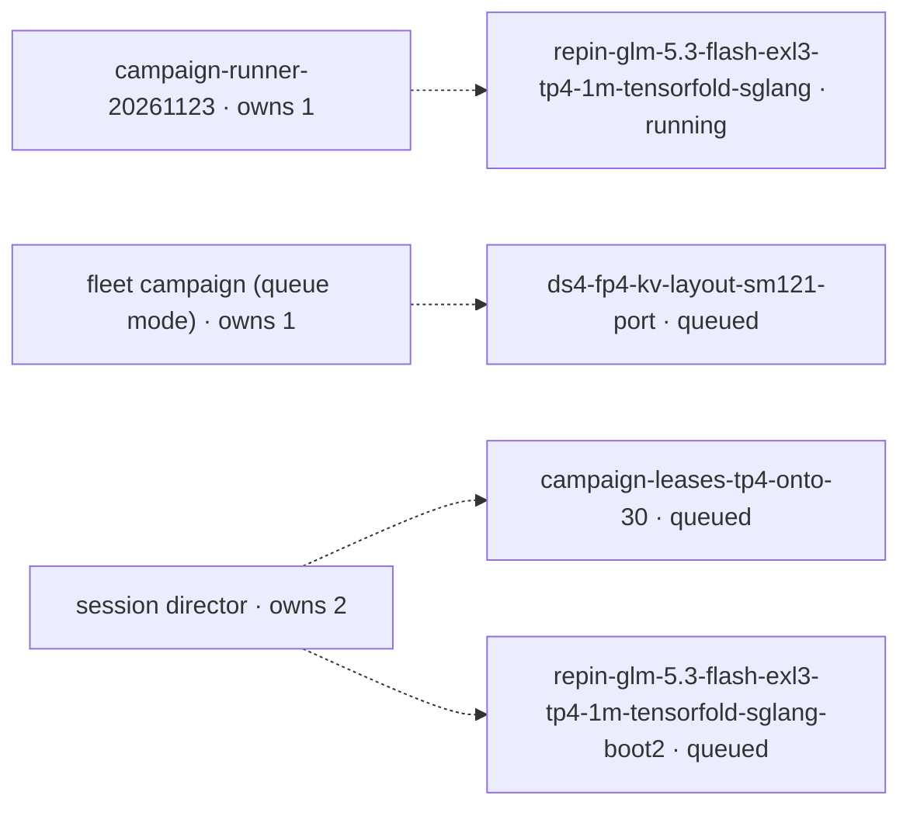

# Board
_Generated 2026-11-23 03:48 ET_

## In flight
| where | owner | what |
|---|---|---|
| census | read-only in tick — booted nothing, claimed nothing, stopped nothing, evicted nothing | read `2026-11-23T08:48:43Z`–`2026-11-23T08:48:45Z` (each node's own `date -u`) on the base census `2026-11-23T07:36:43Z`, **1 h 12 min 0 s** after it: **0 containers, 0 volumes** fleet-wide; **no research rank**; no node probed a serve |
| pool | — (nobody drives it; head units re-proved each tick) | head: `beegfs-mgmtd` **active** (Result success, NRestarts 0, **+0** on the base) · `beegfs-meta` **active** (Result success, NRestarts 0, **+0** on the base) · `beegfs-storage` **active** (Result success, NRestarts 0, **+0** on the base); worker unit states and the pool's through-mount reads are not part of this census |
| queue | register snapshot `a540fc14…`; both blocks below rendered from it | `mad-science/queue.json` sha256 **`a540fc1417857f75395b83f8f8c65b5d41aada839a6a58755e4982f382268de4`** read locally: **253 tasks: 249 done, 3 queued, 0 blocked, 1 running — 4 open**; the head clone reads **`a540fc14…`**, identical |
| window | **no manual lock** at this read | `.local/fleet-window.lock` is **absent** on the head (read `2026-11-23T08:48:46Z`) |
| campaign | `sparkrun-campaign` — active, no lease | head user unit `sparkrun-campaign` reads **`active`** / **`running`** (`MainPID` **3,930,275**, `NRestarts` **0**, **+0** on the base); the lease ledger holds **0 lease(s)** and fence(s) `tp-le2-20261120` |
| lease | **1 fence(s), 0 lease(s)** | the head's repo ledger `.local/fleet-leases.json` (389 B, sha **`ec09509d…`**, mtime **`2026-11-21 03:04:12.907935197 -0500`** local) holds fence **`tp-le2-20261120`** on `.31`, `.32`, `.33`, `.34` (`fenced_at` `2026-11-20T07:25:27Z`, owner directive 2026-11-20: production serve protected, serve `58cddf1c62ba6578_b8865cad5863` / image `986795bcd7f4`) and **0 lease(s)** |
| publication | tick | fresh census (`2026-11-23T08:48:43Z`–`2026-11-23T08:48:45Z`) written to `2026-11-23T084843Z.json` and composed on the base census `2026-11-23T07:36:43Z`; the queue blocks are rendered from `mad-science/queue.json` sha **`a540fc14…`**, and the landed rows from `git log --since=2026-11-23T07:36:43Z` |
| .30 | **nothing live (no reservation)** — idle | `2026-11-23T08:48:43Z` (`spark-41e1`): `docker ps -aq` **0**, running **0**, volumes **0**, `:8000` listeners **0** root **1,054,233,145,344 B avail** (-10,437,492,736, fell) · **2,772,797,673,472 B used** (+10,437,492,736, rose) boot **`2026-11-19T20:06:40Z`** (`btime`), `uptime` **304,923 s** `MemTotal` **127,598,704 kB** (+0), `MemAvailable` **121,879,096 kB** (+1,035,592), `Cached` **90,904,764 kB** (+36,697,776), `AnonPages` **903,960 kB** (+21,348) ring **256** events all-types (+0), **0** in-window lifecycle and **0** in-window `exec`, oldest `2026-11-22T21:20:20.607781358-05:00 container start 74fbcbea`, newest `2026-11-23T03:46:08.759615197-05:00 container destroy 07c378` |
| .31 | **nothing live (no reservation)** — idle | `2026-11-23T08:48:43Z` (`spark-d325`): `docker ps -aq` **0**, running **0**, volumes **0**, `:8000` listeners **0** root **1,243,337,703,424 B avail** (-58,551,107,584, fell) · **2,583,693,115,392 B used** (+58,551,107,584, rose) boot **`2026-11-19T20:11:15Z`** (`btime`), `uptime` **304,648 s** `MemTotal` **127,598,700 kB** (+0), `MemAvailable` **122,684,624 kB** (-269,840), `Cached` **47,590,740 kB** (+45,022,696), `AnonPages` **236,528 kB** (-37,424) ring **256** events all-types (+0), **0** in-window lifecycle and **0** in-window `exec`, oldest `2026-11-23T01:48:04.655746790-05:00 container exec_start: sh`, newest `2026-11-23T03:41:53.785945910-05:00 image pull ghcr.io/miaai` |
| .32 | **nothing live (no reservation)** — idle | `2026-11-23T08:48:44Z` (`spark-ec1d`): `docker ps -aq` **0**, running **0**, volumes **0**, `:8000` listeners **0** root **1,326,941,863,936 B avail** (-58,549,297,152, fell) · **2,500,088,840,192 B used** (+58,549,297,152, rose) boot **`2026-11-19T20:14:21Z`** (`btime`), `uptime` **304,462 s** `MemTotal` **127,598,640 kB** (+0), `MemAvailable` **122,915,960 kB** (-226,864), `Cached` **62,576,636 kB** (+57,101,184), `AnonPages` **185,196 kB** (-50,044) ring **256** events all-types (+0), **0** in-window lifecycle and **0** in-window `exec`, oldest `2026-11-23T01:47:52.769147270-05:00 container exec_create: s`, newest `2026-11-23T03:41:53.711192961-05:00 image pull ghcr.io/miaai` |
| .33 | **nothing live (no reservation)** — idle | `2026-11-23T08:48:44Z` (`spark-3578`): `docker ps -aq` **0**, running **0**, volumes **0**, `:8000` listeners **0** root **1,197,636,554,752 B avail** (-58,549,301,248, fell) · **2,629,394,149,376 B used** (+58,549,301,248, rose) boot **`2026-11-19T20:12:55Z`** (`btime`), `uptime` **304,549 s** `MemTotal` **127,598,636 kB** (+0), `MemAvailable` **122,934,008 kB** (-202,536), `Cached` **69,117,820 kB** (+57,100,032), `AnonPages` **187,540 kB** (-45,904) ring **256** events all-types (+0), **0** in-window lifecycle and **0** in-window `exec`, oldest `2026-11-23T01:47:53.179468178-05:00 container exec_create: s`, newest `2026-11-23T03:41:53.705039664-05:00 image pull ghcr.io/miaai` |
| .34 | **nothing live (no reservation)** — idle | `2026-11-23T08:48:45Z` (`spark-324e`): `docker ps -aq` **0**, running **0**, volumes **0**, `:8000` listeners **0** root **804,139,716,608 B avail** (-58,549,219,328, fell) · **3,022,891,102,208 B used** (+58,549,219,328, rose) boot **`2026-11-19T20:09:04Z`** (`btime`), `uptime` **304,781 s** `MemTotal` **127,598,704 kB** (+0), `MemAvailable` **122,350,268 kB** (-418,172), `Cached` **65,160,716 kB** (+57,097,936), `AnonPages` **184,764 kB** (-43,956) ring **256** events all-types (+0), **0** in-window lifecycle and **0** in-window `exec`, oldest `2026-11-23T01:47:53.565485812-05:00 container exec_start: sh`, newest `2026-11-23T03:41:53.690823692-05:00 image pull ghcr.io/miaai` |
| .35 | **nothing live (no reservation)** — idle | `2026-11-23T08:48:45Z` (`spark-383f`): `docker ps -aq` **0**, running **0**, volumes **0**, `:8000` listeners **0** root **971,279,699,968 B avail** (-22,593,536, fell) · **2,855,751,118,848 B used** (+22,593,536, rose) boot **`2026-11-19T20:07:56Z`** (`btime`), `uptime` **304,848 s** `MemTotal` **127,598,700 kB** (+0), `MemAvailable` **122,948,600 kB** (+110,532), `Cached` **115,091,956 kB** (+17,620), `AnonPages` **237,412 kB** (-61,468) ring **256** events all-types (+0), **0** in-window lifecycle and **0** in-window `exec`, oldest `2026-11-22T21:05:06.535546060-05:00 container exec_start: sh`, newest `2026-11-22T21:19:48.088204374-05:00 container destroy 8b4cc1` |

## Work Queue

| job | node cost | blockers | holds | status | summary |
|---|---|---|---|---|---|
| `repin-glm-5.3-flash-exl3-tp4-1m-tensorfold-sglang` — Boot glm-5.3-flash-exl3-tp4-1m-tensorfold-sglang with the refreshed pin and move its pins | quartet | — | — | running | — PIN MOVE 2026-11-22 (owner rule, ViBoard thread t24): updated pins are boot-tested as soon as a window of the correct size is free for them, and the pin moves in that boot's commit — no carrier-lane ride-along. This row boots recipes/glm/gl… (full note: queue.json) — evidence: `head:~/benchmarks/glm-repin-20261123/repin-1/head-boot.log` |
| `repin-glm-5.3-flash-exl3-tp4-1m-tensorfold-sglang-boot2` — Boot glm-5.3-flash-exl3-tp4-1m-tensorfold-sglang-boot2 with the refreshed pin and move its pins | quartet | — | — | queued | — PIN MOVE 2026-11-22 (owner rule, ViBoard thread t24): updated pins are boot-tested as soon as a window of the correct size is free for them, and the pin moves in that boot's commit — no carrier-lane ride-along. This row boots recipes/glm/gl… (full note: queue.json) |
| `campaign-leases-tp4-onto-30` — The campaign leases memory-heavy TP4 quartets onto .30, which the owner ruling excludes | quartet | — | — | queued | — MECHANISM LANDED OFFLINE 2026-11-11 (commits `aa54000`, `ebf5c8e`, `298098d`, `08ff156`; no live lease and no live six-node boot has run, so the row stays open). One ledger, `<repo>/.local/fleet-leases.json` (flock + atomic write), and one … (full note: queue.json) |
| `ds4-fp4-kv-layout-sm121-port` — DS4 1017 SM121: port the V41/V41_FP4 KV layout so fp4 KV is admissible — dtype is not a lever today, and sizing lies about fp4 | quartet | — | — | queued | — FP4-KV image built and pushed. SGLang side: ghcr.io/littlecedar/aneda@sha256:b5de5272edd983e41059154f10d862a44c25f8f5f403fafd48ad0778b95ceed6 (the dsv41-sm121-dg:0.2.1-fi073e base + patch_dsv41_fp4kv.py + fp4kv_kv_format.py). Recipe at reci… (full note: queue.json) |

## Completed Work
Window: commits since `2026-11-23T07:36:43Z` — the base census stamp, later than the 24 h start `2026-11-22T08:48:43Z`; older rows are not shown.

| time ET | commit | one clause |
|---|---|---|
| 11-23 02:36 | `d2b47e1b` | Refresh the status board: a 2026-11-23T073642Z census |
