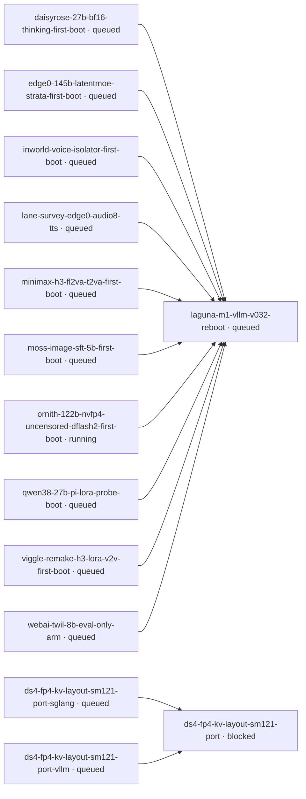

# Board — generated 2026-11-22 02:00 ET

## In flight
| where | owner | what |
|---|---|---|
| census | read-only in tick — booted nothing, claimed nothing, stopped nothing, evicted nothing | read `2026-11-22T07:00:01Z`–`2026-11-22T07:00:03Z` (each node's own `date -u`) on the base census `2026-11-22T06:00:01Z`, **1 h 0 min 0 s** after it: **6 containers, 0 volumes** fleet-wide; **research rank** on `.30`, `.35`; the fenced hosts hold running containers on `.31`, `.32`, `.33`, `.34`, excluded from research accounting; `/v1/models` **200**, `/health` **200** on `.31`; `/v1/models` **200**, `/health` **200** on `.35` |
| pool | — (nobody drives it; head units re-proved each tick) | head: `beegfs-mgmtd` **active** (Result success, NRestarts 0, **+0** on the base) · `beegfs-meta` **active** (Result success, NRestarts 0, **+0** on the base) · `beegfs-storage` **active** (Result success, NRestarts 0, **+0** on the base); worker unit states and the pool's through-mount reads are not part of this census |
| queue | register snapshot `b0705229…`; both blocks below rendered from it | `mad-science/queue.json` sha256 **`b0705229b8caf75fca9ba8a09f605dacd339003b5b6d83b0813f577a6199724f`** read locally: **228 tasks: 190 done, 35 queued, 2 blocked, 1 running — 38 open**; the head clone reads **`b0705229…`**, identical |
| window | **no manual lock** at this read | `.local/fleet-window.lock` is **absent** on the head (read `2026-11-22T07:00:04Z`) |
| campaign | `sparkrun-campaign` — active, no lease | head user unit `sparkrun-campaign` reads **`active`** / **`running`** (`MainPID` **3,930,275**, `NRestarts` **0**, **+0** on the base); the lease ledger holds **0 lease(s)** and fence(s) `tp-le2-20261120` |
| lease | **1 fence(s), 0 lease(s)** | the head's repo ledger `.local/fleet-leases.json` (389 B, sha **`ec09509d…`**, mtime **`2026-11-21 03:04:12.907935197 -0500`** local) holds fence **`tp-le2-20261120`** on `.31`, `.32`, `.33`, `.34` (`fenced_at` `2026-11-20T07:25:27Z`, owner directive 2026-11-20: production serve protected, serve `58cddf1c62ba6578_b8865cad5863` / image `986795bcd7f4`) and **0 lease(s)** |
| publication | tick | fresh census (`2026-11-22T07:00:01Z`–`2026-11-22T07:00:03Z`) written to `2026-11-22T070000Z.json` and composed on the base census `2026-11-22T06:00:01Z`; the queue blocks are rendered from `mad-science/queue.json` sha **`b0705229…`**, and the landed rows from `git log --since=2026-11-22T06:00:01Z` |
| .30 | **live containers** — 1 running, research accounting | `2026-11-22T07:00:01Z` (`spark-41e1`): `docker ps -aq` **1**, running **1**, volumes **0**, `:8000` listeners **0** root **1,340,800,081,920 B avail** (-23,442,673,664, fell) · **2,486,230,736,896 B used** (+23,442,673,664, rose) boot **`2026-11-19T20:06:40Z`** (`btime`), `uptime` **212,000 s** `MemTotal` **127,598,704 kB** (+0), `MemAvailable` **30,918,776 kB** (-55,562,884), `Cached` **27,086,884 kB** (+25,294,816), `AnonPages` **4,785,476 kB** (-2,715,324) ring **256** events all-types (+0), **0** in-window lifecycle and **241** in-window `exec`, oldest `2026-11-22T01:44:59.385436511-05:00 container exec_die 8e373`, newest `2026-11-22T01:59:56.608430547-05:00 container exec_die 8b669` |
| .31 | **fenced serve** — excluded from the research census | `2026-11-22T07:00:01Z` (`spark-d325`): `docker ps -aq` **1**, running **1**, volumes **0**, `:8000` listeners **2**, `/v1/models` **200**, `/health` **200** root **1,606,888,808,448 B avail** (-27,304,374,272, fell) · **2,220,142,010,368 B used** (+27,304,374,272, rose) boot **`2026-11-19T20:11:15Z`** (`btime`), `uptime` **211,726 s** `MemTotal` **127,598,700 kB** (+0), `MemAvailable` **9,451,684 kB** (+49,052), `Cached` **9,628,208 kB** (+30,264), `AnonPages` **6,153,028 kB** (+110,168) ring **256** events all-types (+0), **0** in-window lifecycle and **256** in-window `exec`, oldest `2026-11-22T01:18:20.212743812-05:00 container exec_create: t`, newest `2026-11-22T01:59:50.164412079-05:00 container exec_die d9d79` |
| .32 | **fenced serve** — excluded from the research census | `2026-11-22T07:00:02Z` (`spark-ec1d`): `docker ps -aq` **1**, running **1**, volumes **0**, `:8000` listeners **0** root **1,671,438,721,024 B avail** (-23,668,654,080, fell) · **2,155,591,983,104 B used** (+23,668,654,080, rose) boot **`2026-11-19T20:14:21Z`** (`btime`), `uptime` **211,540 s** `MemTotal` **127,598,640 kB** (+0), `MemAvailable` **11,818,852 kB** (+81,004), `Cached` **12,452,404 kB** (+1,157,468), `AnonPages` **5,315,404 kB** (+5,000) ring **256** events all-types (+0), **0** in-window lifecycle and **256** in-window `exec`, oldest `2026-11-22T01:17:20.649644130-05:00 container exec_die 7641b`, newest `2026-11-22T01:59:50.563362157-05:00 container exec_die 7641b` |
| .33 | **fenced serve** — excluded from the research census | `2026-11-22T07:00:02Z` (`spark-3578`): `docker ps -aq` **1**, running **1**, volumes **0**, `:8000` listeners **0** root **1,579,924,963,328 B avail** (-28,094,955,520, fell) · **2,247,105,740,800 B used** (+28,094,955,520, rose) boot **`2026-11-19T20:12:55Z`** (`btime`), `uptime` **211,627 s** `MemTotal` **127,598,636 kB** (+0), `MemAvailable` **11,761,320 kB** (+85,112), `Cached` **12,536,492 kB** (+156,636), `AnonPages` **5,314,964 kB** (+5,200) ring **256** events all-types (+0), **0** in-window lifecycle and **256** in-window `exec`, oldest `2026-11-22T01:17:21.070166721-05:00 container exec_die d98d0`, newest `2026-11-22T01:59:50.911064556-05:00 container exec_die d98d0` |
| .34 | **fenced serve** — excluded from the research census | `2026-11-22T07:00:02Z` (`spark-324e`): `docker ps -aq` **1**, running **1**, volumes **0**, `:8000` listeners **0** root **1,154,338,275,328 B avail** (+67,428,974,592, rose) · **2,672,692,543,488 B used** (-67,428,974,592, fell) boot **`2026-11-19T20:09:04Z`** (`btime`), `uptime` **211,858 s** `MemTotal` **127,598,704 kB** (+0), `MemAvailable` **11,780,316 kB** (+98,276), `Cached` **12,457,416 kB** (+531,836), `AnonPages` **5,309,344 kB** (+20,056) ring **256** events all-types (+0), **0** in-window lifecycle and **256** in-window `exec`, oldest `2026-11-22T01:17:21.468172256-05:00 container exec_die ff75e`, newest `2026-11-22T01:59:51.653046997-05:00 container exec_die ff75e` |
| .35 | **live containers** — 1 running, research accounting | `2026-11-22T07:00:03Z` (`spark-383f`): `docker ps -aq` **1**, running **1**, volumes **0**, `:8000` listeners **1**, `/v1/models` **200**, `/health` **200** root **1,085,868,179,456 B avail** (-22,744,330,240, fell) · **2,741,162,639,360 B used** (+22,744,330,240, rose) boot **`2026-11-19T20:07:56Z`** (`btime`), `uptime` **211,926 s** `MemTotal` **127,598,700 kB** (+0), `MemAvailable` **12,384,052 kB** (-110,715,816), `Cached` **10,732,556 kB** (-4,132,612), `AnonPages` **4,976,628 kB** (+4,735,520) ring **256** events all-types (+0), **0** in-window lifecycle and **67** in-window `exec`, oldest `2026-11-20T19:59:12.360338785-05:00 network connect c35b8f56`, newest `2026-11-22T01:59:50.954491645-05:00 container exec_die 1ae17` |

## Work queue

| job | node cost | blockers | holds | status | summary |
|---|---|---|---|---|---|
| `ornith-122b-nvfp4-uncensored-dflash2-first-boot` — First boot the eval-only dealignai Ornith-1.5-122B NVFP4 DFlash2 arm and record its cell | single | — | laguna-m1-vllm-v032-reboot | running | — Authored, never booted (recipes/ornith/README.md:996: 75.65 GB, 'DRAFT, never booted, eval-only'). Target pin e6a1c178..., drafter incoai/...-DFlash2 9baefc1b... at 4 draft tokens, SGLang v0.5.22 digest-pinned, min_nodes 1. Its sibling reci… (full note: queue.json) |
| `ds4-fp4-kv-layout-sm121-port-vllm` — DS4 1017 SM121 vLLM: carry nvfp4_ds_mla through the SM12x sparse-MLA backend so fp4 KV is selectable | single | — | ds4-fp4-kv-layout-sm121-port | queued | — ENGINE WORK on the dev host, not a fleet boot: the quartet boot that proves it is the parent row's, which this row unblocks. UPSTREAM ALREADY HAS THE LAYOUT: vllm/config/cache.py:47-48 lists fp8_ds_mla and nvfp4_ds_mla, vllm/_custom_ops.py:… (full note: queue.json) |
| `ds4-fp4-kv-layout-sm121-port-sglang` — DS4 1017 SM121 SGLang: port the V41_FP4 KV layout and the fp4 pool-sizing term so fp4 KV is admissible | single | — | ds4-fp4-kv-layout-sm121-port | queued | — ENGINE WORK on the dev host, not a fleet boot: the quartet boot that proves it is the parent row's, which this row unblocks. Deliverable = the three edits the parent names, in the SGLang tree the lane pins at image commit 103ad321, re-porte… (full note: queue.json) |
| `lane-survey-edge0-audio8-tts` — First boot the Audio8-TTS-Realistic-Air arm and record its RTF and wav round-trip | single | — | laguna-m1-vllm-v032-reboot | queued | Recipe and server mod are tracked and the 2.39 GiB body is staging; the remaining work is its first boot: /health, one POST /v1/audio/speech returning a 44.1 kHz mono WAV, and RTF recorded. |
| `daisyrose-27b-bf16-thinking-first-boot` — First boot the DaisyRose-27B BF16 thinking arm and decide whether it joins the index | single | — | laguna-m1-vllm-v032-reboot | queued | — Authored, not booted (recipes/qwen3/README.md:162: 'the zz- prefix is the arm's status, not a typo. No index row and no flags until a measured boot on a free node renames it'). RadixArk/DaisyRose-27B BF16 on SGLang dev-cu13@sha256:0a1ba33a.… (full note: queue.json) |
| `inworld-voice-isolator-first-boot` — First boot the inworld voice-isolator GPU arm and prove one isolation request | single | — | laguna-m1-vllm-v032-reboot | queued | — Authored 2026-11-20, never booted (recipes/media/README.md:872: '1 node, GPU'). The route is not an LLM serve: the inworld-voice-isolation PyPI SDK plus recipes/media/mods/voice-isolator-server on the lane's CUDA base, with runtime: vllm on… (full note: queue.json) |
| `qwen38-27b-pi-lora-probe-boot` — Boot the qwen3.8-27B pi-adapted LoRA probe and prove the adapter changes the output | single | — | laguna-m1-vllm-v032-reboot | queued | — PROBE, non-shippable, authored-not-booted -- no receipt exists (recipes/qwen3/README.md:211). Qwen/Qwen3.8-27B on SGLang dev-cu13@sha256:0a1ba33a... (the sibling NVFP4 arm's digest), min_nodes 1, with the pi-adapted LoRA. ACCEPTANCE: the ad… (full note: queue.json) |
| `webai-twil-8b-eval-only-arm` — First boot the webAI TwIL-8B eval-only arm and record its cell | single | — | laguna-m1-vllm-v032-reboot | queued | Recipe and both eval-only notices are tracked; the remaining work is the arm's first boot: /v1/models plus one C1 cell, recorded as a receipt, on the 17.58 GB BF16 body. |
| `moss-image-sft-5b-first-boot` — First boot the vendor MOSS-Image-SFT arm on the Kromoss launcher and record one image cell | single | — | laguna-m1-vllm-v032-reboot | queued | — Authored 2026-11-22, NOT booted (recipes/media/README.md:517-540, table row :118); staging of the 27.23 GB body is to follow. OpenMOSS-Team/MOSS-Image-SFT pinned f972bd4b..., Apache-2.0 with no banner, no revenue threshold and no non-commer… (full note: queue.json) |
| `edge0-145b-latentmoe-strata-first-boot` — First boot the Edge0-145B NVFP4 strata arm: in-container source build, then one cell | single | — | laguna-m1-vllm-v032-reboot | queued | — HOST PIN (owner 2026-11-22): boot on .35 ONLY -- .30 is the BeeGFS metadata server and a 106 GiB boot there risks a metadata incident, and .31-.34 carry the fenced production serve. The pin is enforced through this row's exclude_hosts (all … (full note: queue.json) |
| `minimax-h3-fl2va-t2va-first-boot` — First boot the MiniMax-H3 fl2va t2va arm (never booted) at a non-US site and record the video cell | single | — | laguna-m1-vllm-v032-reboot | queued | — LICENSE SETTLED 2026-11-22 (authority: MiniMax's lawyers, relayed by the owner; recorded as #89 in mad-science/TODO.md §'Owner ruling 2026-11-22 — MiniMax-H3's territorial license does not reach recipe authoring or R&D'): recipe authoring a… (full note: queue.json) |
| `viggle-remake-h3-lora-v2v-first-boot` — Boot the Viggle-Remake H3 LoRA v2v ComfyUI arm once its 156 GiB staging lands | single | — | laguna-m1-vllm-v032-reboot | queued | — STAGING IN PROGRESS 2026-11-22: Viggle/Viggle-Remake (~156.06 GiB repo) is being staged into the shared pool now, so the boot is the test -- it cannot start before the transfer lands. Authored 2026-11-16, never booted (recipes/media/README.… (full note: queue.json) |
| `beegfs-meta-restart-loop-non-meta-hosts` — beegfs-meta restart-loops every 5 s on .31-.35, and the loop hides a failed state behind "activating" | single | — | — | blocked | — Measured 2026-11-09 07:03-07:05 ET, and it is the side effect of the fix beegfs-units-restart-no (done) blessed: /etc/systemd/system/beegfs-meta.service.d/oom.conf (mtime 2026-11-08 16:03 on .30, 16:05 on .31) sets OOMScoreAdjust plus Resta… (full note: queue.json) — evidence: `.scratch/infra-chores-20261122/beegfs-meta/RECEIPT.md` |
| `head-clone-object-store-incomplete` — The head clone loses git objects continuously (healed twice on 2026-11-21, gap reopens on every new commit), so `git ls-tree HEAD` and any `git pull` fail there until it is re-healed | — | — | — | queued | Head clone loses loose objects (packs agree) so git reads fail there; healed twice on 2026-11-21 (91 objects), yet the gap reopens on every commit and one 743 B tree never syncs, so the mechanism is unnamed. |
| `hf-cache-20261110-docs-only-repin-bundle` — Docs-only model drift from the 2026-11-10 cache update: 22 recipe rows across 10 repos ride their lane’s next boot (no boot of its own) | — | — | — | queued | Docs-only drift bundle over 14 live recipe rows (8 of the 22 retired to attic): only README/LICENSE/eval_results differ from the head, no pin bumped since the sweep, each lane moves its pin at its next boot and records it. |
| `house-num-scorer-trailing-period` — House battery scores a correct number with a trailing period as a miss | — | — | — | queued | score() for kind=num keeps the sentence-final dot, so a correct 74 ending a sentence scores false (Ripple 2026-11-20 hard-arith-1); fix is stripping trailing punctuation plus a regression test over 74, 74. and 7.5. |
| `house-scores-reasoning-only-as-empty` — House battery scores a reasoning-only reply as empty — Sage trick-1 is a reasoning loop, not a serve event | — | — | — | queued | — tools/quality-battery.py chat() reads only message.content and keeps no finish_reason, so a completion that spends its whole budget in the reasoning channel is scored as an empty reply — indistinguishable from a dead serve. Measured 2026-11… (full note: queue.json) — evidence: `head:~/benchmarks/sage-20261122/run.md` |
| `queue-mode-done-sibling-holds-canary-row` — Queue mode will not lease a row whose recipe a done sibling already holds | — | — | — | queued | Canary row (tp4 quartet recipe) never leases because plan.sibling_hold keys arms on the recipe stem and done sibling h2h-second-boot-ds4-1017 holds it, fleet idle meanwhile; open choice: close sibling, own recipe file, or change the hold. |
| `campaign-ingest-freezes-on-an-unplaceable-pending-arm` — The campaign never re-reads the register while any arm is pending, so one unplaceable pending arm silently stops new rows from ever being seen | — | — | — | queued | Campaign refreshes only when drained; a pending memory-risky TP4 arm that cannot fit .30/.35 with .31-.34 fenced holds drained() false, so rows queued after 00:12 were never ingested; fix: idle-poll refresh or unplaceable state. |
| `campaign-leases-tp4-onto-30` — The campaign leases memory-heavy TP4 quartets onto .30, which the owner ruling excludes | quartet | — | — | queued | Lease ledger and holder/id claim identity landed offline (d0cf704, no live director-driven TP4 lease yet); .30 is waivable for a memory-heavy quartet only inside a declared window with the six guardrails, else refused. Row open. |
| `campaign-state-copy-re-nests` — The director's receipts root copies state.json back into a window subdir, so one campaign now holds 40 nested copies | — | — | — | queued | One campaign holds 40 byte-identical nested state.json copies because --receipts-root equals --root, so each run under tp12-window re-nests; no stale state is read today, but a **/state.json census counted 49 files for 9 campaigns. |
| `hf-cache-20261110-template-ab-ifm-k2` — K2-Horizon template/code drift A/B: head c4f92a0d (0.9B) and 240f2de3 (7B-FP8) vs the shipped pins, template identity + one fixed request | single | — | — | queued | — Class (b) from the 2026-11-10 cache sweep: no weight file changed, but IFM/K2-Horizon-0.9B head moves 383cb66347be -> c4f92a0d66e2 changing chat_template.jinja AND modeling_k2_horizon.py and REMOVING chat_template_asst_tool_gen.jinja + chat… (full note: queue.json) |
| `mem-guard-outlives-its-task` — A window arm's 6.0 GiB stop-rule guard outlives the arm, so the runner accumulates guards for tasks whose containers are gone | — | — | — | queued | Corrected: a leaked guard is a stale no-op because mem-guard stops only its own task id; what accumulates is processes and ssh sessions — three guards alive on 2026-11-10 with one task container; fix is guard lifetime and harness refusal. |
| `watchdog-stall-mmap-flat-residual` — Watchdog stall rule: mmap load with flat io/log and sub-128-MiB memory progress | — | — | — | queued | boot-watchdog counts memory as progress only past a 128 MiB floor, so an mmap load with flat io/log and smaller per-check deltas is still classified stalled at 600 s; fix is cumulative progress or a test plus a recorded risk. |
| `wopr-cache-dir-runtime-regression` — Verify SGLang and llama.cpp still resolve models through the WOPR cache_dir profile | single | — | — | queued | — The 2026-11-20 Hy4 launch added cache_dir: /mnt/beegfs/huggingface to the WOPR cluster profile (sparkrun cluster update WOPR --cache-dir ...), because the head cache symlink resolved outside the workload mounts. Only the vLLM runtime was pr… (full note: queue.json) — evidence: `recipes/ds4/README.md section zz-deepseek-v4.1-flash-1017-weightless-tp4-1m (cache_dir change, task 261430353ba2889a_9e41b9e252af)` |
| `board-publish-accepts-weaker-replacement` — publish replaces a better-grounded In-flight composition with a fresher byte-compatible one, and no guard notices | — | — | — | queued | Publish guards compare bytes, so a replacement with fewer facts passes: on 2026-11-11 a composition replaced the peer's 4 captures ending 01:16 with 3 ending 01:06; acceptance is a pre-publish check on capture count, state labels, teardown. |
| `board-publish-keeps-in-flight-row-set` — A board published without one of the In-flight state rows passes every guard, because publish compares bytes and never the row set | — | — | — | queued | A base missing an In-flight state row is indistinguishable from a good one: bc2cc38 published 0 queue rows and passed publish, lint and the gate; acceptance: refuse an In-flight lacking an expected row key or a strict subset of its base. |
| `cache-audit-pool-budget` — `tools/cache-audit.py --budget-gb`: add a pool mode that judges the one shared HF pool against 90 % of capacity | — | — | — | queued | cache-audit --budget-gb measures per node but the HF cache is one shared pool, so every node reads the same and the fleet flags at once; it needs a pool mode judging usage against 90% of capacity with one pass/fail. Not bootable. |
| `executor-release-host-claim-on-failure` — An executor that stops observing a launch must release the sparkrun host claims it holds | — | — | — | queued | A launcher that stops observing its boot still holds sparkrun host claims: pid 1883449 held .30-.33 after a 414.7 s registry failure, the next three arms refused rc=5; unfixed at 4927a7fe — nothing kills the launcher to drop the claim. |
| `fleet-boot-without-lease-record` — A four-rank boot serves with no lease in either ledger and no window lock | — | — | — | queued | Corrected: the unleased four-rank serve measured on 2026-11-11 is the shipped production arm (image digest and argv match), not a research quartet; open is whether a protected production boot must carry a lease under the S9 answer. |
| `laguna-m1-vllm-v032-reboot` — Re-boot Laguna-M.1 on vLLM v0.32.0 and replace its v0.29.0 measurements | pair | daisyrose-27b-bf16-thinking-first-boot, edge0-145b-latentmoe-strata-first-boot, inworld-voice-isolator-first-boot, lane-survey-edge0-audio8-tts, minimax-h3-fl2va-t2va-first-boot, moss-image-sft-5b-first-boot, ornith-122b-nospec-noparsers-boot, ornith-122b-nospec-rawchat-boot, ornith-122b-nvfp4-uncensored-dflash2-first-boot, qwen38-27b-pi-lora-probe-boot, viggle-remake-h3-lora-v2v-first-boot, webai-twil-8b-eval-only-arm | — | queued | — Open TODO item (mad-science/TODO.md:2997): the pin moved for the CVE on 2026-10-22 (1a306ca, index digest befccf0e... / arm64 child 6ff5ff0d...) and the arm is labelled BUMPED, NOT RE-BOOTED, so its TTR, KV pool and suite numbers are still … (full note: queue.json) |
| `sparkrun-single-gid-index-for-two-hcas` — sparkrun injects one GID index across two HCAs whose tables disagree | — | — | — | queued | Report-only sparkrun defect: one derived NCCL_IB_GID_INDEX is applied to both HCAs, and a 2026-11-11 carrier flap vacated plane A's index 3, failing ncclCommInitRank (ibv_modify_qp 61) on boot 2 and the control; fix per HCA or fail closed. |
| `window-lock-does-not-stop-direct-boots` — A declared window holds campaign placement and `director lease`, but a direct `sparkrun run` boot bypasses both | — | — | — | queued | A declared window stops campaign placement and lease but not a direct sparkrun run: inside the 01:04-01:16 window a solo container started on .35 with no lease record and no assign line; decide whether direct boots consult the lock. |
| `inkling-tp4-first-boot` — Inkling-2-Small TP=4 first boot: nightly pull and the unproven sm_121 Triton path | quartet | — | — | queued | Inkling-2-Small TP4 first boot: nightly digest c17e9d88 is on no node so the boot includes the pull, and sm_121 runs the Hopper/Triton path (attention_sm90, Humming expert GEMMs) unproven here; needs an owner-declared window. |
| `mech-cites-0-4-3` — Re-derive the remaining 117 recipes/MECHANICS.md citations against the installed sparkrun build | — | — | — | queued | 117 recipes/MECHANICS.md anchors still carry 0.4.2/0.4.0 numbering after d0d050f landed 27 plus 13 controls; not mechanically renumberable since core/recipe.py grew to 3080 lines, so each sentence is re-read and its claim re-located. |
| `metrics-instrument-confound` — Metrics knob decomposition: one identical recipe, metrics-on vs metrics-off, name the performance-impacting knobs (`#68` ROM bar) | single | — | — | queued | — Owner's `#68` authorises the decomposition that makes the comparability bar checkable, and it must separate THREE regimes, because only one of them can bias a cell: (1) `tools/run-arm.sh`'s scrape is a single exec AFTER the cell and before … (full note: queue.json) |
| `weightless-dsgb10-tp4-boot-gate` — Boot the weightless-dsgb10 arm four-rank: the α=0 golden hash must equal stock bit-for-bit before any steered request is quoted | quartet | — | — | queued | Boot gate, weightless image: at α=0 output must be byte-identical to stock before any steered request is quoted, then a second-name request must project while a stock one keeps its text; four ranks, .31-.34 unfenced, --cluster WOPR. |
| `ds4-fp4-kv-layout-sm121-port` — DS4 1017 SM121: port the V41/V41_FP4 KV layout so fp4 KV is admissible — dtype is not a lever today, and sizing lies about fp4 | quartet | ds4-fp4-kv-layout-sm121-port-sglang, ds4-fp4-kv-layout-sm121-port-vllm | — | blocked | Blocked on engine work: fp4 KV needs the is_sm100 gate relaxed, the V41/V41_FP4 layout ported and an fp4 branch in the pool configurator, and nvfp4 is unsafe today because sizing has no fp4 term; it buys 2-4x tokens per GiB but no floor. |

## Landed session
Window: commits since `2026-11-22T06:00:01Z` — the base census stamp, later than the 24 h start `2026-11-21T07:00:00Z`; older rows are not shown.

| time ET | commit | one clause |
|---|---|---|
| 11-22 01:00 | `c7dcea5c` | Refresh the status board: a 2026-11-22T060000Z census |
| 11-22 01:13 | `97d6d35c` | Close the Sage trick-1 repeat: the empty reply is a reasoning loop |
| 11-22 01:17 | `72080ae9` | Author MOSS-Image-SFT and Audio8 TTS arms; settle the MiniMax license ruling |
| 11-22 01:18 | `0acdd8ca` | Queue the two DS4 fp4-KV engine rows and load out the NC<=2 candidates |
| 11-22 01:19 | `906d3afd` | Point the register at the settled licence ruling and the Audio8 recipe |
| 11-22 01:23 | `b73c9d52` | Queue the MOSS-Image first boot and make the Audio8 row its own boot row |
| 11-22 01:27 | `ef24035f` | Index the two new media arms and re-take the strict roster snapshot |
| 11-22 01:40 | `9678f38e` | Fix the cache-audit selftest's stale ds4 EXL3 key after the re-pin |
| 11-22 01:46 | `fc630c0b` | Close probe A as a measured negative and the two cache-cleanup rows |
