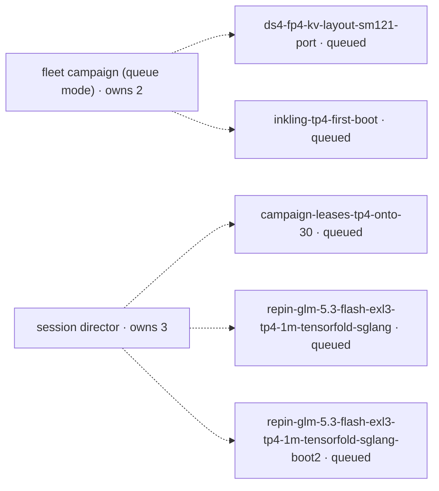

# Board
_Generated 2026-11-23 00:24 ET_

## In flight
| where | owner | what |
|---|---|---|
| census | read-only in tick — booted nothing, claimed nothing, stopped nothing, evicted nothing | read `2026-11-23T05:24:43Z`–`2026-11-23T05:24:45Z` (each node's own `date -u`) on the base census `2026-11-23T05:12:18Z`, **0 h 12 min 25 s** after it: **0 containers, 0 volumes** fleet-wide; **no research rank**; no node probed a serve |
| pool | — (nobody drives it; head units re-proved each tick) | head: `beegfs-mgmtd` **active** (Result success, NRestarts 0, **+0** on the base) · `beegfs-meta` **active** (Result success, NRestarts 0, **+0** on the base) · `beegfs-storage` **active** (Result success, NRestarts 0, **+0** on the base); worker unit states and the pool's through-mount reads are not part of this census |
| queue | register snapshot `c5acc5ba…`; both blocks below rendered from it | `mad-science/queue.json` sha256 **`c5acc5ba4575791c4a7560bd85b6228fa9022e63fe47e424377301cf3af607fc`** read locally: **253 tasks: 248 done, 5 queued, 0 blocked, 0 running — 5 open**; the head clone reads **`c5acc5ba…`**, identical |
| window | **no manual lock** at this read | `.local/fleet-window.lock` is **absent** on the head (read `2026-11-23T05:24:46Z`) |
| campaign | `sparkrun-campaign` — active, no lease | head user unit `sparkrun-campaign` reads **`active`** / **`running`** (`MainPID` **3,930,275**, `NRestarts` **0**, **+0** on the base); the lease ledger holds **0 lease(s)** and fence(s) `tp-le2-20261120` |
| lease | **1 fence(s), 0 lease(s)** | the head's repo ledger `.local/fleet-leases.json` (389 B, sha **`ec09509d…`**, mtime **`2026-11-21 03:04:12.907935197 -0500`** local) holds fence **`tp-le2-20261120`** on `.31`, `.32`, `.33`, `.34` (`fenced_at` `2026-11-20T07:25:27Z`, owner directive 2026-11-20: production serve protected, serve `58cddf1c62ba6578_b8865cad5863` / image `986795bcd7f4`) and **0 lease(s)** |
| publication | tick | fresh census (`2026-11-23T05:24:43Z`–`2026-11-23T05:24:45Z`) written to `2026-11-23T052443Z.json` and composed on the base census `2026-11-23T05:12:18Z`; the queue blocks are rendered from `mad-science/queue.json` sha **`c5acc5ba…`**, and the landed rows from `git log --since=2026-11-23T05:12:18Z` |
| .30 | **nothing live (no reservation)** — idle | `2026-11-23T05:24:43Z` (`spark-41e1`): `docker ps -aq` **0**, running **0**, volumes **0**, `:8000` listeners **0** root **1,197,849,018,368 B avail** (-15,690,162,176, fell) · **2,629,181,800,448 B used** (+15,690,162,176, rose) boot **`2026-11-19T20:06:40Z`** (`btime`), `uptime` **292,683 s** `MemTotal` **127,598,704 kB** (+0), `MemAvailable` **122,253,024 kB** (-35,364), `Cached` **120,232,552 kB** (+18,225,372), `AnonPages` **866,724 kB** (+38,132) ring **256** events all-types (+0), **0** in-window lifecycle and **0** in-window `exec`, oldest `2026-11-22T21:19:20.483473646-05:00 container exec_create: t`, newest `2026-11-23T00:15:07.441268635-05:00 image push ghcr.io/littl` |
| .31 | **nothing live (no reservation)** — idle | `2026-11-23T05:24:44Z` (`spark-d325`): `docker ps -aq` **0**, running **0**, volumes **0**, `:8000` listeners **0** root **1,386,417,664,000 B avail** (-10,314,383,360, fell) · **2,440,613,154,816 B used** (+10,314,383,360, rose) boot **`2026-11-19T20:11:15Z`** (`btime`), `uptime` **292,408 s** `MemTotal` **127,598,700 kB** (+0), `MemAvailable` **122,947,500 kB** (-56,576), `Cached` **11,349,272 kB** (+10,078,500), `AnonPages` **330,664 kB** (-6,008) ring **256** events all-types (+0), **0** in-window lifecycle and **0** in-window `exec`, oldest `2026-11-22T22:09:48.773758086-05:00 container exec_start: ta`, newest `2026-11-22T23:46:19.806196189-05:00 container destroy a5b372` |
| .32 | **nothing live (no reservation)** — idle | `2026-11-23T05:24:44Z` (`spark-ec1d`): `docker ps -aq` **0**, running **0**, volumes **0**, `:8000` listeners **0** root **1,458,177,978,368 B avail** (-4,058,451,968, fell) · **2,368,852,725,760 B used** (+4,058,451,968, rose) boot **`2026-11-19T20:14:21Z`** (`btime`), `uptime` **292,222 s** `MemTotal` **127,598,640 kB** (+0), `MemAvailable` **123,128,084 kB** (-77,464), `Cached` **5,073,180 kB** (+4,346,308), `AnonPages` **276,628 kB** (+4,424) ring **256** events all-types (+0), **0** in-window lifecycle and **0** in-window `exec`, oldest `2026-11-22T22:02:19.264735318-05:00 container exec_start: ta`, newest `2026-11-22T23:46:19.836012090-05:00 container destroy 00f849` |
| .33 | **nothing live (no reservation)** — idle | `2026-11-23T05:24:44Z` (`spark-3578`): `docker ps -aq` **0**, running **0**, volumes **0**, `:8000` listeners **0** root **1,351,970,766,848 B avail** (-6,840,807,424, fell) · **2,475,059,937,280 B used** (+6,840,807,424, rose) boot **`2026-11-19T20:12:55Z`** (`btime`), `uptime` **292,309 s** `MemTotal` **127,598,636 kB** (+0), `MemAvailable` **123,101,592 kB** (-82,976), `Cached` **7,549,220 kB** (+7,065,656), `AnonPages` **272,444 kB** (+2,908) ring **256** events all-types (+0), **0** in-window lifecycle and **0** in-window `exec`, oldest `2026-11-22T22:02:19.682627203-05:00 container exec_start: ta`, newest `2026-11-22T23:46:19.848882875-05:00 container destroy 6a0a3b` |
| .34 | **nothing live (no reservation)** — idle | `2026-11-23T05:24:45Z` (`spark-324e`): `docker ps -aq` **0**, running **0**, volumes **0**, `:8000` listeners **0** root **935,164,858,368 B avail** (-9,039,319,040, fell) · **2,891,865,960,448 B used** (+9,039,319,040, rose) boot **`2026-11-19T20:09:04Z`** (`btime`), `uptime` **292,541 s** `MemTotal` **127,598,704 kB** (+0), `MemAvailable` **123,031,948 kB** (-151,900), `Cached` **9,962,808 kB** (+8,829,812), `AnonPages` **269,824 kB** (-252) ring **256** events all-types (+0), **0** in-window lifecycle and **0** in-window `exec`, oldest `2026-11-22T22:02:20.053640646-05:00 container exec_create: t`, newest `2026-11-22T23:46:19.827378291-05:00 container destroy d7c445` |
| .35 | **nothing live (no reservation)** — idle | `2026-11-23T05:24:45Z` (`spark-383f`): `docker ps -aq` **0**, running **0**, volumes **0**, `:8000` listeners **0** root **1,030,462,619,648 B avail** (-10,465,325,056, fell) · **2,796,568,199,168 B used** (+10,465,325,056, rose) boot **`2026-11-19T20:07:56Z`** (`btime`), `uptime` **292,608 s** `MemTotal` **127,598,700 kB** (+0), `MemAvailable` **119,805,804 kB** (-3,382,120), `Cached` **62,116,516 kB** (+10,237,104), `AnonPages` **3,426,848 kB** (+3,152,692) ring **256** events all-types (+0), **0** in-window lifecycle and **0** in-window `exec`, oldest `2026-11-22T21:05:06.535546060-05:00 container exec_start: sh`, newest `2026-11-22T21:19:48.088204374-05:00 container destroy 8b4cc1` |

## Work Queue

| job | node cost | blockers | holds | status | summary |
|---|---|---|---|---|---|
| `repin-glm-5.3-flash-exl3-tp4-1m-tensorfold-sglang` — Boot glm-5.3-flash-exl3-tp4-1m-tensorfold-sglang with the refreshed pin and move its pins | quartet | — | — | queued | — PIN MOVE 2026-11-22 (owner rule, ViBoard thread t24): updated pins are boot-tested as soon as a window of the correct size is free for them, and the pin moves in that boot's commit — no carrier-lane ride-along. This row boots recipes/glm/gl… (full note: queue.json) |
| `repin-glm-5.3-flash-exl3-tp4-1m-tensorfold-sglang-boot2` — Boot glm-5.3-flash-exl3-tp4-1m-tensorfold-sglang-boot2 with the refreshed pin and move its pins | quartet | — | — | queued | — PIN MOVE 2026-11-22 (owner rule, ViBoard thread t24): updated pins are boot-tested as soon as a window of the correct size is free for them, and the pin moves in that boot's commit — no carrier-lane ride-along. This row boots recipes/glm/gl… (full note: queue.json) |
| `campaign-leases-tp4-onto-30` — The campaign leases memory-heavy TP4 quartets onto .30, which the owner ruling excludes | quartet | — | — | queued | — MECHANISM LANDED OFFLINE 2026-11-11 (commits `aa54000`, `ebf5c8e`, `298098d`, `08ff156`; no live lease and no live six-node boot has run, so the row stays open). One ledger, `<repo>/.local/fleet-leases.json` (flock + atomic write), and one … (full note: queue.json) |
| `inkling-tp4-first-boot` — Inkling-2-Small TP=4 first boot: nightly pull and the unproven sm_121 Triton path | quartet | — | — | queued | — No node holds the pinned nightly digest c17e9d88, so the first boot includes the pull. GB10 is sm_121 and the Blackwell path gates on capability family 100, so the engine runs the Hopper/Triton half (attention_sm90 plus the Humming expert G… (full note: queue.json) — evidence: `head:~/benchmarks/inkling-20261123/` |
| `ds4-fp4-kv-layout-sm121-port` — DS4 1017 SM121: port the V41/V41_FP4 KV layout so fp4 KV is admissible — dtype is not a lever today, and sizing lies about fp4 | quartet | — | — | queued | — FP4-KV image built and pushed. SGLang side: ghcr.io/littlecedar/aneda@sha256:b5de5272edd983e41059154f10d862a44c25f8f5f403fafd48ad0778b95ceed6 (the dsv41-sm121-dg:0.2.1-fi073e base + patch_dsv41_fp4kv.py + fp4kv_kv_format.py). Recipe at reci… (full note: queue.json) |

## Completed Work
Window: commits since `2026-11-23T05:12:18Z` — the base census stamp, later than the 24 h start `2026-11-22T05:24:43Z`; older rows are not shown.

| time ET | commit | one clause |
|---|---|---|
| 11-23 00:12 | `6912f9ac` | Refresh the status board: a 2026-11-23T051218Z census |
| 11-23 00:13 | `8b584030` | Trim root README footnotes per lane, moving excess to lane READMEs |
| 11-23 00:13 | `294d6ef2` | Skip the inkling quartet (body absent), repair the weightless register row |
| 11-23 00:21 | `31f42606` | Add the FP4-KV parent recipe for the aneda image |
