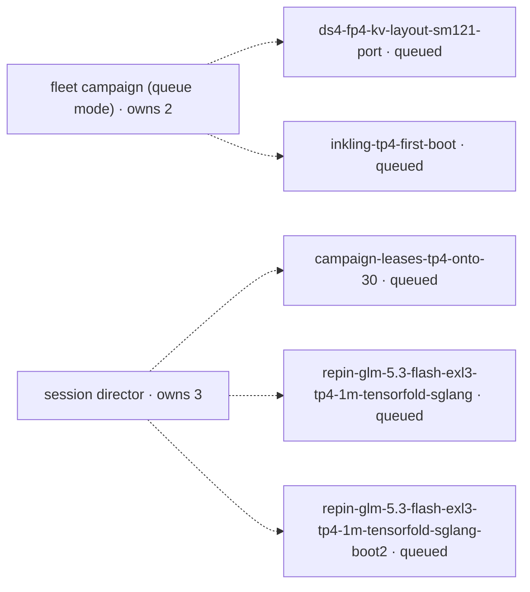

# Board
_Generated 2026-11-23 00:36 ET_

## In flight
| where | owner | what |
|---|---|---|
| census | read-only in tick — booted nothing, claimed nothing, stopped nothing, evicted nothing | read `2026-11-23T05:36:09Z`–`2026-11-23T05:36:11Z` (each node's own `date -u`) on the base census `2026-11-23T05:24:43Z`, **0 h 11 min 26 s** after it: **0 containers, 0 volumes** fleet-wide; **no research rank**; no node probed a serve |
| pool | — (nobody drives it; head units re-proved each tick) | head: `beegfs-mgmtd` **active** (Result success, NRestarts 0, **+0** on the base) · `beegfs-meta` **active** (Result success, NRestarts 0, **+0** on the base) · `beegfs-storage` **active** (Result success, NRestarts 0, **+0** on the base); worker unit states and the pool's through-mount reads are not part of this census |
| queue | register snapshot `8469f57e…`; both blocks below rendered from it | `mad-science/queue.json` sha256 **`8469f57edec23de7f652e2aa483fa80ea4827624d9baee4bc47e6af982cb0cde`** read locally: **253 tasks: 248 done, 5 queued, 0 blocked, 0 running — 5 open**; the head clone reads **`8469f57e…`**, identical |
| window | **no manual lock** at this read | `.local/fleet-window.lock` is **absent** on the head (read `2026-11-23T05:36:11Z`) |
| campaign | `sparkrun-campaign` — active, no lease | head user unit `sparkrun-campaign` reads **`active`** / **`running`** (`MainPID` **3,930,275**, `NRestarts` **0**, **+0** on the base); the lease ledger holds **0 lease(s)** and fence(s) `tp-le2-20261120` |
| lease | **1 fence(s), 0 lease(s)** | the head's repo ledger `.local/fleet-leases.json` (389 B, sha **`ec09509d…`**, mtime **`2026-11-21 03:04:12.907935197 -0500`** local) holds fence **`tp-le2-20261120`** on `.31`, `.32`, `.33`, `.34` (`fenced_at` `2026-11-20T07:25:27Z`, owner directive 2026-11-20: production serve protected, serve `58cddf1c62ba6578_b8865cad5863` / image `986795bcd7f4`) and **0 lease(s)** |
| publication | tick | fresh census (`2026-11-23T05:36:09Z`–`2026-11-23T05:36:11Z`) written to `2026-11-23T053608Z.json` and composed on the base census `2026-11-23T05:24:43Z`; the queue blocks are rendered from `mad-science/queue.json` sha **`8469f57e…`**, and the landed rows from `git log --since=2026-11-23T05:24:43Z` |
| .30 | **nothing live (no reservation)** — idle | `2026-11-23T05:36:09Z` (`spark-41e1`): `docker ps -aq` **0**, running **0**, volumes **0**, `:8000` listeners **0** root **1,179,197,747,200 B avail** (-18,651,271,168, fell) · **2,647,833,071,616 B used** (+18,651,271,168, rose) boot **`2026-11-19T20:06:40Z`** (`btime`), `uptime` **293,368 s** `MemTotal` **127,598,704 kB** (+0), `MemAvailable` **122,203,024 kB** (-50,000), `Cached` **119,993,780 kB** (-238,772), `AnonPages` **874,960 kB** (+8,236) ring **256** events all-types (+0), **0** in-window lifecycle and **0** in-window `exec`, oldest `2026-11-22T21:19:20.483946941-05:00 container exec_start: ta`, newest `2026-11-23T00:26:56.750103274-05:00 image pull ghcr.io/littl` |
| .31 | **nothing live (no reservation)** — idle | `2026-11-23T05:36:09Z` (`spark-d325`): `docker ps -aq` **0**, running **0**, volumes **0**, `:8000` listeners **0** root **1,374,284,328,960 B avail** (-12,133,335,040, fell) · **2,452,746,489,856 B used** (+12,133,335,040, rose) boot **`2026-11-19T20:11:15Z`** (`btime`), `uptime` **293,094 s** `MemTotal` **127,598,700 kB** (+0), `MemAvailable` **122,897,964 kB** (-49,536), `Cached` **23,436,736 kB** (+12,087,464), `AnonPages` **340,612 kB** (+9,948) ring **256** events all-types (+0), **0** in-window lifecycle and **0** in-window `exec`, oldest `2026-11-22T22:10:48.797684710-05:00 container exec_die d9d79`, newest `2026-11-23T00:29:13.298533861-05:00 container destroy 5650e4` |
| .32 | **nothing live (no reservation)** — idle | `2026-11-23T05:36:09Z` (`spark-ec1d`): `docker ps -aq` **0**, running **0**, volumes **0**, `:8000` listeners **0** root **1,451,218,149,376 B avail** (-6,959,828,992, fell) · **2,375,812,554,752 B used** (+6,959,828,992, rose) boot **`2026-11-19T20:14:21Z`** (`btime`), `uptime` **292,908 s** `MemTotal` **127,598,640 kB** (+0), `MemAvailable` **123,013,760 kB** (-114,324), `Cached` **12,106,992 kB** (+7,033,812), `AnonPages` **285,124 kB** (+8,496) ring **256** events all-types (+0), **0** in-window lifecycle and **0** in-window `exec`, oldest `2026-11-22T22:03:19.257825642-05:00 container exec_die 7641b`, newest `2026-11-23T00:29:12.953048037-05:00 container destroy c7049b` |
| .33 | **nothing live (no reservation)** — idle | `2026-11-23T05:36:10Z` (`spark-3578`): `docker ps -aq` **0**, running **0**, volumes **0**, `:8000` listeners **0** root **1,340,754,063,360 B avail** (-11,216,703,488, fell) · **2,486,276,640,768 B used** (+11,216,703,488, rose) boot **`2026-11-19T20:12:55Z`** (`btime`), `uptime` **292,995 s** `MemTotal` **127,598,636 kB** (+0), `MemAvailable` **122,987,464 kB** (-114,128), `Cached` **18,979,952 kB** (+11,430,732), `AnonPages` **284,716 kB** (+12,272) ring **256** events all-types (+0), **0** in-window lifecycle and **0** in-window `exec`, oldest `2026-11-22T22:03:19.672886582-05:00 container exec_die d98d0`, newest `2026-11-23T00:29:12.603876549-05:00 container destroy b3cf81` |
| .34 | **nothing live (no reservation)** — idle | `2026-11-23T05:36:10Z` (`spark-324e`): `docker ps -aq` **0**, running **0**, volumes **0**, `:8000` listeners **0** root **925,698,293,760 B avail** (-9,466,564,608, fell) · **2,901,332,525,056 B used** (+9,466,564,608, rose) boot **`2026-11-19T20:09:04Z`** (`btime`), `uptime` **293,226 s** `MemTotal` **127,598,704 kB** (+0), `MemAvailable` **122,996,552 kB** (-35,396), `Cached` **19,445,216 kB** (+9,482,408), `AnonPages` **278,620 kB** (+8,796) ring **256** events all-types (+0), **0** in-window lifecycle and **0** in-window `exec`, oldest `2026-11-22T22:03:20.043666394-05:00 container exec_start: ta`, newest `2026-11-23T00:29:12.262633870-05:00 container destroy 8b5343` |
| .35 | **nothing live (no reservation)** — idle | `2026-11-23T05:36:11Z` (`spark-383f`): `docker ps -aq` **0**, running **0**, volumes **0**, `:8000` listeners **0** root **1,018,832,764,928 B avail** (-11,629,854,720, fell) · **2,808,198,053,888 B used** (+11,629,854,720, rose) boot **`2026-11-19T20:07:56Z`** (`btime`), `uptime` **293,294 s** `MemTotal` **127,598,700 kB** (+0), `MemAvailable` **120,772,292 kB** (+966,488), `Cached` **73,477,124 kB** (+11,360,608), `AnonPages` **2,379,664 kB** (-1,047,184) ring **256** events all-types (+0), **0** in-window lifecycle and **0** in-window `exec`, oldest `2026-11-22T21:05:06.535546060-05:00 container exec_start: sh`, newest `2026-11-22T21:19:48.088204374-05:00 container destroy 8b4cc1` |

## Work Queue

| job | node cost | blockers | holds | status | summary |
|---|---|---|---|---|---|
| `repin-glm-5.3-flash-exl3-tp4-1m-tensorfold-sglang` — Boot glm-5.3-flash-exl3-tp4-1m-tensorfold-sglang with the refreshed pin and move its pins | quartet | — | — | queued | — PIN MOVE 2026-11-22 (owner rule, ViBoard thread t24): updated pins are boot-tested as soon as a window of the correct size is free for them, and the pin moves in that boot's commit — no carrier-lane ride-along. This row boots recipes/glm/gl… (full note: queue.json) — evidence: `head:~/benchmarks/glm-repin-20261123/repin-1/head-boot.log` |
| `repin-glm-5.3-flash-exl3-tp4-1m-tensorfold-sglang-boot2` — Boot glm-5.3-flash-exl3-tp4-1m-tensorfold-sglang-boot2 with the refreshed pin and move its pins | quartet | — | — | queued | — PIN MOVE 2026-11-22 (owner rule, ViBoard thread t24): updated pins are boot-tested as soon as a window of the correct size is free for them, and the pin moves in that boot's commit — no carrier-lane ride-along. This row boots recipes/glm/gl… (full note: queue.json) |
| `campaign-leases-tp4-onto-30` — The campaign leases memory-heavy TP4 quartets onto .30, which the owner ruling excludes | quartet | — | — | queued | — MECHANISM LANDED OFFLINE 2026-11-11 (commits `aa54000`, `ebf5c8e`, `298098d`, `08ff156`; no live lease and no live six-node boot has run, so the row stays open). One ledger, `<repo>/.local/fleet-leases.json` (flock + atomic write), and one … (full note: queue.json) |
| `inkling-tp4-first-boot` — Inkling-2-Small TP=4 first boot: nightly pull and the unproven sm_121 Triton path | quartet | — | — | queued | — No node holds the pinned nightly digest c17e9d88, so the first boot includes the pull. GB10 is sm_121 and the Blackwell path gates on capability family 100, so the engine runs the Hopper/Triton half (attention_sm90 plus the Humming expert G… (full note: queue.json) — evidence: `head:~/benchmarks/inkling-20261123/` |
| `ds4-fp4-kv-layout-sm121-port` — DS4 1017 SM121: port the V41/V41_FP4 KV layout so fp4 KV is admissible — dtype is not a lever today, and sizing lies about fp4 | quartet | — | — | queued | — FP4-KV image built and pushed. SGLang side: ghcr.io/littlecedar/aneda@sha256:b5de5272edd983e41059154f10d862a44c25f8f5f403fafd48ad0778b95ceed6 (the dsv41-sm121-dg:0.2.1-fi073e base + patch_dsv41_fp4kv.py + fp4kv_kv_format.py). Recipe at reci… (full note: queue.json) |

## Completed Work
Window: commits since `2026-11-23T05:24:43Z` — the base census stamp, later than the 24 h start `2026-11-22T05:36:08Z`; older rows are not shown.

| time ET | commit | one clause |
|---|---|---|
| 11-23 00:24 | `08f9bab8` | Refresh the status board: a 2026-11-23T052443Z census |
| 11-23 00:31 | `e2fbdeb0` | Record the GLM repin failure: OCI relay distribution failed |
| 11-23 00:33 | `b14cbea8` | Fix the address literal in the GLM repin note and re-derive the test count |
