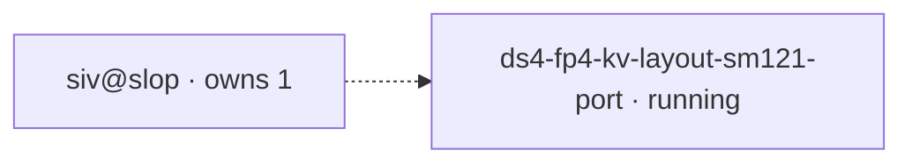

# Board
_Generated 2026-11-23 05:12 ET_

## In flight
| where | owner | what |
|---|---|---|
| census | read-only in tick — booted nothing, claimed nothing, stopped nothing, evicted nothing | read `2026-11-23T10:12:43Z`–`2026-11-23T10:12:45Z` (each node's own `date -u`) on the base census `2026-11-23T09:36:09Z`, **0 h 36 min 34 s** after it: **1 containers, 0 volumes** fleet-wide; **no research rank**; no node probed a serve |
| pool | — (nobody drives it; head units re-proved each tick) | head: `beegfs-mgmtd` **active** (Result success, NRestarts 0, **+0** on the base) · `beegfs-meta` **active** (Result success, NRestarts 0, **+0** on the base) · `beegfs-storage` **active** (Result success, NRestarts 0, **+0** on the base); worker unit states and the pool's through-mount reads are not part of this census |
| queue | register snapshot `028f11d6…`; both blocks below rendered from it | `mad-science/queue.json` sha256 **`028f11d6193d58ebb4cc5638399b525205371d805ffc34189c470783c5359814`** read locally: **253 tasks: 252 done, 0 queued, 0 blocked, 1 running — 1 open**; the head clone reads **`028f11d6…`**, identical |
| window | **no manual lock** at this read | `.local/fleet-window.lock` is **absent** on the head (read `2026-11-23T10:12:46Z`) |
| campaign | `sparkrun-campaign` — active, no lease | head user unit `sparkrun-campaign` reads **`active`** / **`running`** (`MainPID` **3,930,275**, `NRestarts` **0**, **+0** on the base); the lease ledger holds **0 lease(s)** |
| lease | **0 fence(s), 0 lease(s)** | the head's repo ledger `.local/fleet-leases.json` (700 B, sha **`e2b58800…`**, mtime **`2026-11-23 04:34:17.219610796 -0500`** local) holds no fence and **0 lease(s)** |
| publication | tick | fresh census (`2026-11-23T10:12:43Z`–`2026-11-23T10:12:45Z`) written to `2026-11-23T101242Z.json` and composed on the base census `2026-11-23T09:36:09Z`; the queue blocks are rendered from `mad-science/queue.json` sha **`028f11d6…`**, and the landed rows from `git log --since=2026-11-23T09:36:09Z` |
| .30 | **nothing live (no reservation)** — idle | `2026-11-23T10:12:43Z` (`spark-41e1`): `docker ps -aq` **1**, running **0**, volumes **0**, `:8000` listeners **0** root **974,609,674,240 B avail** (-12,374,753,280, fell) · **2,852,421,144,576 B used** (+12,374,753,280, rose) boot **`2026-11-19T20:06:40Z`** (`btime`), `uptime` **309,963 s** `MemTotal` **127,598,704 kB** (+0), `MemAvailable` **120,253,988 kB** (-1,623,276), `Cached` **78,356,280 kB** (-23,267,912), `AnonPages` **973,124 kB** (+36,144) ring **256** events all-types (+0), **0** in-window lifecycle and **0** in-window `exec`, oldest `2026-11-22T21:20:25.483952992-05:00 container exec_create: c`, newest `2026-11-23T05:06:01.036620882-05:00 image save sha256:2fe2a6` |
| .31 | **nothing live (no reservation)** — idle | `2026-11-23T10:12:43Z` (`spark-d325`): `docker ps -aq` **0**, running **0**, volumes **0**, `:8000` listeners **0** root **1,288,925,560,832 B avail** (-8,429,301,760, fell) · **2,538,105,257,984 B used** (+8,429,301,760, rose) boot **`2026-11-19T20:11:15Z`** (`btime`), `uptime` **309,688 s** `MemTotal` **127,598,700 kB** (+0), `MemAvailable` **122,111,304 kB** (-914,136), `Cached` **13,572,752 kB** (+8,220,932), `AnonPages` **303,904 kB** (+20,168) ring **256** events all-types (+0), **0** in-window lifecycle and **0** in-window `exec`, oldest `2026-11-23T03:41:53.785945910-05:00 image pull ghcr.io/miaai`, newest `2026-11-23T04:06:51.057898412-05:00 container destroy 44f102` |
| .32 | **nothing live (no reservation)** — idle | `2026-11-23T10:12:44Z` (`spark-ec1d`): `docker ps -aq` **0**, running **0**, volumes **0**, `:8000` listeners **0** root **1,371,932,205,056 B avail** (-9,618,370,560, fell) · **2,455,098,499,072 B used** (+9,618,370,560, rose) boot **`2026-11-19T20:14:21Z`** (`btime`), `uptime` **309,502 s** `MemTotal` **127,598,640 kB** (+0), `MemAvailable` **122,269,496 kB** (-863,416), `Cached` **14,005,256 kB** (+9,451,524), `AnonPages` **249,620 kB** (+8,904) ring **256** events all-types (+0), **0** in-window lifecycle and **0** in-window `exec`, oldest `2026-11-23T01:59:33.460397050-05:00 container exec_start: sh`, newest `2026-11-23T04:06:50.410818381-05:00 container destroy cb6a01` |
| .33 | **nothing live (no reservation)** — idle | `2026-11-23T10:12:44Z` (`spark-3578`): `docker ps -aq` **0**, running **0**, volumes **0**, `:8000` listeners **0** root **1,241,455,497,216 B avail** (-10,791,464,960, fell) · **2,585,575,206,912 B used** (+10,791,464,960, rose) boot **`2026-11-19T20:12:55Z`** (`btime`), `uptime` **309,589 s** `MemTotal` **127,598,636 kB** (+0), `MemAvailable` **122,333,740 kB** (-852,628), `Cached` **14,642,192 kB** (+10,592,624), `AnonPages` **240,200 kB** (+8,300) ring **256** events all-types (+0), **0** in-window lifecycle and **0** in-window `exec`, oldest `2026-11-23T01:59:33.876997831-05:00 container exec_start: sh`, newest `2026-11-23T04:06:50.728996479-05:00 container destroy f3d7af` |
| .34 | **nothing live (no reservation)** — idle | `2026-11-23T10:12:45Z` (`spark-324e`): `docker ps -aq` **0**, running **0**, volumes **0**, `:8000` listeners **0** root **1,084,533,686,272 B avail** (-9,764,126,720, fell) · **2,742,497,132,544 B used** (+9,764,126,720, rose) boot **`2026-11-19T20:09:04Z`** (`btime`), `uptime` **309,820 s** `MemTotal` **127,598,704 kB** (+0), `MemAvailable` **121,968,484 kB** (-888,184), `Cached` **14,001,116 kB** (+9,591,464), `AnonPages` **253,740 kB** (+8,252) ring **256** events all-types (+0), **0** in-window lifecycle and **0** in-window `exec`, oldest `2026-11-23T01:59:34.307824457-05:00 container exec_die 1b8d4`, newest `2026-11-23T04:06:50.706483124-05:00 container destroy 78208a` |
| .35 | **nothing live (no reservation)** — idle | `2026-11-23T10:12:45Z` (`spark-383f`): `docker ps -aq` **0**, running **0**, volumes **0**, `:8000` listeners **0** root **971,330,994,176 B avail** (-11,329,536, fell) · **2,855,699,824,640 B used** (+11,329,536, rose) boot **`2026-11-19T20:07:56Z`** (`btime`), `uptime` **309,888 s** `MemTotal` **127,598,700 kB** (+0), `MemAvailable` **122,881,892 kB** (-4,204), `Cached` **115,769,928 kB** (+10,824), `AnonPages` **299,200 kB** (+6,520) ring **256** events all-types (+0), **0** in-window lifecycle and **0** in-window `exec`, oldest `2026-11-22T21:05:06.535546060-05:00 container exec_start: sh`, newest `2026-11-22T21:19:48.088204374-05:00 container destroy 8b4cc1` |

## Work Queue

| job | node cost | blockers | holds | status | summary |
|---|---|---|---|---|---|
| `ds4-fp4-kv-layout-sm121-port` — DS4 1017 SM121: port the V41/V41_FP4 KV layout so fp4 KV is admissible — dtype is not a lever today, and sizing lies about fp4 | quartet | — | — | running | — FP4-KV image built and pushed. SGLang side: ghcr.io/littlecedar/aneda@sha256:b5de5272edd983e41059154f10d862a44c25f8f5f403fafd48ad0778b95ceed6 (the dsv41-sm121-dg:0.2.1-fi073e base + patch_dsv41_fp4kv.py + fp4kv_kv_format.py). Recipe at reci… (full note: queue.json) |

## Completed Work
Window: commits since `2026-11-23T09:36:09Z` — the base census stamp, later than the 24 h start `2026-11-22T10:12:42Z`; older rows are not shown.

| time ET | commit | one clause |
|---|---|---|
| 11-23 04:36 | `0645ce5d` | Refresh the status board: a 2026-11-23T093608Z census |
