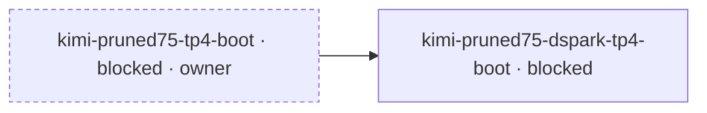

# Board — generated 2026-11-10 06:14 ET
## In flight
| where | owner | what |
|---|---|---|
| census | read-only in every read — booted nothing, claimed no node, stopped nothing | **two reads, 2026-11-10T11:05:24Z → 11:09:57Z UTC, research containers only**: `docker ps -aq` **1 / 1 / 1 / 1 / 1 / 0** and `docker ps -q` **0 / 1 / 1 / 1 / 1 / 0** — `.30`'s single container is the `sm121m` `Created` leftover, and the one running container on each of `.31`–`.34` is the production knapcio serve, excluded from research accounting (probed below). Volumes **0** on all six. Root `df -B1` avail falls on every node over the 273 s between the reads: `.30` −872 448 B, `.31` −438 272, `.32` −425 984, `.33` −413 696, `.34` −421 888, `.35` −278 528 — **−2 850 816 B total ≈ 10.4 KB/s**, ordinary churn, no mover named. **Instrument defect found this tick**: the head cannot reach any node **by name** — all five refuse `Host key verification failed` while all five answer by address in the same second; the nodes' host keys were regenerated 2026-11-05 21:58 and the head's `known_hosts` name entries are stale, so this census hopped by IP. Evidence appended to register row `head-mesh-cannot-reach-30` |
| pool | — (nobody; units re-read **per host** this tick: `beegfs-mgmtd` `active` on `.30` / `inactive` `.31`–`.35`; `-meta` `active` `.30` / `activating` `.31`–`.35`, the 5 s config-less loop owned by `beegfs-meta-restart-loop-non-meta-hosts`; `-storage` `active` × 6; `-mon` `failed` × 6) | **serving, and the hour's growth is not a file write**: `df -B1` used **13 865 881 960 448 B** 10:15:01Z → **13 865 985 769 472 B** 11:04:22Z (**+103 809 024 B** over 2 961 s ≈ 35 KB/s) → **13 865 987 342 336 B** 11:07:24Z (**+1 572 864 B** over 182 s ≈ 8.6 KB/s); avail **10 325 243 985 920 B** of 24 191 229 755 392 B (57.3 % used), **102 hub entries**. The falsifier for a writer ran and came back empty: no file newer than 70 min under `hub/` or any of the ten cache dirs (`b12x-cute-cache`, `flashinfer`, `modules`, `nccl-fr`, `stored_tokens`, `tilelang-cache`, `token`, `triton-cache`, `vllm-cache`, `xet`), so the +103 MB is **unattributed** — LIKELY chunk-store/metadata accounting, not a staged body |
| flight | **no research flight live** — production serve probed and excluded | production knapcio TP=4 serve is **probed and excluded from research accounting**: task `sparkrun_b020d2dd178343a5_8ca88141f99d` on `.31`–`.34`, four containers `Up 51 minutes (healthy)` at 11:03:44Z on image `3f4480818acb`, `sglang.launch_server` pids **271 / 310 / 310 / 312** on ranks 0–3, and `/v1/models` answered **200** at 11:03:59Z. Launched 10:11:49Z, ready 10:15:20Z (TTR 211 s) |
| `.35` | **free — nothing live (no reservation)** | reads **0 containers / 0 volumes** at both reads; root avail 1 319 380 946 944 → 1 319 380 680 704 B |
| campaign | `campaign-queue`, root `~/benchmarks/h2h-20261107` — **active, holds nothing** | user unit `sparkrun-campaign` `active`, `MainPID 4140537`, `NRestarts=0`, entered 05:16:53 ET (10:16:53Z); its log reads `queue: no runnable rows; polling 30s new ones`. The h2h root holds **19 arms, 9 measured / 10 blocked**, and all nine `~/benchmarks/*/state.json` roots hold **0 live leases** (every `lease.expires_at` in the past), so it holds nothing while the production claim stands |
| queue | register `mad-science/queue.json` sha256 **`c6e7d210…`**, snapshot tick, equal live file at publish check | **146 tasks: 106 done, 29 queued, 11 blocked, 0 running, 0 claims, 0 questions** — **40 open**; `check` rc=0 on the same snapshot. Graph and table below derive from that snapshot: `11 blocked, 1 edges, 10 prose-gated, 0 question-gated, 0 question, 38 rows not drawn (--all)`. The register moved this hour: `41415f5` landed 145 → 146 rows, and this tick appended the fleet-wide host-key evidence to `head-mesh-cannot-reach-30` (additive note only, state unchanged) |
| window | **`.31`–`.34` a PRODUCTION claim, not a research window** | head's `.local/fleet-window.lock` reads verbatim: `window=PRODUCTION — ds4 1017 knapcio TP=4 arm serving on .31-.34`, `claim=production (tonight's research windows over; any boot here must read first and stop task explicitly)`, `owner_session=ds4-kimi-fit`, `task=sparkrun_b020d2dd178343a5_8ca88141f99d`, `pin=08c8657f… (recipe model_revision, commit 363e5d4)`, `served_chat_template_sha256=95b7033a…`, `started=2026-11-10T10:15:20Z (ready; launch 10:11:49Z)`, `recorded=2026-11-10T10:16:53Z`, `stop=sparkrun stop … ; then verify docker ps -aq empty on .31-.34 and rewrite file`. This clone's copy is now present (mtime 05:16:53 ET) and matches head |
| publication | tick | **one delta fold onto the peer's 06:12 board** (base **`4932e1d3…`**, origin `fc93425`) — the peer had already published a full tick at 06:12 with its own 11:03–11:07Z census and the two landed rows, so this fold replaces only the census row (later reads plus the head-mesh defect), the queue row (new register sha) and this row, re-renders `## Work queue` from the new sha, and appends one landed row for the register note. Peer's pool, flight, `.35`, campaign and window rows left verbatim |
## Work queue

| job | node cost | holds | state |
|---|---|---|---|
| `w4-survey-arm5-control-boot` — Survey arm 5 paired control: arm 3 serve line on the same 0.2.1 digest (131072 C5/C10) | quartet | — | blocked — STOP POINT 2026-11-10T00:13:18Z (fit floor): control boot 3 (task 1c0dffa45afa6e47_4f0e55683772) passed every boot gate — [moe_b12x_next] armed, zero divide-by-128 ValueError, Load weight end 167.24 s, /v1/models 200 at max_model_len 1048576, boot.py Ready 00:09:52Z, TTR 317 s — but the 128K C5 cell is not runnable under the window 6.0 GiB stop rule: 5x131072-token concurrent prefill drove MemAvailable to 5.66 GiB (.33) and 5.54 GiB (.35) at 00:13:15-18Z on two consecutive 1 Hz samples; the guard stopped the literal task id. C5 aborted at 202.9 s with 4/5 RemoteDisconnected, needle 0/5, no usage.prompt_tokens; C10 refused. Zero kernel OOM and zero earlyoom lines; peak rank cgroup only 12.65 GiB, so the dive is host-side (driver/UVM prefill buffers). An earlier run-arm boot (1c0dffa45afa6e47_43836d4714fc) passed the same gates but its llama-benchy ladder warm-up killed the scheduler in the adapter AcceptSampling top-k branch (AttributeError: dflash_utils has no build_dflash_verify_target_probs), so no ladder or cell. No throughput or needle number is taken. Receipt head:~/benchmarks/sm121-arm5-20261109/. WINDOW (corrected 2026-11-10T08:55Z): `.31`-`.34` are held by a LIVE RESEARCH serve in session `ds4-kimi-fit`'s window — tp=4 job `b020d2dd178343a5` (`recipes/ds4/zz-ds4-1017-08c8657f-template-ab.yaml`, four ranks up) — NOT production, and not free. The production knapcio serve is the LAST boot of the night by owner instruction: it comes up after that session's two cells and after the ERNIE TP=4 arm, and all TP>=4 work completes before it. So this row's next boot needs a window declared in `.local/fleet-window.lock` taken AFTER the research serve is stood down in the `#51` sense (stopped by its task id, zero containers on every rank, clients repointed) — never by displacing it, and never by waiting on the production boot either. — evidence: `head:~/benchmarks/sm121-arm5-20261109/` |
| `w4-survey-arm5-sm121-boot` — Survey arm 5 SM121 boot: TRT-LLM sparse-MLA backend, C5/C10 @128K cell | quartet | — | blocked — STOP POINT 2026-11-10T00:19:16Z (runtime refusal): treatment boot (task 1c0dffa45afa6e47_e3ca507fd4c2) carried the flag — server_args dsv4_attn_backend='trtllm' — and armed b12x (zero divide-by-128 ValueError, Load weight end 131.15 s), then the decode dispatch refused SM121: ValueError: backend='trtllm-gen' requires SM100/SM103, got SM121 at flashinfer/mla/_core.py:1061 via sglang deepseek_v4_trtllm_backend.py:354 (trtllm_batch_decode_sparse_mla_dsv4). The launcher smoke failed, SIGQUIT -> kill_process_tree, all four ranks exit 137, /v1/models never 200, cell not run. The 0.2.1 tree gate admits capability major 12 but the installed FlashInfer runtime adds a second SM100/SM103 gate; do not retry on this image. Receipt head:~/benchmarks/sm121-arm5-20261109/. WINDOW (corrected 2026-11-10T08:55Z): `.31`-`.34` are held by a LIVE RESEARCH serve in session `ds4-kimi-fit`'s window — tp=4 job `b020d2dd178343a5` (`recipes/ds4/zz-ds4-1017-08c8657f-template-ab.yaml`, four ranks up) — NOT production, and not free. The production knapcio serve is the LAST boot of the night by owner instruction: it comes up after that session's two cells and after the ERNIE TP=4 arm, and all TP>=4 work completes before it. So this row's next boot needs a window declared in `.local/fleet-window.lock` taken AFTER the research serve is stood down in the `#51` sense (stopped by its task id, zero containers on every rank, clients repointed) — never by displacing it, and never by waiting on the production boot either. — evidence: `head:~/benchmarks/sm121-arm5-20261109/` |
| `ds4-quartet-served-incomplete-pool-snapshot` — A ds4 quartet boot served the pool snapshot 08c8657f while it was half-present and died at weight load; which resolver picked it is unverified | — | — | queued — 2026-11-10, task `sparkrun_1c0dffa45afa6e47_eb5100b2911f`: a quartet boot served the pool snapshot `snapshots/08c8657f…` (46 of 48 shards present, two `.incomplete` blobs still growing) although the recipe pins `model_revision: 1bae0e10…`, and died at 143 s on `model-00047-of-00048.safetensors` (`adapter/engram_backend.py:114`). WHICH COMPONENT RESOLVED THE INCOMPLETE PATH IS UNVERIFIED, and the obvious reading is the wrong one: the launcher resolves the checkpoint in three branches (`launcher.py:901-940`) and `refs/main` is branch 3 only (repo id / dry run / manual invocation) — on a real launch sparkrun renders `{model}` to the prepared snapshot path (`sparkrun/models/runtime.py:bind_runtime_models`), so branch 2 prints `launcher: MODEL_ID is an on-disk checkpoint dir; serving …` and `refs/main` is never read. sparkrun own pool-cache resolution is the other candidate. DISCRIMINATOR, to be read off that boot: the launcher line (`MODEL_ID is an on-disk checkpoint dir` vs `resolved checkpoint … -> …`) plus the `server_args`/`MODEL_PATH` value it served; the fit session is extracting both. Do NOT assert "model_revision is inert" until that line is quoted. ACCEPTANCE: a boot whose served path is proven by `server_args`; and either the resolver refuses an incomplete snapshot or it honours the recipe pin, with a test. Distinct from the A/B row: the refs/main-names-a-partial-snapshot hazard was operational and live only while the pull ran, and it is recorded there; the incomplete body itself completed at 07:43Z. It also does not disturb the A/B: refs/main and the pin still disagree (08c8657f vs 1bae0e10), so a control boot of the shipped arm may need -o env.MODEL_PATH=<pinned snapshot> once the served path is attributable. 2026-11-10T08:2xZ sweep update: snapshots/08c8657f02291e11b6f6b63e0e16014f8e748518 in the pool is now COMPLETE (89 entries, 0 unresolved by stat -L walk, find -xtype l empty) and refs/main = 08c8657f, so the half-present state that killed the 143 s boot cannot recur for this pair; the general risk (refs/main moving under a pin, and a resolver preferring refs/main over the pinned snapshot) is unchanged and is why the resolved path must still be read from the boot’s own server_args. 2026-11-10 DISCRIMINATOR MEASURED: the failing boot's launcher printed `launcher: resolved checkpoint deepseek-ai/DeepSeek-V4.1-Flash-1017 -> /cache/huggingface/hub/models--deepseek-ai--DeepSeek-V4.1-Flash-1017/snapshots/08c8657f02291e11b6f6b63e0e16014f8e748518` (launch.log:70) and its server_args carried model_path = …/snapshots/08c8657f… with 'revision': None (launch.log:105) — so the launcher took BRANCH 3: it was handed a REPO ID, not a prepared snapshot path, and resolved it through the HF cache refs/main. The hazard is therefore not a dry-run artefact: in the pool era a quartet launch resolves the served checkpoint through refs/main, so a pool update silently changes what is served even though the recipe pins model_revision. ACCEPTANCE: the launcher honours model_revision/MODEL_PATH, or refuses the launch when refs/main disagrees with the recipe pin (named rc, not a silent serve). PROVEN WORKAROUND meanwhile: -o env.MODEL_PATH=<pinned snapshot> (branch 1). Receipt: head:~/benchmarks/fit-ds4-frac78-control-20261110/run1-incomplete-snapshot/launch.log . WINDOW (corrected 2026-11-10T08:55Z): `.31`-`.34` are held by a LIVE RESEARCH serve in session `ds4-kimi-fit`'s window — tp=4 job `b020d2dd178343a5` (`recipes/ds4/zz-ds4-1017-08c8657f-template-ab.yaml`, four ranks up) — NOT production, and not free. The production knapcio serve is the LAST boot of the night by owner instruction: it comes up after that session's two cells and after the ERNIE TP=4 arm, and all TP>=4 work completes before it. So this row's next boot needs a window declared in `.local/fleet-window.lock` taken AFTER the research serve is stood down in the `#51` sense (stopped by its task id, zero containers on every rank, clients repointed) — never by displacing it, and never by waiting on the production boot either. |
| `longctx-cell-decode-sample-length` — longctx-cell: the answer-only question fixes the 1M decode sample at 6 tokens; add a long-generation lever so the arm-3 cell can reach steady state | quartet | — | blocked — ACCEPTANCE: a lever in tools/longctx-cell.py that yields materially more than 6 decode tokens at 1M. CONCRETE BODY CHANGE: set ignore_eos: true (or a min_tokens-style floor) in the chat-completions request body, so greedy decoding cannot stop at the answer code; at max-tokens 128 that yields roughly 64 decode steps while the needle check still runs on the reply. Record the achieved sample length (steps and completion_tokens) in each cell JSON, and record the body flags when the lever is opt-in, so a receipt cannot misstate the sample. Because ignore_eos changes the protocol, arm 3 must be re-measured under it before any delta is quoted. Test at the same boundary style the tool selftest uses (build_prompt, parse_length, verdict): assert the body carries ignore_eos/min_tokens when requested and not by default, plus the verdict floor. The --task {retrieval,long-generation} + --min-answer-tokens idea is optional sugar; ignore_eos is the thing to build. NOT BUILT: nothing in this row edits the tool. EVIDENCE measured 2026-11-10: the identical 1M cell on dsv41-sm121-dg:0.2.1 answered 3 steps / 6 tokens at max-tokens 128 and STILL 3 steps / 6 tokens at max-tokens 512 (54.8 and 55.4 ms/step), so max-tokens is not the lever. Validating needs a real 1M decode on a ready-gated boot (quartet cost). Cross-ref: arm3-control-cell-canary-line, sm121-arm3-control-1m-cell, w4-survey-arm3-sm121-boot. WINDOW (corrected 2026-11-10T08:55Z): `.31`-`.34` are held by a LIVE RESEARCH serve in session `ds4-kimi-fit`'s window — tp=4 job `b020d2dd178343a5` (`recipes/ds4/zz-ds4-1017-08c8657f-template-ab.yaml`, four ranks up) — NOT production, and not free. The production knapcio serve is the LAST boot of the night by owner instruction: it comes up after that session's two cells and after the ERNIE TP=4 arm, and all TP>=4 work completes before it. So this row's next boot needs a window declared in `.local/fleet-window.lock` taken AFTER the research serve is stood down in the `#51` sense (stopped by its task id, zero containers on every rank, clients repointed) — never by displacing it, and never by waiting on the production boot either. \| BLOCKED 2026-11-10T10:15:24Z: production knapcio now serves on .31-.34 as task sparkrun_b020d2dd178343a5_8ca88141f99d, and the campaign (queue mode) does not read .local/fleet-window.lock, so any quartet-cost row is leaseable against a live serve. Unblock only after the production serve is stood down in the `#51` sense: stopped by its task id, zero containers on every rank, clients repointed. |
| `sm121-ladder-acceptsampling-dflash` — SM121 survey ladder dies in llama-benchy warm-up: dflash_utils.build_dflash_verify_target_probs missing | single | — | queued — DENSE: the ladder leg cannot run on dsv41-sm121-dg:0.2.1. llama-benchy's first warm-up request takes the adapter's AcceptSampling top-k branch and /opt/dsv41/adapter/block_verify.py:106 calls dflash_utils.build_dflash_verify_target_probs, which the pinned engine spells build_speculative_verify_target_probs (AttributeError: module sglang.srt.speculative.dflash_utils has no attribute build_dflash_verify_target_probs) and the scheduler dies. Harness/image gap between adapter and pinned engine tree, not an arm result and not throughput evidence. Until it is fixed the longctx cell (tools/longctx-cell.py 128K C5/C10 on the same ready-gated boot) is the measurement path; do not quote a ladder cell from this image. Observed on control boot 1 (zz-ds4-1017-sm121-arm3-control/ladder-crash.txt). |
| `kimi-pruned75-tp4-boot` — Kimi-K3.1-Pro pruned75 MXFP4: boot and ladder at TP=4 | quartet | — | blocked — FIT REJECTION CONFIRMED 2026-11-09 (re-derived in .scratch/kimi-pruned75-fit-20261109/rederivation.md): demand = 110.7128 GiB weights/rank (442.8512/4) + 3.05 + 0.42 KDA + ctx*30,816 B (24 DSA layers x [(512+64)x2 + 128+4] B, from config.json/dsa_config); at best-ever free 115.02 GiB the max margin is 0.84 GiB at ctx 0, largest positive-margin ctx is 29,171 tokens, shipped 16,384 leaves 0.37 GiB and is -2.32 GiB at worst free 112.33; util 0.92 budget 111.95 is 2.70 short at 16k. No util/context clears 115.02 with 2 or 5 GiB margin (requestable util ceiling 0.9452). Body is complete in the pool (96/96 shards, 442.8512 GiB, refs/main fc72e5a1, 0 partials), so staging is not the gate and not worth 443 GiB. Stays blocked as fit-negative. Old note follows. estimate: provisional — first boot carries the engine gate: the pinned nightly's vLLM must resolve KimiK31ForConditionalGeneration (image digest sha256:98a2535b5fa227e529f25ed376751b41d8f707200c81fac82d327a9deee93b15; release tag v0.33.0rc3 lacks it). Measured arithmetic, not nominal (derivation, which now owns both totals and the budget rule: recipes/explore/README.md section 'Fit arithmetic inside one GB10'): the staged shards measure 442.85 GiB, so TP=4 is 110.71 GiB/rank, and demand is 110.71 + 3.05 GiB overhead + 0.42 GiB KDA state = 114.18 GiB. Against the engine's 121.69 GiB total -- the figure `--gpu-memory-utilization` multiplies, and the one earlyoom confirms at 124608 MiB -- util 0.92 budgets 111.95 GiB: 1.24 GiB of slack before overhead, 2.23 GiB short after it. Against the nominal 128 GB label at 2^30, 119.21 GiB (a conservative stand-in 2.48 GiB below the total, not a measured pool and not a carve-out), the same util gives 109.67 GiB: 1.04 GiB short before overhead, 4.51 GiB after. The 2.28 GiB difference between those shortfalls is the 2.48 GiB total gap scaled by 0.92, not a second error, and the verdict does not flip: no KV block fits under either reading, and measured free at startup (112.33-115.02 GiB) clears neither. The deciding quantity is the measured free-at-startup range (112.33-115.02 GiB across five boots), not either total, so a 'barely fits' claim under either reading is false. So an OOM here is a sizing answer, not a checkpoint verdict. The 423.0 GiB / 105.75 GiB-per-rank figure is nominal parameter arithmetic and stale for fit; the recut point (util 0.945 on the engine total = 115.00 GiB, max_model_len 16384) is in that same section. The checkpoint ships NO chat template (tokenizer_config has no chat_template key; formatting is a Python apply_chat_template), so /v1/chat/completions is expected to refuse — test it once as a diagnostic and measure the ladder on /v1/completions. Receipt must carry the digest, the resolved image id, and which endpoint answered. — ATTEMPT HISTORY 2026-11-08 04:42 ET (campaign-ops): the first attempt produced no boot and no measurement because a FOREIGN sparkrun claim held the hosts ('Execution resources are busy: ... held by running pid 1883449', another session's manual sparkrun run of recipes/explore/kimi-k3.1-pro-pruned75-mxfp4-dspark-vllm-tp4); 'claim busy ... waiting for the holder to release the rank host' in the executor log. That holder is gone and 'sparkrun daemon resources list' is empty, so a retry is safe; it is not an arm or model defect. — campaign: kimi-k3.1-pro-pruned75-mxfp4-vllm-tp4: no marker and no machine-readable artefact — campaign: kimi-k3.1-pro-pruned75-mxfp4-vllm-tp4: no marker and no machine-readable artefact — 2026-11-08 07:58 ET (campaign-ops): engine defect, not a model result. serve-reaped rank-0 log: pydantic ValidationError for VllmConfig — 'Couldn't instantiate the backend tokenizer … You need to have sentencepiece or tiktoken installed to convert a slow tokenizer to a fast one'. The engine dies at config validation, which is why /v1/models never answered within 2250 s and only rank 0 left a serve log. The recipe also has no benchmarking block, so a healthy serve here would still produce no marker: acceptance cell added (house4096 client). CORRECTED 2026-11-08: this is NOT a dependency gap — the pinned image already ships tiktoken 0.14.0 and sentencepiece 0.2.3 (verified by in-container import). The tokenizer instantiation failure is the pool snapshot being a config-only stub: 7.2 KB, a single config.json, no tokenizer files, no weights, no refs/. Blocked until the pool snapshot holds the real weights (442.9 GiB unstaged). TP=4 LEASE GATE (owner 2026-11-08): no TP=4 boot until the earlyoom tuning is proven live on the nodes in the lease -- `/proc/$(pgrep -o earlyoom)/cmdline` showing the new minimums (memory term in the ~20 % range, swap term unreachable) plus an `earlyoom --dryrun` report quoting those thresholds; a half-applied `-m 1 -s 70` hands an overrun back to the kernel with ~1 % headroom. The schedulable set is TP=3/4 arms that carry no recorded negative or fit rejection and whose per-rank requirement is arithmetically inside the pool; if none qualifies the quad stays idle rather than being filled. NOT RE-RUNNABLE BY PERMISSION (owner 2026-11-08): 'TP4 allowed' is permission for the owner's work, not a licence to boot a memory-edge arm again -- this row keeps its recorded verdict. PROOF, 2026-11-08 16:18 ET: the earlyoom half is live on all six nodes -- running argv `-m 20,10 -s 100,95`; `earlyoom -m 20,10 -s 100,95 --dryrun` quotes SIGTERM at mem <= 20.00 % and swap <= 100.00 %, SIGKILL at 10 % and 95 %; `earlyoom` itself is `Restart=always`; and `beegfs-mgmtd`, `beegfs-meta`, `beegfs-storage` are `Restart=on-failure` with `OOMScoreAdjust=-1000` (`systemctl show -p Restart,OOMScoreAdjust`). Re-prove this per lease: a reboot or an edit puts the old minimums back. — evidence: `receipts/kimi-k3.1-pro-pruned75-mxfp4-vllm-tp4.json` |
| `beegfs-meta-restart-loop-non-meta-hosts` — beegfs-meta restart-loops every 5 s on .31-.35, and the loop hides a failed state behind "activating" | single | — | queued — Measured 2026-11-09 07:03-07:05 ET, and it is the side effect of the fix `beegfs-units-restart-no` (done) blessed: /etc/systemd/system/beegfs-meta.service.d/oom.conf (mtime 2026-11-08 16:03 on .30, 16:05 on .31) sets OOMScoreAdjust plus Restart=on-failure RestartSec=5 on every host, which is right for .30's real metadata server and wrong for the other five. On .31-.35 beegfs-meta.conf has an empty storeMetaDirectory, so each attempt exits 1 with 'Error: No metadata storage directory specified' and systemd schedules the next one 5 s later, for ever: NRestarts read 3406 on .31 at 07:03 and 3431 at 07:05 (3358 / 3339 / 3324 / 3307 on .32-.35), all since their 02:08:58-02:14:56 boots, and .31's journal already totals 956.6 MB. The 06:14:04 board landed row already read 2710 / 2692 / 2673 / 2658 / 2641 on the same host set, so the count is climbing ~1 per 5 s, not an artefact. Loop only started at the 02:08 reboot: the 23:08 board read `failed` with NRestarts=0, because the drop-in had not been applied to a start attempt yet. Harm: five nodes spawn and reap a process every 5 s and write ~7 journal lines each, and `systemctl is-active beegfs-meta` reads `activating` rather than `failed`, so any gate that treats 'not failed' as healthy now sees a unit that has never served. Not a pool outage: beegfs-storage is `active` `Result=success` on all five and the mount serves df/stat reads from every host. Fix: keep the OOMScoreAdjust the drop-in exists for, and give the meta unit Restart=no (or mask beegfs-meta) on hosts whose storeMetaDirectory is empty; acceptance is NRestarts flat over 10 min and is-active reading failed-or-inactive rather than activating on .31-.35, with .30's unit untouched. The drop-in itself is owner-authorised pool protection and stays: mad-science/SESSION-RECORD.md's 2026-11-08 section (owner authorisation: keep the kernel's OOM killer off BeeGFS) records oom.conf on all six hosts with OOMScoreAdjust=-1000 plus Restart=on-failure RestartSec=5, written with no unit restarted, i.e. taking effect at the next start - which the 2026-11-09 02:08 reboot supplied. Remedy is therefore to mask or disable beegfs-meta on the five role-gated hosts, never to remove the drop-in or the score. |
| `board-publish-accepts-transcript-banner` — publish/lint accept a board carrying a harness transcript banner (stderr echo) inside a section | single | — | queued — Measured 2026-11-09 12:10-12:12 ET: a tick composed a board whose `## Work queue` section carried the eval harness's own `--- stderr ---` banner plus a `VIRTUAL_ENV=...` warning line between the mermaid fence and the job table, because the graph output was captured into a file that also echoed stderr. `task-queue.py publish` accepted it (198 690 B, exit 0) and `lint` printed `ok: 1 markdown file(s) render` - the banner is plain text between two blocks, so neither door looks at it. It reached the clone's board and was caught only by a reader before the commit. Acceptance: publish (or lint) refuses a composed board carrying a `--- stderr ---` line, or a `warning:` line naming VIRTUAL_ENV, outside a fence, and names the line number; a test covers pass/fail. Cheaper alternative worth weighing: compose from subprocess stdout only and never from a `/tmp` file that mixes stderr, which is what fixed this tick by hand. |
| `board-render-state-truncation` — render --board copies every register note into the status board, so the board is 77 KB before any state row | single | — | queued — Measured 2026-11-08 14:10 ET: after the 269-row landed table was retired to SESSION-RECORD.md the board still measured 82 136 B, because tools/task-queue.py:912-919 appends each open task's whole notes prose (11 queued + 12 blocked) into the state cell — 75 821 B of the 23-row Work queue table. Every hourly tick therefore reads ~80 KB before it can write one census row, and board-side trimming cannot fix it: the lever is truncating the state cell in board_rows (with the full note still in queue.json and a pointer on the board), which needs its own guard test since the docstring at :905-908 states the justification text IS the row's notes. Acceptance: a render whose emitted table stays under a stated byte budget per row, the full notes still resolvable from the register, and tests/test_task_queue_tool.py covering the truncation boundary. |
| `gate-validate-degrades-on-broken-install` — Gate: the validate step degrades only when `sparkrun` is absent, not when its install is broken — a board-only commit reddens main | single | — | queued — Measured 2026-11-09 02:42 ET: gate run 42580641156 on `0e7b6cc` — a commit that touches only `mad-science/STATUS.md` — failed at `Validate recipes (degrades honestly)`. The log prints `sparkrun, version 0.4.2` and then `Traceback … File "/home/runner/.local/bin/sparkrun", line 5, in <module> from sparkrun.application import main` → `ModuleNotFoundError: No module named 'sparkrun'`, exit 1. The step's guard is `command -v sparkrun` (`.github/workflows/gate.yml:101-104`), which a half-installed `uv tool install` environment satisfies: the console script exists, its package does not. So the honest-degradation contract covers `sparkrun absent`, never `sparkrun present and broken`, and a commit carrying no recipe reddens main. Earlier runs of the same hour (`c8ccc71`, `0841923`) passed that step, so the state is flaky per runner rather than a tree defect. FIX: smoke the install after it (`sparkrun --version` at minimum, and one cheap `sparkrun recipe validate <arm>`) and route a smoke failure down the same visible `SKIPPED:` path instead of exit 1 — the skip stays legible, and a job that changed no recipe cannot go red on an install half-finish. Acceptance: a run whose install is broken prints the SKIPPED line and exits 0, while a genuinely invalid recipe still fails. |
| `h2h-doc-refresh` — Update TP4-HEAD-TO-HEAD-1025.md's open-cells note as each h2h cell lands | single | h2h-beam-house-and-bfcl-category, h2h-second-boot-ladder | queued — After each h2h-* row lands: update mad-science/TP4-HEAD-TO-HEAD-1025.md's open-cells note and the corresponding table row with the landed cell and its receipt pointer, so the open-cells note cannot silently go stale. Small edit per landing; commit with the row's own close-out. |
| `head-mesh-cannot-reach-30` — head's ssh cannot reach .30 by name: the alias fails host key verification while the node's own address answers | single | — | queued — Measured 2026-11-09 08:02-08:06 ET and re-probed 08:23:46 ET, read-only from the head: ssh to the .30 name fails 'Host key verification failed', while the same node answers 'ok spark-41e1' when addressed by its own address from the same head in the same second. So head does reach the node — what is wrong is the name entry, not the host, and .30 has not rebooted since 2026-11-08 15:29:35. The 08:02 read had probed both forms and both failed, so the state is intermittent or was repaired between the two reads; this row records the later, narrower observation and the earlier one. Discriminator still unrun: 'ssh-keygen -F' on the head for the .30 name separates an absent known_hosts entry from a mismatched one. Effect on the instrument: a tick that censuses by node name silently loses .30 — the exact silent-coverage class — while a census by address reads all six. Fix: restore or pin head's known_hosts entry for the name, and prefer the address in the census until it is fixed. FLEET-WIDE 2026-11-10 06:03-06:05 ET, read-only from the head: the same 'Host key verification failed' now hits every node name — `.31`–`.35` all refuse by name while all five answer by address in the same second. Cause is now discriminated, not intermittent: each node's /etc/ssh/ssh_host_ed25519_key.pub mtime is 2026-11-05 21:58:40-44 (keys regenerated), while the head's known_hosts (mtime 2026-11-08 10:26, 202 lines) still carries the pre-rotation name entries at lines 117-127; the IP entries added 11-08 are the ones that work. So the name entries are stale, not absent, and the fix is ssh-keygen -R <name> plus a re-scan per node on the head. Effect on the instrument: a census that hops by name reads five dead nodes and would report an idle fleet; this tick censused by IP. |
| `hf-cache-20261110-docs-only-repin-bundle` — Docs-only model drift from the 2026-11-10 cache update: 22 recipe rows across 10 repos ride their lane’s next boot (no boot of its own) | — | — | queued — Classes measured with refresh-sweep report mode + Hub tree diff: only README/LICENSE/LICENSE-GLM-5.3-Flash/.eval_results/images files differ between the pin and the Hub head for orcarouter/Nex-N2.5-mini-Uncensored-NVFP4, orcarouter/Qwen3.8-27B-Uncensored-NVFP4, orcarouter/Qwen3.8-Flash-Next-Uncensored-NVFP4, Cloudflare/clef-flash, XHToken/Spark-X2.6-4B(-FP8/-INT8), prism-ml/Ternary-Bonsai-2-9B-gguf, reflection/Beam-1.0-501B-A23B-NVFP4, InternScience/Sage-A1.5-FP8, Mia-AiLab/GLM-5.3-Flash-EXL3-4bpw-TensorFold, MiniMaxAI/MiniMax-H3. CI never bumps a model pin and a pin move is boot-gated, so this row is the bundle: when each lane next boots an arm, move that arm’s pin to the head it just proved, and record the boot in the commit. No measurement needed, no fleet held. |
| `hf-cache-20261110-orcacyber-new-quant` — OrcaCyber-Nano-1.0 head adds a Q8_0 DFlash2 GGUF: decide whether the new quant earns an arm (shipped arms unaffected) | single | — | queued — The 2026-11-10 sweep: orcarouter/OrcaCyber-Nano-1.0 head 97140f3ff7e2 adds OrcaCyber-Nano-1.0-AI-Defense-DFlash2-Q8_0.gguf (~2.05 GB, + README/.gitattributes) over pin 1af1635aa22b. The two shipped arms (recipes/cybersec/orcacyber-nano-1.0-13g-gguf-llamacpp.yaml, -15.7g-) serve :Mix-13G / :Mix-15.7G, which are byte-identical between the revisions, so NO re-pin of those arms is justified. Row is the decision only: author a Q8_0 arm or retire the lead. Cheap because the file is already in the pool. |
| `lane-survey-edge0-audio8-tts` — Media-lane survey: Edge0/Audio8-TTS-Realistic-Air - 0.6B DualAR TTS + bundled codec, TP<4 so surveyed only | — | — | queued — License class: Apache-2.0, unrestricted - ships as a normal arm with no eval-only banner. Weights: 601,159,424 params BF16 in model.safetensors 1.20 GB plus a separate 44.1 kHz codec.pth 1.35 GB; repo 2.39 GiB. Architecture: model_type arktts, architectures ArkttsModel, custom Transformers code in-repo with auto_map (AutoConfig/AutoModel/AutoModelForCausalLM to ArkttsConfig/ArkttsModel), so trust_remote_code is REQUIRED. 23 languages, zero-shot voice cloning from a reference clip plus transcript or with no reference; DualAR (slow AR semantic token, fast AR) after Fish-Audio S2 Pro. ENGINE ROUTE: the card documents an SGLang Omni adapter (paged attention, dynamic batching, OpenAI-compatible speech API); that adapter is not in the fleet pins and is unverified here, while plain Transformers is enough for a one-node arm. TP VERDICT: TP<4 - 2.39 GiB total is 2 percent of one node and a 0.6B TTS has no parallel shape (compare the lane Kokoro and phonon CPU-TTS arms). SURVEYED ONLY, no recipe per the owner rule. |
| `lane-survey-viggle-viggle-remake` — Media-lane survey: Viggle/Viggle-Remake - MiniMax-H3 video-to-video pipeline (GGUF/int8 + ComfyUI node), TP<4 so surveyed only | — | — | queued — License class: community/restricted - license_name minimax-h3-community-license, base_model MiniMaxAI/MiniMax-H3; the media lane already ships MiniMax-H3 arms under the same family and any arm must carry that license note. Repo 167,573,265,325 B = 156.06 GiB: gguf/ 100.90 GiB (six files = three tiers x edit/swap: Q8_0 20.72 GiB, Q6_K 16.38 GiB, Q4_K_M 13.35 GiB each), int8/ 39.06 GiB (two 19.53 GiB convrot exports), lora edit and swap 2.49 GiB each plus lowrank r64/r128 variants, comfyui/ node and api workflows 7.03 GiB, prompt examples. TP VERDICT: TP<4 - every loadable component is 13.35-20.72 GiB, under a fifth of one node, and the shipped route is a single-GPU ComfyUI custom node (comfyui/ComfyUI-Viggle-Remake with workflows remake_edit_api.json and remake_swap_api.json) with no tensor-parallel path. A TP4 route would have to go through the lane MiniMax-H3 sglang arms, which serve the base model rather than this LoRA-swap ComfyUI pipeline, so this stays surveyed-only. For a future arm: edit and swap are separate single-node arms on comfyui (or llama.cpp for the GGUF half). |
| `lane-survey-webai-official-twil-8b` — Explore-lane survey: webAI-Official/TwIL-8B - 8.8B Granite-family reasoning model, TP<4 so surveyed only | — | — | queued — License class: RESTRICTED / NON-COMMERCIAL - card license_name webai-non-commercial-license-ver.-1.0 (LICENSE.md), so any future arm ships with the eval-only banner plus an explicit non-commercial note in the recipe description and the lane README (AGENTS.md, Non-commercial weights ship as eval-only arms). Weights: 8,791,592,960 params BF16 = 17.58 GB per variant; the repo carries two variants (balanced, verbose) of the same arch and tokenizer plus GGUF F16 16.38 GiB, Q8_0 8.70 GiB, Q4_K_M 4.98 GiB; repo total 67.81 GiB. Architecture: model_type granite, architectures GraniteForCausalLM, post-trained from ibm-granite/granite-4.2-8b; upstream chat_template.jinja is present; ungated (gated: false) and no trust_remote_code needed. TP VERDICT: TP<4 - 17.58 GB is 13.7 percent of one node and TP=4 would be 4.4 GB/rank, so it fits one GB10 comfortably. SURVEYED ONLY, no recipe per the owner rule (add the model row, generate and run a recipe only for TP>=4 shapes). Engine routes the tree already holds for Granite: the pinned llama.cpp build upstream-6023692 carries the granite arch, and vLLM 0.32.0 serves granite dense. |
| `queue-mode-done-sibling-holds-canary-row` — Queue mode will not lease a row whose recipe a done sibling already holds | single | — | blocked — Measured 2026-11-10 00:05-00:16 ET, read-only: arm3-control-cell-canary-line (registered 23:21 by df9d40b) is the register's first queued row carrying both recipe: and tp: (quartet, tp 4, recipes/ds4/deepseek-v4.1-flash-knapcio-tp4-1m-sglang.yaml), i.e. work serve --queue exists to pull, and the live director leases nothing while all six nodes read idle (docker ps -aq 1/0/0/0/0/0, 0 running, 0 volumes; no lock in either clone; 0 campaign leases across nine state.json roots). The refusal is plan.sibling_hold's: an arm is keyed on Path(recipe).stem, so this row and done row h2h-second-boot-ds4-1017 are the same arm, and a done sibling holds a recipe by design (sibling_hold docstring cites the 2026-11-08 survey pair). Re-derived in process against that snapshot, not quoted from a journal: queue-skip: arm3-control-cell-canary-line (recipe also named by sibling h2h-second-boot-ds4-1017 is 'done'). Consequence: the row reads queued, the fleet reads idle, and neither is evidence about the other. THREE EXITS, and the third is not a tick's call: (a) close the done sibling's row so the recipe has one row; (b) give the canary cell its own recipe file so the key differs; (c) change sibling_hold's ordering so a done sibling no longer holds - which would reverse a deliberate design decision from 2026-11-08. Note that an env:-only difference can never distinguish two rows, because the hold is keyed on the recipe path, so the canary cell's cell shape alone cannot make it its own arm. — evidence: `mad-science/STATUS.md 2026-11-10 00:15 ET queue row; commit 52b99ef` |
| `engine-exit-capture-watches-5s-for-a-container` — engine-exit-capture.sh watches only 5 s for the container it must attach to, so a 4-rank relay distribution produces its stream after the window has closed | single | — | queued — Measured 2026-11-08 12:10-12:13 ET on zz-ds4-1017-sm121-arm3-control-marlin attempt 7 (task 1c0dffa45afa6e47_ea9d4f8276e4, .30-.33): the arm created four rank containers (four Up at the 12:12:10 census) and both surviving-copy routes still returned nothing -- the reaped-log capture answered 'No such container', and all four cap-*.log files read '# capture failed: no container carrying sparkrun.recipe=recipes/ds4/zz-ds4-1017-sm121-arm3-control-marlin.yaml was created in 5 s of watching /tmp/sparkrun-exitcap.2025334; docker said: nothing'. The same boot's relay container (practical_matsumoto, image oci-relay/pinned:129a6a39...) was only 'Up 2 seconds' at 12:12:45, two minutes after the capture armed, so the 5 s poll ends before the container exists. Acceptance: the capture attaches to the container run-arm.sh already parses by name (or waits as long as the appearance gate does), and a test or a boot receipt shows a cap-<rank>.log carrying engine stdout for a boot whose container appears more than 5 s after arming. |
| `hf-cache-20261110-cache-consistency-defects` — HF cache consistency defects: four repos hf ignores on a refs/main byte defect, one on a broken absolute symlink, plus 204 GB of stray non-cache trees in the hub root | single | — | queued — Measured 2026-11-10 with `hf cache ls --no-truncate --show-warnings` on .30 after the update loop finished a pass. (1) refs/main carries a trailing newline in models--lodestones--Kromoss (41 B; ref a4fe9744, snapshots 0c5417ec + a4fe9744), models--mistralai--Timestral-5M (41 B) and models--mistralai--Timestral-209M (41 B): hf reads the 41-byte value literally, warns "Reference(s) refer missing commit hashes: {'<sha>\n': {'main'}}" and IGNORES the repo — so `hf cache ls \| … \| hf download <repo>` loops (the owner's updater is exactly that loop) silently skip them forever. Fix is a one-byte ref truncation per repo (printf %s of the stripped value), not a delete. (2) models--InternScience--Sage-A1.5-Q4_K_M-GGUF refs/main 10b179b52f is a genuinely absent commit (only 203833ac is present) — it needs `hf download InternScience/Sage-A1.5-Q4_K_M-GGUF`, which the loop cannot reach because the repo is ignored. (3) models--ISTA-DASLab--DeepSeek-V4.1-Flash-1017-GSQ-RCO-Coder-GGUF is ignored because of a broken ABSOLUTE symlink a boot wrote inside the snapshot (snapshots/54229d38…/DeepSeek-V4.1-Flash-Engram-IQ4_NL.gguf -> /cache/huggingface/…): the repo is invisible to hf, so its snapshot can never be verified again. (4) Three entries have no snapshots dir (models--black-forest-labs--FLUX.2-dev, datasets--gorilla-llm--Berkeley-Function-Calling-Leaderboard, models--facebook--dinov3-vith16plus-pretrain-lvd1689m). (5) Two non-cache trees sit in the hub ROOT and are invisible to every cache reader: hub/dsv41-engram 189 GB (2026-10-14) and hub/mellum-mtp-head 15 GB (2026-10-25) — 204 GB that `hf cache prune` will never report, so a capacity audit that trusts hf understates the pool. (6) 32 incomplete downloads, 24.1 GB. Nothing here was deleted or rewritten; the ref repairs and the stray-tree disposition need their own say-so. Cross-ref: hf-cache-20261110-pool-fetch-gaps (the same repos, seen from the recipe side). |
| `hf-cache-20261110-template-ab-ifm-k2` — K2-Horizon template/code drift A/B: head c4f92a0d (0.9B) and 240f2de3 (7B-FP8) vs the shipped pins, template identity + one fixed request | single | — | queued — Class (b) from the 2026-11-10 cache sweep: no weight file changed, but IFM/K2-Horizon-0.9B head moves 383cb66347be -> c4f92a0d66e2 changing chat_template.jinja AND modeling_k2_horizon.py and REMOVING chat_template_asst_tool_gen.jinja + chat_template_generation.jinja; K2-Horizon-7B-FP8 head ea739ec816e0 -> 240f2de329f3 changes chat_template.jinja only. Both head snapshots are complete in the pool (refs/main moved). Discriminator is cheap and single-node: served chat-template bytes read inside the container plus one fixed request with a tool-call-shaped prompt (the removed assistant-tool-gen template is the behaviour risk); NO throughput claim. Re-pin only if that request discriminates; recipe pin edits need their own lane A/B. Shipped arms: recipes/ifm/k2-horizon-0.9b-bf16-sglang.yaml, k2-horizon-0.9b-bf16-uno-sglang.yaml, k2-horizon-7b-fp8-uno-sglang.yaml. |
| `kimi-superexpert-ref-probe` — Probe shashanth-27xA9 Kimi-K3.1-Pro-SuperExpert-12GB through the transformers reference route | single | — | blocked — estimate: provisional — boot gate is the mod's import check (transformers+fastapi+uvicorn+torch) against the pinned vllm-openai image; no engine loads KimiK31SuperExpertForCausalLM, so the arm is the reference server only. Acceptance = boot verified (watchdog healthy, /v1/models 200, image id) and client.json; no marker is possible — llama-benchy/tool-eval-bench/quality-battery are chat-only and this arm speaks /v1/completions only. A house cell here is 0/37 transport 400s, not a score. Still ask whether the U8 nibble-dequant path answers coherently at all — quality is not comparable to the 2.8T base. — campaign: zz-kimi-k3.1-pro-superexpert-24b-q4p-ref-vllm failed twice (rc=4, no artefact); attempt 2's reaped serve log reads serve.py: error: unrecognized arguments: --served-model-name, i.e. the probe's reference server refuses the flag sparkrun appends, and the launch ended head container is not running at 34.4 s — 2026-11-08 04:04 ET. — ATTEMPT CAUSE 2026-11-08 04:50 ET (campaign-ops): both attempts died at 43-44 s with the serve exiting before readiness, and the executor launch log names a recipe argument mismatch, not a model failure: 'serve.py: error: unrecognized arguments: --served-model-name shashanth-27xA9/Kimi-K3.1-Pro-SuperExpert-12GB'. The transformers reference launcher does not accept the flag the recipe's command passes, so a retry without that recipe fix re-measures the same argument error. — campaign: zz-kimi-k3.1-pro-superexpert-24b-q4p-ref-vllm: no marker and no machine-readable artefact — campaign: zz-kimi-k3.1-pro-superexpert-24b-q4p-ref-vllm: no marker and no machine-readable artefact — 2026-11-08 07:58 ET (campaign-ops, acceptance review): marker absence is EXPECTED for this arm, not a failure — the recipe has no benchmarking block, so a transformers reference launcher cannot emit a llama-benchy/tool-eval marker by construction. The @4 boot reached watchdog healthy and was torn down with no client cell, producing zero evidence. Acceptance is now the client cell (ARM_EXTRA_CLIENT house4096 + ARM_RECEIPTS_ROOT), so the receipt carries $L/client/{house.json,client.json,house.log} plus the image id; a row with a successful serve that cannot produce its acceptance evidence had an authoring defect. — campaign: zz-kimi-k3.1-pro-superexpert-24b-q4p-ref-vllm: no marker and no machine-readable artefact — 2026-11-08 08:05 ET (campaign-ops): ATTEMPT 5 RAN WITH THE CLIENT CELL AND THE VERDICT IS AN ACCEPTANCE-PATH DEFECT, NOT A MODEL RESULT. Serve healthy at t=117 s (endpoint ok, served name 'shashanth-27xA9/Kimi-K3.1-Pro-SuperExpert-12GB', image sha256:4ceb6c60eed2 = vllm/vllm-openai:v0.32.0, 327 tensors loaded). The launcher's own line 30 says: 'ready: served name …, no chat template (completions only)'. The beam-style house4096 cell posts to /v1/chat/completions, so vLLM answered 400 Bad Request to every request: house cell 0/37 tasks, HARD 0/18, client rc=2, receipt client {cell house4096, image_id 4ceb6c60…, rc 2}. Marker absence remains expected for a reference launcher. Next attempt needs a /v1/completions cell (tools/decision-ladder.py, tools/jev-decision-bench.py and tools/humanizer-measure.py speak that API) instead of any chat cell; ARM_EXTRA_CLIENT removed because a chat cell on this serve is a guaranteed 400. — ARM_EXTRA_CLIENT DELIBERATELY ABSENT (2026-11-08 08:12 ET, campaign-ops): the 07:57 attempt proved a chat cell cannot answer on this serve — house4096 posted to /v1/chat/completions and got 400 Bad Request on all 37 tasks (0/18 hard, client rc 2), because the launcher serves 'no chat template (completions only)'. The hook was therefore removed rather than left as a guaranteed-400 generator. Keep it out until a /v1/completions client cell exists — do not restore it. SAME-DAY SCHEDULING (owner 2026-11-08): quartet windows are reserved for `tensor_parallel: 4` arms; TP1/TP2 arms run on one or two hosts, never four; a boot whose fit is unproven prefers a client-only host, so an overrun costs one storage target rather than anything else; otherwise node choice follows availability, not role. GATE 2026-11-09 (owner directive, `TODO.md` §"Settled questions" `## Owner directive 2026-11-09 — TP4 unfrozen, TP1/TP2 only via TP4`): TP1/TP2 work is not permitted unless it unblocks TP4 work -- this row unblocks none, so it stays blocked. The register's TP4 neighbours are `kimi-pruned75-tp4-boot` and its DSpark sibling, which boot the 2.8T pruned75 MXFP4 checkpoints on vLLM and wait on 442.9 GiB of unstaged weights, so a 12 GB transformers reference server for a different checkpoint is on neither quartet's path. — evidence: `receipts/zz-kimi-k3.1-pro-superexpert-24b-q4p-ref-vllm.json` |
| `pool-window-invalid-cells` — Gate every boot on a pool half-probe: a cell written while beegfs was down is invalid, not weak | single | — | queued — Pre-registered 2026-11-08 13:22 ET. Invalid windows: 11:27:56-12:07:30 and at/after 12:57:32 (B still open, Restart=no); admissible middle 12:07:30-12:57:31. Acceptance: run-arm (and any lane's harness) probes `timeout 10 ls <snapshots dir of a model the recipe names>` AND `df -h /mnt/beegfs` AND `systemctl is-active beegfs-storage` on the host that will boot, records the three results with their timestamp in the arm receipt, and refuses to lease when any fails; a cell written without a passing probe on record is marked invalid rather than quoted. A test covers pass/fail/absent-probe. Depends on the owner authorising the mgmtd/meta/storage restart on the head. |
| `run-arm-appearance-window-300s` — run-arm.sh must not call 'no container appeared' inside a fixed 300 s window: a 129.6 GB pair distribution takes 340 s to produce a container | single | — | queued — Measured 2026-11-08 05:27-05:39 ET on zz-ripple-65b-preview-bf16-tp2-vllm attempt 3 (.30/.31, task b631dae1dc7bf3d6_693d01660f8b): tools/run-arm.sh's appearance loop is `seq 1 60` x `sleep 5` = 300 s (tools/run-arm.sh:199-219) and it exits 1 at :225 with 'no container appeared' BEFORE it parses TID at :228 -- so the stop-trap is not yet installed and the launcher runs on. Its receipt log (zz-ripple-65b-preview-bf16-tp2-vllm@3.log, 05:32) reads ARM FAIL while the launch completed: containers started 10:32:47Z, launch.log records 'Endpoint ready ... TTR port-open 409.921s, HTTP-ready 409.948s' and /v1/models answers {id: ricursiveAI/Ripple-65B-Preview, max_model_len: 1048576}, rank1 'Extended KV cache 20416 blocks (39.88 GiB)'. Result: a boot that reached readiness was recorded 'no marker and no machine-readable artefact' by the director and left an unowned live serve on .30/.31 while the register row ripple-65b-bf16-tp2 still reads queued. Fix: derive the appearance ceiling from the launch's own distribution time (ARM_CONTAINER_APPEAR_TIMEOUT, default >= 900 s for a multi-rank body), require the launcher pid to be gone AND no container before failing, and install the stop-trap before the appearance loop so an abandoned launch cannot outlive the executor -- and have that trap kill the launcher pid too, not only the task: launch_arm backgrounds `sparkrun run` and keeps it in `$LAUNCH` (tools/run-arm.sh:173-177), while the trap at :238 stops only `$TID`, which is unset on this path, so an earlier trap alone still leaves the launcher running and its containers unowned. Verified at 4927a7fe, still unfixed: the appearance loop is `seq 1 60` × `sleep 5` = 300 s (tools/run-arm.sh:201-218), the hard failure prints at :225 `no container appeared` before TID is parsed at :228, and the stop trap is installed at :236 — after that exit. There is no ARM_CONTAINER_APPEAR_TIMEOUT, no `launcher pid gone AND no container` requirement, and the trap stops $TID and kills $WD but never $LAUNCH. — evidence: `benchmarks/h2h-20261107/zz-ripple-65b-preview-bf16-tp2-vllm/launch.log` |
| `run-arm-executable-mode-guard` — tools/run-arm.sh mode in git is unguarded: the per-arm executor shipped non-executable and nothing failed until a manual chmod | — | — | queued — MEASURED 2026-11-10: `tools/run-arm.sh` -- the per-arm executor the campaign director restarts -- was committed NON-EXECUTABLE. The regression is commit d6fae84 (2026-11-08, raw diff `:100755 100644 37aa515 c6b4120` on that path), which dropped the mode while editing content; the director then failed to restart with "no executable per-arm executor" until the fit session chmod +x the file locally, and commit 69fb98a (2026-11-10T07:06:58Z) restored 100755 on the pushed tip with the SAME blob 0efc9cf4, so today the mode is correct again. NOTHING CAUGHT IT: there is no installed pre-commit hook (`git config core.hooksPath .githooks` is opt-in and parallel sessions do not install it), `bash -n` parses a script without reading its mode, `py_compile` never touches shell files, and the suite tests behaviour of the script, not how git records it. THE LOCAL chmod IS NOT THE FIX and must not be treated as one: it makes the failure invisible on one host while the pushed artifact stays unrunnable for everyone else -- which is exactly how it survived two days. ACCEPTANCE: `git ls-files -s tools/run-arm.sh` prints mode 100755 on the pushed tip AND a test under tests/ fails when the committed mode is not 100755. Build the committed-mode assertion (read `git ls-tree HEAD -- tools/run-arm.sh`, or `git ls-files -s`), skipping cleanly when the working tree is not a git checkout: the stdlib-only alternative `os.access(path, os.X_OK)` on the worktree file is WEAKER and would have passed through the whole incident, because the local chmod sets the bit that check reads. `tools/push-gate.py` is the right home for the run itself -- it already gates shell files changed against origin/main with `bash -n` -- so the test belongs in tests/ and the gate keeps refusing red pushes. |
| `run-arm-harvest-enumerate-reaped-logs` — run-arm.sh's harvest count never enumerates serve-reaped-*.log, so the one log that survives a reap is invisible to 'harvested: N of M' | single | — | queued — Verified open at 4927a7fe — the snapshot half landed in 3e6c8ed9 (tools/run-arm.sh:572-583 writes docker-<rank>.log per rank pre-stop and a '# capture failed' marker when it cannot), but the harvest counter still increments only on a successful serve-*.log copy (:584-590) and prints 'serve logs harvested: N (expected one per running rank; 0 means the log was gone)' (:595). serve-reaped-<container>.log, which boot-watchdog.py:398 writes before its stop, is never counted or named, so an arm whose only surviving log is the reaped one still reports 0. Acceptance: the counter enumerates both patterns, prints each by name, and a test asserts a reaped-only arm reports 1 rather than 0. |
| `hf-cache-20261110-pool-fetch-gaps` — Pool gaps left by the 2026-11-10 cache update: two Hub heads, two pinned revisions, three absent repos, one private repo needing an org token | single | — | queued — Measured 2026-11-10T08:2xZ after the updater stopped, no hf process alive for >60 s. (1) pool-missing-head: InternScience/Sage-A1.5-Q4_K_M-GGUF head 10b179b52f2c and lodestones/Kromoss head 5354bd2349 are not in the pool (Kromoss holds an intermediate 0c5417ec8930 that refs/main does not name and that is not the head). (2) shape-unknown: vllm-sr/Decision-2.0-Kai-0.6B and /Sol-2B have the head snapshot but NOT the pinned revision cd49ea3813 / 64235bef55. (3) pool-absent: vllm-sr/d3-edge, convaiinnovations/laya, vllm-sr/Decision-2.0-Nox-4B, unsloth/Ornith-1.5-122B-GGUF have no cache entry at all, so a boot in a shared-cache profile fails at load. (4) littlecedar/LFM3-1.7B-Base-GGUF answers Hub 404 to our token (private repo) — refresh-sweep fail-closed row; needs an org token or an accepted hold. Fix is `hf download` per repo into /mnt/beegfs/huggingface (never rm/dedupe); no boot needed. ~130 GB of writes. |
| `llamacpp-arms-declare-offload` — Guard: a llama.cpp arm must pass a GPU-offload flag (or say why not) and its boot must assert llama.cpp offloaded its layers | — | — | queued — Measured 2026-11-10 on .35 for the shipped GSQ-RCO arm (recipes/ds4/deepseek-v4.1-flash-1017-gsq-rco-coder-gguf-llamacpp.yaml, task 764ef61b64791742_bdf143e8a992): its process args carry `--n-gpu-layers 999` and the serve log answers it — `load_tensors: offloading 39 repeating layers to GPU`, `offloaded 41/41 layers to GPU`, `CUDA0 model buffer size = 68342.87 MiB`; the only CPU_Mapped buffers are the two Engram lookup tables (105471.89 MiB) and the mmproj (433.98 MiB), which the recipe keeps mmap by design; decode 17.03 tok/s, prompt eval 34.65 tok/s (4-token prompts). So the suspicion that this arm was CPU inference for want of -ngl is FALSIFIED — do not write it anywhere as a finding. The defect CLASS stays worth a guard: a llama.cpp arm that omits the flag, or one whose serve log never prints `offloaded N/N layers`, serves on CPU and reads as "slow but working", which no receipt field would catch. Two cheap guards: (1) a test over recipes with `runtime: llama-cpp` that requires an offload flag in `command:` (or a comment in the recipe declaring why not — a CPU-only arm is legitimate if stated); (2) a `run-arm.sh` receipt assertion that the harvested serve log contains `offloaded` and the CUDA0 model buffer is non-zero. If the .35 arm owner's own verdict contradicts any line above, correct this row rather than opening a second one. CONFIRMED by the arm's own receipt 2026-11-10: its ladder is c1/c2/c5/c10 6.42/12.10/17.77/31.54 t/s on boot3 (c5/c10 slot-limited at parallel=2) and the slow rates are Engram page churn (105.47 GiB mapped + 68.34 GiB CUDA0 over 121.7 GiB unified), not CPU compute and not the fabric (NIC rx ≈0 bytes/token) — so the guard should assert BOTH `offloaded N/N layers` and that the CUDA0 model buffer is non-zero, and should not read a low tok/s as evidence of a missing flag. |
| `run-arm-stall-verdict-reads-as-death` — run-arm.sh reports a watchdog stall as a serve death: rc=3 covers both verdicts and the receipt keeps only the word 'dead' | single | — | queued — Verified open at 4927a7fe — the instrument-side half landed in 3e6c8ed9 (group_stalled over the whole lease + MEM_PROGRESS_FLOOR = 128 MiB, so a loading lease is no longer called stalled), but the two verdicts are still one code and one message: tools/boot-watchdog.py returns 3 for BOTH dead and stalled (:582-585), and tools/run-arm.sh:342 prints 'watchdog: serve dead and stopped (rc=3) at t=Ns -- never ready', so a genuine stall lands in the arm receipt as an engine death. That is the exact mis-read that cost the 753B its verdict (watchdog.log: 'WATCHDOG t=2532s verdict=stalled endpoint=down serve_pid=alive io_delta=0 log_delta=0 idle=603s', receipt: 'serve dead'). Acceptance: (a) the watchdog distinguishes the two — a distinct exit code for stalled or the final verdict= carried into the arm receipt; (b) run-arm.sh's message names which verdict it read instead of always saying dead; (c) a test covers each branch AND a negative control pinning the current single message, so a regression that re-merges them fails. |
| `cache-audit-pool-budget` — `tools/cache-audit.py --budget-gb`: add a pool mode that judges the one shared HF pool against 90 % of capacity | single | — | queued — `tools/cache-audit.py --budget-gb` still measures per node, but the HF cache is one shared pool: all six nodes report the same usage through the shared hub, so the audit flags the whole fleet at once and no node can be read as over- or under-budget. It must grow a pool mode that compares pool usage against the 90 %-of-capacity rule (`mad-science/STORAGE-POLICY.md` § budget, restated at pool level 2026-11-09) instead of comparing each node's shared-hub figure against a per-node cap. Acceptance: one command that prints pool usage, the cap, and a single pass/fail. Not bootable. |
| `executor-release-host-claim-on-failure` — An executor that stops observing a launch must release the sparkrun host claims it holds | single | — | queued — Measured 2026-11-08 04:09-04:13 ET: kimi-k3.1-pro-pruned75-mxfp4-dspark-vllm-tp4 attempt 1 launcher (pid 1883449) held .30-.33 while its own registry distribution failed at 414.7 s (637.1 MiB at 1.6 MiB/s from docker.io, then `Registry image distribution failed on: the four rank hosts (`.30`–`.33`), addresses masked`), and run-arm.sh had already declared `no container appeared` at 04:09:09. The next three arms were refused rc=5 on `Error: Execution resources are busy ... held by running pid 1883449` (dspark @2, kimi-k3.1-pro-pruned75-mxfp4-vllm-tp4 @1..2, zz-ripple-65b-preview-bf16-tp2-vllm @1..2), so the plan tail measured nothing. By 04:14 the pid was gone and `sparkrun daemon resources list` read [] - the claim was released by process exit, not by the executor. Fix: when a launch produces no container, wait for or kill the launcher and verify `sparkrun daemon resources list` is empty before the next arm is leased; a refused claim should end the arm as a distinct holder-busy code instead of retrying into a failed measurement. Verified at 4927a7fe, still unfixed: no code releases a sparkrun host claim when its launcher dies. tools/run-arm.sh:177-190 retries `Execution resources are busy` three times with five-minute waits and then walks into the appearance loop with the launcher still alive; the only distinct exit is :215's `launcher exited with no container` (rc=5), and nothing kills $LAUNCH to drop the claim. A holder-busy code does not exist. |
| `qwen38-flash-next-gguf-viability` — Qwen3.8-Flash-Next GGUF on llama.cpp: which quant tier fits one GB10 at TP=1, and whether the pinned build carries the arch | single | — | queued — BUILD QUESTION ANSWERED, no new image needed: the pinned ghcr.io/littlecedar/dgx-spark-llama-cpp:upstream-6023692@sha256:f2579b80... is commit 6023692b1e13 (2026-11-05) and its src/llama-arch.cpp already maps LLM_ARCH_QWEN4EXP to "qwen4exp", matching Qwen/Qwen3.8-Flash-Next model_type qwen4_exp (architectures Qwen4ExpForConditionalGeneration, 180B BF16, 48 layers, 24 heads / 2 KV heads, head_dim 256, 12 full-attention + 36 linear layers, 512 experts top-10, max_position 262,144). FIT ARITHMETIC AT TP=1 (llama.cpp has no tensor parallel, so the whole body is resident on one node): KV = 12 full-attn layers x 2 KV heads x 256 head_dim x 2 (K,V) x 2 B = 24,576 B/token = 24 KiB/token, so a 262,144 window costs 6.00 GiB and 32k costs 0.75 GiB; budget from recipes/explore/README.md section Fit arithmetic = kernel-visible 121.69 GiB, measured free at startup 112.33-115.02 GiB, non-KV overhead 1.48-3.05 GiB. Tier bytes measured from the tree (each tier total INCLUDES its bundled n-gram/engram table shard, slot 3/3 or 4/4 per engram/README.md, so no separate side file is needed to serve): UD-Q4_K_XL 103.69 GiB, UD-IQ4_XS 87.24, UD-Q3_K_XL 83.32, UD-IQ3_XXS 77.88, UD-Q2_K_XL 74.12, UD-IQ2_XS 70.62, UD-IQ1_S 61.82, Q8_0 175.30, BF16 329.72. UD-Q4_K_XL is a FIT REJECTION: 103.69 + 3.05 + 6.00 = 112.74 GiB, above the 112.33 low free reading and 2.3 GiB under the best one, matching the earlier 111.3 GB triage figure (row gguf-convert-qwen38-spark2_5-q4km). The Q3-class tiers fit: UD-Q3_K_XL 83.32 + 3.05 + 6.00 = 92.37 GiB leaves ~20 GiB headroom; UD-IQ4_XS 87.24 gives 96.29 GiB. VERDICT: a single-node arm is possible at UD-Q3_K_XL (or UD-IQ4_XS) with a 262k window and no image build; Q4 and above are rejected on arithmetic. Unmeasured risk: 3-bit quality on a 180B MoE. The 208 GiB engram/ directory is a table-SWAP catalog, not required data, so do not download it. Owner directive 2026-11-09 still applies (TP1/TP2 work only where it unblocks a TP4 row), so this row is queued, not booted. |
| `ripple-65b-nvfp4-dflash2-tp1` — Ripple-65B Preview NVFP4 TP=1 + DFlash2 drafter: ladder + suite (zz- probe) | single | — | blocked — The drafter cell: 4.04B BF16 DFlash2 draft (8.07 GB) as vLLM speculative_config.method=dflash, 7 draft tokens. HELD 2026-11-08 04:05 ET: its base recipe names ricursiveAI/Ripple-65B-Preview-NVFP4, absent from the pool; unblock only when that repo is pinned. BF16 TP2 sibling is pool-ready. SAME-DAY SCHEDULING (owner 2026-11-08): quartet windows are reserved for `tensor_parallel: 4` arms; TP1/TP2 arms run on one or two hosts, never four; a boot whose fit is unproven prefers a client-only host, so an overrun costs one storage target rather than anything else; otherwise node choice follows availability, not role. GATE 2026-11-09 (owner directive, `TODO.md` §"Settled questions" `## Owner directive 2026-11-09 — TP4 unfrozen, TP1/TP2 only via TP4`): TP1/TP2 work is not permitted unless it unblocks TP4 work -- this row unblocks none, so it stays blocked. No Ripple TP4 row exists -- the trial's cells are TP=1 and TP=2 by fit -- so the directive cannot reach it, and its own gate stands: its base recipe names `ricursiveAI/Ripple-65B-Preview-NVFP4`, which the pool does not hold under that name. CACHE CHECK 2026-11-08 ~15:5x from the hub dir: the base weights ARE staged (NVFP4 54 G, BF16 121 G), so the 04:05 'absent from the pool' hold is stale; what holds this row now is the TP1/TP2 pause. |
| `ripple-65b-nvfp4-tp1` — Ripple-65B Preview NVFP4 TP=1: first boot, ladder + suite (zz- probe) | single | — | blocked — First boot of the Ripple-65B trial, the card one-Spark suggestion: dense 65B, ModelOpt NVFP4 MLPs (57.2 GB, ~53.3 GiB). HELD 2026-11-08 04:05 ET: recipe names ricursiveAI/Ripple-65B-Preview-NVFP4, absent from the pool (/mnt/beegfs/huggingface/hub holds only models--ricursiveAI--Ripple-65B-Preview, snapshot da94cc013a8fda04a502f0a185083c7099ea06c1); unblock only when the NVFP4 repo is pinned with its revision. Do not let the engine fail at load. SAME-DAY SCHEDULING (owner 2026-11-08): quartet windows are reserved for `tensor_parallel: 4` arms; TP1/TP2 arms run on one or two hosts, never four; a boot whose fit is unproven prefers a client-only host, so an overrun costs one storage target rather than anything else; otherwise node choice follows availability, not role. GATE 2026-11-09 (owner directive, `TODO.md` §"Settled questions" `## Owner directive 2026-11-09 — TP4 unfrozen, TP1/TP2 only via TP4`): TP1/TP2 work is not permitted unless it unblocks TP4 work -- this row unblocks none, so it stays blocked. The register holds no Ripple TP4 row -- this trial's three cells are TP=1 and TP=2 by fit -- so the directive cannot reach it, and its own gate stands: the recipe names `ricursiveAI/Ripple-65B-Preview-NVFP4` while the pool holds `models--ricursiveAI--Ripple-65B-Preview`, whose NVFP4 tier the 2026-11-08 cache check found staged at 54 G, so a requeue would settle that naming mismatch first. CACHE CHECK 2026-11-08 ~15:5x from the hub dir: the base weights ARE staged (NVFP4 54 G, BF16 121 G), so the 04:05 'absent from the pool' hold is stale; what holds this row now is the TP1/TP2 pause. |
| `task-queue-write-clobbers-live-claim` — task-queue.py `_save` has no compare-and-swap: a stale writer still drops a live claim and a peer's task row | single | — | queued — Measured 2026-11-08 06:11-06:16 ET on the head's copy of mad-science/queue.json (~/src/sparkrun-recipe-registry, the file the campaign writes): at ~06:11 it read 107 tasks / 22 open / one claim (h2h-second-boot-glm-753b -> sparkrun-campaign:h2h-20261107, state running); at 06:16:48 it read 106 / 21 / no claim, three consecutive reads 4 s apart, with mtime 06:14:05.712 — the workstation copy's mtime to the microsecond — while state.json still leased that arm (attempt 6, re-upped 06:19:43) and its quartet kept running on .30-.33. The content change is what discriminates, not the mtime (syncthing preserves mtimes both ways): a director clearing its own claim removes claimed_by/claimed_at only and never a task row, whereas this replacement lost BOTH a task row (107 -> 106) and the claim, i.e. the writer held a pre-claim copy. The lost row is unrecoverable: neither side has .stversions, and it was never committed. Fix shape: give task-queue.py the CAS that tools/task-queue.py publish already has for the board — hash the file at load, refuse the write when it moved, name the reading host — and treat the head as the authoritative copy for any claim-bearing row (a claim is written only by the campaign, on the head). Until then every tick that adds or updates a row can delete a live lease's claim and an unrelated row the campaign-ops side just added, and a close-out afterwards refuses its own arm as a stale claim. Verified at 4927a7fe — the consumer half landed in 578039f3: campaign/sparkrun_campaign/{plan,director}.py read the register's hold gate instead of the cached plan and re-read the claim before leasing, so the director no longer acts on a stale copy. The writer half is untouched: _save (tools/task-queue.py) still writes tmp + os.replace with no hash or stamp of what it loaded, so any tick on a stale syncthing copy replaces a claim-bearing register wholesale. Remaining fix (narrowed): hash the loaded file, refuse the write when the file moved under it, and name the reading host. |
| `media-idol-3dgs-boot` — Idol single-image 3DGS trial: SDK on the tracked fixture, receipt = .ply 3DGS header + Gaussian count + wall, one node | single | — | blocked — Authored, not booted. TP=1 single-node script arm; a four-rank measurement is what needs a declared window and this is not one, so no lease applies. BLOCKER NAMED 2026-11-09 (owner answer `#81`): the facebook DINOv3 licence is not accepted — `facebook/dinov3-vith16plus-pretrain-lvd1689m` declined for now, in the owner's words "we will not accept facebook license time" — so the arm cannot stage that encoder. The same answer accepts `black-forest-labs/FLUX.2-dev` and `black-forest-labs/flux-3-image-klein`, which clears the other gate; the FLUX VAE alone is not enough, because the arm reads its input through the dinov3 ViT-H+/16 encoder as well as the FLUX.2 VAE (`recipes/media/idol-1.8b-bf16-3dgs-script.yaml:8-14`), so both encoders must be stageable and one is not. Pool staging is otherwise incomplete: the pool must hold `speridlabs/idol` plus those encoders (`vae/*` only for FLUX.2-dev), each fetched by branch so `refs/main` exists — the mod's `pre_exec` gate fails before the port binds. Stage with: `hf download speridlabs/idol`; `hf download black-forest-labs/FLUX.2-dev --include 'vae/*'`. estimate: provisional. STANDING ORDER 2026-11-08 (owner): TP1/TP2 work is frozen — TP3/TP4 only — so this row is parked in order, not by node reservation and not by pool; when the freeze lifts and the dinov3 licence is accepted, requeue once the media arm confirms the pool gate passed. CORRECTION 2026-11-09 (owner directive): the TP1/TP2 freeze is lifted for TP4 work and for TP1/TP2 work that unblocks a TP4 row (`TODO.md` §"Settled questions" `## Owner directive 2026-11-09 — TP4 unfrozen, TP1/TP2 only via TP4`); this row unblocks no TP4 row, so it stays parked, and the declined dinov3 licence (`#81`) is now its only live gate. Node choice follows availability and fit, never role; an idle node has nothing live (no reservation). |
| `campaign-ignores-declared-window` — The campaign leases and launches onto ranks another session has declared in .local/fleet-window.lock | — | — | queued — MEASURED 2026-11-10: the campaign claimed ds4-1017-template-refresh-ab at 2026-11-10T06:42:57Z and attempted a quartet launch on .31-.34 while session ds4-kimi-fit had declared .local/fleet-window.lock for those same ranks at start_utc 2026-11-10T06:43Z (end_utc 09:30Z) and booted there at 06:43:16Z. No campaign container ever appeared - the ranks held the session own containers (image dsv41-sm121-dg:0.2.1) - so what happened is a CLAIM ON A WINDOW BEING DECLARED, not a container collision: timing luck, not protocol. AGENTS.md already names the asymmetric half ("the five manual launch skills still read only .local/fleet-window.lock" and "no lock is not idle"); this is the first measured instance in the other direction - a DECLARED lock does not stop the campaign. ACCEPTANCE: the director reads .local/fleet-window.lock at assignment time (one read; both clones share the synced .local) and skips any row whose node set intersects a live window, with a test; or the protocol states explicitly that a session must suspend sparkrun-campaign.service and that the row carries the suspension as a precondition. Until then a row whose body is still landing must be blocked, because state is the only gate the campaign honours (see the A/B row notes). |
| `kimi-pruned75-dspark-tp4-boot` — Kimi-K3.1-Pro pruned75 + DSpark k=5 drafter: boot, acceptance and ladder vs the plain arm | quartet | kimi-pruned75-tp4-boot | blocked — FIT REJECTION CONFIRMED 2026-11-09 (same memo): weights 110.7128 + 4.19 drafter = 114.9028 GiB, no-KV demand 118.3728 GiB = 3.35 GiB above best-ever free 115.02; required util 0.9728 exceeds requestable 0.9452; no context fits (context only adds 30,816 B/token). Rejection margin is the drafter's 4.19 GiB, not staging. Parent row stays blocked on its own fit verdict; this row keeps the edge and stays blocked. Old note follows. estimate: provisional — DRAFTER-BINDING GATE FIRST: the LithosAI draft declares architectures Qwen3DSparkModel (vLLM's Qwen3-shaped skeleton) while targeting 93-layer Kimi layers [7,23,67,83,91]; until a boot shows the speculator initialising against this target AND acceptance counters moving, the arm has measured no drafter — a refusal or zero counters is the finding 'Qwen3-shaped draft not bindable to a Kimi target', and the route then needs a Kimi-native K3DSparkModel checkpoint (arch is in the pinned image, checkpoint unpublished). Run AFTER kimi-pruned75-tp4-boot, same image digest sha256:98a2535b5fa227e529f25ed376751b41d8f707200c81fac82d327a9deee93b15, so the comparison is same-image. Chat template absent as on the plain arm: acceptance counters come off /v1/completions. Receipt: digest, image id, whether the speculator bound, acceptance counters, and the 4.50 GiB/rank draft cost. Staged-body arithmetic (derivation: recipes/explore/README.md section 'Fit arithmetic inside one GB10', on the engine's 121.69 GiB total -- the figure `--gpu-memory-utilization` multiplies, with 119.21 GiB the nominal 128 GB label at 2^30, 2.48 GiB below it): the target's 442.85 GiB over TP=4 is 110.71 GiB/rank, and the drafter loads at its own TP=1 so rank 0 carries its 4.19 GiB on top -- 114.90 GiB of weights, so demand is 114.90 + 3.05 + 0.42 = 118.37 GiB for a no-KV boot (util 0.973 on the engine total, or 0.993 on the nominal label). Best measured free memory is 115.02 GiB, so demand is 3.35 GiB more than any node has free, and at the shipped util 0.92 the deficit is 6.42 GiB against the 111.95 GiB engine-total budget or 8.70 GiB against the 109.67 GiB nominal one -- this arm is rejected at TP=4 outright regardless of context. The deciding quantity is the measured free-at-startup range (112.33-115.02 GiB across five boots), not either total, so a 'barely fits' claim under either reading is false. — ATTEMPT HISTORY 2026-11-08 04:42 ET (campaign-ops): the first attempt produced no boot and no measurement because a FOREIGN sparkrun claim held the hosts ('Execution resources are busy: ... held by running pid 1883449', another session's manual sparkrun run of recipes/explore/kimi-k3.1-pro-pruned75-mxfp4-dspark-vllm-tp4); 'claim busy ... waiting for the holder to release the rank host' in the executor log. That holder is gone and 'sparkrun daemon resources list' is empty, so a retry is safe; it is not an arm or model defect. — campaign: kimi-k3.1-pro-pruned75-mxfp4-dspark-vllm-tp4: no marker and no machine-readable artefact — campaign: kimi-k3.1-pro-pruned75-mxfp4-dspark-vllm-tp4: no marker and no machine-readable artefact — 2026-11-08 07:58 ET (campaign-ops): engine defect, and the zero-acceptance finding is NOT established. serve-reaped log: value_error asking for a valid Hugging Face repository ID or a local directory holding a recognised configuration file (config.json), i.e. the checkpoint path/repo never resolved, so speculative decode never bound. CAUSE CORRECTED 2026-11-08: not a dependency gap (the pinned image ships tiktoken 0.14.0 and sentencepiece 0.2.3, in-container import verified) and not a bad repo id — the pool snapshot is a config-only stub: 7.2 KB, a single config.json, no tokenizer files, no weights, no refs/, with 442.9 GiB of real weights unstaged, which is why the checkpoint never resolved and speculative decode never bound. Stage the weights before any DSpark binding claim; acceptance cell added (house4096 client) and the recipe gains a benchmarking block before the next attempt. TP=4 LEASE GATE (owner 2026-11-08): no TP=4 boot until the earlyoom tuning is proven live on the nodes in the lease -- `/proc/$(pgrep -o earlyoom)/cmdline` showing the new minimums (memory term in the ~20 % range, swap term unreachable) plus an `earlyoom --dryrun` report quoting those thresholds; a half-applied `-m 1 -s 70` hands an overrun back to the kernel with ~1 % headroom. The schedulable set is TP=3/4 arms that carry no recorded negative or fit rejection and whose per-rank requirement is arithmetically inside the pool; if none qualifies the quad stays idle rather than being filled. NOT RE-RUNNABLE BY PERMISSION (owner 2026-11-08): 'TP4 allowed' is permission for the owner's work, not a licence to boot a memory-edge arm again -- this row keeps its recorded verdict. PROOF, 2026-11-08 16:18 ET: the earlyoom half is live on all six nodes -- running argv `-m 20,10 -s 100,95`; `earlyoom -m 20,10 -s 100,95 --dryrun` quotes SIGTERM at mem <= 20.00 % and swap <= 100.00 %, SIGKILL at 10 % and 95 %; `earlyoom` itself is `Restart=always`; and `beegfs-mgmtd`, `beegfs-meta`, `beegfs-storage` are `Restart=on-failure` with `OOMScoreAdjust=-1000` (`systemctl show -p Restart,OOMScoreAdjust`). Re-prove this per lease: a reboot or an edit puts the old minimums back. — evidence: `receipts/kimi-k3.1-pro-pruned75-mxfp4-dspark-vllm-tp4.json` |
| `ripple-65b-bf16-tp2` — Ripple-65B Preview BF16 TP=2: quality control + the 1M-context cell (zz- probe) | pair | — | blocked — The unquantized control and the only cell that can hold the card's 1M context: 129.6 GB BF16 (~120.7 GiB) does not fit one Spark at util 0.90, so TP=2 is the floor for BF16 (~60.4 GiB/rank, ~42 GiB/rank of KV at 0.85 = ~1.36M tokens at 32 KiB/token/rank). No drafter, so it is a clean quality reference for both NVFP4 cells. Distribution is ~260 GB across the pair; the engine digest is the same nightly pin as the TP=1 arms. — ATTEMPT HISTORY 2026-11-08 04:42 ET (campaign-ops): the first attempt produced no boot and no measurement because a FOREIGN sparkrun claim held the hosts ('Execution resources are busy: ... held by running pid 1883449', another session's manual sparkrun run of recipes/explore/kimi-k3.1-pro-pruned75-mxfp4-dspark-vllm-tp4); 'claim busy ... waiting for the holder to release the rank host' in the executor log. That holder is gone and 'sparkrun daemon resources list' is empty, so a retry is safe; it is not an arm or model defect. — campaign: zz-ripple-65b-preview-bf16-tp2-vllm: no marker and no machine-readable artefact — campaign: zz-ripple-65b-preview-bf16-tp2-vllm: no marker and no machine-readable artefact — 2026-11-08 07:58 ET (campaign-ops): IMAGE IDENTITY UNNAMEABLE, boot stopped rather than measuring bytes that cannot be named. The live container ran local image sha256:e84c490d39a5fb09b06afc25fa0926447a568c5fa64b94be7573c1ca636f8d3d (26.96 GB) whose only tag is oci-relay/pinned:4856ba8c07d52fa0df316413a70d8a14ea8e75a9e9590962bd80a71c4cc7d16f and which carries NO RepoDigests; the recipe pins vllm/vllm-openai:nightly@sha256:390a656b54e12144ad15ff32244c6e848408b0ee94f2c4c5a84451e7430f1aa7. The three local vllm/vllm-openai tags (v0.32.0 befccf0e…, reflection-beam c1a6be6a…, glm53-flash 819ec9c0…) are none of them this image. Stopped by task id b631dae1dc7bf3d6_d2eb381a93a2 ('Workload stopped on 2 host(s)', 0 containers). Blocked until the recipe pins an image that can be resolved to a digest, or the relay tag is proven to be that digest. SAME-DAY SCHEDULING (owner 2026-11-08): quartet windows are reserved for `tensor_parallel: 4` arms; TP1/TP2 arms run on one or two hosts, never four; a boot whose fit is unproven prefers a client-only host, so an overrun costs one storage target rather than anything else; otherwise node choice follows availability, not role. GATE 2026-11-09 (owner directive, `TODO.md` §"Settled questions" `## Owner directive 2026-11-09 — TP4 unfrozen, TP1/TP2 only via TP4`): TP1/TP2 work is not permitted unless it unblocks TP4 work -- this row unblocks none, so it stays blocked. No Ripple TP4 row exists -- the trial's cells are TP=1 and TP=2 by fit -- so the directive cannot reach it, and its own gate stands: IMAGE IDENTITY UNNAMEABLE, the boot ran a local image whose only tag carries no RepoDigests while the recipe pins the vLLM nightly digest. CACHE CHECK 2026-11-08 ~15:5x from the hub dir: the base weights ARE staged (NVFP4 54 G, BF16 121 G), so the 04:05 'absent from the pool' hold is stale; what holds this row now is the TP1/TP2 pause. — evidence: `receipts/zz-ripple-65b-preview-bf16-tp2-vllm.json` |
| `metrics-instrument-confound` — Metrics knob decomposition: one identical recipe, metrics-on vs metrics-off, name the performance-impacting knobs (`#68` ROM bar) | — | — | queued — Owner's `#68` authorises the decomposition that makes the comparability bar checkable, and it must separate THREE regimes, because only one of them can bias a cell: (1) `tools/run-arm.sh`'s scrape is a single exec AFTER the cell and before teardown (`:918`-`:1000`), so it cannot perturb a throughput number at all and it is free; (2) the recipe-level `--enable-metrics` / `--metrics` flag, which mounts Prometheus middleware on the served app for the whole boot — the real cost candidate for a cell; (3) mid-run continuous sampling (`instrument_host.py`, the regime `benchmarking/instr-cps4096-vs-2048-k16.yaml` uses and the one the discarded-tok/s rule was about) — the only regime that touches a cell while it runs. An A/B that conflates them measures nothing and could wrongly license mixing eras. Protocol: one identical recipe, metrics-flag off vs on, throughput measured in both legs, the delta split by knob (engine `/metrics` families, GPU counters, host probe, log-tail scrape, monitor footer) so the genuinely performance-impacting knobs are named and the rest shown insignificant; the continuous-sampling leg runs separately and never inside a throughput cell. Acceptance is the owner's bar: no rough-order-of-magnitude throughput difference between the instrumented and uninstrumented arm. Non-bootable until the executing session fills `recipe`/`tp`/`env`. |

## Landed session

| time ET | commit | one clause |
|---|---|---|
| 11:46 | board refresh | census re-read 11:41:31–11:41:32 ET (all six idle, `.30`'s `Created` leftover only), pool proved by through-mount `stat -L` and 102 hub entries, campaign re-read (active, 32 arms, 0 leases, 9 measured / 9 blocked), register re-checked (122 tasks / 25 open / 0 questions / 0 claims), window absent on both copies, and host OOM policy read live `-900` on all six through unit property and `/proc` |
| 02:17 | `534cac4` | dedup of the 753B register note, and the board's queue row re-rendered rather than hand-edited |
| 02:29 | `d77ddd5` | 753B second boot closed `measured-rejected` never-ready on the artefact discriminator |
| 02:31 | `351c93c` | that close reversed — `rc=4` is the readiness ceiling, so the row returns to `queued` with the timeout and client hook |
| 02:35 | `1034cac` | three GLM-Flash concurrency rows registered, each carrying its recipe and an image-id gate |
| 02:36 | `26582bc` | env adopted for every next attempt, not only the first, so a reopened row's ceiling reaches its boot |
| 02:42 | `2b768e8` | 753B re-boot gated on `ARM_READY_TIMEOUT=3000` — the readiness ceiling, not the arm |
| 02:46 | `e557ce7` | `ARM_READY_TIMEOUT` made a knob that names its effective ceiling on `rc=4`, and the image cell written once for every booting row as the container's own config sha |
| 02:49 | `88b4b34` | session close-out in the ledger and the board published on the 02:45:07 census |
| 02:52 | `d4c3ffe` | the close-out's suite count stated as 1341 against the tree it lands on |
| 02:55 | `b74094f` | the receipt shape arms actually write read, and the measured h2h cells landed against it |
| 03:15 | receipt `zz-beam-1.0-501b-a23b-nvfp4-tp4-vllm.json` | Beam-1.0 501B TP=4 arm landed `rc=0` with house **15/15 = 100** and client HARD **18/18 = 100 %**, workload stopped on 4 hosts; its BFCL category cell ended `rc=241`, so that cell stays open in the register rather than being read as a result |
| 03:26 | receipt `zz-ds4-1017-sm121-indexer-scoring.json` | **corrected 2026-11-08 04:22: this arm did not die evidence-free at the ceiling.** Its `serve-reaped-sparkrun_…_807ec3d7c9a4_node_0.log` (64 KB) shows the engine **fully loaded** — `Engine startup timings (s): load_weight=85.15 … scheduler_e2e=162.85 … tokenizer_e2e=174.91`, `max_total_num_tokens=2459904` at `context_len=1048576` — and then the HTTP server aborted at startup: `AttributeError: module 'sglang.srt.entrypoints.openai.chat_encoding' has no attribute 'spec_supports_inline_system'`, i.e. the SM121 forward-port symbol gap that `e20cc88`/`7c39c02` shimmed at 03:46–03:56. So the arm's failure is a since-fixed image defect, and the `zero serve logs harvested` line under-counted a log that existed under a `serve-reaped-*` name |
| 03:30 | `28fc675`, `a192fa2` | board refresh on the 03:19:04–06 read: the fleet fall discriminated to the pool's chunk store on the node roots, then the census cell collapsed to one read series and one attribution |
| 03:33 | receipt `zz-glm-5.3-flash-exl3-tp4-1m-tensorfold-sglang-dflash2k.json` | DFlash2 k=5 lever measured at C1/C2/C5/C10 agg **96.6 / 116.4 / 96.0 / 86.7** t/s — the C2 peak and the fall after it are still there |
| 03:41 | receipt `zz-glm-5.3-flash-exl3-tp4-1m-tensorfold-sglang-nodrafter.json` | no-drafter ladder measured **53.2 / 74.3 / 76.5 / 71.3** t/s — the C5→C10 fall survives with no DFlash2 at all, so the shipped arm's shape is not the verify-window alone |
| 03:46 | `e20cc88` | shim the `chat_encoding` symbol the SM121 image's forward port dropped |
| 03:47 | `aaabd2a` | register the Kimi and GSQ-RCO trial rows; drop the cross-lane name from the probe comment |
| 03:48 | receipt `zz-glm-5.3-flash-exl3-tp4-1m-tensorfold-sglang-parallel.json` | 4-slot scheduler lever measured **100.2 / 117.1 / 84.6 / 79.4** t/s — slot-limited and still falling past C2 |
| 03:51 | `e9effb8` | idol single-image 3DGS trial arm added, authored and not booted |
| 03:52 | `0f482bd` | idol 3DGS trial row registered in the task queue |
| 03:52 | `5cef9fc` | pin the GSQ-RCO arm to the llama.cpp image's real tag — the `-cu130` suffix does not exist in the registry |
| 03:54 | `cdddf35` | digest-vs-tag authority recorded in the GSQ-RCO arm; the trial rows point at the driver's receipt layout |
| 03:54 | receipt `zz-ds4-1017-sm121-arm3-control@1.log` | arm-3 control attempt 1 ended `rc=4` never-ready and was retried |
| 03:56 | `7c39c02` | carry the `chat_encoding` shim on `PYTHONPATH`, not by rewriting the image |
| 03:56 | `57734fc` | Engram shard link: snapshot discovery is three levels under `snapshots/`, not two |
| 03:57 | receipt `zz-ds4-1017-sm121-arm3-control@2.log` | attempt 2 ended `rc=4`, watchdog `serve dead and stopped (rc=3) at t=134s`, 0 serve logs — no engine evidence for the arm — corrected this cycle: its reaped serve log carries the **same** `ValueError: Mxfp4FlashinferCutlassMoEMethod … multiples of 128 (got hidden=5120, intermediate=576)`, so both SM121 arms fail on the MXFP4 kernel, not on their backends |
| 03:58 | `22ee5f8` | media-idol 3DGS row held behind its encoder pool gate |
| 03:59 | receipt `zz-ds4-1017-sm121-arm5-trtllm-mla@1.log` | arm-5 TRT-LLM sparse-MLA attempt 1 ended `rc=4` and was retried |
| 04:01 | `d1fb57e` | the stated counts moved to the tree the commit lands on: 112 recipes, 1344 tests |
| 04:02 | `b0e6bcd` | read the HF cache path from the launch env in the idol mod gate |
| 04:02 | `0dfc19c` | record that the Kimi K3.1 checkpoints ship no chat template — the ladder measures on `/v1/completions` |
| 04:02 | receipt `zz-ds4-1017-sm121-arm5-trtllm-mla@2.log` | attempt 2 ended `rc=4`, watchdog `serve dead at t=133s`, **0 serve logs harvested** — second SM121 arm with no engine evidence — corrected this cycle: the watchdog **did** capture the reaped serve log, and it carries `ValueError: Mxfp4FlashinferCutlassMoEMethod requires hidden_size and intermediate_size_per_partition to be multiples of 128 (got hidden=5120, intermediate=576)`, so the arm has engine evidence; the collector's `0 harvested` is what hid it |
| 04:03 | receipts `zz-kimi-k3.1-pro-superexpert-24b-q4p-ref-vllm@1..2.log` | reference-server probe ended `rc=4` on both attempts — watchdog `serve dead and stopped` at t=43 s, readiness never reached — the reaped serve log names the cause: `serve.py: error: unrecognized arguments: --served-model-name shashanth-27xA9/Kimi-K3.1-Pro-SuperExpert-12GB`, i.e. the reference server refuses sparkrun's appended flag (launcher defect, not a model reading) |
| 04:04 | receipts `deepseek-v4.1-flash-1017-gsq-rco-coder-gguf-llamacpp@1..2.log` | refused at the ladder/grant guard, so both attempts ended before a boot: a c10 cell over a 2-slot grant measures the slots, not the model |
| 04:05 | `4401e6f` | register: hold the Ripple NVFP4 rows on their pool gate — repo absent — while BF16 TP=2 stays queued |
| 04:05 | `ca38a34` | record node-read pool state for the idol trial arm |
| 04:06 | reaped serve log `zz-ds4-1017-sm121-arm5-trtllm-mla/serve-reaped-…_node_0.log` | the arm did not die evidence-free: rank 0's reaped log carries `ValueError: Mxfp4FlashinferCutlassMoEMethod requires hidden_size and intermediate_size_per_partition to be multiples of 128 (got hidden=5120, intermediate=576)`, so the boot's `serve logs harvested: 0` under-counts a 31 KB log that exists under a `serve-reaped-*` name — the SM121 TRT-LLM line is engine-shape-rejected, not a load timeout |
| 04:06 | reaped serve log `zz-kimi-k3.1-pro-superexpert-24b-q4p-ref-vllm/serve-reaped-…_solo.log` | the reference arm's cause, not only its never-ready: `serve.py: error: unrecognized arguments: --served-model-name shashanth-27xA9/Kimi-K3.1-Pro-Superexpert-12GB` — the recipe passes a flag that arm's own server rejects outright |
| 04:07 | reaped serve logs, both SM121 arms | the same `ValueError: Mxfp4FlashinferCutlassMoEMethod requires hidden_size and intermediate_size_per_partition to be multiples of 128 (got hidden=5120, intermediate=576)` ends `zz-ds4-1017-sm121-arm3-control` attempt 2 and `zz-ds4-1017-sm121-arm5-trtllm-mla` attempt 2 — one MXFP4 kernel limit explains both SM121 failures and neither needs a re-boot to explain |
| 04:08 | `f1400d3` | Engram shard link: why the guards write explicit `if`s — `set -e` turns probes into crashes |
| 04:09 | `kimi-k3.1-pro-pruned75-mxfp4-dspark-vllm-tp4` attempt 1 (`.prev-040944/launch.log`) | `run-arm.sh` gave up at 04:09:09 with `no container appeared` while its launcher (pid 1883449) ran on |
| 04:11 | same arm's `launch.log` | the launcher's own verdict at 04:11:25: `Registry image distribution failed on: the four rank hosts (`.30`–`.33`), addresses masked from the launcher verdict` after 414.7 s — 637.1 MiB at 1.6 MiB/s from the registry, 2.4 GiB to the receivers, `launch_inference failed` |
| 04:11 | receipts `kimi-k3.1-pro-pruned75-mxfp4-dspark-vllm-tp4@2.log`, `zz-ripple-65b-preview-bf16-tp2-vllm@1..2.log` | three attempts refused `rc=5` on `Execution resources are busy … held by running pid 1883449` — held by the still-live first launcher, so an executor that stopped observing without releasing its hosts burned them, not a stale claim |
| 04:13 | logs `kimi-k3.1-pro-pruned75-mxfp4-dspark-vllm-tp4@1..2`, `kimi-k3.1-pro-pruned75-mxfp4-vllm-tp4@1..2`, `zz-ripple-65b-preview-bf16-tp2-vllm@1..2` | the plan's last three arms failed on `Error: Execution resources are busy … held by running pid 1883449` — an orphaned launcher of the dspark arm itself that never produced a container — so no Kimi-TP4 or Ripple cell reached an engine; by 04:14 the pid was gone and `sparkrun daemon resources list` read `[]`, so the campaign drained with the fleet free rather than the fleet being wedged |
| 04:22 | reaped serve log `zz-ds4-1017-sm121-indexer-scoring/serve-reaped-…_807ec3d7c9a4_node_0.log` | the third SM121 arm is **not** a ceiling kill: the engine loaded in 174.9 s and the chat endpoint died on `AttributeError: … chat_encoding has no attribute spec_supports_inline_system`, the symbol pair `e20cc88`/`7c39c02` fixed — so the SM121 survey's three failures split two ways: one MXFP4 kernel limit (arm5 control + MLA) and one already-fixed image gap (arm 3) |
| 04:26 | campaign restart `h2h-20261107` | the drained unit was replaced at 04:26:49 (MainPID `2119564`) and reloaded its plan from the same 17-arm manifest, logging every failed arm as `unmeasured: … no marker and no machine-readable artefact` — nine arms re-run, none re-scored, and the first assignment was the 753B 3bpw arm as **attempt 5** on `.30`–`.33` under `ARM_READY_TIMEOUT=3000` |
| 04:28 | receipt `glm-5.3-exl3-3bpw-tp4-1m-tensorfold-sglang@5.log` | attempt 5 launched at 04:27:03 as task `7d9a3a61b33a29e4_7e44b438d751` on image `cffb3c3f6216` (config sha `sha256:cffb3c3f…b5bd`), with the launcher dropping page caches at 04:26:56 before the boot; loading at the 04:30:50 read, no readiness line yet |
| 04:31 | `fff29f9`, `601ef7c`, `ada13a7`, `555aeac` | the survey trio gated on its MoE-kernel stop rather than the MLA backend, the two harness defects the drained window exposed registered as rows, and the launcher verdict's address list masked out of the board and ledger |
| 05:07 | `1ebfa6c1` | folded this tick's rank-0 liveness evidence into the 05:06 board: GPU 96 %/CPU 308 %/block io 967 MB with a 1103 B serve log byte-identical across 25 s, so on this arm memory and GPU carry liveness and neither serve-log growth nor `pgrep` does |
| 05:09 | watchdog stop, task `7d9a3a61b33a29e4_7e44b438d751` | **the GLM-5.3 753B 3bpw attempt 5 was killed by the watchdog's own stall rule 7 s before its measured TTR, so the arm still has no verdict** — `WATCHDOG t=2532s verdict=stalled endpoint=down serve_pid=alive io_delta=0 log_delta=0 idle=603s` at 05:09:20, then the serve log captured (1103 B, mtime unchanged from container start) and `sparkrun stop 7d9a3a61b33a29e4_7e44b438d751`. Predicted before it fired from the running series: `idle` began at t≈1928 s, so `--stall 600` (`tools/boot-watchdog.py:441-443`) fixed the kill at t≈2528 s while the arm's measured TTR is 2538.9 s (`recipes/glm/README.md:57-58`). The readiness ceiling was lifted correctly for this attempt (`ARM_READY_TIMEOUT=3000` in the director's env) |
| 05:11 | receipt `zz-ds4-1017-sm121-indexer-scoring@3.log` + 31 KB `serve-reaped-…` log | attempt 3 died **observed** (watchdog `dead` at t=95 s, `cause='RuntimeError'`) on `ValueError: Mxfp4FlashinferCutlassMoEMethod requires hidden_size and intermediate_size_per_partition to be multiples of 128 (got hidden=5120, intermediate=576)` — the SM121 MXFP4 kernel limit again, not the already-shimmed `chat_encoding` gap — and `serve logs harvested: 0` under-counted a 31 KB log a second time |
| 05:14 | receipt `zz-ds4-1017-sm121-arm3-control@3.log` | the paired control died **observed** at t=134 s, rc=4, `serve logs harvested: 0` again — and its row already carried the 04:22 `do not re-boot` decision when the campaign leased it |
| 05:17 | receipt `zz-ds4-1017-sm121-arm5-trtllm-mla@3.log` | arm-5 attempt 3 died at t=133 s, rc=4, harvest 0 — the third decided-blocked SM121 re-run, so the pass spent ~6 min of quartet window re-measuring a recorded kernel refusal |
| 05:19 | `recipes/glm/README.md` | the stall blind spot now has a durable home in the lane doc: `--stall 600` kills a healthy 3bpw boot 7 s before its 2538.9 s TTR because the serve log is 1103 B (mod log 0 B) and the weights arrive over BeeGFS, invisible to docker blkio |
| 05:19 | receipt `zz-kimi-k3.1-pro-superexpert-24b-q4p-ref-vllm@3.log` | the reference arm **reached readiness for the first time** (`readiness=yes`, image `4ceb6c60`, `serve logs harvested: 1`) and then ended `rc=5` with `ladder failed` / `suite failed` and no `ladder.yaml` / `house.yaml` — so attempts 1–2 died on the launcher's `--served-model-name` refusal, and the remaining block is the measurement path, not the serve |
| 05:19 | `00361e6a` | stall blind spot given its durable home in `recipes/glm/README.md` and the board republished on the 05:18:46 census, with the peer tick's 05:09 watchdog row carried forward and this tick's rows placed after it in time order |
| 05:22 | `576b85ad` | registered `run-arm-conflates-stall-with-death`: `tools/boot-watchdog.py` exits 3 for both `dead` and `stalled` while `tools/run-arm.sh:319-330` reads only the code, so attempt 5's stall verdict became `watchdog: serve dead and stopped (rc=3)` and an `rc=4` arm close |
| 05:24 | `c6204710` | the stated suite total moved to **1349** by discovery after the publish-door test added a case — landed a minute before the 05:24 board and missed by it, folded here |
| 05:26 | `4927a7fe` | `task-queue lint` now refuses a raw cluster address or `spark-0N` hostname at the same door `publish` already refused (two boards had leaked one and reddened the pushed tip's CI), with one pinned sample set tripping both mirrored pattern copies and `.30`–`.35` shorthand still passing |
| 05:55 | `896d0193` | the pipeline-121 boot row's launcher quote masked to `.NN` shorthand, keeping the fact and keeping `test_tracked_address_hygiene.py` green on the pushed tip |
| 05:55 | `3e6c8ed9` | `boot-watchdog.py` now judges progress **group-scoped** across `--rank NODE:CONTAINER` with a 128 MiB memory floor (any rank's io/log/mem movement resets the clock; an unprobeable rank is `no_probe` and blocks a stall verdict), and `run-arm.sh` captures each rank's serve log **before** the watchdog reaps it — the two gate defects behind attempts 5 and the three SM121 closes |
| 05:59 | `2b6f82a7` | `h2h-second-boot-glm-753b` unblocked on the green gate: run 42473474929 on `3e6c8ed9` succeeded, so `ARM_READY_TIMEOUT=3000` now covers the measured 2538.9 s TTR and the row expects per-rank `serve-<rank>.log` plus `watchdog ranks=4` in its receipt |
| 06:05 | measurement, `zz-ripple-65b-preview-bf16-tp2-vllm` attempt 3 | **a healthy serve was booked as a failure and left running unguarded**: containers appeared at 05:32:47 and the launcher finished at 05:39:37 with `TTR HTTP-ready 409.948s` (launch total 749.2 s, run 375.3 s), yet `run-arm.sh` had closed the arm `rc=1` at 05:32:21 with `no container appeared` — its appearance poll is `seq 1 60` × `sleep 5` = 300 s (`tools/run-arm.sh:204-226`) and it exits at `:225` before `TID` is parsed at `:228`, so the stop trap is not yet installed and the launcher ran on to a serve nothing measures, guards, leases or claims. Peers registered the defect twice before this cycle (`run-arm-appearance-window-300s`, `run-arm-container-window-floor`) |
| 06:09 | measurement, campaign restart `h2h-20261107` | the unit was replaced at **06:08:23** (new MainPID `3320829`, worker `3321004`) and at once leased the GLM-5.3 753B 3bpw arm as **attempt 6** on `.30`–`.33` — task `7d9a3a61b33a29e4_bac2e432c20f`, image `sha256:cffb3c3f…b5bd`, 4 containers `Up About a minute` at the 06:09:54 read, endpoint down (`http=000`) as expected for a 2538.9 s TTR arm. First boot to run the `3e6c8ed9` gate: its `boot-watchdog.py` argv carries `--rank` for all four hosts, so a peer rank's io/memory can now reset the stall clock. `ARM_READY_TIMEOUT=3000` in the arm env |
| 06:09 | census, `.30`+`.31` | **the unleased Ripple pair ended without a measurement**: both containers are gone at 06:09:54, `sparkrun status` lists only the 753B task, and nothing records the stop — the arm's receipt dir still ends at the 05:39:37 launch timings, so `ripple-65b-bf16-tp2` remains `queued` with a served-but-unmeasured boot behind it |
| 06:09 | `d41a3df8` | both Kimi-K3.1-Pro pruned75 arms respelled `kv_cache_dtype: bf16` → `bfloat16` — the engine aborted in `CacheConfig` at startup and the arm closed `rc=4` at t=334 s, so the dspark arm's drafter-binding gate is still unproven, not refuted |
| 06:24 | `e77bd333` | the same `bf16` spelling fixed in both Ripple NVFP4 probes — they pin the nightly digest whose `CacheConfig` rejects it — and the BF16 sibling's `description:` corrected, since it did boot and only its ladder never ran |
| 06:24 | `8ff3b911` | registered `task-queue-write-clobbers-live-claim` and re-asserted the claim that clobber deleted, on the row whose recipe the quartet is serving |
| 06:51 | watchdog `~/benchmarks/h2h-20261107/glm-5.3-exl3-3bpw-tp4-1m-tensorfold-sglang/watchdog.log`, receipt `glm-5.3-exl3-3bpw-tp4-1m-tensorfold-sglang@6.log` | **the GLM-5.3 753B 3bpw arm reached readiness for the first time in this campaign** — `readiness=yes` at 06:50:57 ET, `WATCHDOG t=2539s verdict=healthy`, task `7d9a3a61b33a29e4_bac2e432c20f` on image `sha256:cffb3c3f…b5bd`, serving `GLM-5.3-EXL3-3.0bpw`; the group-scoped watchdog (`3e6c8ed9`) carried it past the t=2532 s point where attempt 5 was killed, and the ladder is measuring |
| 07:08 | measurement `glm-5.3-exl3-3bpw-tp4-1m-tensorfold-sglang/ladder.yaml` | the 753B 3bpw second-boot ladder finished 07:04:37 ET on attempt 6 with all four cells (5 runs each): per-request tg **30.27 ± 1.88 / 28.70 ± 1.01 / 29.61 ± 1.24 / 29.32 ± 3.62** t/s and pp **301.4 ± 3.8 / 256.3 ± 2.1 / 243.3 ± 1.4** t/s at C1/C2/C5/C10 — flat per stream, so the arm carries concurrency without per-stream loss. The CSV's aggregate column (30.27 / 18.90 / 15.95 / 15.16) runs opposite to the per-request means, so the aggregation is what the JSON series must explain before any aggregate figure is quoted as this arm's, and the printed ladder table's columns are not a substitute for the CSV/JSON |
| 07:08 | board refresh | census re-read at 07:03:09–07:03:44 ET, attempt 6's readiness, its group-scoped watchdog line and the live ladder/house progress folded into `In flight`, and the completed ladder's cells landed off its own artefact |
| 07:09 | house `~/benchmarks/h2h-20261107/glm-5.3-exl3-3bpw-tp4-1m-tensorfold-sglang/house.json`, bench `bench_4bbe6fbcf792` | **the 753B 3bpw arm's house suite passed 15/15, score 100** — `benchmarking/standard-suite.yaml` short mode (`ref v2.6.0`, parallel 1, max_turns 8), 287.4 s, 0 partial / 0 fail, on the ready attempt-6 serve; the arm then moved to its `h2h-client.py --cell house4096` extra client (receipt 633 B) and is still in flight, so no arm verdict yet |
| 07:11 | receipt `glm-5.3-exl3-3bpw-tp4-1m-tensorfold-sglang/client/client.json`, arm log `logs/…@6.log` | the campaign's last flight ended measured, not unrecorded: its client cell closed `rc=0` with **HARD 18/18 = 100 %** on `h2h-client.py --cell house4096` (`quality-battery --tier both --max-tokens 4096`), and the arm's own log closes `serve logs harvested: 4` / `Workload stopped on 4 host(s)` / `ARM DONE … rc=0` — landed after the 07:10 board, folded here as the row that closes the quartet flight |
| 07:11–07:18 | campaign `h2h-20261107`, manifest plan | the 753B close released the worker onto the three SM121 arms as attempt 4 — `zz-ds4-1017-sm121-indexer-scoring` rc=4 at 07:14:19, `zz-ds4-1017-sm121-arm3-control` rc=4 at 07:16:50, `zz-ds4-1017-sm121-arm5-trtllm-mla` leased at 07:16:50 before the unit stopped at 07:18:05 — three arms whose register rows already carried the 04:22 `do not re-boot` decision, so ~6 min of quartet window re-measured recorded kernel refusals |
| 07:12 | `b449a272` | the 753B arm's first serving cycle and the ladder's aggregate trap recorded in `mad-science/SESSION-RECORD.md` (55 lines) |
| 07:13 | `a3837191` | the ladder aggregate corrected to `n=5` per cell from `runs/*.json` and `ladder.json` — the aggregate column is an artefact of the printed table, not an n=2 series |
| 07:18–07:20 | campaign unit start refusals | two starts refused before serving: `task-queue: w4-survey-arm5-sm121-boot: a claim exists only on running row; state='blocked' still carries claimed_by/claimed_at` — the claim invariant refusing a stale claim left by the arm the stop cut mid-flight; the unit restarted clean in queue mode at 07:20:26 |
| 07:24 | `29b4d164` | the campaign receipt names its ladder evidence instead of leaving the field blank |
| 07:33 | `578039f3` | the register hold is now read at assignment, claim, close-out and reconciliation, so a `blocked` row can no longer be leased, re-queued or reopened by `--retries` |
| 07:43–07:52 | campaign queue-mode leases, attempt 4 each | five leases, five refusals inside three minutes: `zz-kimi-…-ref-vllm` rc=5 at 07:45:37; `deepseek-v4.1-flash-1017-gsq-rco-coder-gguf-llamacpp` rc=5 at 07:45:42 on `manifest for littlecedar/dgx-spark-llama-cpp@sha256:f2579b80… not found`; `kimi-k3.1-pro-pruned75-mxfp4-dspark-vllm-tp4` rc=4 on `Provide a valid Hugging Face repository ID` for the drafter repo; `kimi-k3.1-pro-pruned75-mxfp4-vllm-tp4` rc=4 on `Couldn't instantiate the backend tokenizer … need sentencepiece or tiktoken`; `zz-ripple-65b-preview-bf16-tp2-vllm` rc=4 with its container gone before the exit-state inspect |
| 07:45 | `4e1bd4c3` | a plan defect is contained to its recipe: a duplicate runnable pair, or a row naming a deleted recipe, skips that arm instead of killing the whole drained tick |
| 07:54:49 | campaign restart | unit replaced (MainPID 259749) and resumed `serve --queue` on the same root, leasing `zz-kimi-…-ref-vllm` as attempt 5 at 07:54:50 |
| 07:57:24 | receipt `zz-kimi-k3.1-pro-superexpert-24b-q4p-ref-vllm.json`, attempt 5 | **the reference arm serves but cannot be measured on chat**: readiness at t=117 s (`WATCHDOG verdict=healthy endpoint=ok serve_pid=alive`), then ladder `[1/4] FAILED (2.6 s)`, house `[1/1] FAILED (0.9 s)` and the client `HARD 0/18 … house answered 0/37 (transport errors)`, every request `POST /v1/chat/completions 400` — the serve log's own line is `ready: served name '…', no chat template (completions only)`, so this arm's ladder belongs on `/v1/completions` |
| 08:04 | board refresh | census re-read at 08:02:21 ET: the quartet's ending, the campaign's drained state and the register's close-out write folded into `In flight`, the live flight row removed, and the queue table re-rendered from the register (21 rows) |
| 08:08 | board refresh | census cell re-read at 08:07:20 ET (all six still `0`/`0`, `sparkrun status` all idle) and eleven landed rows appended, but the publish landed over a peer's **uncommitted** board (`disk was 08:04:25`, not the committed copy the fold was composed from) — that peer republished its own rows at 08:10 and this board carries both |
| 08:11 | pool staging, `models--LithosAI--Kimi-K3.1-Pro-DSpark` | the drafter body the 07:45 dspark arm could not resolve (`Provide a valid Hugging Face repository ID`) now exists: snapshot files written 08:08–08:11, `du -sL` 4 291 MiB, one ~1.128 GB chunk per storage node — and it is the attributable part of this window's fleet-wide root fall |
| 08:17 | probe, `ghcr.io/littlecedar/dgx-spark-llama-cpp@sha256:f2579b80…` | **the GSQ-RCO pin is alive; the 07:45 `manifest unknown` was not a dead image**: the anonymous pull-token call returns **200**, `docker manifest inspect` on the pinned digest returns rc=0 (2,687 B manifest) with no credentials, the tag `upstream-6023692` resolves to that *same* digest, and both probes re-run from `.30`'s own daemon also return rc=0. So the register's `GSQ-RCO image 404` gate is stale, the ~ten tracked recipes sharing the pin are not unbootable, and the next attempt should re-probe rather than re-block |
| 08:24 | board refresh | census re-read at 08:24:35 ET (all six idle, `.34` -20.5 GiB over the window carried as unattributed and watched), the campaign row corrected from `drained` to **active with an empty eligible set**, and the queue-mode row naming `h2h-beam-house-and-bfcl-category` as the unblocked quartet row whose missing `recipe:` idles four nodes |
| 09:04 | measurement, pool staging `models--vllm-project--Kimi-K3.1-Pro-pruned75` | **this hour's fleet-wide root fall is the pruned75 body arriving, not a local writer**: the head's `hf download … --revision fc72e5a1…` (pid 529334) started 08:26:19, 45 of 96 shards are linked and two `.incomplete` blobs were still growing at 09:02:04 (newest 4 873 075 556 B), `du -sL` 218.1 GiB — 97.7 % of the -213.2 GiB six-node root fall between the 08:24:35 and 09:01:05 reads, the pool's chunk store being on every node's root. The previous hour's `.34 -20.5 GiB` slice is part of the same body, so nothing in the fall needs a per-node author. |
| 09:04 | board refresh | census re-read at 09:01:05 ET (all six `0`/`0`, `sparkrun status` all idle), the fleet fall discriminated to the pruned75 staging instead of carried unattributed, the campaign re-read as active-with-empty-eligible-set with no lease, and the queue table re-rendered from the register (21 rows) |
| 09:05 | measurement, pool staging `models--vllm-project--Kimi-K3.1-Pro-pruned75` | the staging is still moving at a measured rate, not in one burst: two byte reads 78 s apart (09:01:30 → 09:02:48) fell 2.32 / 2.54 / 1.39 / 0.31 / 2.59 / 1.40 GB across `.30`–`.35` = **10.56 GB ≈ 0.126 GB/s**, and the body grew from the peer's 09:02:04 read of 45 shards / `du -sL` 218.1 GiB to **49 shards / 231 067 036 KiB = 220.3 GiB** at this tick's 09:02 read — live, not stalled |
| 09:09 | correction, the 09:04 row's `.34` clause | **the previous window's `.34 -20.5 GiB` is not part of the pruned75 body** — the discriminator is `ps -o lstart`: pid 529334 started 08:26:19, after the 08:24:35 read that measured it, and the body's earliest shard symlink is 08:27:54; `mad-science/SESSION-RECORD.md` §08:27 already records that fall **stopping** between 08:17 and 08:24 with no download process, no new file above 300 MB on `.34` and `lsof +L1` at 0 B, and it was single-node while this staging spreads across all six roots. So that ~16 GiB slice stays unresolved and watched, and only this cycle's fall is attributed. The two fleet totals (`~210 GiB` here, `-213.2 GiB` on the 09:04 row) are two different read pairs — the later pair (09:01:30/09:02:48) reads *higher* avail on every node than the 09:01:05 pair, which a monotone writer forbids, so one GiB baseline is off by ~0.3 GiB/node and the quotable figures are the per-node bytes and the 0.126 GB/s rate |
| 09:14 | measurement, pool body size, and the `.34` slice's falsifier | **extends the 09:09 correction with a whole-root scan, and fixes the instrument that made this body's size unreadable**: `sudo find / -xdev` on `.34` (`/srv/beegfs/storage` chunks included, they are on the root device) finds **1.06 GiB** written anywhere on that filesystem in 08:05–08:26 — one BeeGFS chunk of 1 124 792 578 B at 08:08 plus kilobyte metadata — so the −20.5 GiB slice left **no file at all**, not merely nothing above 300 MB, and the reading series is what is in question. Separately, the staged body reads **4.54 GiB** to `find -type f` and **4.88 GB** to `du` without `-L`, against **277.16 GiB** from an inode-deduped `stat` walk (59 of 96 shards): the bodies are symlinks into the pool's shared store, so only a symlink-following measure is right, and GNU `du -sL` is safe because it dedupes by inode. With that number the hour closes — 213.2 + 65.0 GiB of root fall = 278.2 GiB against 277.16 GiB staged, **0.4 %**. A `.34` probe also returned **`.30`'s** avail because a collapsed quote ran the inner command on the head (1197.1 vs the real 1025.3 GiB); every read from here prints `hostname` remotely beside its number. |
| 10:05 | measurement, pool staging `models--vllm-project--Kimi-K3.1-Pro-pruned75` | **the body is complete and the fall has stopped**: 96 of 96 safetensors shards, 112 entries and zero `.incomplete` blobs at revision `fc72e5a1…`, **442.87 GiB** by an inode-deduped `stat` walk (59 shards / 277.16 GiB at the 09:12 read), the `hf download` pid 529334 gone, and a second root read 95 s after the census fell **9.3 MiB across six nodes** — flat. So the −164.9 GiB between the 09:12:20 and 10:00:47 reads is +165.71 GiB of staged body (**100.5 %**), and nothing in it needs a per-node author. The register row's pool precondition is now met; its engine gate is untouched. |
| 10:07 | measurement, `kimi-pruned75-tp4-boot` sizing premise vs the staged body | **the completed body is 19.9 GiB larger than the register row assumes, and the difference crosses the fit boundary**: 96 safetensors shards measure **442.85 GiB** (442.87 GiB tree, 0.017 GiB non-weight) = **110.71 GiB/rank at TP=4**, against the row's `423.0 GiB = 105.75 GiB/rank`; a 128 GB (119.21 GiB) pool at util 0.92 is a **109.67 GiB** budget, so the weights exceed it by ~1.0 GiB/rank before any KV, activation or CUDA-graph allocation. The row's remedy (halve ctx_size) addresses the wrong term, since ctx is what a smaller budget would starve. Register row left `blocked` and unedited by this tick — this row is the carry for its owner; the first boot should read util off the engine's own profile line rather than re-derive it. |
| 10:30 | `03f7b695` | reconciled the six chore rows by evidence (three closed on `4aabfc87`/`3e6c8ed9`, one narrowed to `_save`'s missing CAS, two verified open with `file:line` gaps) and cleared nine finished rows' `blocks` pointers, so four trackers stopped reading as gated by done work |
| 10:41 | `5ad932c` | the SM121 control row took the marlin device-gate verdict — explicit backend overrides bypass the `auto` sm120 cutlass route, the platform gate admits majors `[12]` and pads 576→640 — and was re-queued on that lever |
| 10:44 | `92b7503` | scheduled the two residuals as rows in the appearance-window shape — `run-arm-stall-verdict-reads-as-death` (boot-watchdog exits 3 for both verdicts, run-arm words either as death) and `run-arm-harvest-enumerate-reaped-logs` (counter never names `serve-reaped-*`), each verified open at `4927a7fe` |
| 10:45 | `619e786` | ledger: the pruned75 block was never a dependency gap (the pinned nightly carries tiktoken 0.14.0 and sentencepiece 0.2.3; the failing tokenizer message is vLLM's fallback for a config-only 7,303 B stub against the full 112-file / 442.87 GiB repo), the DSpark drafter's config binds at 4,598,107,009 params with no serve, and the 2026-10-26 triton OOM is retracted as evidence against marlin |
| 10:47 | measurement, `zz-ds4-1017-sm121-arm3-control` attempt 5 | **the marlin lever still has no measurement**: watchdog `dead` at t=114 s (`serve_pid=gone` from t=72 s, `peer_moved=3`, `ranks=4`), and the evidence went with the container — `# capture: container … gone before exit-state inspect`, the `.err` reads `error: no object: sparkrun_1c0dffa45afa6e47_b6c86589119d_node_0`, the watchdog's own capture logged `nothing captured (No such container)` and the arm closed `serve logs harvested: 0` / `rc=4`; `arm_opts.txt` records the verbatim `-o extra_args=--moe-runner-backend marlin` |
| 10:50 | `17cfbc9` | the marlin bypass claim retracted: `ARM_OPTS` word-splitting blocks that route, so a row carrying the string would have failed rather than launched a different backend |
| 10:53 | `5668269` | ledger section: the five blockers that were cheap conditions (readiness ceiling, memory-blind watchdog, rank-0-only probe, phantom `-cu130` tag, SM121 ÷128 as a dispatch choice), the three inferences corrected (pruned75 tokenizer false / 7,303 B stub, DSpark config bound at 4,598,107,009 params, residuals scheduled), and the standing rule that a potential blocker gets a falsifier queued ahead of it |
| 10:57 | `5f10e5a8` | `run-arm.sh` reads `ARM_OPTS` as unit-separated fields (`\x1f`) so a spaced override reaches sparkrun as one argv entry, with the plain form still word-split so historical usage and the parallel slot gate are unchanged, and the evidence test re-pinned to the one-entry shape |
| 11:05 | board refresh | census re-read at 11:01:03/11:02:54 ET (pool flat, the one `.30` container `created` and not running), the campaign's 10:45→10:47 lease and close folded into `In flight`, and the queue table re-rendered from the register (20 rows) |
| 11:06 | measurement, `zz-ds4-1017-sm121-arm3-control` attempt 6 (`.30`–`.33`, task `1c0dffa45afa6e47_c2ccd90cc718`) | **the marlin lever never reached the engine — the launcher dropped it**: `arm_opts.txt` holds the unit-separated `-o\x1fextra_args=--moe-runner-backend marlin` (one argv entry, so the `5f10e5a8` plumbing works), and `launch.log:41` answers `Override(s) -o extra_args have no effect: the 'sglang' runtime does not understand it, so nothing is added to the serve command`. The attempt is the first of the six to leave engine evidence — watchdog `dead` at t=107 s, `cause='RuntimeError'`, serve log captured (31 127 B) — and it shows the **unchanged default path**: `sglang/srt/models/deepseek_v2.py:718` → `get_moe_impl_class` → `mxfp4_flashinfer_cutlass_moe.py:68` → `ValueError: … requires hidden_size and intermediate_size_per_partition to be multiples of 128 (got hidden=5120, intermediate=576)`. No marlin attempt exists yet, so the SM121 survey's kernel block is untouched by the lever |
| 11:08 | measurement, pruned75 body presence and TP=4 fit | **present and infeasible, and the same instrument reports both**: presence by the `find -L` sum (475,525,935,884 B = 442.87 GiB tree, 442.85 GiB of shards) or by `hf cache verify` rc=0, never by `du -sb`, which reads 8,179 B for a complete body here because snapshot files are symlinks into the content-addressed store; fit by 442.85 / 4 = 110.71 GiB per rank against a 109.67 GiB budget at util 0.92, so the weights pass the budget before any KV arrives and the shipped util/ctx pair cannot load at TP=4. That is a recut decision (0.93 or more weights-only with 0–1 GiB KV at 16k, or 4k ctx near 0.95, or a smaller checkpoint), and an OOM here answers sizing, not the engine or the checkpoint. Stated because the earlier read of this lane spent a boot on a 7,303 B stub that the same `du` counted as complete. |
| 11:13 | `f0ae885` | board republished on the honest queued set — the register rows reconciled by evidence and the one stale gate named |
| 11:13 | `d083840` | attempt 6's finding registered: the unit-separated `ARM_OPTS` reaches sparkrun whole, but `-o extra_args=…` has no channel in this arm's sglang command, so the row's marlin re-boot channel is `-o env.EXTRA_SGLANG_ARGS=--moe-runner-backend marlin` |
| 11:13 | measurement, pool body re-read `models--vllm-project--Kimi-K3.1-Pro-pruned75` | **unchanged complete at 11:05:24**: 112 entries, 96 of 96 safetensors shards, zero `.incomplete` blobs, **442.87 GiB** by an inode-deduped `stat` walk (475 525 935 884 B of weights) at revision `fc72e5a1dd88…`, no `hf download` process — the pool precondition holds and only the row's engine gate remains |
| 11:13 | measurement, fleet roots | three byte reads this cycle: 11:01:49 → 11:10:01 fell **22 532 096 B ≈ 21.5 MiB across all six nodes** over 8.2 min after the earlier 63 s pair fell 778 240 B, so the pool is flat and nothing on any node wrote more than ~10 MB in the hour |
| 11:13 | board refresh | census re-read at 11:10:01 ET and folded with the earlier pair, campaign re-read (`state.json` 11:09:45, 9 measured / 8 blocked, no lease), register re-read (20 open: 10 queued + 10 blocked, one row bootable again), and the queue table re-rendered from the register (20 rows) |
| 11:14 | `89d9509` | the SM121 control row retires the `ARM_OPTS` override that reaches nothing and parks the marlin lever in a recipe whose rendered command names `--moe-runner-backend marlin`, blocked until that arm exists and validates; acceptance is the serve log's backend line not reading `flashinfer_mxfp4` |
| 11:14 | `be65995` | the booted Ripple cell pinned to the relayed image, with the trade it buys stated |
| 11:14 | `dde1a3d` | the `du -sb` trap recorded — a complete pruned75 body reads 8,179 B there because its snapshot entries are symlinks, so presence is the `stat` walk |
| 11:15 | `ea84bdc` | the stage-audit row re-scoped: presence is resolved, not directory-sized |
| 11:16 | measurement, the `-o extra_args` drop | **the channel absence in sparkrun's own words, and the positional that was never rejected**: a `-n` render of the same override line prints `Override(s) -o extra_args have no effect: the 'sglang' runtime does not understand it, so nothing is added to the serve command`, `extra_args` has no consumer anywhere in `sparkrun/core/launcher.py`, and the space-split form's stray `marlin` is swallowed by `run`'s `@click.argument("extra_args", nargs=-1, type=click.UNPROCESSED)` (`cli/_run.py:266`) rather than refused — so attempts 5 and 6 both launched and neither reached the engine. Attempt 6's reaped log (31 105 B, the arm's first surviving engine evidence) reads `'moe_runner_backend': 'flashinfer_mxfp4'`, zero `marlin`, and dies on the same `ValueError: Mxfp4FlashinferCutlassMoEMethod … multiples of 128 (got hidden=5120, intermediate=576)` |
| 11:18 | board refresh | census re-read at 11:09:59/11:12:04 ET (flat at 1.00 MiB), the campaign's attempt 5 **and** attempt 6 folded with attempt 6's dropped-override evidence, the window row's escalation claim verified against `git log`, and the queue table re-rendered at 11:15 (identical to the 11:02 render, 20 rows) |
| 11:18 | board refresh | census re-read at 11:05:36 (quartet live, four rank containers Up) and 11:16:31 (six nodes at one never-started container and nothing running), campaign re-read (`state.json` 11:11:15, 9 measured / 8 blocked, no lease), register re-read after `89d9509` (9 queued + 11 blocked, zero claims, byte-identical to HEAD) with the queue table re-rendered from it (20 rows) |
| 11:23 | `3554088` | recorded the board publish that landed over a peer's uncommitted edit — the shape `--expect-sha` now refuses |
| 11:24 | `76a9529`, `813bea8` | `tools/README` cites the reach rule that decides whether an override reaches the engine (committed twice within a minute) |
| 11:26 | `2f32d75` | recorded that the `ARM_OPTS` array fixes argv shape, not override reach |
| 11:27 | correction, the 11:13 fleet-roots landed row | **its "nothing on any node wrote more than ~10 MB in the hour" clause is withdrawn to the interval it measured**: it came from this cycle's own byte pairs (63 s, then 8.2 min to 11:10:01), while a comparison against the 10:02:41 board rests on that read's 1-dp GiB — `.35` 1246.4 → 1246.21 and `.32` 1602.8 → 1602.73 are 0.06–0.19 GiB per node, so the fleet sits ~0.28 GiB lower across the hour, which is itself the rounding resolution of a 1-dp read (±0.05 GiB/node). What the bytes do support: 11:01:49 → 11:10:01 fell 22 532 096 B across six nodes (`.30` −10 399 744 B, `.31` −9 175 040 B, the other four 0.7–0.8 MB each) and the earlier 63 s pair fell 778 240 B — that is flat, and it bounds nothing about the hour |
| 11:27:57 | measurement, kernel `global_oom` on the head | **the marlin boot's failure mode is the host, not the engine, and the kernel says so**: `Out of memory: Killed process 484607 (ssh)`, `1498 (NetworkManager)`, `1715 (syncthing)` and `1891524 (docker)` under `oom-kill:constraint=CONSTRAINT_NONE … global_oom`, so four rank containers plus the head's own services exceeded the box. NetworkManager's `startup complete` at 11:29:34 explains the campaign unit's 11:29:28 restart, and the OOM is why attempt 2's planner stalled with no container. The lever itself is proven (`moe_runner_backend': 'marlin'`); what a marlin re-boot needs is a memory budget that leaves the head alive, sized against the host's 121 GiB and not only the engine's util |
| 11:28 | `eb10fe5` | rule: a publisher diffs its read against the file on disk before it writes |
| 11:29 | measurement, `zz-ds4-1017-sm121-arm3-control-marlin` attempt 1 (task `1c0dffa45afa6e47_6f3b0212e939`) | **the marlin lever is on the wire for the first time**: the retargeted recipe's `-o env.EXTRA_SGLANG_ARGS` channel is consumed at `launcher.py:500` and assembled at `:971`, and the launch log's resolved `server_args` reads **`moe_runner_backend: 'marlin'`** — where attempt 6, same ranks and same digest, resolved `'flashinfer_mxfp4'` — so this boot answers the question `d083840` could only infer from the warning text. The extras survive boot.py's re-stamp guard because that guard is `--fp8-gemm-backend`-specific (`launcher.py:236-246`, mod `README.md:154-159`); the split-on-whitespace caveat (`:482-485`) is satisfied, since `--moe-runner-backend marlin` splits into exactly the flag and its value. At this read the quartet is `loading` — watchdog t=85 s, `serve_pid=alive ranks=4`, endpoint down — so no verdict and no ÷128 refusal yet |
| 11:30 | measurement, `zz-ds4-1017-sm121-arm3-control-marlin` attempt 1 | **the marlin lever engaged for the first time, and the arm is past the wall that stopped all six `-o extra_args=` boots**: server_args reads `moe_runner_backend': 'marlin'` (attempts 1–6 read `flashinfer_mxfp4`), the overlay's startup line carries `EXTRA_SGLANG_ARGS='… --moe-runner-backend marlin'`, and the boot reaches `Load weight begin. avail mem=112.08 GB` / `Detected fp8 checkpoint` with the watchdog `loading` at t=85 s (`ranks=4`, `peer_moved=3`, io and memory moving). So the ÷128 MXFP4 kernel limit was a dispatch consequence, not the arm's verdict — unproven until this boot either serves or dies with evidence |
| 11:31 | correction, the landed table's `10:44` slot | `92b7503` is labelled `10:44` but landed **10:29:17**, and `1ddb728` (landed **10:44:23** — run-arm's `arm_opts.txt` evidence write, superseded in form by `5f10e5a8`) carries no row at all. Recorded here rather than rewriting a published row: the landed table stays append-only |
| 11:31 | measurement, `zz-ds4-1017-sm121-arm3-control-marlin` attempt 1 | **the marlin route boots past the refusal the whole survey was blocked on, then loses its verdict to receipt rotation**: `server_args` resolved `moe_runner_backend: 'marlin'` and the engine printed `Load weight begin. avail mem=112.08 GB` with **no `multiples of 128` ValueError** - the refusal that ended every earlier SM121 arm - and four minutes later (11:32:07) the receipt dir was rotated to `...marlin.prev-113207` by the next attempt while the arm log held only 374 B and no `ARM DONE` / `ARM FAIL`. So the evidence that the lever works survives in that `.prev-` directory and **only** there: it is the evidence-in-waiting class the next rotation deletes |
| 11:32 | campaign reaper, `zz-ds4-1017-sm121-arm3-control-marlin` | **the arm's first clean lever test was killed by the campaign's own bookkeeping, not by the engine**: the 11:29:28 director restart let the lease expire, so at 11:32:06 the reaper logged `reaped zz-ds4-1017-sm121-arm3-control-marlin on the four rank hosts (lease expired; 4 container(s) found)` and immediately re-assigned the same arm as `@2`. Attempt 1 therefore ended with **no verdict**: its receipt dir was rotated to `.prev-113207` holding a watchdog `loading` line at t=85 s and no close line, and its logged arm file ends at the task/image header. Attempt 2 started 11:32:08 and had created no container at the 11:36:27 census |
| 11:33 | measurement, the marlin route's layer | **the flag rides container env, never the rendered command**: the parked recipe sets `EXTRA_SGLANG_ARGS: "--moe-runner-backend marlin"` in `env:` and the overlay launcher appends it verbatim to boot.py's argv (`mods/dsv41-sglang-overlay/launcher.py:500-503`), which is why `-o extra_args=` was inert for six boots (no consumer) and why `89d9509`'s "a recipe whose rendered command names the flag" is the wrong place to look — the render of that recipe is byte-identical to the control's. `-o env.EXTRA_SGLANG_ARGS=…` is a real channel too (`core/resolve.apply_env_overrides` names itself the peer of `-o env.KEY=VALUE`, handled in `apply_recipe_overrides`), so the 11:13 row's route stands; no override is needed for this arm |
| 11:33 | `0299a11` | the pruned75 register blocks moved from presence to **fit** — 110.71 GiB/rank against a 109.67 GiB util-0.92 budget |
| 11:34 | ledger `8a4aab6`, repo repair | recorded that a 127 s arm can live entirely between two censuses (11:00:45 empty, 11:04:52 four ranks up, 11:08:07 gone) and that the ref side of the stale-index hazard is `git update-ref` to the published tip, not `reset --hard`: syncthing had left `refs/heads/main` at a peer's unpushed commit whose objects never arrived, so every `git status`/`git log --` died on `bad tree object HEAD`; the ref plus `git read-tree HEAD` repaired it and three peers' uncommitted edits survived. |
| 11:37 | measurement, same arm's attempt 2, and the close | attempt 2 (started 11:32:07) died in planning: `launch.log` 979 B with mtime 11:32:09, last line `Planning: probing hardware, querying cluster occupancy and model metadata...`, no `run-arm.sh` / `sparkrun run` process alive at the 11:36 read, `sparkrun daemon resources list` `[]`, no container on `.30`-`.33` - and the campaign closed the arm `blocked` at `attempts=2` with no lease, so the register's running row and its claim were released together and the fleet is idle |
| 11:37 | measurement, `zz-ds4-1017-sm121-arm3-control-marlin` attempt 2 | **the re-run died in planning, before any container**: `run-arm.sh:257` reports the launcher `Killed` (SIGKILL) while its `launch.log` still stood at `Planning: probing hardware, querying cluster occupancy and model metadata...`, so no rank was created and the arm closed `rc=5` with `launcher exited with no container`; `sparkrun daemon resources list` reads `[]` afterwards, so the killed launcher released its hosts and the fleet is free. Net: attempt 1 is the hour's only evidence that the marlin lever engages, and it carries no verdict because the campaign reaped it |
| 11:41 | `29b3855` | ds4 lane doc: the SM121 marlin variant, roster re-taken |
| 11:41 | `47627be` | the marlin arm renders, clears the MoE guard, then global-OOMs the host — so a quartet OOM here is a host event, not an engine verdict |
| 11:42 | `59b5eac` | ds4 README re-measures the 1017 body on `.30`/`.31` and names the presence check |
| 11:44 | `7a7db1d` | `run-arm.sh` keeps the engine's stdout across its own exit, not only across a reaper stop |
| 11:48 | `d23b871` | AGENTS suite total moved to the 1405 the tip's `SuiteTotal` guard discovers |
| 11:48 | `924da67` | board: the marlin quartet's flight rows replaced with the empty state two fresh reads show, a quarter-hour after the reaper stopped it |
| 11:50 | `b9c61dd` | the SM121 control row states the host-OOM precedence before any engine reading |
| 11:51 | `d4ce549` | the publish `--expect-sha` gate recorded in place of the clobber note |
| 11:51 | `a8eaa5b` | every TensorFold launcher resolver now refuses a config-only snapshot stub |
| 11:55 | `78d5b3f` | AGENTS stated 1384, the count the gate's clean checkout discovers, after 1405 described a local untracked module |
| 11:57 | `af6ded8` | `publish --expect-sha` restored — a tree rewritten from a stale index had dropped it |
| 11:59 | `1db469a` | AGENTS stated 1405 again, re-derived from the tree being pushed rather than from the worktree |
| 12:00 | `c0191bc` | the second suite-total statement moved to 1405, which `SuiteTotal` compares against `discover("tests")` and had reddened at `AGENTS.md:899` |
| 12:00 | `05580ad` | board: the marlin boot's `global_oom` recorded with the kernel as witness, and the retry read as stalled in the recovery |
| 12:01 | `e456030` | attempt 6's `arm_opts.txt` names its `\x1f` separator, since both forms are 42 B and only `od -c` discriminates them |
| 12:01 | measurement, six-node census | the byte read pair 12:01:00 → 12:01:50 fell **942 080 B across six nodes** (`.30` −606 208 B, `.31`…`.35` −65 536…−69 632 B each) with `1 / 0 / 0 / 0 / 0 / 0` containers and `0` volumes everywhere, so the fleet is flat |
| 12:03 | correction, the two red served-name guards | **they name an untracked draft, not the marlin arm**: `tests.test_recipe_placeholder_resolution` fails both `test_no_recipe_renders_the_flag_from_model` and `test_every_sglang_command_recipe_declares_a_served_name` on `ds4/zz-ds4-1017-malloc-pin-sglang.yaml`, which is `??` in the worktree and absent from `origin/main`, and it declares neither `served_model_name:` nor an ALLOWED entry. The marlin arm the campaign boots does render `--served-model-name {model}` (`:70`) but is in that guard's `ALLOWED` set on the strength of `mods/dsv41-sglang-overlay/launcher.py`'s `_clean_served_name`, so a readiness on it is not disqualified by these two guards and its served id is not the raw snapshot path. Also settled this cycle: attempt 6's `arm_opts.txt` holds `-o\x1fextra_args=…` and attempt 5's holds the space form, both 42 B, which is why a byte count never discriminated them (`od -c` does). |
| 12:03 | `e1ea056` | the pathspec revert and the empty files a shell accident left are recorded |
| 12:04 | `46d0e3e`, `b474686` | the board names why the poller finds nothing and what the red guards actually fail on, and the suite-total rule moves to the remeasurement row |
| 12:04:47 | measurement, `.30` production-pin container | **a shipped-pin container spent its whole life inside the storage outage and then stopped itself cleanly**: `nice_perlman`, image `ghcr.io/littlecedar/dgx-spark-dsv41:canary-roce-aff52fa5`, created 12:04:47 and `Up 44 seconds (health: starting)` at the 12:05:31 read; `.30`'s own event stream then reads `exec_die exit=1` for nine `/opt/dsv41/boot.py health` probes at ~5 s spacing (last 12:06:14), `die exit=0` at **12:06:19** and `destroy` the same second — a graceful exit and auto-remove, not a kill, while all six nodes answered `Communication error on send` on `/mnt/beegfs/huggingface/hub`. So it never loaded weights and its health gate failed throughout; whether the empty pool is what failed the gate is not established, since the probe's own body went with the container. No lease, campaign arm or lock row names it, and this tick removed nothing |
| 12:05 | `207895d` | the guard fixture builds the complete cache the way the HF cache links its bodies |
| 12:06:35–12:07:04 | campaign, `zz-ds4-1017-sm121-arm3-control-marlin` attempts 4–6 | **the director spent its last three retries on the dead pool**: the unit restarted at 12:06:35 and leased the arm three times, each closing in ~20 s at `[3/6] Distributing resources` on `Error: launch_inference failed: [Errno 70] Communication error on send: '/home/red/.cache/huggingface/token'` — the token is a pool symlink, so a storage outage reads as an arm failure at the distribution step; the arm closed `failed` at `attempts=6` with no marker, its attempt-1 lever evidence surviving only in `.prev-113207` |
| 12:06:35–12:07:04 | correction, the attempts 4–6 row | **those three leases did not die of the pool outage**: the register's campaign-ops note dates all three at `[3/6] Distributing resources` on `[Errno 70] Communication error on send` reading the token path with the sparkrun daemons **inactive** on `.30`–`.33`, and `9ef01bc` later recorded exactly that shape — an inactive per-host daemon surfacing as a token error. The store was up either side of that window (mgmtd 12:06:46, meta/storage 12:07:21), so the pool row's consequence stands at weight load, never at the token read. |
| 12:06:46–12:07:47 | fleet storage, `beegfs-mgmtd`/`meta`/`storage` on `.30` | **the whole HF-cache pool was down for 39 minutes and no client could tell why**: the three server units read `Result=oom-kill`, `ExecMainExitTimestamp=11:27:57`, `NRestarts=0` — killed by the same `global_oom` as the head's `ssh`/NetworkManager/syncthing/docker — with the head's client logging `recv result: -104` from `.30:8008` at 11:27:56 and `all targets set to offline` at 11:42:16; every node answered `ls /mnt/beegfs: Communication error on send` and `stat -f` read `Blocks: Total 0`. Restarted mgmtd→meta→storage on a fleet with no container, engine or writer, verified at 12:07:47 (111 hub entries from `.30`/`.31`/`.35`; pruned75 body 112 entries / 96 shards / 0 `.incomplete` / 442.85 GiB). The storage server's own peak was 38.2 GB, so it was also part of what tipped the host over; the units still carry no `Restart=` policy |
| 12:08 | measurement, `git archive HEAD` + discovery | the stated suite total holds on the bytes a commit carries: extracting `HEAD` and running the gate's own discovery gives **1405**, matching both `AGENTS.md` statements — the 1384 revisions described the pre-module tree |
| 12:11 | `a2b894f`, `75d4b90` | a GB10 boot cannot be cgroup-bounded, so host policy is an owner question — and the ds4 lane records marlin as measured: selectable, loading, then host OOM |
| 12:12 | `d367c06` | the board carries the pool outage as a fleet fact, sourced to the 11:27:57 OOM |
| 12:13 | measurement, `zz-ds4-1017-sm121-arm3-control-marlin` attempt 7 | **the re-run on the repaired pool reached four live ranks and still closed with no engine copy**: task `1c0dffa45afa6e47_ea9d4f8276e4` on `.30`–`.33`, image `sha256:85c1ffc3…`, watchdog `serve_pid=gone` from t=84 s and `verdict=dead` at t=96 s, `serve logs harvested: 0` with the reaped-log capture answering `No such container` — and the `7a7db1d` engine-stdout capture wrote `# capture failed: no container carrying sparkrun.recipe=recipes/ds4/zz-ds4-1017-sm121-arm3-control-marlin.yaml was created in 5 s of watching … docker said: nothing` on **all four** ranks, so its 5 s watch window ends before a 4-rank relay distribution produces a container (`practical_matsumoto`, `oci-relay/pinned:129a6a39…`, was `Up 2 seconds` at 12:12:45). `ARM DONE … rc=4` at 12:13:08 |
| 12:13 | `67896d3` | `publish` refuses to drop a line a peer wrote after the read, with exit 3 |
| 12:13 | measurement, `zz-ds4-1017-sm121-arm3-control-marlin@7.log` | **attempt 7 is the fourth marlin boot with no engine verdict**: leased by the director as `w4-survey-arm5-control-boot` at ~12:11, closed `rc=4` at 12:13:21 on `serve dead and stopped (rc=3) at t=135s -- never ready` with `serve logs harvested: 0` and `Workload stopped on 6 host(s)`; the watchdog logged real io and memory movement for ~49 s (`ranks=4 peer_moved=0`) and the capture reads `# capture failed: no container … was created in 5 s of watching`, so the loss is the harvester's, not the engine's silence. Attempt 1 remains the only marlin boot that showed the lever engaging. |
| 12:15 | `0071a82` | the SM121 trio carries the shared backend verdict in the register |
| 12:17 | `4968e13` | ledger: the pool outage was already on the board, with the flatness pair that proves it |
| 12:19 | board refresh | census folded at the 12:00:59 / 12:07:01 and 12:01:00 / 12:01:50 reads, the storage outage and its recovery written in place of an "intermittent" reading of it, the campaign's three outage-killed retries recorded, the pool body re-read at 12:07:47, and the queue table re-rendered from the register |
| 12:25 | board refresh | census folded at the 12:00:59 / 12:07:01 and 12:01:00 / 12:01:50 reads, the storage outage and its recovery written in place of an "intermittent" reading of it, the campaign's three outage-killed retries recorded, the pool body re-read at 12:07:47, and the queue table re-rendered from the register |
| 12:26 | measurement, pool recovery, verified independently | **the store that was dead at 12:03–12:05 is serving again**: `df -h /mnt/beegfs` returns `23T 14T 9.0T 60%` on `.30`, `.31` and `.35`, `ls` of the pruned75 directory answers instead of `Communication error on send`, and `.30`'s `beegfs-mgmtd`, `beegfs-meta` and `beegfs-storage` all read `active` (`beegfs-mon` still `failed`, as it has been since 2026-11-05). So a boot can read weights again, and the register's pool preconditions are re-verifiable rather than dead |
| 12:26 | board refresh | census re-read at 12:23:29 and 12:24:01 ET (all six `0`/`0` but the one `Created` leftover, the 32 s pair falling 0.64 MiB, `sparkrun` idle), `.30`'s byte oscillation across four reads recorded as unattributed rather than as staging, and the queue table re-rendered from the register |
| 12:28:20 | measurement, pool store on `.30` | **the cache's data is on disk, not lost**: `/srv/beegfs/storage` measures 1 344 952 251 B over 7 entries while `/srv/beegfs/storage/*` lists nothing, so the four failed units are a restart job, not a rebuild — stated because the alternative reading (a crashed store that lost its chunks) would change what the owner does |
| 12:28:20 | board refresh | census re-read at 12:28:20 ET from a byte-level read on all six, the pool row extended with the on-disk falsifier, the register re-derived after `0071a82`, and the commits since 12:03 folded |
| 12:31 | board refresh | census folded at the 12:00:59 / 12:07:01 and 12:01:00 / 12:01:50 reads, the storage outage and its recovery written in place of an "intermittent" reading of it, the campaign's three outage-killed retries recorded, the head clone's git/syncthing state re-measured, and the queue table re-rendered from the register |
| 12:32 | `84da4af4` | board: one row per landed commit, after two composers wrote seven rows twice |
| 12:35 | board refresh | census taken twice (**12:26:43** and **12:34:09 ET**: pool `ok` from all six at both, 3.81 MiB of unattributed writes at ≈9.2 kB/s, `.31`–`.35` each exactly 392 KiB), and the register cells corrected from `queue.json` itself — **111 tasks, 22 open (10 queued + 12 blocked)**, zero claims, the new `quartet-boot-host-oom-containment` row counted — with the queue table re-rendered (22 rows, counted against the register) |
| 12:35 | measurement, pool body re-read `models--vllm-project--Kimi-K3.1-Pro-pruned75` | **the body survived the 39 minute outage intact, so the register's pool precondition is verifiable again rather than merely restorable**: the snapshot at revision `fc72e5a1dd88…` lists 111 entries with **96 `.safetensors` shards**, and the store carries **zero `.incomplete` blobs** — the same shard count and completeness the 11:05:24 read recorded, read now through the recovered mount on the head. So the earlier 'no boot can read weights' row is closed by evidence and not by the store merely answering `df` |
| 12:35 | `13834c10` | ledger: the OOM's third casualty is the syncthing unit, and two notes that break a board row |
| 12:35 | `fd5a75f7` | board: the combined suite-total row dropped — the four per-commit rows already cover it |
| 12:35 | `6c409203` | the stated suite total restored to 1410 in both `AGENTS.md` statements |
| 12:36 | `8fa1996b` | board: the pool body re-read intact through the recovered mount |
| 12:37 | counts | suite total **1410 tests** (both `AGENTS.md` statements agree), **59** test modules, **113** tracked recipes, **110** committed register rows with **21 open** (9 queued + 12 blocked, zero claims) — counts taken from the committed tree, never from a worktree carrying peers' uncommitted tests |
| 12:37 | `f145630b` | the pruned75 pair recut to the fit the arithmetic allows |
| 12:37 | `4446d4df` | ledger: the board commit's SHA moved when the push was re-applied |
| 12:40 | `08c5ff06` | tick: the board carried the op-sec questions and the counts, and the ledger named why a launch can fail without an arm verdict |
| 12:42 | `4558b65c` | DESIGN: the daemon preflight's three outcomes, its pinned environment and its evidence file |
| 12:43 | `657454ff` | tests: a conflict copy at the repo root is caught too |
| 12:44 | `27bd6c45` | ledger: the pooled body's index, and the storage server sharing the head with a rank |
| 12:44 | `e91667de` | ds4 lane told to prove an env knob with `export recipe`, not `-n` |
| 12:46 | `e260a817` | queue: the SM121 control row's notes carried to the repaired head |
| 12:46 | `51788505` | engine-exit capture reads status from `docker events` and restarts a dead event client |
| 12:47 | `44f3c28a` | executable bit restored on `task-queue.py`, which a guard commit had dropped |
| 12:52 | `3def7b07` | the host risk named beside the pruned75 fit point |
| 12:52 | `66b2ed3b` | recorded that syncthing keeps no file versions here, so an overwrite is unrecoverable |
| 12:53 | `47aaedd6` | ds4: marlin rides `EXTRA_SGLANG_ARGS` again, with the guard that says so |
| 12:53 | `f954ccec` | the second half of how a shared clone breaks: `worktree add` writes into the shared config |
| 12:54 | `3d06c6eb` | queue: env `EXTRA_SGLANG_ARGS` is this overlay's live route, verified in the log and then in `server_args` |
| 12:55 | `86396e4b` | engine-exit capture guards the whole watch window and names a dead client |
| 12:56–12:57 | measurement, `zz-ds4-1017-sm121-arm3-control-marlin` attempt 8 (task `1c0dffa45afa6e47_1cf9b5ca095d`) | **the marlin boot got engine evidence and then lost it with the host**: 4 ranks on `.30`–`.33`, image `sha256:85c1ffc3…`; every rank's serve log carries `Load weight begin` (rank 1 `avail mem=113.87 GB` at 12:57:22) and the watchdog logged `loading … ranks=4 peer_moved=3` through **t=84 s**, after which ranks 0/2/3 print `/tmp/sparkrun_serve.sh: line 1: … Killed python3 …/launcher.py` and rank 2 the engine's own `RuntimeError: Rank 0 scheduler died during initialization (exit code: -9)`. The `sleep infinity` keep-alive left the containers `Up` with the serve dead, so the 13:01 census read 4 running against `http=000`. `watchdog.log` **stops at t=84 s with no verdict**, no `ARM DONE`/`ARM FAIL` was ever written — both processes died in the 12:59 OOM — and the receipt was then rotated to `…marlin.prev-130235`, whose last line is that t=84 |
| 12:59 | `169e9a52` | a push is refused when red: the two checks behind six red gate runs, run against the committed tree |
| 12:59 | `c346a4ca` | ds4 README names the proof chain that settles an env-carried engine flag |
| 12:59-13:15 | measurement, pool clients | **the pool has been unreadable since 12:59:14, and the hang is the client's**: at 13:15:15 all three units read `failed` and nothing listens on mgmtd's `:8008`, while `/proc/mounts` still carries the `default /mnt/beegfs` beegfs mount — so `stat -f` and `ls` under `/mnt/beegfs` block in an unkillable D state (`timeout` cannot reap them) and took two whole census attempts down at 13:09:08 and 13:10:19 before the loop dropped every `/mnt` access. The stored bytes are not in question: the body read complete and 442.87 GiB at 11:05:24 and again at 12:35. Restart order is mgmtd then meta then storage, as at 12:06:46; this tick is read-only and did not |
| 12:59:12 | measurement, head `global_oom` (the second of the day) and the pool it takes | **this is the 11:27:57 event again, same actor, same consequence**: `XNodeSync`/`tmux`/`bash`/`Worker38` invoke the oom-killer under `constraint=CONSTRAINT_NONE … global_oom` and the kernel kills `ssh`, `systemd-network` and root `sshd` on `.30`, while `beegfs-mgmtd`/`beegfs-meta`/`beegfs-storage` exit `Result=signal` at **12:59:14** with `NRestarts=0`. The window is the marlin quartet's weight load on `.30`–`.33`, the same recipe and shape as 11:27, so `quartet-boot-host-oom-containment` is now a measured second occurrence rather than a single reading |
| 13:02 | evidence harvest, `zz-ds4-1017-sm121-arm3-control-marlin` | attempt 8's `watchdog.log` (`t=84s verdict=loading … ranks=4 peer_moved=3`), `launch.log`, `image.txt` and `arm_opts.txt` copied out of `.prev-130235` to `~/benchmarks/h2h-20261107/evidence-marlin-arm8-130235/` before a third rotation deletes them — the arm's only surviving engine copy after the 12:59 OOM killed it |
| 13:02 | `64ebfab9` | `h2h-client` gains a completions cell for serves that have no chat template |
| 13:02–13:07 | measurement, attempt 9 of the same arm | the director re-leased it at 13:02:35 as `attempts=9` and the boot never created a container: `launch.log` stops at the `Planning:` line and `sparkrun run` (pid 2305288) is still alive at 13:07, which is the pool-hang signature rather than the 11:32 planner death (that one left no live launcher) |
| 13:03 | measurement, register | **112 tasks, 23 open: 11 queued + 12 blocked, zero claims** and `check` green; no queued row carries both `recipe:` and `tp:`, so queue mode is idle on the register and not only on the pool |
| 13:03 | `1796542f` | ds4 README: the marlin fit negative is provisional, with its falsifiers named |
| 13:07 | board refresh | census re-read at **13:01:21 and 13:07:00 ET**, the second pool outage written in place of the recovery the earlier board carried, attempt 8 moved from `In flight` to a landed row and attempt 9 carried as the live lease, and the queue table re-rendered from the register (23 rows) |
| 13:08 | counts | suite total **1427 tests** (both `AGENTS.md` statements agree), **59** test modules, **113** recipes, **112** register rows with **23 open** (11 queued + 12 blocked) — read from the committed tree, and the single open owner question is `QUESTIONS.md` **#67** |
| 13:08 | measurement, `zz-ds4-1017-sm121-arm3-control-marlin` attempts 10–11 | **the daemon preflight fired on a live lease and turned an arm failure into a refusal**: both attempts read `ARM REFUSED … no running sparkrun daemon on .30 .31 .33` with `daemon-preflight.txt` `false,false,true,false`, where that same cause used to surface three steps later as `[Errno 70] Communication error on send` on the HF token path — so the arm now costs one refusal file instead of a distribution attempt, and the `[Errno 70]` reading belongs to the SM121 control row's campaign-ops note (12:20) and DESIGN `9ef01bc`, not to `executor-release-host-claim-on-failure`, which is a launcher holding hosts after `no container appeared` |
| 13:08 | measurement, marlin arm attempts 10 and 11 | **three leases on a dead pool inside 5.5 min and no container from any**: `assign` at 13:07:53 (@10) and 13:08:00 (@11), the arm then closed `failed` at `attempts=11` with `no marker and no machine-readable artefact`, leaving the campaign at **9 measured / 1 failed / 8 blocked** with no lease — the pool died at 12:59:14, so all three boots were leased into an outage they could not pass |
| 13:08 | measurement, `zz-ds4-1017-sm121-arm3-control-marlin` attempts 10–11 | **the daemon preflight fired on a live lease and turned an arm failure into a refusal**: both attempts read `ARM REFUSED … no running sparkrun daemon on .30 .31 .33` with `daemon-preflight.txt` `false,false,true,false`, where that same cause used to surface three steps later as `[Errno 70] Communication error on send` on the HF token path — so the arm now costs one refusal file instead of a distribution attempt, and the `[Errno 70]` reading in `executor-release-host-claim-on-failure` is a daemon fact, not a token or pool one |
| 13:10 | correction, the 13:02–13:07 attempt-9 row | **the stall is pool-caused and the kernel says so, so the hedge comes off**: `sparkrun run` pid 2305288 sits in `D` with wchan `d_alloc_parallel` at 13:10:05 — a path-lookup wait, not a futex — i.e. blocked on a hung mount mid-operation, with 19.6 MB read / 327 kB written and only fds 0–2 open. Its `run-arm.sh` parent is gone and a new attempt took the receipt at 13:07:54, so attempt 9 left an orphaned launcher and no container |
| 13:10 | measurement, six-node census | **the fleet is empty and flat while the pool is dead**: containers `1 / 0 / 0 / 0 / 0 / 0` (the `Created` `sm121m`), running `0`, volumes `0`, `sparkrun daemon resources list` `[]`, and the 13:04:55 → 13:10:44 byte pair fell **25 468 928 B across six roots (≈73 kB/s)** — the outage wrote nothing per node either; `findmnt` still lists the mount on all six, which is why a mount-listed check is not a pool probe |
| 13:10:00 | measurement, dead-mount probe on `.30` | `stat -f /mnt/beegfs` answers **rc=0 in under a second** while `ls /mnt/beegfs` hangs past `timeout -s KILL 6`, so statfs survives a dead store and is not a liveness probe; the same box carried **44 processes in `D`** at 13:10:27, which is what its 39.48 load average was made of |
| 13:12 | measurement, pool units | **`failed` on all three servers at 13:12:43 with `NRestarts=0`**: mgmtd/meta/storage `Result=signal`, exit **12:59:14**, so the 12:59:12 head `global_oom` is the whole cause and nothing self-heals; `beegfs-mon` stays `failed` from 2026-11-05. An `ls`/`stat -f` against the dead mount is unkillable in `D`, which is what hung three census commands this tick |
| 13:12:36 | measurement, sparkrun daemons (six-node) | **the preflight's refusal had already cleared**: all six read `"running": true`, against `.30`/`.31`/`.33` `false` in `daemon-preflight.txt` four minutes earlier — honest when written, stale now, so the arm's next gate is the pool alone |
| 13:12:57 | measurement, six-node census (this tick) | **an independent read of the same window confirms the empty fleet and prices the fall**: containers `1 / 0 / 0 / 0 / 0 / 0`, `0` running, `0` volumes on all six at 13:12:29, then a byte read at 13:12:57 falling **19 165 184 B in 28 s** (`.30` −18 952 192 B, `.31`–`.34` −40 960 B each, `.35` −49 152 B) — 98.9 % of it on the head, where the 12:59 OOM's report was being written; `.31`'s second read (`1 643 194 388 480`) is byte-identical to the peer tick's, so the two ticks read the same instant. Probe note: six serial ssh hops with per-command `timeout` blew a 240 s budget under a load of 27–31, and a parallel probe returned all six in 2 s — the serial shape is what hung, not the nodes. |
| 13:13 | measurement, head clone | `git -C ~/src/sparkrun-recipe-registry log -1` answers `fatal: bad object HEAD` again, thirteen minutes after the 13:00 commits landed from that clone — the 11:34 `update-ref` + `read-tree` repair did not hold |
| 13:14 | board refresh | census re-read at **13:08:54–56 ET** (all six `0` running, the one `Created` leftover on `.30`, 34 s byte pair −8.2 MiB), the pool re-checked at **13:11:04** (three units still `failed`, no restart, the head's enumeration hangs while the nodes' reads error in one line), and attempts 10–11 folded in place of the attempt-9 ‘still alive’ hedge |
| 13:15 | measurement, six-node census + `docker events` autopsy | **this tick's own read agrees with the byte pair already on the board and explains the one snapshot that did not**: at 13:09–13:10:13 ET `.30` read `2` containers then `1` at the 13:10:34 re-read (running `1` then `0`), `.31`–`.35` `0`, volumes `0`, root avail 1 253 448 704 000 / 1 643 194 589 184 / 1 720 900 587 520 / 1 604 291 706 880 / 1 074 107 613 184 / 1 338 029 244 416 B — and `docker events` shows the transient was the relay chain's create/destroy churn, not an arm. The census' `timeout 5 ls /mnt/beegfs/huggingface/hub \| wc -l` returned **nothing** on all six (the pipe never closed; `timeout` cannot kill a syscall in `D`), a second independent read of the same wedge |
| 13:15 | measurement, `sparkrun daemon status` on `.30`–`.33` | **the 12:59:14 OOM's other casualty was the per-host daemons, and they are back — `false, false, true, false` at 13:08:04, `"running": true` on all four at 13:14:13** — so attempts 10 and 11 were refused for a stale reason and the remaining gate on the marlin arm is the hung store alone |
| 13:15 | `b52f9ce` | AGENTS: the skip snapshot re-taken, so its three skips have names |
| 13:16 | board refresh | census re-read at 13:04:55 and 13:10:44 ET, the pool carried as still-down with the unkillable-mount read trap, the campaign corrected from `1 leased` to no lease after attempts 10–11, and the blocked-row-leased drift reported |
| 13:16 | measurement, the outage's D-state signature | **the load the 13:12 row left unexplained is countable, and it cleared**: `ps -eo stat= \| grep -c '^D'` read **44 / 9 / 5 / 3 / 4 / 16** across `.30`–`.35` at the 13:10 census, **47 / 11 / 8 / 8 / 8 / 19** at 13:11:15 and **48 / 11 / 9 / 9 / 10 / 22** at 13:12:13 — the unkillable mount waits piling up with no container running — then **`0` on all six at 13:16:21**, the head's 1-min load falling **36.88 → 1.33**. That is the hang resolving into a fast error, not into a working store: `df -h /mnt/beegfs` answers `Communication error on send` in **2 ms** from 13:17:29 while all three servers still read `failed` with `ExecMainExitTimestamp` 12:59:14. Same read: containers `1 / 0 / 0 / 0 / 0 / 0`, running `0`, volumes `0`, `sparkrun status` all six `Idle hosts`; the 306 s byte pair 13:11:15 → 13:16:21 fell **29 499 392 B (28.1 MiB)**, `.30` −19 345 408 and `.35` −8 798 208 being the writeback drain of those two piles. So a rising `D` count is this outage's cheapest live instrument, and load alone is no CPU signal here |
| 13:17 | census, six nodes | **the fleet is empty and flat while its roots moved 217 088 B in 46 s**: containers `1 / 0 / 0 / 0 / 0 / 0` and volumes `0` everywhere at the 13:16:17–13:17:05 reads, roots 1167.34 / 1530.34 / 1602.71 / 1494.11 / 1000.34 / 1246.13 GiB, `sparkrun status` idle, and all six pool reads answering `Communication error on send` inside 10 s — the mount errors in one line at this read rather than wedging, and no node wrote a body during the outage |
| 13:17 | `5fe0db1` | the arm's `/metrics` scrape read into the campaign receipt beside ladder and client |
| 13:17 | measurement, the daemons that refused attempts 10–11 | **`running: true` from the CLI and `inactive` from the unit are both true, because the daemon is a bare process and not the user unit**: at 13:17:29 `systemctl --user is-active sparkrun-daemon` reads `inactive` on `.30`–`.33` while `sparkrun daemon status` answers `"running": true`, and `pgrep -af` names the process — `…/bin/python -m sparkrun.daemon --config ~/.config/sparkrun/config.yaml serve` (pid 2359615 on `.30` with `--worker-supervisor systemd`, pid 3434464 on `.31` without) — so the preflight's instrument is the CLI JSON and a unit-state read is no substitute for it. Started by a session other than this tick, which ran no `sparkrun daemon start` |
| 13:18 | measurement, head clone object store | **the store is not merely stale-reffed — 455 syncthing conflict/tmp files live inside `.git/objects` (`size-garbage` 8206 KiB) and `git fsck --connectivity-only` names four broken links (commit `be783cbf` → `6689434b`, tree `80f8e0f9` → `fc3964a7`, tree `224360b2` → `e5a40535`, tree `48d4929e` → `0560d806`), while the object a 13:11 `git status` named is readable at 13:18 (`cat-file -e` rc=0) — so a `Could not read` line reports a racing read and only `fsck` reports a hole; the repair is garbage removal plus fetching the missing objects, which `update-ref`/`read-tree` cannot do |
| 13:18 | `d6fae84` | `run-arm.sh` refuses an inactive per-node daemon before the launch and scrapes `/metrics` before the stop |
| 13:20 | board refresh | **what this tick actually moved, corrected in place**: the `pool` row spliced with the allocator state it did not carry (swap untouched at 16 553 416 kB free, `all_unreclaimable? yes`, mgmtd's pre-kill `BeeMsg header deserialization failed` at 12:56:14, and the victim list) and the `.30`–`.35` row spliced with the 13:13:40 load series (16.31 / 31.69 / 29.14, 5 of 121 GiB used, no process above 12.4 % CPU) plus its D-state reading; this tick's own 13:12:29/13:12:57 census landed as a measured row, *not* written over the census cell the peer tick had already published from its 13:04:55/13:10:44 read, which is theirs and two minutes older. No row was reordered and no landed row was rewritten. Read-only throughout: nothing booted, nothing claimed, no unit restarted. |
| 13:20 | `44173be` | a garbled metrics artifact is not a missing one; a missing one stays None |
| 13:20 | counts, correction to the 13:08 row | **`tools/doc-census.py` derives 114 tracked recipes and 59 test modules**, not 113, and the suite total is **1427** by discovery on an extracted `HEAD` (`git archive HEAD` → `defaultTestLoader.discover("tests").countTestCases()`), which both `AGENTS.md` statements already state |
| 13:20 | measurement, attempt 11's `daemon-preflight.txt` | **the campaign's last three refusals are the inactive-daemon gate, with the evidence file the DESIGN asked for**: `false` on `.30`/`.31`/`.33`, `true` on `.32` at 13:08:01 → `exit 9`, nothing launched; a 13:17 re-probe answers `"running": true` on all six, so the state was post-OOM and momentary rather than a dead gate |
| 13:20 | measurement, pool re-probed | `df -h /mnt/beegfs` now answers `Communication error on send` rather than hanging, `stat -f` reads `blocks=0`, and all three server units still read `failed`/`signal` from 12:59:14 with `NRestarts=0` — so the recovery is still a manual `systemctl start` and nothing self-heals |
| 13:20 | board refresh | census re-read at **13:13:56 and 13:14:42 ET** (a 46 s byte pair, flat), the pool re-probed, the campaign's exit-9 evidence and the fleet's cleared daemon state folded, the head clone's stale index recorded, and the queue table re-rendered from the register |
| 13:21 | board refresh | this tick's fold: census at 13:06:08/13:07:06 ET, the 12:59:14 second outage and the campaign's no-lease state, `.35`'s 50 s container attributed, and the unfolded commit rows landed |
| 13:22 | integrity rule, pre-registered | **a cell timestamped in either pool-down window is invalid, not weak** — window A `11:27:56`–`12:07:30` (the head's `mgmtd`/`meta`/`storage` killed 11:27:57, restarted 12:06:46 and 12:07:21, last client transient 12:07:28), window B `12:57:32` onward and **still open** (`.31` storage `oom-kill` 12:57:42, `.33` 12:57:33, full outage 12:59:14, `Restart=no`), with the admissible middle `12:07:30`–`12:57:31` where marlin `@8` ran and died host-side. **No candidate carries a cell**: every `ladder.*`/`house.*`/`client.json` on the shared root predates 11:27, so nothing is retracted today. Closing a window needs a `timeout 10 ls …/snapshots/` **and** an answering `df -h` on the booting host, after the owner authorises the restart |
| 13:22 | daemon re-probe, `.30`–`.33` | **the 13:08 daemon preflight was right when it fired and is stale a quarter hour later**: `sparkrun daemon status` reads `"running": true` on all four rank hosts at 13:22:35, against the `daemon-preflight.txt` that recorded `false,false,true,false` at 13:08:04, so the next attempt clears the gate and meets the dead store instead. Read-only probe; this tick started no daemon |
| 13:26 | board refresh (this tick) | census taken at **13:25:20 ET** with every `/mnt` access removed from the loop (`.30`-`.35`: `1 / 0 / 0 / 0 / 0 / 0` containers, nothing running, `0` volumes everywhere) because the pool hang had already killed two attempts at 13:09:08 and 13:10:19; the only containers that ran between the 13:12 and 13:25 reads were a peer's transient source grep on `.35` and an ephemeral `.30` health probe, neither a boot; the second head `global_oom` at 12:59:14, the pool's D-state clients, attempt 8's rotated evidence and the new daemon preflight's first two refusals folded into `In flight`; the queue table re-rendered from the register (23 rows) |
| 13:28 | correction, the 13:08 attempts-10-and-11 row | **the two later leases were refused at the daemon preflight, not by the dead pool**: `logs/zz-ds4-1017-sm121-arm3-control-marlin@10.log` and `@11.log` both read `ARM REFUSED … no running sparkrun daemon on .30 .31 .33`, with `zz-ds4-1017-sm121-arm3-control-marlin.prev-130801/daemon-preflight.txt` recording `false,false,true,false` at 13:07:57 — so only **attempt 9** met the dead store, and the 13:08 row's "all three boots were leased into an outage they could not pass" over-attributes. What stands: no attempt produced a container, and attempt 9's orphaned launcher kept writing to `…marlin.prev-130754/launch.log` until **13:12:36** (2019 B), i.e. it outlived two reassignments. Independent of the cause, the retry loop spends attempts in seven seconds (@10 13:07:53, @11 13:08:00) while an earlier launcher is alive — that is the defect to fix, not the pool. |
| 13:28 | correction, the blocked-row-leased drift | **reported as a check, not as a proven breach**: the director reads the **head's** copy (`~/src/sparkrun-recipe-registry/mad-science/queue.json`), which holds `w4-survey-arm5-control-boot` at `state=blocked`, `blocked_by=[]`, no claim at 13:24:41 — a state `plan.row_runnable` does not admit — but whether it read `queued` at the 13:02:34 lease is not recoverable now, and `e260a817` was repairing that same copy this hour. So the three leases are recorded as unexplained by the evidence this tick holds, and the durable fix is to log the register state at lease time; nothing does today. |
| 13:29:40–13:30:26 | measurement, six-node census | containers `1 / 0 / 0 / 0 / 0 / 0`, running `0`, volumes `0` on all six, and the 46 s byte pair fell **376 832 B across the fleet** (`.30` −94 208, `.31` −53 248, `.32` −57 344, `.33` −53 248, `.34` −65 536, `.35` −53 248) — flat, with the pool still dead and the campaign holding no lease (`state.json` 13:13:38) |
| 13:30 | measurement, the 12:59:14 OOM's memory, read off its own task/zone tables | **the ~120 GB the killer was chasing was not in any userspace task, which is why the victim list names only small services**: in the 12:59:14 dump `Node 0 Normal free:207068kB` sits under `min:413556kB low:540360kB high:667164kB`, while the whole box's `active_anon` is 80 944 kB, `inactive_anon` 157 472 kB and `active_file` 0 kB (page cache already gone), so nothing a task counter can name held it. The KHO/CMA wedge is ruled out on the same host: `CmaTotal: 0 kB`, `nr_free_cma 0`, `kho=off` in `/proc/cmdline`. What is left is memory outside task accounting — the driver's unified pool retained after attempt 8's weight load — so the pool row's quartet attribution stands on these numbers rather than being refuted by the small victim list. `pgmigrate_fail` reads **401 198 799** at 13:27:52, when `Cached` is 115.7 GB, `MemFree` 3.67 GB and `MemAvailable` 122 GB of 127.6 GB: the page cache came back, nothing was migrated back. |
| 13:30 | correction, this tick's own 13:12:57 row | `.30`'s share of the 28 s fall is **98.9 %** (18 952 192 / 19 165 184), not the 99.9 % that row states; the per-node byte figures beside it are unchanged and the reading is theirs. |
| 13:30 | correction, this tick's own first reading of `.30` | **`.30`'s rise between the 13:13:56 and 13:29:40 reads is 84 971 424 B = 81 MiB, not 84.6 GiB** — the byte difference was read as GiB in the first draft of this tick's census row before it was published; the corrected row above quotes bytes and the per-node deltas, and no node moved more than 1 MiB in the tick's final pair except that 81 MiB on the head |
| 13:30 | board refresh | this tick's fold rebased onto the committed board: the 80 landed rows a trimmed worktree copy had dropped are restored from `HEAD`, the census row carries the 13:29:40/13:30:26 pair, the pool re-probed (`Communication error on send`, `blocks=0`), and the queue table re-rendered from the register |
| 13:50 | retraction, the 13:33 `.35` row, and the lost `metrics rollout` row | **`.35`'s movement is a deletion, not a pull, and the 13:33 attribution is withdrawn**: `docker image inspect ghcr.io/spark-arena/dgx-vllm-eugr-nightly-b12x` on `.35` returns **18.2 GB** (18186256536 B, tag `sha256:cf5a2a53…`, image id `sha256:e90182b5…`, `.Created` 2026-10-15), so the 50 s container reused an image already present and pulled nothing — and `df --output=avail` **rising** means space was **freed**, so `.35`'s `+3.699 GB` over 13:01:21→13:07:00 and `+45 846 528 B` over this tick's 58 s pair are a reclaim of ~3.7 GB whose bulk predates the container's 13:06:16 creation. What stands: the container itself, and the campaign's 9 measured / 9 blocked / no lease. Full retraction in SESSION-RECORD.md §13:46. Separately, the owner decision the 13:26 rewrite dropped is registered as QUESTIONS.md **#68** — instrument everything with markers, split by purpose, or instrumented-plus-paired-control — with the comparability constraint cited from benchmarking/instr-cps4096-vs-2048-k16.yaml. |
| 12:0x | `657454f` | the conflict-copy guard now catches a conflict copy at the **repo root** too, not only inside `tests/` — the sync-conflict shape that silently doubles a test module |
| 12:2x | `71459e4` | register: the SM121 trio annotated in place with the two-lease reconciliation — the marlin lever is no longer a maybe (it rendered, reached the engine, loaded, then the host died), so the three rows stay `blocked` pending the owner's retirement call instead of one carrying a stale premise — and the host-memory gate landed the sanctioned way: `QUESTIONS.md` #67 plus `quartet-boot-host-oom-containment` as `blocked` **with a `questions` entry** |
| 12:2x | `9ef01bc` | DESIGN: an inactive per-host sparkrun daemon surfaces as a *token* error — `[Errno 70] Communication error on send` on the huggingface token path at `[3/6] Distributing resources` — so the fix is one `sparkrun daemon status` per host before a lease, with a preflight being added; leases @3–@6 (no task id reached) burned four retries on exactly that |
| 12:2x | `44f3c28` | `tools/task-queue.py` gets its `100755` bit back — my guard commit wrote it through a temporary index with `--cacheinfo 100644`, so the tree has carried a mode change ever since; blob unchanged, guard and its five tests intact |
| 12:4x–13:0x | `66b2ed3`, `f954cce`, `c07f2e7` | three shared-tree rules, in the section that already governs the second writer: **Syncthing keeps no file versions** here (no `.stversions`), so an overwrite of an uncommitted file is unrecoverable — journal under `.local/`, commit real work promptly; **never `git worktree add` from the shared clone**, which writes `[core] worktree` into the shared `.git/config` and breaks every session's git; and **prune the metadata, never delete a live worktree's directory** |
| 2026-11-08 17:09 | measurement, census + pool + campaign + fork | **census re-derived at 17:03:50 ET** (containers `1 / 0 / 0 / 0 / 0 / 0`, running 0, volumes 0, 3 672 s byte pair **−63 148 032 B** with `.31`–`.35` falling ~13.2 MB each while `.30` rose 2 957 312 B), the pool's roles and start stamps re-read on all six with a live read probe (111 hub entries, 9.86 TB avail), the head's campaign state re-read (18 arms, no lease, 9 measured / 9 blocked), and the **publication fork measured** — 58 ahead / 70 behind, push rejected non-fast-forward, homed in `mad-science/SESSION-RECORD.md` §17:09 |
| 2026-11-08 17:12 | measurement, pool read path | **the pool is readable from a client node, not only from the manager**: `.31` (storage only, `beegfs-mgmtd` never started there) lists **111** hub entries at 17:02:55, the same count the head reads, and `df -B1 /mnt/beegfs` on `.30` gives capacity the board had not carried — 24 191 229 755 392 B total, 9 862 741 753 856 B avail, 60 % used; this tick's own census at 17:02:54–57 agreed with the 17:02:04–05 tick on every count (containers `1 / 0 / 0 / 0 / 0 / 0`, running 0, volumes 0), so its census row stands and is not duplicated |
| 2026-11-08 17:16 | measurement, census pair + hub attribution | **a second, independent 101 s pair (17:05:58 → 17:07:39 ET)** confirms the three-container-free fleet and gives the fall a discriminator the earlier read lacked: the hub dir's mtime is 08:26:19 with its newest entry at 09:58, so the 749 568 B all-six root-avail fall is **not** pool staging and is recorded as deltas without a cause |
| 2026-11-08 17:16 | measurement, campaign lease sweep | **all nine campaign state roots under `~/benchmarks` on the head enumerated: zero live leases** (no `arms[*].lease` with a future `expires_at`), so the idle fleet is not a hidden hold; and the workstation's identically-named `h2h-20261107` root is a stale 6-arm campaign reading 6 `failed`, which is what a local `director status` reports instead of the head's 9 measured / 9 blocked |
| 2026-11-08 17:16 | fold, 12 commits landed on origin 16:16–16:49 | the published line moved while this clone's HEAD did not: `6df4c0c` (BeeGFS units protected from both OOM killers, earlyoom thresholds raised), `3a7cfd7` (window B closed on the clean reboot), `df00388`/`96f0f6c`/`dd25e44`/`d4a05e4`/`c55f159`/`c72a221`/`91828e2`/`4694883` (the pruned75 and pruned-75 fit arithmetic moves to startup free memory under one authority, the metrics row's blocker named as the TP1/TP2 freeze, the earlyoom floor corrected to the documented 5.7 GiB), `b747580`/`609d6cb` (run-arm: a host without the WOPR profile is a host fault, not a model fault). Their content is on disk via syncthing (`tools/push-gate.py`, `tools/bash-ism-lint.py` are present) though none of the SHAs is in this clone's HEAD, which is the same fork the publication row records |
| 2026-11-08 17:20 | measurement, publish path | **the tick's publish is blocked by a two-line divergence, measured with `merge-tree` rather than assumed**: `git rev-list --left-right --count origin/main...HEAD` reads **70 59**, the root is `f954cce` (12:53), and `git merge-tree --write-tree` conflicts only in four docs while every code path merges clean; the four are exactly the files a live peer session is editing in this clone (mtimes 17:05–17:18), so the merge was not taken over their hunks |
| 2026-11-08 17:29–17:36 | measurement + publish | **the tick publishes from a throwaway clone instead of a merge, and origin moved under it twice**: : `git clone --no-hardlinks . /tmp/pub-1809`, `checkout -B main FETCH_HEAD` (`ef7bae8`), one `-o mad-science/STATUS.md` commit, `push HEAD:main` — two attempts were refused as the remote advanced (`ef7bae8` → `3c44ba9`), so the board rides a rebased tip; the 141-commit merge is left to the peer session that holds the four conflicting docs dirty. The hub probe was widened after review: depth 1 cannot see a download, which lands in `models--*/blobs` and `snapshots/<rev>`, so staging is now ruled out at **depth 6 (0 hits)** rather than depth 1 |
| 2026-11-08 17:5x | measurement + publish | this tick folded a fresh six-node census (17:39, `1 / 0 / 0 / 0 / 0 / 0`, volumes `0`, single read), a 17:44 pool unit read (`.30` three units `active` since 15:29:55 / `NRestarts=0`, `beegfs-storage` `active (success)` on all six, `beegfs-client` `inactive` on `.31`–`.35`), a campaign read (USER-scope unit `active`, `state.json` unmoved 13:13, 18 arms 9 measured / 9 blocked, no lease) and the register's 26 open of 115 on `405d9e4`, then published. **The dependency graph is not drawn, and the substitution is named in place**: the skill now requires it under `## Work queue`, `tools/task-queue.py` has no `graph` subcommand yet, so one line stands where the block belongs (`dependency graph unavailable: … at 405d9e4`) — the next tick replaces that line, it does not add a second one |
| 2026-11-08 17:5x | measurement + publish | this tick folded a fresh six-node census (17:39, `1 / 0 / 0 / 0 / 0 / 0`, volumes `0`, single read), a 17:44 pool unit read (`.30` three units `active` since 15:29:55 / `NRestarts=0`, `beegfs-storage` `active (success)` on all six, `beegfs-client` `inactive` on `.31`–`.35`), a campaign read (USER-scope unit `active`, `state.json` unmoved 13:13, 18 arms 9 measured / 9 blocked, no lease) and the register's 26 open of 115 on `405d9e4`, then published. **the dependency graph now rides the board**: `tools/task-queue.py graph` landed on `origin/main` at `40a9d5d` after this tick's first publish carried the `dependency graph unavailable` line, so that line was withdrawn in the same pass and the block pasted whole (tool emits the fence); the tool's counts comment shows the register's real shape (2 row edges + the Q67 question edge, 11 prose-gated of 12 blocked) rather than a connected-looking drawing |
| 18:08 | measurement + publish | this tick folded a fresh six-node census (18:02, `1 / 0 / 0 / 0 / 0 / 0` containers, volumes `0`, root bytes flat against 17:39), a pool unit read at 18:05 (`beegfs-storage` `active (success)` with `NRestarts=0` on all six, `.30` the only host with mgmtd+meta `active`, `beegfs-meta` `failed` on `.31`–`.35` as the recorded role gate, `beegfs-client` `inactive` fleet-wide), a campaign read at 18:03 (USER unit `active`, `state.json` unmoved 13:13, 18 arms 9 measured / 9 blocked, no lease and no `needs_reap`) and the register's 26 open of 115 at `bd93afd` with `check` rc=0; the fleet read the same zero running containers as the hour before, so this cycle changed no fleet state |
| 18:08 | `tools/task-queue.py graph` | **the board's diagram had been drawn from this clone's register, two rows behind the table printed above it**: the 18:03 board's own counts line read `12 blocked, 2 edges, 11 prose-gated` — 24 task nodes — while `render --board` printed 26 rows from the published register. Re-derived from that register (`bd93afd`, 115 tasks) the diagram carries all 26 and its line reads `%% 12 blocked, 3 edges, 9 prose-gated, 2 question-gated, 1 question`, the shape `graph_body`'s own docstring records for this register, so the two halves of `## Work queue` now agree |
| 2026-11-08 17:5x | measurement + publish | this tick folded a fresh six-node census (17:39, `1 / 0 / 0 / 0 / 0 / 0`, volumes `0`, single read), a 17:44 pool unit read (`.30` three units `active` since 15:29:55 / `NRestarts=0`, `beegfs-storage` `active (success)` on all six, `beegfs-client` `inactive` on `.31`–`.35`), a campaign read (USER-scope unit `active`, `state.json` unmoved 13:13, 18 arms 9 measured / 9 blocked, no lease) and the register's 26 open of 115 on `405d9e4`, then published. **the dependency graph now rides the board**: `tools/task-queue.py graph` landed on `origin/main` at `40a9d5d` after this tick's first publish carried the `dependency graph unavailable` line, so that line was withdrawn in the same pass and the block pasted whole (tool emits the fence) and **regenerated once**: the first paste ran `--file` before the subcommand, which the top-level parser took, so the block was drawn from this clone's stale 113-row register (2 edges, 11 prose-gated) — re-running `graph --file <published register>` put the real shape on the board (3 edges, 9 prose-gated, 2 question-gated); the tool's counts comment shows the register's real shape (2 row edges + the Q67 question edge, 11 prose-gated of 12 blocked) rather than a connected-looking drawing |
| 18:13 | measurement, six-node census, the pool's read proof, and the campaign's holder | the fleet is idle across two independent pairs — **18:09:12 → 18:09:37** (110 592 B over 25 s, 4.4 kB/s) and **18:12:22 → 18:12:44** (208 896 B over 22 s, 9.5 kB/s: `.30` −8 192, `.31` −57 344, `.32` −57 344, `.33` −57 344, `.34` −16 384, `.35` −12 288) — with containers `1 / 0 / 0 / 0 / 0 / 0`, `docker ps` empty on all six and `sm121m` never started, volumes `0`. Pool proved readable from the head at **18:12:58**: `df -B1` on `/mnt/beegfs` avail **9 862 608 060 416 B** / used 14 328 621 694 976 B, **111** hub entries (unchanged from 17:27), one snapshot `stat -L` rc=0 at 3921 B; all six `beegfs-storage` units `active (success)` with `NRestarts=0`, entered 15:29:39–15:30:39. Campaign on the head: unit `active` since **15:29:55**, `state.json` 13:13:38 with 18 arms (9 measured / 9 blocked), no `lease` on any arm and none `needs_reap`, so it holds nothing on the fleet |
| 18:22 | measurement, campaign leases | **no campaign holds a node, and the claim now rests on every root**: the head's nine `~/benchmarks/*/state.json` files parse to **32 arms with 0 leases** (arm counts 7 / 1 / 1 / 1 / 18 / 1 / 1 / 1 / 1), so the h2h root's empty lease list is not the whole answer; `needs_reap` empty and the h2h `state.json` still unmoved at 13:13:38 |
| 19:03 | measurement, six-node census | **fleet idle on an independent pair**: 19:03:16 → 19:03:40 ET reads `1 / 0 / 0 / 0 / 0 / 0` containers, `0` volumes on all six, root avail fell **200 704 B in 23.1 s (8.7 kB/s)** spread over all six nodes, and the hub count stayed **111** so no body was staged — the churn is pool chunk-store traffic, the 17:16 attribution re-measured rather than carried |
| 19:04 | measurement, pool units and reads | **serving, proved by a read and not by a unit state**: `beegfs-storage` `active` `NRestarts=0` on six, `.30` also mgmtd+meta `active` since 15:29:55, workers' `beegfs-meta` still `failed` on its recorded config gate; `df -B1 /mnt/beegfs` avail 9 862 542 524 416 B, 111 hub entries, and `stat -L` on a shipped Kolibri shard returns 3 156 374 416 B / 6 164 794 blocks |
| 19:04 | measurement, campaign leases | **no campaign holds a node, and the claim rests on every root**: nine `~/benchmarks/*/state.json` on head = 32 arms, **0 leases**, `needs_reap` empty; the head's h2h root is 18 arms with `state.json` still at 13:13:38, and user unit `sparkrun-campaign` reads `active` `Result=success` `NRestarts=0` since 15:29:55 |
| 19:06 | measurement, queue register | **origin's register is a strict superset of the clone's, so the worktree copy is the wrong source for this board**: both hold the same ids in the same states, origin adds `metrics-flag-boot-verification` and `pool-window-invalid-cells` (115 vs 113 rows), `check` rc=0, 26 open (14 queued + 12 blocked), zero claims |
| 19:07 | fold | **nothing landed on origin since the 18:23 board** — origin tip was `fe40e27`, so this cycle adds no commit row. The clone reads `git rev-list --left-right --count origin/main...HEAD` = **84 73**, stated as observed rather than attributed: **57** of the 73 local-ahead subjects appear nowhere on origin, while **16** appear there under other SHAs (local `30651d4` and origin `bf462c7` are both 'Board: 18:11 census'), so only the 57 are unpublished lineage |
| 19:21 | `8afad24`, `fe58d28a`, `b3ae2cb`, `cfd7c45` | **four board commits this cycle**: the census cell names which host produced each read and why `1` is the whole container census; the fold states the clone's divergence as observed (**57** of 73 local-ahead subjects absent from origin, **16** present there under other SHAs) instead of attributing all 73; the queue row gives the command that produces its bytes in place of the staging copy the tick deletes; gate `success` read on `8afad24` and `fe58d28a`, and the two later commits' runs still in flight at write |
| 2026-11-08 19:5x | graph re-render, tool `3bf4680` | the block under `## Work queue` was **re-rendered from the new tool, not edited**: default is the **connected view** (9 nodes, 6 edges) with `--all` the opt-in for every row, and the palette is gone by construction — `classDef no-recorded-edge stroke-dasharray: 4 3` is the only class and there is **no `fill:`/hex literal in the block**, so the renderer's theme owns colour. The counts line now ends `18 rows not drawn (--all)`, and the undrawn count is **rows not drawn**, not gated: it includes queued rows that simply carry no edge. Verification: the pasted bytes are byte-identical to `python3 -B tools/task-queue.py graph --file <published register>`'s stdout (diffed, and `tool_output in board` afterwards); the old `dependency graph unavailable` line is absent from the graph slot |
| 20:03 | measurement, six-node census + pool read proof | **the pool answers a real read again while the fleet stays flat**: `df -B1 /mnt/beegfs` 9 862 429 278 208 B avail, **111** hub entries (unchanged since 17:27), `stat -L` on a shipped Kolibri shard rc=0 (3 156 374 416 B / 6 164 794 blocks); the hub dir's mtime is still 08:26:19 with 0 entries newer than 19:00, so the 31 s six-root pair's **−208 896 B** (and −3 190 784 B against the 19:56 read) is chunk-store traffic, not staging — the 19:03 attribution re-measured rather than carried |
| 2026-11-08 20:11 | correction, the window row — and a publish repaired | **an audit caught the word "idle" in this row, and that is the incident-shaped wording**: `.local/fleet-window.lock` is 414 B, sha256 `2039f411…a1b4f`, byte-identical on the workstation and the head, mtime `2026-11-07 22:37:33.497 -0500` (= `2026-11-08 03:37:33` UTC), with no rewrite, touch or delete-and-recreate since — **21 h 26 m** old at 20:04 EST. It is a **live claim**: `session: campaign-queue`, all six nodes, `reason: production workload stopped by owner; all six nodes free for the h2h register campaign`, `stop_rule: only containers this campaign starts`. Its owner process exists: the user unit `sparkrun-campaign.service` is `active` with MainPID 2605 and argv `… director serve --queue --hosts … --root /home/red/benchmarks/h2h-20261107 --receipts-root … --max-parallel 1 --retries 8`; its journal has read `queue: no runnable rows; polling every 30s for new ones` since 15:30 and is empty for 90 minutes; `state.json` is unmoved at 13:13:38 with all 18 arms `lease: None` and `lease_ttl=300.0`. What has run **4 h 35 m** is the **unit** (up since 15:29:55), not the lock. The row now says claimed-not-idle and carries the sha prefix so a later reader can tell this claim from a new one. **This commit also repairs a publish**: my 20:06 push carried a 19:57-based board over the peer's live 20:03 board (`e321269`), so the correction is reapplied onto the peer's board and their 20:03 census and pool-read rows survive. The earlier "no lock" reading is explained rather than denied: `~/src/sparkrun-recipe-registry-official` exists on both hosts with no `.local/` at all, so that `ls` was a different path and this lock existed continuously on this one |
| 20:12 | `666e761` | board: the six-node window recorded as a live claim rather than an idle file, and a peer's 20:03 board restored from `HEAD` |
| 20:14 | `469e23b` | ledger: the hour's ticks stood down after peers published it three times, in `mad-science/SESSION-RECORD.md` |
| 20:18 | `5b32533` | board: the 20:09–20:11 census pair, the pool's read proof and the live window's empty-fleet escalation |
| 20:20 | `297d838` | ledger: that board's two census pairs and the publish a sibling wrote, in `mad-science/SESSION-RECORD.md` |
| 20:27 | `e743a9a` | board: the publication row names the route that carried the bytes, and the cycle's gates read green |
| 21:07 | board refresh | census re-read at 21:02:22 and 21:05:00 ET (all six flat, the one `Created` leftover on `.30`), the pool's read proof re-taken at 21:05:01, all nine campaign roots swept to 0 leases under an active unit, the published register re-read (`405d9e4`, 26 open, zero claims) and the queue table plus its graph re-rendered from it — and five peer board/ledger commits since the 20:11 row folded above |
| 21:08 | `a35476a` | board: the 21:02 census pair, the nine-root lease sweep and the register re-render, published from a clone rather than from the diverged worktree |
| 21:09 | `6b47051` | ledger: the hour's census pair, the lease sweep, and why the board came from a clone instead of the clone's branch, in `mad-science/SESSION-RECORD.md` |
| 21:14 | `7a96a4b` | ledger: the graph's counts line counts **row** edges, not the question arrows drawn beside them — 3 stated against 6 drawn while `Q67` was open — so the mismatch is naming, not contradiction, and the line stays tool output copied verbatim |
| 21:20 | `a077e7e` | board: the queue row names the register's last write (`405d9e4`, 17:44) beside the tip it was read at (`e743a9a`), instead of calling the write the tip |
| 21:21 | `76cafe8` | ledger: the census `pgrep` pattern matched earlyoom's own argv (five false positives per node, no engine), and a wrong `--expect-sha` — the composed file's sha instead of the read's — was the tick's own |
| 21:48 | `3f77f52` | **`QUESTIONS.md` emptied: `#67` and `#68` settled** — earlyoom `-m 14,5 -s 90,80` plus `OOMScoreAdjust=-900` on `ssh`/`NetworkManager` registered as `host-memory-policy-apply`, the risky-TP4-off-`.30` placement written into `AGENTS.md` as memory safety rather than role, and the metrics comparability bar registered as `metrics-instrument-confound` |
| 21:59 | `4a94c51` | ledger: the register emptied, and the two answers that emptied it |
| 22:06 | `74c728f` | **the settled policy reconciled with what is already live**: all six nodes already run earlyoom `-m 20,10 -s 100,95` (proved 16:18 ET on running argv), so the answer's drafted `-m 14,5 -s 90,80` would **loosen** the trigger — the apply row keeps the stricter live pair instead of downgrading silently, `quartet-boot-host-oom-containment` closes on its own stated condition, `TODO.md`'s TP=4 line narrows off `.30`, and the `#68` row is re-cut into three regimes so an A/B cannot conflate them |
| 22:20 | board refresh | census re-read at 22:03:35 / 22:03:45 / 22:06:56 / 22:08:32 / 22:13:11 / 22:15:01 ET (all six `0` running, `0` volumes, the one `Created` leftover), the head's 855 MiB slice booked as released rather than staged, the pool proved by a read on a second model, the campaign re-read lease-free across all nine roots, the register re-derived at `74c728f` (**27 open: 16 queued + 11 blocked**, 90 done, zero claims, `check` rc=0), the graph re-rendered — `Q67`'s node gone with the settled question, so the counts line now reads `11 blocked, 3 edges, 0 question-gated, 22 rows not drawn` — and the inbound board's duplicate table delimiter dropped so the six live rows render as one table |
| 22:24 | `763c048` | ledger: the hour's census pairs, two corrections, and the settled-question graph, in `mad-science/SESSION-RECORD.md` |
| 22:26 | `6dd4cf4` | board: publication row now names the tip the push landed on, since the first push was refused and the board re-derived over `74c728f` |
| 22:33 | `e08f1b5` | board: census cell's range spans its own third marker (22:03:35 → 22:15:01), and its publication row names the GitHub shallow clone rather than a local form that once produced a stale tree |
| 22:33 | `d34055d` | ledger: the tick's four corrections, two of them found only by reviewing the published bytes |
| 22:50 | `0294e8f` | register: a five-way read-only sweep raised fourteen owner questions — `#69`–`#82` in `QUESTIONS.md` and the register's `questions` list — and dropped nine stale copies of them |
| 23:05 | `a77f424` | register: the same day's tree and ledger checked the fourteen — `#73` withdrawn because the BeeGFS `Restart=on-failure` drop-ins were executed at 16:47 on all six hosts and the row `beegfs-units-restart-no` closed on that evidence, `#82` ruled outside the JSON by `QUEUE.md`, `#72` restated after the live `-m 20,10` pair was reverted at `-m 4,1` (it would have SIGTERMed a healthy serve at ~24.3 GiB free), `#71`/`#74` restated on narrower premises, `#83` added for `user@1000.service` teardown — 13 open, and the graph now draws 9 question-gated rows over 5 question nodes |
| 23:11 | board refresh | census re-read 23:02:36 / 23:05:51 / 23:07:41 ET (all six flat, `.30`'s `Created` leftover only), pool proved by unit state plus a through-mount `stat -L` read, nine campaign roots swept to 0 leases under the active unit, register re-read and table plus graph re-rendered at `a77f424` (26 open, zero claims), and no receipt under `~/benchmarks` on the head is newer than the 22:22 board, so the hour landed register and ledger work rather than a measurement |
| 23:13 | `20fd935` | the previous cycle's push had replaced a peer tick's own 23:11 board, so it was restored wholesale; the hour's close-out records it |
| 23:14 | `f097e95` | the hour's close-out in `SESSION-RECORD.md`: three census markers, the register's two moves, and the live `campaign-queue` window |
| 23:23 | `c81fdae` | `task-queue.py publish` gained `--expect-remote-sha` and `--remote-ref`, so a peer publishing after the compose read is refused instead of silently overwritten — tests cover the refusal, the unmoved pass-through and a negative control with the gate bypassed |
| 00:09 | board refresh | census re-read 00:03:06 / 00:04:32 / 00:05:59 ET (all six flat, `.30`'s `Created` leftover only), pool proved by unit state plus a through-mount `stat -L` read on all six, nine campaign roots swept to 0 leases under the active unit, register re-read and table plus graph re-rendered at `a77f424` (26 open, zero claims), and no receipt under `~/benchmarks` on the head is newer than the 23:11 board, so the hour landed ledger and tool work rather than a measurement |
| 00:12 | `bcbdff3` | ledger for the 00:09 tick: three census markers flat, an unattributed root fall (the pool's own used bytes fell that hour while the node roots did), and the shared clone's stale-tool trap — 119 commits behind, its `task-queue.py` has no `graph` subcommand |
| 00:15 | `50117b1` | thirteen answers folded into `TODO.md` §"Settled questions" under `## Owner round 2026-11-09` with `QUESTIONS.md` empty again (50 settled) and `#73`/`#82` recorded as withdrawn, and the register re-gated behind them: `#70` keeps the SM121 trio unretired behind a new diagnosis row, `#72`+`#83` ratify the live earlyoom pair, `#75` puts the HF half on a pool budget, `#76`–`#79` accept the installed build and fix the compute set |
| 00:23 | `3263084` | the SM121 trio's block is now machine-readable: `sm121-marlin-oom-diagnosis` carries `blocks` on the three rows and `_relink` mirrored it into their `blocked_by`, so `graph` goes 3 edges → 6 and the diagnosis sorts first (weighing -1.00) instead of the trio being prose-gated |
| 00:26 | `be24567` | the DSV4-Pro item closes by a dated note under a `- [ ]` item, not by a ticked box in a 3,600-line archive that carries none, and `todo_orphans` reads 52 before and after |
| 00:49 | `953ac4a` | owner directive recorded verbatim: the fleet-wide TP1/TP2 freeze is lifted for TP4 work — TP1/TP2 only when it unblocks a TP4 row — with `#70`'s `.31`–`.35` confinement and `#58`'s production-serve protection cancelling nothing, and seven register rows follow, `metrics-flag-boot-verification` retitled to a declared quartet window on the shipped knapcio arm |
| 00:54 | `5e3c006` | the GSQ-RCO row's gate sentence now names the **open** ds4 TP4 rows, since `h2h-second-boot-ds4-1017` is `done` and gates nothing |
| 00:59:11 | campaign unit stop | `sparkrun-campaign.service` ends `Result=success` holding no lease, its last lines listing nine arms blocked by register state — the fleet is released, and in the same minute a new `.local/fleet-window.lock` claims `.31`/`.32`/`.33`/`.35` for `sparkrun-vibe:tp4-boot`, 01:00–04:00 ET |
| 01:00:04 | quartet boot `b020d2dd178343a5_b632751318c7` | the shipped knapcio ds4 arm starts on four ranks at image `sha256:3f4480818acb…`; rank 0 answers `/v1/models` 200 by the 01:06:37 census and `POST /v1/chat/completions 200 OK` at 01:06:11 ET — in flight, with no receipt under `~/benchmarks` and no register claim |
| 01:12 | board refresh | census re-read 01:03:43 / 01:05:00 / 01:06:37 ET, the campaign's stop and the live four-node window folded into `In flight`, the queue table and graph re-rendered over `5e3c006` (28 open, zero claims, empty questions list), and the pool's +51.1 GB used growth written as measured rather than explained |
| 00:59:26 | register claim, `metrics-flag-boot-verification` | the row went `running` under `claimed_by sparkrun-vibe:tp4-boot` in the same minute the window lock was written, so the quartet's boot was claimed before it started — the claim is cleared again now that the row exited `running`, which is why this cites the row's own claim field rather than a live one |
| 01:10:35 | campaign restart, `h2h-20261107` lineage | unit `sparkrun-campaign.service` `Started` again as `MainPID 4025774` with `worker w1 started` a second later, after the 00:59:11 stop that read `signal 15: stopping after this tick`; nine roots hold 0 leases, so it resumes nothing |
| 01:12 | register close, `metrics-flag-boot-verification` → `done` | **the TP4 metrics arm is measured, not inferred**: `--enable-metrics` reached the engine on **4/4 ranks** (`engine-argv.txt`, plus `server_args` showing `enable_metrics: True` and the launcher's `EXTRA_SGLANG_ARGS` ending in the flag at `launch.log:76`), `/metrics` scraped **http-200 on all four ranks** (`metrics-status.txt`, bodies 28–71 KB), the quality battery landed **36/37** (easy 19/19, hard 17/18, the single miss `hard-rev reply nrukraps` — the same miss the lane has recorded since 2026-10-18), and throughput was discarded per `#68` because an instrumented arm has no pre-instrument comparison. `SPARKRUN_EXIT=0`, TTR port-open **327.997 s** / HTTP-ready **360.662 s**, on the pin `sha256:7c3cb394…` tagged `canary-roce-aff52fa5` on the four ranks (image id `sha256:3f448081…`); evidence `head:~/benchmarks/tp4-metrics-20261109/` |
| 01:13 | window release | the lock is gone and the register's close-out records the window as released with 0 containers left on every rank, which the 01:19:52 census confirms |
| 01:22 | `08a73de` | the pool's statfs is the six root filesystems summed (used within 221,184 B of the roots' total), so `.35`'s 51 GB root fall and the "pool used growth" reported side by side were one event; `find /srv/beegfs/storage/chunks -newermt '2026-11-09 00:00'` returns 0 files on `.35` and `.31`, so the consumer needs a before/after `du` the window cannot supply |
| 01:24 | `3381458` | register: `host-memory-policy-apply` → `done` — the `#72`/`#83` remainder is live, not planned: `systemctl show` reads `OOMScoreAdjust=-900` on `ssh.service`, `NetworkManager.service` and `user@1000.service` on the three nodes this tick sampled (`.30`, `.33`, `.35`), receipts in `head:~/benchmarks/host-mem-policy-20261109/`. The row itself leaves one open question it found rather than closed — config reads `-900` while live `sshd` reads `-1000`, i.e. something set that at runtime and the pass did not name it |
| 01:22 | board refresh (second this hour) | **correction, not a supersession**: the 01:12 board's `serve` row said the register held no claim, and its `queue` row said 28 open, because both were rendered from `origin`'s committed register while the head's copy had already claimed the row at 00:59:26 and closed it `done` at 01:10. This refresh re-renders from the head's copy, replaces the serve row with the completed measurement, dates the campaign stop-and-restart pair, and records the window as released |
| 01:30 | `6fe82a9` | ledger: the 01:20 composition was refused non-fast-forward by `c55f165`, so that tick left the board alone and recorded the reads it had taken plus two procedure traps — splitting a board on its line-anchored headings drops the `## Landed session` heading, and `lint` does not catch it |
| 01:36 | `6771d30` | ledger: the lint blind-spot claim now ships its reproduction — heading removed, linted in tree, prints `ok: 1 markdown file(s) render` and exits 0; no tree change |
| 01:37–01:55 | receipts `~/benchmarks/sm121-oom-20261109/boot-2` (task `1c0dffa45afa6e47_bc046dfe041f`) and `boot-3` (`…_cc6ffc677667`), `VERDICT.md` | **the marlin TP=4 OOM is a fit negative, measured not inferred**: `.31` host free drops **106.8 GiB** (fast loader) and **110.3 GiB** (stock loader) in 3–4 s while the rank cgroup never exceeds **5.87 GB**, earlyoom `-m 4` sends SIGTERM to `sglang::schedul` (badness 977) and the kernel logs `NVRM … [NV_ERR_NO_MEMORY]` first with `oom-kill` count **0** on all four ranks — the ~75 GB padded-copy repack cannot fit the ~9.4 GB the arm's own arithmetic leaves. The same runs prove `#67`/`#72` in anger: ~110 GiB went missing and one serve process died, no ssh, no user manager, no pool unit |
| 01:46 | `a54149a` | `sm121-marlin-oom-diagnosis` carries the cgroup-vs-host collapse and the `DSV41_FAST_LOAD=0` falsification, so the stock loader is ruled out as the cause; register rows only |
| 01:56 | `6a0a329` | `sm121-marlin-oom-diagnosis` closes `done` as a fit negative, and the three `w4-survey-arm*-sm121*` rows stay `blocked` on that fit plus the flashinfer 128-multiple refusal — not on owner retirement |
| 01:57 | `0a0b7f9` | `h2h-second-boot-ladder` closes: all four second boots exist, so the head-to-head sigma column is computable and the notes carry per-cell C1/C2/C5/C10 means, sample sds and boot-to-boot deltas; `h2h-beam-house-and-bfcl-category` stays queued on its one missing leg — no complete BFCL run or category summary on any receipt |
| 02:01 | `01eb4b6` | `glm-flash-concurrency-degradation-search` closes on three leg receipts: no ranked lever removes the C2-peak/C5–C10 fall — dropping DFlash2 flattens C2→C10 (−20.8% → −4.1%) but costs **32% at C2** and **48% at C1**, k=5 is noise-equivalent and slots=4 is worse at C5/C10 |
| 02:11 | board refresh | census re-read 02:03:33 / 02:03:40 / 02:06:15 ET (all six flat, `.30`'s `Created` leftover only, nothing writing), pool proved by unit state plus a through-mount `stat -L` read, campaign's 01:42:05 stop and 01:45:54 restart folded in with 0 leases, register re-read and table plus graph re-rendered at `01eb4b6` (23 open, 96 done, zero claims), and the hour's landed rows appended without rewriting any earlier row |
| 02:07:34–02:14:47 | measurement, rolling rank reboot | five ranks rebooted in order — `.31` 02:08:49, `.32` 02:10:21, `.33` 02:11:57, `.34` 02:13:17, `.35` 02:14:47 — each with `systemd-shutdown: Syncing filesystems and block devices` and `Reached target reboot.target` in its previous boot (clean, ~75 s down), the same kernel `7.0.0-1025-nvidia` on both sides and `kho=off` plus `CmaTotal`/`CmaFree` 0 re-read after each, so the RDMA registration wedge the flag guards stays shut and no cell's kernel changed; `.30` was not rebooted. The reboots took the per-host `sparkrun` daemons with them (`running: false` on all six at 02:16:40, from `true` on `.34`/`.35` beforehand), which is a launch gate, not a fault |
| 02:27 | board refresh (this hour's second) | census re-read at **02:03:12 / 02:03:21 / 02:07:00 / 02:12:58 / 02:16:40 ET** (all six empty and flat apart from the reboot writes, `.30`'s `Created` leftover only), the rolling reboot written from its own journal and re-read KHO/CMA state, the pool re-proved by unit state plus identical through-mount reads and `stat`-dated hub counts, the campaign re-read after its 02:16:01 restart (nine roots, 32 arms, 0 leases), the window re-checked absent, and the queue table plus graph re-rendered from the head's live register; composed over the peer's board rather than replacing its landed rows, and published third after two superseded local publishes that were never pushed |
| 02:32 | `182aa0c` | `VERDICT.md` now carries the command and per-rank output attributing both boots' rank-0 `exit -15` to earlyoom's own SIGTERM, with the two falsifiers stated — kernel `oom-kill` count 0 on all four ranks, and the launchers' `kill_process_tree` lines landing *after* the signal — so `#72`'s policy has its first live proof; the campaign host narrowing is withdrawn (`CAMPAIGN_HOSTS` and the director's `state.json` hosts are back to all six, the TP4-on-`.30` constraint kept as a comment) |
| 02:35 | board refresh | **a third, independent census series agrees with both peer boards field for field**: containers `1 / 0 / 0 / 0 / 0 / 0` with volumes 0 on all six at 02:32:02 ET, uptimes unchanged from the roll (`.31` 02:08:49 → `.35` 02:14:47, `.30` 15:29:35), pool `used` 14,380,905,267,200 B. The refresh corrects the live-holder row: the campaign unit restarted **02:30:22** (fourth start of the hour, MainPID 421578) and logs `queue: 12 row(s) queued without a recipe` against the 14 it logged at 01:45:54, while all nine roots still hold 0 leases; the register's head copy moved to `c0216561…` (344,657 B, 02:31:44) with open set, open-row content and claims byte-identical to `origin`'s committed copy, the growth being notes on the done `host-memory-policy-apply` row |
| 02:43 | board refresh | **the census row's sampler clause is corrected, not carried**: both `sample-oom.sh --duration 2400` baselines ended with their hosts' reboots rather than at 2400 s — `pgrep` returns 0 on all six and no `rank-*.csv` has moved since 02:20, each stopping at its own boot time (`.31` 02:07:31 … `.35` 02:14:31), so the three pre-reboot segments per sampled host are all the data there is |
| 02:48 | `7997983` | gate: the validate step degrades only when `sparkrun` is absent, not when its install is broken — `.github/workflows/gate.yml:101-104`'s `command -v sparkrun` guard passes a half-installed `uv tool install`, so a board-only commit (`0e7b6cc`) reddened main at run 42580641156 with `ModuleNotFoundError: No module named 'sparkrun'`; registered as `gate-validate-degrades-on-broken-install` with a smoke-then-`SKIPPED:` acceptance |
| 03:10 | board refresh | census re-read at 03:03:10 and 03:05:49 ET (all six flat, `.30`'s `Created` leftover only, nothing staging on any root), pool proved by unit state plus a through-mount `stat -L` read, the window claim found **cleared** on both copies where the 02:53 board had it live, the owner-question register read as **empty** after 2026-11-09's settled batch (thirteen rows answered, moved to `TODO.md`), the register re-rendered at `eebf7d1` (24 open, zero claims, graph re-drawn), and no receipt or log under `~/benchmarks` on the head is newer than 02:40 — so the hour landed register work rather than a measurement |
| 05:42 | receipt `~/benchmarks/host-mem-policy-20261109/inplace-scores-30.md` | **`#67(b)`/`#83` satisfied on `.30` without a restart**: `oom_score_adj` written into the running processes — NetworkManager pid 1465 `0` → **−900**, `user@1000` pid 2103 `100` → **−900** — with every PID identical before and after, 8 logind sessions and both tmux sessions intact, and sshd plus the three BeeGFS units untouched at `−1000`; the durable half is the drop-in pair at `/etc/systemd/system/{NetworkManager,user@1000}.service.d/oom.conf` (30 B, mtime 01:18:37), so a restart re-applies it |
| 05:43:59 | `abc3e6d` | the head's remaining OOM scores activated in place — the receipt above, no reboot |
| 05:50 | receipt `~/benchmarks/host-mem-policy-20261109/unit-restart-30.md` | **the restarts that make the value a start-time property, issued from `.31`, never from `.30`**: NetworkManager pid 1465 → **1828861** at `−900` with management address plus both rails back, `user@1000` pid 2103 → **1829910** at `−900`, 5 sessions before and after, sshd and the three BeeGFS units untouched; the campaign unit came back on its own (`WantedBy=default.target`), not by a second start. No reboot, `.30` never lost the pool or its management address, and the recovery material is `/root/nm-netplan-*.tgz` + `/root/nm-runprofiles-*.tgz` because the management profile is a volatile `/run` keyfile |
| 05:51:10 | `fd89b1a` | that restart recorded as a commit — the receipts and their four numbered sections, no `.30` reboot |
| 05:57:39 | `5e31aec` | **Kimi pruned75 is fit-negative on arithmetic, and staging is not its gate**: demand 110.7128 GiB weights/rank + 3.05 + 0.42 KDA + 30,816 B/token, max margin 0.84 GiB at ctx 0 and **−2.32 GiB** at the worst recorded free 112.33, so no util/context clears 115.02 with margin; the body is complete in the pool (96/96 shards, 442.8512 GiB, `refs/main` fc72e5a1, no partials). The stale `sm121-marlin-oom-diagnosis` edges are dropped from the three SM121 rows, which stay `blocked` on their own fit plus the flashinfer 128-multiple refusal |
| 06:06:15–06:06:18 | live probe, `oom_score_adj` + earlyoom on all six | **the ratified `#72` policy is live fleet-wide, read back from `/proc`**: every node carries NetworkManager `−900`, `user@1000` `−900`, sshd `−1000`, beegfs-storage `−1000`, and earlyoom `-m 4,1 -s 100,95` with the `--prefer`/`--avoid` lists; 0 containers on all six, so no serve process exists to be OOM-victimised this hour |
| 06:02:59–06:14:04 | measurement, six-node census pair + the worker-side pool units | **an independent read of the same window, plus the worker side the `.30`-only pool probe above does not cover**: containers `1 / 0 / 0 / 0 / 0 / 0` with volumes `0` on all six at three reads 665 s apart (06:02:59, 06:07:51, 06:14:04), `.30`'s leftover the same `created` `7fba5dc0…` container, and root `df -B1` avail falling **5,349,376 B fleet-wide (8.0 kB/s)** with no node writing a distinct share; `.31`–`.35` run `beegfs-storage` `active` from their 02:08:58–02:14:56 boot starts while `beegfs-meta` climbs to **2710 / 2692 / 2673 / 2658 / 2641** restarts, and a `stat -L` read on the Ripple snapshot answers **3,541 B on every host**, not only the head |
| 06:15–06:33 | `844a8cd`…`38b980e` | the hour's board and ledger chain, seven commits: the 06:04–06:07 census pair folded with the pool's role gate re-read (`844a8cd`), the 06:03 census row's root-fall total corrected to its own deltas (`8474a9b`), the director's `-800` recorded as sitting under policy's `-900` (`f5e2732`, `8104be9`), the remote-sha gate's own vacuous-fetch trap written up (`96a998c`) beside the superseded-read refusal it was built for (`85cbac9`), the census total found to be a running subtotal (`1ece060`), and the publication row re-derived over the bytes the tick actually read rather than the sha it typed (`38b980e`) |
| 06:51 | receipt `~/benchmarks/cleanup-20261109/cleanup.md` (47,449 B) | **fleet cleanup executed, not proposed**: nine `hf cache rm` repo deletions whose own pool `df` pair measures used **14,381,376,602,112 → 12,966,706,544,640 B**, **11** unreferenced image ids removed one id at a time, **8** runtime-cache trees, **41** scratch files, two dangling symlinks on `.34`, and a 48 GiB root-owned staging duplicate on `.33`; kept `.30`'s `sm121m` because a receipt names it, kept the 113 GB build cache as prune-class without authorisation, and left `mistralai/Timestral-5M` in place because `hf cache rm` cannot see it (seven dirs ignored as inconsistent, nine scan warnings) |
| 07:16 | probe, `.30` and `.31`, `systemctl cat`/`show` plus the unit journal | **the `beegfs-meta` restart loop is attributed, not just counted: it is the fix `beegfs-units-restart-no` blessed, applied where it cannot succeed.** That closed row's `oom.conf` (mtime 2026-11-08 16:03 on `.30`, 16:05 on `.31`) carries `Restart=on-failure` `RestartSec=5` so an OOM can no longer take the fleet's only weights copy offline — right for `.30`, whose config names `/srv/beegfs/meta` and whose unit reads `active` `NRestarts=0`, and wrong for `.31`–`.35`, whose `storeMetaDirectory` is empty: each attempt exits 1 `Error: No metadata storage directory specified` and systemd schedules the next, so NRestarts read **3406 → 3431 on `.31` in the two minutes watched** (3358 / 3339 / 3324 / 3307 on the rest, all since their 02:08:58–02:14:56 boots) and `.31`'s journal is **956.6 MB**. The 06:14:04 row's 2710 / 2692 / 2673 / 2658 / 2641 is the same loop, so the count is climbing rather than an artefact, and `is-active` reads `activating` rather than `failed` — the state a gate reads as alive. Registered as `beegfs-meta-restart-loop-non-meta-hosts` with the OOMScoreAdjust kept and the acceptance `NRestarts` flat plus failed-or-inactive on the five, `.30` untouched. |
| 07:16 | probe, pool `df -B1` re-read and hub recency | **the pool's post-cleanup growth is one staging write, and the writer is named rather than inferred**: used 12,934,060,703,744 B (07:03:15) → 12,970,863,624,192 B (07:08:24) → **13,057,790,050,304 B (07:16:36)**, i.e. +123,729,346,560 B in 13 min, while `.30`'s root avail fell 13,277,167,616 B over the first five; hub mtimes put `models--meta-models--Muse-Glimmer-30B-assistant` at 06:54 and `models--unsloth--Qwen3.8-27B-GGUF` at 06:58 with its blobs still arriving 07:04, and the chunk store lives on the node roots. The 06:51 cleanup explains the baseline, not the climb: its own pair measures −1,414,670,057,472 B. Also read: `models--ricursiveAI--Ripple-65B-Preview-NVFP4` exists as one snapshot id with **0 files beneath it**, so the register's NVFP4 hold stands even though the directory is there. |
| 07:16 | board refresh | census re-read 07:02:39 → 07:03:09 ET, nine campaign roots swept to 0 leases under a unit that stopped at 07:07:06, register re-read with `beegfs-meta-restart-loop-non-meta-hosts` added (25 open), and the queue table plus graph re-rendered; this composition is over the peer tip `9d1956b` after this tick's own push was refused, so no landed row of theirs was replaced. |
| 07:26 | correction, board cells | **three cells re-derived rather than carried, and none of them was a measurement that moved**: the campaign row's "no receipt newer than the 06:33 board" is now scoped to the scan that made it — a `*.json`/`*.yaml`/`*.log` `find` that never looked at the 06:51 `cleanup.md` this board carries three rows up, so it was the scan's negative and not the tree's; and the census row now cites `mad-science/TODO.md`'s attribution of the 07:07–07:16Z reboots to making the `OOMScoreAdjust` drop-ins live, with `.30` up because its reboot awaits owner approval. The pool row now names the drop-in as deliberate (2026-11-08 owner authorisation, `SESSION-RECORD.md`) and the remedy as masking or disabling `beegfs-meta` on the five, keeping the score. |
| 08:11 | board refresh | census re-read 08:00:43–08:08 ET (five nodes through the head's mesh, `.30` from the workstation because head's ssh fails that node's host key — registered as `head-mesh-cannot-reach-30`), nine campaign roots swept to 0 leases under a unit stopped at 07:07:06, pool proved by unit state plus a through-mount `stat -L` and a 110 s byte pair attributed to one staging pull, and the register re-rendered (122 tasks, 26 open, 0 claims). The 07:28 board read idle because its census was taken at 07:02–07:03, 15 min before the Beam quartet booted at 07:18:36; this composition is the first to carry that boot and its BFCL leg. |
| 08:11 | `head-mesh-cannot-reach-30` (register) | registered `queued`, single, with the two-alias refusal and the not-yet-run discriminator in its notes: the tick's own census instrument now silently reads five nodes, and the fix is head's known_hosts entry for `.30` rather than a wider census workaround. |
| 08:09 | measurement, six-node root fall | **this hour's fleet-wide fall is the staging pull, priced three ways and named at the process**: a 96 s pair (08:07:27 → 08:09:03) fell **11,725,422,592 B across all six roots** — `.30` −1,378,336,768, `.31` −1,668,341,760, `.32` −2,570,706,944, `.33` −2,953,379,840, `.34` −1,478,914,048, `.35` −1,675,743,232 — with **24.4 % of it on `.30` and `.34`, neither running a container**; `df -B1 /mnt/beegfs` used rose **13,374,916,132,864 → 13,409,978,941,440 B** (08:07:38 → 08:15:39, ≈72.9 MB/s); and `.34`'s `sudo find / -xdev -newermt '-8 minutes' -size +50M` names four `/srv/beegfs/storage/chunks/…` files of 3.62–4.92 GB plus its journal. The process is `hf download unsloth/Qwen3.8-27B-GGUF --revision 4ca720788d1e…`, pid **2000526** on the head. So a six-node root fall needs no per-node author while a staging pull runs |
| 08:12 | measurement, live quartet's engine headroom (`bfcl-override.txt`) | **the four-rank serve clears earlyoom's floor by ≥2.8 GiB, and its own receipt says so**: util 0.81 = 98.57 GiB of 121.69, KV cache in use 21.14 GiB, **2,490,411 KV tokens = 19.00× at 131,072 tokens**, `max_num_seqs 16`; settled `MemAvailable` `.31` 8.08 / `.32` 9.05 / `.33` 9.06 / `.35` 9.41 GiB (`.31` 7.70 under BFCL load = 2.83 GiB over the 4.87 GiB SIGTERM floor), **0 earlyoom hits** on head and four ranks since 07:17. Launcher TTR `port-open 1134.845 s / HTTP-ready 1134.952 s / TTFT 1136.316 s`; attempt 1's `rc=143` was the session's own unbuffered restart at 07:39, not an earlyoom kill — carried because the register's sm121 rows read that shape as a fit negative |
| 08:19 | probe, `docker image inspect 58aa975fed12` | the live leg measures the recipe's pinned bytes: the id carries `RepoDigests [vllm/vllm-openai@sha256:c1a6be6ad080…]` and `Created 2026-10-15T05:48:15Z`, exactly the `container:` pin at `recipes/explore/zz-beam-1.0-501b-a23b-nvfp4-tp4-vllm.yaml:20`, so the `58aa975f` id in `sparkrun status` is not a second build and needs no re-pin row |
| 08:22 | board refresh | pool re-read at 08:15:39 with the staging writer named at the process, the live quartet's headroom taken from its own `bfcl-override.txt`, and the flight cell's image-pin proof added; census, register (122 tasks / 26 open / zero claims at `5781900`) and the queue render are the peer's, kept verbatim; this tick booted nothing, stopped nothing and did not touch the lock |
| 08:29 | correction, the 08:22 row's chunk-store clause | **the generalization is withdrawn to the node it was measured on**: the `sudo find / -xdev` ran on `.34` alone and named four `/srv/beegfs/storage/chunks/…` files there, so that node's fall is measured chunk-store writes while `.30` and the four storage-bearing ranks are inference from the pool `df` pair (13,374,916,132,864 → 13,409,978,941,440 B) plus the absence of a container on `.30`/`.34`; the pool cell now states both and the conclusion that no per-node author is needed still stands, because it rests on the `df` pair and the process, not on the scan |
| 09:12 | board refresh | census re-read as a stamped 97 s pair (09:05:42 → 09:07:19 ET: all six flat at 647 168 B total root fall, no staging pull), pool proved by a through-mount `stat -L` plus the meta units' restart counts, nine campaign roots swept to 0 leases under the inactive unit, register re-rendered at `origin/main` `4fa1f2a` (122 tasks / 26 open / zero claims), and the live four-rank flight's readiness, per-rank `MemAvailable` and BFCL progress (1202 of 1240 answered) taken from its own host |
| 09:09 | measurement, `~/benchmarks/h2h-20261107/zz-beam-1.0-501b-a23b-nvfp4-tp4-vllm/client/bfcl.json` (1 896 782 B) | **the Beam-1.0 TP=4 arm's BFCL leg landed, five categories over 1240 questions**: `simple` **381/400 = 95.25 %**, `multiple` **189/200 = 94.50 %**, `parallel` **179/200 = 89.50 %**, `parallel_multiple` **172/200 = 86.00 %**, `irrelevance` **191/240 = 79.58 %** — **1112/1240 = 89.68 %** overall, written by the direct `bfcl-eval.py --json` run the register row's executable form demanded (attempt 1 ended `rc=143` at 07:39 on the session's own restart; attempt 2 ran 07:39:14 → 09:09 with `oom_score_adj=-900`). The serve that produced it was proved ready by this tick at 09:05 — 200 on `.31`'s `/v1/models`, `MemAvailable` 7.09–9.15 GiB per rank, zero `oom-kill` lines since 07:00 — and the four rank containers were gone by the 09:16 census, so the cell's serve and its arithmetic are both on record |
| 09:20 | board refresh | state changed under the tick: the flight that was mid-leg at 09:05 closed its leg at 09:09, its rank containers and its window claim file were gone by 09:16, and the director restarted at 09:12:09 in queue mode reporting `no runnable rows`; the board was republished rather than carried, and the census/pool/queue/window cells are the 09:16–09:17 reads |
| 09:09→09:14 | measurement, the teardown's footprint per host | **the stop released memory on exactly the hosts that carried a rank, which prices it 775 MiB and attributes it**: between this tick's live read (09:09:06, four rank containers `Up`) and its post-teardown read (09:14:44, none), root avail rose **204 529 664 B (`.31`) / 204 017 664 B (`.32`) / 204 034 048 B (`.33`) / 204 091 392 B (`.35`)** on the four rank hosts while the two hosts that carried no rank moved the other way — **`.30` −2 600 960 B, `.34` −2 351 104 B** — and pool `used` fell **811 597 824 B** (12 922 434 617 344 → 12 921 623 019 520 B). So a teardown is legible in bytes per host and separable from a staging pull by direction, which no single fleet-total row can show |
| 09:22 | finding, register row `h2h-beam-house-and-bfcl-category` | **the close and the row's own notes disagree, and only one of them is stale**: `804ae47` set the row `done` (it is the register's 97th done task and the reason the graph lost the `h2h-doc-refresh` edge), while its notes still end "BFCL NOT met … Missing, exactly: one completed direct `bfcl-eval.py --json` run … category table landing in `client/bfcl.json`" — and that file now exists at 1 896 782 B with all five categories and **0 transport errors, 0 skipped, 1240 records**, so the state is right and its note predates its own evidence. Reported here rather than edited: this tick is read-only on the register, and the note rewrite belongs to the session that closed the row |
| 11:06 | probe, `beegfs-meta` `NRestarts` on `.31`–`.35` | **the config-less restart loop is unchanged an hour after the previous board measured it**: 6169 / 6151 / 6132 / 6117 / 6100 at 11:07:27 against 5436 / 5417 / 5398 / 5384 / 5366 at 10:03, i.e. +718 to +719 restarts in 63 min ≈ one per 5.3 s, while `beegfs-storage` stays `active` `NRestarts=0` on the same five hosts — so the loop spends a restart counter and not the weights path, and register row `beegfs-meta-restart-loop-non-meta-hosts` still owns the fix |
| 11:13 | board refresh | census re-read as a stamped pair (11:12:32 → 11:13:50 ET: five nodes fall, `.34` 11 886 592 B against `.33` +11 743 232 B, net 409 600 B), pool proved by unit state plus a through-mount `stat -L` on a 102 400 512 288 B shard, nine campaign roots swept 0 leases under the active unit, register re-read at `origin/main` `989ba40` (122 tasks / 25 open / zero claims, file sha unchanged), and nothing else landed to fold: no commit after 10:13:38 and no file under `~/benchmarks` newer than the 10:11 board |
| 11:20 | correction, this board's pool cell | **the mechanism claim withdrawn, every read kept**: the 11:13 cell said pool bytes "moved chunk-store bytes between node roots", but the pool pair (11:13:51 → 11:14:51) and the census pair (11:12:32 → 11:13:50) are different windows, so no discriminator tied them; the cell now quotes both pairs and labels the attribution **LIKELY**, with the hub-recency read (no repo entry in 6 h) as the only measured half — no body was staged. The numbers themselves are unchanged and were never in dispute |
| 11:26 | correction, this board's census cell | **the same inference removed from its second home**: the census row still said the −143 360 B two-root swing was "pool chunk-store traffic moving between node roots, not one local writer" after the pool cell had been labelled **LIKELY**, so the board asserted and hedged one inference one row apart. The row now gives the per-node directions and the −409 600 B total, states that this read does not measure what moved, and defers to the pool row's label. Values unchanged |
| 11:52 | `0a52fb7` | **the TP4 verification and its two rejections, plus 1.312 TiB reclaimed — folded here because its ledger body was never given a board row**: the metrics boot proved `--enable-metrics` reaches the engine on **4/4 ranks** (`/metrics` 200 on each, quality **36/37**); the SM121 marlin pair proved a **fit negative** (106.8 / 110.3 GiB host dive against a 5.87 GB rank cgroup with **zero kernel oom-kills**); both Kimi TP4 rows closed as **arithmetic fit rejections**, not staging (0.84 GiB best-case margin; DSpark 3.35 GiB over best-ever free); the **Beam BFCL cell landed 1112/1240 = 89.68 %** under a 0.81 util override the row marks accuracy-only; two h2h rows closed on their ladder and concurrency numbers. Host memory policy live on all six by read-back (`.31`–`.35` after their reboots, `.30`'s `NetworkManager` and `user@1000` restarted by `fd89b1a`), each unit **and** running PID at `-900`. Cleanup reclaimed **1 442 780 551 520 B = 1.312 TiB** after its nine-repo pass restored and re-deleted four bodies whose only mentions were retirement notes. No fleet action in that commit. |
| 12:14 | measurement, pool consumption rate across three windows | **the pool's growth accelerated inside 25 min and no staging body explains it**: avail 11 269 466 226 688 → 11 269 448 400 896 (11:41:55 → 12:04:02, 22.1 min, **0.81 MB/min**) → 11 269 438 963 712 (→ 12:06:35, 153 s, **3.70 MB/min**) → 11 269 430 050 816 (→ 12:07:51, 72 s, **7.43 MB/min**, using this board's own first→second read), i.e. 27 262 976 B, then 9 437 184 B, then 8 912 896 B; the hub stayed at **102** entries with `.locks` the only entry newer than 6 h and no `hf download` / `huggingface-cli` / `git-lfs` process on the head or on `.30`, so the writer stays unidentified and no mechanism is asserted. Fleet roots over the same hour: **−17 625 088 B across all six in 22.2 min**, then **−9 596 928 B in 175 s**, with `.32` the mover in the first window (−9 875 456 B) and `.33` in the second (−8 585 216 B); `beegfs-meta` `NRestarts` rose **+306 on each of `.31`–`.35` in 27.2 min**. No single-writer attribution is made for either series |
| 12:17 | correction, the 12:11 board's campaign cell | **the blocked split was one short and contradicted its own arm list**: that cell said "seven of the nine blocked lines" while enumerating eight arms, and `director status` prints **8** `register: register state blocked` lines plus arm5's `register state 'blocked' (state.json had pending)` for its nine — the cell now carries that split with the per-arm names, and the counts 9 measured / 9 blocked / 32 arms / 0 leases are unchanged and were never in dispute. Same row records the divergence decode that the 11:46 cell had backwards: `git rev-list --left-right --count origin/main...HEAD` prints `<behind> <ahead>`, so the shared clone's pair reads **77 ahead / 197 behind** at the 12:11 base and the earlier "195 ahead / 77 behind" is the same pair with the labels swapped, not a reversed direction. Head-side recency re-checked for the same window: no file under `~/benchmarks` on the head is newer than 11:46 (`COUNT 0`), and the head clone's `.local/fleet-window.lock` is absent at `/home/red/src/sparkrun-recipe-registry/.local/` — both corroborate this board's cells |
| 12:19 | `b1869ea` | registered `board-publish-accepts-transcript-banner`: a board carried the eval harness's own `--- stderr ---` banner plus a `VIRTUAL_ENV` warning line between the mermaid fence and the job table, and both doors accepted it — `publish` wrote 198 690 B and exited 0, `lint` printed `ok: 1 markdown file(s) render` — because neither looks at plain text between two blocks |
| 12:21 | `4cc9de3` | the queue table re-emitted over the 123-row register with that defect row in it, and no other section touched |
| 12:24 | `97404f1` | ledger: the pool's movement reverses sign and no node carries a client-side writer, so the change is recorded with no mechanism named |
| 14:32 | `f3bc963` | `## Session protocol`: a publish is not complete until the clone's worktree copy is written, since peer sessions and humans read that file and this clone's `main` cannot fast-forward origin — the tick's `publication` row now carries the field, and a skipped copy is the `no` defect signal |
| 14:40 | `28b6ebf` | that rule made atomic: skip a path whose blob already equals `origin/main`'s, else same-directory temp plus `mv -f`, so a concurrent compose cannot hash a truncated board as its `--base` |
| 15:05 | board refresh | census re-read at 15:04:21–15:04:23 ET (all six flat, `.30`'s `Created` leftover the only container, 155 648 B root fall over 17–18 s), the pool proved by a through-mount `df` and `stat -L` read with the meta loop counted at 8 811–8 880 restarts, all nine campaign roots swept to 32 arms / 0 leases under an active unit, the register re-read (`f383bde0…`, 123 tasks, 26 open, zero claims) with the table and graph re-rendered at `28b6ebf`, and five peer commits folded |
| 17:09 | `b8f83f6` | **64 KiB pages refuted as the SM121 fit negative's mechanism**: the one-shot `7.0.0-1019-nvidia-64k` boot plus `dgx-spark-memory-saver` 0.4.1 UVM leaf-table packing on `.35` ran 16:41:24–16:59:03 with the packing proved in force, and idle host page tables moved only **9 360 → 23 552 kB** (2 451 → 390 pages, i.e. 0.0083 % → 0.021 % of the ~107 GiB dive whose rank cgroup never passed 5.87 GB) — so page tables cannot be it; the one repeatable lever is **MemTotal +2 200 148 kB (+2.10 GiB)** from the 16x smaller vmemmap, and the whole configuration summed additively reaches 4.8 % of the dive, so the fit negative stands; `.35` is back on `7.0.0-1025-nvidia` with the stock UVM module and its original 16 GiB `/swap.img`, lock released, register row `ds4-64k-pagesize-trial` `done`, receipts `head:~/benchmarks/ds4-64k-20261109/`, lane note in `recipes/ds4/README.md`, ledger in `mad-science/SESSION-RECORD.md` — **corrected 2026-11-09 17:21 ET**: the capture pair reads `MemTotal` 127 598 700 kB (4 KiB) → 129 798 848 kB (64 KiB) = **+2 200 148 kB**, so the figure carried here was one digit off; every other number in this row is unchanged |
| 17:16 | board refresh | census re-read at **17:03:07–17:03:24 ET** (all six idle, `.30`'s `Created` leftover the only container, 90 112 B root fall over 17 s, `.35` back on the GRUB-default kernel after its `7.0.0-1019-nvidia-64k` one-shot ran 16:41:24–16:59:03), the pool proved by a through-mount `df` + `stat -L` read with the hour's **+18 384 158 720 B** used growth still writerless at the namespace (live 120 s pair +9 437 184 B, newest HF file 08:48), the campaign re-read (active, 32 arms, 0 leases, 9 measured / 9 blocked), all six nodes' kernel read, and the register re-read at **124 rows / 26 open** with the table and graph re-rendered from it |
| 17:21 | correction, `mad-science/SESSION-RECORD.md` + `mad-science/queue.json` | **the 64 KiB trial's `MemTotal` delta was one digit off in both tracked places that stated it**: the captures `baseline-4k-meminfo.txt` 127 598 700 kB and `matched-64k-meminfo.txt` 129 798 848 kB subtract to **+2 200 148 kB = 2.10 GiB**, while the ledger line and the register note both read `+2 100 148` — 2.003 GiB, which the same sentence's own `2.10 GiB` contradicted. The untracked receipt's §5 already carried 2 200 148, so the slip entered at transcription, not at measurement. Both figures corrected with the capture pair named, and the ruling is unchanged: page tables 0.0083 % → 0.021 % of the ~107 GiB dive and the whole configuration 4.8 %, so the trial cannot explain a fit negative either way |
| 17:35 | `5ac799e` | the overlay's inline-system shim now chains to the serving adapter — `launcher.py`, the lane README and a guard case, plus the AGENTS pointer for mod placement |
| 17:36 | `c198ca7` | board protocol: each predecessor board's true base stated, and the session close-out appended to `mad-science/SESSION-RECORD.md` (47 lines) |
| 17:41 | `6b0434d` | the shadowed `sitecustomize` resolved rather than substituted — the staged shim loads the adapter's own, which is what makes `[moe_b12x_next]` arm inside `dsv41-sm121-dg:0.2.1` |
| 18:03 | measurement, receipt `head:~/benchmarks/sm121-b12x-20261109/` + register rows `w4-survey-arm3-sm121-boot` / `w4-survey-arm3-indexer-scoring` | **the SM121 arm 3 boot passed and the indexer-scoring arm has its first measured cell**: the serve log carries `[moe_b12x_next] armed: routed MoE on b12x_next a7d7d29b (W4A8, in-place repack)` on image `dsv41-sm121-dg:0.2.1` (`sha256:85c1ffc3…`), `Load weight end 214.72 s`, `/v1/models` with `max_model_len 1048576`, watchdog healthy — the 576-wide `/128` refusal did not recur. Memory held: minimum `MemAvailable` **9.28 GiB** (`.35`; stop floor 6.0 GiB, earlyoom 4 %), peak rank cgroup **33.95 GiB**, page tables ≤ 0.10 GiB. Cell: a **1 035 623-token prompt**, TTFT **277.2 s**, needle **1/1**, **56.2 ms/step** (53.57 tok/s) over 3 decode steps — the lane command overshot to 1 072 210 tokens, so it was retried with `--chars-per-token 6.65` and both JSONs sit in the receipt. Teardown verified 0 containers / 0 volumes on the four ranks. Register close `done` is **uncommitted worktree bytes** at this read |
| 18:09 | board refresh | census taken as a stamped pair that straddles the teardown (18:02:24–26 with the four rank containers up, 18:05:43–45 after they were gone), pool read through the mount with a 60 s pair and a `stat -L` proof, campaign re-read (active, 32 arms, 0 leases, 9 measured / 9 blocked), register re-snapshotted mid-tick when the close-out landed (`4b85e490…` → `82212850…`) with the table and graph re-rendered from the later snapshot, and the head clone's missing lock copy recorded rather than repaired |
| 18:14 | measurement, `.local` syncthing propagation | **a window declared in this clone is not invisible to the head**: a probe file written into `.local/` at 18:13:42 ET here appeared on the head with mtime 18:13:42 and its bytes readable, i.e. propagation inside 20 s. So the 18:09 board's "head clone never had it … a head-side reader cannot see a window declared here" clause is withdrawn (window row corrected), and the arm receipt's "written 22:44Z in `.local/fleet-window.lock` on head and workstation" reads as consistent rather than a conflict. Still unverifiable: whether the head carried the lock at 18:03, since that session deleted it after teardown. The operational rule is unchanged — read the lock on whichever clone wrote it, and a campaign lease is never in it |
| 18:31 | `3c9030e` | **the shadowed adapter is now identified by its own modules, not by the filename**: `6b0434d`'s shim scanned `sys.path` for the first foreign `sitecustomize.py` and found Debian's `/usr/lib/python3.x/sitecustomize.py` on CI's system interpreter, so the missing-adapter guard had been red on four commits — the same unexamined-path class the shim exists to fix, moved one level up |
| 18:37 | `6ff2d05` | the ledger records the red guard's **ambient premise**: a decoy on `PYTHONPATH` reproduces CI's traceback locally while the same suite is green without one, so the ambient path was the whole difference and the guard now passes an explicit `path=` instead of trusting the environment |
| 18:42 | `63b0310` | the `sysconfig` import that filter added died with the rewrite and is deleted, and both gate runs are recorded green (**42721165915**, **42721964142**) — while `mad-science/queue.json` carries a peer's live edit and is deliberately left out of the commit |
| 18:47–19:01 | receipt `head:~/benchmarks/sm121-arm5-20261109/zz-ds4-1017-sm121-arm3-control-cell/` | **arm 5's paired control booted healthy on the production MoE path and then measured nothing**: rank 0's serve log carries `[moe_b12x_next] armed: routed MoE on b12x_next a7d7d29b (W4A8, in-place repack)`, weight load **64.62 s** plus the 4.19 s drafter, `/v1/models` `max_model_len 1048576`, and the watchdog's last line `verdict=healthy endpoint=ok serve_pid=alive ranks=4` at **18:55:15 ET** — but the ladder leg produced **no cells**, because llama-benchy's first warm-up request took the adapter's `AcceptSampling` top-k branch and `/opt/dsv41/adapter/block_verify.py:106` called `dflash_utils.build_dflash_verify_target_probs`, a symbol the pinned engine names `build_speculative_verify_target_probs` (`AttributeError`, serve-0.log) |
| 18:55–19:01 | receipt `longctx-128k.json`, `mem-summary.txt` (same dir) | **the 128K cell is a serve-side failure, not a slow arm**: `C5 wall=345.3 s needle=0/5 err=2` and `C10 wall=0.0 s err=10` with `no usage.prompt_tokens: prompt length unverified`, verdict `FAIL` — consistent with the serve having died on the ladder's first sampling request, so neither cell can be quoted as a context result. Memory stayed inside policy on all four ranks: `MemAvailable` minima **15.09 / 12.09 / 16.45 / 15.81 GiB**, `MemFree` minima 0.64–0.67 GiB, peak rank cgroup **28.61–32.97 GiB**, page tables ≤ 0.09 GiB |
| 19:01 | `teardown.txt`, `stop.txt` (same dir) | the control's own teardown is verified rather than inferred: `ctns=0 vols=0` on `.31`/`.32`/`.33`/`.35` and `Workload stopped on 4 host(s)` — the same 0/0 this tick's 19:02:27 census reads fleet-wide, which is what makes the census a gap between boots instead of a stalled window |
| 19:13 | board refresh | census re-read 19:02:27–19:02:29 ET with the root-avail pair through 19:09:59, pool proved through the mount with a 60 s pair and its **−475.1 GiB used drop** recorded against the hub dir's 18:45:48 mtime and 97 → 96 `models--*` count with the removed entry left UNVERIFIED, campaign re-read (active, 32 arms, 0 leases), register re-checked (`0c9bc711…`, 124 tasks, 25 open, **1 claim** `Sm121Arm5`), window row rewritten around the control's verified teardown, and five peer rows folded |
| 18:20 | `c4b258e` | board tick withdrew the head-blind lock clause and recorded a tick that folded nothing — folded here because the 19:13 board's landed table skipped it |
| 19:09–19:19 | receipts `head:~/benchmarks/sm121-arm5-20261109/zz-ds4-1017-sm121-arm3-control-cell2/` and `…-arm5-trtllm-mla-cell/` | **the window's control re-booted and answered; the treatment boot never reached readiness** — control task `1c0dffa45afa6e47_4f0e55683772` answered `/v1/models` on `deepseek-ai/DeepSeek-V4.1-Flash-1017` with `max_model_len 1048576` (19:09 `v1models.json`), while the treatment cell's own `status.txt` reads `never-ready-or-smoke-incomplete` / `ready=no boot_ready=no` (19:19); both closed *Workload stopped on 6 host(s)* with `ctns=0 vols=0` on the four ranks |
| 19:25 | register `mad-science/queue.json` `b7001d1e…` (uncommitted worktree copy) | both window rows close `blocked` with their claims cleared — `w4-survey-arm5-control-boot` and `w4-survey-arm5-sm121-boot` — leaving 124 tasks / 25 open / **0 running / 0 claims**, each pointing its evidence at the receipt root |
| 19:33 | `b9f891b` | **arm 5's two negatives and the guard that fired correctly**: treatment is refused by the hardware, not by config — `server_args dsv4_attn_backend='trtllm'` armed the production MoE path and loaded weights in 131.15 s, then decode dispatch raised `ValueError: backend='trtllm-gen' requires SM100/SM103, got SM121` at `flashinfer/mla/_core.py:1061` via `deepseek_v4_trtllm_backend.py:354` and all four ranks exited 137 before readiness; the paired control serves on the same digest (three boots, `[moe_b12x_next] armed`, `Load weight end 167.24 s`, `/v1/models` 200 at `max_model_len 1048576`, TTR 317 s) and its 128K C5 cell was stopped by the 6.0 GiB host guard at 5.54 GiB (`.35`) and 5.66 GiB (`.33`) with zero kernel `oom-kill` and zero earlyoom lines, which is correct because earlyoom's SIGTERM line is 4.87 GiB, so the cell shape must change and the guard must not be lowered; the ladder leg is unusable on this image (`dflash_utils.build_dflash_verify_target_probs`, an adapter/image gap, not an arm result). Register gains `sm121-ladder-acceptsampling-dflash` (queued), 125 rows, `check` rc=0 |
| 19:36 | `306e655` | ledger: control boot 3's 1 Hz memory sampler armed at 00:13:14, three minutes into the 128K C5 cell, so its floor is a trigger and not a series start — the evidence is the two consecutive samples behind the 6.0 GiB stop, and no other figure in the section moved |
| 19:45 | `ffa5873` | ledger: session paused for a restart with the thread's state and its single next action written down rather than left in commit bodies — boot `zz-ds4-1017-sm121-arm3-control.yaml` on `.31`–`.35`, prove each node's clone carries the tip, run the identical 1M cell; register 125 rows, `check` rc=0, fleet idle, no window lock and no campaign lease touched |
| 19:50 | `2540031` | ds4 lane: arm 3's 56.2 ms/step is a median over three decode steps answering in six tokens, so the falsifying control's receipt must state its own decode-step and token counts and re-run the cell at that length instead of comparing a transient median to a steady-state one; no measurement claimed and no number moved |
| 20:07 | board refresh | census re-read 20:03:14–20:03:18 ET (all six idle, `.30`'s `Created` leftover only container, root pair to 20:06:16), pool read through the head's mount with `statfs`, a 90 s series and a `stat -L` proof of the shipped snapshot, campaign re-read (active, 32 arms, 0 leases, 9 measured / 9 blocked), register re-checked clean at `5c9dd3a4…` (125 tasks / 26 open / 0 claims / 0 questions) with table and graph re-rendered from it, no lock in either clone, and the four peer commits since the 19:28 board folded |
| 20:23 | `eeb1bab` | board: the 20:07 tick's two writes stated and the hour's close-out appended to `mad-science/SESSION-RECORD.md` (40 lines) |
| 22:17–22:44 | receipt `head:~/benchmarks/sm121-arm3-control-20261109/` | **the same-protocol control for arm 3's 56.2 ms/step produced no cell, and the arm line's number repeated**: window `sm121-arm3-control` on `.31`/`.32`/`.33`/`.35` (`03:20Z`–`04:50Z`, `.30` never a rank, lock written on both clones and deleted after verified teardown) ran two boots minutes apart on the same digest (`sha256:85c1ffc3…9195dc7`), same command and env except `SWA_BOUNDED_REPLAY=0`. The control line reached `Ready` at TTR 278 s, `[moe_b12x_next] armed`, `Load weight end 110.41 s`, `/v1/models` 200 at `max_model_len 1048576`, zero `multiples of 128` hits — then its 1M cold prefill drove `.35` to **5.68 GiB** (`.33` 6.46) on eight consecutive 2 Hz samples and the mandatory 6.0 GiB host guard stopped the boot mid-cell, so **no control ms/step exists and arm 3's falsifier stays undecided**; the arm line (replay default) booted in 228 s and measured the identical cell twice at the same 3-step / 6-token sample: **54.8** and **55.4 ms/step** against 56.2 (−2.5 %, −1.4 %, 3-step medians, no steady-state claim), with zero kernel `oom-kill` and zero earlyoom SIGTERM on either boot |
| 22:48 | `bf41a3d` | ds4 lane + register: the replay-off control line cannot run the single-stream 1M cell under the 6.0 GiB host guard, recorded with the knob's measured cost (5.68–7.02 GiB prefill floor against 9.94–10.71 GiB on the default line), the `sm121-arm3-control-1m-cell` row closed `done` and arm 3's falsifier left explicitly undecided |
| 23:03 | `04f6028` | the two SM121 descriptions corrected to the property an operator needs — both arms pin `dsv41-sm121-dg:0.2.1`, the delta is `SWA_BOUNDED_REPLAY=0` and its 1M prefill cost — and register row `longctx-cell-decode-sample-length` queued (quartet): the answer-only question fixes the 1M decode sample at 6 tokens and `max-tokens 512` moved nothing, so steady state needs a long-generation lever in `tools/longctx-cell.py`, which the commit explicitly did not edit |
| 23:09 | board refresh | census re-read 23:02:15–23:02:16 / 23:03:06–23:03:08 ET (all six idle, `.30`'s `Created` leftover only, −524 288 B over 51 s), pool proved by unit state plus a through-mount `stat -L` on a 2 341 216 112 B shard with 102 hub entries / 96 `models--*`, nine campaign roots swept to 0 leases under the active unit, register identical at `3ce6fa8e…` on origin, this clone and the head (127 tasks / 27 open / 0 claims / 0 questions) with table and graph re-rendered from that snapshot, no lock in either clone, and the hour's receipt plus three commits folded |
| 23:12 | `6669aa6` | ledger close-out for the 23:00 tick: the idle six-node census and one register sha on all three copies, so the snapshot claim lives outside a commit body |
| 23:21 | `df9d40b` | ds4 lane + register: the survey table's control for arm 3 is the shipped canary line while the boot that ran measured arm 5's paired control, so arm 3's falsifier is recorded open, and `arm3-control-cell-canary-line` (quartet, tp 4, shipped-canary recipe, cross-image confound stated) queues the comparison the lane table designs |
| 00:15 | board refresh | census re-read 00:03:59–00:04:01 / 00:05:11–00:05:12 ET (all six idle, `.30`'s `Created` leftover only, −753 664 B over 73 s); pool proved by unit state plus a through-mount `stat -L`; campaign re-read (active, 32 arms, 0 leases, 9 measured / 9 blocked); register re-rendered from sha `fbe1a8d3…` (128 tasks / 28 open / 0 claims / 0 questions) and its one runnable row shown refused by the director; no lock in either clone |
| 00:26 | `queue-mode-done-sibling-holds-canary-row` filed (`blocked`, owner-gated) | the director's refusal recorded as work rather than as a board note: its notes carry the printed `queue-skip` line, the `Path(recipe).stem` mechanism, and the three exits, with (c) — changing `sibling_hold` so a `done` sibling stops holding — named as an operator call because it reverses a 2026-11-08 decision; register now 129 tasks / 29 open / 11 blocked |
| 00:26 | board refresh | second write on a fresh census 00:24:01–00:24:03 / 00:25:06–00:25:10 ET (−1 089 536 B over 69 s, all six idle), pool `00:25:10` through-mount read with used −268 959 744 B, campaign re-read (32 arms, 0 leases), and the queue cell plus graph and table re-rendered from register sha `c3ca156d…` |
| 00:17 | `050fff6` | ledger close-out 00:00 tick: idle six-node census and one register row a queue director holds, so that state lives in `mad-science/SESSION-RECORD.md` and not only in a commit body |
| 01:11 | board refresh | census re-read 01:02:19–01:03:22 ET (all six idle, `.30`'s `Created` leftover the only container, net −8 962 048 B with `.34` carrying the share), pool pair 01:06:56 / 01:07:59 through the head's mount plus a `stat -L` proof on the shipped pruned75 shard, campaign re-read at 01:10:14 (active, 32 arms, 0 leases, 9 measured / 9 blocked), register re-checked at `c3ca156d…` on origin, clone and head (129 tasks / 29 open / 0 claims / 0 questions) with its graph and table byte-identical, no lock in either clone, and the 00:17 ledger commit folded; the 00:26 register row now reads as landed on origin in `53bac00` |
| 01:23 | `676f7c4` | board: the pool cell's meta-loop rate restated over its own interval — 15 333 → 15 846 `NRestarts` rose over 37 min, ≈one restart per 4.3 s and ≈830/h, not "≈+513 an hour" — with the counters and flapping state re-read per host |
| 01:28 | `c4fc326` | register + recon: `deepseek-ai/DeepSeek-V4.1-Flash-1017` head `08c8657f` is one commit, "Add chat template (#11)", whose only tree delta is `chat_template.jinja` (16 722 B, oid `35b5c611`) with all 48 shards identical to the pinned `1bae0e10`, so the A/B names one artefact; five candidates surveyed — ERNIE-5.5-Flash-Base only TP≥4, `unsloth/Qwen3.8-Flash-Next-GGUF` UD-Q3_K_XL fits at 92.37 GiB while UD-Q4_K_XL is a fit rejection; 129 → 135 tasks |
| 01:32 | `b99f273` | Kimi pruned75: two quartet boots end the fit question — `kv_cache_dtype: bfloat16` selects no SM121 attention backend (only `FLASHINFER_MLA_SPARSE_SM120`, which requires packed `fp8_ds_mla`), and under `fp8_ds_mla` the weight-tensor allocation alone took host `MemAvailable` from 117.4 GiB to 0.79/1.79/2.03/4.07 GiB on four ranks inside one 0.5 s sample, so the deciding term is 110.71 GiB weights plus ~8–10 GiB engine init; both Kimi recipes now ship `fp8_ds_mla`, receipt `head:~/benchmarks/fit-kimi-eager-20261110/RECEIPT.md` |
| 01:36 | `bf14cf2` | Explore: the Kimi fit-envelope section marked superseded by the 2026-11-10 measurement — heading kept as anchor, the 2026-11-08 arithmetic kept as record, and its "recipe still ships 16k" claim dropped |
| 01:57 | `e543803`, `5b96394`, `c98e82b` | the 1017 chat-template A/B arm authored as the shipped knapcio TP=4 arm byte for byte except `model_revision: 08c8657f…`, the recipe census re-taken rather than adjusted (115 tracked, 66 printing a finding, 31 warning), and that arm made machine-runnable (`recipe:` + `tp: 4`) |
| 01:57 | `9acf075` | register: a campaign claim that is a precondition leak — `ds4-1017-template-refresh-ab` leased at 06:42:57Z while the `08c8657f` body sat at 24–25 of 48 shards, its precondition living only in notes, so the row is `blocked` with `recipe`/`tp`/`env` intact and new row `campaign-ignores-declared-window` files the one-minute collision apex; suite 1530 OK (3 skipped), push-gate green |
| 01:41 | receipt `head:~/benchmarks/ds4-gsq-rco-20261110/preflight.txt` | the GSQ-RCO solo boot's preconditions recorded before it started: 0 containers and 0 volumes on `.35`, `sparkrun status` reading `No sparkrun containers running.`, campaign unit active with **0 leases across 9 roots**, no fleet-window lock in either path, the pinned image `sha256:50359e0a…` present on both head and `.35`, and `.35`'s `MemAvailable` at 122 975 864 kB |
| 01:52 | container `sparkrun_764ef61b64791742_94bc7db00a50_solo`, `.35` | the first GSQ-RCO IQ2_XXS serve started on the pinned llama.cpp image (`upstream-6023692@sha256:f2579b80…`, verified on the receiver so no transfer) — and the launcher's planning block books it as **`Fit EXCEEDS`**: 177.6 GiB of `iq2_xxs` weights against a 109.5 GiB budget (−68.1 GiB spare), with `Missing architecture info` leaving the KV estimate unavailable |
| 02:00 | campaign restart `h2h-20261107` | the user unit was replaced (MainPID 2078281 → **3001784**, `ExecMainStartTimestamp` 02:00:34 EST) and re-read at 07:03:52Z holds **33 arms with 0 leases**; `director status` reads **9 measured / 10 blocked**, the 10th blocked arm being the gsq-rco row the manual session is booting |
| 02:10 | pool read, `models--deepseek-ai--DeepSeek-V4.1-Flash-1017` snapshot `08c8657f…` | **46 of 48 shards present, 2 `.incomplete` blobs, both `hf download` pids alive**, and the revision's own `chat_template.jinja` (16 722 B) resolves through the pool mount — so the body the A/B row waits on is still landing, and the pool's used bytes (+19 159 580 672 B over the 174 s pair) are that pull rather than an unattributed drift |
| 02:13 | `69fb98a` | **the replay-off SM121 line ran the single-stream 1M cell to completion at `MEM_FRACTION_STATIC=0.75`**: task `…_e8cf69f365b1` on `dsv41-sm121-dg:0.2.1`, prompt **1 035 623 tokens**, TTFT **565.4 s**, needle **1/1**, decode **44.7 ms/step over 3 steps**, exit 0, per-rank `MemAvailable` minima **9.04 / 6.74 / 6.35 / 6.14 GiB** — the 6.0 GiB guard never fired and no kernel OOM or earlyoom line exists, so the earlier "cannot run it" reading is replaced; two deltas stay open rather than averaged away (floor 6.14 GiB against the ~9.3 the launcher arithmetic predicted, and prefill 1 831 tok/s against the shipped line's 4 090 1M mean), both to be separated on a same-node 0.78 control |
| 01:52–02:07 | receipts `head:~/benchmarks/ds4-gsq-rco-20261110/boot1-earlyoom.txt`, `boot1-mem-min.txt`, `arm_opts-boot2.txt`, `launch2.log` | **the GSQ-RCO fit probe's first attempt was killed by earlyoom, and that is what shaped the live one**: `boot1-earlyoom.txt` carries four `sending SIGTERM … "llama-server"` lines at VmRSS **45 786–46 001 MiB** (pids 1122126 / 1198348 / 1209172 / 1253990) with `mem 4.00%, swap 100.00%` on each, `boot1-mem-min.txt` gives **4.61 GiB over 559 samples**, and `arm_opts-boot2.txt` states the override that follows — `-o load_mode=mmap (boot 2; recipe default load_mode=none OOM-killed boot 1)`. `.35`'s own earlyoom journal confirms the shape independently (`sending SIGTERM process 1253990 uid 0 "llama-server": badness 1183, VmRSS 45 786 MiB`, 01:48:27 ET) |
| 02:18 | `354907a` | register: `tools/run-arm.sh` lost its exec bit in `d6fae84`, so the director's restart failed `no executable per-arm executor` until a local `chmod +x` — and nothing caught it, because no installed hook, `bash -n` or `py_compile` reads a commit's mode and the suite tests behaviour. A new row `run-arm-executable-mode-guard` asks for a **committed-mode** assertion, explicitly not the `os.access(X_OK)` worktree check the local chmod would have satisfied through the whole incident; `69fb98a` restored 100755 on the pushed tip with the same blob |
| 02:34 | board refresh | **In flight retaken on two flights that the 02:20 board could not yet see**: `.35`'s GSQ-RCO serve healthy at watchdog `t=1317 s`, `/v1/models` 200, chat+image smoke both 200 (4.99 / 7.65 t/s), ladder `[1/4] FAILED (297.9 s)` with the completions ladder started 07:24:09Z; and `.31`–`.34` now held by session `ds4-kimi-fit`, whose `.local/fleet-window.lock` (`2026-11-10T07:14Z`→`2026-11-10T09:30Z`) appeared at 02:14 — attempt 1 `…eb5100b2911f` at 02:15:23 gone, attempt 2 `…38b75ff4e937` up 02:24:50 and not ready. Census pair 07:15:22Z→07:16:37Z UTC (75 s, net −8,289,492,992 B ≈111 MB/s, every node falling), pool pair 07:19:51Z/07:20:42Z UTC (+3,488,612,352 B, 101 hub entries, Engram `stat -L` 110 595 290 816 B), campaign unchanged (33 arms, 0 leases, 9 measured / 10 blocked), register re-snapshotted at `b9d3d226…` (138 tasks / 37 open / 0 claims) after `354907a` landed a row mid-tick |
| 02:40 | `4940959` | DS4: the same-node 0.78 control fails the 1M cell and `MEM_FRACTION_STATIC` buys +0.51 GiB, so 0.75 is not the lever the 1M reading needed |
| 02:43 | `4851428` | board: the census straddle clause corrected and the `.35` lease risk named |
| 02:43 | `431144c` | ledger: that tick's census direction was backwards and its window cell had gone stale |
| 02:47 | `2a70d7f` | board: the fleet drained and both flights ended inside the tick |
| 02:50 | `1ecbe3f` | ledger: two live rows retired to their own receipts rather than left on the board |
| 02:54 | `2869e72` | register: the `08c8657f` body is complete — 48/48 shards, `stat -L` 510 311 062 017 B, `chat_template.jinja` 16 722 B sha256 `95b7033a…` — the A/B row returns to `queued`, and the quartet boot that served 46/48 gets its own row |
| 02:58 | `4b1b94c` | GSQ-RCO llama.cpp arm: `container:` needs the `ghcr.io` host and `load_mode` must be `mmap` (earlyoom SIGTERM at 45 786–46 001 MiB RSS, `MemAvailable` floor 4.61 GiB); cells c1 4.79 / c2 7.27 / c5 8.53 / c10 11.70 t/s, receipt `head:~/benchmarks/ds4-gsq-rco-20261110/` |
| 03:03 | `097506c` | register: the 1017 A/B row held `blocked` on the live fleet window rather than on the body, `recipe`/`tp`/`env` untouched and one word flips it when the window releases |
| 02:48–03:05 | receipt `head:~/benchmarks/fit-ds4-arm3-frac75-20261110/` | **the 1M cell at `MEM_FRACTION_STATIC=0.75` replay-on is a server-side truncation, not a slow cell**: `C1: server counted 1 tokens, asked 1039999`, wall 2.8 s, needle 0/1, exit 3 — while the 512K cell on the same boot completed (522 421 prompt tokens, TTFT 136.3 s, needle 1/1, 72.2 ms/step), so the 1M half needs a cause before it can be compared to the replay-off cell's 565.4 s TTFT |
| 03:15 | board refresh | census re-read 08:03:20Z→08:05:29Z (all six idle except `.30`'s `Created` leftover, net −16 460 423 168 B), pool units re-read per host with a through-mount `stat -L` and 101 hub entries, campaign re-read (`inactive`, 33 arms, 0 leases, 9 measured / 10 blocked), register re-rendered from `a454cec8…` (139 tasks / 38 open / 0 claims), the frac75 window's teardown and its still-present lock folded as rows |
| 03:16 | quartet cells `fit-ds4-arm3-frac75-20261110` (07:50:47–08:03:31Z) | **arm 3 replay-on at `MEM_FRACTION_STATIC=0.75` cannot serve a 1M prompt, and the engine answers 200**: `full_token=702,208` against a 1,035,623-token prompt returns a one-token completion with `err=0` in 2.7 s — the cell tool catches it (`server counted 1 tokens, asked 1039999`), a naive curl would read it as a fast reply. The same serve measures **4,053 tok/s prefill at 131K** (130,710 tokens, 32.38 s) and **3,834 at 512K** (522,421 tokens, 136.5 s, needle 1/1), −32 % / −26 % against the shipped `spark-ds41f` rows, with per-rank `MemAvailable` minima 11.71–15.94 GiB and no OOM. Replay-on costs 43 % of the KV pool (`1,239,040 → 702,208` tokens at the same fraction), so the 1M A/B between the two flag sets is structurally impossible on a 121.69 GiB node — receipt `fit-ds4-arm3-frac75-20261110/RECEIPT.md` |
| 03:16 | `2869e72` | register: the `08c8657f` body landed, the A/B row went `queued`, and the boot that died on the body recorded open |
| 03:16 | `4b1b94c` | GSQ-RCO llama.cpp arm: its pull ref and load mode fixed, measured cells landed |
| 03:16 | `097506c` | register: the 1017 A/B hold moved from the body to the live window — body complete (48/48 shards, `chat_template.jinja` 16,722 B `sha256 95b7033a…`) |
| 03:26 | measurement, `fit-ds4-template-ab-20261110` quartet (08:05:49Z–~08:12:56Z ready) | **the 1017 template A/B answers all three artefacts without a regression**: TTR **427 s**, `max_total_num_tokens` 3,440,896, and the served `chat_template.jinja` is the snapshot's **16,722 B sha256 `95b7033a…`** (no `/cache/runtime/model-overlay` — `ensure_template_overlay` returned early), against the mod copy `297be886…`; `reasoning_effort: "minimal"` answers **200** with `reasoning_tokens: 8` where the mod copy refuses it; a `data:`-URI image answers **200**, "Red", `image_tokens: 184`, so the upstream template restores the inline-placeholder path the mod copy had neutered. Side fact: the body ships **no Engram shards** (`Engram shards missing rank 0/4 (layers [1, 14])`), so this arm booted on the checkpoint fallback path. Receipt `head:~/benchmarks/fit-ds4-template-ab-20261110/` |
| 03:26 | `7b5ef41` | ledger: the tick that found a window's ranks gone while its claim stood |
| 03:26 | `9915f35` | DS4: arm 3 at 0.75 cannot hold the 1M prompt, and the template A/B shows the upstream template with no vision regression |
| 03:26 | `1172130` | register: an HF cache-update sweep as four rows, and the ds4 snapshot recorded complete |
| 03:28 | measurement, the head's name-keyed ssh path | **the head reaches no node by name, and every node answers by address**: `ssh spark-d325` / `spark-ec1d` / `spark-3578` / `spark-324e` (and `.30`, `.35`) each fail `Host key verification failed` citing `~/.ssh/known_hosts` lines 123–127, while `ssh <address> 'hostname -s'` returns every node in the same minute; `ssh-keygen -F <name>` finds **0** entries because `HashKnownHosts yes` stores hashed FQDN entries that no longer match, while the plain-address entries do. Register row `head-mesh-cannot-reach-30` records only the `.30` half — this read measures it fleet-wide, and it is why every census here is taken by management address. Read-only: no `known_hosts` entry was edited |
| 03:38 | measurement, pool writer identity | **the 42 GB that entered the pool this hour is one GGUF repo**: `models--unsloth--flint-GGUF` reads **451 149 541 245 B** against **408 704 348 062 B** before the tick, its `blobs/` tree carried 11.3–49.9 GB shards dated 02:50–03:09 ET, and the register's `flint-four-arm-comparison` row asks for only the 18.49 GB `UD-Q3_K_XL` tier — so what moves is a fetch of other tiers, not that row's work. No client process exists on the head or any node, so the downloader is a pool client outside the fleet |
| 03:38 | board refresh | this tick's own reads folded into the peer composition rather than replacing it: the 73 s root-byte pair, the writer attribution above, and the `known_hosts` finding; census, pool, `.35`, campaign, queue (144 tasks / 43 open / 0 claims at `7feb9d20…`, re-rendered after the register moved mid-tick) and window rows are the peer's, kept verbatim |
| 03:06–03:22 | `~/benchmarks/fit-ds4-template-ab-20261110/` | **the upstream-template A/B quartet ran to a full verdict and its 1M cell passed** — task `sparkrun_b020d2dd178343a5_36a7ab92551a` ready 08:13:47Z (TTR 427 s), `max_total_num_tokens=3,440,896` at `context_len=1048576`, `C1 wall=413.1 s prompt=[1035623] ms/step=72.0 tok/s=41.67 needle=1/1 err=0`; served template is the snapshot's own `95b7033a…` 16,722 B with no overlay, `reasoning_effort: "minimal"` → **200** (`reasoning_tokens: 8`) where the mod copy answers 400, red PNG → **200 "Red"** with `image_tokens: 184`, so the upstream placeholder guards do not regress vision; teardown verified 08:21:57Z, lock deleted 08:22:04Z |
| 03:13 | `~/benchmarks/ds4-gsq-rco-20261110/launch3.log` | GSQ-RCO boot 3 on `.35` — task `sparkrun_764ef61b64791742_bdf143e8a992_solo`, launched 08:13:41Z with `-lv 5` purely to capture loader/offload lines; still loading at the 08:34:24Z read, `/v1/models` 503, boot 2's TTR 21m56s |
| 03:47 | correction, the 03:28 `known_hosts` row | **the stale entry is keyed by the short host `name`, not by the FQDN**: `ssh -G spark-d325` resolves `hostname spark-d325` with `checkhostip no`; `ssh-keygen -F spark-d325` names **line 123**, a hashed `ssh-ed25519` entry carrying an old key, while `ssh-keygen -F <address>` names line 131 and `ssh-keygen -F spark-d325.internal.littlecedar.net` names line 201, both carrying the current key (`…BpFZjA8UIHaPMXuI6swq20V5WNJDz8+1XDYdur9eUMd`). Address entries were therefore never consulted for a name lookup, and `ssh-keygen -R <name>` is the repair this read-only tick correctly did not make — the observation itself, that the head reaches no node by name while every address answers, stands unchanged |
| 08:35–08:45 | `~/benchmarks/ds4-gsq-rco-20261110/` (`cells-analysis-boot3.json`, `cells-analysis-boot3.log`, `boot3-offload-counts.txt`, `w35-engine.log`) | **GSQ-RCO boot 3 finished and measured before its teardown**: watchdog `verdict=healthy` at `t=1288 s` (TTR **21m28s** against boot 2's 21m56s), ladder c1/c2/c5/c10 agg **6.417 / 12.101 / 17.770 / 31.543 t/s**, 0 errors, c5 and c10 slot-limited as their note says; `mem_min_GiB` **46.4** on every cell, `nic_rx_MiB` **0.0** on all four with `nic_rx_bytes_per_token` 0.0 (reads served locally, as boot 2 measured) and `majflt_per_token` falling **44.47 → 0.72** |
| 03:57 | `de0af91` | Board: a new window is declared and its quartet holds the ranks |
| 03:58 | `4689dbf` | Register: the GSQ-RCO llama.cpp arm measured (blocked -> done) and the offload guard confirmed |
| 03:59 | `96dd119` | Ledger: the tick that landed the template A/B verdict and a second window |
| 04:03 | receipt `head:~/benchmarks/fit-ds4-canary-1m-20261110/` (`RECEIPT.md`, `cell-1m-canary.json`, `mem-series-*.csv`, `serve-node_{0..3}.log`) | **the arm 3 documented control ran and the shipped knapcio arm is 63 % slower per decode step than arm 3's own samples**: the recipe exactly as it ships (no `-o`) on the `08c8657f` pin and **image `sha256:85c1ffc3…`** (the SM121 `dg:0.2.1` line — this is **not** the register’s queued `arm3-control-cell-canary-line`, whose shipped canary-roce `7c3cb394…` image it never ran, so that row stays open), TTR **133 s** (08:54:49Z task → 08:57:02Z ready), pool `max_total_num_tokens=2521344`, floor 9.32–10.37 GiB with the guard never firing, then the 1M cell **PASS** — prompt 1,035,623, TTFT 277.257 s (**3,736 tok/s prefill**), **91.4 ms/step** over 3 steps / 6 tokens, needle 1/1, 0 errors; teardown verified `ctns=0 vols=0` at 09:03:32Z. Its three-way table names three confounds it does not resolve (KV pool 1.24M/2.01M/2.52M tokens, packed vs replay-off Engram path, `08c8657f` vs `1bae0e10`), so arm 3's decode advantage stands as an observation, not a reproduction |
| 04:15 | board refresh | this tick's own reads folded in: five census reads 09:02:45→09:12:13Z, the root pair computed from the captured file, the pool writer named by pid and repo dir, the campaign unit's drain at 08:34:27Z, and the register re-rendered from `976e9c30…` |
| 04:27 | correction, `.35` and `## Work queue` | **the `.35` receipt ranking was wrong and the queue block advertised closed work**: the GSQ-RCO tree reads 03:52:32 ET, third behind `fit-ds4-canary-1m-20261110` (04:03:32) and `ernie-tp4-20261110` (03:59:08), so its clause now names the timestamps instead of a rank; and `749cb27` closed `ds4-1017-template-refresh-ab` after the `976e9c30…` render, so the block is re-derived from `1762e3e9…` — 145 tasks, 103 done, 32 queued, 10 blocked, 42 open — rather than left showing a done row as blocked |
| 04:15 | `ab25590` | `363e5d4` moved the shipped knapcio arm's pin but left `cache-audit`'s `FLEET_LEAVES` asking for the old revision's leaf, which read main red from `363e5d4` through `de0af91`; the row and the lookup both move, and the leaf is now derived from the tool's own `model_key` so test and tool cannot drift |
| 04:15 | receipt `fit-ds4-canary-1m-clean-20261110/longctx-1m-frac75.json` | **correction to the 04:03 row, which overstated the control by 63 %**: that boot's cell overlapped the launcher's own post-Ready cell, so two identical requests hit the engine's prefix cache and 91.4 ms/step is a prefix-cache pair, not a single stream. The clean re-run of the same shipped recipe (no `-o`, pin `08c8657f`, same four ranks) reads **61.1 ms/step** over 3 steps, **4,241 tok/s** prefill, needle 1/1, 0 errors, TTR 145 s — so the shipped line is **8.7 % slower per decode step than arm 3's 56.2** (1.087×) and 36.7 % slower than the 0.75 replay-off line's 44.7, not 2.0×. Arm 3's advantage stands, at a size the cell set can still see |
| 04:16 | `749cb27` | the ds4 guards and README follow the pin to `08c8657f`, and `ds4-1017-template-refresh-ab` closes to `done` |
| 04:47 | `f8ec861` | DS4: the pin move's delta stated as template-only in the lane README |
| 04:49 | `10711b1` | Ledger: the tick that found the ranks staging and folded three times |
| 04:51 | `4b7d597` | DEEPSEEK: the pin chain now names `08c8657f` as the live pin |
| 04:52 | `45047e0` | DS4: the pin's counter-example is the same fleet |
| 05:09 | board refresh | census re-read 10:02:46Z → 10:05:41Z (four ERNIE rank containers on `.31`–`.34`, `.30`'s `Created` leftover only, `.35` idle, volumes 0 × 6), pool proved by through-mount `stat -L` and 102 hub entries with the ERNIE fetch complete, campaign re-read (inactive, 33 arms, 0 leases), register re-checked (145 tasks / 42 open / 0 claims, sha unchanged), window read on both clones |
| 05:12 | board refresh | third read 10:06:48Z: the boot's own `/cache/runtime` writes (204 MB, mtimes 10:06 on `.31`) are the pool's writer, correcting the 05:09 row's "no writer" |
| 05:12 | `6cf4eeb` | board commit carrying the 05:11 fold — the peer's commit took the same worktree bytes, so my `830087c` is orphaned rather than rewritten |
| 05:14 | `182afdc` | ERNIE TP=4 probe closed blocked: 128/128 shards loaded, then `Unsupported architecture sparse decode fwd` at decode-graph capture — FlashMLA has no SM121 sparse-decode kernel |
| 05:15 | receipt `production-knapcio-20261110/production-proof.txt` | production knapcio TP=4 boot proved: ready 10:15:20Z (TTR 211 s), `/v1/models` 200, chat `'OK'`, image `'Red'`, `max_total_num_tokens` 2 572 800 at 1M context, snapshot `08c8657f`, template `95b7033a` |
| 05:16 | `92cdc97` | duplicated landed-table separator dropped |
| 05:22 | board refresh | this tick's own reads folded onto the peer's 05:19 board: census pair 10:15:34Z → 10:16:22Z (four production ranks, `.30`'s `Created` leftover only, `.35` idle, volumes 0 × 6), `/v1/models` **200** at 10:16:26Z, pool re-read (used 13 865 883 009 024 B, 102 hub entries, ERNIE body complete), campaign re-read (inactive, 33 arms, 0 leases), register re-checked (145 tasks / 42 open / 0 claims, sha unchanged) |
| 05:17 | lock rewrite + director restart | `.local/fleet-window.lock` became the production claim at 10:16:53Z (task, pin, template sha, stop command) and `sparkrun-campaign` restarted the same second, logging `queue: no runnable rows; polling every 30s` with 0 leases |
| 05:26 | watchdog logs, both quartets | the ERNIE boot was supervised **rank-0 only** — `watchdog3.log` reads `ranks=1` on all 103 samples — while the production boot reads `ranks=4` on all 12, so a peer rank dying on the ERNIE shape would have kept printing `loading` |
| 05:27 | `d3ba1de` | ledger: the hour's three publishes, the peer board that superseded one, and the orphaned `830087c` whose bytes peer `6cf4eeb` committed on the previous parent; also the ERNIE probe's FlashMLA SM121 block, the production serve proved and excluded, the pool writer named as the boot's own JIT cache, and the lock's production claim at 10:16:53Z |
| 05:31 | `f2fc904` | board: the pool row's writer scoped to the window it was measured in (the hour's larger move was the ERNIE fetch, +219 625 816 064 B 09:12:13Z → 10:05:41Z, finished before the tick), and the supervision gap landed — the ERNIE boot's watchdog read `ranks=1` on all 103 samples while the production boot reads `ranks=4` on all 12 |
| 05:55 | `ab2b12b` | `boot-watchdog.py` now prints the container it resolved and **refuses to arm** (exit 4, nothing scheduled, no stop path) on a task id that already carries the `sparkrun_` prefix or a container the node is not running — the instrument that killed a healthy ERNIE load at shard 13/128 with 37.3 GiB free; `TestArmRefusal` pins all four behaviours |
| 05:55 | `41415f5` | register 145 → 146 rows (`check` rc=0): `arm3-control-cell-canary-line` and `lane-survey-baidu-ernie-5.5-flash-base` closed `done` with their measured result, `longctx-cell-decode-sample-length` blocked while production serves, and the watchdog row closed on its fix; lane README refuses the 8 % step delta as cross-window under the same-window rule, Explore lane records TP=8 out of reach, AGENTS carries the bare-id watchdog rule, and the stated test total moved 1530 → 1534 |
| 06:14 | register note | `head-mesh-cannot-reach-30` gains the fleet-wide evidence: all five node names refuse on the head while all five answer by address, host keys regenerated 2026-11-05 21:58 against a `known_hosts` last written 11-08, so the name entries are stale rather than absent; `check` rc=0, 146 rows unchanged |
