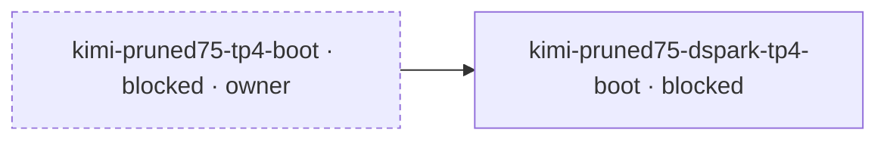

# Board — generated 2026-11-16 21:29 ET

## In flight
| where | owner | what |
|---|---|---|
| census | read-only in tick — booted nothing, claimed nothing, stopped nothing | **one six-node sweep at `2026-11-17T02:07:02Z`–`02:07:06Z`** on the `15:25 ET` base, whose own read was `2026-11-16T20:24:27Z` — **`5 h 43 min` earlier: no tick ran in between**, this workstation rebooted at `15:33 ET` and its sessions died with the reboot (its `uptime -s` reads `2026-11-16 15:33:21`). The shipped production serve still holds `.31`–`.34` — one container per rank, each `Up 4 days (healthy)` on image id `3f4480818acb`, serve-child pid count **1** on every rank under the bracketed `[s]glang.launch_server` pattern (the bare pattern reads **2** by its own `pgrep -f` self-match, re-proved at `02:10:53Z`), rank 0's in-container `/v1/models` **200** at `02:10:53Z` — and that serve is **excluded from research accounting** (owner directive 2026-10-28). Research containers fleet-wide: **0**; node volumes **0** on all six. `.30`/`.35` hold nothing. **Disk moved on all six roots in the `5 h 43 min` since the base read: net `-248,774,656 B`**, `.31` `-110,854,144` and `.35` `-59,142,144` the largest losers, `.34` the only gainer at `+29,446,144`; `MemAvailable` **rose on every node** in the same interval, `+4,807,848`–`+6,029,772 kB` on the four served ranks and `+55,240`/`+24,924 kB` on the two empty ones. No mechanism claimed for either mover. |
| pool | — (nobody drives it; units and reads re-proved each tick) | **serving on every host that serves it; reads answer through the mount on the head and on a worker.** The head's `beegfs-mgmtd`/`beegfs-meta`/`beegfs-storage` read `active`/`active`/`active` at `NRestarts` **0**; the other five still carry the known 5 s `beegfs-meta` loop — `NRestarts` `.31` **83494**, `.32` **83498**, `.33` **83501**, `.34` **83498**, `.35` **83483** — `+3,939` on `.31` over the `20,556 s` between reads, i.e. one restart per `5.218 s`, the loop's own growth and not a new failure; every non-head unit reads `activating`/`exit-code` because the read lands between two restarts. Through-mount proof at `2026-11-17T02:07Z`: hub entry count **103** on the head and **103** on `.35`; `stat -L` returns Kromoss `README.md` **7,685 B** on both of its snapshot revisions and on both hosts, and the ds4 arm's `config.json` **3,311 B** on both of its revisions and on both hosts. Pool `df -B1` used **`13,460,195,246,080 B`** on the head and **`13,460,199,440,384 B`** on `.35` (reads seconds apart, `4 MiB` difference — quoted, not averaged), `+224,919,552 B` over the **`13,459,970,326,528 B`** the register's `pool-content-fall-20261116` row measured at `19:07:40Z`, so the pool is not falling now. |
| queue | register snapshot `mad-science/queue.json` sha256 **`e5e8445b…`** — both blocks below are rendered from that copy, taken inside this tick so the sha names the bytes the table was drawn from | **198 tasks: 157 done, 33 queued, 8 blocked, 0 running — 41 open**, `task-queue.py check` rc=0, **0 live claims**. graph's counts line **8 blocked, 1 edges, 7 prose-gated, 0 question-gated, 0 question, 39 rows not drawn (--all)**. The snapshot's sha equals the live file's sha at `02:10Z`, so the register did not move under this tick — the first cycle today that has been true. |
| window | 0 live leases, 1 fence, no window lock in this clone or on the head | `.local/fleet-leases.json` **1,999 B** sha **`997acbd7…`**, byte-identical on this clone and the head's — `{"leases": []}` plus 1 `fenced` record over `.31`–`.34`, `reason` *production serve: DeepSeek-V4.1-Flash-1017 TP=4 — never displaced, stopped, or leased*; it names the live task `b020d2dd178343a5_9a582e9a0e63`, and this tick's own `docker inspect` returns `StartedAt` `2026-11-12T18:38:18.872734401Z` on rank 0, matching the record's `started_at`, so fence and containers agree. Its identity is `fenced_by` *"owner directive, session production-fence"*, `fenced_at` `2026-11-12T05:05:32Z`, `corrected_at` `2026-11-16T08:46:23Z`; it refuses a boot on those ranks by name and even under `--takeover`. |
| campaign | `h2h-20261107` — inactive since 2026-11-12 01:27:16 ET, zero leases of its own | user unit `sparkrun-campaign` reads **inactive**, `MainPID` **0**, `NRestarts` **0**, `ExecMainStatus` **0**, `ExecMainStartTimestamp` **Wed 2026-11-11 20:03:08 EST**, `InactiveEnterTimestamp` **Thu 2026-11-12 01:27:16 EST**; `state.json` mtime still `2026-11-12T06:00:57Z`. **Nine campaign roots exist and every one reports 0 live leases — 38 arms in total** (h2h 24, campaign-acceptance 7, seven roots of 1 each), so the fleet's claims are the fence and nothing else. |
| .30 | nothing live (no reservation) | `2026-11-17T02:07:03Z`: `docker ps -aq` **0**, running **0**, volumes **0** root **1,477,172,314,112 B avail** (**-36,610,048 B** vs the base's `2026-11-16T20:24:27Z` read) `MemAvailable` **121,764,380 kB** (**+55,240 kB**) beegfs mgmtd=active / meta=active / storage=active; `NRestarts` meta **0** `uptime -s` `2026-11-11 20:02:53`; `kho=off` **1**, CMA **0 /0**, `nr_free_cma` **0**; kernel `7.0.0-1025-nvidia` |
| .31 | **rank 0 of the production serve** — `sparkrun_b020d2dd178343a5_9a582e9a0e63_node_0`, image `3f4480818acb`, protected and excluded from research accounting; in-container `/v1/models` **200** at `2026-11-17T02:28:01Z` over rank 0's own hop, `sglang.launch_server` child pids **1** | `2026-11-17T02:07:03Z`: `docker ps -aq` **1**, running **1**, volumes **0** root **1,754,629,353,472 B avail** (**-110,854,144 B** vs the base's `2026-11-16T20:24:28Z` read) `MemAvailable` **13,959,360 kB** (**+4,807,848 kB**) beegfs mgmtd=inactive (success) / meta=activating / storage=active; `NRestarts` meta **83494** `uptime -s` `2026-11-11 20:03:52`; `kho=off` **1**, CMA **0 /0**, `nr_free_cma` **0**; kernel `7.0.0-1025-nvidia` |
| .32 | **rank 1 of the production serve** — `sparkrun_b020d2dd178343a5_9a582e9a0e63_node_1`, image `3f4480818acb`, protected and excluded from research accounting; in-container `/v1/models` **404** at `2026-11-17T02:28:01Z` over rank 1's own hop, `sglang.launch_server` child pids **1** | `2026-11-17T02:07:04Z`: `docker ps -aq` **1**, running **1**, volumes **0** root **1,923,687,874,560 B avail** (**-34,930,688 B** vs the base's `2026-11-16T20:24:29Z` read) `MemAvailable` **16,609,588 kB** (**+5,976,864 kB**) beegfs mgmtd=inactive (success) / meta=activating / storage=active; `NRestarts` meta **83498** `uptime -s` `2026-11-11 20:02:52`; `kho=off` **1**, CMA **0 /0**, `nr_free_cma` **0**; kernel `7.0.0-1025-nvidia` |
| .33 | **rank 2 of the production serve** — `sparkrun_b020d2dd178343a5_9a582e9a0e63_node_2`, image `3f4480818acb`, protected and excluded from research accounting; in-container `/v1/models` **404** at `2026-11-17T02:28:02Z` over rank 2's own hop, `sglang.launch_server` child pids **1** | `2026-11-17T02:07:04Z`: `docker ps -aq` **1**, running **1**, volumes **0** root **1,838,421,610,496 B avail** (**-36,683,776 B** vs the base's `2026-11-16T20:24:29Z` read) `MemAvailable` **16,718,320 kB** (**+6,029,772 kB**) beegfs mgmtd=inactive (success) / meta=activating / storage=active; `NRestarts` meta **83501** `uptime -s` `2026-11-11 20:02:52`; `kho=off` **1**, CMA **0 /0**, `nr_free_cma` **0**; kernel `7.0.0-1025-nvidia` |
| .34 | **rank 3 of the production serve** — `sparkrun_b020d2dd178343a5_9a582e9a0e63_node_3`, image `3f4480818acb`, protected and excluded from research accounting; in-container `/v1/models` **404** at `2026-11-17T02:28:02Z` over rank 3's own hop, `sglang.launch_server` child pids **1** | `2026-11-17T02:07:05Z`: `docker ps -aq` **1**, running **1**, volumes **0** root **1,308,485,300,224 B avail** (**+29,446,144 B** vs the base's `2026-11-16T20:24:30Z` read) `MemAvailable` **16,351,456 kB** (**+5,826,436 kB**) beegfs mgmtd=inactive (success) / meta=activating / storage=active; `NRestarts` meta **83498** `uptime -s` `2026-11-11 20:02:51`; `kho=off` **1**, CMA **0 /0**, `nr_free_cma` **0**; kernel `7.0.0-1025-nvidia` |
| .35 | nothing live (no reservation) | `2026-11-17T02:07:06Z`: `docker ps -aq` **0**, running **0**, volumes **0** root **1,199,592,955,904 B avail** (**-59,142,144 B** vs the base's `2026-11-16T20:24:31Z` read) `MemAvailable` **122,351,768 kB** (**+24,924 kB**) beegfs mgmtd=inactive (success) / meta=activating / storage=active; `NRestarts` meta **83483** `uptime -s` `2026-11-11 20:02:52`; `kho=off` **1**, CMA **0 /0**, `nr_free_cma` **0**; kernel `7.0.0-1025-nvidia` |
| publication | tick | base = the board composition on disk, titled `2026-11-16 15:25 ET` (content sha256 **`21d38b7e…`**), composed from a byte copy taken before the census; `--expect-remote-sha` names the board `origin/main` carries (**`4de3351f…`**, titled `2026-11-16 14:55 ET`). Every census, pool and node cell above is this tick's own read at `2026-11-17T02:07:02Z`–`02:07:06Z`; the queue blocks are `tools/task-queue.py` output over the snapshot named above. **This clone had drifted 2 commits ahead and 2 behind `origin/main`** (an unpushed board commit whose census only the boards it replaced could read, and an unpublished ledger note), so it was reset onto `2ff99cc` and the note re-landed as `edd48b1` — nothing dropped, and the worktree files another session holds were left byte-identical. **Re-published at 2026-11-16 21:29 ET because this tick's first composition typed ranks 1-3's in-container code from rank 0's answer instead of probing them**; every rank was then probed in-container over its own hop at `2026-11-17T02:28:01Z`-`2026-11-17T02:28:02Z` (`200` / `404` / `404` / `404`, unchanged) and the cells now carry measured codes with their read time. Title and census are the only things that moved; no census value was re-read, so the In-flight deltas still belong to the `02:07:02Z` sweep. |

## Work queue

| job | node cost | holds | state |
|---|---|---|---|
| `campaign-does-not-honour-the-.30-exclusion` — The campaign places tp>=4 work on .30 regardless of the memory-risk exclusion: a leaseable row that needs .30 is a live risk, so placement must be a field the director refuses to violate | — | — | queued — MECHANISM LANDED OFFLINE 2026-11-11 (commits `aa54000`, `ebf5c8e`, `298098d`, `08ff156`; no live lease and no live six-node boot has run, so the row stays open). One ledger, `<repo>/.local/fleet-leases.json` (flock + atomic write), and one … (full note: queue.json) |
| `sm121-ladder-acceptsampling-dflash` — SM121 survey ladder dies in llama-benchy warm-up: dflash_utils.build_dflash_verify_target_probs missing | single | — | queued — DENSE: the ladder leg cannot run on dsv41-sm121-dg:0.2.1. llama-benchy's first warm-up request takes the adapter's AcceptSampling top-k branch and /opt/dsv41/adapter/block_verify.py:106 calls dflash_utils.build_dflash_verify_target_probs, w… (full note: queue.json) |
| `kimi-pruned75-tp4-boot` — Kimi-K3.1-Pro pruned75 MXFP4: boot and ladder at TP=4 | quartet | — | blocked — OWNER 2026-11-11 (#3/#2): the owner chose the six-machine route (S3a) and does NOT authorize another four-machine attempt, so the "RE-BLOCKED on placement" paragraph above is superseded in both of its halves: no four-rank retry is ordered, … (full note: queue.json) — evidence: `receipts/kimi-k3.1-pro-pruned75-mxfp4-vllm-tp4.json` |
| `beegfs-meta-restart-loop-non-meta-hosts` — beegfs-meta restart-loops every 5 s on .31-.35, and the loop hides a failed state behind "activating" | single | — | queued — Measured 2026-11-09 07:03-07:05 ET, and it is the side effect of the fix `beegfs-units-restart-no` (done) blessed: /etc/systemd/system/beegfs-meta.service.d/oom.conf (mtime 2026-11-08 16:03 on .30, 16:05 on .31) sets OOMScoreAdjust plus Res… (full note: queue.json) |
| `head-mesh-cannot-reach-30` — head's ssh cannot reach .30 by name: the alias fails host key verification while the node's own address answers | single | — | queued — Measured 2026-11-09 08:02-08:06 ET and re-probed 08:23:46 ET, read-only from the head: ssh to the .30 name fails 'Host key verification failed', while the same node answers 'ok spark-41e1' when addressed by its own address from the same hea… (full note: queue.json) |
| `hf-cache-20261110-docs-only-repin-bundle` — Docs-only model drift from the 2026-11-10 cache update: 22 recipe rows across 10 repos ride their lane’s next boot (no boot of its own) | — | — | queued — Classes measured with refresh-sweep report mode + Hub tree diff: only README/LICENSE/LICENSE-GLM-5.3-Flash/.eval_results/images files differ between the pin and the Hub head for orcarouter/Nex-N2.5-mini-Uncensored-NVFP4, orcarouter/Qwen3.8-… (full note: queue.json) |
| `hf-cache-20261110-orcacyber-new-quant` — OrcaCyber-Nano-1.0 head adds a Q8_0 DFlash2 GGUF: decide whether the new quant earns an arm (shipped arms unaffected) | single | — | queued — The 2026-11-10 sweep: orcarouter/OrcaCyber-Nano-1.0 head 97140f3ff7e2 adds OrcaCyber-Nano-1.0-AI-Defense-DFlash2-Q8_0.gguf (~2.05 GB, + README/.gitattributes) over pin 1af1635aa22b. The two shipped arms (recipes/cybersec/orcacyber-nano-1.0-… (full note: queue.json) |
| `lane-survey-edge0-audio8-tts` — Media-lane survey: Edge0/Audio8-TTS-Realistic-Air - 0.6B DualAR TTS + bundled codec, TP<4 so surveyed only | — | — | queued — License class: Apache-2.0, unrestricted - ships as a normal arm with no eval-only banner. Weights: 601,159,424 params BF16 in model.safetensors 1.20 GB plus a separate 44.1 kHz codec.pth 1.35 GB; repo 2.39 GiB. Architecture: model_type arkt… (full note: queue.json) |
| `lane-survey-viggle-viggle-remake` — Media-lane survey: Viggle/Viggle-Remake - MiniMax-H3 video-to-video pipeline (GGUF/int8 + ComfyUI node), TP<4 so surveyed only | — | — | queued — License class: community/restricted - license_name minimax-h3-community-license, base_model MiniMaxAI/MiniMax-H3; the media lane already ships MiniMax-H3 arms under the same family and any arm must carry that license note. Repo 167,573,265,… (full note: queue.json) |
| `lane-survey-webai-official-twil-8b` — Explore-lane survey: webAI-Official/TwIL-8B - 8.8B Granite-family reasoning model, TP<4 so surveyed only | — | — | queued — License class: RESTRICTED / NON-COMMERCIAL - card license_name webai-non-commercial-license-ver.-1.0 (LICENSE.md), so any future arm ships with the eval-only banner plus an explicit non-commercial note in the recipe description and the lane… (full note: queue.json) |
| `queue-mode-done-sibling-holds-canary-row` — Queue mode will not lease a row whose recipe a done sibling already holds | single | — | queued — Measured 2026-11-10 00:05-00:16 ET, read-only: arm3-control-cell-canary-line (registered 23:21 by df9d40b) is the register's first queued row carrying both recipe: and tp: (quartet, tp 4, recipes/ds4/deepseek-v4.1-flash-knapcio-tp4-1m-sglan… (full note: queue.json) — evidence: `mad-science/STATUS.md 2026-11-10 00:15 ET queue row; commit 52b99ef` |
| `campaign-leases-tp4-onto-30` — The campaign leases memory-heavy TP4 quartets onto .30, which the owner ruling excludes | — | — | queued — MECHANISM LANDED OFFLINE 2026-11-11 (commits `aa54000`, `ebf5c8e`, `298098d`, `08ff156`; no live lease and no live six-node boot has run, so the row stays open). One ledger, `<repo>/.local/fleet-leases.json` (flock + atomic write), and one … (full note: queue.json) |
| `campaign-state-copy-re-nests` — The director's receipts root copies state.json back into a window subdir, so one campaign now holds 40 nested copies | — | — | queued — Measured 2026-11-11 05:1x ET, read-only on the head: `h2h-20261107/state.json` and 40 byte-identical copies at `h2h-20261107/tp12-window/state.json`, `.../tp12-window/tp12-window/state.json` and so on, one level deeper per run under that wi… (full note: queue.json) |
| `hf-cache-20261110-cache-consistency-defects` — HF cache consistency defects: four repos hf ignores on a refs/main byte defect, one on a broken absolute symlink, plus 204 GB of stray non-cache trees in the hub root | single | — | queued — Measured 2026-11-10 with `hf cache ls --no-truncate --show-warnings` on .30 after the update loop finished a pass. (1) refs/main carries a trailing newline in models--lodestones--Kromoss (41 B; ref a4fe9744, snapshots 0c5417ec + a4fe9744), … (full note: queue.json) |
| `hf-cache-20261110-template-ab-ifm-k2` — K2-Horizon template/code drift A/B: head c4f92a0d (0.9B) and 240f2de3 (7B-FP8) vs the shipped pins, template identity + one fixed request | single | — | queued — Class (b) from the 2026-11-10 cache sweep: no weight file changed, but IFM/K2-Horizon-0.9B head moves 383cb66347be -> c4f92a0d66e2 changing chat_template.jinja AND modeling_k2_horizon.py and REMOVING chat_template_asst_tool_gen.jinja + chat… (full note: queue.json) |
| `kimi-superexpert-ref-probe` — Probe shashanth-27xA9 Kimi-K3.1-Pro-SuperExpert-12GB through the transformers reference route | single | — | blocked — OWNER 2026-11-11 (directive): parked until the production serve returns — see `mad-science/TODO.md` §"Settled questions" `## Owner directive 2026-11-11 — TP1/TP2 parked until production returns`; no state change and no unblocking. \| estimat… (full note: queue.json) — evidence: `receipts/zz-kimi-k3.1-pro-superexpert-24b-q4p-ref-vllm.json` |
| `mem-guard-outlives-its-task` — A window arm's 6.0 GiB stop-rule guard outlives the arm, so the runner accumulates guards for tasks whose containers are gone | single | — | queued — CORRECTED 2026-11-11: the premise that a leaked guard can stop a future boot is false. `mem-guard.sh` issues `sparkrun stop` only for the TID in its own argv, so a guard whose task is gone is a stale no-op and cannot touch the next boot. Wh… (full note: queue.json) |
| `pool-target-probe-beegfs-ctl-absent` — Pool storage-target byte accounting is unreachable: beegfs-ctl is absent from .30 though beegfs-utils 20:8.4.1 is installed | single | — | queued — Measured 2026-11-10 15:05:59Z and again 15:06:29Z on .30: beegfs-ctl exits 127 (command not found) as the red user, and no binary named beegfs-ctl exists under /usr, /opt or /sbin at depth <=5, although dpkg lists beegfs-utils 20:8.4.1 plus… (full note: queue.json) |
| `pool-window-invalid-cells` — Gate every boot on a pool half-probe: a cell written while beegfs was down is invalid, not weak | single | — | queued — Pre-registered 2026-11-08 13:22 ET. Invalid windows: 11:27:56-12:07:30 and at/after 12:57:32 (B still open, Restart=no); admissible middle 12:07:30-12:57:31. Acceptance: run-arm (and any lane's harness) probes … (full note: queue.json) |
| `hf-cache-20261110-pool-fetch-gaps` — Pool gaps left by the 2026-11-10 cache update: two Hub heads, two pinned revisions, three absent repos, one private repo needing an org token | single | — | queued — CENSUS 2026-11-11 (`.scratch/tp4-20261111/RECEIPT-boot-a-and-pool-census-20261111.md`): the ds4 1017 body's 'double-count' is now an artifact, named: two revisions share one index — `08c8657f` (a link farm) and `1bae0e10` (the in-body revis… (full note: queue.json) |
| `board-publish-accepts-weaker-replacement` — publish replaces a better-grounded In-flight composition with a fresher byte-compatible one, and no guard notices | — | — | queued — The publish guards compare BYTES, so they cannot see that a replacement carried FEWER facts than the rows it removed. Measured 2026-11-11 20:18 ET on mad-science/STATUS.md: this tick's composition was accepted (publish rc=0, lint ok) while … (full note: queue.json) — evidence: `mad-science/STATUS.md@e4bea70` |
| `board-publish-keeps-in-flight-row-set` — A board published without one of the In-flight state rows passes every guard, because publish compares bytes and never the row set | single | — | queued — Measured 2026-11-11 03:17-03:25 ET. The 03:14 board (blob 2249062c) carried a `\| queue \|` row; the 03:17 board (commit `8e160b2`, blob 0f54622c) carried none, and a tick that composes on it and keeps the In flight body verbatim inherits the… (full note: queue.json) — evidence: `mad-science/STATUS.md at 8e160b2 / bc2cc38 / 9ae7cd4` |
| `cache-audit-pool-budget` — `tools/cache-audit.py --budget-gb`: add a pool mode that judges the one shared HF pool against 90 % of capacity | single | — | queued — `tools/cache-audit.py --budget-gb` still measures per node, but the HF cache is one shared pool: all six nodes report the same usage through the shared hub, so the audit flags the whole fleet at once and no node can be read as over- or unde… (full note: queue.json) |
| `executor-release-host-claim-on-failure` — An executor that stops observing a launch must release the sparkrun host claims it holds | single | — | queued — Measured 2026-11-08 04:09-04:13 ET: kimi-k3.1-pro-pruned75-mxfp4-dspark-vllm-tp4 attempt 1 launcher (pid 1883449) held .30-.33 while its own registry distribution failed at 414.7 s (637.1 MiB at 1.6 MiB/s from docker.io, then … (full note: queue.json) |
| `fleet-boot-without-lease-record` — A four-rank boot serves with no lease in either ledger and no window lock | — | — | queued — Measured 2026-11-11 19:15:59Z-19:31Z, read-only: task `b020d2dd178343a5_55dafcf24cde` runs one rank each on `.31`-`.34` (image `littlecedar/dgx-spark-dsv41:canary-roce-aff52fa5`, id `3f4480818acb`, `Up` and healthy, `/v1/models` 200 serving… (full note: queue.json) |
| `pool-content-fall-20261116` — Pool used fell 501 GB in 6.5 h while every repo entry stayed: name the deletion before the next budget claim | — | — | queued — Measured read-only from the head at 2026-11-16T19:07:40Z: df -B1 on /mnt/beegfs reads used 13,459,970,326,528 B, which is 501,316,845,568 B BELOW the 13,961,287,172,096 B the 06:39 board carried at 11:23:54Z. It is not HF content vanishing:… (full note: queue.json) |
| `ripple-65b-nvfp4-dflash2-tp1` — Ripple-65B Preview NVFP4 TP=1 + DFlash2 drafter: ladder + suite (zz- probe) | single | — | blocked — OWNER 2026-11-11 (directive): parked until the production serve returns — see `mad-science/TODO.md` §"Settled questions" `## Owner directive 2026-11-11 — TP1/TP2 parked until production returns`; no state change and no unblocking. \| The dra… (full note: queue.json) |
| `ripple-65b-nvfp4-tp1` — Ripple-65B Preview NVFP4 TP=1: first boot, ladder + suite (zz- probe) | single | — | blocked — OWNER 2026-11-11 (directive): parked until the production serve returns — see `mad-science/TODO.md` §"Settled questions" `## Owner directive 2026-11-11 — TP1/TP2 parked until production returns`; no state change and no unblocking. \| First b… (full note: queue.json) |
| `runtime-cache-stale-tree-gc` — Delete the stale runtime-cache trees the 2026-11-12 audit approved (732 GB planned, never executed) | single | — | queued — BATCH 1 EXECUTED 2026-11-16T16:33:28Z — 52 items / 554.54 GB deleted on '.30'-'.34' ('.30' 22.53, '.31' 96.38, '.32' 143.49, '.33' 143.68, '.34' 148.46 GB) and '.35' released 0.00 GB — receipt '.scratch/gc-20261116/census.md' rev 3 §Executi… (full note: queue.json) |
| `sparkrun-single-gid-index-for-two-hcas` — sparkrun injects one GID index across two HCAs whose tables disagree | — | — | queued — REPORT-ONLY IN THIS REPO (sparkrun-side defect; no `recipe`/`tp`, not bootable). One derived `NCCL_IB_GID_INDEX` applied to every HCA the probe names is wrong when the rails' GID tables disagree: `scripts/ib_detect.sh:44-45` derives the ind… (full note: queue.json) |
| `media-idol-3dgs-boot` — Idol single-image 3DGS trial: SDK on the tracked fixture, receipt = .ply 3DGS header + Gaussian count + wall, one node | single | — | blocked — Authored, not booted. TP=1 single-node script arm; a four-rank measurement is what needs a declared window and this is not one, so no lease applies. BLOCKER NAMED 2026-11-09 (owner answer `#81`): the facebook DINOv3 licence is not accepted … (full note: queue.json) — evidence: `head:~/benchmarks/tp1-20261112/idol-dinov3-gate-probe.log` |
| `campaign-ignores-declared-window` — The campaign leases and launches onto ranks another session has declared in .local/fleet-window.lock | — | — | queued — MECHANISM LANDED OFFLINE 2026-11-11 (commits `aa54000`, `ebf5c8e`, `298098d`, `08ff156`; no live lease and no live six-node boot has run, so the row stays open). One ledger, `<repo>/.local/fleet-leases.json` (flock + atomic write), and one … (full note: queue.json) |
| `kimi-pruned75-dspark-tp4-boot` — Kimi-K3.1-Pro pruned75 + DSpark k=5 drafter: boot, acceptance and ladder vs the plain arm | quartet | kimi-pruned75-tp4-boot | blocked — OWNER 2026-11-11 (#3/#2): the owner chose the six-machine route (S3a) and does NOT authorize another four-machine attempt, so no four-rank drafter boot is ordered either; any future rank on `.30` is legal only inside an explicitly declared … (full note: queue.json) — evidence: `receipts/kimi-k3.1-pro-pruned75-mxfp4-dspark-vllm-tp4.json` |
| `ripple-65b-bf16-tp2` — Ripple-65B Preview BF16 TP=2: quality control + the 1M-context cell (zz- probe) | pair | — | blocked — OWNER 2026-11-11 (directive): parked until the production serve returns — see `mad-science/TODO.md` §"Settled questions" `## Owner directive 2026-11-11 — TP1/TP2 parked until production returns`; no state change and no unblocking. \| The unq… (full note: queue.json) — evidence: `receipts/zz-ripple-65b-preview-bf16-tp2-vllm.json` |
| `webai-twil-8b-eval-only-arm` — Author and ship the webAI 8.8B eval-only arm (webAI-Official/TwIL-8B): recipe, license banner, lane README notice, index row | — | — | queued — Authoring work, no hardware yet and no recipe, so not machine-runnable. LICENSE (owner 2026-11-12: "Accept and ship it."): card `license_name: webai-non-commercial-license-ver.-1.0`, so the arm ships EVAL-ONLY under AGENTS.md §Recipes, with… (full note: queue.json) |
| `campaign-six-node-claim` — The director claims and leases a six-node tp 2 x pp 3 shape: the register cannot express six ranks, so the claim itself is the work | — | — | queued — MECHANISM LANDED OFFLINE 2026-11-11 (commits `aa54000`, `ebf5c8e`, `298098d`, `08ff156`; no live lease and no live six-node boot has run, so the row stays open). One ledger, `<repo>/.local/fleet-leases.json` (flock + atomic write), and one … (full note: queue.json) |
| `kimi-k31-indexer-block-vs-blhnc-layout` — Kimi K3.1 indexer needs 64-token kernel blocks; KDA/mamba forces a 5,760-token block and BLHNC | — | — | queued — AUTHORING 2026-11-11, estimate 4 h provisional. Engine-side blocker, not a memory one: the DeepSeek-V32 indexer needs 64-token kernel blocks, while the KDA/mamba alignment forces the KV manager block to 5,760 tokens (`interface.py:1115`, 'S… (full note: queue.json) — evidence: ``.scratch/kimi-six-engine-verdict-20261111.md`: the pinned image's engine `v0.33.0rc1.dev1016+g06129ab02` (boot6 rank-1 log), #66037 merged as `4088c283` 2026-11-09T04:31Z and absent from the pinned tree and from every release, GHCR tags ending at `2026110702` both resolving to the pinned digest, Docker Hub `eugr/spark-vllm` latest 2026-11-07, and the knob audit that leaves only the rebuild; the row stays queued on an image built from main ≥ `4088c283`` |
| `mech-cites-0-4-3` — Re-derive the remaining 117 recipes/MECHANICS.md citations against the installed sparkrun build | — | — | queued — d0d050f landed 27 moved anchors + 13 byte-identical controls for §The one rule and §Key reference §Format and identity, then stopped. Remaining 117 anchors still carry 0.4.2/0.4.0 numbering: the rest of §Key reference (from §Model and servi… (full note: queue.json) |
| `metrics-instrument-confound` — Metrics knob decomposition: one identical recipe, metrics-on vs metrics-off, name the performance-impacting knobs (`#68` ROM bar) | — | — | queued — Owner's `#68` authorises the decomposition that makes the comparability bar checkable, and it must separate THREE regimes, because only one of them can bias a cell: (1) `tools/run-arm.sh`'s scrape is a single exec AFTER the cell and before … (full note: queue.json) |
| `minimax-viggle-remake-eval-only-arm` — Author and ship the MiniMax video eval-only arm (Viggle/Viggle-Remake): ComfyUI node route, license banner, lane README notice, index row | — | — | queued — Authoring work, no hardware yet and no recipe, so not machine-runnable. LICENSE (owner 2026-11-12: "Accept and ship it."): card `license_name: minimax-h3-community-license`, base_model MiniMaxAI/MiniMax-H3 — community-restricted, so the arm… (full note: queue.json) |
| `ds4-fp4-kv-layout-sm121-port` — DS4 1017 SM121: port the V41/V41_FP4 KV layout so fp4 KV is admissible — dtype is not a lever today, and sizing lies about fp4 | quartet | — | blocked — CORRECTION TO THE FP8-KV IDEA this lane carried: KV dtype is NOT a lever here. The line is already `kv_dtype: fp8_e4m3`, and `fp8_ds_mla` is not a value this engine knows — zero occurrences in image commit `103ad321`; it is vLLM's packed ML… (full note: queue.json) |

## Landed session
| time ET | commit | one clause |
|---|---|---|
| 08:10 | `e79b489` | feat(qwen4): boot-verified UD-Q3_K_XL GGUF arm for Qwen3.8-Flash-Next at TP=1 |
| 09:03 | `dcf98a2` | docs(qwen4): GGUF viability arm in the lane index; register row answered by boot |
| 10:01 | `276c149` | ship two owner-approved eval-only arms: TwIL-8B and Viggle Remake |
| 10:18 | `10ed155` | rule the head-node launch precondition, with its reason attached |
| 11:02 | `ba7b9b3` | the six roots' fall is the BeeGFS pool intake, measured to 311 KB |
| 11:24 | `07485e0` | mask the head hostname the GGUF register note carried |
| 13:03 | `417ad7e` | ledger: record the board tick that landed and the push it could not make |
| 13:37 | `bf59c0d` | note the GGUF arm's launch host and cluster resolution in the lane doc and register row |
| 14:34 | `2865aa2` | drop the head hostname from the GGUF arm's launch-host line |
| 14:50 | `24aae67` | drop the second count from the unpinned-model-revision note |
| 14:52 | `05944df` | record two stand-down board ticks and close the pool fall to an identity |
| 14:52 | `e3a2839` | board: 13:47 ET refresh, and the pool lost half a terabyte unattributed |
| 14:54 | `cc7b292` | name the half-terabyte pool fall: the `sparkrun/` tree is gone |
| 08:59 | runtime-cache GC (no commit) | the approved `runtime-cache-stale-tree-gc` executed against its own 52-row sidecar: health gate PASS first (the fenced serve answering), then **52 of 52 planned items deleted, 554.54 GB freed** — node-local `runtime-cache` trees for non-1017 and vision variants plus dangling images, no `docker image prune`, no list expansion; receipt `.scratch/gc-20261116/run-20261116T135644Z.md`, register row left open for its owner |
| 14:55 | board refresh | census re-read at `2026-11-16T19:52:54Z`–`2026-11-16T19:52:59Z` on the `13:47 ET` base, the served ranks' readiness and engine children probed, the pool re-proved by a through-mount `stat -L` on the head and `.35` (103 hub entries), the fence and all nine campaign roots re-read, the register re-snapshotted with both queue blocks re-rendered from it, and the 14 commit(s) the base board did not carry folded from their own subjects |
| 14:59 | `f2344ec` | ledger records the tick that stood down behind the peer's fresher board and hands the pool `df` decomposition — the six nodes' own `/srv/beegfs/storage` totals — to a cell it could not change |
| 07:15 | `2be97f0` | record that the close-out landed inside a peer's commit |
| 07:27 | `6f22bb9` | record the 07:05 tick that stood down behind a peer's 06:39 board |
| 07:35 | `ae9db99` | log the 11:24Z fleet re-read and the fence's id-as-digest |
| 07:57 | `d03d519` | queue the rest of the MECHANICS.md citation re-derivation |
| 09:21 | `055b491` | board: refresh on the 06:39 base with an `11:28:25Z` census |
| 12:09 | `e2ef062` | re-take the stated recipe counts for the three arms that landed |
| 15:03 | `e274094` | record the tick that stood down at the publish guard, and the GC arithmetic it cannot close |
| 15:08 | `91ed9f7` | ledger: record the tick that stood down behind a fresher peer board |
| 15:11 | `7651da1` | record the tick that stood down and refute the board's uptime cell |
| 15:23 | board refresh | census re-read at `2026-11-16T20:18:36Z`–`2026-11-16T20:18:39Z` on the base board it replaces, whose own cells were read `2026-11-16T20:18:36Z` — `0 h 00 min` apart: the production serve alone on `.31`–`.34` with every rank's `sglang.launch_server` matching and rank 0 answering `/v1/models` 200 in-container, `.30`/`.35` empty, research containers 0 and volumes 0 fleet-wide; the pool re-proved by units and two through-mount `stat -L` reads on the head and on `.35` (103 hub entries, up one from the base, newest `models--unsloth--Qwen3.8-Flash-Next-GGUF`); the fence re-read and its identity checked against this tick's own `StartedAt`; the campaign and register re-read (register `e84d7bf6…`, 41 open) with both queue blocks re-rendered from the snapshot |
| 15:05 | `f297d2b` | name the pool GC in the stand-down note and drop its `Up 3 days` clause |
| 15:10 | `10790ee` | ledger: record the tick that stood down behind a fresher peer board |
| 08:59 | runtime-cache GC (no commit) | the approved `runtime-cache-stale-tree-gc` executed against its own 52-row sidecar: health gate PASS first (the fenced serve answering), then **52 of 52 planned items deleted, 554.54 GB freed** — node-local `runtime-cache` trees for non-1017 and vision variants plus dangling images, no `docker image prune`, no list expansion; receipt `.scratch/gc-20261116/run-20261116T135644Z.md`, register row left open for its owner |
| 15:25 | board refresh | census re-read at `2026-11-16T20:24:27Z`–`2026-11-16T20:24:32Z` on the `13:47 ET` base, the served ranks' readiness and engine children probed, the pool re-proved by a through-mount `stat -L` on the head and `.35` (103 hub entries), the fence and all nine campaign roots re-read, the register re-snapshotted with both queue blocks re-rendered from it, and the 3 commit(s) the base board did not carry folded from their own subjects |
| 15:13 | `112f1f7` | record the stand-down and name the `pgrep` self-match before it ships |
| 15:23 | `716d42f` | disclose the peer sections the stand-down commit published |
| 15:25 | `f922c23` | record the seventh stand-down of this hour's board ticks |
| 15:28 | `2ff99cc` | queue the 501 GB pool fall the GC batch did not cause, and record standing down |
| 21:07 | `edd48b1` | re-land the ledger note this clone's reset onto `origin/main` would otherwise have dropped |
| 21:07 | board refresh | census re-read at `2026-11-17T02:07:02Z`–`02:07:06Z` on the `15:25 ET` base after a `5 h 43 min` gap (the workstation rebooted at `15:33 ET`), the served ranks' readiness and engine children probed, the pool re-proved by through-mount `stat -L` reads on the head and `.35`, the fence and all nine campaign roots re-read, the register re-snapshotted with both queue blocks re-rendered from it, and the 4 commit(s) the base board did not carry folded from their own subjects |

