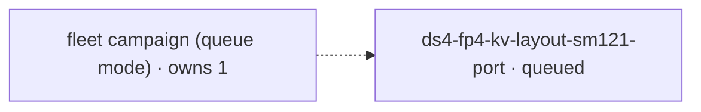

# Board
_Generated 2026-11-23 04:36 ET_

## In flight
| where | owner | what |
|---|---|---|
| census | read-only in tick — booted nothing, claimed nothing, stopped nothing, evicted nothing | read `2026-11-23T09:36:09Z`–`2026-11-23T09:36:11Z` (each node's own `date -u`) on the base census `2026-11-23T09:12:29Z`, **0 h 23 min 40 s** after it: **1 containers, 0 volumes** fleet-wide; **no research rank**; no node probed a serve |
| pool | — (nobody drives it; head units re-proved each tick) | head: `beegfs-mgmtd` **active** (Result success, NRestarts 0, **+0** on the base) · `beegfs-meta` **active** (Result success, NRestarts 0, **+0** on the base) · `beegfs-storage` **active** (Result success, NRestarts 0, **+0** on the base); worker unit states and the pool's through-mount reads are not part of this census |
| queue | register snapshot `bcbea761…`; both blocks below rendered from it | `mad-science/queue.json` sha256 **`bcbea761c0d5fcb9062eac2c83b9554cc9ec9cae55474ad5e6900039bdd45769`** read locally: **253 tasks: 252 done, 1 queued, 0 blocked, 0 running — 1 open**; the head clone reads **`9a920a3f…`**, **differs** |
| window | **no manual lock** at this read | `.local/fleet-window.lock` is **absent** on the head (read `2026-11-23T09:36:11Z`) |
| campaign | `sparkrun-campaign` — active, no lease | head user unit `sparkrun-campaign` reads **`active`** / **`running`** (`MainPID` **3,930,275**, `NRestarts` **0**, **+0** on the base); the lease ledger holds **0 lease(s)** and fence(s) `tp-le2-20261120` |
| lease | **1 fence(s), 0 lease(s)** | the head's repo ledger `.local/fleet-leases.json` (389 B, sha **`ec09509d…`**, mtime **`2026-11-21 03:04:12.907935197 -0500`** local) holds fence **`tp-le2-20261120`** on `.31`, `.32`, `.33`, `.34` (`fenced_at` `2026-11-20T07:25:27Z`, owner directive 2026-11-20: production serve protected, serve `58cddf1c62ba6578_b8865cad5863` / image `986795bcd7f4`) and **0 lease(s)** |
| publication | tick | fresh census (`2026-11-23T09:36:09Z`–`2026-11-23T09:36:11Z`) written to `2026-11-23T093608Z.json` and composed on the base census `2026-11-23T09:12:29Z`; the queue blocks are rendered from `mad-science/queue.json` sha **`bcbea761…`**, and the landed rows from `git log --since=2026-11-23T09:12:29Z` |
| .30 | **nothing live (no reservation)** — idle | `2026-11-23T09:36:09Z` (`spark-41e1`): `docker ps -aq` **1**, running **0**, volumes **0**, `:8000` listeners **0** root **986,984,427,520 B avail** (-76,055,973,888, fell) · **2,840,046,391,296 B used** (+76,055,973,888, rose) boot **`2026-11-19T20:06:40Z`** (`btime`), `uptime` **307,768 s** `MemTotal` **127,598,704 kB** (+0), `MemAvailable` **121,877,264 kB** (-45,768), `Cached` **101,624,192 kB** (+18,331,912), `AnonPages` **936,980 kB** (-64) ring **256** events all-types (+0), **0** in-window lifecycle and **0** in-window `exec`, oldest `2026-11-22T21:20:22.121475690-05:00 container exec_start: ba`, newest `2026-11-23T04:29:13.485711945-05:00 image create sha256:2fe2` |
| .31 | **nothing live (no reservation)** — idle | `2026-11-23T09:36:09Z` (`spark-d325`): `docker ps -aq` **0**, running **0**, volumes **0**, `:8000` listeners **0** root **1,297,354,862,592 B avail** (-1,941,504, fell) · **2,529,675,956,224 B used** (+1,941,504, rose) boot **`2026-11-19T20:11:15Z`** (`btime`), `uptime` **307,494 s** `MemTotal` **127,598,700 kB** (+0), `MemAvailable` **123,025,440 kB** (+44,048), `Cached` **5,351,820 kB** (+10,332), `AnonPages` **283,736 kB** (-15,432) ring **256** events all-types (+0), **0** in-window lifecycle and **0** in-window `exec`, oldest `2026-11-23T03:41:53.785945910-05:00 image pull ghcr.io/miaai`, newest `2026-11-23T04:06:51.057898412-05:00 container destroy 44f102` |
| .32 | **nothing live (no reservation)** — idle | `2026-11-23T09:36:10Z` (`spark-ec1d`): `docker ps -aq` **0**, running **0**, volumes **0**, `:8000` listeners **0** root **1,381,550,575,616 B avail** (-1,941,504, fell) · **2,445,480,128,512 B used** (+1,941,504, rose) boot **`2026-11-19T20:14:21Z`** (`btime`), `uptime` **307,308 s** `MemTotal` **127,598,640 kB** (+0), `MemAvailable` **123,132,912 kB** (-25,252), `Cached` **4,553,732 kB** (+397,116), `AnonPages` **240,716 kB** (-56) ring **256** events all-types (+0), **0** in-window lifecycle and **0** in-window `exec`, oldest `2026-11-23T01:59:33.460397050-05:00 container exec_start: sh`, newest `2026-11-23T04:06:50.410818381-05:00 container destroy cb6a01` |
| .33 | **nothing live (no reservation)** — idle | `2026-11-23T09:36:10Z` (`spark-3578`): `docker ps -aq` **0**, running **0**, volumes **0**, `:8000` listeners **0** root **1,252,246,962,176 B avail** (-1,941,504, fell) · **2,574,783,741,952 B used** (+1,941,504, rose) boot **`2026-11-19T20:12:55Z`** (`btime`), `uptime` **307,395 s** `MemTotal` **127,598,636 kB** (+0), `MemAvailable` **123,186,368 kB** (+30,964), `Cached` **4,049,568 kB** (+398,464), `AnonPages` **231,900 kB** (+1,468) ring **256** events all-types (+0), **0** in-window lifecycle and **0** in-window `exec`, oldest `2026-11-23T01:59:33.876997831-05:00 container exec_start: sh`, newest `2026-11-23T04:06:50.728996479-05:00 container destroy f3d7af` |
| .34 | **nothing live (no reservation)** — idle | `2026-11-23T09:36:10Z` (`spark-324e`): `docker ps -aq` **0**, running **0**, volumes **0**, `:8000` listeners **0** root **1,094,297,812,992 B avail** (-1,933,312, fell) · **2,732,733,005,824 B used** (+1,933,312, rose) boot **`2026-11-19T20:09:04Z`** (`btime`), `uptime` **307,626 s** `MemTotal` **127,598,704 kB** (+0), `MemAvailable` **122,856,668 kB** (+3,412), `Cached` **4,409,652 kB** (+9,164), `AnonPages` **245,488 kB** (-2,004) ring **256** events all-types (+0), **0** in-window lifecycle and **0** in-window `exec`, oldest `2026-11-23T01:59:34.307824457-05:00 container exec_die 1b8d4`, newest `2026-11-23T04:06:50.706483124-05:00 container destroy 78208a` |
| .35 | **nothing live (no reservation)** — idle | `2026-11-23T09:36:11Z` (`spark-383f`): `docker ps -aq` **0**, running **0**, volumes **0**, `:8000` listeners **0** root **971,342,323,712 B avail** (-10,330,112, fell) · **2,855,688,495,104 B used** (+10,330,112, rose) boot **`2026-11-19T20:07:56Z`** (`btime`), `uptime` **307,694 s** `MemTotal` **127,598,700 kB** (+0), `MemAvailable` **122,886,096 kB** (+41,880), `Cached` **115,759,104 kB** (+6,356), `AnonPages` **292,680 kB** (-5,152) ring **256** events all-types (+0), **0** in-window lifecycle and **0** in-window `exec`, oldest `2026-11-22T21:05:06.535546060-05:00 container exec_start: sh`, newest `2026-11-22T21:19:48.088204374-05:00 container destroy 8b4cc1` |

## Work Queue

| job | node cost | blockers | holds | status | summary |
|---|---|---|---|---|---|
| `ds4-fp4-kv-layout-sm121-port` — DS4 1017 SM121: port the V41/V41_FP4 KV layout so fp4 KV is admissible — dtype is not a lever today, and sizing lies about fp4 | quartet | — | — | queued | Queued, boot pending: the SGLang V41_FP4 KV-layout port landed (9d2c2166, kernel gate 2026-11-22) and the FP4-KV image is built/pushed (aneda@b5de5272); the quartet boot validates 528/288 B/token plus a needle cell. |

## Completed Work
Window: commits since `2026-11-23T09:12:29Z` — the base census stamp, later than the 24 h start `2026-11-22T09:36:08Z`; older rows are not shown.

| time ET | commit | one clause |
|---|---|---|
| 11-23 04:12 | `85c88ba1` | Refresh the status board: a 2026-11-23T091228Z census |
| 11-23 04:34 | `2bffe8ec` | Close the .30 lease proof: guardrails pass, lease acquire/release cycle works |
