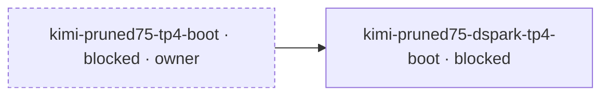

# Board — generated 2026-11-16 04:26 ET
## In flight
| where | owner | what |
|---|---|---|
| census | read-only in tick — booted nothing, claimed nothing, stopped nothing | **one six-node sweep at `2026-11-16T09:00:33Z`–`2026-11-16T09:00:36Z`**: shipped production serve holds `.31`–`.34` and **no research container runs on any node**. Production, probed then **excluded research accounting** (owner directive 2026-10-28): one container per rank (`sparkrun_b020d2dd178343a5_9a582e9a0e63_node_0` … `_node_3`), each `Up 3 days (healthy)`, created `2026-11-12T18:38:18Z`, image id `3f4480818acb` (digest `sha256:3f4480818acb…a4d5`); `/v1/models` from rank 0 answers **200** `deepseek-ai/DeepSeek-V4.1-Flash-1017` (max_model_len 1048576). **Research containers: 0** — `.30` and `.35` each carry `docker ps -aq` **0** and volumes **0**, and no node carries a research container. The `03:39 ET` base read the same fleet 39 min earlier (`08:21:32Z`). |
| pool | — (nobody drives it; units and reads re-proved each tick) | **serving; reads answer through mount.** Head's `beegfs-mgmtd`/`beegfs-meta`/`beegfs-storage` read `active` `Result=success` `NRestarts` **0**; the other five still carry the known 5 s `beegfs-meta` restart loop (`NRestarts` `.31` **71690**, `.32` **71693**, `.33` **71695**, `.34` **71694**, `.35` **71681**, +449/+449/+449/+449/+449 on the base read, the loop's own growth, no new failure). `df -B1` on the mount at `2026-11-16T09:00:36Z`: used **13,961,150,332,928 B**, avail **10,230,079,422,464 B**, total **24,191,229,755,392 B** — used **+69,206,016 B** on the base board's `2026-11-16T08:21:55Z` read, a ~39 min window. Reads answer from a worker as well as from the head: `stat -L` on the shipped cybersec snapshot `OrcaCyber-Nano-1.0-AI-Defense-Mix-13G.gguf` returns **12,993,304,352 B** on `.35` and the head serves **102** hub entries. |
| queue | register snapshot `mad-science/queue.json` sha256 **`9c62a1f3…`** — both blocks below rendered from that copy | live file matched at read (`9c62a1f3…`, byte-identical). **196 tasks: 155 done, 33 queued, 8 blocked, 0 running — 41 open**, `task-queue.py check` rc=0, **0 live claims**, **0 questions**. The register is the `03:39 ET` base's own, unchanged at 196/41 open. graph's counts line **8 blocked, 1 edges, 7 prose-gated, 0 question-gated, 0 question, 39 rows not drawn (--all)** |
| window | 0 live leases, 1 fence, window lock absent | `.local/fleet-leases.json` **1999 B** sha **`997acbd7…`** mtime `2026-11-16 03:47:03 ET` (`{"leases": []}`): **no live lease**. The one `fenced` record is **identity-corrected as of `2026-11-16T08:46:23Z`** by `session fleet-gc-census (census only, no container touched)` — it now names the live task `b020d2dd178343a5_9a582e9a0e63`, image id `3f4480818acb` (digest `sha256:3f4480818acb…`), `started_at` `2026-11-12T18:38:18.872734401Z`, `/v1/models` 200, with the `docker inspect` line as evidence — so the stale identity the base board reported (`previous_task_id` `b020d2dd178343a5_0abd7d020db4`) is closed; hosts, reason, `fenced_by` and `fenced_at` unchanged. No `.local/fleet-window.lock` in this clone or on the head, conflict=0 conflict copies. |
| campaign | `h2h-20261107` — inactive since 01:27:16 ET on 2026-11-12, zero leases its own | `h2h-20261107` user unit `sparkrun-campaign` reads **inactive**, `MainPID` **0**, `ExecMainStatus` **0** `Result` **success**; no restart in four days. `state.json` **62,990 B** mtime `2026-11-12 01:00:57 ET` sha **`85c1b777…`** — unchanged, 24 arms, **0 leases** in the root file and in every campaign state under `~/benchmarks`; no state file written in the last two hours. **The register's `campaign-state-copy-re-nests` row does not hold on this tree**: `h2h-20261107/tp12-window` is a symlink to `.`, so a recursive walk reaches the one root `state.json` repeatedly while `find -name state.json` counts **1** file — the row's "40 nested copies" is that walk's own loop, not copies. |
| .30 | nothing live (no reservation) | `2026-11-16T09:00:36Z`: `docker ps -aq` **0**, running **0**, volumes **0**; root **1,466,392,915,968 B avail** / **2,360,637,902,848 B used** (**−7,020,544 B** avail vs base read); `MemAvailable` **121,939,208 kB** (116.3 GiB) (**−16,016 kB** on base read); beegfs mgmtd=active / meta=active / storage=active; `NRestarts` mgmtd **0**, meta **0**, storage **0**; `uptime -s` `2026-11-11 20:02:53`; `kho=off` **1**, `CmaTotal/CmaFree` **0/0**, `nr_free_cma` **0**. |
| .31 | **rank 0 production serve** — `sparkrun_b020d2dd178343a5_9a582e9a0e63_node_0`, image `3f4480818acb`, protected and excluded research accounting | `2026-11-16T09:00:36Z`: `docker ps -aq` **1**, running **1**, volumes **0** (`3f4480818acb sparkrun_b020d2dd178343a5_9a582e9a0e63_node_0 Up 3 days (healthy)`); root **1,664,146,640,896 B avail** / **2,162,884,177,920 B used** (**−12,902,400 B** avail vs base read); `MemAvailable` **15,144,692 kB** (14.4 GiB) (**−41,632 kB** on base read); beegfs mgmtd=inactive / meta=activating / storage=active; `NRestarts` mgmtd **0**, meta **71690**, storage **0**; `uptime -s` `2026-11-11 20:03:52`; `kho=off` **1**, `CmaTotal/CmaFree` **0/0**, `nr_free_cma` **0**. |
| .32 | **rank 1 of production serve** — `sparkrun_b020d2dd178343a5_9a582e9a0e63_node_1`, image `3f4480818acb`, protected and excluded research accounting | `2026-11-16T09:00:36Z`: `docker ps -aq` **1**, running **1**, volumes **0** (`3f4480818acb sparkrun_b020d2dd178343a5_9a582e9a0e63_node_1 Up 3 days (healthy)`); root **1,789,209,735,168 B avail** / **2,037,820,968,960 B used** (**−12,570,624 B** avail vs base read); `MemAvailable` **16,413,532 kB** (15.7 GiB) (**+306,440 kB** on base read); beegfs mgmtd=inactive / meta=activating / storage=active; `NRestarts` mgmtd **0**, meta **71693**, storage **0**; `uptime -s` `2026-11-11 20:02:52`; `kho=off` **1**, `CmaTotal/CmaFree` **0/0**, `nr_free_cma` **0**. |
| .33 | **rank 2 of production serve** — `sparkrun_b020d2dd178343a5_9a582e9a0e63_node_2`, image `3f4480818acb`, protected and excluded research accounting | `2026-11-16T09:00:36Z`: `docker ps -aq` **1**, running **1**, volumes **0** (`3f4480818acb sparkrun_b020d2dd178343a5_9a582e9a0e63_node_2 Up 3 days (healthy)`); root **1,706,570,293,248 B avail** / **2,120,460,410,880 B used** (**−12,578,816 B** avail vs base read); `MemAvailable` **16,757,060 kB** (16.0 GiB) (**−34,784 kB** on base read); beegfs mgmtd=inactive / meta=activating / storage=active; `NRestarts` mgmtd **0**, meta **71695**, storage **0**; `uptime -s` `2026-11-11 20:02:52`; `kho=off` **1**, `CmaTotal/CmaFree` **0/0**, `nr_free_cma` **0**. |
| .34 | **rank 3 of production serve** — `sparkrun_b020d2dd178343a5_9a582e9a0e63_node_3`, image `3f4480818acb`, protected and excluded research accounting | `2026-11-16T09:00:36Z`: `docker ps -aq` **1**, running **1**, volumes **0** (`3f4480818acb sparkrun_b020d2dd178343a5_9a582e9a0e63_node_3 Up 3 days (healthy)`); root **1,159,435,763,712 B avail** / **2,667,595,055,104 B used** (**−12,570,624 B** avail vs base read); `MemAvailable` **16,618,964 kB** (15.8 GiB) (**+563,784 kB** on base read); beegfs mgmtd=inactive / meta=activating / storage=active; `NRestarts` mgmtd **0**, meta **71694**, storage **0**; `uptime -s` `2026-11-11 20:02:51`; `kho=off` **1**, `CmaTotal/CmaFree` **0/0**, `nr_free_cma` **0**. |
| .35 | nothing live (no reservation) | `2026-11-16T09:00:36Z`: `docker ps -aq` **0**, running **0**, volumes **0**; root **1,215,279,099,904 B avail** / **2,611,751,718,912 B used** (**−11,997,184 B** avail vs base read); `MemAvailable` **123,130,544 kB** (117.4 GiB) (**+32,648 kB** on base read); beegfs mgmtd=inactive / meta=activating / storage=active; `NRestarts` mgmtd **0**, meta **71681**, storage **0**; `uptime -s` `2026-11-11 20:02:52`; `kho=off` **1**, `CmaTotal/CmaFree` **0/0**, `nr_free_cma` **0**. |
| publication | tick | base = the `2026-11-16 04:20 ET` board, content sha256 **`138f303d3419…`** (blob **`8548071…`**), copied into this tick's private dir and composed from the copy. At publish `origin/main` was `6c8af4f` and still carried the `03:39 ET` board (`331ab824…`, blob `0a199a25…`), so `--expect-remote-sha` named `331ab824…` while `--base`/`--expect-sha` bound this copy; origin caught up to the same base at `c6b31b2` two minutes later, so the base is the published bytes. This tick's own census (`08:20:09Z`) and pool read (`08:43:08Z`) were superseded by a peer's fresher reads and are recorded in the ledger section instead; every cell above is the base's, carried unedited, and what this tick changed is the landed table and the ledger. This tick commits `mad-science/STATUS.md` and the ledger section. |
## Work queue

| job | node cost | holds | state |
|---|---|---|---|
| `campaign-does-not-honour-the-.30-exclusion` — The campaign places tp>=4 work on .30 regardless of the memory-risk exclusion: a leaseable row that needs .30 is a live risk, so placement must be a field the director refuses to violate | — | — | queued — MECHANISM LANDED OFFLINE 2026-11-11 (commits `aa54000`, `ebf5c8e`, `298098d`, `08ff156`; no live lease and no live six-node boot has run, so the row stays open). One ledger, `<repo>/.local/fleet-leases.json` (flock + atomic write), and one … (full note: queue.json) |
| `sm121-ladder-acceptsampling-dflash` — SM121 survey ladder dies in llama-benchy warm-up: dflash_utils.build_dflash_verify_target_probs missing | single | — | queued — DENSE: the ladder leg cannot run on dsv41-sm121-dg:0.2.1. llama-benchy's first warm-up request takes the adapter's AcceptSampling top-k branch and /opt/dsv41/adapter/block_verify.py:106 calls dflash_utils.build_dflash_verify_target_probs, w… (full note: queue.json) |
| `kimi-pruned75-tp4-boot` — Kimi-K3.1-Pro pruned75 MXFP4: boot and ladder at TP=4 | quartet | — | blocked — OWNER 2026-11-11 (#3/#2): the owner chose the six-machine route (S3a) and does NOT authorize another four-machine attempt, so the "RE-BLOCKED on placement" paragraph above is superseded in both of its halves: no four-rank retry is ordered, … (full note: queue.json) — evidence: `receipts/kimi-k3.1-pro-pruned75-mxfp4-vllm-tp4.json` |
| `beegfs-meta-restart-loop-non-meta-hosts` — beegfs-meta restart-loops every 5 s on .31-.35, and the loop hides a failed state behind "activating" | single | — | queued — Measured 2026-11-09 07:03-07:05 ET, and it is the side effect of the fix `beegfs-units-restart-no` (done) blessed: /etc/systemd/system/beegfs-meta.service.d/oom.conf (mtime 2026-11-08 16:03 on .30, 16:05 on .31) sets OOMScoreAdjust plus Res… (full note: queue.json) |
| `head-mesh-cannot-reach-30` — head's ssh cannot reach .30 by name: the alias fails host key verification while the node's own address answers | single | — | queued — Measured 2026-11-09 08:02-08:06 ET and re-probed 08:23:46 ET, read-only from the head: ssh to the .30 name fails 'Host key verification failed', while the same node answers 'ok spark-41e1' when addressed by its own address from the same hea… (full note: queue.json) |
| `hf-cache-20261110-docs-only-repin-bundle` — Docs-only model drift from the 2026-11-10 cache update: 22 recipe rows across 10 repos ride their lane’s next boot (no boot of its own) | — | — | queued — Classes measured with refresh-sweep report mode + Hub tree diff: only README/LICENSE/LICENSE-GLM-5.3-Flash/.eval_results/images files differ between the pin and the Hub head for orcarouter/Nex-N2.5-mini-Uncensored-NVFP4, orcarouter/Qwen3.8-… (full note: queue.json) |
| `hf-cache-20261110-orcacyber-new-quant` — OrcaCyber-Nano-1.0 head adds a Q8_0 DFlash2 GGUF: decide whether the new quant earns an arm (shipped arms unaffected) | single | — | queued — The 2026-11-10 sweep: orcarouter/OrcaCyber-Nano-1.0 head 97140f3ff7e2 adds OrcaCyber-Nano-1.0-AI-Defense-DFlash2-Q8_0.gguf (~2.05 GB, + README/.gitattributes) over pin 1af1635aa22b. The two shipped arms (recipes/cybersec/orcacyber-nano-1.0-… (full note: queue.json) |
| `lane-survey-edge0-audio8-tts` — Media-lane survey: Edge0/Audio8-TTS-Realistic-Air - 0.6B DualAR TTS + bundled codec, TP<4 so surveyed only | — | — | queued — License class: Apache-2.0, unrestricted - ships as a normal arm with no eval-only banner. Weights: 601,159,424 params BF16 in model.safetensors 1.20 GB plus a separate 44.1 kHz codec.pth 1.35 GB; repo 2.39 GiB. Architecture: model_type arkt… (full note: queue.json) |
| `lane-survey-viggle-viggle-remake` — Media-lane survey: Viggle/Viggle-Remake - MiniMax-H3 video-to-video pipeline (GGUF/int8 + ComfyUI node), TP<4 so surveyed only | — | — | queued — License class: community/restricted - license_name minimax-h3-community-license, base_model MiniMaxAI/MiniMax-H3; the media lane already ships MiniMax-H3 arms under the same family and any arm must carry that license note. Repo 167,573,265,… (full note: queue.json) |
| `lane-survey-webai-official-twil-8b` — Explore-lane survey: webAI-Official/TwIL-8B - 8.8B Granite-family reasoning model, TP<4 so surveyed only | — | — | queued — License class: RESTRICTED / NON-COMMERCIAL - card license_name webai-non-commercial-license-ver.-1.0 (LICENSE.md), so any future arm ships with the eval-only banner plus an explicit non-commercial note in the recipe description and the lane… (full note: queue.json) |
| `queue-mode-done-sibling-holds-canary-row` — Queue mode will not lease a row whose recipe a done sibling already holds | single | — | queued — Measured 2026-11-10 00:05-00:16 ET, read-only: arm3-control-cell-canary-line (registered 23:21 by df9d40b) is the register's first queued row carrying both recipe: and tp: (quartet, tp 4, recipes/ds4/deepseek-v4.1-flash-knapcio-tp4-1m-sglan… (full note: queue.json) — evidence: `mad-science/STATUS.md 2026-11-10 00:15 ET queue row; commit 52b99ef` |
| `campaign-leases-tp4-onto-30` — The campaign leases memory-heavy TP4 quartets onto .30, which the owner ruling excludes | — | — | queued — MECHANISM LANDED OFFLINE 2026-11-11 (commits `aa54000`, `ebf5c8e`, `298098d`, `08ff156`; no live lease and no live six-node boot has run, so the row stays open). One ledger, `<repo>/.local/fleet-leases.json` (flock + atomic write), and one … (full note: queue.json) |
| `campaign-state-copy-re-nests` — The director's receipts root copies state.json back into a window subdir, so one campaign now holds 40 nested copies | — | — | queued — Measured 2026-11-11 05:1x ET, read-only on the head: `h2h-20261107/state.json` and 40 byte-identical copies at `h2h-20261107/tp12-window/state.json`, `.../tp12-window/tp12-window/state.json` and so on, one level deeper per run under that wi… (full note: queue.json) |
| `hf-cache-20261110-cache-consistency-defects` — HF cache consistency defects: four repos hf ignores on a refs/main byte defect, one on a broken absolute symlink, plus 204 GB of stray non-cache trees in the hub root | single | — | queued — Measured 2026-11-10 with `hf cache ls --no-truncate --show-warnings` on .30 after the update loop finished a pass. (1) refs/main carries a trailing newline in models--lodestones--Kromoss (41 B; ref a4fe9744, snapshots 0c5417ec + a4fe9744), … (full note: queue.json) |
| `hf-cache-20261110-template-ab-ifm-k2` — K2-Horizon template/code drift A/B: head c4f92a0d (0.9B) and 240f2de3 (7B-FP8) vs the shipped pins, template identity + one fixed request | single | — | queued — Class (b) from the 2026-11-10 cache sweep: no weight file changed, but IFM/K2-Horizon-0.9B head moves 383cb66347be -> c4f92a0d66e2 changing chat_template.jinja AND modeling_k2_horizon.py and REMOVING chat_template_asst_tool_gen.jinja + chat… (full note: queue.json) |
| `kimi-superexpert-ref-probe` — Probe shashanth-27xA9 Kimi-K3.1-Pro-SuperExpert-12GB through the transformers reference route | single | — | blocked — OWNER 2026-11-11 (directive): parked until the production serve returns — see `mad-science/TODO.md` §"Settled questions" `## Owner directive 2026-11-11 — TP1/TP2 parked until production returns`; no state change and no unblocking. \| estimat… (full note: queue.json) — evidence: `receipts/zz-kimi-k3.1-pro-superexpert-24b-q4p-ref-vllm.json` |
| `mem-guard-outlives-its-task` — A window arm's 6.0 GiB stop-rule guard outlives the arm, so the runner accumulates guards for tasks whose containers are gone | single | — | queued — CORRECTED 2026-11-11: the premise that a leaked guard can stop a future boot is false. `mem-guard.sh` issues `sparkrun stop` only for the TID in its own argv, so a guard whose task is gone is a stale no-op and cannot touch the next boot. Wh… (full note: queue.json) |
| `pool-target-probe-beegfs-ctl-absent` — Pool storage-target byte accounting is unreachable: beegfs-ctl is absent from .30 though beegfs-utils 20:8.4.1 is installed | single | — | queued — Measured 2026-11-10 15:05:59Z and again 15:06:29Z on .30: beegfs-ctl exits 127 (command not found) as the red user, and no binary named beegfs-ctl exists under /usr, /opt or /sbin at depth <=5, although dpkg lists beegfs-utils 20:8.4.1 plus… (full note: queue.json) |
| `pool-window-invalid-cells` — Gate every boot on a pool half-probe: a cell written while beegfs was down is invalid, not weak | single | — | queued — Pre-registered 2026-11-08 13:22 ET. Invalid windows: 11:27:56-12:07:30 and at/after 12:57:32 (B still open, Restart=no); admissible middle 12:07:30-12:57:31. Acceptance: run-arm (and any lane's harness) probes … (full note: queue.json) |
| `hf-cache-20261110-pool-fetch-gaps` — Pool gaps left by the 2026-11-10 cache update: two Hub heads, two pinned revisions, three absent repos, one private repo needing an org token | single | — | queued — CENSUS 2026-11-11 (`.scratch/tp4-20261111/RECEIPT-boot-a-and-pool-census-20261111.md`): the ds4 1017 body's 'double-count' is now an artifact, named: two revisions share one index — `08c8657f` (a link farm) and `1bae0e10` (the in-body revis… (full note: queue.json) |
| `n35-unreferenced-image-gc` — Delete .35's 455.3 GB of unreferenced images and its 43 GB ComfyUI cache | single | — | queued — APPROVED, NOT ATTEMPTED. Owner answered 'n35_images' ok on 2026-11-12 (oversight thread t8); the fleet sweep the same morning measured '.35' at 455.3 GB reclaimable images plus 43 GB of ComfyUI cache and left both untouched because the box … (full note: queue.json) |
| `board-publish-accepts-weaker-replacement` — publish replaces a better-grounded In-flight composition with a fresher byte-compatible one, and no guard notices | — | — | queued — The publish guards compare BYTES, so they cannot see that a replacement carried FEWER facts than the rows it removed. Measured 2026-11-11 20:18 ET on mad-science/STATUS.md: this tick's composition was accepted (publish rc=0, lint ok) while … (full note: queue.json) — evidence: `mad-science/STATUS.md@e4bea70` |
| `board-publish-keeps-in-flight-row-set` — A board published without one of the In-flight state rows passes every guard, because publish compares bytes and never the row set | single | — | queued — Measured 2026-11-11 03:17-03:25 ET. The 03:14 board (blob 2249062c) carried a `\| queue \|` row; the 03:17 board (commit `8e160b2`, blob 0f54622c) carried none, and a tick that composes on it and keeps the In flight body verbatim inherits the… (full note: queue.json) — evidence: `mad-science/STATUS.md at 8e160b2 / bc2cc38 / 9ae7cd4` |
| `cache-audit-pool-budget` — `tools/cache-audit.py --budget-gb`: add a pool mode that judges the one shared HF pool against 90 % of capacity | single | — | queued — `tools/cache-audit.py --budget-gb` still measures per node, but the HF cache is one shared pool: all six nodes report the same usage through the shared hub, so the audit flags the whole fleet at once and no node can be read as over- or unde… (full note: queue.json) |
| `executor-release-host-claim-on-failure` — An executor that stops observing a launch must release the sparkrun host claims it holds | single | — | queued — Measured 2026-11-08 04:09-04:13 ET: kimi-k3.1-pro-pruned75-mxfp4-dspark-vllm-tp4 attempt 1 launcher (pid 1883449) held .30-.33 while its own registry distribution failed at 414.7 s (637.1 MiB at 1.6 MiB/s from docker.io, then … (full note: queue.json) |
| `fleet-boot-without-lease-record` — A four-rank boot serves with no lease in either ledger and no window lock | — | — | queued — Measured 2026-11-11 19:15:59Z-19:31Z, read-only: task `b020d2dd178343a5_55dafcf24cde` runs one rank each on `.31`-`.34` (image `littlecedar/dgx-spark-dsv41:canary-roce-aff52fa5`, id `3f4480818acb`, `Up` and healthy, `/v1/models` 200 serving… (full note: queue.json) |
| `qwen38-flash-next-gguf-viability` — Qwen3.8-Flash-Next GGUF on llama.cpp: which quant tier fits one GB10 at TP=1, and whether the pinned build carries the arch | single | — | queued — BUILD QUESTION ANSWERED, no new image needed: the pinned ghcr.io/littlecedar/dgx-spark-llama-cpp:upstream-6023692@sha256:f2579b80... is commit 6023692b1e13 (2026-11-05) and its src/llama-arch.cpp already maps LLM_ARCH_QWEN4EXP to "qwen4exp"… (full note: queue.json) |
| `ripple-65b-nvfp4-dflash2-tp1` — Ripple-65B Preview NVFP4 TP=1 + DFlash2 drafter: ladder + suite (zz- probe) | single | — | blocked — OWNER 2026-11-11 (directive): parked until the production serve returns — see `mad-science/TODO.md` §"Settled questions" `## Owner directive 2026-11-11 — TP1/TP2 parked until production returns`; no state change and no unblocking. \| The dra… (full note: queue.json) |
| `ripple-65b-nvfp4-tp1` — Ripple-65B Preview NVFP4 TP=1: first boot, ladder + suite (zz- probe) | single | — | blocked — OWNER 2026-11-11 (directive): parked until the production serve returns — see `mad-science/TODO.md` §"Settled questions" `## Owner directive 2026-11-11 — TP1/TP2 parked until production returns`; no state change and no unblocking. \| First b… (full note: queue.json) |
| `runtime-cache-stale-tree-gc` — Delete the stale runtime-cache trees the 2026-11-12 audit approved (732 GB planned, never executed) | single | — | queued — APPROVED BUT NEVER RUN. Owner answered ok to both 'prod_cache' and 'n35_images' on 2026-11-12 (oversight thread t8); the cache-GC worker then built the plan and was killed by the host's SIGHUP at 11:34:19 ET before issuing a single delete. … (full note: queue.json) |
| `sparkrun-single-gid-index-for-two-hcas` — sparkrun injects one GID index across two HCAs whose tables disagree | — | — | queued — REPORT-ONLY IN THIS REPO (sparkrun-side defect; no `recipe`/`tp`, not bootable). One derived `NCCL_IB_GID_INDEX` applied to every HCA the probe names is wrong when the rails' GID tables disagree: `scripts/ib_detect.sh:44-45` derives the ind… (full note: queue.json) |
| `media-idol-3dgs-boot` — Idol single-image 3DGS trial: SDK on the tracked fixture, receipt = .ply 3DGS header + Gaussian count + wall, one node | single | — | blocked — Authored, not booted. TP=1 single-node script arm; a four-rank measurement is what needs a declared window and this is not one, so no lease applies. BLOCKER NAMED 2026-11-09 (owner answer `#81`): the facebook DINOv3 licence is not accepted … (full note: queue.json) — evidence: `head:~/benchmarks/tp1-20261112/idol-dinov3-gate-probe.log` |
| `campaign-ignores-declared-window` — The campaign leases and launches onto ranks another session has declared in .local/fleet-window.lock | — | — | queued — MECHANISM LANDED OFFLINE 2026-11-11 (commits `aa54000`, `ebf5c8e`, `298098d`, `08ff156`; no live lease and no live six-node boot has run, so the row stays open). One ledger, `<repo>/.local/fleet-leases.json` (flock + atomic write), and one … (full note: queue.json) |
| `kimi-pruned75-dspark-tp4-boot` — Kimi-K3.1-Pro pruned75 + DSpark k=5 drafter: boot, acceptance and ladder vs the plain arm | quartet | kimi-pruned75-tp4-boot | blocked — OWNER 2026-11-11 (#3/#2): the owner chose the six-machine route (S3a) and does NOT authorize another four-machine attempt, so no four-rank drafter boot is ordered either; any future rank on `.30` is legal only inside an explicitly declared … (full note: queue.json) — evidence: `receipts/kimi-k3.1-pro-pruned75-mxfp4-dspark-vllm-tp4.json` |
| `ripple-65b-bf16-tp2` — Ripple-65B Preview BF16 TP=2: quality control + the 1M-context cell (zz- probe) | pair | — | blocked — OWNER 2026-11-11 (directive): parked until the production serve returns — see `mad-science/TODO.md` §"Settled questions" `## Owner directive 2026-11-11 — TP1/TP2 parked until production returns`; no state change and no unblocking. \| The unq… (full note: queue.json) — evidence: `receipts/zz-ripple-65b-preview-bf16-tp2-vllm.json` |
| `webai-twil-8b-eval-only-arm` — Author and ship the webAI 8.8B eval-only arm (webAI-Official/TwIL-8B): recipe, license banner, lane README notice, index row | — | — | queued — Authoring work, no hardware yet and no recipe, so not machine-runnable. LICENSE (owner 2026-11-12: "Accept and ship it."): card `license_name: webai-non-commercial-license-ver.-1.0`, so the arm ships EVAL-ONLY under AGENTS.md §Recipes, with… (full note: queue.json) |
| `campaign-six-node-claim` — The director claims and leases a six-node tp 2 x pp 3 shape: the register cannot express six ranks, so the claim itself is the work | — | — | queued — MECHANISM LANDED OFFLINE 2026-11-11 (commits `aa54000`, `ebf5c8e`, `298098d`, `08ff156`; no live lease and no live six-node boot has run, so the row stays open). One ledger, `<repo>/.local/fleet-leases.json` (flock + atomic write), and one … (full note: queue.json) |
| `kimi-k31-indexer-block-vs-blhnc-layout` — Kimi K3.1 indexer needs 64-token kernel blocks; KDA/mamba forces a 5,760-token block and BLHNC | — | — | queued — AUTHORING 2026-11-11, estimate 4 h provisional. Engine-side blocker, not a memory one: the DeepSeek-V32 indexer needs 64-token kernel blocks, while the KDA/mamba alignment forces the KV manager block to 5,760 tokens (`interface.py:1115`, 'S… (full note: queue.json) — evidence: ``.scratch/kimi-six-engine-verdict-20261111.md`: the pinned image's engine `v0.33.0rc1.dev1016+g06129ab02` (boot6 rank-1 log), #66037 merged as `4088c283` 2026-11-09T04:31Z and absent from the pinned tree and from every release, GHCR tags ending at `2026110702` both resolving to the pinned digest, Docker Hub `eugr/spark-vllm` latest 2026-11-07, and the knob audit that leaves only the rebuild; the row stays queued on an image built from main ≥ `4088c283`` |
| `metrics-instrument-confound` — Metrics knob decomposition: one identical recipe, metrics-on vs metrics-off, name the performance-impacting knobs (`#68` ROM bar) | — | — | queued — Owner's `#68` authorises the decomposition that makes the comparability bar checkable, and it must separate THREE regimes, because only one of them can bias a cell: (1) `tools/run-arm.sh`'s scrape is a single exec AFTER the cell and before … (full note: queue.json) |
| `minimax-viggle-remake-eval-only-arm` — Author and ship the MiniMax video eval-only arm (Viggle/Viggle-Remake): ComfyUI node route, license banner, lane README notice, index row | — | — | queued — Authoring work, no hardware yet and no recipe, so not machine-runnable. LICENSE (owner 2026-11-12: "Accept and ship it."): card `license_name: minimax-h3-community-license`, base_model MiniMaxAI/MiniMax-H3 — community-restricted, so the arm… (full note: queue.json) |
| `ds4-fp4-kv-layout-sm121-port` — DS4 1017 SM121: port the V41/V41_FP4 KV layout so fp4 KV is admissible — dtype is not a lever today, and sizing lies about fp4 | quartet | — | blocked — CORRECTION TO THE FP8-KV IDEA this lane carried: KV dtype is NOT a lever here. The line is already `kv_dtype: fp8_e4m3`, and `fp8_ds_mla` is not a value this engine knows — zero occurrences in image commit `103ad321`; it is vLLM's packed ML… (full note: queue.json) |
## Landed session
| time ET | commit | one clause |
|---|---|---|
| 02:36 | `05fbec2` | ledger records the 02:29 tick: the first live read in four days, the production serve alone on `.31`–`.34`, pool serving at 102 hub entries, and the stale fence identity reported not repaired |
| 02:39 | `ecc5247` | the publication row now names the base board's blob as well as its content digest, so a stale base is distinguishable from an advancing tip |
| 02:44 | `b9e60c3` | restores the DINOv3 ruling a crashed session lost (`42990a0` is unreachable in this repo) plus its four register closures and the questions correction |
| 02:48 | `4527038` | the window cell no longer makes the fence the reason register row `fleet-boot-without-lease-record` is open; it states the row's own state and leaves the decision to a later session |
| 02:49 | `a8ef939` | ledger records this hour's second tick publishing nothing, because a peer board two minutes fresher already sat on disk |
| 02:55 | `2e198bf` | masks the head address the restored note carried into `queue.json`, which had reddened the pushed tip on `test_tracked_address_hygiene` |
| 02:56 | `4e4f5e7` | the same mask on the committed blob only, leaving every uncommitted worktree edit untouched |
| 03:12 | `7d7cbfd` | close-out for the session that took a SIGHUP on 2026-11-12, reconstructed from its transcript and worker reports, plus its two orphaned GC rows |
| 03:16 | `83f6159` | the sweep's `Accept` list gains the single-image OCI manifest type, so four live digest-only pins stop classifying `container-unresolvable`; one case negotiates on `Accept` the way ghcr does |
| 03:39 | board refresh | census re-read at `08:21:32Z`, the served ranks' readiness probed, the fence and campaign re-read, the register re-snapshotted and both queue blocks re-rendered from it; the nine commits since the 02:29 board folded from their own bodies |
| 04:20 | board refresh | census re-read at `2026-11-16T09:00:33Z`–`2026-11-16T09:00:36Z` on the `03:39 ET` base: production serve alone on `.31`–`.34` (`Up 3 days (healthy)`, image `3f4480818acb`), `.30`/`.35` empty, research 0, register unchanged at 196 tasks / 41 open; **the window cell the base still carried was stale** — `.local/fleet-leases.json` was identity-corrected at `2026-11-16T08:46:23Z` (now **1,999 B** sha **`997acbd7…`**, live task `b020d2dd178343a5_9a582e9a0e63`) — and the register's `campaign-state-copy-re-nests` row does not hold on this tree (`tp12-window` is a symlink to `.`, one `state.json`) |
| 04:26 | board refresh | the `## Landed session` table retired at a session boundary — **894 rows, of which 706 home their fact in a tracked doc by identifier and 188 home nowhere, so those 188 were appended verbatim to `mad-science/SESSION-RECORD.md` before the table was cut** (`.scratch/tick-0302-sA/homing.py`, 696 tracked text files); the cells above are the base tick's own census, carried verbatim because it is fresher than this tick's `08:20:09Z`/`08:43:08Z` reads, and the table now carries this window's landings only |
