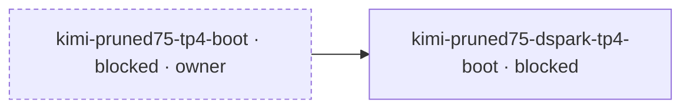

# Board — generated 2026-11-18 16:17 ET

## In flight
| where | owner | what |
|---|---|---|
| census | read-only in tick — booted nothing, claimed nothing, stopped nothing, evicted nothing | `2026-11-18T21:02:04Z`–`21:02:06Z`, **54 min 21 s** after the base's own read (`2026-11-18T20:07:43Z`): **the knapcio quartet served and is gone.** The base carried task `b020d2dd178343a5_5357c86eb6d8` loading on `.31`–`.34` at `20:07:43Z` (rank 0 `StartedAt` `2026-11-18T20:04:11Z`); the base's own `15:22 ET` correction row records all four ranks `Up 16 minutes (healthy)` with `:8000` listening and rank 0's `/v1/models` **200** naming `deepseek-ai/DeepSeek-V4.1-Flash-1017` at `20:20:37Z`–`20:20:48Z`. This tick reads **0 containers, 0 volumes, 0 `:8000` listeners on all six hosts**, and head's `sparkrun status` lists every host idle with `No sparkrun containers running`. Teardown observed directly on each of `.31`–`.34`: `kill` at `20:46:49Z`, `die`/`destroy` at `20:46:51Z` — a stop call, not a crash; the **issuer is unidentified** (no receipt, no serve log). The boot's `create`/`start` are **not** in the rings: `.31`–`.34` each hold **255** events with oldest `20:25:58Z`–`20:25:59Z`, so the start is **evicted, not absent** and the bound my own read supports is `(20:07:43Z, 20:25:58Z]`. `/tmp/sparkrun_serve.log` is **absent** on `.31` at the read, so no engine-log post-mortem exists. `MemAvailable` rose `+81,638,416 kB`–`+83,736,196 kB` on `.31`–`.34` as the ranks emptied, `+86,052 kB` on `.30`, `-11,000 kB` on `.35`. |
| pool | — (nobody drives it; units and reads re-proved each tick) | **serving.** Head units mgmtd/meta/storage `active`, all three `Result=success`, `NRestarts` **0**. Mount `used` **14,060,845,268,992 B** at `21:03:32Z`; the six roots' `statfs` summed **14,060,845,338,624 B** across `21:03:58Z`–`21:04:00Z`, residue **-69,632 B** — **one quantity read twice**: a consistency check, never corroboration. Against the base's pair (`14,060,763,480,064 B` at `20:07:43Z`) mount `used` is **up 81,788,928 B** across the quartet's fill and teardown. Hub **103** entries; the ds4 arm's `config.json` **3,311 B** in both snapshot dirs, read through the mount. `.32`–`.35` `beegfs-meta` read `activating` with `Result=exit-code` and `NRestarts` **113,086**–**113,108**, `.31` `active`/`success`/**113,104** — the known restart loop (`beegfs-meta-restart-loop-non-meta-hosts`), unchanged and dated on its own journal. |
| queue | register snapshot `0b28a919…` — both blocks below rendered from it | `mad-science/queue.json` sha256 **`0b28a919…`**, the same as the base carried and as the clean `HEAD` blob (`git show HEAD:mad-science/queue.json`), re-checked live at compose. **201 tasks: 159 done, 34 queued, 8 blocked, 0 running — 42 open**; `task-queue.py check` prints `ok: 201 task(s)`. |
| window | **no declared window and no lease** | `.local/fleet-window.lock` is **absent** at `21:02Z` (the base carried sha `1edeca1f…`, mtime `2026-11-18T19:42:06Z`, hosts `.31`–`.34`, window `19:45Z`–`22:45Z`). `.local/fleet-leases.json` is **48 B, sha `34eed267…`**: `{"fenced":[],"leases":[],"version":1}` — the `knapcio-ceiling-262k` lease (issued `19:42:02Z`, expiry `23:42:02Z`) was **released at `20:47Z`**, inside the declared window and about a minute after the quartet's `20:46:49Z` teardown, so the window **closed** rather than expired. Its `proof` field was empty, as the base recorded; these ranks are released and free. |
| campaign | `h2h-20261107` inactive since 2026-11-11 20:03:08 ET, zero leases its own | user unit `sparkrun-campaign` reads **inactive** (`ActiveEnterTimestamp Wed 2026-11-11 20:03:08 EST`). A plain `os.walk` of `/home/red` at `21:03Z` (symlinks **not** followed) returns **21** `state.json` paths → **21** inodes: **nine** are campaign roots under `/home/red/benchmarks` carrying **38 arms** and **0 live leases** (each arm's `lease.expires_at` parsed as float epoch against `time.time()`), the other twelve are `.swival` audit and git rewrite-observer state, not campaigns. The base's **49 paths → 9 files** is the `find`-with-symlinks number: `h2h-20261107/tp12-window` is a symlink to `.`, which is what expands it. |
| publication | tick | base = `15:22 ET` board, content sha256 **`8d525c9c…`**, its tip **`45ca22e`**; the board blob is **`7352c5e`** at this clone's `HEAD` **`491a99e`** and at `origin/main` **`51e1e9e`** (HEAD is one commit ahead, tree identical for this file). `--expect-sha` and `--expect-remote-sha` both carry the content sha256, `git fetch` run before publish; both queue blocks render from one snapshot, the live register re-checked at publish. |
| .30 | nothing live (no reservation) | `2026-11-18T21:02:04Z`: `docker ps -aq` **0**, running **0**, volumes **0**, `:8000` listeners **0** container events in window **0**, ring holds **197**, oldest **`2026-11-17T06:05:11Z`** root **1,453,809,106,944 B avail** (-13,438,976 vs base census) · **2,373,221,711,872 B used** (+13,438,976 vs base) `MemAvailable` **121,083,332 kB** (+86,052 kB vs base) beegfs active/active/active; `NRestarts` meta **0** / `Result=success` boot **2026-11-12T01:02:53Z** (590,351 s up, local clock converted); `kho=off` **1**, CMA **0 0**, `nr_free_cma` **0**; kernel `7.0.0-1025-nvidia` |
| .31 | nothing live (no reservation) — released with the window | `2026-11-18T21:02:04Z`: `docker ps -aq` **0**, running **0**, volumes **0**, `:8000` listeners **0** container events in window **255**, ring holds **255**, oldest **`2026-11-18T20:25:58Z`** root **1,690,828,345,344 B avail** (-13,656,064 vs base census) · **2,136,202,473,472 B used** (+13,656,064 vs base) `MemAvailable` **122,925,920 kB** (+81,638,416 kB vs base) beegfs inactive/active/active; `NRestarts` meta **113104** / `Result=success` boot **2026-11-12T01:03:52Z** (590,292 s up, local clock converted); `kho=off` **1**, CMA **0 0**, `nr_free_cma` **0**; kernel `7.0.0-1025-nvidia` quartet rank gone: `kill` **`20:46:49Z`**, `die`/`destroy` **`20:46:51Z`** |
| .32 | nothing live (no reservation) — released with the window | `2026-11-18T21:02:05Z`: `docker ps -aq` **0**, running **0**, volumes **0**, `:8000` listeners **0** container events in window **255**, ring holds **255**, oldest **`2026-11-18T20:25:58Z`** root **1,751,689,240,576 B avail** (-30,412,800 vs base census) · **2,075,341,463,552 B used** (+30,412,800 vs base) `MemAvailable` **122,947,756 kB** (+83,391,592 kB vs base) beegfs inactive/activating/active; `NRestarts` meta **113106** / `Result=exit-code` boot **2026-11-12T01:02:52Z** (590,353 s up, local clock converted); `kho=off` **1**, CMA **0 0**, `nr_free_cma` **0**; kernel `7.0.0-1025-nvidia` quartet rank gone: `kill` **`20:46:49Z`**, `die`/`destroy` **`20:46:51Z`** |
| .33 | nothing live (no reservation) — released with the window | `2026-11-18T21:02:05Z`: `docker ps -aq` **0**, running **0**, volumes **0**, `:8000` listeners **0** container events in window **255**, ring holds **255**, oldest **`2026-11-18T20:25:59Z`** root **1,666,627,637,248 B avail** (-30,416,896 vs base census) · **2,160,403,066,880 B used** (+30,416,896 vs base) `MemAvailable` **122,950,388 kB** (+83,736,196 kB vs base) beegfs inactive/activating/active; `NRestarts` meta **113108** / `Result=exit-code` boot **2026-11-12T01:02:52Z** (590,353 s up, local clock converted); `kho=off` **1**, CMA **0 0**, `nr_free_cma` **0**; kernel `7.0.0-1025-nvidia` quartet rank gone: `kill` **`20:46:49Z`**, `die`/`destroy` **`20:46:51Z`** |
| .34 | nothing live (no reservation) — released with the window | `2026-11-18T21:02:06Z`: `docker ps -aq` **0**, running **0**, volumes **0**, `:8000` listeners **0** container events in window **255**, ring holds **255**, oldest **`2026-11-18T20:25:59Z`** root **1,138,837,180,416 B avail** (-22,044,672 vs base census) · **2,688,193,638,400 B used** (+22,044,672 vs base) `MemAvailable` **122,999,428 kB** (+83,299,144 kB vs base) beegfs inactive/activating/active; `NRestarts` meta **113105** / `Result=exit-code` boot **2026-11-12T01:02:51Z** (590,355 s up, local clock converted); `kho=off` **1**, CMA **0 0**, `nr_free_cma` **0**; kernel `7.0.0-1025-nvidia` quartet rank gone: `kill` **`20:46:49Z`**, `die`/`destroy` **`20:46:51Z`** |
| .35 | nothing live (no reservation) | `2026-11-18T21:02:06Z`: `docker ps -aq` **0**, running **0**, volumes **0**, `:8000` listeners **0** container events in window **0**, ring holds **245**, oldest **`2026-11-12T05:50:09Z`** root **1,199,551,045,632 B avail** (+31,105,024 vs base census) · **2,627,479,773,184 B used** (-31,105,024 vs base) `MemAvailable` **122,325,488 kB** (-11,000 kB vs base) beegfs inactive/activating/active; `NRestarts` meta **113086** / `Result=exit-code` boot **2026-11-12T01:02:52Z** (590,354 s up, local clock converted); `kho=off` **1**, CMA **0 0**, `nr_free_cma` **0**; kernel `7.0.0-1025-nvidia` |

## Work queue

| job | node cost | holds | state |
|---|---|---|---|
| `campaign-does-not-honour-the-.30-exclusion` — The campaign places tp>=4 work on .30 regardless of the memory-risk exclusion: a leaseable row that needs .30 is a live risk, so placement must be a field the director refuses to violate | — | — | queued — MECHANISM LANDED OFFLINE 2026-11-11 (commits `aa54000`, `ebf5c8e`, `298098d`, `08ff156`; no live lease and no live six-node boot has run, so the row stays open). One ledger, `<repo>/.local/fleet-leases.json` (flock + atomic write), and one … (full note: queue.json) |
| `sm121-ladder-acceptsampling-dflash` — SM121 survey ladder dies in llama-benchy warm-up: dflash_utils.build_dflash_verify_target_probs missing | single | — | queued — DENSE: the ladder leg cannot run on dsv41-sm121-dg:0.2.1. llama-benchy's first warm-up request takes the adapter's AcceptSampling top-k branch and /opt/dsv41/adapter/block_verify.py:106 calls dflash_utils.build_dflash_verify_target_probs, w… (full note: queue.json) |
| `kimi-pruned75-tp4-boot` — Kimi-K3.1-Pro pruned75 MXFP4: boot and ladder at TP=4 | quartet | — | blocked — OWNER 2026-11-11 (#3/#2): the owner chose the six-machine route (S3a) and does NOT authorize another four-machine attempt, so the "RE-BLOCKED on placement" paragraph above is superseded in both of its halves: no four-rank retry is ordered, … (full note: queue.json) — evidence: `receipts/kimi-k3.1-pro-pruned75-mxfp4-vllm-tp4.json` |
| `beegfs-meta-restart-loop-non-meta-hosts` — beegfs-meta restart-loops every 5 s on .31-.35, and the loop hides a failed state behind "activating" | single | — | queued — Measured 2026-11-09 07:03-07:05 ET, and it is the side effect of the fix `beegfs-units-restart-no` (done) blessed: /etc/systemd/system/beegfs-meta.service.d/oom.conf (mtime 2026-11-08 16:03 on .30, 16:05 on .31) sets OOMScoreAdjust plus Res… (full note: queue.json) |
| `head-mesh-cannot-reach-30` — head's ssh cannot reach .30 by name: the alias fails host key verification while the node's own address answers | single | — | queued — Measured 2026-11-09 08:02-08:06 ET and re-probed 08:23:46 ET, read-only from the head: ssh to the .30 name fails 'Host key verification failed', while the same node answers 'ok spark-41e1' when addressed by its own address from the same hea… (full note: queue.json) |
| `hf-cache-20261110-docs-only-repin-bundle` — Docs-only model drift from the 2026-11-10 cache update: 22 recipe rows across 10 repos ride their lane’s next boot (no boot of its own) | — | — | queued — Classes measured with refresh-sweep report mode + Hub tree diff: only README/LICENSE/LICENSE-GLM-5.3-Flash/.eval_results/images files differ between the pin and the Hub head for orcarouter/Nex-N2.5-mini-Uncensored-NVFP4, orcarouter/Qwen3.8-… (full note: queue.json) |
| `hf-cache-20261110-orcacyber-new-quant` — OrcaCyber-Nano-1.0 head adds a Q8_0 DFlash2 GGUF: decide whether the new quant earns an arm (shipped arms unaffected) | single | — | queued — The 2026-11-10 sweep: orcarouter/OrcaCyber-Nano-1.0 head 97140f3ff7e2 adds OrcaCyber-Nano-1.0-AI-Defense-DFlash2-Q8_0.gguf (~2.05 GB, + README/.gitattributes) over pin 1af1635aa22b. The two shipped arms (recipes/cybersec/orcacyber-nano-1.0-… (full note: queue.json) |
| `lane-survey-edge0-audio8-tts` — Media-lane survey: Edge0/Audio8-TTS-Realistic-Air - 0.6B DualAR TTS + bundled codec, TP<4 so surveyed only | — | — | queued — License class: Apache-2.0, unrestricted - ships as a normal arm with no eval-only banner. Weights: 601,159,424 params BF16 in model.safetensors 1.20 GB plus a separate 44.1 kHz codec.pth 1.35 GB; repo 2.39 GiB. Architecture: model_type arkt… (full note: queue.json) |
| `lane-survey-viggle-viggle-remake` — Media-lane survey: Viggle/Viggle-Remake - MiniMax-H3 video-to-video pipeline (GGUF/int8 + ComfyUI node), TP<4 so surveyed only | — | — | queued — License class: community/restricted - license_name minimax-h3-community-license, base_model MiniMaxAI/MiniMax-H3; the media lane already ships MiniMax-H3 arms under the same family and any arm must carry that license note. Repo 167,573,265,… (full note: queue.json) |
| `lane-survey-webai-official-twil-8b` — Explore-lane survey: webAI-Official/TwIL-8B - 8.8B Granite-family reasoning model, TP<4 so surveyed only | — | — | queued — License class: RESTRICTED / NON-COMMERCIAL - card license_name webai-non-commercial-license-ver.-1.0 (LICENSE.md), so any future arm ships with the eval-only banner plus an explicit non-commercial note in the recipe description and the lane… (full note: queue.json) |
| `queue-mode-done-sibling-holds-canary-row` — Queue mode will not lease a row whose recipe a done sibling already holds | single | — | queued — Measured 2026-11-10 00:05-00:16 ET, read-only: arm3-control-cell-canary-line (registered 23:21 by df9d40b) is the register's first queued row carrying both recipe: and tp: (quartet, tp 4, recipes/ds4/deepseek-v4.1-flash-knapcio-tp4-1m-sglan… (full note: queue.json) — evidence: `mad-science/STATUS.md 2026-11-10 00:15 ET queue row; commit 52b99ef` |
| `campaign-leases-tp4-onto-30` — The campaign leases memory-heavy TP4 quartets onto .30, which the owner ruling excludes | — | — | queued — MECHANISM LANDED OFFLINE 2026-11-11 (commits `aa54000`, `ebf5c8e`, `298098d`, `08ff156`; no live lease and no live six-node boot has run, so the row stays open). One ledger, `<repo>/.local/fleet-leases.json` (flock + atomic write), and one … (full note: queue.json) |
| `campaign-state-copy-re-nests` — The director's receipts root copies state.json back into a window subdir, so one campaign now holds 40 nested copies | — | — | queued — Measured 2026-11-11 05:1x ET, read-only on the head: `h2h-20261107/state.json` and 40 byte-identical copies at `h2h-20261107/tp12-window/state.json`, `.../tp12-window/tp12-window/state.json` and so on, one level deeper per run under that wi… (full note: queue.json) |
| `hf-cache-20261110-cache-consistency-defects` — HF cache consistency defects: four repos hf ignores on a refs/main byte defect, one on a broken absolute symlink, plus 204 GB of stray non-cache trees in the hub root | single | — | queued — Measured 2026-11-10 with `hf cache ls --no-truncate --show-warnings` on .30 after the update loop finished a pass. (1) refs/main carries a trailing newline in models--lodestones--Kromoss (41 B; ref a4fe9744, snapshots 0c5417ec + a4fe9744), … (full note: queue.json) |
| `hf-cache-20261110-template-ab-ifm-k2` — K2-Horizon template/code drift A/B: head c4f92a0d (0.9B) and 240f2de3 (7B-FP8) vs the shipped pins, template identity + one fixed request | single | — | queued — Class (b) from the 2026-11-10 cache sweep: no weight file changed, but IFM/K2-Horizon-0.9B head moves 383cb66347be -> c4f92a0d66e2 changing chat_template.jinja AND modeling_k2_horizon.py and REMOVING chat_template_asst_tool_gen.jinja + chat… (full note: queue.json) |
| `kimi-superexpert-ref-probe` — Probe shashanth-27xA9 Kimi-K3.1-Pro-SuperExpert-12GB through the transformers reference route | single | — | blocked — OWNER 2026-11-11 (directive): parked until the production serve returns — see `mad-science/TODO.md` §"Settled questions" `## Owner directive 2026-11-11 — TP1/TP2 parked until production returns`; no state change and no unblocking. \| estimat… (full note: queue.json) — evidence: `receipts/zz-kimi-k3.1-pro-superexpert-24b-q4p-ref-vllm.json` |
| `mem-guard-outlives-its-task` — A window arm's 6.0 GiB stop-rule guard outlives the arm, so the runner accumulates guards for tasks whose containers are gone | single | — | queued — CORRECTED 2026-11-11: the premise that a leaked guard can stop a future boot is false. `mem-guard.sh` issues `sparkrun stop` only for the TID in its own argv, so a guard whose task is gone is a stale no-op and cannot touch the next boot. Wh… (full note: queue.json) |
| `pool-target-probe-beegfs-ctl-absent` — Pool storage-target byte accounting is unreachable: beegfs-ctl is absent from .30 though beegfs-utils 20:8.4.1 is installed | single | — | queued — Measured 2026-11-10 15:05:59Z and again 15:06:29Z on .30: beegfs-ctl exits 127 (command not found) as the red user, and no binary named beegfs-ctl exists under /usr, /opt or /sbin at depth <=5, although dpkg lists beegfs-utils 20:8.4.1 plus… (full note: queue.json) |
| `pool-window-invalid-cells` — Gate every boot on a pool half-probe: a cell written while beegfs was down is invalid, not weak | single | — | queued — Pre-registered 2026-11-08 13:22 ET. Invalid windows: 11:27:56-12:07:30 and at/after 12:57:32 (B still open, Restart=no); admissible middle 12:07:30-12:57:31. Acceptance: run-arm (and any lane's harness) probes … (full note: queue.json) |
| `hf-cache-20261110-pool-fetch-gaps` — Pool gaps left by the 2026-11-10 cache update: two Hub heads, two pinned revisions, three absent repos, one private repo needing an org token | single | — | queued — CENSUS 2026-11-11 (`.scratch/tp4-20261111/RECEIPT-boot-a-and-pool-census-20261111.md`): the ds4 1017 body's 'double-count' is now an artifact, named: two revisions share one index — `08c8657f` (a link farm) and `1bae0e10` (the in-body revis… (full note: queue.json) |
| `n35-unreferenced-image-gc` — Delete .35's 455.3 GB of unreferenced images and its 43 GB ComfyUI cache | single | — | queued — BATCH 2 RAN 2026-11-16T15:12:45Z AND DELETED NOTHING, and that does not close this row: its object is a deletion, so it stays 'queued' and the batch settles only what the 455.3 GB figure was. 44 images inspected on '.35' under the any-tree-… (full note: queue.json) |
| `board-publish-accepts-weaker-replacement` — publish replaces a better-grounded In-flight composition with a fresher byte-compatible one, and no guard notices | — | — | queued — The publish guards compare BYTES, so they cannot see that a replacement carried FEWER facts than the rows it removed. Measured 2026-11-11 20:18 ET on mad-science/STATUS.md: this tick's composition was accepted (publish rc=0, lint ok) while … (full note: queue.json) — evidence: `mad-science/STATUS.md@e4bea70` |
| `board-publish-keeps-in-flight-row-set` — A board published without one of the In-flight state rows passes every guard, because publish compares bytes and never the row set | single | — | queued — Measured 2026-11-11 03:17-03:25 ET. The 03:14 board (blob 2249062c) carried a `\| queue \|` row; the 03:17 board (commit `8e160b2`, blob 0f54622c) carried none, and a tick that composes on it and keeps the In flight body verbatim inherits the… (full note: queue.json) — evidence: `mad-science/STATUS.md at 8e160b2 / bc2cc38 / 9ae7cd4` |
| `cache-audit-pool-budget` — `tools/cache-audit.py --budget-gb`: add a pool mode that judges the one shared HF pool against 90 % of capacity | single | — | queued — `tools/cache-audit.py --budget-gb` still measures per node, but the HF cache is one shared pool: all six nodes report the same usage through the shared hub, so the audit flags the whole fleet at once and no node can be read as over- or unde… (full note: queue.json) |
| `executor-release-host-claim-on-failure` — An executor that stops observing a launch must release the sparkrun host claims it holds | single | — | queued — Measured 2026-11-08 04:09-04:13 ET: kimi-k3.1-pro-pruned75-mxfp4-dspark-vllm-tp4 attempt 1 launcher (pid 1883449) held .30-.33 while its own registry distribution failed at 414.7 s (637.1 MiB at 1.6 MiB/s from docker.io, then … (full note: queue.json) |
| `fleet-boot-without-lease-record` — A four-rank boot serves with no lease in either ledger and no window lock | — | — | queued — Measured 2026-11-11 19:15:59Z-19:31Z, read-only: task `b020d2dd178343a5_55dafcf24cde` runs one rank each on `.31`-`.34` (image `littlecedar/dgx-spark-dsv41:canary-roce-aff52fa5`, id `3f4480818acb`, `Up` and healthy, `/v1/models` 200 serving… (full note: queue.json) |
| `pool-content-fall-20261116` — Pool used fell 501 GB in 6.5 h while every repo entry stayed: name the deletion before the next budget claim | — | — | queued — Measured read-only from the head at 2026-11-16T19:07:40Z: df -B1 on /mnt/beegfs reads used 13,459,970,326,528 B, which is 501,316,845,568 B BELOW the 13,961,287,172,096 B the 06:39 board carried at 11:23:54Z. It is not HF content vanishing:… (full note: queue.json) |
| `ripple-65b-nvfp4-dflash2-tp1` — Ripple-65B Preview NVFP4 TP=1 + DFlash2 drafter: ladder + suite (zz- probe) | single | — | blocked — OWNER 2026-11-11 (directive): parked until the production serve returns — see `mad-science/TODO.md` §"Settled questions" `## Owner directive 2026-11-11 — TP1/TP2 parked until production returns`; no state change and no unblocking. \| The dra… (full note: queue.json) |
| `ripple-65b-nvfp4-tp1` — Ripple-65B Preview NVFP4 TP=1: first boot, ladder + suite (zz- probe) | single | — | blocked — OWNER 2026-11-11 (directive): parked until the production serve returns — see `mad-science/TODO.md` §"Settled questions" `## Owner directive 2026-11-11 — TP1/TP2 parked until production returns`; no state change and no unblocking. \| First b… (full note: queue.json) |
| `runtime-cache-stale-tree-gc` — Delete the stale runtime-cache trees the 2026-11-12 audit approved (732 GB planned, never executed) | single | — | queued — BATCH 1 EXECUTED 2026-11-16T16:33:28Z — 52 items / 554.54 GB deleted on '.30'-'.34' ('.30' 22.53, '.31' 96.38, '.32' 143.49, '.33' 143.68, '.34' 148.46 GB) and '.35' released 0.00 GB — receipt '.scratch/gc-20261116/census.md' rev 3 §Executi… (full note: queue.json) |
| `sparkrun-single-gid-index-for-two-hcas` — sparkrun injects one GID index across two HCAs whose tables disagree | — | — | queued — REPORT-ONLY IN THIS REPO (sparkrun-side defect; no `recipe`/`tp`, not bootable). One derived `NCCL_IB_GID_INDEX` applied to every HCA the probe names is wrong when the rails' GID tables disagree: `scripts/ib_detect.sh:44-45` derives the ind… (full note: queue.json) |
| `media-idol-3dgs-boot` — Idol single-image 3DGS trial: SDK on the tracked fixture, receipt = .ply 3DGS header + Gaussian count + wall, one node | single | — | blocked — Authored, not booted. TP=1 single-node script arm; a four-rank measurement is what needs a declared window and this is not one, so no lease applies. BLOCKER NAMED 2026-11-09 (owner answer `#81`): the facebook DINOv3 licence is not accepted … (full note: queue.json) — evidence: `head:~/benchmarks/tp1-20261112/idol-dinov3-gate-probe.log` |
| `campaign-ignores-declared-window` — The campaign leases and launches onto ranks another session has declared in .local/fleet-window.lock | — | — | queued — MECHANISM LANDED OFFLINE 2026-11-11 (commits `aa54000`, `ebf5c8e`, `298098d`, `08ff156`; no live lease and no live six-node boot has run, so the row stays open). One ledger, `<repo>/.local/fleet-leases.json` (flock + atomic write), and one … (full note: queue.json) |
| `kimi-pruned75-dspark-tp4-boot` — Kimi-K3.1-Pro pruned75 + DSpark k=5 drafter: boot, acceptance and ladder vs the plain arm | quartet | kimi-pruned75-tp4-boot | blocked — OWNER 2026-11-11 (#3/#2): the owner chose the six-machine route (S3a) and does NOT authorize another four-machine attempt, so no four-rank drafter boot is ordered either; any future rank on `.30` is legal only inside an explicitly declared … (full note: queue.json) — evidence: `receipts/kimi-k3.1-pro-pruned75-mxfp4-dspark-vllm-tp4.json` |
| `ripple-65b-bf16-tp2` — Ripple-65B Preview BF16 TP=2: quality control + the 1M-context cell (zz- probe) | pair | — | blocked — OWNER 2026-11-11 (directive): parked until the production serve returns — see `mad-science/TODO.md` §"Settled questions" `## Owner directive 2026-11-11 — TP1/TP2 parked until production returns`; no state change and no unblocking. \| The unq… (full note: queue.json) — evidence: `receipts/zz-ripple-65b-preview-bf16-tp2-vllm.json` |
| `webai-twil-8b-eval-only-arm` — Author and ship the webAI 8.8B eval-only arm (webAI-Official/TwIL-8B): recipe, license banner, lane README notice, index row | — | — | queued — Authoring work, no hardware yet and no recipe, so not machine-runnable. LICENSE (owner 2026-11-12: "Accept and ship it."): card `license_name: webai-non-commercial-license-ver.-1.0`, so the arm ships EVAL-ONLY under AGENTS.md §Recipes, with… (full note: queue.json) |
| `campaign-six-node-claim` — The director claims and leases a six-node tp 2 x pp 3 shape: the register cannot express six ranks, so the claim itself is the work | — | — | queued — MECHANISM LANDED OFFLINE 2026-11-11 (commits `aa54000`, `ebf5c8e`, `298098d`, `08ff156`; no live lease and no live six-node boot has run, so the row stays open). One ledger, `<repo>/.local/fleet-leases.json` (flock + atomic write), and one … (full note: queue.json) |
| `kimi-k31-indexer-block-vs-blhnc-layout` — Kimi K3.1 indexer needs 64-token kernel blocks; KDA/mamba forces a 5,760-token block and BLHNC | — | — | queued — AUTHORING 2026-11-11, estimate 4 h provisional. Engine-side blocker, not a memory one: the DeepSeek-V32 indexer needs 64-token kernel blocks, while the KDA/mamba alignment forces the KV manager block to 5,760 tokens (`interface.py:1115`, 'S… (full note: queue.json) — evidence: ``.scratch/kimi-six-engine-verdict-20261111.md`: the pinned image's engine `v0.33.0rc1.dev1016+g06129ab02` (boot6 rank-1 log), #66037 merged as `4088c283` 2026-11-09T04:31Z and absent from the pinned tree and from every release, GHCR tags ending at `2026110702` both resolving to the pinned digest, Docker Hub `eugr/spark-vllm` latest 2026-11-07, and the knob audit that leaves only the rebuild; the row stays queued on an image built from main ≥ `4088c283`` |
| `mech-cites-0-4-3` — Re-derive the remaining 117 recipes/MECHANICS.md citations against the installed sparkrun build | — | — | queued — d0d050f landed 27 moved anchors + 13 byte-identical controls for §The one rule and §Key reference §Format and identity, then stopped. Remaining 117 anchors still carry 0.4.2/0.4.0 numbering: the rest of §Key reference (from §Model and servi… (full note: queue.json) |
| `metrics-instrument-confound` — Metrics knob decomposition: one identical recipe, metrics-on vs metrics-off, name the performance-impacting knobs (`#68` ROM bar) | — | — | queued — Owner's `#68` authorises the decomposition that makes the comparability bar checkable, and it must separate THREE regimes, because only one of them can bias a cell: (1) `tools/run-arm.sh`'s scrape is a single exec AFTER the cell and before … (full note: queue.json) |
| `minimax-viggle-remake-eval-only-arm` — Author and ship the MiniMax video eval-only arm (Viggle/Viggle-Remake): ComfyUI node route, license banner, lane README notice, index row | — | — | queued — Authoring work, no hardware yet and no recipe, so not machine-runnable. LICENSE (owner 2026-11-12: "Accept and ship it."): card `license_name: minimax-h3-community-license`, base_model MiniMaxAI/MiniMax-H3 — community-restricted, so the arm… (full note: queue.json) |
| `ds4-fp4-kv-layout-sm121-port` — DS4 1017 SM121: port the V41/V41_FP4 KV layout so fp4 KV is admissible — dtype is not a lever today, and sizing lies about fp4 | quartet | — | blocked — CORRECTION TO THE FP8-KV IDEA this lane carried: KV dtype is NOT a lever here. The line is already `kv_dtype: fp8_e4m3`, and `fp8_ds_mla` is not a value this engine knows — zero occurrences in image commit `103ad321`; it is vLLM's packed ML… (full note: queue.json) |
## Landed session
| time ET | commit | one clause |
|---|---|---|
| 15:12 | `fb3a217` | board: 15:12 ET refresh finds a knapcio quartet loading under a new window |
| 15:15 | `d832206` | ledger the 15:00 tick that stood down, and name the head's ad-hoc churn |
| 15:23 | `b0f49e5` | board: give each readiness reading its own host, and the quartet its ready state |
| 15:23 | `15b9827` | ledger the four-rank serve probe and scope the earlier count to rank 0 |
| 15:52 | `74782ed` | record knapcio's raised output ceiling and its loop guard in the engine comparison: `DSV41_MAX_NEW_TOKENS` now sets **262,144** on both shipped engines (the 32,768 cap was the image's adapter policy), the ceiling was reached only with the loop guard disabled, and a shipped-config full-262k reply stays unproven |
| 15:58 | `b387512` | pin a matched two-engine benchmark protocol for the GB10 quartet |
| 16:00 | `51e1e9e` | ds4: switch-side PFC is enabled on tc3; end-to-end priority flow control is not in effect |
| 16:04 | `491a99e` | correct the protocol's flag citations to the lines that hold them |
| 16:01 | board refresh | census re-read at `2026-11-18T21:02:04Z`–`21:02:06Z` on the `15:22 ET` base, **54 min 21 s** apart: the knapcio quartet the base carried loading had **served** (the base's own row: healthy, `/v1/models` **200** at `20:20:48Z`) and was **torn down at `20:46:49Z`** on all four ranks (`kill` then `die`/`destroy` at `20:46:51Z`), leaving all six hosts at **0 containers and 0 volumes** with head's `sparkrun status` idle everywhere; the window lock is **gone** and the lease ledger **released at `20:47Z`** (48 B, `leases: []`), 2 h 55 min before the declared `22:45Z` end; the pool re-proved by head units and a through-mount pair (`used` **14,060,845,268,992 B**, residues **-69,632 B** against the six roots and **+81,788,928 B** on the base's), **103** hub entries and the ds4 `config.json` **3,311 B**; nine campaign roots / **38 arms** with 0 live leases; the register (`0b28a919…`) unchanged with both queue blocks re-rendered from the snapshot; and the **8 commit(s)** the base did not carry folded from their own subjects |
| 16:01 | board measurement | the quartet's teardown is dated from `docker events` on all four ranks rather than inferred, and its start is cited as a **bound** `(20:07:43Z, 20:25:58Z]` because the dockerd rings on `.31`–`.34` hold **255** events with oldest `20:25:58Z`–`20:25:59Z` — the boot's own `create`/`start` were **evicted, not absent**; `/tmp/sparkrun_serve.log` is gone on `.31`, so no engine-log post-mortem exists and the issuer of the stop stays unidentified |
| 16:16 | board archive | the **245**-row `## Landed session` table earlier ticks had appended is **retired from the board** — the board is state, not history — and homed by reference: its bytes are `mad-science/STATUS.md` at `b95c5ad`, blob **`3280485e…`**, pushed; the reason and the 69-of-140 unhomed count are recorded in `mad-science/SESSION-RECORD.md` under `2026-11-18 16:16 ET` |

