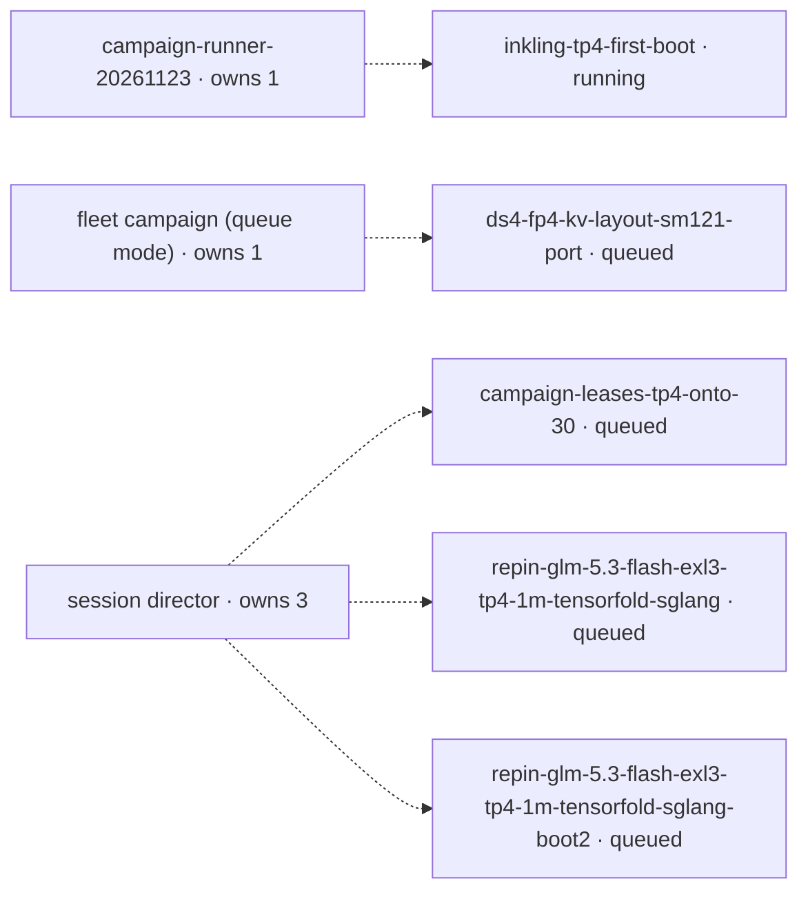

# Board
_Generated 2026-11-23 01:48 ET_

## In flight
| where | owner | what |
|---|---|---|
| census | read-only in tick — booted nothing, claimed nothing, stopped nothing, evicted nothing | read `2026-11-23T06:48:43Z`–`2026-11-23T06:48:45Z` (each node's own `date -u`) on the base census `2026-11-23T05:36:09Z`, **1 h 12 min 34 s** after it: **4 containers, 0 volumes** fleet-wide; **no research rank**; the fenced hosts hold running containers on `.31`, `.32`, `.33`, `.34`, excluded from research accounting; no node probed a serve |
| pool | — (nobody drives it; head units re-proved each tick) | head: `beegfs-mgmtd` **active** (Result success, NRestarts 0, **+0** on the base) · `beegfs-meta` **active** (Result success, NRestarts 0, **+0** on the base) · `beegfs-storage` **active** (Result success, NRestarts 0, **+0** on the base); worker unit states and the pool's through-mount reads are not part of this census |
| queue | register snapshot `fc6c2247…`; both blocks below rendered from it | `mad-science/queue.json` sha256 **`fc6c22473c41845367407bc187822db685e1cc31b282863eed1ef2c0cfb2afcb`** read locally: **253 tasks: 248 done, 4 queued, 0 blocked, 1 running — 5 open**; the head clone reads **`fc6c2247…`**, identical |
| window | **no manual lock** at this read | `.local/fleet-window.lock` is **absent** on the head (read `2026-11-23T06:48:46Z`) |
| campaign | `sparkrun-campaign` — active, no lease | head user unit `sparkrun-campaign` reads **`active`** / **`running`** (`MainPID` **3,930,275**, `NRestarts` **0**, **+0** on the base); the lease ledger holds **0 lease(s)** and fence(s) `tp-le2-20261120` |
| lease | **1 fence(s), 0 lease(s)** | the head's repo ledger `.local/fleet-leases.json` (389 B, sha **`ec09509d…`**, mtime **`2026-11-21 03:04:12.907935197 -0500`** local) holds fence **`tp-le2-20261120`** on `.31`, `.32`, `.33`, `.34` (`fenced_at` `2026-11-20T07:25:27Z`, owner directive 2026-11-20: production serve protected, serve `58cddf1c62ba6578_b8865cad5863` / image `986795bcd7f4`) and **0 lease(s)** |
| publication | tick | fresh census (`2026-11-23T06:48:43Z`–`2026-11-23T06:48:45Z`) written to `2026-11-23T064842Z.json` and composed on the base census `2026-11-23T05:36:09Z`; the queue blocks are rendered from `mad-science/queue.json` sha **`fc6c2247…`**, and the landed rows from `git log --since=2026-11-23T05:36:09Z` |
| .30 | **nothing live (no reservation)** — idle | `2026-11-23T06:48:43Z` (`spark-41e1`): `docker ps -aq` **0**, running **0**, volumes **0**, `:8000` listeners **0** root **1,114,273,992,704 B avail** (-64,923,754,496, fell) · **2,712,756,826,112 B used** (+64,923,754,496, rose) boot **`2026-11-19T20:06:40Z`** (`btime`), `uptime` **297,723 s** `MemTotal` **127,598,704 kB** (+0), `MemAvailable` **121,951,104 kB** (-251,920), `Cached` **109,194,604 kB** (-10,799,176), `AnonPages` **962,180 kB** (+87,220) ring **256** events all-types (+0), **0** in-window lifecycle and **0** in-window `exec`, oldest `2026-11-22T21:19:21.583964191-05:00 container exec_start: sh`, newest `2026-11-23T01:28:01.518510481-05:00 image pull vllm/vllm-ope` |
| .31 | **fenced serve** — excluded from the research census | `2026-11-23T06:48:44Z` (`spark-d325`): `docker ps -aq` **1**, running **1**, volumes **0**, `:8000` listeners **0** root **1,301,776,863,232 B avail** (-72,507,465,728, fell) · **2,525,253,955,584 B used** (+72,507,465,728, rose) boot **`2026-11-19T20:11:15Z`** (`btime`), `uptime` **297,448 s** `MemTotal` **127,598,700 kB** (+0), `MemAvailable` **13,832,432 kB** (-109,065,532), `Cached` **21,166,080 kB** (-2,270,656), `AnonPages` **3,115,632 kB** (+2,775,020) ring **256** events all-types (+0), **0** in-window lifecycle and **90** in-window `exec`, oldest `2026-11-22T23:16:45.546431792-05:00 container exec_start: ba`, newest `2026-11-23T01:48:42.523729822-05:00 container exec_die 97b00` |
| .32 | **fenced serve** — excluded from the research census | `2026-11-23T06:48:44Z` (`spark-ec1d`): `docker ps -aq` **1**, running **1**, volumes **0**, `:8000` listeners **0** root **1,385,311,641,600 B avail** (-65,906,507,776, fell) · **2,441,719,062,528 B used** (+65,906,507,776, rose) boot **`2026-11-19T20:14:21Z`** (`btime`), `uptime` **297,262 s** `MemTotal` **127,598,640 kB** (+0), `MemAvailable` **13,222,488 kB** (-109,791,272), `Cached` **20,469,312 kB** (+8,362,320), `AnonPages` **3,785,584 kB** (+3,500,460) ring **256** events all-types (+0), **0** in-window lifecycle and **85** in-window `exec`, oldest `2026-11-22T23:16:31.509356044-05:00 container exec_die 10650`, newest `2026-11-23T01:48:42.935836530-05:00 container exec_die 8bde4` |
| .33 | **fenced serve** — excluded from the research census | `2026-11-23T06:48:44Z` (`spark-3578`): `docker ps -aq` **1**, running **1**, volumes **0**, `:8000` listeners **0** root **1,256,006,328,320 B avail** (-84,747,735,040, fell) · **2,571,024,375,808 B used** (+84,747,735,040, rose) boot **`2026-11-19T20:12:55Z`** (`btime`), `uptime` **297,349 s** `MemTotal` **127,598,636 kB** (+0), `MemAvailable` **13,138,128 kB** (-109,849,336), `Cached` **20,360,920 kB** (+1,380,968), `AnonPages` **3,853,700 kB** (+3,568,984) ring **256** events all-types (+0), **0** in-window lifecycle and **79** in-window `exec`, oldest `2026-11-22T23:16:19.457087297-05:00 container destroy cb7128`, newest `2026-11-23T01:48:43.333204372-05:00 container exec_die 68938` |
| .34 | **fenced serve** — excluded from the research census | `2026-11-23T06:48:45Z` (`spark-324e`): `docker ps -aq` **1**, running **1**, volumes **0**, `:8000` listeners **0** root **862,509,477,888 B avail** (-63,188,815,872, fell) · **2,964,521,340,928 B used** (+63,188,815,872, rose) boot **`2026-11-19T20:09:04Z`** (`btime`), `uptime` **297,581 s** `MemTotal` **127,598,704 kB** (+0), `MemAvailable` **12,032,772 kB** (-110,963,780), `Cached` **19,298,104 kB** (-147,112), `AnonPages` **4,909,524 kB** (+4,630,904) ring **256** events all-types (+0), **0** in-window lifecycle and **79** in-window `exec`, oldest `2026-11-22T23:16:19.111816030-05:00 container destroy 3d1a61`, newest `2026-11-23T01:48:43.736301370-05:00 container exec_die 1b8d4` |
| .35 | **nothing live (no reservation)** — idle | `2026-11-23T06:48:45Z` (`spark-383f`): `docker ps -aq` **0**, running **0**, volumes **0**, `:8000` listeners **0** root **971,314,585,600 B avail** (-47,518,179,328, fell) · **2,855,716,233,216 B used** (+47,518,179,328, rose) boot **`2026-11-19T20:07:56Z`** (`btime`), `uptime` **297,649 s** `MemTotal` **127,598,700 kB** (+0), `MemAvailable` **122,864,380 kB** (+2,092,088), `Cached` **115,055,520 kB** (+41,578,396), `AnonPages` **287,984 kB** (-2,091,680) ring **256** events all-types (+0), **0** in-window lifecycle and **0** in-window `exec`, oldest `2026-11-22T21:05:06.535546060-05:00 container exec_start: sh`, newest `2026-11-22T21:19:48.088204374-05:00 container destroy 8b4cc1` |

## Work Queue

| job | node cost | blockers | holds | status | summary |
|---|---|---|---|---|---|
| `repin-glm-5.3-flash-exl3-tp4-1m-tensorfold-sglang` — Boot glm-5.3-flash-exl3-tp4-1m-tensorfold-sglang with the refreshed pin and move its pins | quartet | — | — | queued | — PIN MOVE 2026-11-22 (owner rule, ViBoard thread t24): updated pins are boot-tested as soon as a window of the correct size is free for them, and the pin moves in that boot's commit — no carrier-lane ride-along. This row boots recipes/glm/gl… (full note: queue.json) — evidence: `head:~/benchmarks/glm-repin-20261123/repin-1/head-boot.log` |
| `repin-glm-5.3-flash-exl3-tp4-1m-tensorfold-sglang-boot2` — Boot glm-5.3-flash-exl3-tp4-1m-tensorfold-sglang-boot2 with the refreshed pin and move its pins | quartet | — | — | queued | — PIN MOVE 2026-11-22 (owner rule, ViBoard thread t24): updated pins are boot-tested as soon as a window of the correct size is free for them, and the pin moves in that boot's commit — no carrier-lane ride-along. This row boots recipes/glm/gl… (full note: queue.json) |
| `campaign-leases-tp4-onto-30` — The campaign leases memory-heavy TP4 quartets onto .30, which the owner ruling excludes | quartet | — | — | queued | — MECHANISM LANDED OFFLINE 2026-11-11 (commits `aa54000`, `ebf5c8e`, `298098d`, `08ff156`; no live lease and no live six-node boot has run, so the row stays open). One ledger, `<repo>/.local/fleet-leases.json` (flock + atomic write), and one … (full note: queue.json) |
| `inkling-tp4-first-boot` — Inkling-2-Small TP=4 first boot: nightly pull and the unproven sm_121 Triton path | quartet | — | — | running | — No node holds the pinned nightly digest c17e9d88, so the first boot includes the pull. GB10 is sm_121 and the Blackwell path gates on capability family 100, so the engine runs the Hopper/Triton half (attention_sm90 plus the Humming expert G… (full note: queue.json) — evidence: `head:~/benchmarks/inkling-20261123/` |
| `ds4-fp4-kv-layout-sm121-port` — DS4 1017 SM121: port the V41/V41_FP4 KV layout so fp4 KV is admissible — dtype is not a lever today, and sizing lies about fp4 | quartet | — | — | queued | — FP4-KV image built and pushed. SGLang side: ghcr.io/littlecedar/aneda@sha256:b5de5272edd983e41059154f10d862a44c25f8f5f403fafd48ad0778b95ceed6 (the dsv41-sm121-dg:0.2.1-fi073e base + patch_dsv41_fp4kv.py + fp4kv_kv_format.py). Recipe at reci… (full note: queue.json) |

## Completed Work
Window: commits since `2026-11-23T05:36:09Z` — the base census stamp, later than the 24 h start `2026-11-22T06:48:42Z`; older rows are not shown.

| time ET | commit | one clause |
|---|---|---|
| 11-23 00:36 | `0731fec2` | Refresh the status board: a 2026-11-23T053608Z census |
