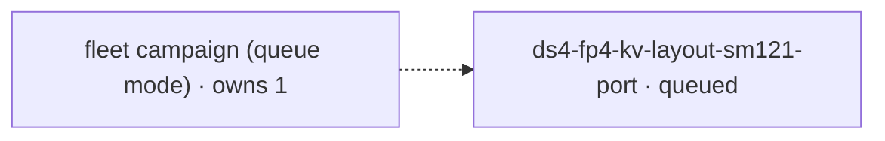

# Board
_Generated 2026-11-23 06:00 ET_

## In flight
| where | owner | what |
|---|---|---|
| census | read-only in tick — booted nothing, claimed nothing, stopped nothing, evicted nothing | read `2026-11-23T11:00:01Z`–`2026-11-23T11:00:03Z` (each node's own `date -u`) on the base census `2026-11-23T10:12:43Z`, **0 h 47 min 18 s** after it: **1 containers, 0 volumes** fleet-wide; **no research rank**; no node probed a serve |
| pool | — (nobody drives it; head units re-proved each tick) | head: `beegfs-mgmtd` **active** (Result success, NRestarts 0, **+0** on the base) · `beegfs-meta` **active** (Result success, NRestarts 0, **+0** on the base) · `beegfs-storage` **active** (Result success, NRestarts 0, **+0** on the base); worker unit states and the pool's through-mount reads are not part of this census |
| queue | register snapshot `bcbea761…`; both blocks below rendered from it | `mad-science/queue.json` sha256 **`bcbea761c0d5fcb9062eac2c83b9554cc9ec9cae55474ad5e6900039bdd45769`** read locally: **253 tasks: 252 done, 1 queued, 0 blocked, 0 running — 1 open**; the head clone reads **`bcbea761…`**, identical |
| window | **no manual lock** at this read | `.local/fleet-window.lock` is **absent** on the head (read `2026-11-23T11:00:03Z`) |
| campaign | `sparkrun-campaign` — active, no lease | head user unit `sparkrun-campaign` reads **`active`** / **`running`** (`MainPID` **3,930,275**, `NRestarts` **0**, **+0** on the base); the lease ledger holds **0 lease(s)** and fence(s) `tp-le2-20261120` |
| lease | **1 fence(s), 0 lease(s)** | the head's repo ledger `.local/fleet-leases.json` (1,034 B, sha **`d2ae6e2f…`**, mtime **`2026-11-23 05:56:48.233826412 -0500`** local) holds fence **`tp-le2-20261120`** on `.31`, `.32`, `.33`, `.34` (`fenced_at` `2026-11-23T10:56:48Z`, window closed — production serve protected, serve `58cddf1c62ba6578_b8865cad5863` / image `986795bcd7f4`) and **0 lease(s)** |
| publication | tick | fresh census (`2026-11-23T11:00:01Z`–`2026-11-23T11:00:03Z`) written to `2026-11-23T110000Z.json` and composed on the base census `2026-11-23T10:12:43Z`; the queue blocks are rendered from `mad-science/queue.json` sha **`bcbea761…`**, and the landed rows from `git log --since=2026-11-23T10:12:43Z` |
| .30 | **nothing live (no reservation)** — idle | `2026-11-23T11:00:01Z` (`spark-41e1`): `docker ps -aq` **1**, running **0**, volumes **0**, `:8000` listeners **0** root **986,969,894,912 B avail** (+12,360,220,672, rose) · **2,840,060,923,904 B used** (-12,360,220,672, fell) boot **`2026-11-19T20:06:40Z`** (`btime`), `uptime` **312,800 s** `MemTotal` **127,598,704 kB** (+0), `MemAvailable` **121,930,256 kB** (+1,676,268), `Cached` **66,397,576 kB** (-11,958,704), `AnonPages` **855,256 kB** (-117,868) ring **256** events all-types (+0), **0** in-window lifecycle and **16** in-window `exec`, oldest `2026-11-23T05:43:49.443810772-05:00 container die 4799baa21d`, newest `2026-11-23T05:49:41.127349897-05:00 container destroy b65199` |
| .31 | **nothing live (no reservation)** — idle | `2026-11-23T11:00:01Z` (`spark-d325`): `docker ps -aq` **0**, running **0**, volumes **0**, `:8000` listeners **0** root **1,271,637,483,520 B avail** (-17,288,077,312, fell) · **2,555,393,335,296 B used** (+17,288,077,312, rose) boot **`2026-11-19T20:11:15Z`** (`btime`), `uptime` **312,526 s** `MemTotal` **127,598,700 kB** (+0), `MemAvailable` **123,127,284 kB** (+1,015,980), `Cached` **2,025,324 kB** (-11,547,428), `AnonPages` **252,688 kB** (-51,216) ring **256** events all-types (+0), **0** in-window lifecycle and **243** in-window `exec`, oldest `2026-11-23T05:30:31.067539197-05:00 container exec_die 7f73a`, newest `2026-11-23T05:41:09.915289922-05:00 container destroy 0598db` |
| .32 | **nothing live (no reservation)** — idle | `2026-11-23T11:00:01Z` (`spark-ec1d`): `docker ps -aq` **0**, running **0**, volumes **0**, `:8000` listeners **0** root **1,355,833,618,432 B avail** (-16,098,586,624, fell) · **2,471,197,085,696 B used** (+16,098,586,624, rose) boot **`2026-11-19T20:14:21Z`** (`btime`), `uptime` **312,340 s** `MemTotal` **127,598,640 kB** (+0), `MemAvailable` **123,217,552 kB** (+948,056), `Cached` **1,941,668 kB** (-12,063,588), `AnonPages` **201,028 kB** (-48,592) ring **256** events all-types (+0), **0** in-window lifecycle and **236** in-window `exec`, oldest `2026-11-23T05:27:19.277417799-05:00 container exec_create: s`, newest `2026-11-23T05:41:09.911867387-05:00 container destroy 4a6b85` |
| .33 | **nothing live (no reservation)** — idle | `2026-11-23T11:00:02Z` (`spark-3578`): `docker ps -aq` **0**, running **0**, volumes **0**, `:8000` listeners **0** root **1,226,530,025,472 B avail** (-14,925,471,744, fell) · **2,600,500,678,656 B used** (+14,925,471,744, rose) boot **`2026-11-19T20:12:55Z`** (`btime`), `uptime` **312,427 s** `MemTotal` **127,598,636 kB** (+0), `MemAvailable` **123,237,296 kB** (+903,556), `Cached` **1,943,016 kB** (-12,699,176), `AnonPages` **191,404 kB** (-48,796) ring **256** events all-types (+0), **0** in-window lifecycle and **236** in-window `exec`, oldest `2026-11-23T05:27:06.890470675-05:00 container exec_start: sh`, newest `2026-11-23T05:41:09.914059786-05:00 container destroy 1af3d1` |
| .34 | **nothing live (no reservation)** — idle | `2026-11-23T11:00:02Z` (`spark-324e`): `docker ps -aq` **0**, running **0**, volumes **0**, `:8000` listeners **0** root **1,068,580,827,136 B avail** (-15,952,859,136, fell) · **2,758,449,991,680 B used** (+15,952,859,136, rose) boot **`2026-11-19T20:09:04Z`** (`btime`), `uptime` **312,658 s** `MemTotal` **127,598,704 kB** (+0), `MemAvailable` **122,957,028 kB** (+988,544), `Cached` **1,945,476 kB** (-12,055,640), `AnonPages` **197,500 kB** (-56,240) ring **256** events all-types (+0), **0** in-window lifecycle and **235** in-window `exec`, oldest `2026-11-23T05:27:07.632209775-05:00 container exec_die 0b59e`, newest `2026-11-23T05:41:09.949089761-05:00 container destroy 7fe505` |
| .35 | **nothing live (no reservation)** — idle | `2026-11-23T11:00:03Z` (`spark-383f`): `docker ps -aq` **0**, running **0**, volumes **0**, `:8000` listeners **0** root **971,318,726,656 B avail** (-12,267,520, fell) · **2,855,712,092,160 B used** (+12,267,520, rose) boot **`2026-11-19T20:07:56Z`** (`btime`), `uptime` **312,726 s** `MemTotal` **127,598,700 kB** (+0), `MemAvailable` **122,891,708 kB** (+9,816), `Cached` **115,782,400 kB** (+12,472), `AnonPages` **245,584 kB** (-53,616) ring **256** events all-types (+0), **0** in-window lifecycle and **0** in-window `exec`, oldest `2026-11-22T21:05:06.535546060-05:00 container exec_start: sh`, newest `2026-11-22T21:19:48.088204374-05:00 container destroy 8b4cc1` |

## Work Queue

| job | node cost | blockers | holds | status | summary |
|---|---|---|---|---|---|
| `ds4-fp4-kv-layout-sm121-port` — DS4 1017 SM121: port the V41/V41_FP4 KV layout so fp4 KV is admissible — dtype is not a lever today, and sizing lies about fp4 | quartet | — | — | queued | Queued, boot pending: the SGLang V41_FP4 KV-layout port landed (9d2c2166, kernel gate 2026-11-22) and the FP4-KV image is built/pushed (aneda@b5de5272); the quartet boot validates 528/288 B/token plus a needle cell. |

## Completed Work
Window: commits since `2026-11-23T10:12:43Z` — the base census stamp, later than the 24 h start `2026-11-22T11:00:00Z`; older rows are not shown.

| time ET | commit | one clause |
|---|---|---|
| 11-23 05:12 | `a995dc10` | Refresh the status board: a 2026-11-23T101242Z census |
