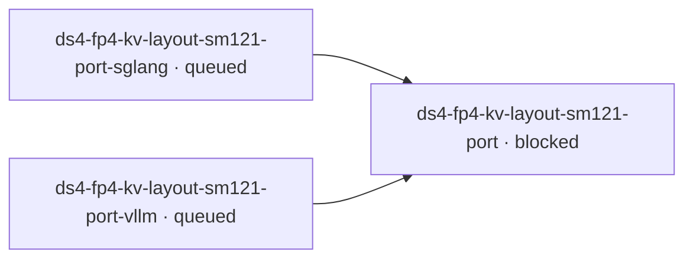

# Board
_Generated 2026-11-22 12:12 ET_

## In flight
| where | owner | what |
|---|---|---|
| census | read-only in tick — booted nothing, claimed nothing, stopped nothing, evicted nothing | read `2026-11-22T17:12:43Z`–`2026-11-22T17:12:45Z` (each node's own `date -u`) on the base census `2026-11-22T17:01:08Z`, **0 h 11 min 35 s** after it: **5 containers, 0 volumes** fleet-wide; **no research rank**; the fenced hosts hold running containers on `.31`, `.32`, `.33`, `.34`, excluded from research accounting; `/v1/models` **200**, `/health` **200** on `.31` |
| pool | — (nobody drives it; head units re-proved each tick) | head: `beegfs-mgmtd` **active** (Result success, NRestarts 0, **+0** on the base) · `beegfs-meta` **active** (Result success, NRestarts 0, **+0** on the base) · `beegfs-storage` **active** (Result success, NRestarts 0, **+0** on the base); worker unit states and the pool's through-mount reads are not part of this census |
| queue | register snapshot `f73b96ad…`; both blocks below rendered from it | `mad-science/queue.json` sha256 **`f73b96ad076aa1fbe2a1be3d393c1173c03122a58b80ab4011ebf509c4573622`** read locally: **228 tasks: 218 done, 6 queued, 4 blocked, 0 running — 10 open**; the head clone reads **`f73b96ad…`**, identical |
| window | **no manual lock** at this read | `.local/fleet-window.lock` is **absent** on the head (read `2026-11-22T17:12:46Z`) |
| campaign | `sparkrun-campaign` — active, no lease | head user unit `sparkrun-campaign` reads **`active`** / **`running`** (`MainPID` **3,930,275**, `NRestarts` **0**, **+0** on the base); the lease ledger holds **0 lease(s)** and fence(s) `tp-le2-20261120` |
| lease | **1 fence(s), 0 lease(s)** | the head's repo ledger `.local/fleet-leases.json` (389 B, sha **`ec09509d…`**, mtime **`2026-11-21 03:04:12.907935197 -0500`** local) holds fence **`tp-le2-20261120`** on `.31`, `.32`, `.33`, `.34` (`fenced_at` `2026-11-20T07:25:27Z`, owner directive 2026-11-20: production serve protected, serve `58cddf1c62ba6578_b8865cad5863` / image `986795bcd7f4`) and **0 lease(s)** |
| publication | tick | fresh census (`2026-11-22T17:12:43Z`–`2026-11-22T17:12:45Z`) written to `2026-11-22T171242Z.json` and composed on the base census `2026-11-22T17:01:08Z`; the queue blocks are rendered from `mad-science/queue.json` sha **`f73b96ad…`**, and the landed rows from `git log --since=2026-11-22T17:01:08Z` |
| .30 | **nothing live (no reservation)** — idle | `2026-11-22T17:12:43Z` (`spark-41e1`): `docker ps -aq` **1**, running **0**, volumes **0**, `:8000` listeners **0** root **1,219,215,769,600 B avail** (-111,472,640, fell) · **2,607,815,049,216 B used** (+111,472,640, rose) boot **`2026-11-19T20:06:40Z`** (`btime`), `uptime` **248,763 s** `MemTotal` **127,598,704 kB** (+0), `MemAvailable` **122,061,864 kB** (-71,476), `Cached` **7,829,444 kB** (+110,024), `AnonPages` **972,844 kB** (-4,448) ring **256** events all-types (+0), **0** in-window lifecycle and **0** in-window `exec`, oldest `2026-11-22T11:23:40.626769558-05:00 container start 049f5ed6`, newest `2026-11-22T11:51:05.985082629-05:00 container die ee1f4311be` |
| .31 | **fenced serve** — excluded from the research census | `2026-11-22T17:12:44Z` (`spark-d325`): `docker ps -aq` **1**, running **1**, volumes **0**, `:8000` listeners **2**, `/v1/models` **200**, `/health` **200** root **1,559,415,750,656 B avail** (-9,568,256, fell) · **2,267,615,068,160 B used** (+9,568,256, rose) boot **`2026-11-19T20:11:15Z`** (`btime`), `uptime` **248,488 s** `MemTotal` **127,598,700 kB** (+0), `MemAvailable` **8,991,600 kB** (-108,264), `Cached` **3,420,172 kB** (-501,932), `AnonPages` **6,395,804 kB** (+20,044) ring **256** events all-types (+0), **0** in-window lifecycle and **69** in-window `exec`, oldest `2026-11-22T11:30:15.629650822-05:00 container exec_start: ta`, newest `2026-11-22T12:12:15.614876059-05:00 container exec_die d9d79` |
| .32 | **fenced serve** — excluded from the research census | `2026-11-22T17:12:44Z` (`spark-ec1d`): `docker ps -aq` **1**, running **1**, volumes **0**, `:8000` listeners **0** root **1,625,041,940,480 B avail** (-17,891,328, fell) · **2,201,988,763,648 B used** (+17,891,328, rose) boot **`2026-11-19T20:14:21Z`** (`btime`), `uptime` **248,302 s** `MemTotal` **127,598,640 kB** (+0), `MemAvailable` **11,673,404 kB** (-24,800), `Cached` **9,520,972 kB** (+3,768), `AnonPages` **5,305,456 kB** (-300) ring **256** events all-types (+0), **0** in-window lifecycle and **69** in-window `exec`, oldest `2026-11-22T11:29:46.288815131-05:00 container exec_die 7641b`, newest `2026-11-22T12:12:16.136286526-05:00 container exec_die 7641b` |
| .33 | **fenced serve** — excluded from the research census | `2026-11-22T17:12:44Z` (`spark-3578`): `docker ps -aq` **1**, running **1**, volumes **0**, `:8000` listeners **0** root **1,521,617,256,448 B avail** (-17,895,424, fell) · **2,305,413,447,680 B used** (+17,895,424, rose) boot **`2026-11-19T20:12:55Z`** (`btime`), `uptime` **248,389 s** `MemTotal` **127,598,636 kB** (+0), `MemAvailable` **11,684,608 kB** (+58,068), `Cached` **8,764,796 kB** (+3,888), `AnonPages` **5,292,984 kB** (-14,488) ring **256** events all-types (+0), **0** in-window lifecycle and **69** in-window `exec`, oldest `2026-11-22T11:29:46.903003919-05:00 container exec_die d98d0`, newest `2026-11-22T12:12:16.501583619-05:00 container exec_die d98d0` |
| .34 | **fenced serve** — excluded from the research census | `2026-11-22T17:12:45Z` (`spark-324e`): `docker ps -aq` **1**, running **1**, volumes **0**, `:8000` listeners **0** root **1,107,009,703,936 B avail** (-17,911,808, fell) · **2,720,021,114,880 B used** (+17,911,808, rose) boot **`2026-11-19T20:09:04Z`** (`btime`), `uptime` **248,621 s** `MemTotal` **127,598,704 kB** (+0), `MemAvailable` **11,675,128 kB** (+10,892), `Cached` **9,533,188 kB** (+3,752), `AnonPages` **5,298,284 kB** (-768) ring **256** events all-types (+0), **0** in-window lifecycle and **69** in-window `exec`, oldest `2026-11-22T11:29:47.570324116-05:00 container exec_die ff75e`, newest `2026-11-22T12:12:16.873162756-05:00 container exec_die ff75e` |
| .35 | **nothing live (no reservation)** — idle | `2026-11-22T17:12:45Z` (`spark-383f`): `docker ps -aq` **0**, running **0**, volumes **0**, `:8000` listeners **0** root **1,041,795,801,088 B avail** (-9,363,456, fell) · **2,785,235,017,728 B used** (+9,363,456, rose) boot **`2026-11-19T20:07:56Z`** (`btime`), `uptime` **248,688 s** `MemTotal` **127,598,700 kB** (+0), `MemAvailable` **123,124,952 kB** (-11,432), `Cached` **5,632,364 kB** (+3,028), `AnonPages` **229,040 kB** (+11,660) ring **256** events all-types (+0), **0** in-window lifecycle and **0** in-window `exec`, oldest `2026-11-22T06:03:40.672336005-05:00 container exec_create: b`, newest `2026-11-22T06:20:39.466944765-05:00 container destroy 5a5f12` |

## Work Queue

| job | node cost | blockers | holds | status | summary |
|---|---|---|---|---|---|
| `ds4-fp4-kv-layout-sm121-port-vllm` — DS4 1017 SM121 vLLM: carry nvfp4_ds_mla through the SM12x sparse-MLA backend so fp4 KV is selectable | single | — | ds4-fp4-kv-layout-sm121-port | queued | Queued engine work: upstream vLLM already ships nvfp4_ds_mla at 352 B/token against fp8 packed 976; the gap is the SM120 sparse-MLA backend selecting it on GB10, patched in the fork overlay, then the parent TP4 boot. |
| `ds4-fp4-kv-layout-sm121-port-sglang` — DS4 1017 SM121 SGLang: port the V41_FP4 KV layout and the fp4 pool-sizing term so fp4 KV is admissible | single | — | ds4-fp4-kv-layout-sm121-port | queued | Queued: the SM121 fp4-KV patch and image are delivered and the store gate is byte-exact (1.32x tokens at equal bytes), but the FlashInfer reader returns zeros at 16 heads, so decode call shape is unproven. |
| `beegfs-meta-restart-loop-non-meta-hosts` — beegfs-meta restart-loops every 5 s on .31-.35, and the loop hides a failed state behind "activating" | single | — | — | blocked | Blocked, owner 2026-11-22: the OOM drop-in Restart=on-failure loops beegfs-meta every 5 s on .31-.35 (NRestarts 3431, 956.6 MB journal) while is-active reads activating; remedy is masking the unit there, .30 untouched. |
| `hf-cache-20261110-docs-only-repin-bundle` — Docs-only model drift from the 2026-11-10 cache update: 22 recipe rows across 10 repos ride their lane’s next boot (no boot of its own) | — | — | — | queued | Queued: the docs-only drift bundle is 14 live rows (8 retired to attic), no live pin moved since the sweep, so each lane re-pins at its next boot - needs a live window, not a decision. |
| `campaign-leases-tp4-onto-30` — The campaign leases memory-heavy TP4 quartets onto .30, which the owner ruling excludes | quartet | — | — | queued | Lease ledger and holder/id claim identity landed offline (d0cf704, no live director-driven TP4 lease yet); .30 is waivable for a memory-heavy quartet only inside a declared window with the six guardrails, else refused. Row open. |
| `mem-guard-outlives-its-task` — A window arm's 6.0 GiB stop-rule guard outlives the arm, so the runner accumulates guards for tasks whose containers are gone | — | — | — | blocked | Blocked on a live boot: a leaked guard is a stale no-op (stops only its own task id), the harness kill and stub test are proven, and closing needs one real stop that leaves no guard process behind. |
| `fleet-boot-without-lease-record` — A four-rank boot serves with no lease in either ledger and no window lock | — | — | — | blocked | Blocked on a live window: the unleased quartet is the shipped production serve (digest and argv match), not a research boot, so the open question is whether a protected production boot must carry a lease under S9. |
| `inkling-tp4-first-boot` — Inkling-2-Small TP=4 first boot: nightly pull and the unproven sm_121 Triton path | quartet | — | — | queued | Inkling-2-Small TP4 first boot: nightly digest c17e9d88 is on no node so the boot includes the pull, and sm_121 runs the Hopper/Triton path (attention_sm90, Humming expert GEMMs) unproven here; needs an owner-declared window. |
| `weightless-dsgb10-tp4-boot-gate` — Boot the weightless-dsgb10 arm four-rank: the α=0 golden hash must equal stock bit-for-bit before any steered request is quoted | quartet | — | — | queued | Boot gate, weightless image: at α=0 output must be byte-identical to stock before any steered request is quoted, then a second-name request must project while a stock one keeps its text; four ranks, .31-.34 unfenced, --cluster WOPR. |
| `ds4-fp4-kv-layout-sm121-port` — DS4 1017 SM121: port the V41/V41_FP4 KV layout so fp4 KV is admissible — dtype is not a lever today, and sizing lies about fp4 | quartet | ds4-fp4-kv-layout-sm121-port-sglang, ds4-fp4-kv-layout-sm121-port-vllm | — | blocked | Blocked on engine work: fp4 KV needs the is_sm100 gate relaxed, the V41/V41_FP4 layout ported and an fp4 branch in the pool configurator, and nvfp4 is unsafe today because sizing has no fp4 term; it buys 2-4x tokens per GiB but no floor. |

## Completed Work
Window: commits since `2026-11-22T17:01:08Z` — the base census stamp, later than the 24 h start `2026-11-21T17:12:42Z`; older rows are not shown.

| time ET | commit | one clause |
|---|---|---|
| 11-22 12:01 | `d06d7222` | Refresh the status board: a 2026-11-22T170107Z census |
| 11-22 12:04 | `7f3ce4ab` | Make the board's new headings a contract, and gate the board's own tests |
