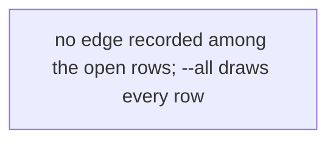

# Board — generated 2026-11-21 23:44 ET

## In flight
| where | owner | what |
|---|---|---|
| census | read-only in tick — booted nothing, claimed nothing, stopped nothing, evicted nothing | read `2026-11-22T04:44:22Z`–`2026-11-22T04:44:24Z` (each node's own `date -u`) on the base census `2026-11-22T04:27:13Z`, **0 h 17 min 9 s** after it: **4 containers, 0 volumes** fleet-wide; **no research rank**; the fenced hosts hold running containers on `.31`, `.32`, `.33`, `.34`, excluded from research accounting; `/v1/models` **200**, `/health` **200** on `.31` |
| pool | — (nobody drives it; head units re-proved each tick) | head: `beegfs-mgmtd` **active** (Result success, NRestarts 0, **+0** on the base) · `beegfs-meta` **active** (Result success, NRestarts 0, **+0** on the base) · `beegfs-storage` **active** (Result success, NRestarts 0, **+0** on the base); worker unit states and the pool's through-mount reads are not part of this census |
| queue | register snapshot `71b74a46…`; both blocks below rendered from it | `mad-science/queue.json` sha256 **`71b74a4646fdb3b195ce1c177d941c4444ece57879240992f79b4b02e2238c9a`** read locally: **214 tasks: 181 done, 32 queued, 1 blocked, 0 running — 33 open**; the head clone reads **`71b74a46…`**, identical |
| window | **no manual lock** at this read | `.local/fleet-window.lock` is **absent** on the head (read `2026-11-22T04:44:24Z`) |
| campaign | `sparkrun-campaign` — active, no lease | head user unit `sparkrun-campaign` reads **`active`** / **`running`** (`MainPID` **3,930,275**, `NRestarts` **0**, **+0** on the base); the lease ledger holds **0 lease(s)** and fence(s) `tp-le2-20261120` |
| lease | **1 fence(s), 0 lease(s)** | the head's repo ledger `.local/fleet-leases.json` (389 B, sha **`ec09509d…`**, mtime **`2026-11-21 03:04:12.907935197 -0500`** local) holds fence **`tp-le2-20261120`** on `.31`, `.32`, `.33`, `.34` (`fenced_at` `2026-11-20T07:25:27Z`, owner directive 2026-11-20: production serve protected, serve `58cddf1c62ba6578_b8865cad5863` / image `986795bcd7f4`) and **0 lease(s)** |
| publication | tick | fresh census (`2026-11-22T04:44:22Z`–`2026-11-22T04:44:24Z`) written to `2026-11-22T044421Z.json` and composed on the base census `2026-11-22T04:27:13Z`; the queue blocks are rendered from `mad-science/queue.json` sha **`71b74a46…`**, and the landed rows from `git log --since=2026-11-22T04:27:13Z` |
| .30 | **nothing live (no reservation)** — idle | `2026-11-22T04:44:22Z` (`spark-41e1`): `docker ps -aq` **0**, running **0**, volumes **0**, `:8000` listeners **0** root **1,369,718,542,336 B avail** (-162,353,152, fell) · **2,457,312,276,480 B used** (+162,353,152, rose) boot **`2026-11-19T20:06:40Z`** (`btime`), `uptime` **203,862 s** `MemTotal` **127,598,704 kB** (+0), `MemAvailable` **121,061,280 kB** (-83,384), `Cached` **26,167,656 kB** (+177,664), `AnonPages` **1,147,560 kB** (+32,360) ring **256** events all-types (+0), **0** in-window lifecycle and **0** in-window `exec`, oldest `2026-11-21T01:06:26.326203501-05:00 container destroy 4db0fd`, newest `2026-11-21T03:05:54.712690080-05:00 image delete sha256:5c2b` |
| .31 | **fenced serve** — excluded from the research census | `2026-11-22T04:44:22Z` (`spark-d325`): `docker ps -aq` **1**, running **1**, volumes **0**, `:8000` listeners **2**, `/v1/models` **200**, `/health` **200** root **1,649,764,139,008 B avail** (-1,974,272, fell) · **2,177,266,679,808 B used** (+1,974,272, rose) boot **`2026-11-19T20:11:15Z`** (`btime`), `uptime` **203,587 s** `MemTotal` **127,598,700 kB** (+0), `MemAvailable` **8,021,652 kB** (+7,088), `Cached` **2,597,944 kB** (+3,800), `AnonPages` **7,415,872 kB** (+34,156) ring **256** events all-types (+0), **0** in-window lifecycle and **105** in-window `exec`, oldest `2026-11-21T23:01:50.252494114-05:00 container exec_die d9d79`, newest `2026-11-21T23:44:20.239011246-05:00 container exec_die d9d79` |
| .32 | **fenced serve** — excluded from the research census | `2026-11-22T04:44:23Z` (`spark-ec1d`): `docker ps -aq` **1**, running **1**, volumes **0**, `:8000` listeners **0** root **1,709,848,305,664 B avail** (-10,067,968, fell) · **2,117,182,398,464 B used** (+10,067,968, rose) boot **`2026-11-19T20:14:21Z`** (`btime`), `uptime` **203,401 s** `MemTotal` **127,598,640 kB** (+0), `MemAvailable` **11,745,220 kB** (+72,916), `Cached` **10,725,124 kB** (+5,740), `AnonPages` **5,313,896 kB** (-5,980) ring **256** events all-types (+0), **0** in-window lifecycle and **105** in-window `exec`, oldest `2026-11-21T23:01:50.672653204-05:00 container exec_die 7641b`, newest `2026-11-21T23:44:20.658155101-05:00 container exec_die 7641b` |
| .33 | **fenced serve** — excluded from the research census | `2026-11-22T04:44:23Z` (`spark-3578`): `docker ps -aq` **1**, running **1**, volumes **0**, `:8000` listeners **0** root **1,625,664,618,496 B avail** (-10,067,968, fell) · **2,201,366,085,632 B used** (+10,067,968, rose) boot **`2026-11-19T20:12:55Z`** (`btime`), `uptime` **203,488 s** `MemTotal` **127,598,636 kB** (+0), `MemAvailable` **11,665,100 kB** (-38,804), `Cached` **10,362,460 kB** (+5,488), `AnonPages` **5,320,360 kB** (+684) ring **256** events all-types (+0), **0** in-window lifecycle and **105** in-window `exec`, oldest `2026-11-21T23:01:51.080959736-05:00 container exec_die d98d0`, newest `2026-11-21T23:44:21.099808511-05:00 container exec_die d98d0` |
| .34 | **fenced serve** — excluded from the research census | `2026-11-22T04:44:23Z` (`spark-324e`): `docker ps -aq` **1**, running **1**, volumes **0**, `:8000` listeners **0** root **1,102,496,366,592 B avail** (-10,080,256, fell) · **2,724,534,452,224 B used** (+10,080,256, rose) boot **`2026-11-19T20:09:04Z`** (`btime`), `uptime` **203,719 s** `MemTotal` **127,598,704 kB** (+0), `MemAvailable` **11,665,388 kB** (-37,828), `Cached` **9,169,908 kB** (+5,624), `AnonPages` **5,316,136 kB** (+12,388) ring **256** events all-types (+0), **0** in-window lifecycle and **105** in-window `exec`, oldest `2026-11-21T23:01:51.487110861-05:00 container exec_die ff75e`, newest `2026-11-21T23:44:21.523854169-05:00 container exec_die ff75e` |
| .35 | **nothing live (no reservation)** — idle | `2026-11-22T04:44:24Z` (`spark-383f`): `docker ps -aq` **0**, running **0**, volumes **0**, `:8000` listeners **0** root **1,112,130,629,632 B avail** (-10,022,912, fell) · **2,714,900,189,184 B used** (+10,022,912, rose) boot **`2026-11-19T20:07:56Z`** (`btime`), `uptime` **203,787 s** `MemTotal` **127,598,700 kB** (+0), `MemAvailable` **123,026,444 kB** (+15,020), `Cached` **6,118,656 kB** (+6,420), `AnonPages` **248,092 kB** (-1,288) ring **256** events all-types (+0), **0** in-window lifecycle and **0** in-window `exec`, oldest `2026-11-20T19:46:09.290987692-05:00 container exec_die 2f39b`, newest `2026-11-20T20:56:32.651557975-05:00 container destroy 26b0f5` |

## Work queue

| job | node cost | blockers | holds | status | summary |
|---|---|---|---|---|---|
| `beegfs-meta-restart-loop-non-meta-hosts` — beegfs-meta restart-loops every 5 s on .31-.35, and the loop hides a failed state behind "activating" | single | — | — | queued | OOM drop-in's Restart=on-failure loops beegfs-meta every 5 s on .31-.35 (NRestarts 3431 on .31, 956.6 MB journal) while is-active reads activating; fix is masking the unit on role-gated hosts, .30 untouched, storage serving. |
| `head-clone-object-store-incomplete` — The head clone loses loose objects without a named cause (healed 2026-11-21, recurrence unproven), so `git ls-tree HEAD` and any `git pull` fail there until it is re-healed | — | — | — | queued | Head clone loses loose objects (packs agree), so git reads and pulls fail there; healed 2026-11-21 by restoring 76 objects, but the cause is unnamed and a detector is still owed. |
| `hf-cache-20261110-docs-only-repin-bundle` — Docs-only model drift from the 2026-11-10 cache update: 22 recipe rows across 10 repos ride their lane’s next boot (no boot of its own) | — | — | — | queued | Docs-only drift bundle over 14 live recipe rows (8 of the 22 retired to attic): only README/LICENSE/eval_results differ from the head, no pin bumped since the sweep, each lane moves its pin at its next boot and records it. |
| `house-num-scorer-trailing-period` — House battery scores a correct number with a trailing period as a miss | — | — | — | queued | score() for kind=num keeps the sentence-final dot, so a correct 74 ending a sentence scores false (Ripple 2026-11-20 hard-arith-1); fix is stripping trailing punctuation plus a regression test over 74, 74. and 7.5. |
| `lane-survey-edge0-audio8-tts` — Media-lane survey: Edge0/Audio8-TTS-Realistic-Air - 0.6B DualAR TTS + bundled codec, TP<4 so surveyed only | — | — | — | queued | Edge0/Audio8-TTS survey: Apache-2.0, 0.6B DualAR TTS plus a 1.35 GB 44.1 kHz codec, trust_remote_code required, SGLang Omni adapter unverified; TP<4, so surveyed only with no recipe per the owner rule. |
| `queue-mode-done-sibling-holds-canary-row` — Queue mode will not lease a row whose recipe a done sibling already holds | — | — | — | queued | Canary row (tp4 quartet recipe) never leases because plan.sibling_hold keys arms on the recipe stem and done sibling h2h-second-boot-ds4-1017 holds it, fleet idle meanwhile; open choice: close sibling, own recipe file, or change the hold. |
| `sage-q4km-trick1-empty-repeat` — Sage Q4_K_M: repeat the trick-1 house cell — one empty reply in the 37-case run | single | — | — | queued | Sage Q4_K_M scored 36/37 on the 2026-11-20 house; the one miss is trick-1 returning empty content, a serving event, so repeat that cell n=3 on the same boot shape and open a llama.cpp pin row if it recurs. |
| `campaign-ingest-freezes-on-an-unplaceable-pending-arm` — The campaign never re-reads the register while any arm is pending, so one unplaceable pending arm silently stops new rows from ever being seen | — | — | — | queued | Campaign refreshes only when drained; a pending memory-risky TP4 arm that cannot fit .30/.35 with .31-.34 fenced holds drained() false, so rows queued after 00:12 were never ingested; fix: idle-poll refresh or unplaceable state. |
| `campaign-leases-tp4-onto-30` — The campaign leases memory-heavy TP4 quartets onto .30, which the owner ruling excludes | — | — | — | queued | Lease ledger and holder/id claim identity landed offline (d0cf704, no live director-driven TP4 lease yet); .30 is waivable for a memory-heavy quartet only inside a declared window with the six guardrails, else refused. Row open. |
| `campaign-state-copy-re-nests` — The director's receipts root copies state.json back into a window subdir, so one campaign now holds 40 nested copies | — | — | — | queued | One campaign holds 40 byte-identical nested state.json copies because --receipts-root equals --root, so each run under tp12-window re-nests; no stale state is read today, but a **/state.json census counted 49 files for 9 campaigns. |
| `hf-cache-20261110-cache-consistency-defects` — HF cache consistency defects: four repos hf ignores on a refs/main byte defect, one on a broken absolute symlink, plus 204 GB of stray non-cache trees in the hub root | single | — | — | queued | Cache defects: three repos ignored on a trailing-newline refs/main (one-byte truncation fix), Sage Q4_K_M ref on an absent commit, 202.9 GiB non-cache trees invisible to hf, 32 incomplete files (19.27 GiB); nothing deleted pending say-so. |
| `hf-cache-20261110-template-ab-ifm-k2` — K2-Horizon template/code drift A/B: head c4f92a0d (0.9B) and 240f2de3 (7B-FP8) vs the shipped pins, template identity + one fixed request | single | — | — | queued | K2-Horizon drift A/B: both head snapshots are complete and differ from the pins in chat_template.jinja (0.9B also modeling code, two templates removed); a single-node template-bytes plus tool-call check decides re-pin, no throughput claim. |
| `mem-guard-outlives-its-task` — A window arm's 6.0 GiB stop-rule guard outlives the arm, so the runner accumulates guards for tasks whose containers are gone | — | — | — | queued | Corrected: a leaked guard is a stale no-op because mem-guard stops only its own task id; what accumulates is processes and ssh sessions — three guards alive on 2026-11-10 with one task container; fix is guard lifetime and harness refusal. |
| `pool-target-probe-beegfs-ctl-absent` — Pool storage-target byte accounting is unreachable: beegfs-ctl is absent from .30 though beegfs-utils 20:8.4.1 is installed | single | — | — | queued | beegfs-ctl exits 127 on .30 though beegfs-utils 20:8.4.1 is installed, so the storage-target --space probe that would explain pool growth cannot run; the 15:03-15:06 series rose 10,485,760 B with no hub file newer than 12 min. |
| `watchdog-stall-mmap-flat-residual` — Watchdog stall rule: mmap load with flat io/log and sub-128-MiB memory progress | — | — | — | queued | boot-watchdog counts memory as progress only past a 128 MiB floor, so an mmap load with flat io/log and smaller per-check deltas is still classified stalled at 600 s; fix is cumulative progress or a test plus a recorded risk. |
| `hf-cache-20261110-pool-fetch-gaps` — Pool gaps left by the 2026-11-10 cache update: two Hub heads, two pinned revisions, three absent repos, one private repo needing an org token | single | — | — | queued | Pool gaps: two heads and two pinned revisions missing, four repos absent so a shared-cache boot fails at load, one private repo 404ing for an org token; fix is hf download per repo (~130 GB); 1017's double-count is two revisions, one index. |
| `wopr-cache-dir-runtime-regression` — Verify SGLang and llama.cpp still resolve models through the WOPR cache_dir profile | single | — | — | queued | WOPR's new cache_dir profile was proven only on vLLM: boot one SGLang arm and one llama.cpp arm with --cluster WOPR and assert the prepared model path resolves inside the cache mount; a bare -H anonymous cluster should refuse. |
| `board-publish-accepts-weaker-replacement` — publish replaces a better-grounded In-flight composition with a fresher byte-compatible one, and no guard notices | — | — | — | queued | Publish guards compare bytes, so a replacement with fewer facts passes: on 2026-11-11 a composition replaced the peer's 4 captures ending 01:16 with 3 ending 01:06; acceptance is a pre-publish check on capture count, state labels, teardown. |
| `board-publish-keeps-in-flight-row-set` — A board published without one of the In-flight state rows passes every guard, because publish compares bytes and never the row set | — | — | — | queued | A base missing an In-flight state row is indistinguishable from a good one: bc2cc38 published 0 queue rows and passed publish, lint and the gate; acceptance: refuse an In-flight lacking an expected row key or a strict subset of its base. |
| `cache-audit-pool-budget` — `tools/cache-audit.py --budget-gb`: add a pool mode that judges the one shared HF pool against 90 % of capacity | — | — | — | queued | cache-audit --budget-gb measures per node but the HF cache is one shared pool, so every node reads the same and the fleet flags at once; it needs a pool mode judging usage against 90% of capacity with one pass/fail. Not bootable. |
| `executor-release-host-claim-on-failure` — An executor that stops observing a launch must release the sparkrun host claims it holds | — | — | — | queued | A launcher that stops observing its boot still holds sparkrun host claims: pid 1883449 held .30-.33 after a 414.7 s registry failure, the next three arms refused rc=5; unfixed at 4927a7fe — nothing kills the launcher to drop the claim. |
| `fleet-boot-without-lease-record` — A four-rank boot serves with no lease in either ledger and no window lock | — | — | — | queued | Corrected: the unleased four-rank serve measured on 2026-11-11 is the shipped production arm (image digest and argv match), not a research quartet; open is whether a protected production boot must carry a lease under the S9 answer. |
| `pool-content-fall-20261116` — Pool used fell 501 GB in 6.5 h while every repo entry stayed: name the deletion before the next budget claim | single | — | — | queued | Pool used fell 501 GB in 6.5 h with every repo entry intact — ~501 GB of chunk content deleted, matching the two approved-but-unrun GC sets (498.3 GB) within 0.5%; naming the deletion is the work, and beegfs-ctl is absent. |
| `runtime-cache-stale-tree-gc` — Delete the stale runtime-cache trees the 2026-11-12 audit approved (732 GB planned, never executed) | single | — | — | queued | Batch 1 deleted 554.54 GB across .30-.34 on 2026-11-16; what stays open is the CHECK bucket, NEEDS-ROOT debris and the shared HF pool, with the on-disk 54-tree/732.1 GB plan blocked on .31-.34 being fenced for the production serve. |
| `sparkrun-single-gid-index-for-two-hcas` — sparkrun injects one GID index across two HCAs whose tables disagree | — | — | — | queued | Report-only sparkrun defect: one derived NCCL_IB_GID_INDEX is applied to both HCAs, and a 2026-11-11 carrier flap vacated plane A's index 3, failing ncclCommInitRank (ibv_modify_qp 61) on boot 2 and the control; fix per HCA or fail closed. |
| `window-lock-does-not-stop-direct-boots` — A declared window holds campaign placement and `director lease`, but a direct `sparkrun run` boot bypasses both | — | — | — | queued | A declared window stops campaign placement and lease but not a direct sparkrun run: inside the 01:04-01:16 window a solo container started on .35 with no lease record and no assign line; decide whether direct boots consult the lock. |
| `webai-twil-8b-eval-only-arm` — Author and ship the webAI 8.8B eval-only arm (webAI-Official/TwIL-8B): recipe, license banner, lane README notice, index row | — | — | — | queued | No recipe yet: webAI/TwIL-8B is webai-non-commercial, so the arm ships eval-only with license banner, description note and lane README notice; 8.79B BF16 in balanced and verbose variants plus GGUF quants; closes when both are tracked. |
| `inkling-tp4-first-boot` — Inkling-2-Small TP=4 first boot: nightly pull and the unproven sm_121 Triton path | quartet | — | — | queued | Inkling-2-Small TP4 first boot: nightly digest c17e9d88 is on no node so the boot includes the pull, and sm_121 runs the Hopper/Triton path (attention_sm90, Humming expert GEMMs) unproven here; needs an owner-declared window. |
| `mech-cites-0-4-3` — Re-derive the remaining 117 recipes/MECHANICS.md citations against the installed sparkrun build | — | — | — | queued | 117 recipes/MECHANICS.md anchors still carry 0.4.2/0.4.0 numbering after d0d050f landed 27 plus 13 controls; not mechanically renumberable since core/recipe.py grew to 3080 lines, so each sentence is re-read and its claim re-located. |
| `metrics-instrument-confound` — Metrics knob decomposition: one identical recipe, metrics-on vs metrics-off, name the performance-impacting knobs (`#68` ROM bar) | single | — | — | queued | #68 must separate three instrument regimes — the free post-cell scrape, the recipe metrics flag mounted for the whole boot, and mid-run sampling — via one identical recipe off vs on; acceptance: no order-of-magnitude throughput difference. |
| `minimax-viggle-remake-eval-only-arm` — Author and ship the MiniMax video eval-only arm (Viggle/Viggle-Remake): ComfyUI node route, license banner, lane README notice, index row | — | — | — | queued | No recipe yet: Viggle-Remake is under the minimax-h3 community license, so the ComfyUI-node arm ships eval-only with banner and README notice; tiers Q8_0 20.72 GiB to Q4_K_M 13.35 GiB, repo 156 GiB so staging is a pool transfer. |
| `weightless-dsgb10-tp4-boot-gate` — Boot the weightless-dsgb10 arm four-rank: the α=0 golden hash must equal stock bit-for-bit before any steered request is quoted | quartet | — | — | queued | Boot gate, weightless image: at α=0 output must be byte-identical to stock before any steered request is quoted, then a second-name request must project while a stock one keeps its text; four ranks, .31-.34 unfenced, --cluster WOPR. |
| `ds4-fp4-kv-layout-sm121-port` — DS4 1017 SM121: port the V41/V41_FP4 KV layout so fp4 KV is admissible — dtype is not a lever today, and sizing lies about fp4 | quartet | — | — | blocked | Blocked on engine work: fp4 KV needs the is_sm100 gate relaxed, the V41/V41_FP4 layout ported and an fp4 branch in the pool configurator, and nvfp4 is unsafe today because sizing has no fp4 term; it buys 2-4x tokens per GiB but no floor. |

## Landed session
Window: commits since `2026-11-22T04:27:13Z` — the base census stamp, later than the 24 h start `2026-11-21T04:44:21Z`; older rows are not shown.

| time ET | commit | one clause |
|---|---|---|
| 11-21 23:27 | `523c01e7` | Refresh the status board: a 2026-11-22T042712Z census |
| 11-21 23:33 | `5d3b761d` | Heal the head clone's missing objects and register the unnamed cause |
| 11-21 23:33 | `497ea4f8` | Derive the census head fixture's register sha so a queue edit cannot redden it |
| 11-21 23:44 | `b9ad5662` | Write the head-clone object-loss row's board summary from its own notes |
