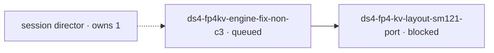

# Board
_Generated 2026-11-23 11:36 ET_

## In flight
| where | owner | what |
|---|---|---|
| census | read-only in tick — booted nothing, claimed nothing, stopped nothing, evicted nothing | read `2026-11-23T16:36:43Z`–`2026-11-23T16:36:45Z` (each node's own `date -u`) on the base census `2026-11-23T11:00:01Z`, **5 h 36 min 42 s** after it: **1 containers, 0 volumes** fleet-wide; **no research rank**; no node probed a serve |
| pool | — (nobody drives it; head units re-proved each tick) | head: `beegfs-mgmtd` **active** (Result success, NRestarts 0, **+0** on the base) · `beegfs-meta` **active** (Result success, NRestarts 0, **+0** on the base) · `beegfs-storage` **active** (Result success, NRestarts 0, **+0** on the base); worker unit states and the pool's through-mount reads are not part of this census |
| queue | register snapshot `205529cb…`; both blocks below rendered from it | `mad-science/queue.json` sha256 **`205529cb6bd2748759956336ffb8ea88e4521ca040d99aa27f96fa7e515236b8`** read locally: **254 tasks: 252 done, 1 queued, 1 blocked, 0 running — 2 open**; the head clone reads **`205529cb…`**, identical |
| window | **no manual lock** at this read | `.local/fleet-window.lock` is **absent** on the head (read `2026-11-23T16:36:46Z`) |
| campaign | `sparkrun-campaign` — active, no lease | head user unit `sparkrun-campaign` reads **`active`** / **`running`** (`MainPID` **3,930,275**, `NRestarts` **0**, **+0** on the base); the lease ledger holds **0 lease(s)** and fence(s) `tp-le2-20261120` |
| lease | **1 fence(s), 0 lease(s)** | the head's repo ledger `.local/fleet-leases.json` (1,034 B, sha **`d2ae6e2f…`**, mtime **`2026-11-23 05:56:48.233826412 -0500`** local) holds fence **`tp-le2-20261120`** on `.31`, `.32`, `.33`, `.34` (`fenced_at` `2026-11-23T10:56:48Z`, window closed — production serve protected, serve `58cddf1c62ba6578_b8865cad5863` / image `986795bcd7f4`) and **0 lease(s)** |
| publication | tick | fresh census (`2026-11-23T16:36:43Z`–`2026-11-23T16:36:45Z`) written to `2026-11-23T163642Z.json` and composed on the base census `2026-11-23T11:00:01Z`; the queue blocks are rendered from `mad-science/queue.json` sha **`205529cb…`**, and the landed rows from `git log --since=2026-11-23T11:00:01Z` |
| .30 | **nothing live (no reservation)** — idle | `2026-11-23T16:36:43Z` (`spark-41e1`): `docker ps -aq` **1**, running **0**, volumes **0**, `:8000` listeners **0** root **986,941,526,016 B avail** (-28,368,896, fell) · **2,840,089,292,800 B used** (+28,368,896, rose) boot **`2026-11-19T20:06:40Z`** (`btime`), `uptime` **333,003 s** `MemTotal` **127,598,704 kB** (+0), `MemAvailable` **122,006,228 kB** (+75,972), `Cached` **66,437,416 kB** (+39,840), `AnonPages` **817,088 kB** (-38,168) ring **256** events all-types (+0), **0** in-window lifecycle and **0** in-window `exec`, oldest `2026-11-23T05:43:49.443810772-05:00 container die 4799baa21d`, newest `2026-11-23T05:49:41.127349897-05:00 container destroy b65199` |
| .31 | **nothing live (no reservation)** — idle | `2026-11-23T16:36:44Z` (`spark-d325`): `docker ps -aq` **0**, running **0**, volumes **0**, `:8000` listeners **0** root **1,271,619,686,400 B avail** (-17,797,120, fell) · **2,555,411,132,416 B used** (+17,797,120, rose) boot **`2026-11-19T20:11:15Z`** (`btime`), `uptime` **332,728 s** `MemTotal` **127,598,700 kB** (+0), `MemAvailable` **123,150,484 kB** (+23,200), `Cached` **2,510,784 kB** (+485,460), `AnonPages` **242,612 kB** (-10,076) ring **256** events all-types (+0), **0** in-window lifecycle and **0** in-window `exec`, oldest `2026-11-23T05:30:31.067539197-05:00 container exec_die 7f73a`, newest `2026-11-23T05:41:09.915289922-05:00 container destroy 0598db` |
| .32 | **nothing live (no reservation)** — idle | `2026-11-23T16:36:44Z` (`spark-ec1d`): `docker ps -aq` **0**, running **0**, volumes **0**, `:8000` listeners **0** root **1,355,822,993,408 B avail** (-10,625,024, fell) · **2,471,207,710,720 B used** (+10,625,024, rose) boot **`2026-11-19T20:14:21Z`** (`btime`), `uptime` **332,542 s** `MemTotal` **127,598,640 kB** (+0), `MemAvailable` **123,245,108 kB** (+27,556), `Cached` **2,430,772 kB** (+489,104), `AnonPages` **190,088 kB** (-10,940) ring **256** events all-types (+0), **0** in-window lifecycle and **0** in-window `exec`, oldest `2026-11-23T05:27:19.277417799-05:00 container exec_create: s`, newest `2026-11-23T05:41:09.911867387-05:00 container destroy 4a6b85` |
| .33 | **nothing live (no reservation)** — idle | `2026-11-23T16:36:44Z` (`spark-3578`): `docker ps -aq` **0**, running **0**, volumes **0**, `:8000` listeners **0** root **1,226,519,404,544 B avail** (-10,620,928, fell) · **2,600,511,299,584 B used** (+10,620,928, rose) boot **`2026-11-19T20:12:55Z`** (`btime`), `uptime` **332,629 s** `MemTotal` **127,598,636 kB** (+0), `MemAvailable` **123,249,236 kB** (+11,940), `Cached` **2,431,708 kB** (+488,692), `AnonPages` **192,216 kB** (+812) ring **256** events all-types (+0), **0** in-window lifecycle and **0** in-window `exec`, oldest `2026-11-23T05:27:06.890470675-05:00 container exec_start: sh`, newest `2026-11-23T05:41:09.914059786-05:00 container destroy 1af3d1` |
| .34 | **nothing live (no reservation)** — idle | `2026-11-23T16:36:45Z` (`spark-324e`): `docker ps -aq` **0**, running **0**, volumes **0**, `:8000` listeners **0** root **1,068,570,222,592 B avail** (-10,604,544, fell) · **2,758,460,596,224 B used** (+10,604,544, rose) boot **`2026-11-19T20:09:04Z`** (`btime`), `uptime` **332,861 s** `MemTotal` **127,598,704 kB** (+0), `MemAvailable` **122,979,160 kB** (+22,132), `Cached` **2,434,084 kB** (+488,608), `AnonPages` **186,368 kB** (-11,132) ring **256** events all-types (+0), **0** in-window lifecycle and **0** in-window `exec`, oldest `2026-11-23T05:27:07.632209775-05:00 container exec_die 0b59e`, newest `2026-11-23T05:41:09.949089761-05:00 container destroy 7fe505` |
| .35 | **nothing live (no reservation)** — idle | `2026-11-23T16:36:45Z` (`spark-383f`): `docker ps -aq` **0**, running **0**, volumes **0**, `:8000` listeners **0** root **971,307,405,312 B avail** (-11,321,344, fell) · **2,855,723,413,504 B used** (+11,321,344, rose) boot **`2026-11-19T20:07:56Z`** (`btime`), `uptime` **332,928 s** `MemTotal` **127,598,700 kB** (+0), `MemAvailable` **122,927,860 kB** (+36,152), `Cached` **115,876,184 kB** (+93,784), `AnonPages` **233,536 kB** (-12,048) ring **256** events all-types (+0), **0** in-window lifecycle and **0** in-window `exec`, oldest `2026-11-22T21:05:06.535546060-05:00 container exec_start: sh`, newest `2026-11-22T21:19:48.088204374-05:00 container destroy 8b4cc1` |

## Work Queue

| job | node cost | blockers | holds | status | summary |
|---|---|---|---|---|---|
| `ds4-fp4kv-engine-fix-non-c3` — Rebuild the FP4-KV image on a non-c3 base or adapt the recipe for the c3 tree | — | — | ds4-fp4-kv-layout-sm121-port | queued | — THREE BOOT ATTEMPTS FAILED on the same wall (serve log: serve-reaped-*.log in the boot receipt). The c3-reconciled base has incompatible kernel modules: sglang.kernels.ops.attention.dsv4.wo_a_bf16 is missing (the c3 tree renamed it to wo_a)… (full note: queue.json) |
| `ds4-fp4-kv-layout-sm121-port` — DS4 1017 SM121: port the V41/V41_FP4 KV layout so fp4 KV is admissible — dtype is not a lever today, and sizing lies about fp4 | quartet | ds4-fp4kv-engine-fix-non-c3 | — | blocked | — FP4-KV image built and pushed. SGLang side: ghcr.io/littlecedar/aneda@sha256:b5de5272edd983e41059154f10d862a44c25f8f5f403fafd48ad0778b95ceed6 (the dsv41-sm121-dg:0.2.1-fi073e base + patch_dsv41_fp4kv.py + fp4kv_kv_format.py). Recipe at reci… (full note: queue.json) |

## Completed Work
Window: commits since `2026-11-23T11:00:01Z` — the base census stamp, later than the 24 h start `2026-11-22T16:36:42Z`; older rows are not shown.

| time ET | commit | one clause |
|---|---|---|
| 11-23 06:00 | `25d7f799` | Refresh the status board: a 2026-11-23T110000Z census |
| 11-23 11:27 | `f4cbc1cd` | Block ds4-fp4-kv-layout-sm121-port on an engine fix |
| 11-23 11:29 | `50e1d302` | Merge remote-tracking branch 'origin/main' |
