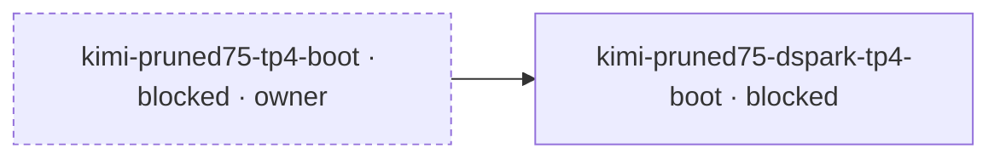

# Board — generated 2026-11-19 11:13 ET

## In flight
| where | owner | what |
|---|---|---|
| census | read-only in tick — booted nothing, claimed nothing, stopped nothing, evicted nothing | `2026-11-19T16:11:52Z`–`2026-11-19T16:11:54Z` (each node's own `date -u`, five hosts from the head; `.30` `2026-11-19T16:12:37Z` straight from this workstation because the head's own ssh to the `.30` name still fails host-key verification — open `head-mesh-cannot-reach-30` row), **0 h 07 min 49 s** after base's first node read (`2026-11-19T16:04:03Z`): the replacement boot `b020d2dd178343a5_6a7e0d618bcc` (image `3f4480818acb`) is **unchanged and still loading** — `Up 10 minutes (health: starting)`, no `:8000` listener, rank 0 **000** at `16:11:55Z` — while each rank's engine log has reached `Dummy health check server started … 0.0.0.0:80` at **`16:12:35Z`** and `Waiting for application startup` at **`16:12:36Z`**; all four serve children **alive** (bracketed count **1**, see correction row); `.30`/`.35` at **0/0/0** |
| pool | — (nobody drives it; units and reads re-proved each tick) | **serving.** Head units mgmtd/meta/storage `active`, `Result=success`, `NRestarts` **0**; mount *listed* (`findmnt -M /mnt/beegfs` reports `default beegfs`), serving proved by reads on all six nodes: `df -B1` on mount **14,059,048,009,728 B** `used` identical on five hosts at `2026-11-19T16:11:52Z`–`2026-11-19T16:11:54Z`, and **14,059,053,252,608 B** on `.30` `2026-11-19T16:12:37Z` (**+5,242,880 B** of growth between the two reads), **+5,242,880 B** on the base's `14,059,042,766,848 B` read over **0 h 07 min 49 s**; **103** hub entries and `stat -L` on `models--deepseek-ai--DeepSeek-V4.1-Flash-1017/snapshots/08c8657f…/config.json` **3311 B** |
| queue | register snapshot `b6fe77a7…` both blocks below rendered from it | `mad-science/queue.json` sha256 **`b6fe77a7…`** — unchanged since base and still equal the live file this tick composed from; **201 tasks: 159 done, 34 queued, 8 blocked, 0 running — 42 open**; `task-queue.py check` prints **`ok: 201 task(s)`** in the live worktree; both blocks rendered from the one snapshot with `graph --file` / `--file … render --board` |
| window | **`prefill-cudnn-20261119` holds `.31`–`.34`** | `.local/fleet-window.lock` **present** here and on head, **184 B**, sha `900dc274…`, mtime **`2026-11-19 10:34:13 ET`** (`15:34:13Z`), declared **`12:14:00Z`**, window `prefill-cudnn-20261119`, end **`2026-11-19T17:00:00Z`**; lease ledger **407 B, sha `afcb8507…`**, identical bytes and mtime on head, one live lease `prefill-cudnn-20261119:h5-cudnn:1795102442` on `.31`–`.34`, issued **`15:34:02Z`**, TTL **4 h**, expiring **`19:34:02Z`** — byte-identical to the base, so the loading boot is inside the holder's own window and this tick took no action |
| campaign | `h2h-20261107` inactive, zero leases its own | user unit `sparkrun-campaign` reads `ActiveState=inactive`; a read-only scan under head's `/home/red/benchmarks` finds **9** `state.json` files (9 paths → 9 files, no duplicates by `(st_dev, st_ino)`) carrying **38 arms** and **0 live leases** (each `lease.expires_at` parsed float epoch against wall clock); the fleet is under no campaign claim at all |
| publication | tick | base = peer's **`11:09 ET`** board, content sha256 **`8545a040…`**, published and pushed as `4229ff3`, git blob **`504a2800…`**; `origin/main` was `4229ff3` at read time and its board blob is that same `504a2800…`, so `--expect-sha` and `--expect-remote-sha` both carry `8545a040…`; every base line is preserved and this tick appends only its own rows; both queue blocks rendered from snapshot `b6fe77a7…` |
| .30 | nothing live (no reservation) | `2026-11-19T16:12:37Z` (`spark-41e1`): `docker ps -aq` **0**, running **0**, volumes **0**, `:8000` listeners **0** nothing running root **1,453,576,552,448 B avail** (−3,702,784 base census) · **2,373,454,266,368 B used** `MemAvailable` **120,842,552 kB** (+66,608 base), `Cached` **101,170,464 kB** (+3,808), `AnonPages` **1,413,624 kB** (−3,916), `MemTotal` **127,598,704 kB** mgmtd **active** (success, 0) · meta **active** (success, 0) · storage **active** (success, 0) boot **2026-11-11 20:02:53 local** = **2026-11-12T01:02:53Z**, `uptime` **659,383 s** (row read − boot **659,384 s**, Δ **+0 s**), `kho=off` **1**, CMA **0/0**, `nr_free_cma` **0**; kernel `7.0.0-1025-nvidia` |
| .31 | `prefill-cudnn-20261119` (lease) | `2026-11-19T16:11:52Z` (`spark-d325`): `docker ps -aq` **1**, running **1**, volumes **0**, `:8000` listeners **0** `sparkrun_b020d2dd178343a5_6a7e0d618bcc_node_0`, image `3f4480818acb`, `Up 10 minutes (health: starting)`, serve child **alive** — bracketed `pgrep -c -f '[s]glang.launch_server'` reads **1** on all four ranks at the read (bare pattern reads **2**, the wrapper's own argv), `:8000` closed, rank-0 `/v1/models` **000** and `/health` **000** at `16:11:55Z` from the head; engine logs reach `Dummy health check server started … 0.0.0.0:80` at **`16:12:35Z`** and `Waiting for application startup` at **`16:12:36Z`** root **1,690,786,426,880 B avail** (−692,224 base census) · **2,136,244,391,936 B used** `MemAvailable` **37,900,132 kB** (−782,540 base), `Cached` **6,396,792 kB** (−32,547,460), `AnonPages` **1,802,924 kB** (−4,081,156), `MemTotal` **127,598,704 kB** mgmtd **inactive** (success, 0) · meta **activating** (exit-code, 126327) · storage **active** (success, 0) boot **2026-11-11 20:03:52 local** = **2026-11-12T01:03:52Z**, `uptime` **659,280 s** (row read − boot **659,280 s**, Δ **+0 s**), `kho=off` **1**, CMA **0/0**, `nr_free_cma` **0**; kernel `7.0.0-1025-nvidia` |
| .32 | `prefill-cudnn-20261119` (lease) | `2026-11-19T16:11:53Z` (`spark-ec1d`): `docker ps -aq` **1**, running **1**, volumes **0**, `:8000` listeners **0** `sparkrun_b020d2dd178343a5_6a7e0d618bcc_node_1`, image `3f4480818acb`, `Up 10 minutes (health: starting)`, serve child **alive** — bracketed `pgrep -c -f '[s]glang.launch_server'` reads **1** on all four ranks at the read (bare pattern reads **2**, the wrapper's own argv), `:8000` closed, rank-0 `/v1/models` **000** and `/health` **000** at `16:11:55Z` from the head; engine logs reach `Dummy health check server started … 0.0.0.0:80` at **`16:12:35Z`** and `Waiting for application startup` at **`16:12:36Z`** root **1,751,681,044,480 B avail** (−577,536 base census) · **2,075,349,659,648 B used** `MemAvailable` **38,640,696 kB** (−2,226,088 base), `Cached` **35,747,336 kB** (−4,311,084), `AnonPages` **1,072,916 kB** (−2,816,368), `MemTotal` **127,598,640 kB** mgmtd **inactive** (success, 0) · meta **activating** (exit-code, 126329) · storage **active** (success, 0) boot **2026-11-11 20:02:52 local** = **2026-11-12T01:02:52Z**, `uptime` **659,340 s** (row read − boot **659,341 s**, Δ **+0 s**), `kho=off` **1**, CMA **0/0**, `nr_free_cma` **0**; kernel `7.0.0-1025-nvidia` |
| .33 | `prefill-cudnn-20261119` (lease) | `2026-11-19T16:11:53Z` (`spark-3578`): `docker ps -aq` **1**, running **1**, volumes **0**, `:8000` listeners **0** `sparkrun_b020d2dd178343a5_6a7e0d618bcc_node_2`, image `3f4480818acb`, `Up 10 minutes (health: starting)`, serve child **alive** — bracketed `pgrep -c -f '[s]glang.launch_server'` reads **1** on all four ranks at the read (bare pattern reads **2**, the wrapper's own argv), `:8000` closed, rank-0 `/v1/models` **000** and `/health` **000** at `16:11:55Z` from the head; engine logs reach `Dummy health check server started … 0.0.0.0:80` at **`16:12:35Z`** and `Waiting for application startup` at **`16:12:36Z`** root **1,666,611,204,096 B avail** (−577,536 base census) · **2,160,419,500,032 B used** `MemAvailable` **38,151,548 kB** (−2,810,704 base), `Cached` **35,653,172 kB** (−4,925,604), `AnonPages` **1,107,300 kB** (−2,814,876), `MemTotal` **127,598,640 kB** mgmtd **inactive** (success, 0) · meta **activating** (exit-code, 126330) · storage **active** (success, 0) boot **2026-11-11 20:02:52 local** = **2026-11-12T01:02:52Z**, `uptime` **659,341 s** (row read − boot **659,341 s**, Δ **+0 s**), `kho=off` **1**, CMA **0/0**, `nr_free_cma` **0**; kernel `7.0.0-1025-nvidia` |
| .34 | `prefill-cudnn-20261119` (lease) | `2026-11-19T16:11:54Z` (`spark-324e`): `docker ps -aq` **1**, running **1**, volumes **0**, `:8000` listeners **0** `sparkrun_b020d2dd178343a5_6a7e0d618bcc_node_3`, image `3f4480818acb`, `Up 10 minutes (health: starting)`, serve child **alive** — bracketed `pgrep -c -f '[s]glang.launch_server'` reads **1** on all four ranks at the read (bare pattern reads **2**, the wrapper's own argv), `:8000` closed, rank-0 `/v1/models` **000** and `/health` **000** at `16:11:55Z` from the head; engine logs reach `Dummy health check server started … 0.0.0.0:80` at **`16:12:35Z`** and `Waiting for application startup` at **`16:12:36Z`** root **1,141,099,855,872 B avail** (−577,536 base census) · **2,685,930,962,944 B used** `MemAvailable` **38,927,860 kB** (−2,263,956 base), `Cached` **37,080,800 kB** (−3,991,608), `AnonPages` **976,876 kB** (−2,752,560), `MemTotal` **127,598,704 kB** mgmtd **inactive** (success, 0) · meta **activating** (exit-code, 126329) · storage **active** (success, 0) boot **2026-11-11 20:02:51 local** = **2026-11-12T01:02:51Z**, `uptime` **659,342 s** (row read − boot **659,343 s**, Δ **+0 s**), `kho=off` **1**, CMA **0/0**, `nr_free_cma` **0**; kernel `7.0.0-1025-nvidia` |
| .35 | nothing live (no reservation) | `2026-11-19T16:11:54Z` (`spark-383f`): `docker ps -aq` **0**, running **0**, volumes **0**, `:8000` listeners **0** nothing running root **1,199,380,488,192 B avail** (−552,960 base census) · **2,627,650,330,624 B used** `MemAvailable` **122,295,052 kB** (+2,240 base), `Cached` **112,546,032 kB** (+1,564), `AnonPages` **219,208 kB** (+10,288), `MemTotal` **127,598,700 kB** mgmtd **inactive** (success, 0) · meta **activating** (exit-code, 126305) · storage **active** (success, 0) boot **2026-11-11 20:02:52 local** = **2026-11-12T01:02:52Z**, `uptime` **659,342 s** (row read − boot **659,342 s**, Δ **+0 s**), `kho=off` **1**, CMA **0/0**, `nr_free_cma` **0**; kernel `7.0.0-1025-nvidia` |

## Work queue

| job | node cost | holds | state |
|---|---|---|---|
| `campaign-does-not-honour-the-.30-exclusion` — The campaign places tp>=4 work on .30 regardless of the memory-risk exclusion: a leaseable row that needs .30 is a live risk, so placement must be a field the director refuses to violate | — | — | queued — MECHANISM LANDED OFFLINE 2026-11-11 (commits `aa54000`, `ebf5c8e`, `298098d`, `08ff156`; no live lease and no live six-node boot has run, so the row stays open). One ledger, `<repo>/.local/fleet-leases.json` (flock + atomic write), and one … (full note: queue.json) |
| `sm121-ladder-acceptsampling-dflash` — SM121 survey ladder dies in llama-benchy warm-up: dflash_utils.build_dflash_verify_target_probs missing | single | — | queued — DENSE: the ladder leg cannot run on dsv41-sm121-dg:0.2.1. llama-benchy's first warm-up request takes the adapter's AcceptSampling top-k branch and /opt/dsv41/adapter/block_verify.py:106 calls dflash_utils.build_dflash_verify_target_probs, w… (full note: queue.json) |
| `kimi-pruned75-tp4-boot` — Kimi-K3.1-Pro pruned75 MXFP4: boot and ladder at TP=4 | quartet | — | blocked — OWNER 2026-11-11 (#3/#2): the owner chose the six-machine route (S3a) and does NOT authorize another four-machine attempt, so the "RE-BLOCKED on placement" paragraph above is superseded in both of its halves: no four-rank retry is ordered, … (full note: queue.json) — evidence: `receipts/kimi-k3.1-pro-pruned75-mxfp4-vllm-tp4.json` |
| `beegfs-meta-restart-loop-non-meta-hosts` — beegfs-meta restart-loops every 5 s on .31-.35, and the loop hides a failed state behind "activating" | single | — | queued — Measured 2026-11-09 07:03-07:05 ET, and it is the side effect of the fix `beegfs-units-restart-no` (done) blessed: /etc/systemd/system/beegfs-meta.service.d/oom.conf (mtime 2026-11-08 16:03 on .30, 16:05 on .31) sets OOMScoreAdjust plus Res… (full note: queue.json) |
| `head-mesh-cannot-reach-30` — head's ssh cannot reach .30 by name: the alias fails host key verification while the node's own address answers | single | — | queued — Measured 2026-11-09 08:02-08:06 ET and re-probed 08:23:46 ET, read-only from the head: ssh to the .30 name fails 'Host key verification failed', while the same node answers 'ok spark-41e1' when addressed by its own address from the same hea… (full note: queue.json) |
| `hf-cache-20261110-docs-only-repin-bundle` — Docs-only model drift from the 2026-11-10 cache update: 22 recipe rows across 10 repos ride their lane’s next boot (no boot of its own) | — | — | queued — Classes measured with refresh-sweep report mode + Hub tree diff: only README/LICENSE/LICENSE-GLM-5.3-Flash/.eval_results/images files differ between the pin and the Hub head for orcarouter/Nex-N2.5-mini-Uncensored-NVFP4, orcarouter/Qwen3.8-… (full note: queue.json) |
| `hf-cache-20261110-orcacyber-new-quant` — OrcaCyber-Nano-1.0 head adds a Q8_0 DFlash2 GGUF: decide whether the new quant earns an arm (shipped arms unaffected) | single | — | queued — The 2026-11-10 sweep: orcarouter/OrcaCyber-Nano-1.0 head 97140f3ff7e2 adds OrcaCyber-Nano-1.0-AI-Defense-DFlash2-Q8_0.gguf (~2.05 GB, + README/.gitattributes) over pin 1af1635aa22b. The two shipped arms (recipes/cybersec/orcacyber-nano-1.0-… (full note: queue.json) |
| `lane-survey-edge0-audio8-tts` — Media-lane survey: Edge0/Audio8-TTS-Realistic-Air - 0.6B DualAR TTS + bundled codec, TP<4 so surveyed only | — | — | queued — License class: Apache-2.0, unrestricted - ships as a normal arm with no eval-only banner. Weights: 601,159,424 params BF16 in model.safetensors 1.20 GB plus a separate 44.1 kHz codec.pth 1.35 GB; repo 2.39 GiB. Architecture: model_type arkt… (full note: queue.json) |
| `lane-survey-viggle-viggle-remake` — Media-lane survey: Viggle/Viggle-Remake - MiniMax-H3 video-to-video pipeline (GGUF/int8 + ComfyUI node), TP<4 so surveyed only | — | — | queued — License class: community/restricted - license_name minimax-h3-community-license, base_model MiniMaxAI/MiniMax-H3; the media lane already ships MiniMax-H3 arms under the same family and any arm must carry that license note. Repo 167,573,265,… (full note: queue.json) |
| `lane-survey-webai-official-twil-8b` — Explore-lane survey: webAI-Official/TwIL-8B - 8.8B Granite-family reasoning model, TP<4 so surveyed only | — | — | queued — License class: RESTRICTED / NON-COMMERCIAL - card license_name webai-non-commercial-license-ver.-1.0 (LICENSE.md), so any future arm ships with the eval-only banner plus an explicit non-commercial note in the recipe description and the lane… (full note: queue.json) |
| `queue-mode-done-sibling-holds-canary-row` — Queue mode will not lease a row whose recipe a done sibling already holds | single | — | queued — Measured 2026-11-10 00:05-00:16 ET, read-only: arm3-control-cell-canary-line (registered 23:21 by df9d40b) is the register's first queued row carrying both recipe: and tp: (quartet, tp 4, recipes/ds4/deepseek-v4.1-flash-knapcio-tp4-1m-sglan… (full note: queue.json) — evidence: `mad-science/STATUS.md 2026-11-10 00:15 ET queue row; commit 52b99ef` |
| `campaign-leases-tp4-onto-30` — The campaign leases memory-heavy TP4 quartets onto .30, which the owner ruling excludes | — | — | queued — MECHANISM LANDED OFFLINE 2026-11-11 (commits `aa54000`, `ebf5c8e`, `298098d`, `08ff156`; no live lease and no live six-node boot has run, so the row stays open). One ledger, `<repo>/.local/fleet-leases.json` (flock + atomic write), and one … (full note: queue.json) |
| `campaign-state-copy-re-nests` — The director's receipts root copies state.json back into a window subdir, so one campaign now holds 40 nested copies | — | — | queued — Measured 2026-11-11 05:1x ET, read-only on the head: `h2h-20261107/state.json` and 40 byte-identical copies at `h2h-20261107/tp12-window/state.json`, `.../tp12-window/tp12-window/state.json` and so on, one level deeper per run under that wi… (full note: queue.json) |
| `hf-cache-20261110-cache-consistency-defects` — HF cache consistency defects: four repos hf ignores on a refs/main byte defect, one on a broken absolute symlink, plus 204 GB of stray non-cache trees in the hub root | single | — | queued — Measured 2026-11-10 with `hf cache ls --no-truncate --show-warnings` on .30 after the update loop finished a pass. (1) refs/main carries a trailing newline in models--lodestones--Kromoss (41 B; ref a4fe9744, snapshots 0c5417ec + a4fe9744), … (full note: queue.json) |
| `hf-cache-20261110-template-ab-ifm-k2` — K2-Horizon template/code drift A/B: head c4f92a0d (0.9B) and 240f2de3 (7B-FP8) vs the shipped pins, template identity + one fixed request | single | — | queued — Class (b) from the 2026-11-10 cache sweep: no weight file changed, but IFM/K2-Horizon-0.9B head moves 383cb66347be -> c4f92a0d66e2 changing chat_template.jinja AND modeling_k2_horizon.py and REMOVING chat_template_asst_tool_gen.jinja + chat… (full note: queue.json) |
| `kimi-superexpert-ref-probe` — Probe shashanth-27xA9 Kimi-K3.1-Pro-SuperExpert-12GB through the transformers reference route | single | — | blocked — OWNER 2026-11-11 (directive): parked until the production serve returns — see `mad-science/TODO.md` §"Settled questions" `## Owner directive 2026-11-11 — TP1/TP2 parked until production returns`; no state change and no unblocking. \| estimat… (full note: queue.json) — evidence: `receipts/zz-kimi-k3.1-pro-superexpert-24b-q4p-ref-vllm.json` |
| `mem-guard-outlives-its-task` — A window arm's 6.0 GiB stop-rule guard outlives the arm, so the runner accumulates guards for tasks whose containers are gone | single | — | queued — CORRECTED 2026-11-11: the premise that a leaked guard can stop a future boot is false. `mem-guard.sh` issues `sparkrun stop` only for the TID in its own argv, so a guard whose task is gone is a stale no-op and cannot touch the next boot. Wh… (full note: queue.json) |
| `pool-target-probe-beegfs-ctl-absent` — Pool storage-target byte accounting is unreachable: beegfs-ctl is absent from .30 though beegfs-utils 20:8.4.1 is installed | single | — | queued — Measured 2026-11-10 15:05:59Z and again 15:06:29Z on .30: beegfs-ctl exits 127 (command not found) as the red user, and no binary named beegfs-ctl exists under /usr, /opt or /sbin at depth <=5, although dpkg lists beegfs-utils 20:8.4.1 plus… (full note: queue.json) |
| `pool-window-invalid-cells` — Gate every boot on a pool half-probe: a cell written while beegfs was down is invalid, not weak | single | — | queued — Pre-registered 2026-11-08 13:22 ET. Invalid windows: 11:27:56-12:07:30 and at/after 12:57:32 (B still open, Restart=no); admissible middle 12:07:30-12:57:31. Acceptance: run-arm (and any lane's harness) probes … (full note: queue.json) |
| `hf-cache-20261110-pool-fetch-gaps` — Pool gaps left by the 2026-11-10 cache update: two Hub heads, two pinned revisions, three absent repos, one private repo needing an org token | single | — | queued — CENSUS 2026-11-11 (`.scratch/tp4-20261111/RECEIPT-boot-a-and-pool-census-20261111.md`): the ds4 1017 body's 'double-count' is now an artifact, named: two revisions share one index — `08c8657f` (a link farm) and `1bae0e10` (the in-body revis… (full note: queue.json) |
| `n35-unreferenced-image-gc` — Delete .35's 455.3 GB of unreferenced images and its 43 GB ComfyUI cache | single | — | queued — BATCH 2 RAN 2026-11-16T15:12:45Z AND DELETED NOTHING, and that does not close this row: its object is a deletion, so it stays 'queued' and the batch settles only what the 455.3 GB figure was. 44 images inspected on '.35' under the any-tree-… (full note: queue.json) |
| `board-publish-accepts-weaker-replacement` — publish replaces a better-grounded In-flight composition with a fresher byte-compatible one, and no guard notices | — | — | queued — The publish guards compare BYTES, so they cannot see that a replacement carried FEWER facts than the rows it removed. Measured 2026-11-11 20:18 ET on mad-science/STATUS.md: this tick's composition was accepted (publish rc=0, lint ok) while … (full note: queue.json) — evidence: `mad-science/STATUS.md@e4bea70` |
| `board-publish-keeps-in-flight-row-set` — A board published without one of the In-flight state rows passes every guard, because publish compares bytes and never the row set | single | — | queued — Measured 2026-11-11 03:17-03:25 ET. The 03:14 board (blob 2249062c) carried a `\| queue \|` row; the 03:17 board (commit `8e160b2`, blob 0f54622c) carried none, and a tick that composes on it and keeps the In flight body verbatim inherits the… (full note: queue.json) — evidence: `mad-science/STATUS.md at 8e160b2 / bc2cc38 / 9ae7cd4` |
| `cache-audit-pool-budget` — `tools/cache-audit.py --budget-gb`: add a pool mode that judges the one shared HF pool against 90 % of capacity | single | — | queued — `tools/cache-audit.py --budget-gb` still measures per node, but the HF cache is one shared pool: all six nodes report the same usage through the shared hub, so the audit flags the whole fleet at once and no node can be read as over- or unde… (full note: queue.json) |
| `executor-release-host-claim-on-failure` — An executor that stops observing a launch must release the sparkrun host claims it holds | single | — | queued — Measured 2026-11-08 04:09-04:13 ET: kimi-k3.1-pro-pruned75-mxfp4-dspark-vllm-tp4 attempt 1 launcher (pid 1883449) held .30-.33 while its own registry distribution failed at 414.7 s (637.1 MiB at 1.6 MiB/s from docker.io, then … (full note: queue.json) |
| `fleet-boot-without-lease-record` — A four-rank boot serves with no lease in either ledger and no window lock | — | — | queued — Measured 2026-11-11 19:15:59Z-19:31Z, read-only: task `b020d2dd178343a5_55dafcf24cde` runs one rank each on `.31`-`.34` (image `littlecedar/dgx-spark-dsv41:canary-roce-aff52fa5`, id `3f4480818acb`, `Up` and healthy, `/v1/models` 200 serving… (full note: queue.json) |
| `pool-content-fall-20261116` — Pool used fell 501 GB in 6.5 h while every repo entry stayed: name the deletion before the next budget claim | — | — | queued — Measured read-only from the head at 2026-11-16T19:07:40Z: df -B1 on /mnt/beegfs reads used 13,459,970,326,528 B, which is 501,316,845,568 B BELOW the 13,961,287,172,096 B the 06:39 board carried at 11:23:54Z. It is not HF content vanishing:… (full note: queue.json) |
| `ripple-65b-nvfp4-dflash2-tp1` — Ripple-65B Preview NVFP4 TP=1 + DFlash2 drafter: ladder + suite (zz- probe) | single | — | blocked — OWNER 2026-11-11 (directive): parked until the production serve returns — see `mad-science/TODO.md` §"Settled questions" `## Owner directive 2026-11-11 — TP1/TP2 parked until production returns`; no state change and no unblocking. \| The dra… (full note: queue.json) |
| `ripple-65b-nvfp4-tp1` — Ripple-65B Preview NVFP4 TP=1: first boot, ladder + suite (zz- probe) | single | — | blocked — OWNER 2026-11-11 (directive): parked until the production serve returns — see `mad-science/TODO.md` §"Settled questions" `## Owner directive 2026-11-11 — TP1/TP2 parked until production returns`; no state change and no unblocking. \| First b… (full note: queue.json) |
| `runtime-cache-stale-tree-gc` — Delete the stale runtime-cache trees the 2026-11-12 audit approved (732 GB planned, never executed) | single | — | queued — BATCH 1 EXECUTED 2026-11-16T16:33:28Z — 52 items / 554.54 GB deleted on '.30'-'.34' ('.30' 22.53, '.31' 96.38, '.32' 143.49, '.33' 143.68, '.34' 148.46 GB) and '.35' released 0.00 GB — receipt '.scratch/gc-20261116/census.md' rev 3 §Executi… (full note: queue.json) |
| `sparkrun-single-gid-index-for-two-hcas` — sparkrun injects one GID index across two HCAs whose tables disagree | — | — | queued — REPORT-ONLY IN THIS REPO (sparkrun-side defect; no `recipe`/`tp`, not bootable). One derived `NCCL_IB_GID_INDEX` applied to every HCA the probe names is wrong when the rails' GID tables disagree: `scripts/ib_detect.sh:44-45` derives the ind… (full note: queue.json) |
| `media-idol-3dgs-boot` — Idol single-image 3DGS trial: SDK on the tracked fixture, receipt = .ply 3DGS header + Gaussian count + wall, one node | single | — | blocked — Authored, not booted. TP=1 single-node script arm; a four-rank measurement is what needs a declared window and this is not one, so no lease applies. BLOCKER NAMED 2026-11-09 (owner answer `#81`): the facebook DINOv3 licence is not accepted … (full note: queue.json) — evidence: `head:~/benchmarks/tp1-20261112/idol-dinov3-gate-probe.log` |
| `campaign-ignores-declared-window` — The campaign leases and launches onto ranks another session has declared in .local/fleet-window.lock | — | — | queued — MECHANISM LANDED OFFLINE 2026-11-11 (commits `aa54000`, `ebf5c8e`, `298098d`, `08ff156`; no live lease and no live six-node boot has run, so the row stays open). One ledger, `<repo>/.local/fleet-leases.json` (flock + atomic write), and one … (full note: queue.json) |
| `kimi-pruned75-dspark-tp4-boot` — Kimi-K3.1-Pro pruned75 + DSpark k=5 drafter: boot, acceptance and ladder vs the plain arm | quartet | kimi-pruned75-tp4-boot | blocked — OWNER 2026-11-11 (#3/#2): the owner chose the six-machine route (S3a) and does NOT authorize another four-machine attempt, so no four-rank drafter boot is ordered either; any future rank on `.30` is legal only inside an explicitly declared … (full note: queue.json) — evidence: `receipts/kimi-k3.1-pro-pruned75-mxfp4-dspark-vllm-tp4.json` |
| `ripple-65b-bf16-tp2` — Ripple-65B Preview BF16 TP=2: quality control + the 1M-context cell (zz- probe) | pair | — | blocked — OWNER 2026-11-11 (directive): parked until the production serve returns — see `mad-science/TODO.md` §"Settled questions" `## Owner directive 2026-11-11 — TP1/TP2 parked until production returns`; no state change and no unblocking. \| The unq… (full note: queue.json) — evidence: `receipts/zz-ripple-65b-preview-bf16-tp2-vllm.json` |
| `webai-twil-8b-eval-only-arm` — Author and ship the webAI 8.8B eval-only arm (webAI-Official/TwIL-8B): recipe, license banner, lane README notice, index row | — | — | queued — Authoring work, no hardware yet and no recipe, so not machine-runnable. LICENSE (owner 2026-11-12: "Accept and ship it."): card `license_name: webai-non-commercial-license-ver.-1.0`, so the arm ships EVAL-ONLY under AGENTS.md §Recipes, with… (full note: queue.json) |
| `campaign-six-node-claim` — The director claims and leases a six-node tp 2 x pp 3 shape: the register cannot express six ranks, so the claim itself is the work | — | — | queued — MECHANISM LANDED OFFLINE 2026-11-11 (commits `aa54000`, `ebf5c8e`, `298098d`, `08ff156`; no live lease and no live six-node boot has run, so the row stays open). One ledger, `<repo>/.local/fleet-leases.json` (flock + atomic write), and one … (full note: queue.json) |
| `kimi-k31-indexer-block-vs-blhnc-layout` — Kimi K3.1 indexer needs 64-token kernel blocks; KDA/mamba forces a 5,760-token block and BLHNC | — | — | queued — AUTHORING 2026-11-11, estimate 4 h provisional. Engine-side blocker, not a memory one: the DeepSeek-V32 indexer needs 64-token kernel blocks, while the KDA/mamba alignment forces the KV manager block to 5,760 tokens (`interface.py:1115`, 'S… (full note: queue.json) — evidence: ``.scratch/kimi-six-engine-verdict-20261111.md`: the pinned image's engine `v0.33.0rc1.dev1016+g06129ab02` (boot6 rank-1 log), #66037 merged as `4088c283` 2026-11-09T04:31Z and absent from the pinned tree and from every release, GHCR tags ending at `2026110702` both resolving to the pinned digest, Docker Hub `eugr/spark-vllm` latest 2026-11-07, and the knob audit that leaves only the rebuild; the row stays queued on an image built from main ≥ `4088c283`` |
| `mech-cites-0-4-3` — Re-derive the remaining 117 recipes/MECHANICS.md citations against the installed sparkrun build | — | — | queued — d0d050f landed 27 moved anchors + 13 byte-identical controls for §The one rule and §Key reference §Format and identity, then stopped. Remaining 117 anchors still carry 0.4.2/0.4.0 numbering: the rest of §Key reference (from §Model and servi… (full note: queue.json) |
| `metrics-instrument-confound` — Metrics knob decomposition: one identical recipe, metrics-on vs metrics-off, name the performance-impacting knobs (`#68` ROM bar) | — | — | queued — Owner's `#68` authorises the decomposition that makes the comparability bar checkable, and it must separate THREE regimes, because only one of them can bias a cell: (1) `tools/run-arm.sh`'s scrape is a single exec AFTER the cell and before … (full note: queue.json) |
| `minimax-viggle-remake-eval-only-arm` — Author and ship the MiniMax video eval-only arm (Viggle/Viggle-Remake): ComfyUI node route, license banner, lane README notice, index row | — | — | queued — Authoring work, no hardware yet and no recipe, so not machine-runnable. LICENSE (owner 2026-11-12: "Accept and ship it."): card `license_name: minimax-h3-community-license`, base_model MiniMaxAI/MiniMax-H3 — community-restricted, so the arm… (full note: queue.json) |
| `ds4-fp4-kv-layout-sm121-port` — DS4 1017 SM121: port the V41/V41_FP4 KV layout so fp4 KV is admissible — dtype is not a lever today, and sizing lies about fp4 | quartet | — | blocked — RECIPE RETIRED 2026-11-18: the `zz-` arm this row booted is archived at `attic/ds4/zz-ds4-1017-sm121-indexer-scoring.yaml` (it was run or refused on record; see the lane attic index), so the row is no longer bootable. CORRECTION TO THE FP8-… (full note: queue.json) |

## Landed session

| time ET | commit | one clause |
|---|---|---|
| 10:26 | `ff25ad6` | Keep the address-hygiene gate green in the vision cell's usage line |
| 10:32 | `251e7ae` | Ship the long-context and vision cells as instruments, with their traps named |
| 11:05 | board refresh | census re-read `2026-11-19T16:04:03Z`–`2026-11-19T16:05:46Z` on the `10:15 ET` base, **61 min 5 s** after the base's node read (`2026-11-19T15:04:41Z`): the stalled quartet the base carried is **gone and replaced twice** — the base's `…_907303a0d0e8` left before every surviving ring (`.31` back to `2026-11-19T15:55:58Z`, `.32` `2026-11-19T15:55:24Z`, `.33`/`.34` `2026-11-19T15:54:59Z`), an intermediate `b020d2dd178343a5_7af57d7186e7` reached container-healthy **`15:58:54Z`** and was killed **`16:00:13Z`** (`die`+`destroy` `16:00:15Z`/`16:00:16Z`), and a third boot `b020d2dd178343a5_6a7e0d618bcc` is **loading** one rank each on `.31`–`.34` (`create`+`start` **`16:01:09Z`**, `Up` 2–4 minutes with health `starting`, serve child **170/218/212/212**, `:8000` closed, `/v1/models` **000**) while `.30`/`.35` stay at **0/0/0**; the window changed hands to `prefill-cudnn-20261119` (lock mtime `2026-11-19 10:34 ET`, one lease to `19:34:02Z`); the pool is re-proved by head units and six identical through-mount reads (**14,059,042,766,848 B**, **−1,551,892,480 B** on the base over **61 min 6 s**), **103** hub entries and `config.json` **3311 B**; nine campaign roots, 38 arms, **0 live leases**; queue register unchanged at b6fe77a7… (`ok: 201 task(s)`, 42 open) |
| 11:05 | board measurement | the replacement's two predecessors are dated by what survives: `…_7af57d7186e7` is observed only from **`15:57:43Z`** (health `unhealthy`), **`15:58:54Z`** (health `healthy`) and its `kill` **`16:00:13Z`** on `.31`, so its own `create`/`start` are **evicted, not absent** — bounded to `(2026-11-19T15:54:59Z, 15:57:43Z]` by the oldest entries `.33`/`.34` retain — and the base's `…_907303a0d0e8` teardown lies before every surviving ring, so it is left undated rather than claimed. All four rings hold **256** events; `.30` (oldest `2026-11-17T06:12:27Z`) and `.35` (`2026-11-12T05:50:09Z`) both predate the window, so their **0** in-window counts are measurements |
| 11:05 | board measurement | the loading quartet's page cache refilled to the same ~35–40 GB-per-rank shape the `09:38` boot showed: `Cached` **38,944,252 / 40,058,420 / 40,578,776 / 41,072,408 kB** on `.31`–`.34` with `AnonPages` **3,729,436–5,884,080 kB**, and `MemAvailable` 38,682,672 / 40,866,784 / 40,962,252 / 41,191,816 kB — moved **+30,911,228 / +34,034,900 / +32,941,368 / −81,749,812 kB** against the base, .34's fall being the only one of its own class because the base read it already empty after its engine died at `15:00:55Z`; `.30` moved **−43,684 kB** and `.35` **+24,076 kB** |
| 11:05 | board measurement | the base's boot left and two replacements ran inside this interval; the six roots moved net **+1,552,011,264 B** in avail (`.30` −5,603,328, `.31` −31,666,176, `.32` −31,760,384, `.33` −31,768,576, `.34` +1,675,214,848, `.35` −22,405,120 — `.34` the one that gained, **+1,675,214,848 B**) while the pool's `used` fell **−1,551,892,480 B**; nothing running outside the window explains the pool's fall (`Cached` on all four serving ranks is page cache of the boot's own weight load, not a deletion), so the roots-and-pool pair does **not** cancel this hour and the mover is **not identified** by this tick |
| 11:05 | board measurement | five one-shot containers on `.30` between **`15:27:16Z`** and **`15:30:04Z`** are **not sparkrun tasks**: docker's random names (`hopeful_elbakyan`, `cranky_blackburn`, `funny_banach`, `musing_hoover`, `inspiring_darwin`), each `create`+`start` within a second and `die`+`destroy` 5–23 s later, bracketing the interval before the window lock's own mtime (`2026-11-19 10:34 ET`) — no lease, lock or receipt line names them, so their issuer stays unidentified by this tick |
| 11:13 | board refresh | census re-read `2026-11-19T16:11:52Z`–`2026-11-19T16:11:54Z` on the peer's `11:09 ET` base, **0 h 07 min 49 s** after its first node read (`2026-11-19T16:04:03Z`): the replacement boot is **unchanged and still loading** — `b020d2dd178343a5_6a7e0d618bcc` (image `3f4480818acb`) `Up 10 minutes (health: starting)`, no `:8000` listener, rank 0 **000** at `16:11:55Z`, while every rank's engine log reached `Dummy health check server started … 0.0.0.0:80` **`16:12:35Z`** and `Waiting for application startup` **`16:12:36Z`**; `.30`/`.35` at **0/0/0**; the pool is re-proved on all six nodes (`used` **14,059,048,009,728 B** at `2026-11-19T16:11:52Z`–`2026-11-19T16:11:54Z`, **+5,242,880 B** on the base over **0 h 07 min 49 s**, and **14,059,053,252,608 B** on `.30` `2026-11-19T16:12:37Z` as a growing read); window and lease byte-identical |
| 11:13 | board correction | the four rank rows the previous composition carried are **not** serve-child counts: on the same containers in the same second the bare `pgrep -c -f sglang.launch_server` reads **2** and the bracketed `pgrep -c -f '[s]glang.launch_server'` reads **1** on all four ranks (`16:07:03Z`–`16:07:04Z` and again at the `16:11:52Z`–`16:11:54Z` read), because `pgrep -f` scans the `docker exec sh -c` wrapper's own argv — the earlier `170`/`218`/`212` figures exceed even the self-match and no process evidence supports them. The rows now publish `serve child alive` with the bracketed count |
| 11:13 | board measurement | headroom settled into the loading shape the `09:38` boot showed rather than the stalled one: `MemAvailable` **37,900,132 / 38,640,696 / 38,151,548 / 38,927,860 kB** on `.31`–`.34` with `Cached` **6,396,792 / 35,747,336 / 35,653,172 / 37,080,800 kB** (`.31` still refilling, `.32`–`.34` already at ~36 GB) and `AnonPages` **1,802,924 / 1,072,916 / 1,107,300 / 976,876 kB**; every rank is far above the 6.0 GiB (`6,291,456 kB`) stop-rule floor, and nothing was stopped by this tick |
