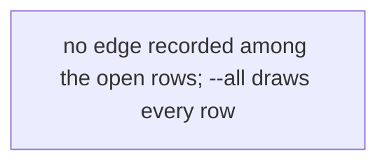

# Board — generated 2026-11-21 23:21 ET

## In flight
| where | owner | what |
|---|---|---|
| census | read-only in tick — booted nothing, claimed nothing, stopped nothing, evicted nothing | read `2026-11-22T04:21:24Z`–`2026-11-22T04:21:27Z` (each node's own `date -u`) on the base census `2026-11-22T03:39:12Z`, **0 h 42 min 12 s** after it: **4 containers, 0 volumes** fleet-wide; **no research rank**; the fenced hosts hold running containers on `.31`, `.32`, `.33`, `.34`, excluded from research accounting; `/v1/models` **200**, `/health` **200** on `.31` |
| pool | — (nobody drives it; head units re-proved each tick) | head: `beegfs-mgmtd` **active** (Result success, NRestarts 0, **+0** on the base) · `beegfs-meta` **active** (Result success, NRestarts 0, **+0** on the base) · `beegfs-storage` **active** (Result success, NRestarts 0, **+0** on the base); worker unit states and the pool's through-mount reads are not part of this census |
| queue | register snapshot `55ea2a14…`; both blocks below rendered from it | `mad-science/queue.json` sha256 **`55ea2a142b868f08444f2141cae6721ea972541a40d1ac527f41f955f6c2d74c`** read locally: **213 tasks: 181 done, 31 queued, 1 blocked, 0 running — 32 open**; the head clone reads **`55ea2a14…`**, identical |
| window | **no manual lock** at this read | `.local/fleet-window.lock` is **absent** on the head (read `2026-11-22T04:21:27Z`) |
| campaign | `sparkrun-campaign` — active, no lease | head user unit `sparkrun-campaign` reads **`active`** / **`running`** (`MainPID` **3,930,275**, `NRestarts` **0**, **+0** on the base); the lease ledger holds **0 lease(s)** and fence(s) `tp-le2-20261120` |
| lease | **1 fence(s), 0 lease(s)** | the head's repo ledger `.local/fleet-leases.json` (389 B, sha **`ec09509d…`**, mtime **`2026-11-21 03:04:12.907935197 -0500`** local) holds fence **`tp-le2-20261120`** on `.31`, `.32`, `.33`, `.34` (`fenced_at` `2026-11-20T07:25:27Z`, owner directive 2026-11-20: production serve protected, serve `58cddf1c62ba6578_b8865cad5863` / image `986795bcd7f4`) and **0 lease(s)** |
| publication | tick | fresh census (`2026-11-22T04:21:24Z`–`2026-11-22T04:21:27Z`) written to `2026-11-22T042124Z.json` and composed on the base census `2026-11-22T03:39:12Z`; the queue blocks are rendered from `mad-science/queue.json` sha **`55ea2a14…`**, and the landed rows from `git log --since=2026-11-22T03:39:12Z` |
| .30 | **nothing live (no reservation)** — idle | `2026-11-22T04:21:24Z` (`spark-41e1`): `docker ps -aq` **0**, running **0**, volumes **0**, `:8000` listeners **0** root **1,369,930,964,992 B avail** (-411,942,912, fell) · **2,457,099,853,824 B used** (+411,942,912, rose) boot **`2026-11-19T20:06:40Z`** (`btime`), `uptime` **202,484 s** `MemTotal` **127,598,704 kB** (+0), `MemAvailable` **121,044,444 kB** (-92,648), `Cached` **25,940,896 kB** (+403,664), `AnonPages` **1,111,124 kB** (-2,852) ring **256** events all-types (+0), **0** in-window lifecycle and **0** in-window `exec`, oldest `2026-11-21T01:06:26.326203501-05:00 container destroy 4db0fd`, newest `2026-11-21T03:05:54.712690080-05:00 image delete sha256:5c2b` |
| .31 | **fenced serve** — excluded from the research census | `2026-11-22T04:21:25Z` (`spark-d325`): `docker ps -aq` **1**, running **1**, volumes **0**, `:8000` listeners **2**, `/v1/models` **200**, `/health` **200** root **1,649,766,834,176 B avail** (-21,762,048, fell) · **2,177,263,984,640 B used** (+21,762,048, rose) boot **`2026-11-19T20:11:15Z`** (`btime`), `uptime` **202,210 s** `MemTotal` **127,598,700 kB** (+0), `MemAvailable` **8,092,732 kB** (-1,304), `Cached` **2,590,376 kB** (-20,800), `AnonPages` **7,387,300 kB** (-2,716) ring **256** events all-types (+0), **0** in-window lifecycle and **255** in-window `exec`, oldest `2026-11-21T22:38:50.301170484-05:00 container exec_die d9d79`, newest `2026-11-21T23:21:20.342022401-05:00 container exec_die d9d79` |
| .32 | **fenced serve** — excluded from the research census | `2026-11-22T04:21:25Z` (`spark-ec1d`): `docker ps -aq` **1**, running **1**, volumes **0**, `:8000` listeners **0** root **1,709,859,004,416 B avail** (-21,004,288, fell) · **2,117,171,699,712 B used** (+21,004,288, rose) boot **`2026-11-19T20:14:21Z`** (`btime`), `uptime` **202,024 s** `MemTotal` **127,598,640 kB** (+0), `MemAvailable` **11,688,060 kB** (-9,552), `Cached` **10,717,396 kB** (+14,980), `AnonPages` **5,320,820 kB** (-3,528) ring **256** events all-types (+0), **0** in-window lifecycle and **255** in-window `exec`, oldest `2026-11-21T22:38:50.686472110-05:00 container exec_die 7641b`, newest `2026-11-21T23:21:20.753577561-05:00 container exec_die 7641b` |
| .33 | **fenced serve** — excluded from the research census | `2026-11-22T04:21:26Z` (`spark-3578`): `docker ps -aq` **1**, running **1**, volumes **0**, `:8000` listeners **0** root **1,625,675,309,056 B avail** (-21,000,192, fell) · **2,201,355,395,072 B used** (+21,000,192, rose) boot **`2026-11-19T20:12:55Z`** (`btime`), `uptime` **202,111 s** `MemTotal` **127,598,636 kB** (+0), `MemAvailable` **11,709,116 kB** (-17,988), `Cached` **10,355,148 kB** (+15,460), `AnonPages` **5,315,688 kB** (-6,644) ring **256** events all-types (+0), **0** in-window lifecycle and **255** in-window `exec`, oldest `2026-11-21T22:38:51.059585085-05:00 container exec_die d98d0`, newest `2026-11-21T23:21:21.166799445-05:00 container exec_die d98d0` |
| .34 | **fenced serve** — excluded from the research census | `2026-11-22T04:21:26Z` (`spark-324e`): `docker ps -aq` **1**, running **1**, volumes **0**, `:8000` listeners **0** root **1,102,515,453,952 B avail** (-12,611,584, fell) · **2,724,515,364,864 B used** (+12,611,584, rose) boot **`2026-11-19T20:09:04Z`** (`btime`), `uptime` **202,342 s** `MemTotal` **127,598,704 kB** (+0), `MemAvailable` **11,651,024 kB** (-71,616), `Cached` **9,162,264 kB** (+15,116), `AnonPages` **5,308,064 kB** (+3,120) ring **256** events all-types (+0), **0** in-window lifecycle and **255** in-window `exec`, oldest `2026-11-21T22:38:51.449939721-05:00 container exec_die ff75e`, newest `2026-11-21T23:21:21.557471408-05:00 container exec_die ff75e` |
| .35 | **nothing live (no reservation)** — idle | `2026-11-22T04:21:27Z` (`spark-383f`): `docker ps -aq` **0**, running **0**, volumes **0**, `:8000` listeners **0** root **1,112,141,217,792 B avail** (-20,856,832, fell) · **2,714,889,601,024 B used** (+20,856,832, rose) boot **`2026-11-19T20:07:56Z`** (`btime`), `uptime` **202,410 s** `MemTotal` **127,598,700 kB** (+0), `MemAvailable` **123,032,416 kB** (+6,056), `Cached` **6,110,104 kB** (+15,248), `AnonPages` **248,468 kB** (+764) ring **256** events all-types (+0), **0** in-window lifecycle and **0** in-window `exec`, oldest `2026-11-20T19:46:09.290987692-05:00 container exec_die 2f39b`, newest `2026-11-20T20:56:32.651557975-05:00 container destroy 26b0f5` |

## Work queue

| job | node cost | holds | state |
|---|---|---|---|
| `beegfs-meta-restart-loop-non-meta-hosts` — beegfs-meta restart-loops every 5 s on .31-.35, and the loop hides a failed state behind "activating" | single | — | queued — Measured 2026-11-09 07:03-07:05 ET, and it is the side effect of the fix `beegfs-units-restart-no` (done) blessed: /etc/systemd/system/beegfs-meta.service.d/oom.conf (mtime 2026-11-08 16:03 on .30, 16:05 on .31) sets OOMScoreAdjust plus Res… (full note: queue.json) |
| `hf-cache-20261110-docs-only-repin-bundle` — Docs-only model drift from the 2026-11-10 cache update: 22 recipe rows across 10 repos ride their lane’s next boot (no boot of its own) | — | — | queued — Classes measured with refresh-sweep report mode + Hub tree diff: only README/LICENSE/LICENSE-GLM-5.3-Flash/.eval_results/images files differ between the pin and the Hub head for orcarouter/Nex-N2.5-mini-Uncensored-NVFP4, orcarouter/Qwen3.8-… (full note: queue.json) |
| `house-num-scorer-trailing-period` — House battery scores a correct number with a trailing period as a miss | — | — | queued — tools/quality-battery.py:203-207 score() for kind=num compares nums[-1] to expect, and the regex -?[0-9]+\.?[0-9]* captures the sentence-final dot: the Ripple 2026-11-20 hard-arith-1 cell (gold 74, reply ends "... 37 x 2 = 74.") stores "74.… (full note: queue.json) — evidence: `head:~/benchmarks/tp2-completion-20261120/ripple-nvfp4-tp1/house.json` |
| `lane-survey-edge0-audio8-tts` — Media-lane survey: Edge0/Audio8-TTS-Realistic-Air - 0.6B DualAR TTS + bundled codec, TP<4 so surveyed only | — | — | queued — License class: Apache-2.0, unrestricted - ships as a normal arm with no eval-only banner. Weights: 601,159,424 params BF16 in model.safetensors 1.20 GB plus a separate 44.1 kHz codec.pth 1.35 GB; repo 2.39 GiB. Architecture: model_type arkt… (full note: queue.json) |
| `queue-mode-done-sibling-holds-canary-row` — Queue mode will not lease a row whose recipe a done sibling already holds | — | — | queued — Measured 2026-11-10 00:05-00:16 ET, read-only: arm3-control-cell-canary-line (registered 23:21 by df9d40b) is the register's first queued row carrying both recipe: and tp: (quartet, tp 4, recipes/ds4/deepseek-v4.1-flash-knapcio-tp4-1m-sglan… (full note: queue.json) — evidence: `mad-science/STATUS.md 2026-11-10 00:15 ET queue row; commit 52b99ef` |
| `sage-q4km-trick1-empty-repeat` — Sage Q4_K_M: repeat the trick-1 house cell — one empty reply in the 37-case run | single | — | queued — The 2026-11-20 boot scored 36/37 on the 37-case house; the single miss is trick-1, which returned empty content (house.json). Empty content is a serving event, not a capability miss. Repeat that cell n=3 on the same boot shape (--parallel 1… (full note: queue.json) — evidence: `head:~/benchmarks/tp2-completion-20261120/sage-a1.5-35b/house.json` |
| `campaign-ingest-freezes-on-an-unplaceable-pending-arm` — The campaign never re-reads the register while any arm is pending, so one unplaceable pending arm silently stops new rows from ever being seen | — | — | queued — Measured 2026-11-21 on the head (`sparkrun-campaign.service`, started 00:12:15 EST, `NRestarts=0`): no `assign:` line after 00:12:16, zero containers on `.30` and `.35`, and `.local/fleet-leases.json` reads `leases: []`. The pending arm is … (full note: queue.json) |
| `campaign-leases-tp4-onto-30` — The campaign leases memory-heavy TP4 quartets onto .30, which the owner ruling excludes | — | — | queued — MECHANISM LANDED OFFLINE 2026-11-11 (commits `aa54000`, `ebf5c8e`, `298098d`, `08ff156`; no live lease and no live six-node boot has run, so the row stays open). One ledger, `<repo>/.local/fleet-leases.json` (flock + atomic write), and one … (full note: queue.json) |
| `campaign-state-copy-re-nests` — The director's receipts root copies state.json back into a window subdir, so one campaign now holds 40 nested copies | — | — | queued — Measured 2026-11-11 05:1x ET, read-only on the head: `h2h-20261107/state.json` and 40 byte-identical copies at `h2h-20261107/tp12-window/state.json`, `.../tp12-window/tp12-window/state.json` and so on, one level deeper per run under that wi… (full note: queue.json) |
| `hf-cache-20261110-cache-consistency-defects` — HF cache consistency defects: four repos hf ignores on a refs/main byte defect, one on a broken absolute symlink, plus 204 GB of stray non-cache trees in the hub root | single | — | queued — Measured 2026-11-10 with `hf cache ls --no-truncate --show-warnings` on .30 after the update loop finished a pass. (1) refs/main carries a trailing newline in models--lodestones--Kromoss (41 B; ref a4fe9744, snapshots 0c5417ec + a4fe9744), … (full note: queue.json) |
| `hf-cache-20261110-template-ab-ifm-k2` — K2-Horizon template/code drift A/B: head c4f92a0d (0.9B) and 240f2de3 (7B-FP8) vs the shipped pins, template identity + one fixed request | single | — | queued — Class (b) from the 2026-11-10 cache sweep: no weight file changed, but IFM/K2-Horizon-0.9B head moves 383cb66347be -> c4f92a0d66e2 changing chat_template.jinja AND modeling_k2_horizon.py and REMOVING chat_template_asst_tool_gen.jinja + chat… (full note: queue.json) |
| `mem-guard-outlives-its-task` — A window arm's 6.0 GiB stop-rule guard outlives the arm, so the runner accumulates guards for tasks whose containers are gone | — | — | queued — CORRECTED 2026-11-11: the premise that a leaked guard can stop a future boot is false. `mem-guard.sh` issues `sparkrun stop` only for the TID in its own argv, so a guard whose task is gone is a stale no-op and cannot touch the next boot. Wh… (full note: queue.json) |
| `pool-target-probe-beegfs-ctl-absent` — Pool storage-target byte accounting is unreachable: beegfs-ctl is absent from .30 though beegfs-utils 20:8.4.1 is installed | single | — | queued — Measured 2026-11-10 15:05:59Z and again 15:06:29Z on .30: beegfs-ctl exits 127 (command not found) as the red user, and no binary named beegfs-ctl exists under /usr, /opt or /sbin at depth <=5, although dpkg lists beegfs-utils 20:8.4.1 plus… (full note: queue.json) |
| `watchdog-stall-mmap-flat-residual` — Watchdog stall rule: mmap load with flat io/log and sub-128-MiB memory progress | — | — | queued — tools/boot-watchdog.py:336-345 counts memory as progress only past MEM_PROGRESS_FLOOR (128 MiB), and its own docstring names the mmap case (no io/log for minutes while RAM fills). A load whose per-check memory delta stays below 128 MiB with… (full note: queue.json) — evidence: `tools/boot-watchdog.py:336-345 (progressed), 347-368 (group_stalled)` |
| `hf-cache-20261110-pool-fetch-gaps` — Pool gaps left by the 2026-11-10 cache update: two Hub heads, two pinned revisions, three absent repos, one private repo needing an org token | single | — | queued — CENSUS 2026-11-11 (`.scratch/tp4-20261111/RECEIPT-boot-a-and-pool-census-20261111.md`): the ds4 1017 body's 'double-count' is now an artifact, named: two revisions share one index — `08c8657f` (a link farm) and `1bae0e10` (the in-body revis… (full note: queue.json) |
| `wopr-cache-dir-runtime-regression` — Verify SGLang and llama.cpp still resolve models through the WOPR cache_dir profile | single | — | queued — The 2026-11-20 Hy4 launch added cache_dir: /mnt/beegfs/huggingface to the WOPR cluster profile (sparkrun cluster update WOPR --cache-dir ...), because the head cache symlink resolved outside the workload mounts. Only the vLLM runtime was pr… (full note: queue.json) — evidence: `recipes/ds4/README.md section zz-deepseek-v4.1-flash-1017-weightless-tp4-1m (cache_dir change, task 261430353ba2889a_9e41b9e252af)` |
| `board-publish-accepts-weaker-replacement` — publish replaces a better-grounded In-flight composition with a fresher byte-compatible one, and no guard notices | — | — | queued — The publish guards compare BYTES, so they cannot see that a replacement carried FEWER facts than the rows it removed. Measured 2026-11-11 20:18 ET on mad-science/STATUS.md: this tick's composition was accepted (publish rc=0, lint ok) while … (full note: queue.json) — evidence: `mad-science/STATUS.md@e4bea70` |
| `board-publish-keeps-in-flight-row-set` — A board published without one of the In-flight state rows passes every guard, because publish compares bytes and never the row set | — | — | queued — Measured 2026-11-11 03:17-03:25 ET. The 03:14 board (blob 2249062c) carried a `\| queue \|` row; the 03:17 board (commit `8e160b2`, blob 0f54622c) carried none, and a tick that composes on it and keeps the In flight body verbatim inherits the… (full note: queue.json) — evidence: `mad-science/STATUS.md at 8e160b2 / bc2cc38 / 9ae7cd4` |
| `cache-audit-pool-budget` — `tools/cache-audit.py --budget-gb`: add a pool mode that judges the one shared HF pool against 90 % of capacity | — | — | queued — `tools/cache-audit.py --budget-gb` still measures per node, but the HF cache is one shared pool: all six nodes report the same usage through the shared hub, so the audit flags the whole fleet at once and no node can be read as over- or unde… (full note: queue.json) |
| `executor-release-host-claim-on-failure` — An executor that stops observing a launch must release the sparkrun host claims it holds | — | — | queued — Measured 2026-11-08 04:09-04:13 ET: kimi-k3.1-pro-pruned75-mxfp4-dspark-vllm-tp4 attempt 1 launcher (pid 1883449) held .30-.33 while its own registry distribution failed at 414.7 s (637.1 MiB at 1.6 MiB/s from docker.io, then … (full note: queue.json) |
| `fleet-boot-without-lease-record` — A four-rank boot serves with no lease in either ledger and no window lock | — | — | queued — Measured 2026-11-11 19:15:59Z-19:31Z, read-only: task `b020d2dd178343a5_55dafcf24cde` runs one rank each on `.31`-`.34` (image `littlecedar/dgx-spark-dsv41:canary-roce-aff52fa5`, id `3f4480818acb`, `Up` and healthy, `/v1/models` 200 serving… (full note: queue.json) |
| `pool-content-fall-20261116` — Pool used fell 501 GB in 6.5 h while every repo entry stayed: name the deletion before the next budget claim | single | — | queued — Measured read-only from the head at 2026-11-16T19:07:40Z: df -B1 on /mnt/beegfs reads used 13,459,970,326,528 B, which is 501,316,845,568 B BELOW the 13,961,287,172,096 B the 06:39 board carried at 11:23:54Z. It is not HF content vanishing:… (full note: queue.json) |
| `runtime-cache-stale-tree-gc` — Delete the stale runtime-cache trees the 2026-11-12 audit approved (732 GB planned, never executed) | single | — | queued — BATCH 1 EXECUTED 2026-11-16T16:33:28Z — 52 items / 554.54 GB deleted on '.30'-'.34' ('.30' 22.53, '.31' 96.38, '.32' 143.49, '.33' 143.68, '.34' 148.46 GB) and '.35' released 0.00 GB — receipt '.scratch/gc-20261116/census.md' rev 3 §Executi… (full note: queue.json) |
| `sparkrun-single-gid-index-for-two-hcas` — sparkrun injects one GID index across two HCAs whose tables disagree | — | — | queued — REPORT-ONLY IN THIS REPO (sparkrun-side defect; no `recipe`/`tp`, not bootable). One derived `NCCL_IB_GID_INDEX` applied to every HCA the probe names is wrong when the rails' GID tables disagree: `scripts/ib_detect.sh:44-45` derives the ind… (full note: queue.json) |
| `window-lock-does-not-stop-direct-boots` — A declared window holds campaign placement and `director lease`, but a direct `sparkrun run` boot bypasses both | — | — | queued — FOUND 2026-11-21 while closing `campaign-ignores-declared-window`. A declared window (`<repo>/.local/fleet-window.lock` with a future `window-end`) reaches `_assign` -> `held_hosts` and `director lease`, so the campaign places nothing and a… (full note: queue.json) |
| `webai-twil-8b-eval-only-arm` — Author and ship the webAI 8.8B eval-only arm (webAI-Official/TwIL-8B): recipe, license banner, lane README notice, index row | — | — | queued — Authoring work, no hardware yet and no recipe, so not machine-runnable. LICENSE (owner 2026-11-12: "Accept and ship it."): card `license_name: webai-non-commercial-license-ver.-1.0`, so the arm ships EVAL-ONLY under AGENTS.md §Recipes, with… (full note: queue.json) |
| `inkling-tp4-first-boot` — Inkling-2-Small TP=4 first boot: nightly pull and the unproven sm_121 Triton path | quartet | — | queued — No node holds the pinned nightly digest c17e9d88, so the first boot includes the pull. GB10 is sm_121 and the Blackwell path gates on capability family 100, so the engine runs the Hopper/Triton half (attention_sm90 plus the Humming expert G… (full note: queue.json) — evidence: `recipes/explore/README.md section zz-inkling-2-small-nvfp4-thinking-tools-tp4-vllm` |
| `mech-cites-0-4-3` — Re-derive the remaining 117 recipes/MECHANICS.md citations against the installed sparkrun build | — | — | queued — d0d050f landed 27 moved anchors + 13 byte-identical controls for §The one rule and §Key reference §Format and identity, then stopped. Remaining 117 anchors still carry 0.4.2/0.4.0 numbering: the rest of §Key reference (from §Model and servi… (full note: queue.json) |
| `metrics-instrument-confound` — Metrics knob decomposition: one identical recipe, metrics-on vs metrics-off, name the performance-impacting knobs (`#68` ROM bar) | single | — | queued — Owner's `#68` authorises the decomposition that makes the comparability bar checkable, and it must separate THREE regimes, because only one of them can bias a cell: (1) `tools/run-arm.sh`'s scrape is a single exec AFTER the cell and before … (full note: queue.json) |
| `minimax-viggle-remake-eval-only-arm` — Author and ship the MiniMax video eval-only arm (Viggle/Viggle-Remake): ComfyUI node route, license banner, lane README notice, index row | — | — | queued — Authoring work, no hardware yet and no recipe, so not machine-runnable. LICENSE (owner 2026-11-12: "Accept and ship it."): card `license_name: minimax-h3-community-license`, base_model MiniMaxAI/MiniMax-H3 — community-restricted, so the arm… (full note: queue.json) |
| `weightless-dsgb10-tp4-boot-gate` — Boot the weightless-dsgb10 arm four-rank: the α=0 golden hash must equal stock bit-for-bit before any steered request is quoted | quartet | — | queued — Boot gate for the image closed by weightless-image-build-publish-pin (1bc6b5cb). Image ghcr.io/littlecedar/dgx-picom-ds41f:ds41f-7c123ad4-pr15-pr7-weightless, digest sha256:305b6e5151a2cfd13b85f18c36bccf9062af83e28917fd11a0f151691c5e83df, p… (full note: queue.json) — evidence: `recipes/ds4/zz-deepseek-v4.1-flash-1017-weightless-dsgb10-tp4.yaml (container pinned by digest at line 30); recipes/ds4/README.md lines 2890-2911 (two-name contract, alpha=0 identity) and 2990-2996 (the boot gate)` |
| `ds4-fp4-kv-layout-sm121-port` — DS4 1017 SM121: port the V41/V41_FP4 KV layout so fp4 KV is admissible — dtype is not a lever today, and sizing lies about fp4 | quartet | — | blocked — RECIPE RETIRED 2026-11-18: the `zz-` arm this row booted is archived at `attic/ds4/zz-ds4-1017-sm121-indexer-scoring.yaml` (it was run or refused on record; see the lane attic index), so the row is no longer bootable. CORRECTION TO THE FP8-… (full note: queue.json) |

## Landed session
Window: commits since `2026-11-22T03:39:12Z` — the base census stamp, later than the 24 h start `2026-11-21T04:21:24Z`; older rows are not shown.

| time ET | commit | one clause |
|---|---|---|
| 11-21 22:40 | `1aff26ba` | Stop the board subtracting ring counts taken over two different windows |
| 11-21 22:43 | `dd73b3c2` | Refresh the status board: a 03:39Z census on an unchanged fenced serve |
| 11-21 23:07 | `38062830` | Add the single-flight board tick so an hour costs no model call |
| 11-21 23:09 | `55b4d2d8` | Keep Landed to a rolling 24 hours and state the window it used |
| 11-21 23:11 | `a48d2bf2` | Refresh the status board: a 2026-11-22T041127Z census |
| 11-21 23:17 | `6e405c0d` | Refresh the status board: a 04:14Z census on an unchanged fenced serve |
| 11-21 23:19 | `ec11c572` | Record the board refresh and the head clone's refs outrunning its objects |
