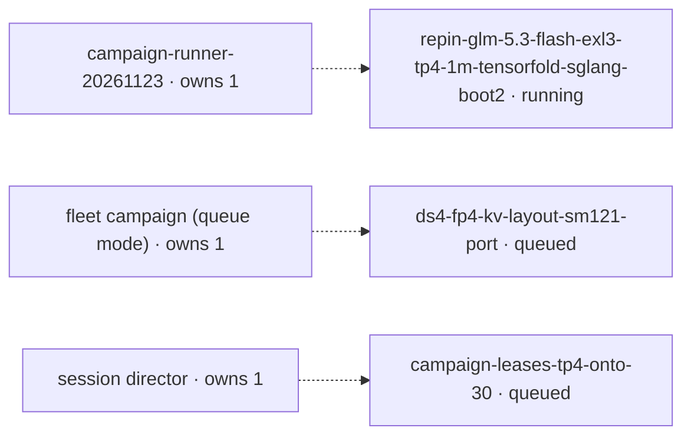

# Board
_Generated 2026-11-23 04:00 ET_

## In flight
| where | owner | what |
|---|---|---|
| census | read-only in tick — booted nothing, claimed nothing, stopped nothing, evicted nothing | read `2026-11-23T09:00:01Z`–`2026-11-23T09:00:03Z` (each node's own `date -u`) on the base census `2026-11-23T08:48:43Z`, **0 h 11 min 18 s** after it: **0 containers, 0 volumes** fleet-wide; **no research rank**; no node probed a serve |
| pool | — (nobody drives it; head units re-proved each tick) | head: `beegfs-mgmtd` **active** (Result success, NRestarts 0, **+0** on the base) · `beegfs-meta` **active** (Result success, NRestarts 0, **+0** on the base) · `beegfs-storage` **active** (Result success, NRestarts 0, **+0** on the base); worker unit states and the pool's through-mount reads are not part of this census |
| queue | register snapshot `b8b661bc…`; both blocks below rendered from it | `mad-science/queue.json` sha256 **`b8b661bc44aab61b62d15b820e78d89aaf4e4fb9490bdc49c5ed23d4b925d40a`** read locally: **253 tasks: 250 done, 2 queued, 0 blocked, 1 running — 3 open**; the head clone reads **`b8b661bc…`**, identical |
| window | **no manual lock** at this read | `.local/fleet-window.lock` is **absent** on the head (read `2026-11-23T09:00:03Z`) |
| campaign | `sparkrun-campaign` — active, no lease | head user unit `sparkrun-campaign` reads **`active`** / **`running`** (`MainPID` **3,930,275**, `NRestarts` **0**, **+0** on the base); the lease ledger holds **0 lease(s)** and fence(s) `tp-le2-20261120` |
| lease | **1 fence(s), 0 lease(s)** | the head's repo ledger `.local/fleet-leases.json` (389 B, sha **`ec09509d…`**, mtime **`2026-11-21 03:04:12.907935197 -0500`** local) holds fence **`tp-le2-20261120`** on `.31`, `.32`, `.33`, `.34` (`fenced_at` `2026-11-20T07:25:27Z`, owner directive 2026-11-20: production serve protected, serve `58cddf1c62ba6578_b8865cad5863` / image `986795bcd7f4`) and **0 lease(s)** |
| publication | tick | fresh census (`2026-11-23T09:00:01Z`–`2026-11-23T09:00:03Z`) written to `2026-11-23T090000Z.json` and composed on the base census `2026-11-23T08:48:43Z`; the queue blocks are rendered from `mad-science/queue.json` sha **`b8b661bc…`**, and the landed rows from `git log --since=2026-11-23T08:48:43Z` |
| .30 | **nothing live (no reservation)** — idle | `2026-11-23T09:00:01Z` (`spark-41e1`): `docker ps -aq` **0**, running **0**, volumes **0**, `:8000` listeners **0** root **1,063,041,482,752 B avail** (+8,808,337,408, rose) · **2,763,989,336,064 B used** (-8,808,337,408, fell) boot **`2026-11-19T20:06:40Z`** (`btime`), `uptime` **305,600 s** `MemTotal` **127,598,704 kB** (+0), `MemAvailable` **121,863,560 kB** (-15,536), `Cached` **83,267,608 kB** (-7,637,156), `AnonPages` **1,006,704 kB** (+102,744) ring **256** events all-types (+0), **0** in-window lifecycle and **0** in-window `exec`, oldest `2026-11-22T21:20:20.734482151-05:00 container die 74fbcbeab8`, newest `2026-11-23T03:49:08.974501878-05:00 image import sha256:a104` |
| .31 | **nothing live (no reservation)** — idle | `2026-11-23T09:00:01Z` (`spark-d325`): `docker ps -aq` **0**, running **0**, volumes **0**, `:8000` listeners **0** root **1,297,357,938,688 B avail** (+54,020,235,264, rose) · **2,529,672,880,128 B used** (-54,020,235,264, fell) boot **`2026-11-19T20:11:15Z`** (`btime`), `uptime` **305,326 s** `MemTotal` **127,598,700 kB** (+0), `MemAvailable` **123,036,072 kB** (+351,448), `Cached` **4,963,588 kB** (-42,627,152), `AnonPages` **297,540 kB** (+61,012) ring **256** events all-types (+0), **0** in-window lifecycle and **120** in-window `exec`, oldest `2026-11-23T01:54:30.957474717-05:00 container exec_start: ta`, newest `2026-11-23T03:55:51.514354187-05:00 container destroy 2d6d0f` |
| .32 | **nothing live (no reservation)** — idle | `2026-11-23T09:00:01Z` (`spark-ec1d`): `docker ps -aq` **0**, running **0**, volumes **0**, `:8000` listeners **0** root **1,381,553,582,080 B avail** (+54,611,718,144, rose) · **2,445,477,122,048 B used** (-54,611,718,144, fell) boot **`2026-11-19T20:14:21Z`** (`btime`), `uptime` **305,140 s** `MemTotal` **127,598,640 kB** (+0), `MemAvailable` **123,103,484 kB** (+187,524), `Cached` **4,169,336 kB** (-58,407,300), `AnonPages` **252,612 kB** (+67,416) ring **256** events all-types (+0), **0** in-window lifecycle and **114** in-window `exec`, oldest `2026-11-23T01:53:57.373738249-05:00 container exec_create: s`, newest `2026-11-23T03:55:51.712912219-05:00 container destroy b10117` |
| .33 | **nothing live (no reservation)** — idle | `2026-11-23T09:00:02Z` (`spark-3578`): `docker ps -aq` **0**, running **0**, volumes **0**, `:8000` listeners **0** root **1,252,249,972,736 B avail** (+54,613,417,984, rose) · **2,574,780,731,392 B used** (-54,613,417,984, fell) boot **`2026-11-19T20:12:55Z`** (`btime`), `uptime` **305,227 s** `MemTotal` **127,598,636 kB** (+0), `MemAvailable` **123,186,304 kB** (+252,296), `Cached` **206,108 kB** (-68,911,712), `AnonPages` **242,580 kB** (+55,040) ring **256** events all-types (+0), **0** in-window lifecycle and **114** in-window `exec`, oldest `2026-11-23T01:53:57.754809615-05:00 container exec_create: s`, newest `2026-11-23T03:55:51.718398557-05:00 container destroy 25f272` |
| .34 | **nothing live (no reservation)** — idle | `2026-11-23T09:00:02Z` (`spark-324e`): `docker ps -aq` **0**, running **0**, volumes **0**, `:8000` listeners **0** root **1,094,300,823,552 B avail** (+290,161,106,944, rose) · **2,732,729,995,264 B used** (-290,161,106,944, fell) boot **`2026-11-19T20:09:04Z`** (`btime`), `uptime` **305,458 s** `MemTotal` **127,598,704 kB** (+0), `MemAvailable` **123,174,808 kB** (+824,540), `Cached` **213,740 kB** (-64,946,976), `AnonPages` **250,944 kB** (+66,180) ring **256** events all-types (+0), **0** in-window lifecycle and **114** in-window `exec`, oldest `2026-11-23T01:53:58.164814856-05:00 container exec_start: sh`, newest `2026-11-23T03:55:51.243372869-05:00 container destroy d0bf87` |
| .35 | **nothing live (no reservation)** — idle | `2026-11-23T09:00:03Z` (`spark-383f`): `docker ps -aq` **0**, running **0**, volumes **0**, `:8000` listeners **0** root **971,278,745,600 B avail** (-954,368, fell) · **2,855,752,073,216 B used** (+954,368, rose) boot **`2026-11-19T20:07:56Z`** (`btime`), `uptime` **305,526 s** `MemTotal` **127,598,700 kB** (+0), `MemAvailable` **122,903,908 kB** (-44,692), `Cached` **115,745,776 kB** (+653,820), `AnonPages` **291,504 kB** (+54,092) ring **256** events all-types (+0), **0** in-window lifecycle and **0** in-window `exec`, oldest `2026-11-22T21:05:06.535546060-05:00 container exec_start: sh`, newest `2026-11-22T21:19:48.088204374-05:00 container destroy 8b4cc1` |

## Work Queue

| job | node cost | blockers | holds | status | summary |
|---|---|---|---|---|---|
| `repin-glm-5.3-flash-exl3-tp4-1m-tensorfold-sglang-boot2` — Boot glm-5.3-flash-exl3-tp4-1m-tensorfold-sglang-boot2 with the refreshed pin and move its pins | quartet | — | — | running | — PIN MOVE 2026-11-22 (owner rule, ViBoard thread t24): updated pins are boot-tested as soon as a window of the correct size is free for them, and the pin moves in that boot's commit — no carrier-lane ride-along. This row boots recipes/glm/gl… (full note: queue.json) |
| `campaign-leases-tp4-onto-30` — The campaign leases memory-heavy TP4 quartets onto .30, which the owner ruling excludes | quartet | — | — | queued | — MECHANISM LANDED OFFLINE 2026-11-11 (commits `aa54000`, `ebf5c8e`, `298098d`, `08ff156`; no live lease and no live six-node boot has run, so the row stays open). One ledger, `<repo>/.local/fleet-leases.json` (flock + atomic write), and one … (full note: queue.json) |
| `ds4-fp4-kv-layout-sm121-port` — DS4 1017 SM121: port the V41/V41_FP4 KV layout so fp4 KV is admissible — dtype is not a lever today, and sizing lies about fp4 | quartet | — | — | queued | — FP4-KV image built and pushed. SGLang side: ghcr.io/littlecedar/aneda@sha256:b5de5272edd983e41059154f10d862a44c25f8f5f403fafd48ad0778b95ceed6 (the dsv41-sm121-dg:0.2.1-fi073e base + patch_dsv41_fp4kv.py + fp4kv_kv_format.py). Recipe at reci… (full note: queue.json) |

## Completed Work
Window: commits since `2026-11-23T08:48:43Z` — the base census stamp, later than the 24 h start `2026-11-22T09:00:00Z`; older rows are not shown.

| time ET | commit | one clause |
|---|---|---|
| 11-23 03:48 | `c700f286` | Refresh the status board: a 2026-11-23T084843Z census |
