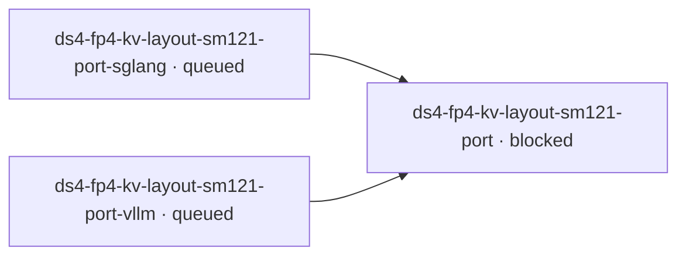

# Board — generated 2026-11-22 07:00 ET

## In flight
| where | owner | what |
|---|---|---|
| census | read-only in tick — booted nothing, claimed nothing, stopped nothing, evicted nothing | read `2026-11-22T12:00:01Z`–`2026-11-22T12:00:03Z` (each node's own `date -u`) on the base census `2026-11-22T11:01:46Z`, **0 h 58 min 15 s** after it: **4 containers, 0 volumes** fleet-wide; **no research rank**; the fenced hosts hold running containers on `.31`, `.32`, `.33`, `.34`, excluded from research accounting; `/v1/models` **200**, `/health` **200** on `.31` |
| pool | — (nobody drives it; head units re-proved each tick) | head: `beegfs-mgmtd` **active** (Result success, NRestarts 0, **+0** on the base) · `beegfs-meta` **active** (Result success, NRestarts 0, **+0** on the base) · `beegfs-storage` **active** (Result success, NRestarts 0, **+0** on the base); worker unit states and the pool's through-mount reads are not part of this census |
| queue | register snapshot `255a95ab…`; both blocks below rendered from it | `mad-science/queue.json` sha256 **`255a95ab83e4cdf2fee1c0db0dfdfc702e5123bf261d2dd612ccee2f09c9efa6`** read locally: **228 tasks: 214 done, 7 queued, 7 blocked, 0 running — 14 open**; the head clone reads **`255a95ab…`**, identical |
| window | **no manual lock** at this read | `.local/fleet-window.lock` is **absent** on the head (read `2026-11-22T12:00:04Z`) |
| campaign | `sparkrun-campaign` — active, no lease | head user unit `sparkrun-campaign` reads **`active`** / **`running`** (`MainPID` **3,930,275**, `NRestarts` **0**, **+0** on the base); the lease ledger holds **0 lease(s)** and fence(s) `tp-le2-20261120` |
| lease | **1 fence(s), 0 lease(s)** | the head's repo ledger `.local/fleet-leases.json` (389 B, sha **`ec09509d…`**, mtime **`2026-11-21 03:04:12.907935197 -0500`** local) holds fence **`tp-le2-20261120`** on `.31`, `.32`, `.33`, `.34` (`fenced_at` `2026-11-20T07:25:27Z`, owner directive 2026-11-20: production serve protected, serve `58cddf1c62ba6578_b8865cad5863` / image `986795bcd7f4`) and **0 lease(s)** |
| publication | tick | fresh census (`2026-11-22T12:00:01Z`–`2026-11-22T12:00:03Z`) written to `2026-11-22T120000Z.json` and composed on the base census `2026-11-22T11:01:46Z`; the queue blocks are rendered from `mad-science/queue.json` sha **`255a95ab…`**, and the landed rows from `git log --since=2026-11-22T11:01:46Z` |
| .30 | **nothing live (no reservation)** — idle | `2026-11-22T12:00:01Z` (`spark-41e1`): `docker ps -aq` **0**, running **0**, volumes **0**, `:8000` listeners **0** root **1,220,608,667,648 B avail** (-368,615,424, fell) · **2,606,422,151,168 B used** (+368,615,424, rose) boot **`2026-11-19T20:06:40Z`** (`btime`), `uptime` **230,001 s** `MemTotal` **127,598,704 kB** (+0), `MemAvailable` **122,373,692 kB** (+145,164), `Cached` **1,231,376 kB** (-71,679,920), `AnonPages` **735,100 kB** (+2,060) ring **256** events all-types (-10), **0** in-window lifecycle and **252** in-window `exec`, oldest `2026-11-22T06:04:11.906324228-05:00 container exec_die 957b8`, newest `2026-11-22T06:20:39.839141796-05:00 container destroy 957b85` |
| .31 | **fenced serve** — excluded from the research census | `2026-11-22T12:00:01Z` (`spark-d325`): `docker ps -aq` **1**, running **1**, volumes **0**, `:8000` listeners **2**, `/v1/models` **200**, `/health` **200** root **1,559,414,718,464 B avail** (-12,992,512, fell) · **2,267,616,100,352 B used** (+12,992,512, rose) boot **`2026-11-19T20:11:15Z`** (`btime`), `uptime` **229,726 s** `MemTotal` **127,598,700 kB** (+0), `MemAvailable` **9,219,088 kB** (+18,392), `Cached` **9,364,696 kB** (+927,816), `AnonPages` **6,283,116 kB** (-264) ring **256** events all-types (+0), **0** in-window lifecycle and **0** in-window `exec`, oldest `2026-11-22T01:22:20.316343646-05:00 container exec_create: t`, newest `2026-11-22T02:03:50.216539739-05:00 container exec_die d9d79` |
| .32 | **fenced serve** — excluded from the research census | `2026-11-22T12:00:02Z` (`spark-ec1d`): `docker ps -aq` **1**, running **1**, volumes **0**, `:8000` listeners **0** root **1,625,048,657,920 B avail** (-20,885,504, fell) · **2,201,982,046,208 B used** (+20,885,504, rose) boot **`2026-11-19T20:14:21Z`** (`btime`), `uptime` **229,540 s** `MemTotal` **127,598,640 kB** (+0), `MemAvailable` **11,780,304 kB** (+26,608), `Cached` **12,541,328 kB** (+208,612), `AnonPages` **5,311,856 kB** (+9,028) ring **256** events all-types (+0), **0** in-window lifecycle and **0** in-window `exec`, oldest `2026-11-22T01:21:20.669666082-05:00 container exec_die 7641b`, newest `2026-11-22T02:03:50.609980136-05:00 container exec_die 7641b` |
| .33 | **fenced serve** — excluded from the research census | `2026-11-22T12:00:02Z` (`spark-3578`): `docker ps -aq` **1**, running **1**, volumes **0**, `:8000` listeners **0** root **1,521,623,920,640 B avail** (-20,967,424, fell) · **2,305,406,783,488 B used** (+20,967,424, rose) boot **`2026-11-19T20:12:55Z`** (`btime`), `uptime` **229,627 s** `MemTotal` **127,598,636 kB** (+0), `MemAvailable` **11,741,668 kB** (-64,936), `Cached` **12,452,932 kB** (-107,532), `AnonPages` **5,309,076 kB** (+8,604) ring **256** events all-types (+0), **0** in-window lifecycle and **0** in-window `exec`, oldest `2026-11-22T01:21:21.059279363-05:00 container exec_die d98d0`, newest `2026-11-22T02:03:50.958560605-05:00 container exec_die d98d0` |
| .34 | **fenced serve** — excluded from the research census | `2026-11-22T12:00:03Z` (`spark-324e`): `docker ps -aq` **1**, running **1**, volumes **0**, `:8000` listeners **0** root **1,107,016,404,992 B avail** (-20,914,176, fell) · **2,720,014,413,824 B used** (+20,914,176, rose) boot **`2026-11-19T20:09:04Z`** (`btime`), `uptime` **229,858 s** `MemTotal` **127,598,704 kB** (+0), `MemAvailable` **11,750,936 kB** (-63,020), `Cached` **12,374,972 kB** (-151,840), `AnonPages` **5,298,844 kB** (+8,240) ring **256** events all-types (+0), **0** in-window lifecycle and **0** in-window `exec`, oldest `2026-11-22T01:21:21.472607032-05:00 container exec_die ff75e`, newest `2026-11-22T02:03:51.331148782-05:00 container exec_die ff75e` |
| .35 | **nothing live (no reservation)** — idle | `2026-11-22T12:00:03Z` (`spark-383f`): `docker ps -aq` **0**, running **0**, volumes **0**, `:8000` listeners **0** root **1,041,849,180,160 B avail** (+177,463,296, rose) · **2,785,181,638,656 B used** (-177,463,296, fell) boot **`2026-11-19T20:07:56Z`** (`btime`), `uptime` **229,926 s** `MemTotal` **127,598,700 kB** (+0), `MemAvailable` **123,074,820 kB** (+61,389,932), `Cached` **5,116,088 kB** (-58,229,608), `AnonPages` **245,280 kB** (-787,080) ring **256** events all-types (+3), **0** in-window lifecycle and **252** in-window `exec`, oldest `2026-11-22T06:03:40.672336005-05:00 container exec_create: b`, newest `2026-11-22T06:20:39.466944765-05:00 container destroy 5a5f12` |

## Work queue

| job | node cost | blockers | holds | status | summary |
|---|---|---|---|---|---|
| `ds4-fp4-kv-layout-sm121-port-vllm` — DS4 1017 SM121 vLLM: carry nvfp4_ds_mla through the SM12x sparse-MLA backend so fp4 KV is selectable | single | — | ds4-fp4-kv-layout-sm121-port | queued | Queued engine work: upstream vLLM already ships nvfp4_ds_mla at 352 B/token against fp8 packed 976; the gap is the SM120 sparse-MLA backend selecting it on GB10, patched in the fork overlay, then the parent TP4 boot. |
| `ds4-fp4-kv-layout-sm121-port-sglang` — DS4 1017 SM121 SGLang: port the V41_FP4 KV layout and the fp4 pool-sizing term so fp4 KV is admissible | single | — | ds4-fp4-kv-layout-sm121-port | queued | Queued engine work: three SGLang edits at image commit 103ad321 (relax the is_sm100 gate, port the V41_FP4 layout, size the pool in fp4 bytes) so fp4 KV is admissible; a numerics gate before the parent TP4 boot. |
| `beegfs-meta-restart-loop-non-meta-hosts` — beegfs-meta restart-loops every 5 s on .31-.35, and the loop hides a failed state behind "activating" | single | — | — | blocked | Blocked, owner 2026-11-22: the OOM drop-in Restart=on-failure loops beegfs-meta every 5 s on .31-.35 (NRestarts 3431, 956.6 MB journal) while is-active reads activating; remedy is masking the unit there, .30 untouched. |
| `head-clone-object-store-incomplete` — The head clone loses git objects continuously (healed twice on 2026-11-21, gap reopens on every new commit), so `git ls-tree HEAD` and any `git pull` fail there until it is re-healed | — | — | — | blocked | — Measured read-only 2026-11-21 22:35-23:50 ET on the head at `/home/red/src/sparkrun-recipe-registry`: `git ls-tree HEAD` failed `not a tree object`, `git show HEAD:<path>` failed `exists on disk, but not in HEAD`, `git log` reached … (full note: queue.json) — evidence: `head:/home/red/src/sparkrun-recipe-registry (fsck 7 missing -> 0 after git fetch origin main + git read-tree HEAD)` |
| `hf-cache-20261110-docs-only-repin-bundle` — Docs-only model drift from the 2026-11-10 cache update: 22 recipe rows across 10 repos ride their lane’s next boot (no boot of its own) | — | — | — | queued | — Classes measured with refresh-sweep report mode + Hub tree diff: only README/LICENSE/LICENSE-GLM-5.3-Flash/.eval_results/images files differ between the pin and the Hub head for orcarouter/Nex-N2.5-mini-Uncensored-NVFP4, orcarouter/Qwen3.8-… (full note: queue.json) |
| `queue-mode-done-sibling-holds-canary-row` — Queue mode will not lease a row whose recipe a done sibling already holds | — | — | — | blocked | — Measured 2026-11-10 00:05-00:16 ET, read-only: arm3-control-cell-canary-line (registered 23:21 by df9d40b) is the register's first queued row carrying both recipe: and tp: (quartet, tp 4, recipes/ds4/deepseek-v4.1-flash-knapcio-tp4-1m-sglan… (full note: queue.json) — evidence: `mad-science/STATUS.md 2026-11-10 00:15 ET queue row; commit 52b99ef` |
| `campaign-leases-tp4-onto-30` — The campaign leases memory-heavy TP4 quartets onto .30, which the owner ruling excludes | quartet | — | — | queued | Lease ledger and holder/id claim identity landed offline (d0cf704, no live director-driven TP4 lease yet); .30 is waivable for a memory-heavy quartet only inside a declared window with the six guardrails, else refused. Row open. |
| `mem-guard-outlives-its-task` — A window arm's 6.0 GiB stop-rule guard outlives the arm, so the runner accumulates guards for tasks whose containers are gone | — | — | — | blocked | — CORRECTED 2026-11-11: the premise that a leaked guard can stop a future boot is false. `mem-guard.sh` issues `sparkrun stop` only for the TID in its own argv, so a guard whose task is gone is a stale no-op and cannot touch the next boot. Wh… (full note: queue.json) |
| `fleet-boot-without-lease-record` — A four-rank boot serves with no lease in either ledger and no window lock | — | — | — | blocked | — Measured 2026-11-11 19:15:59Z-19:31Z, read-only: task `b020d2dd178343a5_55dafcf24cde` runs one rank each on `.31`-`.34` (image `littlecedar/dgx-spark-dsv41:canary-roce-aff52fa5`, id `3f4480818acb`, `Up` and healthy, `/v1/models` 200 serving… (full note: queue.json) |
| `window-lock-does-not-stop-direct-boots` — A declared window holds campaign placement and `director lease`, but a direct `sparkrun run` boot bypasses both | — | — | — | blocked | — FOUND 2026-11-21 while closing `campaign-ignores-declared-window`. A declared window (`<repo>/.local/fleet-window.lock` with a future `window-end`) reaches `_assign` -> `held_hosts` and `director lease`, so the campaign places nothing and a… (full note: queue.json) |
| `inkling-tp4-first-boot` — Inkling-2-Small TP=4 first boot: nightly pull and the unproven sm_121 Triton path | quartet | — | — | queued | Inkling-2-Small TP4 first boot: nightly digest c17e9d88 is on no node so the boot includes the pull, and sm_121 runs the Hopper/Triton path (attention_sm90, Humming expert GEMMs) unproven here; needs an owner-declared window. |
| `mech-cites-0-4-3` — Re-derive the remaining 117 recipes/MECHANICS.md citations against the installed sparkrun build | — | — | — | queued | 117 recipes/MECHANICS.md anchors still carry 0.4.2/0.4.0 numbering after d0d050f landed 27 plus 13 controls; not mechanically renumberable since core/recipe.py grew to 3080 lines, so each sentence is re-read and its claim re-located. |
| `weightless-dsgb10-tp4-boot-gate` — Boot the weightless-dsgb10 arm four-rank: the α=0 golden hash must equal stock bit-for-bit before any steered request is quoted | quartet | — | — | queued | Boot gate, weightless image: at α=0 output must be byte-identical to stock before any steered request is quoted, then a second-name request must project while a stock one keeps its text; four ranks, .31-.34 unfenced, --cluster WOPR. |
| `ds4-fp4-kv-layout-sm121-port` — DS4 1017 SM121: port the V41/V41_FP4 KV layout so fp4 KV is admissible — dtype is not a lever today, and sizing lies about fp4 | quartet | ds4-fp4-kv-layout-sm121-port-sglang, ds4-fp4-kv-layout-sm121-port-vllm | — | blocked | Blocked on engine work: fp4 KV needs the is_sm100 gate relaxed, the V41/V41_FP4 layout ported and an fp4 branch in the pool configurator, and nvfp4 is unsafe today because sizing has no fp4 term; it buys 2-4x tokens per GiB but no floor. |

## Landed session
Window: commits since `2026-11-22T11:01:46Z` — the base census stamp, later than the 24 h start `2026-11-21T12:00:00Z`; older rows are not shown.

| time ET | commit | one clause |
|---|---|---|
| 11-22 06:01 | `cdf196fe` | Refresh the status board: a 2026-11-22T110145Z census |
| 11-22 06:21 | `9fa0895a` | Close Edge0 on one node and the Laguna pair on v0.32.0 |
| 11-22 06:26 | `2a2456e4` | Score a sentence-final number as a number |
| 11-22 06:28 | `783d27b7` | Report a reasoning-only reply as reasoning, not empty |
| 11-22 06:31 | `bcd010ec` | Heal the head clone and record how it is repaired |
| 11-22 06:32 | `fba29737` | Record that no queued row is held by a done sibling |
| 11-22 06:33 | `36d69d30` | Make the docs-only re-pin bundle readable from the register |
| 11-22 06:33 | `31238382` | Mask the head hostname in the clone-repair row |
| 11-22 06:37 | `73ae87b6` | Record the one shape the stall rule calls a freeze |
| 11-22 06:38 | `db4b4165` | Pin that a campaign's record stays at its root |
| 11-22 06:40 | `c930d7a3` | Close the board row, block three on their gates, record the drain |
| 11-22 06:46 | `ffe446a5` | Give the HF cache a pool verdict |
| 11-22 06:48 | `383ccbed` | Refuse a board that shrinks a row without a newer read |
| 11-22 06:52 | `de5f8fed` | Release a failed launch's host claim, and name a refused one |
| 11-22 06:54 | `9bd47bf0` | Close the GID row upstream and record the second batch |
