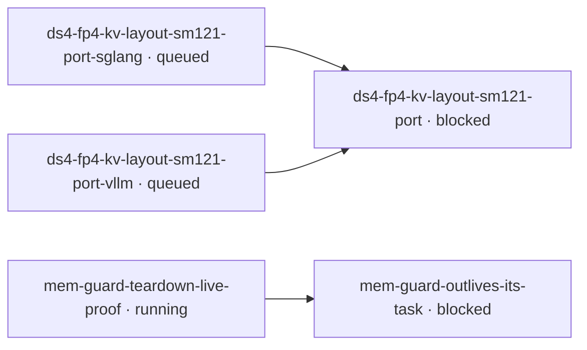

# Board
_Generated 2026-11-22 16:24 ET_

## In flight
| where | owner | what |
|---|---|---|
| census | read-only in tick — booted nothing, claimed nothing, stopped nothing, evicted nothing | read `2026-11-22T21:24:43Z`–`2026-11-22T21:24:46Z` (each node's own `date -u`) on the base census `2026-11-22T17:24:43Z`, **4 h 0 min 0 s** after it: **5 containers, 0 volumes** fleet-wide; **no research rank**; the fenced hosts hold running containers on `.31`, `.32`, `.33`, `.34`, excluded from research accounting; `/v1/models` **200**, `/health` **200** on `.31` |
| pool | — (nobody drives it; head units re-proved each tick) | head: `beegfs-mgmtd` **active** (Result success, NRestarts 0, **+0** on the base) · `beegfs-meta` **active** (Result success, NRestarts 0, **+0** on the base) · `beegfs-storage` **active** (Result success, NRestarts 0, **+0** on the base); worker unit states and the pool's through-mount reads are not part of this census |
| queue | register snapshot `4a147060…`; both blocks below rendered from it | `mad-science/queue.json` sha256 **`4a147060ca00c053f56d2d9039f9fa5ab9610b7e257c41793bbe5c2863d6f8f7`** read locally: **229 tasks: 218 done, 3 queued, 7 blocked, 1 running — 11 open**; the head clone reads **`4a147060…`**, identical |
| window | **no manual lock** at this read | `.local/fleet-window.lock` is **absent** on the head (read `2026-11-22T21:24:46Z`) |
| campaign | `sparkrun-campaign` — active, no lease | head user unit `sparkrun-campaign` reads **`active`** / **`running`** (`MainPID` **3,930,275**, `NRestarts` **0**, **+0** on the base); the lease ledger holds **0 lease(s)** and fence(s) `tp-le2-20261120` |
| lease | **1 fence(s), 0 lease(s)** | the head's repo ledger `.local/fleet-leases.json` (389 B, sha **`ec09509d…`**, mtime **`2026-11-21 03:04:12.907935197 -0500`** local) holds fence **`tp-le2-20261120`** on `.31`, `.32`, `.33`, `.34` (`fenced_at` `2026-11-20T07:25:27Z`, owner directive 2026-11-20: production serve protected, serve `58cddf1c62ba6578_b8865cad5863` / image `986795bcd7f4`) and **0 lease(s)** |
| publication | tick | fresh census (`2026-11-22T21:24:43Z`–`2026-11-22T21:24:46Z`) written to `2026-11-22T212442Z.json` and composed on the base census `2026-11-22T17:24:43Z`; the queue blocks are rendered from `mad-science/queue.json` sha **`4a147060…`**, and the landed rows from `git log --since=2026-11-22T17:24:43Z` |
| .30 | **nothing live (no reservation)** — idle | `2026-11-22T21:24:43Z` (`spark-41e1`): `docker ps -aq` **1**, running **0**, volumes **0**, `:8000` listeners **0** root **1,218,385,436,672 B avail** (-666,755,072, fell) · **2,608,645,382,144 B used** (+666,755,072, rose) boot **`2026-11-19T20:06:40Z`** (`btime`), `uptime` **263,883 s** `MemTotal` **127,598,704 kB** (+0), `MemAvailable` **122,047,712 kB** (-9,688), `Cached` **8,645,244 kB** (+655,864), `AnonPages` **972,028 kB** (-1,544) ring **256** events all-types (+0), **0** in-window lifecycle and **0** in-window `exec`, oldest `2026-11-22T11:23:40.626769558-05:00 container start 049f5ed6`, newest `2026-11-22T11:51:05.985082629-05:00 container die ee1f4311be` |
| .31 | **fenced serve** — excluded from the research census | `2026-11-22T21:24:44Z` (`spark-d325`): `docker ps -aq` **1**, running **1**, volumes **0**, `:8000` listeners **2**, `/v1/models` **200**, `/health` **200** root **1,559,390,294,016 B avail** (-24,195,072, fell) · **2,267,640,524,800 B used** (+24,195,072, rose) boot **`2026-11-19T20:11:15Z`** (`btime`), `uptime` **263,608 s** `MemTotal` **127,598,700 kB** (+0), `MemAvailable` **8,902,836 kB** (-136,580), `Cached` **2,932,188 kB** (-493,720), `AnonPages` **6,551,724 kB** (+164,352) ring **256** events all-types (+0), **0** in-window lifecycle and **256** in-window `exec`, oldest `2026-11-22T15:41:45.607965264-05:00 container exec_die d9d79`, newest `2026-11-22T16:24:15.658328092-05:00 container exec_die d9d79` |
| .32 | **fenced serve** — excluded from the research census | `2026-11-22T21:24:44Z` (`spark-ec1d`): `docker ps -aq` **1**, running **1**, volumes **0**, `:8000` listeners **0** root **1,625,018,200,064 B avail** (-22,544,384, fell) · **2,202,012,504,064 B used** (+22,544,384, rose) boot **`2026-11-19T20:14:21Z`** (`btime`), `uptime` **263,422 s** `MemTotal` **127,598,640 kB** (+0), `MemAvailable` **11,701,860 kB** (+5,928), `Cached` **9,622,784 kB** (+96,828), `AnonPages` **5,305,776 kB** (-1,824) ring **256** events all-types (+0), **0** in-window lifecycle and **256** in-window `exec`, oldest `2026-11-22T15:41:45.977402517-05:00 container exec_die 7641b`, newest `2026-11-22T16:24:16.062754944-05:00 container exec_die 7641b` |
| .33 | **fenced serve** — excluded from the research census | `2026-11-22T21:24:45Z` (`spark-3578`): `docker ps -aq` **1**, running **1**, volumes **0**, `:8000` listeners **0** root **1,521,593,413,632 B avail** (-22,650,880, fell) · **2,305,437,290,496 B used** (+22,650,880, rose) boot **`2026-11-19T20:12:55Z`** (`btime`), `uptime` **263,509 s** `MemTotal` **127,598,636 kB** (+0), `MemAvailable` **11,678,852 kB** (-3,192), `Cached` **8,865,836 kB** (+96,308), `AnonPages` **5,305,220 kB** (-6,036) ring **256** events all-types (+0), **0** in-window lifecycle and **256** in-window `exec`, oldest `2026-11-22T15:41:46.325509392-05:00 container exec_die d98d0`, newest `2026-11-22T16:24:16.637611677-05:00 container exec_die d98d0` |
| .34 | **fenced serve** — excluded from the research census | `2026-11-22T21:24:45Z` (`spark-324e`): `docker ps -aq` **1**, running **1**, volumes **0**, `:8000` listeners **0** root **1,106,985,869,312 B avail** (-22,654,976, fell) · **2,720,044,949,504 B used** (+22,654,976, rose) boot **`2026-11-19T20:09:04Z`** (`btime`), `uptime` **263,741 s** `MemTotal` **127,598,704 kB** (+0), `MemAvailable` **11,743,848 kB** (+72,144), `Cached` **9,634,084 kB** (+96,040), `AnonPages` **5,297,908 kB** (-148) ring **256** events all-types (+0), **0** in-window lifecycle and **256** in-window `exec`, oldest `2026-11-22T15:41:46.691317485-05:00 container exec_die ff75e`, newest `2026-11-22T16:24:17.380490532-05:00 container exec_die ff75e` |
| .35 | **nothing live (no reservation)** — idle | `2026-11-22T21:24:46Z` (`spark-383f`): `docker ps -aq` **0**, running **0**, volumes **0**, `:8000` listeners **0** root **1,041,784,164,352 B avail** (-10,625,024, fell) · **2,785,246,654,464 B used** (+10,625,024, rose) boot **`2026-11-19T20:07:56Z`** (`btime`), `uptime` **263,809 s** `MemTotal` **127,598,700 kB** (+0), `MemAvailable` **123,140,628 kB** (-7,216), `Cached` **5,717,056 kB** (+79,880), `AnonPages` **227,204 kB** (+1,620) ring **256** events all-types (+0), **0** in-window lifecycle and **0** in-window `exec`, oldest `2026-11-22T06:03:40.672336005-05:00 container exec_create: b`, newest `2026-11-22T06:20:39.466944765-05:00 container destroy 5a5f12` |

## Work Queue

| job | node cost | blockers | holds | status | summary |
|---|---|---|---|---|---|
| `ds4-fp4-kv-layout-sm121-port-vllm` — DS4 1017 SM121 vLLM: carry nvfp4_ds_mla through the SM12x sparse-MLA backend so fp4 KV is selectable | single | — | ds4-fp4-kv-layout-sm121-port | queued | — ENGINE WORK on the dev host, not a fleet boot: the quartet boot that proves it is the parent row's, which this row unblocks. UPSTREAM ALREADY HAS THE LAYOUT: vllm/config/cache.py:47-48 lists fp8_ds_mla and nvfp4_ds_mla, vllm/_custom_ops.py:… (full note: queue.json) |
| `ds4-fp4-kv-layout-sm121-port-sglang` — DS4 1017 SM121 SGLang: port the V41_FP4 KV layout and the fp4 pool-sizing term so fp4 KV is admissible | single | — | ds4-fp4-kv-layout-sm121-port | queued | Queued: the SM121 fp4-KV patch and image are delivered and the store gate is byte-exact (1.32x tokens at equal bytes), but the FlashInfer reader returns zeros at 16 heads, so decode call shape is unproven. |
| `mem-guard-teardown-live-proof` — Prove the window guard exits with its task: one armed boot whose stop leaves no guard process | single | — | mem-guard-outlives-its-task | running | — One live armed boot. Launch a single-node arm with ARM_WINDOW=<the window name> so tools/run-arm.sh starts ~/benchmarks/<window>/mem-guard.sh <task-id> and the per-rank samplers (and ARM_ALLOW_DECLARED_WINDOW=<reason> if a .local/fleet-wind… (full note: queue.json) |
| `beegfs-meta-restart-loop-non-meta-hosts` — beegfs-meta restart-loops every 5 s on .31-.35, and the loop hides a failed state behind "activating" | single | — | — | blocked | — Measured 2026-11-09 07:03-07:05 ET, and it is the side effect of the fix beegfs-units-restart-no (done) blessed: /etc/systemd/system/beegfs-meta.service.d/oom.conf (mtime 2026-11-08 16:03 on .30, 16:05 on .31) sets OOMScoreAdjust plus Resta… (full note: queue.json) — evidence: `.scratch/infra-chores-20261122/beegfs-meta/RECEIPT.md` |
| `hf-cache-20261110-docs-only-repin-bundle` — Docs-only model drift from the 2026-11-10 cache update: 22 recipe rows across 10 repos ride their lane’s next boot (no boot of its own) | — | — | — | queued | — Classes measured with refresh-sweep report mode + Hub tree diff: only README/LICENSE/LICENSE-GLM-5.3-Flash/.eval_results/images files differ between the pin and the Hub head for orcarouter/Nex-N2.5-mini-Uncensored-NVFP4, orcarouter/Qwen3.8-… (full note: queue.json) |
| `campaign-leases-tp4-onto-30` — The campaign leases memory-heavy TP4 quartets onto .30, which the owner ruling excludes | quartet | — | — | blocked | — MECHANISM LANDED OFFLINE 2026-11-11 (commits `aa54000`, `ebf5c8e`, `298098d`, `08ff156`; no live lease and no live six-node boot has run, so the row stays open). One ledger, `<repo>/.local/fleet-leases.json` (flock + atomic write), and one … (full note: queue.json) |
| `mem-guard-outlives-its-task` — A window arm's 6.0 GiB stop-rule guard outlives the arm, so the runner accumulates guards for tasks whose containers are gone | — | mem-guard-teardown-live-proof | — | blocked | Blocked on a live boot: a leaked guard is a stale no-op (stops only its own task id), the harness kill and stub test are proven, and closing needs one real stop that leaves no guard process behind. |
| `fleet-boot-without-lease-record` — A four-rank boot serves with no lease in either ledger and no window lock | — | — | — | blocked | — Measured 2026-11-11 19:15:59Z-19:31Z, read-only: task `b020d2dd178343a5_55dafcf24cde` runs one rank each on `.31`-`.34` (image `littlecedar/dgx-spark-dsv41:canary-roce-aff52fa5`, id `3f4480818acb`, `Up` and healthy, `/v1/models` 200 serving… (full note: queue.json) |
| `inkling-tp4-first-boot` — Inkling-2-Small TP=4 first boot: nightly pull and the unproven sm_121 Triton path | quartet | — | — | blocked | — No node holds the pinned nightly digest c17e9d88, so the first boot includes the pull. GB10 is sm_121 and the Blackwell path gates on capability family 100, so the engine runs the Hopper/Triton half (attention_sm90 plus the Humming expert G… (full note: queue.json) — evidence: `recipes/explore/README.md section zz-inkling-2-small-nvfp4-thinking-tools-tp4-vllm` |
| `weightless-dsgb10-tp4-boot-gate` — Boot the weightless-dsgb10 arm four-rank: the α=0 golden hash must equal stock bit-for-bit before any steered request is quoted | quartet | — | — | blocked | — Boot gate for the image closed by weightless-image-build-publish-pin (1bc6b5cb). Image ghcr.io/littlecedar/dgx-picom-ds41f:ds41f-7c123ad4-pr15-pr7-weightless, digest sha256:305b6e5151a2cfd13b85f18c36bccf9062af83e28917fd11a0f151691c5e83df, p… (full note: queue.json) — evidence: `recipes/ds4/zz-deepseek-v4.1-flash-1017-weightless-dsgb10-tp4.yaml (container pinned by digest at line 30); recipes/ds4/README.md lines 2890-2911 (two-name contract, alpha=0 identity) and 2990-2996 (the boot gate)` |
| `ds4-fp4-kv-layout-sm121-port` — DS4 1017 SM121: port the V41/V41_FP4 KV layout so fp4 KV is admissible — dtype is not a lever today, and sizing lies about fp4 | quartet | ds4-fp4-kv-layout-sm121-port-sglang, ds4-fp4-kv-layout-sm121-port-vllm | — | blocked | Blocked on engine work: fp4 KV needs the is_sm100 gate relaxed, the V41/V41_FP4 layout ported and an fp4 branch in the pool configurator, and nvfp4 is unsafe today because sizing has no fp4 term; it buys 2-4x tokens per GiB but no floor. |

## Completed Work
Window: commits since `2026-11-22T17:24:43Z` — the base census stamp, later than the 24 h start `2026-11-21T21:24:42Z`; older rows are not shown.

| time ET | commit | one clause |
|---|---|---|
| 11-22 12:24 | `85940356` | Refresh the status board: a 2026-11-22T172443Z census |
| 11-22 16:19 | `019b8c96` | Relabel the queued rows that no scheduler can start |
