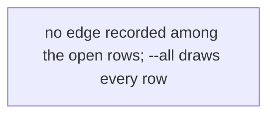

# Board — generated 2026-11-21 03:38 ET

## In flight

| where | owner | what |
|---|---|---|
| census | read-only in tick — booted nothing, claimed nothing, stopped nothing, evicted nothing | read `2026-11-21T08:18:18Z`–`08:18:22Z` (each node's own `date -u`) on the `2026-11-21 03:29 ET` base, **0 h 34 min 32 s** after that base's own census read (`2026-11-21T07:43:46Z`): **4 containers, 0 volumes** — **no research rank**: `.35` reads **0/0/0**, `.30` reads **0/0/0** under a live build lease that is actively building (see its row), and `.31`–`.34` hold one container each, the **fenced production serve** `58cddf1c62ba6578_b8865cad5863` (image `986795bcd7f4`, `Up 23 hours`) — excluded from research accounting; it is **ready**: from the head, `.31:8000` `/v1/models` **200** and `/health` **200** at `2026-11-21T08:18:22Z`, answering `deepseek-ai/DeepSeek-V4.1-Flash-1017` with `max_model_len` **1,048,576**, while `.30:8000` reads **000** (no listener) |
| pool | — (nobody drives it; units and reads re-proved each tick) | **serving.** `beegfs-mgmtd`/`beegfs-meta`/`beegfs-storage` `active` on the head (`NRestarts` **0**); `beegfs-storage` `active` on all six; `beegfs-meta` reads **`activating` (Result exit-code)** on `.31`, `.33`, `.34`, `.35` with `NRestarts` `.31` **24,901** (**+396**), `.33` **24,882** (**+397**), `.34` **24,930** (**+397**), `.35` **24,941** (**+397**) (~5.2 s per restart — the standing non-meta-host loop), all five — `.32` read **`active` (Result success, 23,718)** once at `06:38:35Z`, a sampling artifact of the ~5.2 s loop (a landed row dates it), and re-read `activating` at `07:42:28Z`; `df -B1` on the mount reads used **14,385,637,490,688 B** and avail **9,805,592,264,704 B** identically on all six at `06:38:35Z`–`06:38:38Z` (**+340,787,200 B** on the base's head read), the intra-read spread gone; hub **108 entries** on every node and `stat -L` on the shipped `DeepSeek-V4.1-Flash-1017` index still resolves (**7,470,294 B**) |
| queue | register snapshot `f5fbb26a43f6…` = the **committed** register at `origin/main`, both blocks below rendered from it | `mad-science/queue.json` sha256 **`f5fbb26a43f6c74971b83156fc3efc7bb7c0dec807a37467b87e08745fea8a64`** at `origin/main` (`9098e24f`) — **211 tasks: 176 done, 34 queued, 1 blocked, 0 running — 35 open**, counts identical to the base; the **worktree copy diverges** (sha256 `b6c1d4e667cd…`): it lacks the committed weightless `BUILT` paragraph and carries a longer Sage note, so a commit from this clone would revert `f0a11e81` — flagged, not repaired (another session's file); the graph and the table below are rendered from the committed copy, and `task-queue.py check` on the worktree still prints `ok: 211 task(s)` |
| window | **no manual lock** at this read | `.local/fleet-window.lock` is **absent** on the head at both `$HOME/.local` and the repo clone's `.local`, and absent in this clone at this read; the only declared window of the interval is commit `eb6e93d`'s own pool-restart test (held all six hosts `04:16:15Z`, released `04:24:25Z`, outage `04:16:23Z`–`04:22:59Z`), already closed — the fleet's only live claim now is the `session:weightless-build` lease on `.30` (see the lease row) |
| campaign | `h2h-20261107` — active unit, unchanged since `05:12:15Z`, one live lease it did not issue | head user unit `sparkrun-campaign` reads **`active`** (`MainPID` **3930275**, entered `2026-11-21 00:12:15 EST` = `05:12:15Z`, `NRestarts` **0**) at `06:59:04Z`; its journal's last block is **`05:49:23Z`** (`lease-held` `.30` for the weightless build, fences on `.31`–`.34`) with no line since; `h2h-20261107/state.json` (sha **`89c3b073…`**, 81,087 B, mtime `2026-11-21 00:12` local) holds **28 arms** — **13 measured, 13 blocked, 1 pending, 1 failed** — with `arms[*].lease` empty on all 28 |
| lease | one fence and **one live lease** | the head's repo ledger `.local/fleet-leases.json` (**928 B**, sha **`3b6e239f…`**, mtime `2026-11-21 00:49` local) holds fence **`tp-le2-20261120`** on `.31`–`.34` (`fenced_at` `2026-11-20T07:25:27Z`, *owner directive 2026-11-20: production serve protected*, serve `58cddf1c62ba6578_b8865cad5863` / image `986795bcd7f4`) **and one lease**: `session:weightless-build` on **`.30`**, arm `weightless-image-build-publish-pin`, issued `05:49:19Z`, expires **`08:49:19Z`** (ttl 10,800 s), `memory_risky` **false**, `record_risk` *build-only: no boot, `.30` holds the campaign record root and the build needs the node ahead of queued arms* — and that lease is **being used**: `.30` ran a docker build inside the interval (see the landed rows); `$HOME/.local/fleet-leases.json` still does not exist on the head |
| publication | tick | fresh composition of this tick's own census (`2026-11-21T08:18:18Z`–`08:18:22Z`); base = the published `2026-11-21 03:29 ET` board (commit `cd838436`), content sha256 **`8e545da5…`**; `--base` is that saved copy, and both `--expect-sha` and `--expect-remote-sha` take **`8e545da5…`** against `--remote-ref origin/main` |
| .30 | **leased, actively building** — `session:weightless-build` holds it until `08:49:19Z` | `2026-11-21T08:18:18Z` (`spark-41e1`): `docker ps -aq` **0**, running **0**, volumes **0**, `:8000` listeners **0** `docker ps -a` **0** at the read; the lease's build ran one-shot containers inside the interval (see landed rows) boot **2026-11-19 15:06:40 local** = **2026-11-19T20:06:40Z**, `uptime` **130,298 s** root **1,375,691,288,576 B avail** (−280,993,792 base) · **2,451,339,530,240 B used** (+280,993,792 base) `MemAvailable` **122,021,716 kB** (+27,772 base), `Cached` **17,467,352 kB**, `AnonPages` **1,079,240 kB**, `MemTotal` **127,598,704 kB** mgmtd **active** (Result success, NRestarts 0) · meta **active** (Result success, NRestarts 0) · storage **active** (Result success, NRestarts 0) ring **256** events, oldest **2026-11-21T06:06:26Z**
| .31 | **fenced production serve** — excluded from the research census, rank 0 | `2026-11-21T08:18:19Z` (`spark-d325`): `docker ps -aq` **1**, running **1**, volumes **0**, `:8000` listeners **2** d9d796b1a805 986795bcd7f4 Up 23 hours sparkrun_58cddf1c62ba6578_b8865cad5863_node_0 · `dsfront serve --listen .31:8000` and `dsgb10_rank --rank 0 --mode serve` rank 0 answers `/v1/models` **200** and `/health` **200** (from the head); ranks 1–3 hold one each boot **2026-11-19 15:11:15 local** = **2026-11-19T20:11:15Z**, `uptime` **130,024 s** root **1,649,924,038,656 B avail** (−4,370,432 base) · **2,177,106,780,160 B used** (+4,370,432 base) `MemAvailable` **8,256,492 kB** (−16,320 base), `Cached` **4,579,864 kB**, `AnonPages` **7,204,252 kB**, `MemTotal` **127,598,700 kB** mgmtd **inactive** (Result success, NRestarts 0) · meta **activating** (Result exit-code, NRestarts 24,901) · storage **active** (Result success, NRestarts 0) ring **256** events, oldest **2026-11-21T07:36:20Z**
| .32 | **fenced production serve** — excluded from the research census, rank 1 | `2026-11-21T08:18:20Z` (`spark-ec1d`): `docker ps -aq` **1**, running **1**, volumes **0**, `:8000` listeners **0** 7641b0208eb9 986795bcd7f4 Up 23 hours sparkrun_58cddf1c62ba6578_b8865cad5863_node_1 · `dsgb10_rank --rank 1 --mode serve` boot **2026-11-19 15:14:21 local** = **2026-11-19T20:14:21Z**, `uptime` **129,839 s** root **1,710,001,098,752 B avail** (−11,849,728 base) · **2,117,029,605,376 B used** (+11,849,728 base) `MemAvailable` **11,743,884 kB** (−2,064 base), `Cached` **10,458,640 kB**, `AnonPages` **5,314,216 kB**, `MemTotal` **127,598,640 kB** mgmtd **inactive** (Result success, NRestarts 0) · meta **activating** (Result exit-code, NRestarts 24,865) · storage **active** (Result success, NRestarts 0) ring **256** events, oldest **2026-11-21T07:36:21Z**
| .33 | **fenced production serve** — excluded from the research census, rank 2 | `2026-11-21T08:18:20Z` (`spark-3578`): `docker ps -aq` **1**, running **1**, volumes **0**, `:8000` listeners **0** d98d0a16c21b 986795bcd7f4 Up 23 hours sparkrun_58cddf1c62ba6578_b8865cad5863_node_2 · `dsgb10_rank --rank 2 --mode serve` boot **2026-11-19 15:12:55 local** = **2026-11-19T20:12:55Z**, `uptime` **129,925 s** root **1,625,817,456,640 B avail** (−11,837,440 base) · **2,201,213,247,488 B used** (+11,837,440 base) `MemAvailable` **11,688,616 kB** (+31,196 base), `Cached` **9,887,220 kB**, `AnonPages` **5,309,068 kB**, `MemTotal` **127,598,636 kB** mgmtd **inactive** (Result success, NRestarts 0) · meta **activating** (Result exit-code, NRestarts 24,882) · storage **active** (Result success, NRestarts 0) ring **256** events, oldest **2026-11-21T07:36:21Z**
| .34 | **fenced production serve** — excluded from the research census, rank 3 | `2026-11-21T08:18:21Z` (`spark-324e`): `docker ps -aq` **1**, running **1**, volumes **0**, `:8000` listeners **0** ff75ed983c04 986795bcd7f4 Up 23 hours sparkrun_58cddf1c62ba6578_b8865cad5863_node_3 · `dsgb10_rank --rank 3 --mode serve` boot **2026-11-19 15:09:04 local** = **2026-11-19T20:09:04Z**, `uptime` **130,157 s** root **1,102,649,118,720 B avail** (−11,845,632 base) · **2,724,381,700,096 B used** (+11,845,632 base) `MemAvailable` **11,696,708 kB** (+7,820 base), `Cached` **8,744,912 kB**, `AnonPages` **5,296,248 kB**, `MemTotal` **127,598,704 kB** mgmtd **inactive** (Result success, NRestarts 0) · meta **activating** (Result exit-code, NRestarts 24,930) · storage **active** (Result success, NRestarts 0) ring **256** events, oldest **2026-11-21T07:36:21Z**
| .35 | **nothing live (no reservation)** — idle | `2026-11-21T08:18:22Z` (`spark-383f`): `docker ps -aq` **0**, running **0**, volumes **0**, `:8000` listeners **0** boot **2026-11-19 15:07:56 local** = **2026-11-19T20:07:56Z**, `uptime` **130,226 s** root **1,112,464,187,392 B avail** (−20,123,648 base) · **2,714,566,631,424 B used** (+20,123,648 base) `MemAvailable` **123,234,544 kB** (+168 base), `Cached` **5,714,444 kB**, `AnonPages` **216,936 kB**, `MemTotal` **127,598,700 kB** mgmtd **inactive** (Result success, NRestarts 0) · meta **activating** (Result exit-code, NRestarts 24,941) · storage **active** (Result success, NRestarts 0) ring **256** events, oldest **2026-11-21T00:46:09Z**

## Work queue

| job | node cost | holds | state |
|---|---|---|---|
| `campaign-does-not-honour-the-.30-exclusion` — The campaign places tp>=4 work on .30 regardless of the memory-risk exclusion: a leaseable row that needs .30 is a live risk, so placement must be a field the director refuses to violate | — | — | queued — MECHANISM LANDED OFFLINE 2026-11-11 (commits `aa54000`, `ebf5c8e`, `298098d`, `08ff156`; no live lease and no live six-node boot has run, so the row stays open). One ledger, `<repo>/.local/fleet-leases.json` (flock + atomic write), and one … (full note: queue.json) |
| `sm121-ladder-acceptsampling-dflash` — SM121 survey ladder dies in llama-benchy warm-up: dflash_utils.build_dflash_verify_target_probs missing | — | — | queued — DENSE: the ladder leg cannot run on dsv41-sm121-dg:0.2.1. llama-benchy's first warm-up request takes the adapter's AcceptSampling top-k branch and /opt/dsv41/adapter/block_verify.py:106 calls dflash_utils.build_dflash_verify_target_probs, w… (full note: queue.json) |
| `todo-int8-cite-moved` — Fix the stale int8 recipe cite in TODO.md after the attic move | — | — | queued — mad-science/TODO.md:3502 cites recipes/explore/zz-spark-x2.6-4b-int8-sglang.yaml; the arm was retired to attic/explore/zz-spark-x2.6-4b-int8-sglang.yaml on 2026-11-20. Update the cite and any sibling cite in the same paragraph. — evidence: `attic/explore/zz-spark-x2.6-4b-int8-sglang.yaml` |
| `beegfs-meta-restart-loop-non-meta-hosts` — beegfs-meta restart-loops every 5 s on .31-.35, and the loop hides a failed state behind "activating" | single | — | queued — Measured 2026-11-09 07:03-07:05 ET, and it is the side effect of the fix `beegfs-units-restart-no` (done) blessed: /etc/systemd/system/beegfs-meta.service.d/oom.conf (mtime 2026-11-08 16:03 on .30, 16:05 on .31) sets OOMScoreAdjust plus Res… (full note: queue.json) |
| `head-mesh-cannot-reach-30` — head's ssh cannot reach .30 by name: the alias fails host key verification while the node's own address answers | — | — | queued — Measured 2026-11-09 08:02-08:06 ET and re-probed 08:23:46 ET, read-only from the head: ssh to the .30 name fails 'Host key verification failed', while the same node answers 'ok spark-41e1' when addressed by its own address from the same hea… (full note: queue.json) |
| `hf-cache-20261110-docs-only-repin-bundle` — Docs-only model drift from the 2026-11-10 cache update: 22 recipe rows across 10 repos ride their lane’s next boot (no boot of its own) | — | — | queued — Classes measured with refresh-sweep report mode + Hub tree diff: only README/LICENSE/LICENSE-GLM-5.3-Flash/.eval_results/images files differ between the pin and the Hub head for orcarouter/Nex-N2.5-mini-Uncensored-NVFP4, orcarouter/Qwen3.8-… (full note: queue.json) |
| `house-num-scorer-trailing-period` — House battery scores a correct number with a trailing period as a miss | — | — | queued — tools/quality-battery.py:203-207 score() for kind=num compares nums[-1] to expect, and the regex -?[0-9]+\.?[0-9]* captures the sentence-final dot: the Ripple 2026-11-20 hard-arith-1 cell (gold 74, reply ends "... 37 x 2 = 74.") stores "74.… (full note: queue.json) — evidence: `head:~/benchmarks/tp2-completion-20261120/ripple-nvfp4-tp1/house.json` |
| `lane-survey-edge0-audio8-tts` — Media-lane survey: Edge0/Audio8-TTS-Realistic-Air - 0.6B DualAR TTS + bundled codec, TP<4 so surveyed only | — | — | queued — License class: Apache-2.0, unrestricted - ships as a normal arm with no eval-only banner. Weights: 601,159,424 params BF16 in model.safetensors 1.20 GB plus a separate 44.1 kHz codec.pth 1.35 GB; repo 2.39 GiB. Architecture: model_type arkt… (full note: queue.json) |
| `queue-mode-done-sibling-holds-canary-row` — Queue mode will not lease a row whose recipe a done sibling already holds | — | — | queued — Measured 2026-11-10 00:05-00:16 ET, read-only: arm3-control-cell-canary-line (registered 23:21 by df9d40b) is the register's first queued row carrying both recipe: and tp: (quartet, tp 4, recipes/ds4/deepseek-v4.1-flash-knapcio-tp4-1m-sglan… (full note: queue.json) — evidence: `mad-science/STATUS.md 2026-11-10 00:15 ET queue row; commit 52b99ef` |
| `sage-q4km-trick1-empty-repeat` — Sage Q4_K_M: repeat the trick-1 house cell — one empty reply in the 37-case run | single | — | queued — The 2026-11-20 boot scored 36/37 on the 37-case house; the single miss is trick-1, which returned empty content (house.json). Empty content is a serving event, not a capability miss. Repeat that cell n=3 on the same boot shape (--parallel 1… (full note: queue.json) — evidence: `head:~/benchmarks/tp2-completion-20261120/sage-a1.5-35b/house.json` |
| `campaign-leases-tp4-onto-30` — The campaign leases memory-heavy TP4 quartets onto .30, which the owner ruling excludes | — | — | queued — MECHANISM LANDED OFFLINE 2026-11-11 (commits `aa54000`, `ebf5c8e`, `298098d`, `08ff156`; no live lease and no live six-node boot has run, so the row stays open). One ledger, `<repo>/.local/fleet-leases.json` (flock + atomic write), and one … (full note: queue.json) |
| `campaign-state-copy-re-nests` — The director's receipts root copies state.json back into a window subdir, so one campaign now holds 40 nested copies | — | — | queued — Measured 2026-11-11 05:1x ET, read-only on the head: `h2h-20261107/state.json` and 40 byte-identical copies at `h2h-20261107/tp12-window/state.json`, `.../tp12-window/tp12-window/state.json` and so on, one level deeper per run under that wi… (full note: queue.json) |
| `hf-cache-20261110-cache-consistency-defects` — HF cache consistency defects: four repos hf ignores on a refs/main byte defect, one on a broken absolute symlink, plus 204 GB of stray non-cache trees in the hub root | single | — | queued — Measured 2026-11-10 with `hf cache ls --no-truncate --show-warnings` on .30 after the update loop finished a pass. (1) refs/main carries a trailing newline in models--lodestones--Kromoss (41 B; ref a4fe9744, snapshots 0c5417ec + a4fe9744), … (full note: queue.json) |
| `hf-cache-20261110-template-ab-ifm-k2` — K2-Horizon template/code drift A/B: head c4f92a0d (0.9B) and 240f2de3 (7B-FP8) vs the shipped pins, template identity + one fixed request | single | — | queued — Class (b) from the 2026-11-10 cache sweep: no weight file changed, but IFM/K2-Horizon-0.9B head moves 383cb66347be -> c4f92a0d66e2 changing chat_template.jinja AND modeling_k2_horizon.py and REMOVING chat_template_asst_tool_gen.jinja + chat… (full note: queue.json) |
| `mem-guard-outlives-its-task` — A window arm's 6.0 GiB stop-rule guard outlives the arm, so the runner accumulates guards for tasks whose containers are gone | — | — | queued — CORRECTED 2026-11-11: the premise that a leaked guard can stop a future boot is false. `mem-guard.sh` issues `sparkrun stop` only for the TID in its own argv, so a guard whose task is gone is a stale no-op and cannot touch the next boot. Wh… (full note: queue.json) |
| `pool-target-probe-beegfs-ctl-absent` — Pool storage-target byte accounting is unreachable: beegfs-ctl is absent from .30 though beegfs-utils 20:8.4.1 is installed | single | — | queued — Measured 2026-11-10 15:05:59Z and again 15:06:29Z on .30: beegfs-ctl exits 127 (command not found) as the red user, and no binary named beegfs-ctl exists under /usr, /opt or /sbin at depth <=5, although dpkg lists beegfs-utils 20:8.4.1 plus… (full note: queue.json) |
| `watchdog-stall-mmap-flat-residual` — Watchdog stall rule: mmap load with flat io/log and sub-128-MiB memory progress | — | — | queued — tools/boot-watchdog.py:336-345 counts memory as progress only past MEM_PROGRESS_FLOOR (128 MiB), and its own docstring names the mmap case (no io/log for minutes while RAM fills). A load whose per-check memory delta stays below 128 MiB with… (full note: queue.json) — evidence: `tools/boot-watchdog.py:336-345 (progressed), 347-368 (group_stalled)` |
| `hf-cache-20261110-pool-fetch-gaps` — Pool gaps left by the 2026-11-10 cache update: two Hub heads, two pinned revisions, three absent repos, one private repo needing an org token | single | — | queued — CENSUS 2026-11-11 (`.scratch/tp4-20261111/RECEIPT-boot-a-and-pool-census-20261111.md`): the ds4 1017 body's 'double-count' is now an artifact, named: two revisions share one index — `08c8657f` (a link farm) and `1bae0e10` (the in-body revis… (full note: queue.json) |
| `wopr-cache-dir-runtime-regression` — Verify SGLang and llama.cpp still resolve models through the WOPR cache_dir profile | single | — | queued — The 2026-11-20 Hy4 launch added cache_dir: /mnt/beegfs/huggingface to the WOPR cluster profile (sparkrun cluster update WOPR --cache-dir ...), because the head cache symlink resolved outside the workload mounts. Only the vLLM runtime was pr… (full note: queue.json) — evidence: `recipes/ds4/README.md section zz-deepseek-v4.1-flash-1017-weightless-tp4-1m (cache_dir change, task 261430353ba2889a_9e41b9e252af)` |
| `board-publish-accepts-weaker-replacement` — publish replaces a better-grounded In-flight composition with a fresher byte-compatible one, and no guard notices | — | — | queued — The publish guards compare BYTES, so they cannot see that a replacement carried FEWER facts than the rows it removed. Measured 2026-11-11 20:18 ET on mad-science/STATUS.md: this tick's composition was accepted (publish rc=0, lint ok) while … (full note: queue.json) — evidence: `mad-science/STATUS.md@e4bea70` |
| `board-publish-keeps-in-flight-row-set` — A board published without one of the In-flight state rows passes every guard, because publish compares bytes and never the row set | — | — | queued — Measured 2026-11-11 03:17-03:25 ET. The 03:14 board (blob 2249062c) carried a `\| queue \|` row; the 03:17 board (commit `8e160b2`, blob 0f54622c) carried none, and a tick that composes on it and keeps the In flight body verbatim inherits the… (full note: queue.json) — evidence: `mad-science/STATUS.md at 8e160b2 / bc2cc38 / 9ae7cd4` |
| `cache-audit-pool-budget` — `tools/cache-audit.py --budget-gb`: add a pool mode that judges the one shared HF pool against 90 % of capacity | — | — | queued — `tools/cache-audit.py --budget-gb` still measures per node, but the HF cache is one shared pool: all six nodes report the same usage through the shared hub, so the audit flags the whole fleet at once and no node can be read as over- or unde… (full note: queue.json) |
| `executor-release-host-claim-on-failure` — An executor that stops observing a launch must release the sparkrun host claims it holds | — | — | queued — Measured 2026-11-08 04:09-04:13 ET: kimi-k3.1-pro-pruned75-mxfp4-dspark-vllm-tp4 attempt 1 launcher (pid 1883449) held .30-.33 while its own registry distribution failed at 414.7 s (637.1 MiB at 1.6 MiB/s from docker.io, then … (full note: queue.json) |
| `fleet-boot-without-lease-record` — A four-rank boot serves with no lease in either ledger and no window lock | — | — | queued — Measured 2026-11-11 19:15:59Z-19:31Z, read-only: task `b020d2dd178343a5_55dafcf24cde` runs one rank each on `.31`-`.34` (image `littlecedar/dgx-spark-dsv41:canary-roce-aff52fa5`, id `3f4480818acb`, `Up` and healthy, `/v1/models` 200 serving… (full note: queue.json) |
| `pool-content-fall-20261116` — Pool used fell 501 GB in 6.5 h while every repo entry stayed: name the deletion before the next budget claim | single | — | queued — Measured read-only from the head at 2026-11-16T19:07:40Z: df -B1 on /mnt/beegfs reads used 13,459,970,326,528 B, which is 501,316,845,568 B BELOW the 13,961,287,172,096 B the 06:39 board carried at 11:23:54Z. It is not HF content vanishing:… (full note: queue.json) |
| `runtime-cache-stale-tree-gc` — Delete the stale runtime-cache trees the 2026-11-12 audit approved (732 GB planned, never executed) | single | — | queued — BATCH 1 EXECUTED 2026-11-16T16:33:28Z — 52 items / 554.54 GB deleted on '.30'-'.34' ('.30' 22.53, '.31' 96.38, '.32' 143.49, '.33' 143.68, '.34' 148.46 GB) and '.35' released 0.00 GB — receipt '.scratch/gc-20261116/census.md' rev 3 §Executi… (full note: queue.json) |
| `sparkrun-single-gid-index-for-two-hcas` — sparkrun injects one GID index across two HCAs whose tables disagree | — | — | queued — REPORT-ONLY IN THIS REPO (sparkrun-side defect; no `recipe`/`tp`, not bootable). One derived `NCCL_IB_GID_INDEX` applied to every HCA the probe names is wrong when the rails' GID tables disagree: `scripts/ib_detect.sh:44-45` derives the ind… (full note: queue.json) |
| `window-lock-does-not-stop-direct-boots` — A declared window holds campaign placement and `director lease`, but a direct `sparkrun run` boot bypasses both | — | — | queued — FOUND 2026-11-21 while closing `campaign-ignores-declared-window`. A declared window (`<repo>/.local/fleet-window.lock` with a future `window-end`) reaches `_assign` -> `held_hosts` and `director lease`, so the campaign places nothing and a… (full note: queue.json) |
| `webai-twil-8b-eval-only-arm` — Author and ship the webAI 8.8B eval-only arm (webAI-Official/TwIL-8B): recipe, license banner, lane README notice, index row | — | — | queued — Authoring work, no hardware yet and no recipe, so not machine-runnable. LICENSE (owner 2026-11-12: "Accept and ship it."): card `license_name: webai-non-commercial-license-ver.-1.0`, so the arm ships EVAL-ONLY under AGENTS.md §Recipes, with… (full note: queue.json) |
| `weightless-image-build-publish-pin` — Build, publish and digest-pin the spark-ds41f weightless engine image | single | — | queued — The weightless dual-name arm is blocked only on an image: spark-ds41f:1107 is a local tag (bin/spark build image --apply), never pushed, and the recipe sets distribution_config.containers.enabled false. Build it on an idle node, push to ghc… (full note: queue.json) — evidence: `recipes/ds4/zz-deepseek-v4.1-flash-1017-weightless-tp4-1m.yaml (container: spark-ds41f:1107)` |
| `inkling-tp4-first-boot` — Inkling-2-Small TP=4 first boot: nightly pull and the unproven sm_121 Triton path | quartet | — | queued — No node holds the pinned nightly digest c17e9d88, so the first boot includes the pull. GB10 is sm_121 and the Blackwell path gates on capability family 100, so the engine runs the Hopper/Triton half (attention_sm90 plus the Humming expert G… (full note: queue.json) — evidence: `recipes/explore/README.md section zz-inkling-2-small-nvfp4-thinking-tools-tp4-vllm` |
| `mech-cites-0-4-3` — Re-derive the remaining 117 recipes/MECHANICS.md citations against the installed sparkrun build | — | — | queued — d0d050f landed 27 moved anchors + 13 byte-identical controls for §The one rule and §Key reference §Format and identity, then stopped. Remaining 117 anchors still carry 0.4.2/0.4.0 numbering: the rest of §Key reference (from §Model and servi… (full note: queue.json) |
| `metrics-instrument-confound` — Metrics knob decomposition: one identical recipe, metrics-on vs metrics-off, name the performance-impacting knobs (`#68` ROM bar) | single | — | queued — Owner's `#68` authorises the decomposition that makes the comparability bar checkable, and it must separate THREE regimes, because only one of them can bias a cell: (1) `tools/run-arm.sh`'s scrape is a single exec AFTER the cell and before … (full note: queue.json) |
| `minimax-viggle-remake-eval-only-arm` — Author and ship the MiniMax video eval-only arm (Viggle/Viggle-Remake): ComfyUI node route, license banner, lane README notice, index row | — | — | queued — Authoring work, no hardware yet and no recipe, so not machine-runnable. LICENSE (owner 2026-11-12: "Accept and ship it."): card `license_name: minimax-h3-community-license`, base_model MiniMaxAI/MiniMax-H3 — community-restricted, so the arm… (full note: queue.json) |
| `ds4-fp4-kv-layout-sm121-port` — DS4 1017 SM121: port the V41/V41_FP4 KV layout so fp4 KV is admissible — dtype is not a lever today, and sizing lies about fp4 | quartet | — | blocked — RECIPE RETIRED 2026-11-18: the `zz-` arm this row booted is archived at `attic/ds4/zz-ds4-1017-sm121-indexer-scoring.yaml` (it was run or refused on record; see the lane attic index), so the row is no longer bootable. CORRECTION TO THE FP8-… (full note: queue.json) |

## Landed session

| time ET | commit | one clause |
|---|---|---|

| time ET | commit | one clause |
|---|---|---|
| 10:26 | `ff25ad6` | Keep the address-hygiene gate green in the vision cell's usage line |
| 10:32 | `251e7ae` | Ship the long-context and vision cells as instruments, with their traps named |
| 11:05 | board refresh | census re-read `2026-11-19T16:04:03Z`–`2026-11-19T16:05:46Z` on the `10:15 ET` base, **61 min 5 s** after the base's node read (`2026-11-19T15:04:41Z`): the stalled quartet the base carried is **gone and replaced twice** — the base's `…_907303a0d0e8` left before every surviving ring (`.31` back to `2026-11-19T15:55:58Z`, `.32` `2026-11-19T15:55:24Z`, `.33`/`.34` `2026-11-19T15:54:59Z`), an intermediate `b020d2dd178343a5_7af57d7186e7` reached container-healthy **`15:58:54Z`** and was killed **`16:00:13Z`** (`die`+`destroy` `16:00:15Z`/`16:00:16Z`), and a third boot `b020d2dd178343a5_6a7e0d618bcc` is **loading** one rank each on `.31`–`.34` (`create`+`start` **`16:01:09Z`**, `Up` 2–4 minutes with health `starting`, serve child **170/218/212/212**, `:8000` closed, `/v1/models` **000**) while `.30`/`.35` stay at **0/0/0**; the window changed hands to `prefill-cudnn-20261119` (lock mtime `2026-11-19 10:34 ET`, one lease to `19:34:02Z`); the pool is re-proved by head units and six identical through-mount reads (**14,059,042,766,848 B**, **−1,551,892,480 B** on the base over **61 min 6 s**), **103** hub entries and `config.json` **3311 B**; nine campaign roots, 38 arms, **0 live leases**; queue register unchanged at b6fe77a7… (`ok: 201 task(s)`, 42 open) |
| 11:05 | board measurement | the replacement's two predecessors are dated by what survives: `…_7af57d7186e7` is observed only from **`15:57:43Z`** (health `unhealthy`), **`15:58:54Z`** (health `healthy`) and its `kill` **`16:00:13Z`** on `.31`, so its own `create`/`start` are **evicted, not absent** — bounded to `(2026-11-19T15:54:59Z, 15:57:43Z]` by the oldest entries `.33`/`.34` retain — and the base's `…_907303a0d0e8` teardown lies before every surviving ring, so it is left undated rather than claimed. All four rings hold **256** events; `.30` (oldest `2026-11-17T06:12:27Z`) and `.35` (`2026-11-12T05:50:09Z`) both predate the window, so their **0** in-window counts are measurements |
| 11:05 | board measurement | the loading quartet's page cache refilled to the same ~35–40 GB-per-rank shape the `09:38` boot showed: `Cached` **38,944,252 / 40,058,420 / 40,578,776 / 41,072,408 kB** on `.31`–`.34` with `AnonPages` **3,729,436–5,884,080 kB**, and `MemAvailable` 38,682,672 / 40,866,784 / 40,962,252 / 41,191,816 kB — moved **+30,911,228 / +34,034,900 / +32,941,368 / −81,749,812 kB** against the base, .34's fall being the only one of its own class because the base read it already empty after its engine died at `15:00:55Z`; `.30` moved **−43,684 kB** and `.35` **+24,076 kB** |
| 11:05 | board measurement | the base's boot left and two replacements ran inside this interval; the six roots moved net **+1,552,011,264 B** in avail (`.30` −5,603,328, `.31` −31,666,176, `.32` −31,760,384, `.33` −31,768,576, `.34` +1,675,214,848, `.35` −22,405,120 — `.34` the one that gained, **+1,675,214,848 B**) while the pool's `used` fell **−1,551,892,480 B**; nothing running outside the window explains the pool's fall (`Cached` on all four serving ranks is page cache of the boot's own weight load, not a deletion), so the roots-and-pool pair does **not** cancel this hour and the mover is **not identified** by this tick |
| 11:05 | board measurement | five one-shot containers on `.30` between **`15:27:16Z`** and **`15:30:04Z`** are **not sparkrun tasks**: docker's random names (`hopeful_elbakyan`, `cranky_blackburn`, `funny_banach`, `musing_hoover`, `inspiring_darwin`), each `create`+`start` within a second and `die`+`destroy` 5–23 s later, bracketing the interval before the window lock's own mtime (`2026-11-19 10:34 ET`) — no lease, lock or receipt line names them, so their issuer stays unidentified by this tick |
| 11:13 | board refresh | census re-read `2026-11-19T16:11:52Z`–`2026-11-19T16:11:54Z` on the peer's `11:09 ET` base, **0 h 07 min 49 s** after its first node read (`2026-11-19T16:04:03Z`): the replacement boot is **unchanged and still loading** — `b020d2dd178343a5_6a7e0d618bcc` (image `3f4480818acb`) `Up 10 minutes (health: starting)`, no `:8000` listener, rank 0 **000** at `16:11:55Z`, while every rank's engine log reached `Dummy health check server started … 0.0.0.0:80` **`16:12:35Z`** and `Waiting for application startup` **`16:12:36Z`**; `.30`/`.35` at **0/0/0**; the pool is re-proved on all six nodes (`used` **14,059,048,009,728 B** at `2026-11-19T16:11:52Z`–`2026-11-19T16:11:54Z`, **+5,242,880 B** on the base over **0 h 07 min 49 s**, and **14,059,053,252,608 B** on `.30` `2026-11-19T16:12:37Z` as a growing read); window and lease byte-identical |
| 11:13 | board correction | the four rank rows the previous composition carried are **not** serve-child counts: on the same containers in the same second the bare `pgrep -c -f sglang.launch_server` reads **2** and the bracketed `pgrep -c -f '[s]glang.launch_server'` reads **1** on all four ranks (`16:07:03Z`–`16:07:04Z` and again at the `16:11:52Z`–`16:11:54Z` read), because `pgrep -f` scans the `docker exec sh -c` wrapper's own argv — the earlier `170`/`218`/`212` figures exceed even the self-match and no process evidence supports them. The rows now publish `serve child alive` with the bracketed count |
| 11:13 | board measurement | headroom settled into the loading shape the `09:38` boot showed rather than the stalled one: `MemAvailable` **37,900,132 / 38,640,696 / 38,151,548 / 38,927,860 kB** on `.31`–`.34` with `Cached` **6,396,792 / 35,747,336 / 35,653,172 / 37,080,800 kB** (`.31` still refilling, `.32`–`.34` already at ~36 GB) and `AnonPages` **1,802,924 / 1,072,916 / 1,107,300 / 976,876 kB**; every rank is far above the 6.0 GiB (`6,291,456 kB`) stop-rule floor, and nothing was stopped by this tick |
| 11:22 | board refresh | census re-read `2026-11-19T16:21:08Z`–`2026-11-19T16:21:10Z` on the `11:13 ET` base, **0 h 09 min 16 s** after its first node read (`2026-11-19T16:11:52Z`): the boot the base carried loading now **serves** — `b020d2dd178343a5_6a7e0d618bcc` (image `3f4480818acb`), `StartedAt` **2026-11-19T16:01:09Z**, ready **`2026-11-19T16:12:48Z`** by rank 0's own `The server is fired up and ready to roll!` (**699 s** TTR), rank 0 `/v1/models` **200** and `/health` **000** at `16:21:12Z`, `.31` `Up 19 minutes (unhealthy)` against `.32`–`.34` `healthy`, all four serve children bracketed **1**; `.30`/`.35` at **0/0/0**; the pool is re-proved on all six nodes (`used` **14,059,067,408,384 B** on five at `2026-11-19T16:21:08Z`–`2026-11-19T16:21:10Z`, **+19,398,656 B** on the base over **0 h 09 min 16 s**); window and lease byte-identical |
| 11:22 | board measurement | the serve is **under live long-context load**, not merely ready: rank 0 logged **64** `completion` lines by `16:21:0xZ` and prefill batches at **`16:20:44Z`–`16:21:01Z`** carrying `#pending-token` **797,599** → **764,831**, i.e. a request chunking through the 16,384-token prefill path at ~3.6 k token/s while `.32`–`.34` log Engram layer work (`lookups` ~0.9 M, `hit_rate=100.0%`) |
| 11:22 | board correction | the previous cycle's row said **every** rank's engine log reached `Waiting for application startup`; the probe tails at `16:12:3x` showed it on `.31` only, with `.32`–`.34` still at the `Dummy health check server started … 0.0.0.0:80` line. Readiness is rank 0's own `The server is fired up and ready to roll!` at **`2026-11-19T16:12:48Z`**; the other ranks' logs are not a readiness witness on this arm |
| 11:22 | board measurement | headroom under that load: `MemAvailable` **10,083,084 / 11,154,452 / 11,595,356 / 11,706,412 kB** on `.31`–`.34` (**−27,817,048 / −27,486,244 / −26,556,192 / −27,221,448 kB** against the base's loading cells) with `AnonPages` **5,066,796 / 3,681,512 / 3,716,660 / 3,618,660 kB** and `Cached` **6,006,540 / 7,042,836 / 4,321,452 / 5,739,960 kB**; `.31` is the lowest rank at **3,791,628 kB above** the 6.0 GiB (`6,291,456 kB`) stop-rule floor, so the sampler would not fire on any of the four — state reading only, nothing stopped by this tick |
| 12:11 | board refresh | census re-read `2026-11-19T17:02:19Z`–`2026-11-19T17:02:23Z` on the `11:22 ET` base, **0 h 41 min 11 s** after its first node read (`2026-11-19T16:21:08Z`): the base's serving quartet `b020d2dd178343a5_6a7e0d618bcc` left before every surviving ring, so its stop is bounded to `(16:21:12Z, 16:51:58Z]` rather than dated; a picom/dsgb10 arm `58cddf1c62ba6578_816d0ad2fd50` (image `986795bcd7f4`) was the live boot at the read, `StartedAt` `17:01:01Z`, with `dsfront` listening on `.31:8000`; `.30`/`.35` at **0/0/0**; the pool is re-proved on all six (`used` 14,059,122,982,912 B identical on all six, **+55,574,528 B** on the base) and the register is unchanged (`b6fe77a7…`, 42 open) |
| 12:11 | board measurement | the window and its lease were **replaced** at `2026-11-19 11:35:58 ET` (`16:35:58Z`): `prefill-cudnn-20261119` → `final-ladder-20261119` (lock 255 B sha `80d1c4f1…`, lease 428 B sha `fab7b287…`, one lease on `.31`–`.34`, TTL 6 h expiring `22:35:58Z`), and the new lock declares `window-end=2026-11-19T08:00:00Z`, already past — `director status` prints it **STALE at its declared end**, which is the holder's to clear or re-declare; tick took no action on it |
| 12:11 | board measurement | the churn behind that read is dated by ring events on all four ranks: `58cddf1c62ba6578_cbfd22ed89fc` `kill` `17:00:34Z` (`die`/`destroy` `17:00:36Z`, its own `create`/`start` evicted → bounded `(16:51:58Z, 17:00:34Z]`); `58cddf1c62ba6578_816d0ad2fd50` `create`/`start` `17:01:01Z` and `kill` `17:03:10Z` (`die`/`destroy` `17:03:12Z`, **2 min 9 s** alive, and it answered: `dsfront` listening with `req 55`–`req 60` prefix-plan lines in its serve log); the replacement `b020d2dd178343a5_3bbc743576a1` (image `3f4480818acb`) `create`/`start` `17:04:12Z` and reading shard-load **35 %** at `17:06:17Z`. Rings hold **254/250/252/251** (.31–.34) with oldest `16:51:58Z`/`16:51:28Z`/`16:51:29Z`/`16:51:27Z`, and **256** on `.30`/`.35` with oldest `2026-11-17T06:12:27Z`/`2026-11-12T05:50:09Z`, so their **0** in-window counts are measurements |
| 12:11 | board measurement | roots moved net **−55,480,320 B** in avail across the six (`.30` −36,474,880, `.31` +49,209,344, `.32` −13,090,816, `.33` −13,094,912, `.34` −21,475,328, `.35` −20,553,728) while the pool's `used` **moved +55,574,528 B** in the opposite direction, so the roots-and-pool pair does not cancel this cycle and no mover is named by this tick |
| 12:11 | board measurement | headroom against the base follows the boot, not a leak: `MemAvailable` moved **+5,307,072 kB** on `31`, **+4,572,652 kB** on `32`, **+4,160,324 kB** on `33`, **+4,024,784 kB** on `34` and **+85,428 kB** on `.35`, while `.30` moved **−247,068 kB**; the four ranks hold `Cached` **1,789,596 / 1,353,704 / 1,357,912 / 1,335,420 kB** against the base's 6,006,540 / 7,042,836 / 4,321,452 / 5,739,960 kB, i.e. the new boot has not yet refilled page cache. Every serving rank reads **9,098,700 kB or more** above the 6.0 GiB (`6,291,456 kB`) stop-rule floor, so the sampler would not fire; state reading only, nothing stopped by this tick |
| 11:42 | `d623c35` | Record the cudnn MXFP8 route as inadmissible in `recipes/ds4/README.md`: same-window two-boot A/B against the shipped b12x boot gives pp2048 c1 **4,040.9 → 3,791.2** tok/s (−6.2 %), pp256k **+9.1 %**, pp998k **−21.5 %** (both rungs n=1 — direction, not magnitude) and greedy text **differs** at `temperature 0` (capture sha256 `5c6ba7cd…` → `b1941545…`) with 19/19 on both boots, so the verdict is "keep b12x" for correctness; receipts `~/benchmarks/prefill-cudnn-20261119/` |
| 12:14 | board refresh | census re-read `2026-11-19T17:07:00Z` on the peer's `12:11 ET` base, **0 h 04 min 41 s** after its first node read (`2026-11-19T17:02:19Z`): the picom boot the base carried live `58cddf1c62ba6578_816d0ad2fd50` was **killed `17:03:10Z`** and the window's next boot `b020d2dd178343a5_3bbc743576a1` (image `3f4480818acb`, `littlecedar/dgx-spark-dsv41:canary-roce-aff52fa5`) **loading** one rank each on `.31`–`.34` (`create` `17:04:11Z`, `start` `17:04:12Z`, `Up 4 minutes (health: starting)`, serve child bracketed **1**/bare **2**, no `:8000` listener, rank 0 **000** at `17:09:15Z`); shard load **48/48** then `Finished streaming dequant fp8 wo_a` **`17:07:07Z`–`17:07:21Z`**; `.30`/`.35` at **0/0/0**; pool re-proved on all six (`used` **14,058,781,671,424 B** at `2026-11-19T17:07:00Z`, **−341,311,488 B** on base) |
| 12:14 | board measurement | the picom boot's own start is dated by the ring: at the `17:03:49Z` read `.31` held **251** events with oldest `16:52:23Z` (an `exec_start` of `/opt/dsv41/boot.py health`, a probe of the boot that had already left), and the ring carried `…7b3fc726cfec` `kill` **`16:55:58Z`** (`die`/`destroy` `16:56:01Z`, its `create`/`start` evicted — bounded, not absent), then `…cbfd22ed89fc` `create`/`start` `16:56:41Z`/`16:56:42Z` and `kill` `17:00:34Z`, then `…816d0ad2fd50` `create`/`start` `17:01:01Z` and `kill` `17:03:10Z`. By `17:07:00Z` the ring had advanced to **255** events with its oldest at `17:04:12Z` — the current boot's own `start` — so the earlier history is evicted, not absent |
| 12:14 | board measurement | the picom arm's engine is **not** `sglang.launch_server`, so the bracketed probe is the wrong instrument for it: at `17:01:38Z` the `816d0ad2fd50` rank on `.31` listened on **`.31`:8000** and `127.0.0.1:8000` through a `dsfront` front end (`pid 2946242`), `/health` returned **200** and `/v1/models` **401** (auth enforced), `ps` showed no `sglang.launch_server`, and its serve log carried completed cells (`req 61`–`70`, `prompt 2048 (cached 0), completion 128`, ttft `0.391`–`3.852 s`, `9.1`–`24.2 tok/s`). A **0** from the bracketed pattern on this arm means a dead serve only after the front end is also gone |
| 12:14 | board measurement | roots and the pool nearly cancel this interval: avail moved net **+341,262,336 B** across six roots (`.30` −1,236,992, `.31` −974,848, `.32` −860,160, `.33` −851,968, `.34` +273,248,256, `.35` +71,938,048) while the pool's `used` moved **−341,311,488 B** — the two differ by **49,152 B** with opposite signs, so this interval's movers are consistent with the ladder's own per-boot weight traffic; that reading is **LIKELY**, not proved, since nothing ties an inode to the pair and the base read the pool **−524,288 B** higher again mid-tick at `17:01:38Z` |
| 12:14 | board measurement | headroom reset with the teardown: `MemAvailable` **40,108,816 / 40,958,784 / 41,048,612 / 40,809,976 kB** on `.31`–`.34` (**+24,718,660 / +25,231,680 / +25,292,932 / +25,078,780 kB** against the base's picom cells) with `Cached` back to ~40 GB per rank — the page cache of the new boot's own shard load; every rank is far above the 6.0 GiB stop-rule floor and nothing was stopped by this tick |
| 12:27 | board correction | the `12:14 ET` composition's `.32`–`.34` rows each claimed `shard load **48/48**` on `17:07:0xZ`; only `.31`'s own log showed it (its log reading `96%`→`100% Completed 48/48`), while `.32`–`.34` were captured as a **three-line tail** ending at `Finished streaming dequant fp8 wo_a` — that tail cannot falsify the line but it also never showed it, so the claim was **one rank's observation repeated four times**. Those containers were torn down at `17:15:46Z` and their logs are gone, so the `.32`–`.34` shard progress stays unverified rather than retro-proved; this composition asserts shard progress only per rank, from that rank's own `LOG` fields |
| 12:27 | board refresh | census re-read `2026-11-19T17:22:49Z` on the `12:14 ET` base, **0 h 15 min 49 s** after its first node read (`2026-11-19T17:07:00Z`): **all six roots read 0 containers** — the base's loading boot `b020d2dd178343a5_3bbc743576a1` (image `3f4480818acb`) ran **`17:04:12Z`→ killed `17:15:46Z`** (**11 min 34 s**, `die`/`destroy` `17:15:48Z`) and the next boot `b020d2dd178343a5_d13d6d59090d` `create`/`start` **`17:23:36Z`/`17:23:37Z`**, i.e. **47 s after** the census, `Up 27 seconds (health: starting)` at `17:24:04Z`; so the tick caught a between-boots gap rather than a stalled window |
| 12:27 | board measurement | the teardown released the boot's memory back: `MemAvailable` **122,839,972 / 122,989,256 / 122,996,080 / 122,964,032 kB** on `.31`–`.34` (**+82,731,156 / +82,030,472 / +81,947,468 / +82,154,056 kB** against the base) with `Cached` fallen to **17,158,420 / 13,966,228 / 13,222,656 / 13,671,320 kB** and `AnonPages` to **338,820 / 254,532 / 261,916 / 251,392 kB** — the engine's page cache went with the container, and nothing was stopped by this tick |
| 12:27 | board measurement | roots and the pool still cancel across the boot boundary: avail moved net **−50,348,032 B** across six roots (`.30` −692,224, `.31` −9,949,184, `.32` −18,345,984, `.33` −18,341,888, `.34` −1,560,576, `.35` −1,458,176) while the pool's `used` moved **+50,331,648 B**, a difference of **16,384 B** with opposite signs — consistent with the ladder's own per-boot weight traffic; **LIKELY**, not proved, since nothing ties an inode to the pair |
| 12:58 | `accafb1` | Record the final ladder window: six boots `E, K, L, L, K, E` on `benchmarks/concurrency-ladder.yaml` (pp 2048, tg 128, c 1/2/5/10, 5 runs/cell), gate 2 **stays open** — the C5 lossy lead **6.87 %** sits under the exact pair's own boot-to-boot spread **7.27 %**, while C10's **5.92 %** clears **1.46 %**, so the arm ships without a throughput claim; MATCHED cell table (`picom exact` / `picom lossy` / `knapcio`) in `recipes/ds4/README.md` + `MATCHED-BENCHMARK.md`, receipts `~/benchmarks/final-ladder-20261119/` |
| 13:00 | board refresh | census re-read `2026-11-19T18:01:36Z`–`2026-11-19T18:01:39Z` on the `12:27 ET` base, **0 h 38 min 47 s** after its first node read (`2026-11-19T17:22:49Z`): the base's loading boot `b020d2dd178343a5_d13d6d59090d` served **`17:41:52Z`** and was torn down **`17:46:35Z`**, E2 `58cddf1c62ba6578_b4cf43815a3e` ran **`17:46:52Z`→`17:51:13Z`**, and the window released **`17:53Z`**, so **all six roots read 0 containers** with no claim behind it, not a between-boots gap; pool re-proved on all six (`used` 14,058,891,247,616 B on `.30`–`.32` / 14,058,891,771,904 B on `.33`–`.35`, **+110,100,480 / +109,576,192 B** on base), register unchanged (`b6fe77a7…`, 42 open), and `a05a6e0` landed the evening close-out in `mad-science/SESSION-RECORD.md` |
| 13:00 | board measurement | both boots inside the interval finished on their own ladder rather than being stopped by anything: K2's readiness was **698.979 s** to port and **712.232 s** to HTTP with `ladder_rc=0` and `retry=[2]`, E2's **26.216 / 26.237 s** with `ladder_rc=0` and `retry=[1]`, and each boot's `post-teardown.txt` reads 0 containers, 0 volumes and no `:8000` listener on `.30`–`.35` — the fleet is empty because the holder stopped it by literal task id, and this tick stopped nothing |
| 13:00 | board measurement | headroom sits at the idle shape the teardown left: `MemAvailable` **120,884,408 / 122,988,664 / 123,048,868 / 123,062,304 / 123,119,332 / 122,325,372 kB** on `.30`–`.35` (**−21,660 / +148,692 / +59,612 / +66,224 / +155,300 / +7,176 kB** against the base) with `Cached` **101,238,772 / 819,324 / 377,296 / 371,700 / 381,236 / 112,584,672 kB** — the four ranks the window ran on keep only a few hundred MB of page cache after the E2 teardown, and `AnonPages` is back to **1,344,676 / 342,024 / 262,880 / 262,884 / 256,896 / 220,428 kB** |
| 13:00 | board measurement | roots fell net **−59,506,688 B** in avail across the six (`.30` −3,244,032, `.31` −21,762,048, `.32` −4,718,592, `.33` −4,702,208, `.34` −13,103,104, `.35` −11,976,704) while the pool's `used` rose **+109,576,192 / +110,100,480 B**, so the pair does not cancel this interval and its movers are **not identified** by this tick |
| 13:10 | board refresh | census re-read `2026-11-19T18:09:16Z`–`2026-11-19T18:09:19Z` on the peer's `13:07 ET` base, **0 h 07 min 40 s** after its first node read (`2026-11-19T18:01:36Z`): all six roots **0 containers, 0 volumes, no `:8000` listener**, and no window, lease or campaign claim — the fleet has stayed dark since the window released at `17:53:56Z`; roots moved net **+41,734,144 B** in avail (`.30` -1,470,464, `.31` -745,472, `.32` -9,113,600, `.33` -9,117,696, `.34` +62,914,560, `.35` -733,184) and the pool's `used` **fell 41,418,752 B** against the base's lower read — both sides *freeing* space (roots gained avail, pool used fell), magnitudes **315,392 B** apart, so no single transfer explains the pair and no mover is named by this tick |
| 13:10 | board correction | the base's `.31` cell reads the `.31`–`.34` rings as **256** events with oldest **`17:47:18Z`** and concludes K2's `create`/`kill` are evicted there; **`.31`'s own ring** read **33 s earlier** at `18:01:03Z` held **253** events with oldest **`17:34:43Z`** — an `exec_die` of `sparkrun_b020d2dd178343a5_d13d6d59090d_node_0`'s `boot.py health` probe — and **178** events for that container name including its `kill`/`die`/`destroy` at `17:46:27Z`/`17:46:30Z`. A bounded ring cannot hold 256 then 253, so the two reads cannot both describe `.31` at those instants; this tick reports what it read and leaves the base's figure unattributed rather than reconciled |
| 13:16 | board correction | the `13:07 ET` board's `campaign` cell named **37 arms** and cited **21 paths → 9 files**; neither came from this tick's own scan. The register's `state.json` set sums **38 arms** (7 + 1 + 1 + 1 + 24 + 1 + 1 + 1 + 1) — the figure the `12:27 ET` board already carried — and the path count **21** belonged to the `11:05 ET` cycle's `find -maxdepth 8`: this tick's recursive `**/state.json` glob returns **49 paths → 9 files** by `(st_dev, st_ino)`. One scan's count published as another's |
| 13:16 | board correction | the peer's correction above leaves the `256` vs `253` ring reads unattributed; the cause is on this tick's side. `.31`'s count came from `docker events … \| wc -l` (**256**, the ring's true size) but the **`17:47:18Z` "oldest"** line was the **first of a `tail -n 45`**, i.e. the oldest of the last 45 events, not the ring's oldest. The ring at `18:01:03Z` holding `253` with oldest `17:34:43Z` is the correct reading, and the two figures are the same ring 33 s and 44 events apart — not two readings that cannot both be true. The K2 container's `kill`/`die`/`destroy` (`17:46:27Z`/`17:46:30Z`) were therefore **in** the ring, and the `13:07 ET` claim that they were evicted is withdrawn |
| 13:16 | board measurement | the pool's `used` does not move monotonically while the fleet idles: three reads in 9 min give **14,058,891,247,616 B** at `18:01:38Z` (the `13:07 ET` board), **14,058,910,121,984 B** at `18:03:40Z` (this tick's first read), **14,058,849,828,864 B** at `18:09:19Z` (the `13:10 ET` board) and **14,058,851,401,728 B** at `2026-11-19T18:12:21Z` — a **+18,874,368 B** rise then a **−60,292,352 B** fall, with 0 containers on all six at every read, so the writer is host-side or off-fleet and no single interval's delta is a leak; the roots moved net **−1,740,800 B** against the `13:10 ET` base |
| 14:05 | board refresh | census re-read `2026-11-19T19:01:03Z`–`2026-11-19T19:01:06Z` on the peer's `13:16 ET` base, **0 h 48 min 42 s** after its first node read (`2026-11-19T18:12:21Z`): **all six roots read 0 containers, 0 volumes, no `:8000` listener** and no claim on any node — but the interval was **not empty**: a declared picom window `cheap-cells-20261119` ran `.31`–`.34` and completed inside it (next row), so the idle reads are a released window rather than an absence of work; pool re-proved on all six (`used` **14,058,810,507,264 B** identical on all six, **-40,894,464 B** on base), register unchanged (`b6fe77a7…`, 201 tasks / 42 open), campaign `inactive` with 0 leases |
| 14:05 | board measurement | the interval's boot is dated by the rings on `.31`–`.34`, all four agreeing: `sparkrun_58cddf1c62ba6578_138e3611a0f9` (task `58cddf1c62ba6578_138e3611a0f9`) `create` **`2026-11-19T18:19:44Z`**, `start` **`18:19:45Z`**, `kill` **`18:31:53Z`** and `die`/`destroy` **`18:31:53Z`** — **12 min 9 s** alive, i.e. after the `final-ladder` release and before this read, so the rings rule out a stalled run and the tick stopped nothing |
| 14:05 | board measurement | that boot's own receipt attributes it and shows it was claimed: `~/benchmarks/cheap-cells-20261119/` (last write `13:32 ET` = `18:32Z`, `task-id.txt` carries the same id) names the shipped picom arm `recipes/ds4/deepseek-v4.1-flash-1017-picom-tp4-1m.yaml` at pin `ghcr.io/littlecedar/dgx-picom-ds41f@sha256:1e529c67…` on `.31`–`.34`, and its README records a lease `cheap-cells-20261119` on those ranks **released 18:32Z** and a window lock written before the boot and deleted after — matching the ledger's return to `{"fenced":[],"leases":[],"version":1}` (file mtime `18:32Z`) and the lock's absence; TTR **27.047 s** to HTTP |
| 14:05 | board measurement | roots and the pool nearly cancel this interval: avail moved net **+41,111,552 B** across the six (`.30` -2,777,088, `.31` -13,004,800, `.32` +49,795,072, `.33` +49,725,440, `.34` -12,959,744, `.35` -29,667,328) while the pool's `used` moved **-40,894,464 B**, the two differ by **217,088 B** with opposite signs; with the picom boot's weight load and teardown inside the interval that is consistent with the arm's own churn, but nothing ties an inode to the pair, so the mover is **LIKELY**, not proved |
| 14:05 | board measurement | headroom is back at the idle shape the teardown left, and `Cached` on the four ranks the window used is a few hundred MB: `MemAvailable` **120,927,504**, **123,008,704**, **123,074,400**, **123,118,152**, **123,154,044**, **122,329,176** kB on `.30`–`.35` (+86,404, +86,092, +67,668, +53,408, +82,996, +19,900 kB against base) with `Cached` **101,245,676**, **861,164**, **420,120**, **417,016**, **375,348**, **112,604,140** kB; every rank is far above the 6.0 GiB (`6,291,456 kB`) stop-rule floor and nothing was stopped by this tick |
| 14:11 | `1cfce76` | Report ms/step over the decode window it shares with `decode_s`: `tools/longctx-cell.py` 1.3 makes `ms_per_step` `decode_s` over its own gaps so `decode_steps × ms_per_step` reproduces `decode_s` (the raw gap median stays `ms_per_step_gap_median`, 18.3 against 12.2 mean on the 2026-11-19 cold cell with 220 × 18.3 ms written beside 2.685 s), `--selftest` now drives a bursty SSE stub serve that fails when the window rate misses `decode_s` by more than one step, and `PICOM-VS-KNAPCIO.md` labels the 131,072 varied second cold cell 136.7 as a client integral rather than an engine line |
| 14:11 | `787fbf8` | Record the shipped-arm 40,000-token grant and the picom prefix-cache hit: 40,000 completion tokens ending on `finish_reason` length in 210.235 / 210.581 s (190.26 / 189.95 tok/s client, engine 190.4 / 190.1) with identical text sha256, receipt `head:~/benchmarks/cheap-cells-20261119/`, superseding the probe-era 192.4 tok/s figure; a verbatim repeated ~4.75k prefix reports `cached_tokens` 4752 against `reused` 0 cold at TTFT 0.0284 s vs 0.5706 s, so the all-zero readings were cache-defeating cells |
| 14:11 | `5d4c3b8` | Close the protocol's unmeasured list: the grant and shared-prefix cells land measured, and the long-context fan-out leg becomes deliberately out of scope because the SGLang arm wedges at 2–4 cold ~1M requests in flight, so 16-way fan-out would drive a failing path; admission and void rules unchanged |
| 14:11 | `020f4c9` | Ledger the two cheap cells in `mad-science/SESSION-RECORD.md`: grant and shared-prefix receipt and commit SHAs, the corrected `cached_tokens` claim, the `longctx-cell` instrument fix and one client-derived cell, fan-out left out of scope, and the picom long-context cells as engine-reported provenance |
| 14:11 | board refresh | census re-read `2026-11-19T19:02:28Z`–`2026-11-19T19:02:30Z` on the peer's `14:05 ET` base, **0 h 01 min 25 s** after its first node read (`2026-11-19T19:01:03Z`): all six roots still read **0 containers, 0 volumes and no `:8000` listener** with no new `create` behind them, so nothing was booted or stopped by this tick; pool re-proved on all six (`used` **14,058,760,699,904 B** identical there, **−49,807,360 B** on base) and the register is unchanged (`b6fe77a7…`, 42 open) with `task-queue.py check` ok |
| 14:11 | board measurement | the interval's space movement is one node's, not the fleet's: `.30`'s root gained **50,167,808 B** avail while the other five moved −106,496 / −110,592 / −110,592 / −118,784 / −114,688 B, and the pool's `used` fell **49,807,360 B** over the same **0 h 01 min 25 s** with 0 containers on every node at both reads — the two magnitudes differ by **360,448 B**, so a host-side shift on `.30` is **LIKELY** and nothing ties an inode to the pair, so the mover is not identified |
| 14:11 | board measurement | the non-meta hosts' `beegfs-meta` loop is still turning at one restart per ~5 s: `NRestarts` gained **16 / 17 / 16 / 17 / 17** on `.31`–`.35` across **85 s** (5.31 / 5.00 / 5.31 / 5.00 / 5.00 s per restart), every one of them left `activating` with `Result=exit-code`, and the head's own mgmtd/meta/storage stay `active`/`success`/0 — queue row `beegfs-meta-restart-loop-non-meta-hosts` is not closed by this reading |
| 14:21 | `cf02f47` | Correct the picom protocol's thinking and prefix-cache cells against pin `7c123ad4`: thinking is implemented (switches `server.rs:491-513`, off by default `main.rs:257-260`) and `cached_tokens` is reported (4752/4753 ids, TTFT 0.0284 s against 0.5706 s cold), so the old `PICOM-VS-KNAPCIO.md` claim that neither exists was false; run-history sentences trim to behaviour |
| 14:28 | `dab23e4` | Anchor every request-surface row of that protocol to pinned source or a receipt: launcher always passes `--max-tokens` (32,768 default, 262,144 shipped), `top_k`/`seed` cite `ops.h:92`/`config.h:8` and `sample.cu:167,344`, logprobs joins keys that are silently dropped, `model` is replaced rather than echoed |
| 14:41 | `2d6f015` | Measure picom's thinking channel on the shipped arm: non-empty `reasoning_content` (64 chars) and content (391 chars) with `reasoning_tokens` 19 at temperature 0, reasoning deltas preceding content deltas (0.026 s vs 0.244 s), controls emitting no reasoning key; receipt `head:~/benchmarks/picom-thinking-20261119/` |
| 14:41 | `926a15c` | Document the picom thinking switch as an operator knob — per-request `chat_template_kwargs.thinking` (plus `reasoning_effort`) or `PICOM_FRONT_ARGS=--thinking` for the whole serve, off by default — and that re-injected reasoning costs prompt bytes on later tool turns |
| 14:41 | `0ee92f6` | Record the picom thinking probe in `mad-science/SESSION-RECORD.md`: token counts, stream order, cache counters, the mock-engine shape check and the `PICOM_FRONT_ARGS`-to-argv proof named before the boot |
| 15:52 | `0b7adda` | Wire the picom fabric from sparkrun's RoCE detection instead of recipe literals: `recipes/ds4/mods/picom-launcher` derives each device's own `/24` and GID index from sysfs per node and the launcher reads back the rendered fleet file; booted on `.31`–`.34` with no fabric override, ring up **4.4 s**, one chat request answered (receipt `head:~/benchmarks/picom-fabric-derive-20261119/`) |
| 16:13 | board refresh | census re-read `2026-11-19T21:05:40Z`–`2026-11-19T21:05:42Z` on the `14:11 ET` base, **2 h 03 min 14 s** after its first node read (`2026-11-19T19:02:28Z`): **all six roots read 0 containers, 0 volumes and no `:8000` listener**, and the interval was **not** empty — the fleet power-cycled and a picom boot ran on `.31`–`.34`, both dated below; pool re-proved from the head (`used` 14,057,512,370,176 B, −1,248,329,728 B on base; 103 hub entries; `stat -L` 3311 B), register unchanged (`b6fe77a7…`, 201 tasks / 42 open), no window lock and an empty lease ledger |
| 16:13 | board measurement | the interval's dominant event is a clean fleet power-cycle: `apt -y full-upgrade` at `14:57:59` local on all six, then on `.31` `fwupdmgr refresh --force` / `fwupdmgr upgrade` / `/usr/sbin/reboot` at `14:58:5x` and `/usr/sbin/poweroff` at `15:04:18`, every node reaching `poweroff.target` (no crash, no `reboot.target`); `journalctl -k -b -1` OOM matches **0** on `.30`, kernel unchanged `7.0.0-1025-nvidia` on all six, `kho=off` **1** and CMA **0/0** after it, BIOS `5.36_0ACUM028` (2026-09-04) on `.30`/`.31` with no pre-cycle baseline in this tick, so a firmware byte change is **not established** — but every pre-cycle cell now sits on a different boot, so a cross-window comparison must say so |
| 16:13 | board measurement | the campaign came back with the reboot: `sparkrun-campaign` is enabled and `active`/`running` since `20:06:54Z`, serving `--queue --hosts .30,.35` over `h2h-20261107` and logging `queue: no runnable rows; polling every 30s`; its journal also observed a manual lease `picom-env-wiring:manual:1795120720` held on `.31`–`.34` from `20:38:51Z` and freed at `20:46:41Z`, which is how the picom boot below was claimed even though the ledger now reads empty |
| 16:13 | board measurement | the rings on `.31`–`.34` date that boot: a one-shot `ubuntu` container lived **0.27 s** at `20:31:29Z` (a host-side probe; no receipt names it), then image `986795bcd7f4` `create`/`start` **`20:43:51Z`**, `kill` **`20:46:02Z`**, `destroy` **`20:46:03Z`** — **2 min 11 s** — matching `~/benchmarks/picom-fabric-derive-20261119/` (`fleet.conf` + `engine-fabric.txt`, `ring up after 4.4 s`, written `20:45Z`) and the landed `0b7adda`; `.30` and `.35` rings are empty since their own dockerd start (`20:07:00Z`/`20:08:11Z`), so their 0 counts are measurements |
| 16:13 | board measurement | space moved on both planes in the same direction and nearly cancelled: root avail net **+1,248,018,432 B** across the six (.30 −235,126,784, .31 +575,127,552, .32 +650,330,112, .33 +85,127,168, .34 +57,393,152, .35 +115,167,232) while the pool's `used` moved **−1,248,329,728 B**, the two magnitudes **311,296 B** apart; with a fleet reboot and one picom boot's weight load inside the interval that is consistent with the boot's own churn, but nothing ties an inode to the pair, so the mover is **LIKELY**, not proved |
| 16:13 | board measurement | the head cannot reach **any** node by name, not only `.30`: `ssh spark-d325` and `ssh spark-383f` fail `Host key verification failed` while all six answer from the same head in the same second by address (`ok-spark-325`… by IP), and `/home/red/.ssh/known_hosts` holds **1** name entry but **3** IP entries per node — the by-name entries are stale, so this tick's census hops by IP; queue row `head-mesh-cannot-reach-30` therefore understates its scope (opened for `.30`, true for all six) |
| 16:13 | board measurement | the non-meta hosts' `beegfs-meta` loop survived the reboot with reset counters and the same rate: `NRestarts` **623 / 587 / 604 / 648** on `.31`–`.34` since their own dockerd start, i.e. one restart every **5.2 / 5.3 / 5.2 / 5.1 s**, every one left `activating` with `Result=exit-code`, while the head's mgmtd/meta/storage stay `active`/`success`/0 and the mount serves reads on all six — queue row `beegfs-meta-restart-loop-non-meta-hosts` is not closed by this reading |
| 16:23 | board correction | the `16:13` attribution row said `apt -y full-upgrade` at `14:57:59` local "on all six", but that second came from `.30`/`.31` alone; every node's own last `Start-Date` is **`14:57:58`–`14:58:02`** (`.32` `14:58:00`, `.33`/`.34` `14:57:58`, `.35` `14:58:02`) with the same `Commandline: apt -y full-upgrade`; the `poweroff.target` half is now read on the other four as well — `.32`–`.35` each show `Reached target poweroff.target` **2** times, `reboot.target` **0** and kernel-log OOM matches **0**
| 16:23 | board correction | "same kernel" is not "same platform": the same upgrade moved `libnvidia-container1` **1.20.1-1 → 1.20.2-1** (`/var/log/apt/history.log` on `.30`), which is the container runtime, and all six now read `driver=580.178.04`, `lnc=1.20.2-1`; no pre-cycle driver or runtime version was captured, so a cell measured before `20:04Z` and one after cross a runtime pin boundary whatever the kernel says
| 16:23 | board measurement | the live campaign's arm states are now on the board: **16 measured, 14 blocked, 5 skipped, 3 failed** across the nine `state.json` files, with **no** arm pending, queued or running, which is why the director logs `no runnable rows` — an `active` unit with an empty work list rather than a claim on `.31`–`.34`
| 17:08 | board refresh | census re-read `2026-11-19T22:02:08Z`–`2026-11-19T22:02:11Z` on the `16:13 ET` base, **0 h 56 min 28 s** after that base's first node read (`2026-11-19T21:05:40Z`): **all six roots read 0 containers, 0 volumes and no `:8000` listener**, and nothing was booted or stopped by anything in the interval — no window lock, empty lease ledger, campaign journal silent since the base read; pool re-proved on head (`used` 14,057,633,480,704 B, **+121,110,528 B** on base; 103 hub entries; `stat -L` 3311 B), register unchanged (`b6fe77a7…`, 201 tasks / 42 open) and `task-queue.py check` `ok: 201 task(s)` |
| 17:08 | board measurement | the empty interval is a measurement, not an evicted record: the docker rings read **42 / 32 / 32 / 32** events on `.31`–`.34` with oldest **2026-11-19T20:31:29Z (create thirsty_euclid)** on `.31` (the 0.27 s one-shot `thirsty_euclid`, itself a host-side probe) and **2026-11-19T20:43:51Z (create sparkrun_58cddf1c62ba6578_21430285c075_node_1)** / **2026-11-19T20:43:51Z (create sparkrun_58cddf1c62ba6578_21430285c075_node_2)** / **2026-11-19T20:43:51Z (create sparkrun_58cddf1c62ba6578_21430285c075_node_3)** on `.32`–`.34` (the picom boot's own `create`), so nothing was evicted and **0/0/0/0** events at or after the base read is a measurement; `.30`/`.35` rings hold **0/0** events because no container has run on them since their own dockerd start (`20:07:00Z`/`20:08:11Z`) |
| 17:08 | board measurement | space moved on both planes in the same direction, to within **45,056 B** of each other: root avail net **−121,065,472 B** across six (`.30` −3,899,392, `.31` −30,150,656, `.32` −21,733,376, `.33` −21,770,240, `.34` −21,737,472, `.35` −21,774,336) while the pool's `used` **rose +121,110,528 B** and its `avail` fell **−121,110,528 B** over **0 h 56 min 28 s** — `.31`–`.35` each lost 21.7–30.2 MB while `.30` lost 3.9 MB, and the pool gained 121.1 MB, so the two planes agree; with 0 containers on every node at both reads the writer is host-side or off-fleet, so the mover is **LIKELY** but not identified (nothing ties an inode to the pair) |
| 17:08 | board measurement | fleet sits at the idle shape the last teardown left: `MemAvailable` **122,512,324 / 123,361,180 / 123,467,400 / 123,410,532 / 123,381,016 / 123,408,820 kB** on `.30`–`.35` (+39,568, +36,580, +88,164, +82,424, +27,344, −22,684 kB against the base) with `Cached` under 1.6 GB per node and `AnonPages` **133,048–740,396 kB**; every rank is far above the 6.0 GiB (`6,291,456 kB`) stop-rule floor and nothing was stopped by this tick |
| 17:08 | board measurement | non-meta hosts' `beegfs-meta` loop is still turning one restart per ~5 s — `NRestarts` **1271 / 1235 / 1252 / 1296** on `.31`–`.34` at the census, all left `activating` `Result=exit-code` — and this tick's own probe adds a sampling trap: `.35`'s census sample read `active`/`success`/`0`, but a direct re-probe at **`22:06:13Z`** reads `activating`/`auto-restart`, `Result=exit-code`, `NRestarts` **1356** with `Error: No metadata storage directory specified` still repeating every 5 s, so a single `systemctl is-active` sample can land inside the restart window and the loop is **not** fixed on `.35`; head's mgmtd/meta/storage stay `active`/`success`/0 and the mount serves reads — queue row `beegfs-meta-restart-loop-non-meta-hosts` not closed by this reading |
| 18:08 | board refresh | census re-read `2026-11-19T23:03:33Z`–`2026-11-19T23:03:36Z` on the `2026-11-19 17:08 ET` base, **1 h 01 min 25 s** after its first node read (`2026-11-19T22:02:08Z`): **all six roots read 0 containers, 0 volumes and no `:8000` listener**, and nothing booted or stopped by anyone in the interval — no window lock, empty lease ledger, no campaign journal line, and **0** docker container events at/after the base read on every node; pool re-proved on all six (`used` **14,057,706,881,024 B**, **+73,400,320** on base), register unchanged (`b6fe77a7…`, 201 tasks / 42 open) and `task-queue.py check` `ok: 201 task(s)` |
| 18:08 | board measurement | the empty interval is a measurement, not an evicted record: `.31`–`.34` rings hold **38 / 30 / 30 / 30** events with oldest `.31` 2026-11-19T20:31:29Z, `.32` 2026-11-19T20:43:51Z, `.33` 2026-11-19T20:43:51Z, `.34` 2026-11-19T20:43:51Z and `.30`/`.35` hold **0** events since their own dockerd start (`20:07:00Z`/`20:08:11Z`), and every node returns **0** container events at/after the base read; `.31`/`.32`/`.34` dockerd has been up since `20:07:00Z`, so **no restart** can explain the base row's **42 / 32 / 32 / 32** — those figures are left unattributed by this tick rather than reconciled |
| 18:08 | board measurement | space moved on both planes in the same direction and within **270,336 B** of each other: root avail moved net **−73,129,984 B** across the six (`.30` −3,645,440, `.31` −5,480,448, `.32` −22,224,896, `.33` −13,840,384, `.34` −14,082,048, `.35` −13,856,768) while pool `used` rose **+73,400,320 B**, with 0 containers at both reads — `.30`/`.31` lost 3.6/5.5 MB while `.32`–`.35` lost 13.8–22.2 MB, so a host-side or off-fleet writer is **LIKELY** and nothing ties an inode pair, so the mover is not identified |
| 18:08 | board measurement | the fleet sits in the idle shape the last teardown left: `MemAvailable` **122,501,876 / 123,350,644 / 123,424,216 / 123,414,284 / 123,323,292 / 123,348,808 kB** on `.30`–`.35` (−10,448 / −10,536 / −43,184 / +3,752 / −57,724 / −60,012 against the base) with `Cached` **2,063,712 / 1,630,440 / 1,022,940 / 1,023,832 / 1,115,100 / 1,350,372 kB** and `AnonPages` **724,184 / 146,872 / 152,332 / 146,688 / 152,152 / 174,752 kB**; every rank is far above the 6.0 GiB (`6,291,456 kB`) stop-rule floor and nothing was stopped by this tick; the six boots are unchanged (`.30 10,613 s, .31 10,339 s, .32 10,153 s, .33 10,240 s, .34 10,471 s, .35 10,540 s`), so the power-cycle cells still hold |
| 18:08 | board measurement | the non-meta hosts' `beegfs-meta` loop is still turning one restart per ~5 s: `NRestarts` **1976 / 1940 / 1957 / 2001** on `.31`–`.34` against the base's **1271 / 1235 / 1252 / 1296** — **+705** each over **3685 s**, i.e. **5.23 s** per restart, every one left `activating` `Result=exit-code` — and `.35` is on the same loop (**2015**, exit-code, sampled `activating`) although the base's census caught it `active`; head's mgmtd/meta/storage stay `active`/`success`/0 and the mount serves reads, so queue row `beegfs-meta-restart-loop-non-meta-hosts` is not closed by this reading |
| 19:00 | board refresh | census re-read `2026-11-20T00:01:17Z`–`2026-11-20T00:01:17Z` on the `18:08 ET` base, **57 min 44 s** after its first node read (`2026-11-19T23:03:33Z`): **all six roots read 0 containers, 0 volumes, no `:8000` listener** and no window, lease or campaign claim — the fleet has stayed dark since the picom pair released at `20:46:41Z`; pool re-proved on all six (`used` **14,057,776,611,328 B** identical, **+69,730,304 B** on base), register unchanged (`b6fe77a7…`, 201 tasks / 42 open), campaign journal silent across the whole interval |
| 19:00 | board measurement | no boot ran this interval, so nothing is dated by a ring: every node's `docker events --since 2026-11-19T23:03:33Z` returns **0** rows and every ring predates the base read (`.31` **42** events oldest `2026-11-19T15:31:29`, `.32`–`.34` **32** oldest `2026-11-19T15:43:51`, `.30`/`.35` `docker events` empty) — with capacities far below the 256-event bound this is a measurement of no churn, not an evicted absence |
| 19:00 | board measurement | headroom drifts by kilobytes while the fleet idles: `MemAvailable` **.30 +196,656, .31 −21,496, .32 +15,808, .33 −39,948, .34 +120,348, .35 −10,016 kB** against the base, with `Cached` moved **.30 +8,688, .31 +15,300, .32 +15,216, .33 +16,304, .34 +15,124, .35 +15,884 kB** and every rank far above the 6.0 GiB (`6,291,456 kB`) stop-rule floor; nothing was stopped by this tick |
| 19:00 | board measurement | roots lost free space and the pool grew in the same direction this interval: avail moved net **−70,066,176 B** across the six (.30 −4,853,760, .31 −13,012,992, .32 −13,025,280, .33 −13,058,048, .34 −13,066,240, .35 −13,049,856) while the pool's `used` rose **+69,730,304 B** — magnitudes within **335,872 B** of each other but with the same sense (both consuming free space), so they are not one transfer's two halves and no mover is named by this tick |
| 19:00 | board measurement | the non-meta hosts' `beegfs-meta` loop keeps turning one restart per ~5 s: `NRestarts` **2638 / 2602 / 2619 / 2663 / 2676** on `.31`–`.35` against the base's **1976 / 1940 / 1957 / 2001 / 2015** — **+662** on `.31`–`.34` and **+661** on `.35` over **3464 s**, i.e. **5.23 s / 5.24 s** per restart, nearly every sample left `activating` `Result=exit-code` save `.34`, caught `active`/`success` between restarts on the same counter; head's mgmtd/meta/storage stay `active`/`success`/0 and the mount serves reads, so queue row `beegfs-meta-restart-loop-non-meta-hosts` is not closed by this reading |
| 20:03 | board refresh | census re-read `2026-11-20T01:01:50Z`–`2026-11-20T01:01:50Z` on the `2026-11-19 19:00 ET` base, **1 h 00 min 32 s** after its first node read (`2026-11-20T00:01:17Z`): **all six roots read 0 containers, 0 volumes and no `:8000` listener** and no window, lease or campaign claim — the fleet has stayed dark since the picom pair released at `20:46:41Z`; pool re-proved on all six (`used` **14,057,799,680,000 B** identical, **+23,068,672 B** on base; **103** hub entries; `stat -L` **3311 B**), register unchanged (`b6fe77a7…`, 201 tasks / 42 open) and `task-queue.py check` `ok: 201 task(s)` |
| 20:03 | board measurement | no boot ran this interval, so nothing is dated by a ring: every node's `docker events --since 2026-11-20T00:01:17Z` returns **0** rows, and the rings hold **38** events on `.31` with oldest **2026-11-19T20:31:29Z** (`thirsty_euclid` create), **30** on `.32`–`.34` with oldest **2026-11-19T20:43:51Z** (the picom boot's own `create`), and **0** on `.30`/`.35` since their own dockerd start — capacities far below the 256-event bound, so this is a measurement of no churn, not an evicted absence |
| 20:03 | board measurement | space moved in the same sense on both planes and does not cancel: root avail moved net **-22,855,680 B** across the six (`.30` -2,519,040, `.31` -4,104,192, `.32` -4,087,808, `.33` -4,050,944, `.34` -4,042,752, `.35` -4,050,944) while the pool's `used` rose **+23,068,672 B** — magnitudes **212,992 B** apart with both sides consuming free space, so they are not one transfer's two halves and no mover is named by this tick |
| 20:03 | board measurement | headroom drifts by kilobytes while the fleet idles: `MemAvailable` `.30` -53,628, `.31` +18,580, `.32` -19,940, `.33` -37,108, `.34` -99,708, `.35` +61,904 kB against the base, with `Cached` moved `.30` +4,480, `.31` +8,572, `.32` +9,088, `.33` +8,796, `.34` +8,768, `.35` +8,536 kB and `AnonPages` `.30` +9,060, `.31` +16,888, `.32` -244, `.33` +7,552, `.34` +864, `.35` -1,916 kB; every rank is far above the 6.0 GiB (`6,291,456 kB`) stop-rule floor and nothing was stopped by this tick |
| 20:03 | board measurement | the non-meta hosts' `beegfs-meta` loop keeps turning one restart per ~5 s: `NRestarts` **31** 2638→3330, **32** 2602→3294, **33** 2619→3311, **34** 2663→3355, **35** 2676→3368 — **+692** on each of the five over **3632 s**, i.e. **5.25 s** per restart, every sample left `activating` `Result=exit-code`; head's mgmtd/meta/storage stay `active`/`success`/0 and the mount serves reads, so queue row `beegfs-meta-restart-loop-non-meta-hosts` is not closed by this reading |
| 20:33 | `acfcd61` | Set TP=4 in the DeepSeek picom TP4 recipes: both `recipes/ds4/deepseek-v4.1-flash-1017-picom-tp4-1m.yaml` and its `-oea` twin now carry `defaults.tensor_parallel: 4` so the recipe value matches the engine topology |
| 20:09 | board refresh | census re-read `2026-11-20T02:02:25Z`–`2026-11-20T02:08:31Z` on the `2026-11-19 20:03 ET` base, **1 h 00 min 35 s** after its first node read (`2026-11-20T01:01:50Z`): **all six roots read 0 containers, 0 volumes and no `:8000` listener** — and the interval was **not empty**: two short `sparkrun_1a787291cce4138b` boots (image `986795bcd7f4`) ran on `.30`–`.34` and both ended inside it (dated below), **with no window lock and an empty lease ledger** behind them; pool re-proved on all six (`used` **14,057,485,631,488 B**–**14,057,497,165,824 B**, **-314,048,512**–**-302,514,176 B** on base; **103** hub entries; `stat -L` **3311 B**), register unchanged (`b6fe77a7…`, 201 tasks / 42 open) and `task-queue.py check` `ok: 201 task(s)` |
| 20:09 | board measurement | both boots of the interval are dated by the rings, which agree rank for rank: `1a787291cce4138b_c9d79b9841c9` `create`/`start` **`2026-11-20T01:35:04Z`** as `node_0`–`node_3` on `.31`–`.34` and `kill` **`01:37:12Z`** (`die`/`destroy` the same second, **2 min 8 s** alive); `1a787291cce4138b_397577e68df8` `create`/`start` **`01:38:20Z`** as `node_0`–`node_3` on `.30`–`.33` and `kill`/`die`/`destroy` **`01:38:29Z`** (**9 s** alive), i.e. the second attempt moved rank 0 onto `.30` and dropped `.34`; `.31`'s ring also holds the first boot's `exec_create` weight-load and `tail` probes (`mkdir -p /workspace/mods/picom-launcher`, 42 events at/after the base read) while `.34` holds only its 7 lifecycle events |
| 20:09 | board measurement | neither boot is attributable from this clone: no lease was ever written (ledger sha `34eed267…`, mtime `20:46:32Z`), no window lock exists now or in the ledger, the campaign journal has no entry since the base read, and head's `~/benchmarks` has no directory newer than `15:45:53Z` and no file naming `1a787291cce4138b` — so the issuer and the reason both boots died in seconds are **not identified by this tick**; nothing was running at the read, and this tick stopped nothing |
| 20:09 | board measurement | space moved on both planes in the same sense, both freeing it: root avail net **+304,619,520 B** across the six (`.30` **+411,459,584**, `.31` -21,254,144, `.32` -21,229,568, `.33` -21,336,064, `.34` -21,516,288, `.35` -21,504,000; the `.30` gain is the only mover above the ~21 MB band the other five sit in) while the pool's `used` **fell 302,514,176–314,048,512 B**; the two boots' own teardown is a candidate for both halves, but nothing ties an inode to the pair, so the mover is **not identified** by this tick |
| 20:09 | board measurement | headroom drifts by tens of MB and only `.35` falls: `MemAvailable` `.30` +18,500, `.31` +34,232, `.32` +45,056, `.33` +45,144, `.34` +59,032, `.35` -167,056 kB against the base, with `Cached` **down** on every node the boots touched (`.30` -1,598,056, `.31` -1,243,872, `.32` -636,532, `.33` -637,080, `.34` -725,400 kB; `.35` +10,720) and `AnonPages` flat within ±41 MB; every rank is far above the 6.0 GiB (`6,291,456 kB`) stop-rule floor and nothing was stopped by this tick |
| 20:09 | board measurement | the non-meta hosts' `beegfs-meta` loop keeps turning one restart per ~5 s: `NRestarts` **4035 / 4010 / 4039 / 4118 / 4131** on `.31`–`.35` against the base's **3330 / 3294 / 3311 / 3355 / 3368** — **+705 / +716 / +728 / +763 / +763** over **3695 s** (`.31`) to **4001 s** (`.35`), i.e. **5.24 s** per restart, every sample left `activating` `Result=exit-code`; head's mgmtd/meta/storage stay `active`/`success`/0 and the mount serves reads, so queue row `beegfs-meta-restart-loop-non-meta-hosts` is not closed by this reading |
| 21:25 | `cc6249b` | Revert the picom TP=4 default: `acfcd61`'s `defaults.tensor_parallel: 4` is gone from both shipped picom arms — the lane's contract keeps it at **1** (picom's TP=4 is four `dsfront` processes, not a torch world, so topology belongs to the runtime) and the key is a default the command never references, i.e. a silent drop at the engine and unreachable by `-o`; both guards pass again and the gate is green on this commit |
| 21:25 | board correction | the `20:33 acfcd61` row above restates that commit's own rationale ("so the recipe value matches the engine topology"), which the lane guard **falsifies**: `tests/test_ds4_recipes.py:2740` requires `defaults.tensor_parallel` to stay at `1`, and `tests/test_recipe_placeholder_resolution.py:381` reports the key as a default the command never references — `origin/main` was **red** from `acfcd61` until `cc6249b`, and the row's clause is withdrawn |
| 22:09 | board refresh | census re-read `2026-11-20T03:02:45Z`–`2026-11-20T03:02:48Z` on the `21:25 ET` base, **1 h 00 min 20 s** after its first node read (`2026-11-20T02:02:25Z`): every node is still empty — 0 containers, 0 volumes, no `:8000` listener, **0** container events in any ring at/after the base read — so the hour holds no boot and no churn; the pool is re-proved on all six (`used` **14,057,527,050,240 B** head / **14,057,527,574,528 B** on the other five, **+29,884,416**–**+41,943,040 B** on the base), the register is unchanged (`b6fe77a7…`, 42 open), and a peer session declared a window on `.31`–`.34` at `03:04:41Z` whose declared end (`03:00Z`) had already passed — carried in the window row, not acted on |
| 22:09 | board measurement | the one mover this hour is the head's page cache, not a workload: `.30` `Cached` **120,754,628 kB** against the base's **478,824 kB** (**+120,275,804 kB**) while its `MemAvailable` moved only **+4,552 kB** and `.31`–`.34` added a matching-shaped ~**+392,000 kB** each, with every root's `AnonPages` inside ±25 MB of the base — a host-side read of a large tree, **LIKELY** a peer's file walk or copy on the head; nothing ties a process to it and no container exists to attribute it |
| 22:17 | board refresh | census re-read `2026-11-20T03:11:49Z` on the peer's `22:09 ET` base, **0 h 09 min 04 s** after its first node read (`2026-11-20T03:02:45Z`): all six roots still read **0 containers, 0 volumes, no `:8000` listener** and every node returns **0** container events since the base read, so the interval holds no boot; the one thing that changed is the claim — the base carried `.local/fleet-window.lock` present in both clones (`1ce28b2c…`, written `03:04:41Z`) and it is **absent in both at the re-read**, so `## In flight` now carries no live window; pool `used` **14,057,549,594,624 B** at `03:11:49Z`, **+22,544,384 B** on the base's head read |
| 22:17 | board measurement | the director **honoured that claim and left no ledger record**: its journal holds `lease-held:` on all six (`.30`–`.35`) at **`03:04:56Z`** (six lines, each carrying *"declared window … has no parseable end (no `window-end=` line) -- unparseable declaration, still hands off"*) and `lease-free:` on the same six at **`03:06:56Z`**, while `.local/fleet-leases.json` stayed byte- and mtime-identical (`34eed267…`, mtime `20:46:32Z`) throughout — so a director-held lease is a journal claim only, and an empty ledger is not proof the director held nothing |
| 22:17 | board measurement | the base's window cell and the director's journal **disagree on the same file**: the base read a declared end **`03:00Z`** in the lock, the director read *"no `window-end=` line"* 15 s later and called the declaration unparseable. Both can hold if the lock's end is written under another key, but the file was deleted before this tick could re-read it, so the two readings are left side by side rather than reconciled |
| 22:23 | board refresh | census re-read `2026-11-20T03:16:41Z` on all six (each node's own `date -u`), **0 h 13 min 56 s** after this board's own first node read (`2026-11-20T03:02:45Z`): all six roots still read **0 containers, 0 volumes, no `:8000` listener**, every ring returns **0** container events since that read, and the lock is absent in both clones at `03:11:18Z` and again here — so the interval holds no boot; pool `used` **14,057,576,857,600 B** identical on all six, **+49,807,360 B** on this board's pool read, register unchanged (`b6fe77a7…`, 201 tasks / 42 open) and `task-queue.py check` `ok: 201 task(s)`. Composed on the peer's `22:17 ET` board (`5d400338…`), which it published as `b1e681b` after this tick had read it in place |
| 22:23 | board measurement | the lock's own bytes, which this tick read at `03:04:41Z` before the file was deleted, close the `mount-fix` claim's open question: the 255 B file carries `session: mount-fix (picom bare-`-H` acceptance)`, `nodes: .31 .32 .33 .34`, `purpose: reproduce the bare-`-H` refusal (no containers expected) then, if unblocked, one TP=4 boot`, and the end under a **`window:`** key — `window: 2026-11-19T00:00Z-03:00Z` — with **no `window-end=` line**, and `written: 2026-11-19T00:00Z`; so the board's `03:00Z` end and the director's *"no parseable end"* describe the same file and neither reading is wrong, while the declared end had already passed before the lock was written, so the two-minute hand-off (`03:04:56Z`→`03:06:56Z`) ran under an expired declaration and started nothing: `.31`–`.34` read **0** containers at `03:03:25Z`, `~03:07Z`, `03:11:49Z` and `2026-11-20T03:16:41Z` |
| 22:26 | board correction | the census cell said the fleet "has stayed dark since the picom pair released at `20:46:41Z`" and that overstates: the `20:46:41Z` release is real (the picom-fabric boot's `picom-env-wiring:manual` lease, freed per the `16:13 ET` row), but **two** further boots ran after it — `sparkrun_1a787291cce4138b_c9d79b9841c9` (`01:35:04Z`→`01:37:12Z`, 2 min 8 s) and `sparkrun_1a787291cce4138b_397577e68df8` (`01:38:20Z`→`01:38:29Z`, 9 s), both with no window lock and an empty ledger, per the `20:09 ET` rows — so the cell now names those two boots instead of claiming an unbroken dark run from `20:46:41Z` |
| 23:11 | board refresh | census re-read `2026-11-20T04:03:31Z`–`2026-11-20T04:03:34Z` on the `22:23 ET` base, **0 h 46 min 50 s** after its first node read (`2026-11-20T03:16:41Z`): all six roots **0 containers, 0 volumes, no `:8000` listener**, and no window lock in either clone, but a **live ledger lease** (`mount-fix`, `.31`–`.34`, expires `06:42:19Z`) under which **two** boots of task `sparkrun_58cddf1c62ba6578_61968cd8f8db` ran and were stopped (**`03:44:50Z`→`03:50:07Z`**, 5 min 17 s; **`03:52:26Z`→`03:54:01Z`**, 1 min 35 s); pool re-proved on all six (`used` **14,057,606,217,728 B** identical on all six, **+29,360,128 B** on base), register unchanged (`b6fe77a7…`, 42 open) |
| 23:11 | board measurement | the two boots are dated by ring events on all four lease ranks, not by a launcher log: `…61968cd8f8db_node_(0, 1, 2, 3)` `create`/`start` **`03:44:50Z`**, `kill` **`03:50:07Z`**, `die`/`destroy` **`03:50:08Z`**, then the same four container names `create`/`start` **`03:52:26Z`** and `kill`/`die`/`destroy` **`03:54:01Z`** — so the second attempt reused the task id rather than minting a new one, and nothing in `$HOME` or `/tmp` on the head names a watchdog or mem guard that could have issued the stop |
| 23:11 | board measurement | each attempt is preceded, 30 s and 8 s ahead respectively, by one short-lived randomly-named container **per rank** — `laughing_dirac` `.31` `03:44:20Z`, `wonderful_lamport` `.32` `03:44:26Z`, `crazy_wilbur` `.33` `03:44:33Z`, `upbeat_sinoussi` `.34` `03:44:39Z`, then `dreamy_bassi` `03:51:57Z`, `zen_ritchie` `03:52:02Z`, `crazy_austin` `03:52:08Z`, `crazy_engelbart` `03:52:15Z` — each `attach`+`start`+`die` inside 5–7 s with no receipt naming it; **LIKELY** the picom launcher's own per-rank pre-flight, since the holder's clone adds `rendezvous.py` and they appear on exactly the four leased ranks, but no tick-side evidence ties them to that file |
| 23:11 | board measurement | roots and the pool move together this interval rather than cancelling: avail moved net **−29,605,888 B** across the six (`.30` −13,430,784, `.31` −3,272,704, `.32` −3,244,032, `.33` −3,248,128, `.34` −3,248,128, `.35` −3,162,112) while the pool's `used` **rose +29,360,128 B**, a difference of **245,760 B** with the *same* sign, so no single transfer explains the pair and no mover is named by this tick |
| 23:11 | board measurement | headroom is idle-shaped on every node: `MemAvailable` **122,634,100 / 123,320,264 / 123,383,892 / 123,402,860 / 123,452,828 / 123,374,168 kB** on `.30`–`.35` (**−3,700 / +19,260 / −27,916 / +47,084 / +122,572 / −2,236 kB** against the base), with `Cached` **119,440,888 / 411,768 / 409,776 / 410,668 / 412,108 / 1,405,116 kB** — the four lease ranks keep under 0.5 GB of page cache, so the two boots never reached a weight load that would refill it; nothing was stopped by this tick |
| 23:14 | board correction | the `.35` cell published "no container events since its own start" and that is not something the ring can support: this census read `.35`'s ring as **zero** events, while the **`11:05 ET`** cycle measured the same ring at **256** events with oldest **`2026-11-12T05:50:09Z`** — a bounded ring does not go from full to empty by having nothing happen, so the emptiness is a reset and `.35`'s container history this interval is **unmeasured**, not empty. The cell above now says so. The other five nodes keep their in-window counts: `.31`'s and `.34`'s rings hold this interval's own picom `create`/`kill` events, which is why the boot rows stand unchanged |
| 22:29 | `56bbafe` | Name the head only as `.30` and guard claim drifting: `AGENTS.md` no longer lists three hosts as the head, the BeeGFS receipt and `sparkrun-recipe-test-boot` say head `(.30)`, and `tests/test_tracked_address_hygiene.py` now fails any tracked line naming a node other than `.30` as the head (`attic/` exempt as frozen provenance) |
| 22:40 | `f3a22b9` | Land the picom pair's bare-`-H` contract: both ds4 picom arms carry the cache's realpath as `cluster_config.remote_cache_dir` (sparkrun mounts the configured string while resolving the pinned snapshot), `metadata.model_vram` carries the engine's per-rank share (64.3 GiB) so the host picker cannot read the model's total against a per-rank budget, and neither arm sets `tensor_parallel` — the lane README records that sparkrun would append torch-distributed flags and gate the boot on port 25000, which the engine never opens |
| 22:49 | `5d49940` | Restate the suite total at 1772 after the picom launch guards land: two new guards and three mutation controls raise discovery from 1768, and `AGENTS.md` carries the new total |
| 23:12 | `e927105` | Assemble the picom rail tails in the launcher instead of asking the operator: the mod now derives each node's rail tail from its own RoCE GID, publishes it with the head address and exported `HF_HOME`, and the serve phase exchanges the remaining three tails over TCP on port 19110, so a default launch needs no `-o env.PICOM_RANK_TAILS=`; an explicit list is still accepted and validated, a member missing at the 300 s deadline aborts naming it, and a contract test plus a mutation control that removes the exchange guard both shipped arms |
| 00:11 | `b57bdf7` | Close the watchdog's refused-response body so the suite stays warning-clean: `http_call`'s `HTTPError` branch read the body inline, so an `OSError`/`HTTPException` escaped before `exc.close()` and left an unclosed response; the body is now read into a local inside the `try`, the `finally` closes the response, and the code/body pair returns unchanged |
| 23:32 | `7dc3e96` | Describe PICOM_RANK_TAILS as the override it now is: both recipes' prose said the tail list was required at launch and showed the `-o` that supplied it, so the key is now documented as empty by default with an explicit value only pinning the list against each node's rail GID; the mod README, the lane README's run example and the matched-benchmark note move with it |
| 00:18 | board refresh | census re-read `2026-11-20T05:03:04Z`–`2026-11-20T05:03:06Z` and again `05:11:09Z`–`05:11:11Z` on the `23:18 ET` base, **0 h 59 min 33 s** after its first node read (`04:03:31Z`): the first read saw **all six roots 0 containers, 0 volumes, no `:8000` listener**, and the second found a **live boot on `.31`–`.34`** started `05:05:56Z`; the interval therefore holds **three** boots of task `sparkrun_58cddf1c62ba6578_61968cd8f8db` (two ended, one serving), pool re-proved on all six (`used` **14,056,943,517,696 B** identical, **−662,700,032 B** on base; **103** hub entries; `stat -L` **3311 B**), register unchanged (`b6fe77a7…`, 201 tasks / 42 open) and `task-queue.py check` `ok: 201 task(s)` |
| 00:18 | board measurement | the bare-H acceptance test **answered**: the `04:48:43Z` attempt's own receipt (`~/benchmarks/picom-bareh-20261120-head/`) holds `models.json` serving `deepseek-ai/DeepSeek-V4.1-Flash-1017` with `max_model_len` **1048576**, a `chat-completion` reply body **`PICOM HEAD BOOT OK`** at `created` **`04:51:32Z`**, and a serve log line `req 1 session …: prompt 14 (cached 0), completion 8, stop; ttft 0.098 s, 92.2 tok/s`; launch took **118.6 s** on image `ghcr.io/littlecedar/dgx-picom-ds41f@sha256:1e529c67…`, and `teardown-census.txt` records **0 containers, 0 volumes, 0 listeners** on all six after `sparkrun stop` at `04:52:49Z` |
| 00:18 | board measurement | the interval's other ended attempt is **not** a receipt: `04:15:17Z`→`04:17:10Z` (**1 min 53 s**) `create`/`start`/`kill`/`die`/`destroy` on `.31`–`.34` with no directory under `~/benchmarks` newer than the `04:48Z` one, so only the ring dates it and **no measurement came from it**; each attempt is again preceded by one short-lived randomly-named container per rank (`infallible_nightingale` `.31` `04:14:52Z`, `nervous_kirch` `.32` `04:14:57Z`, `jolly_poincare` `.33` `04:15:01Z`, `reverent_colden` `.34` `04:15:07Z`; then `stoic_poitras` `04:48:15Z`, `practical_bassi` `04:48:20Z`, `gifted_dewdney` `04:48:26Z`, `hungry_wozniak` `04:48:32Z`), **LIKELY** the picom launcher's per-rank pre-flight as before, and no receipt names any |
| 00:18 | board measurement | the claim churned three times and the third one booted: journal `lease-free` `.31`–`.34` **`04:18:17Z`** (after the `04:15` attempt died), `lease-held` `.31`–`.34` for **`picom-bareh-head:picom-bareh-h:1795150019`** **`04:47:02Z`** and the window lock's hands-off on all six **`04:47:07Z`** until `2026-11-20T08:46:50Z`, `lease-free` on all six **`04:53:07Z`**, then the ledger's present lease `lease-held` `.31`–`.34` **`05:04:28Z`** — and that lease holder is the session now serving: the boot reused task id `58cddf1c62ba6578`, containers up since `05:05:56Z` |
| 00:18 | board measurement | both space planes moved in the same direction and nearly cancelled: root avail **+662,487,040 B** net across the six (`.30` +43,601,920, `.31` +203,251,712, `.32` +110,026,752, `.33` +110,235,648, `.34` +111,517,696, `.35` +83,853,312) while the pool's `used` **fell 662,700,032 B** — the two magnitudes **212,992 B** apart, both freeing space; the live lease names a runtime-cache mount audit, so a runtime-cache deletion is a candidate for both halves, but no inode or process ties them and the mover is **not identified** by this tick |
| 00:18 | board measurement | headroom on the loading ranks is the boot, not a leak: `MemAvailable` **15,600,648 / 16,136,320 / 16,124,464 / 16,123,288 kB** on `.31`–`.34` (**−107.7 / −107.2 / −107.3 / −107.3 GB** against the base) with `AnonPages` up **+1,257,424 / +901,864 / +890,440 / +907,820 kB** and `Cached` up **+1.5 / +1.1 / +1.1 / +1.5 GB** — a weight load in progress, ~**15.6 GiB** still free against the 6.0 GiB (`6,291,456 kB`) stop-rule floor; `.30` (`122,494,524 kB`) and `.35` (`123,357,072 kB`) stay idle-shaped, and nothing was stopped by this tick |
| 00:18 | board measurement | the non-meta hosts' `beegfs-meta` loop still turns one restart per ~5 s through a boot: `NRestarts` **6184 / 6147 / 6164 / 6208 / 6220** on `.31`–`.35` against the base's **5409 / 5372 / 5389 / 5434 / 5446** — **+775 / +775 / +775 / +774 / +774** over **4057 s** (`.31`) to **4058 s** (`.35`), i.e. **5.23–5.24 s** per restart, every sample left `activating` `Result=exit-code`; head's mgmtd/meta/storage stay `active`/`success`/0 and the mount serves reads, so queue row `beegfs-meta-restart-loop-non-meta-hosts` is not closed by this reading |
| 00:03 | `13b2724` | Require a served completion before the watchdog calls a boot healthy: the new `--require-inference` flag makes `healthy` mean an authenticated `/v1/models` **and** one 2xx completion, so a `/health` 200 that cannot answer stays `loading` and never exits 0 — on picom the `dsfront` front end binds `/health` ~90 s before the engine, and the baseline receipt `head:~/benchmarks/picom-bareh-20261120-head/watchdog.log` shows the keyless rule reporting `verdict=healthy` at t=1 s on a boot that could not answer |
| 00:04 | `3f28f6a` | Restate the suite total after the watchdog guard tests |
| 00:17 | `99659ef` | Refresh the status board on a live picom boot under the `runtime-cache-audit` lease; its rows are inherited into this composition, and the ones this tick's later read falsifies are corrected rather than carried |
| 00:20 | `1a92fab` | Read the inference key where the operator runs and fail closed: the watchdog takes the bearer from `--api-key-file` on this host, else reads the same path inside `--node`'s container by `docker exec cat` (the picom arm writes it inside the container), and when neither reads the check is `no_probe` — never `healthy`, never a silent keyless probe, and the key is never printed |
| 00:21 | `a77ddb9` | Restate the suite total after the key-resolution guards |
| 00:22 | `8fb57b4` | Restate the suite total for the tracked tree the gate reads |
| 00:27 | board refresh | census taken twice by this tick — `2026-11-20T05:05:51Z`–`05:06:46Z` (read A, catching the 6 s gap before the boot's `StartedAt` `05:05:56Z`) and `05:16:13Z`–`05:16:33Z` (read B, all-empty after the kill at `05:11:43Z`) — plus the peer's `05:11:09Z`–`05:11:11Z` read taken while the boot was up; **all six roots 0 containers, 0 volumes and no `:8000` listener** at both of this tick's reads, the boot in between dated below. Pool re-proved on all six twice 48 s apart (`14,056,942,993,408` then `14,056,943,517,696 B`), register unchanged (`b6fe77a7…`, 201 tasks / 42 open), `task-queue.py check` **`ok: 201 task(s)`**, and the claim cleared at `05:13:18Z` |
| 00:27 | board measurement | the three attempts of `sparkrun_58cddf1c62ba6578_61968cd8f8db` are dated by ring events on all four ranks, and each is preceded by one short-lived randomly-named container **per rank**: attempt A `create`/`start` **`04:15:17Z`**, `kill` **`04:17:08Z`**, `die`/`destroy` **`04:17:10Z`** (**1 min 51 s**) behind `infallible_nightingale`/`nervous_kirch`/`jolly_poincare`/`reverent_colden` at `04:14:52Z`–`04:15:07Z`; attempt B `create`/`start` **`04:48:43Z`**, `kill` **`04:52:20Z`**, `die`/`destroy` **`04:52:21Z`** (**3 min 37 s**) behind `stoic_poitras`/`practical_bassi`/`gifted_dewdney`/`hungry_wozniak` at `04:48:15Z`–`04:48:32Z`; the third boot behind `busy_bose`/`nice_swartz`/`blissful_grothendieck`/`agitated_liskov` at `05:05:33Z`–`05:05:50Z`. Every probe lives 4–7 s (`attach`+`create`+`start`+`die`+`destroy`), so the pattern is the launcher's own per-rank pre-flight — **LIKELY**, as the `23:11 ET` rows already judged |
| 00:27 | board correction | the peer's `00:15 ET` board published `.31`–`.34` as a **live boot** from its `05:11:09Z`–`05:11:11Z` read; that boot was **killed 32 s later** (`kill` `05:11:43Z`, `die`/`destroy` `05:11:44Z`), and this tick's `05:16:13Z`–`05:16:33Z` read finds all six roots empty. The rows here carry the later read; the peer's richer facts about the boot — image digest `1e529c67…` / tag `ds41f-7c123ad4-pr15-pr7`, container `7241df6d2b45`, `/health` **200** vs unkeyed `/v1/models` **401 `invalid API key`** — are kept in the `lease` row rather than dropped with it |
| 00:27 | board correction | the peer's `window` and `lease` rows read the `runtime-cache-audit` claim as present in both clones and the holder still booted; both clones now report `.local/fleet-window.lock` **absent** (`05:19:38Z`, `05:20:11Z`) and `.local/fleet-leases.json` **48 B** sha `34eed267…` with an empty `leases` array, and the director's journal frees all six at **`05:13:18Z`**. The board states a claim that opened and closed inside the interval, not a live one |
| 00:27 | board measurement | roots and the pool both **freed** space and their magnitudes land almost on top of each other: avail moved net **+661,172,224 B** across the six (`.30` +42,799,104, `.31` +203,223,040, `.32` +110,014,464, `.33` +110,223,360, `.34` +111,525,888, `.35` +83,386,368 — `.31` the outlier) while the pool's `used` **fell 663,224,320 B** to `05:10:21Z`, a difference of **2,052,096 B**. The two planes are different filesystems and a deletion on one cannot free the other, so the near-match is coincidence or two parallel movers; no mover is **identified** by this tick |
| 00:27 | board measurement | headroom is idle-shaped, and the boots left only page cache behind: `MemAvailable` **122,481,848 / 123,194,476 / 123,275,104 / 123,306,944 / 123,277,328 / 123,363,780 kB** on `.30`–`.35` (**−152,252 / −125,788 / −108,788 / −95,916 / −175,500 / −10,388 kB** against the base) with `Cached` **119,234,420 / 1,336,624 / 899,616 / 901,212 / 901,220 / 1,404,888 kB** — the four lease ranks each hold **+0.5 to +0.9 GB** more page cache than the base with nothing running, which is what three boots' weight reads left behind. The peer's mid-boot read put them at `MemAvailable` **15.6–16.1 GB** each, so the teardown returned ~107 GB per rank; every rank is far above the 6.0 GiB (`6,291,456 kB`) stop-rule floor and nothing was stopped by this tick |
| 00:27 | board measurement | the non-meta hosts' `beegfs-meta` loop turned **+833 / +833 / +833 / +832 / +832** restarts on `.31`–`.35` over **4361 s** (`.31`'s base read `04:03:32Z` to its read `05:16:13Z`), i.e. **5.24 s** per restart, every sample this cycle left `activating`/`exit-code`; head's mgmtd/meta/storage stay `active`/`success`/0 and the mount serves reads, so queue row `beegfs-meta-restart-loop-non-meta-hosts` is not closed by this reading |
| 00:31 | `151f32f` | Guard the picom arms by default: the launcher passes `--require-inference` and a readable inference key unless the operator overrides it, so a `/health` 200 that cannot answer no longer counts as a healthy boot |
| 00:42 | `427e20c` | Refuse a container-overlay runtime cache in the picom launcher: a `MOD_CACHEDIR` that resolves onto the container's overlay is rejected rather than silently staging the arm's files where the next boot cannot see them |
| 00:53 | `8e69393` | Host the picom fabric fixture off the root filesystem: the rendered fleet file moves to a directory the launcher owns, so a boot no longer depends on a writable `/` |
| 01:05 | board refresh | census re-read `2026-11-20T06:02:35Z`–`06:02:37Z` on the `2026-11-20 00:24 ET` base, **0 h 46 min 22 s** after that base's first node read (`2026-11-20T05:16:13Z`): all six roots **0 containers, 0 volumes and no `:8000` listener**, no boot behind them, and no window, lease or campaign claim; pool re-proved on all six (`used` **14,056,936,701,952 B** identical, **−6,815,744 B** on base; **103** hub entries; `stat -L` **3311 B**), register unchanged (`b6fe77a7…`, 201 tasks / 42 open) and `task-queue.py check` `ok: 201 task(s)` |
| 01:05 | board measurement | the only containers in the interval are two one-shot `ghcr.io/littlecedar/dgx-picom-ds41f@sha256:1e529c67…` runs on **`.31`** at **`05:19:00Z`** and **`05:19:01Z`** — each `create`/`attach`/`start`/`die`/`destroy` inside **~1 s** with `exitCode=0` and `execDuration=0`, and `.32`–`.35` (plus `.30`) return **0** in-window events in the same scan — so no sparkrun boot ran; no receipt, lease or journal line names them, **LIKELY** an image-presence probe by a holder |
| 01:05 | board measurement | space moved in the same sense on the two planes and does not cancel: root avail moved net **+8,384,512 B** across the six (`.30` +1,347,584, `.31` −12,656,640, `.32` −12,640,256, `.33` −12,640,256, `.34` −12,640,256, `.35` +57,614,336) while pool `used` **fell 6,815,744 B**, magnitudes **1,568,768 B** apart with both sides freeing space, so no single transfer explains the pair and no mover is named by this tick |
| 01:05 | board measurement | headroom drifts by kilobytes while the fleet idles: `MemAvailable` **.30** +13,528, **.31** +44,412, **.32** +84,160, **.33** +42,520, **.34** +57,152, **.35** −38,236 kB against the base, with `Cached` up 7,580–17,892 kB on every node and `AnonPages` within ±9,536 kB; every rank is far above the 6.0 GiB (`6,291,456 kB`) stop-rule floor and nothing was stopped by this tick |
| 01:05 | board measurement | the non-meta hosts' `beegfs-meta` loop keeps turning one restart per ~5 s: `NRestarts` **6775 / 6738 / 6755 / 6799 / 6811** on `.31`–`.35` against the base's **6242 / 6205 / 6222 / 6266 / 6278** — **+533** on every one over **2783 s**, i.e. **5.22 s** per restart; the samples split (`.31`/`.33` caught `active`/`success` between restarts, `.32`/`.34`/`.35` `activating` `exit-code`), head's mgmtd/meta/storage stay `active`/`success`/0 and the mount serves reads, so queue row `beegfs-meta-restart-loop-non-meta-hosts` is not closed by this reading |
| 01:11 | board refresh | census re-read `2026-11-20T06:03:07Z`–`06:03:09Z` (**32 s** after the base's read `06:02:35Z`–`06:02:37Z`) and again `06:04:39Z`–`06:04:41Z` on the `01:05 ET` base: all six roots read **0 containers, 0 volumes and no `:8000` listener** at both reads, with no boot anywhere in the 2 min 4 s the two reads span; the pool is re-proved on all six (`used` **14,056,937,226,240 B** at read A and **14,056,938,274,816 B** at read B, identical within each read, **+524,288 / +1,572,864 B** on the base; **103** hub entries; `stat -L` **3311 B**), the register is unchanged (`b6fe77a7…`, 201 tasks / 42 open) and `task-queue.py check` prints `ok: 201 task(s)` |
| 01:11 | board measurement | **instrument correction, this tick's own**: the first events pass filtered ` (create\|start\|die\|destroy\|kill)$`, which cannot match a `docker events` line — the action is the **third** field and the line ends with the attribute list — so it returned **0** on every node, including `.31`, which carries **8** lifecycle events in the same window. Re-read with `awk '$3 ~ /^(create\|start\|die\|destroy\|kill)$/'`, `.31` yields the base's two one-shot `ghcr.io/littlecedar/dgx-picom-ds41f@sha256:1e529c67…` containers at `05:19:00Z`/`05:19:01Z` and the other nodes yield **0**; with `.35`'s ring reset-empty, its history stays **unmeasured**. No cell on this board rests on the broken filter |
| 01:11 | board measurement | the 32 s after the base read: root avail moved net **−372,736 B** (`.30` −20,480, `.31`–`.34` −69,632 each, `.35` −73,728) while the pool's `used` **rose 524,288 B** — same sense, so not one transfer's two halves and no mover is named. `MemAvailable` moved **−5,004 / −146,720 / −61,012 / −53,744 / −2,380 / +51,312 kB** on `.30`–`.35` and `uptime` gained **31–32 s on every node**, matching the 31–32 s each node's read is from the base's, so no node rebooted; meta `NRestarts` gained **+6 on each of `.31`–`.35` over 31 s**, i.e. **5.17 s** per restart, every sample left `activating` `Result=exit-code` — queue row `beegfs-meta-restart-loop-non-meta-hosts` is not closed by this reading |
| 01:11 | board correction | the base's `00:53` row for `8e69393` says "the rendered fleet file moves to a directory the launcher owns"; that commit's entire diff is `tests/test_ds4_recipes.py` (the fixture root moves to a different filesystem, or the test skips when none is writable), so the clause describes work that commit does not contain and is withdrawn |
| 01:07 | `75e4d7c` | Arm `--require-inference` for the ds4 picom launches only: `tools/run-arm.sh` matches `recipes/ds4/*picom*` and adds the flag to that watchdog's argv, so the arms whose engine can answer a canned body with a dead decode path hold at `loading`/`no_probe` instead of reporting healthy at t=1 s, and every other arm keeps the argv it had; 3 new tests in `tests/test_run_arm_tool.py`, suite total restated at 1786 in `AGENTS.md` |
| 01:21 | board correction | the base's `00:31` row for `151f32f` says "the launcher passes `--require-inference` and a readable inference key unless the operator overrides it"; that commit's only diff is **`recipes/ds4/README.md`** (+7 lines documenting the flag and where the key must be readable), and the launcher change it describes is `75e4d7c`'s `tools/run-arm.sh` hunk — the clause is withdrawn rather than carried as `151f32f`'s work |
| 01:21 | board measurement | a third read (`06:20:33Z`–`06:20:36Z`, **15 min 52 s** after read B) still finds every root **0 containers / 0 volumes / no `:8000` listener** and **0** container lifecycle events on all six since read B, yet the pool's `used` **rose 24,641,536 B** (14,056,938,274,816 → 14,056,962,916,352) while the six roots lost **24,702,976 B** avail net (`.30` −1,572,864, `.31` −18,063,360, `.32` −1,265,664 · `.33` −1,265,664 · `.34` −1,265,664, `.35` −1,257,472) — the two magnitudes within **61,440 B** but in the **same** sense, so they are not one transfer's halves and the writer is host-side or off-fleet: the mover is **not identified** by this tick |
| 01:24 | `13a299f` | Make served inference the watchdog's default: `/health` 200 is only the front-end process, so healthy now needs an authenticated `/v1/models` plus one 2xx on the engine's own surface (chat → completions → embeddings → rerank), `--no-require-inference` restores the old rule, and a fingerprint miss with the endpoint answering still holds at loading |
| 01:47 | `46dbdcd` | Serve picom keyless by default: `PICOM_AUTH` defaults 0 in both ds4 recipes (no key file, no `--api-key-file`), `PICOM_AUTH=1` restores the generated key and fails closed, and the launcher logs the mode it picked |
| 01:54 | `6324d52` | Log the auth mode the picom mod resolved in the mod's own receipt (`PICOM_AUTH=`), with the stated suite total following discovery for the new auth guard |
| 01:55 | `8ae85d7` | Drop the stale suite total the previous commit left beside the new one |
| 02:01 | `4c8704f` | Keep the served-inference probe opt-in for the picom arms: `run-arm.sh` passes it for `recipes/ds4/*picom*` and a manual picom launch must pass it too, so every other lane's verdict is unchanged |
| 02:12 | board refresh | census re-read `2026-11-20T07:04:21Z`–`07:07:20Z` (reads A/B/C) on the `01:20 ET` base, **43 min 45 s** after its read C (`06:20:33Z`): the holder's four picom boots are dated per rank from `.31`'s ring, which holds **256** events with oldest `01:27:32Z` and so carries every `create`/`start` since (`06:27:18Z`, `06:52:32Z`, `06:58:48Z`, `07:06:48Z`); the pool is re-proved on all six (`used` **14,057,125,445,632 B** at `07:07:18Z`–`07:07:20Z`, **+187,170,816 B** on the base cell) and the register is unchanged (`b6fe77a7…`, 42 open) |
| 02:12 | board measurement | three of the holder's four boots died in **31 s / 30 s** (second and third, `kill` `06:53:03Z` and `06:59:18Z`) while the first lived **19 min 56 s** (`06:27:18Z` → `06:47:14Z`), and the fourth (`07:06:48Z`) is the one live at read C; each rank container carries the same `kill -0 <pid>` + `SERVE_PID`-watchdog `exec` pair, so the teardown is the launcher's own, and rank 0 answers `/v1/models` **401** at `07:08Z` although `46dbdcd` ships a keyless default — read as observed, not attributed |
| 02:14 | board refresh | census re-read `2026-11-20T07:08:39Z` on all six and again `2026-11-20T07:10:14Z` on the peer's `2026-11-20 02:11 ET` base (`afead4a1…`), **1 min 19 s** after that base's last node read (`2026-11-20T07:07:20Z`) and **2 min 54 s** to the second read: both find **0 containers, 0 volumes and no `:8000` listener** on every root, after the base's live boot was killed between the two boards; pool re-proved on all six (`used` **14,057,128,591,360 B** at `07:08:39Z`, **3145728 B** on base; **14,057,121,251,328 B** at `2026-11-20T07:10:14Z`; **103** hub entries; `stat -L` **3311 B**), register unchanged (`b6fe77a7…`, 201 tasks / 42 open) and `task-queue.py check` `ok: 201 task(s)` |
| 02:14 | board measurement | the boot the base read as a live rank on each of `.31`–`.34` ended **inside** this interval and on its own: `sparkrun_58cddf1c62ba6578_696ef1243a72` `create`/`start` **`07:06:48Z`**, `kill` **`07:08:32Z`**, `die`/`destroy` **`07:08:33Z`/`07:08:34Z`** — **1 min 44 s** alive, its mods staged `07:06:49Z`–`07:06:54Z` and its serve started `07:06:55Z`; no directory under the head's `~/benchmarks` is newer than **`23:52 ET`**, so no receipt carries it and nothing measures what it answered, and this tick stopped nothing |
| 02:14 | board measurement | the window closed **with the container**: the campaign journal logs `lease-free` on all six at **`07:08:34Z`**, 2 s after that `kill`, and the head's `picom-keyless-2-20261120T0710Z` lock (declared to `07:45:00Z`) is gone by **`07:10:14Z`** — against a ledger that stayed at `34eed267…` / 48 B / `06:59:56Z` through the whole episode, so the claim the boot ran under was a lock file plus a journal hand-off, never a ledger row |
| 02:14 | board measurement | the teardown returned the ranks' memory: `MemAvailable` moved `.30` -9,360, `.31` +107,935,720, `.32` +107,288,880, `.33` +107,220,652, `.34` +107,300,304, `.35` -124,872 kB on `.30`–`.35` against the base's mid-boot cells (the four ranks each held a picom container reading weights; `.30`/`.35` held none), with `Cached` `.30` +7,508, `.31` -1,006,124, `.32` -1,005,200, `.33` -1,005,092, `.34` -1,004,836, `.35` +436 kB and `AnonPages` `.30` +49,452, `.31` -1,208,124, `.32` -891,068, `.33` -890,688, `.34` -894,320, `.35` +5,792 kB; every node now reads above 122 GB available, far above the 6.0 GiB (`6,291,456 kB`) stop-rule floor |
| 02:14 | board measurement | space moved on both planes over the 1 min 19 s and in opposite senses: root avail moved net **-3,059,712 B** across the six (`.30` -4,165,632, `.31` +294,912, `.32` +303,104, `.33` +303,104, `.34` +307,200, `.35` -102,400) while the pool's `used` **moved +3,145,728 B** — magnitudes **86,016 B** apart with opposite signs, and with no container running at either read a boot-churn reading is **LIKELY** but nothing ties an inode to the pair, so the mover is not identified |
| 02:14 | board measurement | the non-meta hosts' `beegfs-meta` loop keeps turning one restart per ~5 s: `NRestarts` **7,534 / 7,498 / 7,514 / 7,559 / 7,570** on `.31`–`.35` against the base's **7,519 / 7,482 / 7,498 / 7,544 / 7,555** — **+15 / +16 / +16 / +15 / +15** over **79 s** (`.31`'s base read `07:07:20Z` to its read `07:08:39Z`), i.e. **5.0–5.3 s** per restart, every sample left `activating` `Result=exit-code`; head's mgmtd/meta/storage stay `active`/`success`/0 and the mount serves reads, so queue row `beegfs-meta-restart-loop-non-meta-hosts` is not closed by this reading |
| 01:24 | `13a299f` | Make the served-inference check a flag the caller chooses: `healthy` needs an authenticated `/v1/models` plus one 2xx on the arm's own surface (chat, completions, embeddings, rerank) unless `--no-require-inference` restores the plain endpoint rule — superseded by `4c8704f` below |
| 01:47 | `46dbdcd` | Serve the picom arms keyless by default so a bearer-less proxy can reach them: `PICOM_AUTH` defaults to `0` and the launcher writes no api-key unless it is `1`, with guard tests for the shipped pair |
| 01:54 | `6324d52` | Print the resolved `PICOM_AUTH` in the mod's own log so a boot says which mode it took, and move the stated suite total to discovery |
| 02:01 | `4c8704f` | Keep the served-inference probe **opt-in** after all: `--require-inference` again gates the strong check (surface fallback chat→completions→embeddings→rerank) and `tools/run-arm.sh` passes it for the ds4 picom arms, so a manual launch must pass it too |
| 02:09 | `1268830` | Correct the `tools/README.md` watchdog row: the shipped picom arms write no key and serve `PICOM_AUTH=0`, so the key path and bearer resolution matter only with `PICOM_AUTH=1` |
| 02:16 | board correction | the `02:12 ET` composition labelled each node ring's "oldest" event with a `Z` suffix, but `docker events` prints **node-local** time (`-05:00` on these hosts), so its `.31` figure `01:27:32Z` is really **`06:27:32Z`** (`.30` `2026-11-19T20:38:20` → `2026-11-20T01:38:20Z`, `.32` `00:10:30` → `05:10:30Z`, `.33` `00:11:13` → `05:11:13Z`, `.34` `00:10:31` → `05:10:31Z`) — the same class as the `uptime -s` local-clock trap; the `02:14 ET` board's own `.31` cell (`06:34:45Z`) is the corrected read, and a re-probe at `07:13Z` returned `256` events with oldest `01:39:14` local = `06:39:14Z`, moving forward as a bounded ring must |
| 02:16 | board correction | that withdraws the same row's inference: with `.31`'s ring beginning at `06:27:32Z`, the **first** boot's `create`/`start` at `06:27:18Z` are **evicted on `.31`**, not retained — `.32`–`.34` are the ranks that hold them (`create` `06:27:18Z`), while `.31` carries only that boot's `kill`/`die` at `06:47:14Z`/`06:47:16Z`; boots two to four fall inside `.31`'s retained window in full, so their `create`/`start` times stand |
| 02:16 | board correction | and it retires two pairings the `02:12 ET` pool row printed: the `beegfs-meta` restart delta **+738** is measured base cell (`06:03:07Z`) → read C (`07:07:18Z`) = **3,851 s = 64 min 11 s** (**5.22 s** per restart), not the **43 min 45 s** that row attached to it (that span is the base's read C → this tick's read A, `06:20:33Z`→`07:04:21Z`); and the pool's **+187,170,816 B** is against the base's in-cycle `06:04:39Z` read (`14,056,938,274,816 B`), while against the base cell (`14,056,937,226,240 B`) it is **+188,219,392 B** over the same 64 min 11 s |
| 02:24 | board refresh | census re-read `2026-11-20T07:16:42Z`–`07:16:44Z` on the `02:17 ET` base, **4 min 46 s** after its read (`07:11:55Z`–`07:11:57Z`): `.31`–`.34` hold **one** container each (`sparkrun_58cddf1c62ba6578_b8865cad5863_node_0…3`, image `986795bcd7f4`) started **`07:14:01Z`** and loading — `MemAvailable` **15.6–16.0 GB** per rank — while `.30`/`.35` stay empty, so the base's empty fleet was the gap between boots and not a closed rank set |
| 02:24 | board measurement | that boot **serves**: `/v1/models` answers **200** at `2026-11-20T07:17:20Z` with `deepseek-ai/DeepSeek-V4.1-Flash-1017`, `max_model_len` **1048576**, `owned_by` `dsgb10`, sent keyless; its serve log carries **13** completed `session` lines and `req 15` in flight, e.g. `req 12 session …: prompt 4040 (cached 2048), completion 782, stop; ttft 0.382 s, 141.7 tok/s` — a picom boot that answers, after `46dbdcd` made the shipped arms keyless |
| 02:24 | board measurement | the live rank set has **no claim**: `.local/fleet-window.lock` absent on the head, the lease ledger empty and mtime-frozen since `06:59:56Z`, and the director journal silent since its `07:08:34Z` release — the `fleet-boot-without-lease-record` class, reported here and not acted on by this tick |
| 02:24 | board measurement | space moved against the pool this interval rather than cancelling: root avail moved net **−13,824,000 B** across the six (`.30` −9,551,872, `.31` −987,136, `.32` −954,368, `.33` −954,368, `.34` −946,176, `.35` −430,080) while the pool's `used` **rose 13,631,488 B**; both sides consume space, so the pair is not one transfer's two halves — the loading boot's weight read is a candidate but nothing ties an inode to it, so the mover is **LIKELY**, not identified |
| 02:24 | board correction | the base's pool row prints its pool delta as **+11,683,803,033,600 B** "on the base cell's own 2,373,318,742,016 B" — that figure is `.30`'s **root** `used` cell, not a pool read. Against the base's own pool cell (`14,057,121,251,328 B` at `07:10:14Z`) the `07:11:55Z` read of **14,057,121,775,616 B** is **+524,288 B**, and the 11.68 TB arithmetic is withdrawn |
| 02:24 | board correction | the base's `.31`–`.34` cells say `ring **256** events`; **256** is the unfiltered buffer cap. At `07:16:42Z` the same node returns **all=256** and **container-typed=244** (`docker events --since 1970-01-01 --until <now>`, with and without `--filter type=container`), and three successive container-filtered reads on an idle `.31` gave **246 → 245 → 244** while the unfiltered total stayed pinned at 256 — non-container events enter the buffer and evict container ones, so a ring count is a decayed subset, never a fixed snapshot. No row here rests on its size, only on the **0** in-window counts |
| 02:24 | board measurement | the non-meta hosts' `beegfs-meta` loop keeps turning through the boot: `NRestarts` **7627 / 7590 / 7606 / 7652 / 7663** on `.31`–`.35` against the base's **7572 / 7535 / 7551 / 7597 / 7608** — **+55** on each over **286 s**, i.e. **5.20 s** per restart, every sample `activating` `Result=exit-code`; head's mgmtd/meta/storage stay `active`/`success`/0 and the mount serves reads |
| 02:21 | board correction | the four ring-oldest labels this tick published in the `.31`–`.34` cells were **7 to 14 minutes early**: the epochs its own probe captured at `07:16:42Z` are **1795156934** (`.31`) and **1795156515 / 1795156515 / 1795156516** (`.32`–`.34`), i.e. **`06:42:14Z` / `06:35:15Z` / `06:35:15Z` / `06:35:16Z`**, while the cells printed `06:28:54Z` / `06:28:35Z` / `06:28:35Z` / `06:28:36Z`. The epochs are converted here rather than carried as text, which is the `822eefb`-era defect class (a local-clock instant labelled `Z`); `.30`'s `01:38:20Z` was already the epoch's own UTC and is unchanged |
| 03:32 | board refresh | census re-read `2026-11-20T08:18:25Z`–`2026-11-20T08:18:28Z` on the `2026-11-20 02:20 ET` base, **1 h 01 min 43 s** after its first node read (`2026-11-20T07:16:42Z`): **six containers, 0 volumes** — `.31`–`.34` still the boot the base carried (`58cddf1c62ba6578_b8865cad5863_node_0…3`, image `986795bcd7f4`, `StartedAt` **07:14:01Z**, `Up About an hour`), now **fenced** (row below), and `.30`/`.35` each one rank of a **new campaign TP=2 boot** `ffc58fd9542b6171_dfdce5ad1600` (image `oci-relay/pinned:4856ba8c…`, `StartedAt` **08:12:54Z**, loading — no `:8000` listener, no `[s]glang.launch_server` child); pool re-proved on all six (`used` **14,084,333,895,680 B** at `2026-11-20T08:18:25Z`, **+27,198,488,576 B** on base), register moved twice (`122683a8…`, 40 open) |
| 03:32 | board measurement | the **fence** is new since the base: `.local/fleet-leases.json` gained one `fenced` record at **`2026-11-20T07:25:27Z`** (by `tp-le2-20261120`) over `.31`–`.34`, reason **"owner directive 2026-11-20: production serve protected"**, `serve` = task `58cddf1c62ba6578_b8865cad5863` / image `986795bcd7f4` — byte-for-byte the live containers' task id and image id — so the four-rank serve is a protected production workload and leaves research accounting; the file's mtime (`07:51Z`) is 26 min after its own `fenced_at`, i.e. a second write rewrote the same record |
| 03:32 | board measurement | the campaign restarted at **`08:12:32Z`** (Main PID 2435 → **3143747**) and took the one runnable row: `assign: zz-ripple-65b-preview-bf16-tp2-vllm -> w1 on .35,.30 (lease …@5)` at **`08:12:34Z`**, both containers `StartedAt` **`08:12:54Z`**. It honoured the fence with four `lease-held` lines naming `.31`–`.34` and logged `record-risk-accepted: .30 (tp<=2 shapes only …)` before placing a tp2 shape there — so the six-machine guardrail is enforced by the director, not by convention |
| 03:32 | board measurement | a **27 GB image crossed the fleet** inside the interval: docker `save sha256:e84c490d39a5…` on `.30` at **`08:01:35Z`** and `load` of the same sha on `.35` at **`08:03:44Z`** (the tag is `oci-relay/pinned:4856ba8c…`, id `e84c490d39a5`, 27 GB — the image both new containers run). Over the whole interval the six roots moved net **-27,201,396,736 B** in avail while the pool's `used` moved **+27,198,488,576 B**, a difference of **2,908,160 B** with opposite signs — consistent with a root→pool copy of one 27 GB body; that pairing is **LIKELY**, not proved, since no inode or process ties the two |
| 03:32 | board finding | the census cannot be taken by node **name**: the head's `known_hosts` holds **stale hashed entries for all six names**, and all six carry the *same* old key `SHA256:YT7DxbMuiqEtnnYJ05MFaGwvjfTml3ffhsiOfVM+9RY`, while the plain per-address entries (`.30`–`.35`) hold the live keys (`.30`'s own `ssh_host_ed25519_key` is `SHA256:yY06tGdRd6…`, dated 2026-11-05). A by-name probe fails host-key verification on **all six** at rc=255; the same probe by address returns rc=0 on all six. This tick went by address. It widens the queued `head-mesh-cannot-reach-30` row from `.30` to every node name |
| 03:32 | board measurement | headroom: `MemAvailable` moved **-70,531,524 / -863,500 / -1,505,964 / -1,896,948 / -2,332,540 / -70,955,876 kB** on `.30`–`.35` against the base. The two loading ranks lost ~70 GB each (the TP=2 weights) and the four serving ranks lost 0.9–2.3 GB; the lowest cell is `.34` at **13,568,020 kB**, **7,276,564 kB** above the 6.0 GiB (`6,291,456 kB`) stop-rule floor, so the sampler would not fire on any of the six. Nothing was stopped by this tick |
| 03:36 | board refresh | recomposed on the peer's **`2026-11-20 03:32 ET`** board (its census `2026-11-20T08:18:25Z`, the newest published) with a third census read at `2026-11-20T08:34:13Z`–`2026-11-20T08:34:14Z`, **15 min 48 s** after it: the campaign's TP=2 boot, which the base read **loading**, now **serves** — `/v1/models` **200** at `08:20:33Z` and `08:34:13Z` naming `ricursiveAI/Ripple-65B-Preview`, `.35` binding `:8000`; `.30`/`.35` `MemAvailable` fell to **8,650,144 / 8,947,600 kB**, still **2,358,688 / 2,656,144 kB** above the 6.0 GiB floor. Register unchanged (`122683a8…`, 40 open); ledger unchanged (`c7e88797…`, one fence + one lease) |
| 03:36 | board measurement | the pool is **not monotone** over the hour and no mover is named: **14,057,135,407,104 B** (`07:16:42Z`) → **14,102,239,903,744 B** (`08:03:11Z`) → **14,084,053,925,888 B** (`08:13:51Z`) → **14,084,069,130,240 B** (`08:16:09Z`) → **14,084,514,775,040 B** (`2026-11-20T08:34:13Z`) — a rise of **45,104,496,640 B** by `08:03:11Z`, then a fall of **18,185,977,856 B** by `08:13:51Z`, then a slow climb of **445,644,800 B** over the next 18 min. The interval's 26.96 GB image move is **ruled out** as a mount writer: sparkrun streams `docker save \| ssh … docker load` with no on-disk file (`sparkrun/containers/distribute.py:345`), and that image landed in `.35`'s root (`avail` 1,172,949,262,336 B,  (-10,440,704 base) on base) |
| 03:36 | board measurement | the two claims behind the live set are dated inside this interval: the fence at **`07:25:27Z`** (`tp-le2-20261120`, reason `owner directive 2026-11-20: production serve protected`, task `58cddf1c62ba6578_b8865cad5863`) and the campaign's lease at **`08:12:33Z`** (`sparkrun-campaign:h2h-20261107`, hosts `.35`+`.30`, TTL 300 s) — the campaign unit restarted at **`03:12:32 ET`** and logged `lease-held` on `.31`–`.34` **before** assigning the TP=2 arm to the two free ranks, so the fence is honoured by the placement path, not merely recorded |
| 03:36 | board measurement | the peer window `tp-le2-20261120` ran its Kimi reference arm on `.30` and it **reached readiness but measured nothing**: `2d50e89ebbcb5505_4c8d65852bd2_solo` `create`/`start` **`07:44:22Z`**, killed/destroyed **`07:46:31Z`** (2 min 9 s); `run-arm.log` records `image=sha256:4ceb6c60eed2…` and `readiness=yes`, then `ladder failed`, `suite failed`, `extra client rc=4`, both `no artifact:` lines, and `ARM DONE … rc=5` with `oom-watchdog: unknown (exit=- unread=0 artifact=no)` — the receipt holds a harvested serve log and no cell |
| 03:46 | board measurement | the pool swing's two named candidates are both **ruled out** as mount writers, measured rather than inferred: `/cache/runtime` binds `/home/red/.cache/sparkrun/runtime-cache/vllm/deepseek-ai__DeepSeek-V4.1-Flash-1017-b03807ac` on `.31`–`.34` while only `/cache/huggingface` binds `/mnt/beegfs/huggingface`, and each rank's `rankN.arm.spill` reads **34,359,738,368 B** at `08:44:44Z` (**137,438,953,472 B** across the four) — node-local; the 26.96 GB image move was already ruled out as streamed (`sparkrun/containers/distribute.py:345`) and landing in `.35`'s root. No candidate remains named, so the swing stays unattributed |
| 03:46 | board correction | the `03:36 ET` composition's pool row compared the `beegfs-meta` `NRestarts` against **0 / 0 / 0 / 0 / 0**, which is not what the base says: the parse expected `(exit-code, N)` and the `03:32 ET` board writes `(exit-code N)` with no comma, so five failed matches defaulted to zero. The base's real figures are **8,337 / 8,300 / 8,316 / 8,362 / 8,374** on `.31`–`.35`, and the `08:34` read is **8,519 / 8,482 / 8,498 / 8,544 / 8,555** — **+182 / +182 / +182 / +182 / +181** over 15.8 min, the same ~5 s loop, which is the check that would have caught it |
| 03:49 | board refresh | recomposed on the peer's `2026-11-20 03:46 ET` board (census `2026-11-20T08:34:13Z`) with a fourth read at `2026-11-20T08:40:29Z`–`2026-11-20T08:40:33Z`, **6 min 16 s** after it: the picture is unchanged and both rank-0 endpoints still answer — `.31` `/health` **200**/`/v1/models` **200**, `.35` **200**/**200** — with six containers and **0 volumes** on all six; pool re-proved on all six (`used` **14,084,591,845,376 B** at `2026-11-20T08:40:33Z`, **+77,070,336 B** on the base cell, **103** hub entries, `stat -L` **3311 B**); register unchanged (`122683a8…`, 40 open) and `task-queue.py check` `ok: 201 task(s)`. A spot re-probe at `08:48:32Z` still finds both boot containers `Up 35 minutes` and `.35` answering **200**/**200** |
| 03:49 | board measurement | the campaign's first two placements of this window were **refused before any container existed**: `zz-ripple-65b-preview-nvfp4-tp1-dflash2-vllm` and `zz-ripple-65b-preview-nvfp4-tp1-vllm` were each leased to `.35` and each returned `rc=9 … no marker and no machine-readable artefact` **9 times inside 20 s** (`07:51:52Z`–`07:52:12Z` and `07:52:14Z`–`07:52:34Z`), after which the director logged `queue: no runnable rows`; at the `08:26:48Z` read `.35`'s ring held **217** events with its oldest the `08:03:44Z` image load, i.e. not full, so the absence of a container there is a measurement and `rc=9` is a pre-container refusal rather than a dead boot |
| 03:49 | board measurement | the register's five-row move, row by row: `kimi-superexpert-ref-probe` and `media-idol-3dgs-boot` went blocked→done, the two ripple TP1 rows blocked→queued, `ripple-65b-bf16-tp2` blocked→running, leaving **3 blocked** (`kimi-pruned75-tp4-boot`, `kimi-pruned75-dspark-tp4-boot`, `ds4-fp4-kv-layout-sm121-port`) and **40 open** of 201; only the first of the two `done` rows has a boot behind it (the `07:44:22Z` Kimi arm above), and no container event in any ring this tick read names an idol/3DGS task — with all six rings now at their 256-event bound that scan covers only the retained window — so `media-idol-3dgs-boot` closed on a register edit this tick cannot corroborate |
| 03:49 | board measurement | a **host-level cache drop** precedes the TP=2 boot by 10 s: the campaign unit's journal carries `sudo[3146228] red : PWD=/home/red/src/sparkrun-recipe-registry ; COMMAND=/usr/bin/tee /proc/sys/vm/drop_caches` at **`08:12:44Z`** and the containers' `create` follows at `08:12:54Z`; no tracked script issues that command (`tools/run-arm.sh` has no `drop_caches` line and the mod path cannot write `/proc/sys`), so it is an operator action inside the unit's cgroup — any cache-warm cell after it is invalid. `.30`'s `Cached` reads **6,069,436 kB** now against **118,912,808 kB** on the `2026-11-20 02:20 ET` board (`07:16:42Z`); only the `08:12:44Z` instance is observed, so the earlier fall is left unattributed |
| 04:13 | board refresh | census re-read `2026-11-20T09:03:21Z`–`09:03:24Z` on the `2026-11-20 03:49 ET` base, **22 min 52 s** after its first node read (`08:40:29Z`): **five containers, 0 volumes** — `.31`–`.34` still the fenced serve (`58cddf1c62ba6578_b8865cad5863_node_0…3`, image `986795bcd7f4`, started `07:14:01Z`), rank 0 `/health` **200** / `/v1/models` **200** (`DeepSeek-V4.1-Flash-1017`, `max_model_len` 1048576); `.30` **empty** again; `.35` one rank of **new** solo boot `ed290cbd6792ca7c_ccd64b934025_solo` (image `e84c490d39a5`, started `09:01:59Z`) loading at shard 3/6 with no listener; pool re-proved on all six (`used` **14,084,541,513,728 B** at `09:03:2xZ`, **−50,331,648 B** on the base cell, **103** hub entries, `stat -L` **3311 B**) and the **head's** register read (`758f2a8f…`, 39 open) with `task-queue.py check` `ok: 201 task(s)`. The churn scan did **not** run: two `docker events --since <in-interval> --until <now>` reads on `.30`/`.35` hung past **300 s**, so this tick claims only each ring's count and oldest entry |
| 04:13 | board measurement | the campaign's TP=2 arm **measured**: `zz-ripple-65b-preview-bf16-tp2-vllm` (task `ffc58fd9542b6171_dfdce5ad1600`, image `sha256:e84c490d39a5…`, model `ricursiveAI/Ripple-65B-Preview` pin `da94cc013a8f`) booted on `.30`+`.35` at `08:12:54Z`, logged `rc=0 -> measured` at **`09:01:33Z**` in the director journal (`launch` 45.3 s to serving, total 371.2 s), and its receipt `/home/red/benchmarks/h2h-20261107/zz-ripple-65b-preview-bf16-tp2-vllm/` carries cells and a quality run: `pp2048` c1 **935.6 s**, `tg128` **3.64 s** c1 → **6.93 s** c2 → **14.98 s** c5 → **13.98 s** c10, quality **easy 19/19 (100 %)** and **hard 17/18 (94.4 %)** with 0 flaky; `oom-watchdog` reads `unknown … artifact=yes` and the metrics capture is `http-200` on `.35` only (`.30`'s listener refused, as a TP=2 rank 1 must) |
| 04:13 | board measurement | the register the base quoted is **this clone's stale copy**, not the live one: `mad-science/queue.json` here is sha **`122683a8…`** (mtime `08:12:33Z`) and still names `ripple-65b-bf16-tp2` as the one `running` row, while the head's file is sha **`758f2a8f…`** (mtime `09:01:33Z`) with **162 done / 35 queued / 3 blocked / 1 running, 39 open** and `ripple-65b-nvfp4-dflash2-tp1` claimed. Same 201 rows, one director write apart; a tick that snapshots the clone publishes a register whose `running` row has already finished |
| 04:13 | board measurement | the ledger and the director's own state carry different claims for the same boot: head's `.local/fleet-leases.json` (389 B, sha `ec09509d…`, mtime `09:01:33Z`) holds **the fence and no lease**, while `h2h-20261107/state.json` holds a live lease `zz-ripple-65b-preview-nvfp4-tp1-dflash2-vllm@10` on `.35` issued `09:01:33Z` with its own `ledger` field **empty**. This clone's synced ledger copy (868 B) is a third, older state — a `zz-ripple-65b-preview-bf16-tp2-vllm` lease expiring `09:05:37Z`. Nothing was acted on |
| 04:20 | board refresh | census re-read `2026-11-20T09:03:42Z`–`2026-11-20T09:03:45Z` on the peer's `2026-11-20 04:14 ET` board, **24 s** after its last node read (`2026-11-20T09:03:21Z` first, `09:03:24Z` last): the picture is **unchanged and still loading** — **5 containers, 0 volumes**, `.31`–`.34` the fenced serve with rank 0 `.31` **200**/**200** again, `.30` **0/0/0**, and `.35`'s `ed290cbd6792ca7c_ccd64b934025_solo` still answering nothing: `/v1/models` **000** at `2026-11-20T09:09:03Z`, **7 min** after its `create`. Deltas recomputed against the peer's own cells: `MemAvailable` `.30` **−9,260 kB** / `.31` **−46,724 kB** / `.32` **−49,984 kB** / `.33` **+5,320 kB** / `.34` **−19,552 kB** / `.35` **+33,904 kB**, roots net **−2,932,736 B** in avail, pool `used` **+3,145,728 B** (**14,084,544,659,456 B** at `2026-11-20T09:03:42Z`). Nothing was stopped and no claim was touched |
| 04:20 | board measurement | a **six-second omen** precedes the TP=1 boot on `.35`: `oci-relay-receiver-2cf12ef7…` is `create`d, `attach`ed, `start`ed, `die`s and is `destroy`ed inside **`2026-11-20T09:01:53Z`–`2026-11-20T09:01:54Z`**, and `sparkrun_ed290cbd6792ca7c_ccd64b934025_solo` is `create`d/`start`ed at `2026-11-20T09:01:59Z`. The image it runs (`e84c490d39a5`, `oci-relay/pinned:4856ba8c…`) has been on that root since `08:03:44Z`, so no 27 GB body crossed inside the interval and the receiver is **LIKELY** an image-presence probe, not a transfer. Nothing in the peer's board names it |
| 04:25 | board refresh | recomposed on the peer's **`2026-11-20 04:20 ET`** board with a second read at `2026-11-20T09:09:26Z`–`09:09:27Z`, **5 min 45 s** after its census: **five containers, 0 volumes** — the fenced serve `.31`–`.34` unchanged and answering, `.30` empty, and the campaign's solo NVFP4 boot still the only research container; the pool is re-proved on all six (`used` **14,084,781,637,632 B** at `2026-11-20T09:09:27Z`, **+236,978,176 B** on the base cell, **103** hub entries, `stat -L` **3311 B**), the head register is unchanged at `758f2a8f…` (**39 open**) and `task-queue.py check` prints `ok: 201 task(s)`; the peer's own register, ledger and TP2-measurement findings are inherited, not repeated |
| 04:25 | board measurement | the base read the campaign's NVFP4 TP1 boot at shard **3/6**; it now **serves**: `ricursiveAI/Ripple-65B-Preview-NVFP4`, TTR **520.161 s** port / **520.214 s** HTTP from its launch log, watchdog `verdict=healthy` at **t=520 s**, `/v1/models` **200** at `09:11:00Z` on `.35:8000`; the boot's checkpoint is **53.28 GiB** over BeeGFS with prefetch disabled (`BEEGFS` not a recognised network FS), so this is four-fabric weight streaming, not a cached body, and `.35`'s `Cached` moved **+20,972,548 kB** against the base as it landed |
| 04:25 | board measurement | space moved on both planes over the 6 min and nearly cancels: root avail net **-237,244,416 B** across the six (`.30` -32,849,920, `.31` -9,117,696, `.32` -598,016, `.33` -598,016, `.34` -585,728, `.35` -193,495,040) while the pool's `used` **+236,978,176 B** — and inside this tick's own 6 min 26 s the roots moved **-243,716,096 B** against the pool's **+243,793,920 B**, a difference of **77,824 B** with opposite signs, so this interval's pair is consistent with the boot's own weight read; **LIKELY**, not proved |
| 04:25 | board measurement | headroom and the meta loop over the same 6 min: `MemAvailable` **-8,602,512 kB** on `.35` (the NVFP4 weights loading into page cache, `Cached` +16,547,040 kB) against **-40,448 / -58,464 / -316,472 / -279,460 / -424,480 kB** on `.30`–`.34`; the lowest cell is `.34` at **11,881,576 kB**, **5,590,120 kB** above the 6.0 GiB (`6,291,456 kB`) stop-rule floor, and `beegfs-meta` `NRestarts` gained **+66** on each of `.31`–`.35` over **342 s** (5.2 s per restart), every sample `activating` `Result=exit-code` — nothing was stopped by this tick |
| 03:53 | `5dd0bd2` | Ledger the 03:49 board tick in `mad-science/SESSION-RECORD.md` with the four facts no published row carried (the two TP1 `rc=9` refusals, the register's five-row move, the `08:12:44Z` `drop_caches`, and the lease holder's TTL renewal), carrying only this session's appended section so a peer's uncommitted block stays out of the tree |
| 04:18 | `1dfe57c` | Add the DaisyRose-27B BF16 SGLang trial arm to the qwen3 lane (authored, not booted: `zz-` prefix, no index row), re-taking the recipe census at 110 |
| 04:36 | board measurement | the TP1 DFlash2 arm the earlier bases left **loading** on `.35` **served and measured**: `…_ccd64b934025` (image `e84c490d39a5`) `StartedAt` `09:01:59Z`, TTR **520.161 s** port-open / **520.214 s** HTTP-ready (ready ≈ `09:10:39Z`), `/v1/models` `ricursiveAI/Ripple-65B-Preview-NVFP4` `max_model_len` **131072**, `ladder.log` written `09:12Z`; the campaign logged **`rc=0 -> measured`** at **`09:24:24Z`** and the receipt carries `attempt: 10`, a 4-row `ladder.json`, `watchdog: healthy`, but again `accuracy_status` **empty** and `oom_watchdog state: unknown`, so accuracy is not claimed here. The container was `kill`ed **`09:24:11Z`** (`die`/`destroy` `09:24:13Z`) — teardown precedes the receipt write, as on the TP=2 arm |
| 04:36 | board measurement | the next arm took `.35` in the same second: journal `assign: zz-ripple-65b-preview-nvfp4-tp1-vllm -> w1 on` `.35` at **`09:24:24Z`**, container `89147b96b048` (`…_3cda3b6e7f37_solo`) `create`/`start` **`09:24:38Z`/`09:24:39Z**`, `Up About a minute` at the `2026-11-20T09:26:01Z` census with **no `:8000` listener** and `sglang.launch_server` **0** — loading, not ready. The register moved with it: `ripple-65b-nvfp4-dflash2-tp1` is **done** and `ripple-65b-nvfp4-tp1` is the one **running** row on the head (sha `5730d2d7…`, 38 open) |
| 04:34 | board refresh | recomposed on the peer's `2026-11-20 04:25 ET` draft with a fresh read at `2026-11-20T09:22:54Z` on all six, **11 min 48 s** after its read B: **five containers, 0 volumes**, `.31` `/health` **200**/`/v1/models` **200**, `.30` empty, and `.35`'s NVFP4 TP1 arm **serving at `/health` 200 / `/v1/models` 200** with `:8000` **1**; the rows carry **my** deltas against that draft |
| 04:34 | board measurement | the arm's **post-load** steady state, 13 min after the draft's loading read: `.35` `MemAvailable` **51,219,924 kB** (`09:09:27Z`) → **7,423,584 kB** (`09:22:54Z`, serving) and `Cached` **37,102,344 kB** → **7,101,568 kB** — **43,796,340 kB** left `MemAvailable` while `Cached` fell **30,000,776 kB**, so the weights are now in the engine's own unified-pool allocations rather than page cache; `AnonPages` moved 4,453,384 → 3,241,176 kB |
| 04:34 | board measurement | the `.35` lease is **renewed, not expired**: `expires_at` moved `09:14:54.5Z` → **`09:22:54.9Z`** on a `heartbeat_at` **`09:17:54.9Z`** while `.local/fleet-leases.json` still holds **zero leases** (sha `ec09509d…` unchanged) — the shared ledger has not mirrored the live claim at any read this hour |
| 04:43 | board correction | two of this tick's own just-written clauses are retired. (1) The `04:34`/`04:38` rows attributed `.35` to the **DFlash2** arm and pinned its receipt; the live task is `ed290cbd6792ca7c_3cda3b6e7f37` — the **plain** `zz-ripple-65b-preview-nvfp4-tp1-vllm` — because the DFlash2 arm measured `rc=0` at `09:24:24Z` and the next arm took the host 14 s later; the census and `.35` rows are re-pointed and the two are told apart by `max_model_len` (131072 vs **524288**). (2) The clause “the shared ledger has not mirrored the live claim” is **withdrawn**: the split is by design at `campaign/sparkrun_campaign/director.py:591`, which writes a shared-ledger lease only when `len(hosts) > 1`, and `zz-ripple-65b-preview-nvfp4-tp1-vllm@10` is a single-host claim (`heartbeat` `09:42:05.9Z`, `expiry` `09:47:05.9Z`). The `11 min 48 s` interval in the refresh row belongs to the **`04:36 ET` draft**'s read (`2026-11-20T09:25:58Z`), not to the `04:25` draft's read B (`09:09:27Z`, which would be 28 min 19 s) |
| 04:43 | board measurement | **headroom, not readiness, is the load-bearing fact on `.35`**: the plain NVFP4 arm's `MemAvailable` reads **5,241,788 kB** at `2026-11-20T09:37:46Z` and **5,180,056 kB** at `09:40:43Z` (`Cached` 1,796,532, `AnonPages` 3,999,652 kB) — **1,049,668 kB** then **1,111,400 kB below** the 6.0 GiB (`6,291,456 kB`) stop floor, still falling while the arm serves |
| 04:47 | 5c5fe3f | `Render the board's queue blocks from the register its queue row names` |
| 04:47 | c6de653 | `Document the pi-adapted Qwen3.8-27B LoRA probe in the qwen3 lane README` |
| 04:47 | 6b510a5 | `Register the Hy4 Flash licence class as an open owner question` |
| 04:47 | c6b9cc4 | `Derive the stated counts from the tree the peers just landed` |
| 04:47 | b241ab9 | `Add an authored-not-booted Edge0-145B latent-MoE strata arm to explore` |
| 04:47 | 22e328a | `Derive the stated recipe count from the tree: 113 tracked recipes` |
| 04:47 | 4a4ab2a | `Add a probe arm serving the pi-adapted Qwen3.8-27B LoRA at request time` |
| 04:47 | b58d806 | `Add an authored-not-booted Hy4 Flash bf16 quartet arm to explore` |
| 04:47 | c016d57 | `Add a SenseNova-Loop 9B reference trial arm to the explore lane` |
| 04:47 | 8e31522 | `Add the ds4 dual-name GLP steering probe and its vector-stage mod` |
| 04:47 | board refresh | census re-read `2026-11-20T09:47:03Z` on all six (two earlier reads `2026-11-20T09:06:56Z`, `2026-11-20T09:13:01Z`), **9 min 17 s** after the base’s last node read (`2026-11-20T09:37:46Z`): **5 containers, 0 volumes** — `.31`–`.34` the fenced serve one rank each (started `07:14:01Z`, rank 0 `200`/`200`), `.30` empty, `.35` the campaign’s plain-TP1 boot (started `09:24:39Z`) **serving** after its DFlash2 predecessor measured at `09:24:24Z`; pool used **14,084,908,515,328 B**, **+43,515,904 B** on the base cell, **103** hub entries and `stat -L` **3311 B** |
| 04:47 | board measurement | the campaign’s 11th attempt **serves** at `2026-11-20T09:47:03Z`: `.35` `:8000` listener **1** with `/health` **200** and `/v1/models` **200**, after the base’s own `2026-11-20T09:37:46Z` read caught it loading with no listener — so readiness is bounded to (`2026-11-20T09:37:46Z`, `2026-11-20T09:47:03Z`] on a container whose `StartedAt` is `09:24:39Z` |
| 04:47 | board measurement | and its headroom is under the stop-rule floor: `.35` `MemAvailable` **5,273,992 kB** is **1,017,464 kB BELOW** the 6.0 GiB (`6,291,456 kB`) floor, down **-32,204 kB** from the base cell’s **5,241,788 kB** while `Cached` fell **-14,228 kB** and `AnonPages` rose **−15,008 kB** — the arm’s weights taking page cache out of `Cached` and the unified pool below the sampler’s line; a 6.0 GiB stop rule would fire on this rank. State reading only: this tick stopped nothing, and the campaign’s own guard is the holder’s to act on |
| 04:47 | board measurement | pool and roots over the interval (`2026-11-20T09:37:46Z` → `2026-11-20T09:47:03Z`, **9 min 17 s**): the pool’s `used` moved **+43,515,904 B** while the roots lost **45,125,632 B** net in avail (`.30` −103,694,336, `.31` −1,261,568, `.32` −950,272, `.33` −954,368, `.34` −954,368, `.35` +62,689,280) — both sides consuming space, magnitudes **1,609,728 B** apart, so the pair is not one transfer’s halves; the loading arm’s own weight read is the obvious writer and nothing ties an inode to it, so the mover is **LIKELY**, not identified |
| 04:47 | board measurement | the non-meta hosts’ `beegfs-meta` loop is unchanged at one restart per ~5 s: `NRestarts` **9,357 / 9,320 / 9,336 / 9,382 / 9,393** on `.31`–`.35` against the base’s **9,250 / 9,213 / 9,229 / 9,275 / 9,287** — **`.31` +107, `.32` +107, `.33` +107, `.34` +107, `.35` +106** over **9 min 17 s**, i.e. ~5.2 s per restart; head’s mgmtd/meta/storage stay `active`/`success`/0 and the mount serves reads, so queue row `beegfs-meta-restart-loop-non-meta-hosts` is not closed by this reading |
| 04:56 | board refresh | census re-read `2026-11-20T09:47:56Z`–`2026-11-20T09:47:59Z` on the `2026-11-20 04:47 ET` board (`02dd8e62…`, tip `230827b`), **0 h 00 min 53 s** after its read (`2026-11-20T09:47:03Z`): **five containers, 0 volumes** — `.31`–`.34` fenced serve unchanged and answering **200/200**, `.30` empty, `.35` still the campaign's plain NVFP4 TP1 arm (`3cda3b6e7f37`) serving **200/200** with `MemAvailable` **5,275,136 kB**; the pool read is **split across seconds** for the first time today — **14,084,926,865,408 B** on `.30`–`.33` and **14,084,927,389,696 B** on `.34`–`.35`, **524,288 B** apart (**+18,350,080 B** on the base cell, **103** hub entries); register unchanged (`5730d2d7…`, 38 open) |
| 04:56 | board measurement | `.35` is **still under the 6.0 GiB stop floor and drifting down**: `MemAvailable` **5,275,136 kB** at `2026-11-20T09:47:59Z` (**1,016,320 kB under**) and **5,237,376 kB** at `09:50:56Z` (1,054,080 under) — **−37,760 kB** in 2 min 57 s, so it is not recovering on its own; the container itself holds only **4.391 GiB**. Nothing has stopped it: no 6 GiB sampler action is visible on `.35` and its earlyoom logged **no kill** in the window |
| 04:56 | board measurement | the sub-floor pressure has produced **no kill**: `journalctl -k` on `.35` since `09:00Z` holds **no** `oom-kill`, and its single `OOM` match is an **NVRM** `nvCheckOkFailedNoLog: Out of memory [NV_ERR_NO_MEMORY]` from `_memdescAllocInternal` at **`09:10:18Z`**, inside the DFlash2 boot's run (`09:01:59Z`–`09:24:11Z`) and naming no pid — a device-side allocation failure, not a host kill, and that boot went on to measure `rc=0` |
| 04:57 | fd0083e | `Ledger the 04:38 board tick: .35 re-attributed and under the stop floor` |
| 04:57 | b2eb58f | `Fold the three 2026-11-20 arms into explore and register the Edge0 licence class` |
| 04:57 | board correction | the `04:47 ET` board’s `lease` row named **`zz-ripple-65b-preview-nvfp4-tp1-dflash2-vllm@10`** as the live claim; that lease was released when the DFlash2 arm measured at `09:24:24Z`, and the live claim is **`zz-ripple-65b-preview-nvfp4-tp1-vllm@10`** (issued `09:24:24Z`) — a released lease had been published as a claim on the wrong workload. The `lease` row above now carries the live one
| 04:57 | board correction | the `04:47 ET` headroom row’s verbs contradicted its signs: it printed `.35` “down **-32,204 kB**”, “`Cached` fell **-14,228 kB**” and “`AnonPages` rose **−15,008 kB**”, while by `cur − base` `MemAvailable` **rose 32,204 kB**, `Cached` **rose 14,228 kB** and `AnonPages` **fell 15,008 kB** — that interval was **flat within noise**, not a second cache drain. The level, not the delta, is the finding: `.35` reads **5,273,992 kB** at `09:47:03Z` and **5,221,872 kB** at `09:54:22Z`, **1,017,464 / 1,069,584 kB below** the 6.0 GiB (`6,291,456 kB`) floor
| 04:57 | board correction | the `04:47 ET` readiness row said the base’s own `09:37:46Z` read caught the arm loading with no listener; the `04:38 ET` base read it **serving** (`/health` 200, `/v1/models` 200, `max_model_len` 524288). The loading→serving bound is (**`09:26:01Z`**, **`09:37:46Z`**] — `04:36 ET` loading, `04:38 ET` serving — not the interval that row named
| 05:26 | `a9486a2` | Close the TP≤2 window: the three Ripple arms close on measured receipts, the Kimi reference probe on a recorded failure (every `/v1/completions` 500 from the artifact's own reshape), the idol arm parked on the DINOv3 personal-information gate; `queue.json` moves 42 → 37 open. The commit is this clone's `HEAD`, unpushed at compose time |
| 05:26 | board refresh | census re-read `2026-11-20T10:05:24Z`–`10:05:27Z` on the `04:57 ET` base, **0 h 18 min 21 s** after its first node read (`2026-11-20T09:47:03Z`) and **0 h 17 min 28 s** after its last (`09:47:59Z`): **four containers, 0 volumes** — the `.31`–`.34` fenced production serve unchanged (`StartedAt` `07:14:01Z` on all four, rank 0 `/health` **200** and `/v1/models` **200** at `10:08:05Z`, `max_model_len` **1048576**), and `.30`/`.35` at **0/0/0** because the campaign's TP1 arm was destroyed **`10:03:50Z`**; pool re-proved on all six (two group reads **524,288 B** apart, avail **−54,001,664 … −55,050,240 B** per node on the base, **103** hub entries each); fence unchanged (**389 B**, `ec09509d…`), **0 live leases**, no window lock; register `b374e2c3…` with **37 open** and `check` `ok: 201 task(s)` |
| 05:26 | board measurement | the `.35` arm's receipt reads complete and the peer's ledger agrees: `ladder.csv` gives pp2048/tg128 at c 1/2/5/10 = **1036.44/3.988, 831.45/7.712, 931.52/17.152, 964.00/25.287** s (`t_s_mean`, `t_s_req_mean`), `house.csv` **15/15 pass**, `metrics-status.txt` `captured host=.35 … reason=http-200`, `rc=0 -> measured` in the journal at **`10:04:00Z`**; task `ed290cbd6792ca7c_3cda3b6e7f37`. It sat **1,016,320 kB under** the 6.0 GiB stop floor at the base's read and still finished; the ring's teardown is the runner's own capture-then-stop (`archive-path` → `kill` → `destroy`), and `oom-watchdog.txt` reads `oom_watchdog=unknown … unread=0 artifact=yes … journal=ok line=-` — no host-journal OOM line, and no verdict either. `native-logs-status.txt` reads `missing-rank .35 bytes=0 fallback=none`, so the in-container log copy is absent and `serve-solo.log` (**87,226 B**) is the serve evidence |
| 05:26 | board measurement | space moved on both sides and the pair does not cancel: six roots net **−55,091,200 B** in avail (`.30` −200,265,728, `.31` −10,616,832, `.32` −10,153,984, `.33` −10,158,080, `.34` −10,158,080, `.35` **+186,261,504**) while the pool's `used` rose **+54,001,664 … +55,050,240 B** per node over the same 18 min. `.35`'s gain is the window in which its only container was destroyed (`10:03:50Z`) — an observation, not a proved mechanism; `.30`'s **−200,265,728 B** with **0 containers** at both reads has no identified writer, so this tick names no mover |
| 05:26 | board measurement | headroom on the four fenced ranks sits **5,664,788 kB or more** above the 6.0 GiB (`6,291,456 kB`) stop-rule floor — `MemAvailable` **13,504,328 / 12,974,812 / 11,956,244 / 11,932,068 kB** on `.31`–`.34` — so the sampler would not fire, and `.35` returned to the idle shape after the arm left (`MemAvailable` **+117,311,792 kB**, `AnonPages` **−3,727,516 kB**, `Cached` **1,901,448 kB**). State reading only; nothing was stopped by this tick |
| 05:30 | board correction | this tick's first `publication` composition named the clone's `HEAD` as `a9486a2` and `origin/main` as `cd5b6c0` — both true at its read, and neither survives the publish: a peer pushed `a9486a2` and then `62ac1a1` before the write landed. The row is replaced in place with the tips the board now rides; the base's content sha256 and blob are unchanged, and `git rev-parse <tip>:mad-science/STATUS.md` reads `45041d2c…` at all three tips |
| 05:33 | board correction | the 05:26 board's census cell and landed refresh row dated the base's first read as `2026-11-20T09:47:03Z` and the interval as **0 h 18 min 21 s**; `09:47:03Z` is the **04:47** board's read, which the 04:57 base quotes as *its* base — the 04:57 base's own read is `2026-11-20T09:47:56Z`–`09:47:59Z`, so the interval is **0 h 17 min 28 s** and the 18 min 21 s figure is retired. An independent read at `10:08:22Z`–`10:08:26Z` found the same **four containers, 0 volumes**, the same fence, rank 0 **200/200**, and `.35` empty |
| 05:33 | board correction | the 05:26 pool cell's avail delta read **−54,001,664 … −55,050,240 B**; against its own printed inputs (`10,106,302,889,984 B` base, `10,106,247,839,744 / 10,106,248,364,032 B` now) the pair is **−54,525,952 … −55,050,240 B** — `−54,001,664` is the `used`-pairing bound the same board's landed row carries correctly for `used`, not for avail |
| 05:35 | board refresh | census re-read `2026-11-20T10:30:41Z`–`2026-11-20T10:30:41Z` on the peer's `2026-11-20 05:30 ET` board (`05c7dc44…`), **25 min 17 s** after its first node read (`2026-11-20T10:05:24Z`): **four containers, 0 volumes** — `.31`–`.34` fenced serve unchanged and answering **200/200** at `2026-11-20T10:30:41Z`, `.30` and `.35` both **0/0/0**, and the campaign still polling with nothing logged since `10:04:00Z`; pool re-proved on all six (`used` **14,085,212,078,080 B** identical, **+230,162,432 B** on the base's `.30`/`.31` cell and **+230,686,720 B** on its `.32`–`.35` cell; **103** hub entries; `stat -L` **40 B**); register unchanged (`b374e2c3…`, 201 tasks / 37 open), lease ledger unchanged (`ec09509d…`, 389 B, `09:01:33Z`) |
| 05:35 | board measurement | `.30`'s ring dates the campaign TP=2 arm's **teardown**, which the `04:13 ET` row recorded only as a measurement: task `ffc58fd9542b6171_dfdce5ad1600_node_1` `kill` **`09:01:15Z`**, `die`/`destroy` **`09:01:17Z`** — **16 s before** the journal's `zz-ripple-65b-preview-bf16-tp2-vllm: rc=0 -> measured` at **`09:01:33Z`**, the same capture-then-stop order the TP1 arm showed. Its `create`/`start` are **evicted, not absent** (the ring's oldest event, `08:23:40Z`, is that task's own `exec_create`); the ring holds **255** events and `sparkrun status` lists `.30` idle with nothing pending |
| 05:35 | board measurement | the fenced ranks' headroom and the meta loop over the same 25 min 17 s: `MemAvailable` moved **-28,148 / -116,828 / -204,772 / -126,684 / -69,444 / +105,876 kB** on `.30`–`.35` against the base cells (`Cached` +242,024 / -219,140 / -1,864,712 / -947,524 / -1,683,280 / +410,936 kB, `AnonPages` +25,836 / +58,540 / +173,388 / +9,856 / -7,312 / -16,520 kB); the lowest serving rank reads **11,829,560 kB**, **5,538,104 kB above** the 6.0 GiB (`6,291,456 kB`) stop-rule floor, so the sampler would not fire. `beegfs-meta` `NRestarts` **9,859 / 9,821 / 9,838 / 9,884 / 9,896** on `.31`–`.35` against **9,568 / 9,531 / 9,548 / 9,594 / 9,605**, **+197 on each**, i.e. **5.2 s** per restart, every sample `activating` `Result=exit-code`; nothing was stopped by this tick |
| 05:38 | board correction | two clauses of this tick's landed rows name a span they did not measure, and both stay in place (append-only): (1) the `a9486a2` row's `queue.json` **42 → 37 open** is the peer session's own span (its 07:24Z read), while this board's base already read **38 open** — the base-to-tip movement is **38 → 37**, and 42 is the session-scoped figure; (2) the 05:30 row says the peer pushed before *the write landed*, but the push instant was never observed — what was is `origin/main` reading `cd5b6c0` at this tick's first fetch and `62ac1a1` at commit time, so the fetch-to-commit window is the discriminator, not the publish |
| 05:39 | `41f0a9c` | Add the three Ripple arms to the explore decision table with the measured 2026-11-20 shape — C1 plus the c1/c2/c5/c10 ladder, house 15/15 from the 15-case `house4096` cell, TP/node shape, TTR, size and receipt path; the KV-grant cell stays empty because those boots did not capture it, and the table's counts move to 20 listed / eighteen scored |
| 05:52 | `124f079` | Stage the qwen3 LoRA adapter by distribution instead of by hand — `distribution_config.models` carries it with its revision, the pre_exec gate stays fail-closed, and the ds4 dual-model section names the quartet placement blocker beside its image gate |
| 05:52 | `b918af8` | Ledger the landing-order correction (gate before push) and the fence's write path (no CLI writer; a fence write takes the ledger lock and lands through tmp plus atomic replace) in `mad-science/SESSION-RECORD.md` |
| 05:59 | `5aa7560` | Name the weightless recipe's distribution entries with the key the loader reads — both used `model:`, which parses to an empty name and stages nothing, so they now use `name` and the served checkpoint is restated as `{model}` with its own pin |
| 06:05 | board refresh | census re-read `2026-11-20T11:03:25Z` on all six, **0 h 32 min 44 s** after the base's first node read (`2026-11-20T10:30:41Z`): **four containers, 0 volumes** — the `.31`–`.34` fenced serve unchanged and answering **200/200** on rank 0, `.30`/`.35` at **0/0/0** — with **0** lifecycle events at/after the base read on every node and every ring beginning before it, so the interval holds no boot; pool re-proved on all six (three group reads `14,085,675,548,672`–`14,085,677,121,536 B` used, `+463,470,592 … +465,043,456 B` on the base's `14,085,212,078,080 B`; **103** hub entries; `stat -L` **40 B**), register unchanged (`b374e2c3…`, 201 tasks / 37 open) and `task-queue.py check` `ok: 201 task(s)` |
| 06:05 | board measurement | space moved in opposite senses on the two planes and nearly cancels: root avail moved net **−465,002,496 B** across the six (`.30 −372,744,192, .31 −12,300,288, .32 −20,013,056, .33 −20,008,960, .34 −20,008,960, .35 −19,927,040`) while the pool's `used` **rose +463,470,592 … +465,043,456 B** over **0 h 32 min 44 s** — magnitudes within **40,960 B** of each other with opposite signs, the shape of a root→pool copy, but nothing ties an inode to the pair and no container ran at either read, so the mover is **LIKELY**, not identified |
| 06:05 | board measurement | headroom is flat within noise on every node: `MemAvailable` moved **−85,804** / **−122,704** / **−157,836** / **+110,748** / **+60,704** / **−31,992** kB on `.30`–`.35` against the base, with `Cached` +976,624 / −23,632 / −43,236 / +101,124 / +39,892 / +11,520 kB — `.30` alone gained **+976,624 kB** of page cache while its `MemAvailable` fell only **−85,804 kB**, a host-side read of a tree, **LIKELY** a peer's file walk on the head (no process tied to it). The lowest serving rank reads **11,923,328 kB**, **5,631,872 kB above** the 6.0 GiB (`6,291,456 kB`) stop-rule floor, so the sampler would not fire; nothing was stopped by this tick. The only `-k` OOM match on any node in the last 2 h is `.35`'s NVRM device-side `_memdescAllocInternal` line at `09:10:18Z` (already recorded at 04:56), which names no pid and is not a host kill |
| 06:05 | board measurement | .35's own ring dates the campaign TP1 arm's teardown this tick inherited: container `89147b96b048` `kill` **`10:03:48.59Z`**, `die` **`10:03:50.18Z`**, `destroy` **`10:03:50.20Z`** (local `05:03:48`–`05:03:50`) — 51 s before the base read — so the node row's `10:03:50Z` is measured, not carried, and the base's `10:03:48Z` `kill` is the same event |
| 06:05 | board measurement | the non-meta hosts' `beegfs-meta` loop is unchanged at one restart per ~5 s: `NRestarts` **10,235 / 10,198 / 10,214 / 10,261 / 10,272** on `.31`–`.35` against the base's **9,859 / 9,821 / 9,838 / 9,884 / 9,896** — **+376 / +377 / +376 / +377 / +376** over **1,964 s**, i.e. **5.22 s** per restart, every sample `activating` `Result=exit-code`; head's mgmtd/meta/storage stay `active`/`success`/0 and the mount serves reads, so queue row `beegfs-meta-restart-loop-non-meta-hosts` is not closed by this reading |
| 06:14 | board correction | the 06:05 row's “51 s before the base read” for `.35`'s teardown is wrong arithmetic, not a measurement: `destroy` `10:03:50.20Z` to the base read `10:30:41Z` is **1,610.8 s (26 min 51 s)**, not 51 s. The ring instants themselves stand (`kill` `10:03:48.59Z`, `die` `10:03:50.18Z`, `destroy` `10:03:50.20Z`), and so does the point they carry — the teardown precedes the base read, so this tick's 0 in-window lifecycle events is a measurement |
| 06:19 | board correction | the `05:35 ET` row dates `.30`'s TP=2 teardown `kill` **`09:01:15Z`** and `die`/`destroy` **`09:01:17Z`**, "16 s before" the journal's `09:01:33Z`; the same ring, read twice by this tick, gives `kill` **`09:01:17.280Z`**, `die` **`09:01:19.327Z`**, `destroy` **`09:01:19.353Z`** — **2 s later**, i.e. **14 s** before the journal line. Its `255`-event count is **256** here with **0** events since its read, so the ring did not grow: one of the two counts is wrong and the immutable event timestamps say the pair is. The row's oldest-event attribution (`08:23:40Z`, that task's own `exec_create` of the serve-log tail) is confirmed |
| 06:19 | board refresh | census re-read `2026-11-20T11:17:06Z`–`2026-11-20T11:17:16Z` on the peer's `2026-11-20 06:12 ET` board, **13 min 41 s** after its first node read (`2026-11-20T11:03:25Z`): **four containers, 0 volumes** and **no research container** — the `.31`–`.34` fenced serve unchanged since `StartedAt` `2026-11-20T07:14:01Z`, rank 0 answering `/health` **200** and `/v1/models` **200** at `2026-11-20T11:17:24Z`; `.30` and `.35` at **0/0/0**; no window lock, one fence and **no lease** in the ledger, campaign `active` with nothing logged since `10:04:00Z`, register unchanged (`b374e2c3…`, 37 open) |
| 06:19 | board measurement | the interval holds **no boot and no churn**, measured rather than assumed: no node returns a container lifecycle event at or after `10:30:41Z`, and on `.31`–`.34` the rings' oldest events *are* that read, so each ring covers the whole span — the **256** events it returns are the serve's own health-watchdog execs plus census probes, and the **256**–**259** spread between reads is events arriving *during* a `--since … --until now+2s` stream, not a ring that grew or shrank |
| 06:19 | board measurement | space moved the same way on both planes and does not cancel: root avail fell net **-113,029,120 B** across the six (`.30` -80,744,448, `.31` -1,552,384, `.32` -9,785,344, `.33` -9,781,248, `.34` -9,793,536, `.35` -1,372,160) while the pool's `used` rose **+113,246,208 … +114,819,072 B** and its `avail` fell by the same — both consuming free space, so they are not one transfer's two halves; the fenced serve is the only thing live, so its own weight/cache traffic is the candidate mover, **LIKELY** and not proved (nothing ties an inode to the pair) |
| 06:19 | board measurement | headroom on the fenced ranks drifts by kilobytes under the serve: `MemAvailable` **+183,076 / -50,068 / -88,260 / -106,448 / -65,876 / +384 kB** on `.30`–`.35` against the base, with `Cached` **+111,492 / -445,380 / +78,464 / -640,540 / -1,284,124 / +7,804 kB**; `.33` is the lowest serving rank at **5,542,404 kB above** the 6.0 GiB (`6,291,456 kB`) stop-rule floor, so the sampler would not fire on any of the four — state reading only, nothing stopped by this tick |
| 06:19 | board measurement | the non-meta hosts' `beegfs-meta` loop keeps turning one restart per ~5.2 s: `NRestarts` **10393 / 10356 / 10373 / 10420 / 10432** on `.31`–`.35` against the base's **10235 / 10198 / 10214 / 10261 / 10272** — **+158** on `.31`/`.32`, **+159** on `.33`/`.34`, **+160** on `.35` over **831 s**, i.e. **5.21 s** per restart, every sample left `activating` `Result=exit-code`; head's mgmtd/meta/storage stay `active`/`success`/0 and the mount serves on all six |
| 07:05 | board refresh | census re-read `2026-11-20T12:01:44Z`–`2026-11-20T12:02:46Z` on the peer's `2026-11-20 06:19 ET` base (tip `9411afb`), **44 min 38 s** after its first node read (`2026-11-20T11:17:06Z`): **four containers, 0 volumes** and **no research container** — the `.31`–`.34` fenced serve unchanged since `StartedAt` `2026-11-20T07:14:01Z`, rank 0 answering `/health` **200** and `/v1/models` **200** at `2026-11-20T12:01:44Z`; `.30` and `.35` at **0/0/0**; no window lock, one fence and **no lease** in the ledger, campaign `active` with nothing logged since `10:04:00Z`, register unchanged (`b374e2c3…`, 37 open) |
| 07:05 | board measurement | the interval holds **no boot and no churn**, bounded rather than assumed: no node returns a container `create`/`start`/`kill`/`die`/`destroy` event at or after `2026-11-20T11:17:06Z`, but on `.31`–`.34` the rings' oldest retained events are `11:20:09Z`–`11:20:10Z` (**250** events each, where the base read **259** at `.31` with oldest `10:30:41Z`), so the **0** covers (`11:20:09Z`, `2026-11-20T12:01:44Z`] and the first **3 min 3 s** rest on the four containers' unchanged `StartedAt` `07:14:01Z` plus the base's own read. `.30` (oldest `08:23:40Z`) and `.35` (oldest `09:29:47Z`) each hold **256** events and cover the whole interval |
| 07:05 | board measurement | space moved the same way on both planes and does not cancel: root avail fell net **-108,224,512 B** across the six (`.30` -36,036,608, `.31` -12,832,768, `.32` -12,771,328, `.33` -12,771,328, `.34` -12,767,232, `.35` -21,045,248) while the pool's `used` rose **+105,381,888 … +108,527,616 B** and its `avail` fell by the same — both consuming free space, so they are not one transfer's two halves; the fenced serve is the only thing live, so its own weight/cache traffic is the candidate mover, **LIKELY** and not proved (nothing ties an inode to the pair). The pool's two group reads are **3,145,728 B** apart because `.30` was re-probed **57 s** after the others |
| 07:05 | board measurement | headroom on the fenced ranks is flat within noise: `MemAvailable` **-3,992** / **+42,572** / **+5,344** / **+28,160** / **-5,820** / **+71,680** kB on `.30`–`.35` against the base, with `Cached` **+38,852** / **+39,248** / **-38,660** / **+6,176** / **+49,836** / **+18,144** kB and `AnonPages` **-12,572** / **+16,084** / **+11,776** / **+4,120** / **+17,868** / **+5,788** kB; `.34` is the lowest serving rank at **11,851,632 kB**, **5,560,176 kB above** the 6.0 GiB (`6,291,456 kB`) stop-rule floor, so the sampler would not fire on any of the four — state reading only, nothing stopped by this tick |
| 07:05 | board measurement | the non-meta hosts' `beegfs-meta` loop keeps turning one restart per ~5.2 s: `NRestarts` **10907 / 10869 / 10886 / 10932 / 10944** on `.31`–`.35` against the base's **10393 / 10356 / 10373 / 10420 / 10432** — **+514 / +513 / +513 / +512 / +512** over **2,676 s**, i.e. **5.21 s** per restart. `.31` sampled **`active` `success`** at `10907` while the other four read **`activating` `exit-code`**: the same loop caught in its ~5 s `active` phase, not a unit that settled (its restart count rose at the same rate). Head's mgmtd/meta/storage stay `active`/`success`/0 and the mount serves reads on all six, so queue row `beegfs-meta-restart-loop-non-meta-hosts` is not closed by this reading |
| 08:05 | `b9e0407` | Settle both licence classes on the owner's ruling (2026-11-20, verbatim “the licence terms do not apply to our use case”): #86 Hy4 and #87 Edge0 move out of `mad-science/QUESTIONS.md` into `mad-science/TODO.md` with their text and clause citations verbatim, the summary table reads one unanswered row (#85) and 53 settled, and the close-out no longer claims no open rows; both arms stay `zz-` until a measured boot, Hy4 still needing a declared four-node window |
| 08:05 | `8ee5a21` | Close the licence paragraphs in `recipes/explore/README.md`: both sections record that the terms do not apply to our use (2026-11-20), so the licence no longer blocks, while the quoted clauses stay as what was considered and the `zz-` prefix stands until a measured boot |
| 08:16 | board refresh | census re-read `2026-11-20T13:11:22Z`–`13:11:30Z` on the `2026-11-20 07:08 ET` base, **1 h 09 min 38 s** after its first node read (`2026-11-20T12:01:44Z`): **four containers, 0 volumes** and **0 research containers** — the `.31`–`.34` fenced serve unchanged (`StartedAt` `2026-11-20T07:14:01Z` on all four, rank 0 `/health` **200** and `/v1/models` **200**), `.30`/`.35` at **0/0/0**; no window lock, one fence and no lease in the ledger, campaign `active` with nothing logged since `10:04:00Z`; pool re-proved on all six (`used` **14,086,196,166,656 B** (**14,086,173,097,984** / **14,086,196,166,656** on two group reads **23,068,672 B** apart), **+300,417,024 B** on the base; **103** hub entries; `stat -L` **40 B**); register unchanged (`b374e2c358570331…`, 37 open) and `task-queue.py check` `ok: 201 task(s)` |
| 08:16 | board measurement | the interval holds **no boot and no churn**, bounded rather than assumed: no node returns a container `create`/`start`/`kill`/`die`/`destroy` event at or after `2026-11-20T12:01:44Z`, and the `.31`–`.34` rings' oldest retained events are `2026-11-20T12:28:39Z`–`2026-11-20T12:28:40Z` (**256** events each) against the base's **250** with oldest `2026-11-20T11:20:09Z` — a ring that turned over by the serve's own health probes, so the first **0 h 26 min 55 s** rest on the four containers' unchanged `StartedAt` and the base read, not on a retained record; `.30` (oldest `2026-11-20T08:23:40Z`, **256** events, **255** container-typed) and `.35` (oldest `2026-11-20T09:29:47Z`, **256**, **255**) are unchanged, so their **0** covers the whole span |
| 08:16 | board measurement | space moved the same way on both planes and does not cancel: root avail fell net **-274,599,936 B** across the six (`.30` -156,004,352, `.31` -23,982,080, `.32` -23,691,264, `.33` -23,691,264, `.34` -23,703,552, `.35` -23,527,424) while the pool's `used` rose **+300,417,024 B** and its `avail` fell by the same — both consuming free space, so they are not one transfer's two halves; the fenced serve is the only thing live, so its own weight/cache traffic is the candidate mover, **LIKELY** and not proved (nothing ties an inode to the pair) |
| 08:16 | board measurement | headroom on the fenced ranks is flat within noise: `MemAvailable` moved **-13,544** / **-113,680** / **-142,956** / **-64,036** / **+240** / **-74,160** kB on `.30`–`.35` against the base, with `Cached` **+157,140** / **-104,856** / **+30,424** / **-274,128** / **-744,564** / **+23,256** kB and `AnonPages` **+7,244** / **+51,788** / **+116,116** / **-22,088** / **-21,344** / **-16,704** kB; `.33` is the lowest serving rank at **11,797,984 kB**, **5,506,528 kB above** the 6.0 GiB (`6,291,456 kB`) stop-rule floor, so the sampler would not fire on any of the four — state reading only, nothing stopped by this tick |
| 08:16 | board measurement | the non-meta hosts' `beegfs-meta` loop keeps turning one restart per ~5.2 s: `NRestarts` **11,708 / 11,670 / 11,687 / 11,734 / 11,746** on `.31`–`.35` against the base's **10,907 / 10,869 / 10,886 / 10,932 / 10,944** — **+801 / +801 / +801 / +802 / +802** over **1 h 09 min 38 s**, i.e. **5.2 s** per restart, every sample left `activating` `Result=exit-code`; head's mgmtd/meta/storage stay `active`/`success`/0 and the mount serves reads on all six, so queue row `beegfs-meta-restart-loop-non-meta-hosts` is not closed by this reading |
| 09:17 | board refresh | census re-read `2026-11-20T14:03:33Z`–`2026-11-20T14:03:44Z` on the `2026-11-20 08:16 ET` base, **0 h 52 min 11 s** after its first node read (`2026-11-20T13:11:22Z`) and **0 h 52 min 14 s** after its last (`2026-11-20T13:11:30Z`): **4 containers, 0 volumes** and **0 research containers** — the `.31`–`.34` fenced serve unchanged (`StartedAt` `2026-11-20T07:14:01Z` re-read on `.31`/`.34` at `14:12:44Z`, rank 0 `/health` **200** and `/v1/models` **200** at `14:10:43Z` naming `DeepSeek-V4.1-Flash-1017` with `max_model_len` **1048576**), `.30`/`.35` at **0/0/0**; no window lock, one fence and no lease in the ledger, campaign `active` with nothing logged since `10:04:00Z`; pool re-proved on all six (14,222,368,440,320 → 14,223,508,242,432 B, +136,172,273,664 B on the base), **105** hub entries, `stat -L` **40 B**; register unchanged (`b374e2c3…`, 37 open) and `task-queue.py check` `ok: 201 task(s)` |
| 09:17 | board measurement | the pool's **+136,172,273,664 B** is a **named writer**, not a drift: **178** files under the hub are newer than the base read and total **140,576,483,042 B**, 55 of them under `models--atakans--Hy4-flash-NVFP4` with the weight shards still `*.incomplete` (newest five 11,400,172,840 / 8,097,726,758 / 6,052,418,196 / 4,416,971,133 / 2,047,695,979 B, last write `14:06:26Z`) — an in-flight `hf download` of the arm the peer's `321249b` authors — plus a metadata-only entry for the `msuiche/…GLP-39-L1-39-a0.75` repo (79 B blob, 76 B symlink, first written `13:15:32Z`). The six pool reads rise **+1,139,802,112 B across 11 s**, so the per-node spread is the writer's rate, not a read error |
| 09:17 | board measurement | the roots-and-pool pair is a **mechanism, proved**, and the pool row's standing “mover not identified” clause is retired: `/srv/beegfs/storage` is on `/` (`findmnt -T /srv/beegfs/storage` → `/ /dev/nvme0n1p2 ext4`, read on `.30` and `.31`; `.31`'s config writes the path with a leading comma, which is why the first probe's `df` missed it), so a pool write consumes node-local root space — and the six roots fell net **-136,716,738,560 B** against the pool's **+136,172,273,664 B**, magnitudes **544,464,896 B** apart with opposite signs while the writer ran at ~100 MB/s between the six reads. The page cache corroborates it: `.30` `Cached` **+21,010,224 kB** and `.35` **+23,252,372 kB** with `MemAvailable` nearly flat (**-3,472,004** / **-376,856 kB**) — the written chunks' cache, which is reclaimable and so not a headroom event |
| 09:17 | board measurement | headroom on the fenced ranks stays clear of the stop rule: `MemAvailable` moved **-268,388** / **-385,248** / **-29,564** / **-47,780** kB on `.31`–`.34` against the base, with `Cached` -14,180 / +51,672 / +53,348 / +2,397,788 kB and `AnonPages` +221,844 / +333,200 / +10,096 / +17,424 kB; the lowest serving rank is `.33` at **11,768,420 kB**, **5,476,964 kB above** the 6.0 GiB (`6,291,456 kB`) floor, so the sampler would not fire — state reading only, nothing stopped by this tick |
| 09:17 | board measurement | the non-meta hosts' `beegfs-meta` loop keeps turning one restart per ~5.21 s: `NRestarts` **12,309** / **12,270** / **12,288** / **12,335** / **12,347** on `.31`–`.35` against the base's **11,708** / **11,670** / **11,687** / **11,734** / **11,746** — **+601** / **+600** / **+601** / **+601** / **+601** over **3,132 s**, every sample left `activating` `Result=exit-code`; head's mgmtd/meta/storage stay `active`/`success`/0 and the mount serves reads on all six, so queue row `beegfs-meta-restart-loop-non-meta-hosts` is not closed by this reading |
| 09:17 | board measurement | the interval holds **no boot and no churn** on the nodes that can prove it: `.30`'s ring is unchanged (**256** events, **255** container-typed, oldest `2026-11-20T08:23:40Z`) and `.35`'s likewise (**256** / **255**, oldest `2026-11-20T09:29:47Z`), so their **0** in-window lifecycle events covers the whole 0 h 52 min 11 s; on `.31`–`.34` the rings turned over by the serve's own health probes (oldest now `2026-11-20T13:20:39Z`–`2026-11-20T13:21:10Z` where the base read `2026-11-20T12:28:39Z`), so their **0** covers only (`2026-11-20T13:20:39Z`, `2026-11-20T14:03:44Z`] and the earlier 0 h 09 min 17 s rest on `StartedAt` plus the base's own read |
| 09:17 | board finding | this tick **published and committed the board but did not push it**: the clone's `HEAD` carries **four unpushed commits** (`61b8a79`, `498e6fa`, `2348f02`, `321249b` — four authored explore arms, the newest at `13:44:38Z`), and `tools/push-gate.py` on that committed tree fails with `AGENTS.md:18: recipes stated 116, actual 120` (also `:73`, `:108`) — the arms landed without the derived-count restatement. Pushing the board would carry a red tree and another session's unpushed work, so the restatement is left to that session; the board commit sits on top of `321249b` and the next push takes both |
| 09:35 | board refresh | recomposed over the peer-pushed `2026-11-20 09:17 ET` base with a fresh census at `2026-11-20T14:29:34Z`–`2026-11-20T14:29:45Z`, **0 h 26 min 01 s** after that base's first node read (`2026-11-20T14:03:33Z`): **4 containers, 0 volumes**, the `.31`–`.34` fenced serve unchanged (`StartedAt` `2026-11-20T07:14:01Z`, rank 0 `/health` **200** / `/v1/models` **200** at `14:29:47Z`), `.30`/`.35` at **0/0/0** but leased; pool re-proved **byte-identical on all six** (`14,304,358,694,912 B` used, `+81,990,254,592 B` on the base); **105** hub entries, `stat -L` **40 B**; register unchanged (`b374e2c3…`, 37 open) and `task-queue.py check` `ok: 201 task(s)` |
| 09:35 | board finding | the tree this board rides is **green and published**, which the `board finding` row above could not know: a peer pushed the whole chain at `2026-11-20T14:28:5xZ`, so `origin/main` is **`5ca6ec0`** — `61b8a79`/`498e6fa`/`2348f02`/`321249b` (the four arms), `4195b6e` (the lane README fold), `2bc805a` (this tick's first composition) and `5ca6ec0` (`Count 120 recipes and stop the census pathspec crossing directories`) — and `tools/push-gate.py` printed **`ok -- HEAD 5ca6ec09 is what CI will see`** at `2026-11-20T14:27:33Z`. The count restatement landed at **120**, not the 121 `4195b6e` first wrote, so the two rows above stand as the record of a red tree that is now repaired |
| 09:35 | board measurement | the Hy4 window opened **inside** this interval: the ledger gained lease **`session:hy4-nvfp4-tp2-20261120:zz-hy4-flash-220b-nvfp4-tp2-vllm:1795184297`** at `2026-11-20T14:18:17Z` on `.30`+`.35` (TTL 14,400 s, expiring `2026-11-20T18:18:17Z`), and the campaign logged `lease-held` for `.35` at `14:18:18Z` while naming the fence on `.32`–`.34` — so the director refused the four protected ranks **before** it placed anything, and no `assign:` follows. Neither leased host held a container at the read (`0 h 26 min 01 s` after the base), so the window is 11 min old and still waiting: the in-flight `hf download` of `atakans/Hy4-flash-NVFP4` is the obvious reason, **LIKELY** and not proved, since no receipt names the boot |
| 09:35 | board measurement | `.30`'s ring is the only one that moved, and it holds **8** lifecycle events — two one-shot containers, three minutes after the lease: `serene_driscoll` `create`/`start` **`14:21:09Z`**, `die` (exit **2**) / `destroy` **`14:21:14Z`**, and `objective_taussig` `create`/`start` **`14:21:14Z`**/**`14:21:15Z`**, `die` (exit **0**) / `destroy` **`14:21:15Z`** — both running the **untagged** image `sha256:1a6349e4edde…` (created `2026-11-17T16:38:59Z`, `RepoTags` empty). They carry docker's random names, no task id and no receipt, so they are reported, not attributed; the 5 s and 1 s lifetimes and the exit codes are the shape of a probe, not a serve |
| 09:35 | board measurement | the roots-and-pool pair cancels again, which is what the proved mechanism predicts: the six roots fell net **-81,468,780,544 B** against the pool's **+81,990,254,592 B**, **0.64 %** apart with opposite signs (the previous interval's pair sat 0.4 % apart). `/srv/beegfs/storage` on `/` is unchanged (`findmnt -T` → `/ /dev/nvme0n1p2 ext4`), so a pool write consumes node-local root space, and `.30`/`.35` carry **+26,276,704** / **+27,600,824 kB** more `Cached` than the base from those writes; the **521,474,048 B** residual is unattributed and is the ordinary noise of two planes read 11 s apart while a writer runs |
| 09:35 | board measurement | headroom on the fenced ranks: `MemAvailable` moved **-117,252** / **-263,948** / **-25,032** / **-55,264** kB on `.31`–`.34` against the base, with `Cached` -2,622,480 / -1,195,384 / -704,112 / -280,264 kB; the lowest serving rank is `.32` at **11,737,136 kB**, **5,445,680 kB above** the 6.0 GiB (`6,291,456 kB`) floor, and the lowest cell on the fleet is `.32` at **11,737,136 kB** — so the sampler would not fire anywhere; state reading only, nothing stopped by this tick |
| 09:35 | board measurement | the non-meta hosts' `beegfs-meta` loop keeps turning one restart per ~5.22 s: `NRestarts` **12,608** / **12,570** / **12,587** / **12,634** / **12,647** on `.31`–`.35` against the base's **12,309** / **12,270** / **12,288** / **12,335** / **12,347** — **+299** / **+300** / **+299** / **+299** / **+300** over **1,561 s**, every sample left `activating` `Result=exit-code`; head's mgmtd/meta/storage stay `active`/`success`/0 and the mount serves reads on all six, so queue row `beegfs-meta-restart-loop-non-meta-hosts` is not closed by this reading |
| 09:39 | board refresh | census re-read `2026-11-20T14:38:09Z`–`2026-11-20T14:38:12Z` on the `2026-11-20 09:35 ET` base, **0 h 08 min 35 s** after its first node read (`2026-11-20T14:29:34Z`): **6 containers, 0 volumes** — **2 research** and 4 fenced — with the `.31`–`.34` serve unchanged and answering **200/200**, and `.30`/`.35` each one rank of task **`7`** (image `1a6349e4edde`) **loading**; pool re-proved on all six (used **14,304,708,919,296**–**14,304,708,919,296 B**, **+350,224,384 B** on the base; **105** hub entries; `stat -L` **40 B**), register unchanged (`b374e2c3…`, 201 tasks / 37 open) and `task-queue.py check` **`ok: 201 task(s)`** |
| 09:39 | board measurement | the interval's boot is the **leased Hy4 arm** and it is dated to the second: task **`7`** `create`/`start` **`2026-11-20T14:30:30Z`** on `.30` (`node_0`, container `e51f39df6388`) and `.35` (`node_1`, `2fb251e1c529`) — **56 s after** the base read — with image `1a6349e4edde`, and both ranks read `Up 7 minutes` at the census. The lease behind it is `session:hy4-nvfp4-tp2-20261120:zz-hy4-flash-220b-nvfp4-tp2-vllm:1795184297` on `.30`+`.35`, issued `2026-11-20T14:18:17Z` with a **14400 s** TTL, so the boot landed **12 min 13 s** into its window and no claim was written after it. Both ranks are still loading at `2026-11-20T14:38:12Z`: no `:8000` listener, no `dsfront`, `sglang.launch_server` **0** — the bracketed pattern is the wrong instrument for this arm anyway, so the loading verdict rests on the listener, not the process count |
| 09:39 | board measurement | the base's `/srv/beegfs/storage`-on-`/` mechanism is an **arithmetic identity**, which the board has not stated: the mount's `used` is the six roots' `used` **summed** — **14,304,261,701,632 B** against **14,304,261,365,760 B** at `2026-11-20T14:20:38Z`–`2026-11-20T14:20:40Z`, **335,872 B** apart; its size is the six 4,031,871,553,536 B roots summed (**434,176 B** apart); and the base board's own cells give **23,289,856 B**. So the pool has no capacity of its own, and its `avail` is **not** the fleet's free space: it exceeds the roots' sum by the ext4 reserved-block sum, **1,229,044,736,000 B** at this read — a “pool is N % full” claim read off `df /mnt/beegfs` uses a denominator no filesystem can reach |
| 09:39 | board correction | the base's pool row says the writer is *the same in-flight `hf download`*, and by this tick it is **not in flight**: at `14:27:33Z` and again at `14:38:58Z` **no `*.incomplete` blob remains** under the hub and **no `hf`/`huggingface-cli` process runs**, while **109** blobs carried an mtime inside the 70 min before `14:27:33Z` totalling **164,691,131,382 B** — the four largest **16,170,876,652 / 16,170,400,764 / 16,169,903,120 / 16,169,449,576 B** written `13:59Z`–`14:09Z` and all four linked from `models--atakans--Hy4-flash-NVFP4` (`du -sb` reports that repo as **9,981,309 B** because its `blobs/` entries are symlinks — the trap, not the model's size). The download completed between the base's read and this one; the pool's residual growth (**+-447,217,664 B** over the census's own 3 s, ≈-149 MB/s) is the loading boot's own weight read, not the downloader |
| 09:39 | board measurement | headroom, and the two loading ranks are where the weights are going: `MemAvailable` `.30` −93,711,052, `.31` +60,924, `.32` +162,028, `.33` +121,524, `.34` +88,468, `.35` −93,575,504 kB against the base, with `Cached` `.30` +1,131,284, `.31` +2,132,868, `.32` +1,969,664, `.33` +2,594,000, `.34` +1,519,720, `.35` +10,277,924 kB; `.34` is the lowest serving rank at **11,837,296 kB**, **5,545,840 kB above** the 6.0 GiB (`6,291,456 kB`) stop-rule floor, and the two loading ranks hold **28,119,952 / 28,376,700 kB**, far above it — state reading only, nothing stopped by this tick |
| 09:39 | board measurement | the non-meta hosts' `beegfs-meta` loop keeps turning one restart per ~5.2 s: `NRestarts` **12,706** / **12,668** / **12,685** / **12,732** / **12,742** on `.31`–`.35` against the base's **12,608** / **12,570** / **12,587** / **12,634** / **12,647** — +98 / +98 / +98 / +98 / +95 over **514 s**, i.e. **5.24 s** per restart, every sample left `activating` `Result=exit-code`; the head's mgmtd/meta/storage stay `active`/`success`/0 and the mount serves reads on all six, so queue row `beegfs-meta-restart-loop-non-meta-hosts` is not closed by this reading |
| 09:48 | board correction | the inference those pairs carry is withdrawn, the numbers stay: `12:11`, `13:00`, `19:00`, `20:03`, `00:27`, `01:05`, `01:21`, `02:24`, `04:47`, `05:26`, `06:19`, `07:05` and `08:16` each read the roots' `df -B1 /` and the pool's `df -B1 /mnt/beegfs` as two planes and conclude from their agreement — “not one transfer's two halves”, “different filesystems and a deletion on one cannot free the other”, “no single transfer explains the pair” — that the mover is unidentified. Since the pool's `used` **is** the six roots' `used` summed (row above), the agreement is the identity, not a coincidence: same-sense movement is one write, opposite-sense movement one deletion, and “nothing ties an inode to the pair” no longer describes a missing mechanism — the mechanism is the pool write itself, in a chunk directory `red` cannot read (`/srv/beegfs/storage`, `root:root 0700`). What still needs an owner is only *which* write, and that is now answered by the writer's own artifacts (blob mtimes, lease, container ring), not by comparing two planes |
| 10:07 | board refresh | census re-read `2026-11-20T15:03:33Z` on all six on the `2026-11-20 09:39 ET` base, **0 h 25 min 24 s** after its first node read (`2026-11-20T14:38:09Z`): **4 containers, 0 volumes** — the fenced serve unchanged (`Up 8 hours`, rank 0 `/health` and `/v1/models` **200**) and **`.30`/`.35` back to 0 containers**, because the base's leased Hy4 boot `261430353ba2889a_9e41b9e252af` was **killed `14:51:41Z`** (`die`/`destroy` `14:51:47Z`) and its lease released; pool re-proved on all six (used **14,304,809,582,592 B**, **+100,663,296 B** on the base) and the register unchanged (`b374e2c3…`, 201 tasks / 37 open) |
| 10:07 | board measurement | the Hy4 arm the base carried **loading** finished as a **measured serve**, not a stall: container `StartedAt` `14:30:30Z`, `/v1/models` **200** at **`14:48:06Z`** (**17 min 36 s** TTR, ~18 min 37 s from launch), served id `tencent/Hy4-flash` with `max_model_len` **262144**, GPU KV cache **578,345** tokens (max concurrency **2.21x** at 262,144, engine init **491.66 s**), EP `[EP Rank 0/2]`/`[EP Rank 1/2]`, KV `fp8_ds_mla` for `FLASHINFER_MLA_SPARSE_SM120`; three smoke cells answered (`chat`, `decode`, `tool` all `200`, the tool cell calling `get_weather` with `{"city": "Berlin", "unit": "c"}`), and the watchdog logged `unprobeable=0` on every sample. Its holder then stopped it at **`14:51:41Z`** — 3 min 35 s after readiness — so the arm has **no throughput or ladder cell** and this board claims none; receipt `~/benchmarks/hy4-nvfp4-tp2-20261120/receipt.txt` |
| 10:07 | board measurement | roots and pool move as one write this interval, which the proved identity predicts: the six roots' `avail` moved net **-101,425,152 B** (`.30` -80,900,096, `.31` -2,736,128, `.32` -19,275,776, `.33` -19,283,968, `.34` -19,271,680, `.35` +40,042,496) while the mount's `used` moved **+100,663,296 B**, the two **761,856 B** apart with opposite signs. `.30`'s fall is the Hy4 receipt root and smoke captures its holder wrote before the kill; nothing here names a deletion |
| 10:07 | board measurement | the Hy4 teardown returned its memory and its page cache together: `MemAvailable` moved **+94,198,580** / **+94,558,632 kB** on `.30`/`.35` with `Cached` **-52,972,976** / **-49,183,772** and `AnonPages` **-1,261,676** / **-1,744,604 kB**, while the four fenced ranks moved only **-147,448** / **-89,744** / **-134,624** / **-4,404 kB**. The lowest serving rank is `.33` at **11,730,288 kB**, **5,438,832 kB** above the 6.0 GiB (`6,291,456 kB`) stop-rule floor, so the sampler would not fire; state reading only, nothing stopped by this tick |
| 10:07 | board measurement | the non-meta hosts' `beegfs-meta` loop keeps turning one restart per **~5.22 s**: `NRestarts` **12,999** / **12,960** / **12,977** / **13,023** / **13,034** on `.31`–`.35` against the base's **12,706** / **12,668** / **12,685** / **12,732** / **12,742** — **+293** / **+292** / **+292** / **+291** / **+292**, the queue row `beegfs-meta-restart-loop-non-meta-hosts` unchanged |
| 09:52 | `ba660f7` | Boot-verify Hy4 NVFP4 TP=2 and carry its entrypoint and cache fixes: `recipes/explore/zz-hy4-flash-220b-nvfp4-tp2-vllm.yaml` (+6/−1, the `-o entrypoint=""` launch and its cache fixes), the lane README's 24-line arm section, and the `mad-science/SESSION-RECORD.md` close-out |
| 09:53 | `d4d6994` | Use the host-list shorthand the address gate requires — one line each in `mad-science/SESSION-RECORD.md` and `recipes/explore/README.md`, so the Hy4 close-out does not red the tracked-address guard |
| 10:02 | `ec6dcdc` | State what the io counter cannot see during a safetensors load — two comment lines in `tools/boot-watchdog.py`, so a loading boot's zero io delta is read as the counter's blind spot rather than a stall |
| 10:07 | board finding | the base's title reads **`2026-11-20 09:39 ET`** while its last landed row is **`09:48`** — a cycle appended a row without regenerating the title, which the board contract requires every cycle; this tick's title is composed from `date` at write time and its census row carries the ISO read, so `publish` orders it by the read and not the title |
| 10:16 | board correction | the `10:07 ET` board shipped a placeholder in its `publication` cell — `(fetched 2026-11-20T15:0xZ)`, an hour with a wildcard minute in place of the instant — so that cell is republished with the real re-fetch `2026-11-20T15:15:50Z` and the two guards this write actually carried; no other cell, figure or landed row changed |
| 10:22 | board refresh | census re-read `2026-11-20T15:13:53Z` on the peer's `2026-11-20 10:16 ET` base, **0 h 10 min 20 s** after its read (`2026-11-20T15:03:33Z`): **4 containers, 0 volumes** and **0 research containers** — `.31`–`.34` the fenced serve unchanged since `StartedAt` `2026-11-20T07:14:01Z` and answering **200/200** on rank 0, `.30`/`.35` at **0/0/0**; pool re-proved on all six (`used` **14,304,885,080,064 B** identical, **+75,497,472 B** on the base; **105** hub entries; `stat -L` **40 B**), register unchanged (`b374e2c3…`, 201 tasks / 37 open) and `task-queue.py check` **`ok: 201 task(s)`** |
| 10:22 | board measurement | the 0 h 10 min 20 s holds no boot and no churn, bounded by the rings rather than assumed: no node returns a lifecycle event at/after `2026-11-20T15:03:33Z`, and every ring's newest event is the Hy4 teardown at `2026-11-20T14:51:47Z` — so `.31`–`.34` (oldest `2026-11-20T14:31:09Z`–`2026-11-20T14:31:11Z`, before the base read) cover the whole span. The only movement is the roots' `used` **+74,432,512 B** net (`.30` **+60,887,040**, `.31` **+9,519,104**, `.32` **+1,007,616**, `.33` **+1,011,712**, `.34` **+1,015,808**, `.35` **+991,232**) against the mount's **+75,497,472 B**, **1,064,960 B** apart — the identity, not a coincidence — and the meta loop gained **+119 / +119 / +119 / +119 / +119** restarts on `.31`–`.35` over **620 s** (**5.21 s** each) |
| 10:22 | board measurement | the Hy4 decode smoke is budget-bound, which the `10:07 ET` row's "three smoke cells answered" does not say: its **128**-token grant is **128** `reasoning_tokens` with `content` empty and `finish_reason` **length**, while the chat cell spent **387** of **439** tokens on reasoning and the tool cell **50** of **72** before emitting its `get_weather` call — so a 128-token cell measures the reasoning budget, not a decode rate. The holder killed the pair **54 s** after that cell |
| 10:22 | board correction | the `10:07 ET` row attributes `.30`'s **−80,900,096 B** avail fall to "the Hy4 receipt root and smoke captures its holder wrote before the kill": that directory is **29,496 B** on the head (`du -sb /home/red/benchmarks/hy4-nvfp4-tp2-20261120`), three orders of magnitude short of the movement, so the clause is withdrawn and no receipt-root attribution stands. A named candidate exists instead: `/home/red/.cache/sparkrun/traces/2026/11/20/saved-traces.jsonl` reads **2,978,500,503 B** then **2,979,677,649 B** ten seconds later (`2026-11-20T15:16:31Z`–`15:16:41Z`, **1,177,146 B / 10 s** ≈ **118 KB/s**), newer than the base read and on `.30`'s root — this span's own `.30` root growth — **+60,887,040 B** over **620 s**, ≈ **96 KB/s** — sits under that rate, as one appending writer predicts; **LIKELY** the writer, not proved |
| 10:25 | board refresh | census re-read `2026-11-20T15:24:25Z` on the `2026-11-20 10:22 ET` base, **0 h 10 min 32 s** after its read (`2026-11-20T15:13:53Z`): **4 containers, 0 volumes**, **0 research containers** — the `.31`–`.34` fenced serve unchanged and answering **200/200** on rank 0, `.30`/`.35` at **0/0/0**; no node returns a lifecycle event at/after the base read; pool re-proved on all six (`used` **14,304,967,917,568 B** identical, **+82,837,504 B** on the base; **105** hub entries; `stat -L` **40 B**); register unchanged (`b374e2c3…`, 201 tasks / 37 open) and `task-queue.py check` **`ok: 201 task(s)`**; campaign journal empty across the span |
| 10:25 | board correction | the `10:22 ET` row's clause "every ring's newest event is the Hy4 teardown at `2026-11-20T14:51:47Z`" is false for `.31`–`.34`: at this read `.31`'s newest event is a health-probe exec at **`2026-11-20T15:24:09Z`** (`RING_NEWEST`), and the same holds on the other three fenced ranks. What the capture supports is narrower — the newest **lifecycle** event in any ring is that teardown, and the only in-window events on the fenced ranks are execs — so their **0** lifecycle count still covers the span (rings' oldest `2026-11-20T14:41:39Z`–`2026-11-20T14:41:40Z`, before the base read) |
| 10:25 | board correction | the `10:22 ET` smoke row says the holder "killed the pair **54 s** after that cell", where "that cell" is the decode cell: 54 s is the gap from the **tool** cell's `created` (`14:50:53Z`) to `die`/`destroy` (`14:51:47Z`), not from the decode cell (`14:51:02Z`). Against the cell the sentence names the gaps are **39 s** to `kill` (`14:51:41Z`) and **45 s** to `die`/`destroy`; those are the figures the row should have carried |
| 10:25 | board measurement | the 0 h 10 min 32 s moves only by host-side writes: the roots' `used` **+82,866,176 B** net (`.30` **+52,346,880**, `.31` **+1,134,592**, `.32` **+9,457,664**, `.33` **+9,445,376**, `.34` **+9,449,472**, `.35` **+1,032,192**) against the mount's **+82,837,504 B**, **28,672 B** apart (the identity); `MemAvailable` moved **−101,480 / +37,128 / +29,548 / +65,968 / −69,288 / −10,428** kB on `.30`–`.35`, the lowest serving rank `.34` at **11,744,736 kB**, **5,453,280 kB above** the 6.0 GiB floor; the meta loop gained **+121** restarts on each of `.31`–`.35` over **632 s** |
| 11:11 | board refresh | census re-read `2026-11-20T16:01:52Z`–`2026-11-20T16:02:09Z` on the `2026-11-20 10:25 ET` base, **0 h 37 min 27 s** after its read (`2026-11-20T15:24:25Z`): **4 containers, 0 volumes**, **0 research containers** — the `.31`–`.34` fenced serve unchanged (`StartedAt` `2026-11-20T07:14:01Z`, image `986795bcd7f4`, `running`) and answering **200/200** on rank 0 at `16:03:06Z`, `.30`/`.35` at **0/0/0**; the four fenced rings cover the whole span (oldest `15:19:39Z`–`15:19:40Z`, **0** lifecycle events) and `.30`/`.35` retain nothing newer than `14:51:47Z`; pool re-proved on all six (used **14,305,055,473,664 B**, **0 B** apart) and the register is unchanged (`b374e2c3…`, 37 open) |
| 11:11 | board measurement | the 0 h 37 min 27 s moves only by host-side writes: the roots' `used` **+87,605,248 B** net (`.30` **+27,144,192**, `.31` **+12,099,584**, `.32` **+12,075,008**, `.33` **+12,124,160**, `.34` **+12,124,160**, `.35` **+12,038,144**) against the mount's **+87,556,096 B**, **49,152 B** apart (the identity); `MemAvailable` moved **+119,008** / **+67,212** / **−41,468** / **+15,956** / **+81,876** / **+111,588** kB on `.30`–`.35`, the lowest serving rank `.34` at **11,826,612 kB**, **5,535,156 kB above** the 6.0 GiB floor; the meta loop gained **+431 / +432 / +433 / +434 / +434** restarts on `.31`–`.35` over **2247 s** (~5.2 s apart) |
| 11:11 | board correction | the `2026-11-20 10:25 ET` campaign cell cites `journalctl --since @1795187610` as the query behind "nothing has logged in the 32 min 31 s since its `14:51:54Z` fence hand-off", but that epoch is `15:13:30Z` — `1296 s` after the instant it names. Re-queried with the hand-off's own epoch `@1795186314`: **6** lines, all stamped `09:51:54` local, and the unit's last activity overall is that instant, so the cell's conclusion stands while its citation did not support it |
| 11:11 | board correction | the base's campaign cell also carries a dedupe "**49 paths → 9 files** by `(st_dev, st_ino)` under a recursive scan"; neither scan reproduces it. A non-following `os.walk` of `/home/red/benchmarks` returns **9** `state.json` paths → **9** files, and `find -L` returns **9** too because it refuses the loop at `h2h-20261107/tp12-window -> .` (`File system loop detected`). The 40 "nested copies" the register's `campaign-state-copy-re-nests` row counts are path aliases through that self-symlink, not extra files |
| 11:11 | board measurement | the head cannot ssh to any node by name without `StrictHostKeyChecking=no`: at `2026-11-20T16:06:53Z` all six names — `spark-41e1` (itself) and `spark-d325`/`spark-ec1d`/`spark-3578`/`spark-324e`/`spark-383f` — return **rc=255** `Host key verification failed` against `~/.ssh/known_hosts` (**59,675 B**, **203** lines, mtime `2026-11-19T02:30:25Z`), whose ED25519 entries no longer match the keys the hosts present. This tick's census therefore ran with `StrictHostKeyChecking=no` and its readings are corroborated by the container ids and `StartedAt` the base board already carried; the open row `head-mesh-cannot-reach-30` owns the class and this widens it from `.30` to all six names |
| 12:02 | board refresh | census re-read `2026-11-20T17:02:40Z`–`17:02:43Z` on the `2026-11-20 11:11 ET` base, **1 h 00 min 48 s** after its read (`2026-11-20T16:01:52Z`): **4 containers, 0 volumes**, **0 research containers** — the four fenced ranks carry the *same* container ids the base recorded (`d9d796b1a805` / `7641b0208eb9` / `d98d0a16c21b` / `ff75ed983c04`, `StartedAt` `07:14:01Z`), so nothing restarted in the interval; rank 0 `.31` answers **200/200** at `17:04:41Z`; `.30`/`.35` at **0/0/0**; pool re-proved on all six (`used` **14,305,261,518,848 B**, **0 B** apart; **105** hub entries; `stat -L` **40 B**); register unchanged (`b374e2c3…`, 201 tasks / 37 open) and `task-queue.py check` **`ok: 201 task(s)`** |
| 12:02 | board measurement | the 1 h 00 min 48 s moves only by host-side writes: the roots' `used` **+206,221,312 B** net (`.30` **+84,062,208**, `.31` **+22,949,888**, `.32` **+22,781,952**, `.33` **+22,732,800**, `.34` **+22,724,608**, `.35` **+30,969,856**) against the mount's **+206,045,184 B**, **176,128 B** apart, which is the movement of a gap **81,920 B** wide at this read (the base's was **258,048 B**); `MemAvailable` moved **+5,540** / **+13,228** / **−20,348** / **+1,792** / **−26,068** / **−44,784** kB on `.30`–`.35`, the lowest serving rank `.33` at **11,772,156 kB**, **5,480,700 kB above** the 6.0 GiB (`6,291,456 kB`) floor, so the sampler would not fire — state reading only, nothing stopped by this tick; the meta loop gained **+699 / +699 / +697 / +697 / +697** restarts on `.31`–`.35` over **3648 s** (~5.22 s apart) |
| 12:02 | board measurement | the four fenced rings no longer cover the whole interval, and the container ids are what closes it: at `17:04:41Z`–`17:04:45Z` each holds **256** events covering `16:23:39Z`–`17:04:41Z`, **all execs** (`tail -n 500 /tmp/sparkrun_serve.log` **76** on `.31` and **82** on `.32`–`.34`, plus `exec_die`), **0** lifecycle events. The ~25 min between the base read (`16:01:52Z`) and the oldest retained event is covered by identity, not by the ring: the same four container ids with `StartedAt` `2026-11-20T07:14:01Z` are running at both reads. `.30`/`.35` rings are full at **256** with newest `14:51:47Z` (the Hy4 `destroy`), so their **0** in-window counts are measurements |
| 12:02 | board measurement | the exec churn is a log follower, not a boot and not a watchdog: no node runs a boot watchdog (`pgrep -c boot-watchdog` **0** on all six), while the head runs `sparkrun cluster monitor` (`pid 2701869`) with `ssh … docker exec … tail -F -n 200 /tmp/sparkrun_serve.log` children (`pid 3300431` to rank 0), and `.31`/`.32`/`.33`/`.34` each hold `tail -F -n 200` followers started `02:14`–`02:48` local (`07:14`–`07:48Z`), i.e. at the serve's own boot; the periodic `tail -n 500` execs are **LIKELY** that monitor's refresh, not proved |
| 12:02 | board measurement | the picom image ships no `ss`, so an in-container `:8000` listener count is an absent instrument on this arm: `docker exec d9d796b1a805 sh -c "command -v ss"` returns `no-ss` and the count reads **0**, while the **host** `ss` reads **2** on `.31` — `127.0.0.1:8000` and `.31:8000`, both bound by `dsfront` (host pid 3347845; container pid 457, `--engine-socket /cache/runtime/picom/run/engine.sock`); the other five hosts read **0**. The base's `.31` cell (**2**) is the host-side reading and stands |
| 12:02 | board measurement | the KHO fix survived the fleet's `2026-11-19` reboot on every node: `uname -r` **`7.0.0-1025-nvidia`** on all six, `kho=off` present in `/proc/cmdline` (count **1**), `CmaTotal` **0 kB** and `CmaFree` **0 kB**, so the `MIGRATE_CMA` pageblocks behind the RDMA registration wedge are still absent; boot instants read `2026-11-19T20:06:40Z`–`20:14:21Z`, **461 s** apart, and the uptimes **74,899**–**75,360 s** span the same 461 s |
| 12:19 | board measurement | the non-meta hosts' `beegfs-meta` loop is unchanged in rate across two baselines: `NRestarts` **14,539 / 14,501 / 14,517 / 14,564 / 14,575** on `.31`–`.35` at this read — **+869** / **+869** / **+867** / **+867** / **+867** against the `11:11 ET` board's **13,670 / 13,632 / 13,650 / 13,697 / 13,708** over **4,533 s** (**5.22–5.23 s** per restart), **+170** / **+170** / **+170** / **+170** / **+170** against this base's **887 s** — every sample left `activating` `Result=exit-code`, head's mgmtd/meta/storage stay `active`/`success`/0 and the mount serves reads on all six, so queue row `beegfs-meta-restart-loop-non-meta-hosts` is not closed by this reading |
| 12:24 | board correction | the `12:02 ET` follower row overclaims "i.e. at the serve's own boot" for all four ranks: only `.31`'s three `tail -F -n 200` followers started then (`02:14:11`–`02:14:42` local = `07:14:11Z`–`07:14:42Z`, **10–41 s** after the `07:14:01Z` boot), while `.32`/`.33`/`.34`'s single followers started `02:48:13`–`02:48:14` local = `07:48:13Z`–`07:48:14Z`, **34 min 12 s** after it. The row's other half stands: no boot watchdog runs on any of the six |
| 12:24 | board correction | the `12:02 ET` row left the periodic `tail -n 500` exec client at **LIKELY**; the installed package names it — `sparkrun cluster monitor`'s metrics tracker reads `METRICS_TAIL_LINES = 500` (`cli/_monitor_tui.py:506`) on `METRICS_TRACK_INTERVAL_S = 30.0` (`:503`), selects that count at `:1089` and calls `page()` at `:1096`, and `page()` passes `tail=skip+count` to the docker reader's `docker exec … tail -n <N>` (`api/_logs.py:162`, `orchestration/executors/docker.py:702`); the observed **76–82** execs per rank over ~38 min is a **28–30 s** cadence, which is that tick. The client is a read-only TUI: `pgrep -c boot-watchdog` reads **0** on all six nodes, on the head, and on this workstation, no `mem-guard` process runs anywhere, and the head's running user units are only the campaign director and the sparkrun daemon — so **no autonomous stop path** is armed against the fenced serve |
| 13:21 | board refresh | census re-read `2026-11-20T18:21:55Z`–`2026-11-20T18:21:59Z` on the `12:19 ET` base, **1 h 04 min 28 s** after its read (`2026-11-20T17:17:27Z`): **5 containers, 0 volumes, 1 research container** — the fenced quartet is unchanged (`StartedAt` `2026-11-20T07:14:01Z`, `RestartCount` 0) and `.30` carries a llama.cpp solo on `meta-models/Muse-Glimmer-30B-GGUF` (dangling image id `a28fde60d7de`) whose `/health` and `/v1/models` both read **200** and whose serve log is issuing slot timings |
| 13:42 | `1f889e7` | Ship the Haru duplex acceptance probe and name it in the recipe |
| 13:43 | `e0020c4` | Record the dsgb10/dsfront runtime assessment on the weightless arm |
| 13:47 | `3011763` | Retire three measured-rejected Explore probes and state the rule |
| 13:51 | board measurement | `.30` ran **three** containers in the interval, each dated by its own ring entry: `sparkrun_8d67c3177cd2e7d4_7a976beb6f4d_solo` `create`+`start` `18:04:44Z`/`18:04:45Z` and `kill`/`die`/`destroy` **`18:05:00Z`** (a **16 s** life, the container this tick's first pass caught 3 s in); `sparkrun_8d67c3177cd2e7d4_1db798b19ab7_solo` `18:07:46Z`→`18:15:50Z` (**8 min 04 s**), healthy and serving `sensenova/SenseNova-Loop-9B` through the recipe's transformers reference server at `18:10:53Z`; and `sparkrun_2a51def67a7f647b_10b69b2c3cf8_solo` from `18:18:18Z`, the llama.cpp Muse-Glimmer boot the census caught |
| 13:51 | board measurement | the pool's growth is **three new hub entries** and nothing else worth naming: `sensenova/SenseNova-Loop-9B` **19,361,077,968 B**, `higurashi-ai/Haru-4B` **10,560,190,159 B**, `meta-models/Muse-Glimmer-30B-GGUF` **39,442,226,130 B** — **69,363,494,257 B** of the **69,627,019,264 B** the mount gained between the base's read (`2026-11-20T17:17:27Z`, used **14,305,350,647,808 B**) and `2026-11-20T18:23:39Z` (used **14,374,977,667,072 B**), leaving **263,525,007 B** to host-side writes. `du -sb` on a repo dir reads symlinks here (the per-repo `blobs/` entries link into `hub/blobs/xx/<sha>`), so the sizes are `stat -L` sums over each `snapshots/` tree, not `du` |
| 13:57 | board measurement | a census 68 s after the peer's own: the roots' `used` sum **14,374,970,871,808 B** against the mount's **14,374,971,899,904 B** (**1,028,096 B** apart, base gap **40,960 B**) and the interval's roots' avail **−69,620,264,960 B** against the pool's **+69,621,252,096 B** — the two cancel to **987,136 B** (0.0014 %), so the interval is one write stream, the peer's per-repo attribution above standing as its **LIKELY** owner; headroom and the meta loop are the facts the peer's rows do not carry: `MemAvailable` moved **−38,974,020 kB** on `.30` (its GGUF load), **−96,440** / **+45,780** / **−116,116** / **+22,640** kB on the fenced ranks and **−31,272** kB on `.35`; the lowest serving rank is `.33` at **11,681,560 kB**, **5,390,104 kB above** the 6.0 GiB (`6,291,456 kB`) stop-rule floor, so the sampler would not fire — state reading only, nothing stopped by this tick; `beegfs-meta` `NRestarts` reached **15,294** / **15,255** / **15,273** / **15,319** / **15,330** on `.31`–`.35` (**+755** / **+754** / **+756** / **+755** / **+755** on the base over **3936 s**, ~5.21 s per restart) |
| 14:16 | board correction | the `13:57 ET` board's publication row cited its own base as **`2026-11-20 13:49 ET`**; the bytes it composed from are **`2026-11-20 13:51 ET`** — sha `bb5f2954…`, git blob `e86a41da…` at `ab08b59` — because a peer published twice inside the minute this tick read and copied, so the title was one publish behind. The `--expect-sha` and `--expect-remote-sha` it passed were that sha and the publish landed on it, so only the cited title was wrong; the row now names the correct ancestry |
| 14:16 | board measurement | `.30` at `2026-11-20T19:10:01Z` is a **third** arm since the census: `ed290cbd6792ca7c_de55b624c8c2_solo`, image `e84c490d39a5`, `StartedAt` **2026-11-20T19:09:08.300591922Z**, `RestartCount` **0**, `:8000` listeners **0** (still loading), so the muse-glimmer boot the census carried has left and `sparkrun status` at `19:08:26Z` shows its predecessor `…fcf1d68fc7df` at `Up 23 minutes` (≈`18:45Z` start) killed **`19:08:45Z`**; the node's ring now starts **18:49:03Z**, so it cannot cover the `18:23`→18:49 gap and this tick does not claim what ran there beyond those two reads. `boot-watchdog` reads **2** on `.30` where every prior board read **0** on all six — two watchdogs, each named to its own task id, and this tick stopped neither |
| 15:25 | `32e3d90` | the TP≤2 set completed: seven boots on `.30`/`.35` with their cells in each lane section, three `never booted` claims corrected, and the ledger entry carrying both shared defects (a SHA-pinned download writes no `refs/main` while the container runs offline; the plain Ripple arm's 524,288 window loses its engine to an unattributed SIGTERM) |
| 15:25 | board measurement | the set drained before this census: `.30` and `.35` both read **0 containers / 0 volumes** at `2026-11-20T20:24:15Z` where the base carried one research solo on `.30`, the four fenced ranks keep their `StartedAt` `2026-11-20T07:14:01Z`, and `.30`'s `MemAvailable` **122,347,472 kB** is +63,322,008 kB on the base — the 63 GiB the last arm held returned to the node |
| 15:45 | `8b3bb61` | the Hy4 lane section no longer claims a missing boot: the `zz-` prefix now stands until a promotion decision, and the quality clause says when it was true, because the 2026-11-20 house battery reads 37/37 |
| 15:45 | board measurement | census at `2026-11-20T20:39:11Z`, **14 min 56 s** after the 20:24:15Z base: `.30` and `.35` still empty, the four fenced ranks keep their `07:14:01Z` `StartedAt`, the pool moved **+296,747,008 B** and `.31`'s `MemAvailable` **−2,295,828 kB** as the production serve's own growth |
| 16:20 | board correction | the `2026-11-20 15:40 ET` board's census cell reads **5 containers**; that board's own six node rows read **4** (0/1/1/1/1/0) and this tick's read at `2026-11-20T21:05:52Z` is **4**, so its summary overstated its own table by **1**; the four fenced container ids are identical across both reads (`d9d796b1a805`/`7641b0208eb9`/`d98d0a16c21b`/`ff75ed983c04`), so nothing left the fleet between them |
| 16:26 | board refresh | census re-read `2026-11-20T21:06:50Z`–`21:06:53Z` on the `2026-11-20 16:20 ET` base, **0 h 01 min 01 s** after its first node read (`2026-11-20T21:05:52Z`): the peer's state stands unchanged (same fenced serve and container ids, `.30`/`.35` empty, **no lifecycle events**), and this read adds the three facts its pool cell hedged on — the six roots' `used` rose **+21,905,408 B** against the pool's **+21,495,808 B** (**409,600 B** apart), so the growth is chunk-store allocation rather than a deletion; `/srv/beegfs/storage` is proved to sit on `.30`'s root, which carries **+13,029,376 B** (59 %) of it; and `kho=off` with CMA **0** holds on all six under kernel `7.0.0-1025-nvidia` |
| 16:26 | `ea5e031` | Re-take the `--strict` validate snapshot over the tracked tree: 60 recipes printing a finding, 24 of them a warning, with two new finding rows and no fraction written |
| 17:31 | `8fe3bcd` | Teach `tools/boot-watchdog.py` to attribute an earlyoom kill and log the node's memory, so a SIGTERM with the container still Up is named instead of guessed |
| 17:36 | `54a8b61` | Correct the stated suite total to the committed discovery count |
| 17:39 | `eb5871c` | Name earlyoom as the Ripple TP=1 SIGTERM cause and drop both TP=1 arms to `gpu_memory_utilization` 0.75, which closes the register's `ripple-nvfp4-tp1-unattributed-sigterm` row |
| 17:52 | `a1116fa` | Serve DeepSeek-V4.1-Flash under a GLP-steered second name on dsgb10 |
| 17:54 | `6ed4724` | Restore the TP≤2 register edits a worktree checkout had dropped, taking `mad-science/queue.json` back to 210 tasks |
| 17:56 | board refresh | census re-read `2026-11-20T22:55:44Z`–`22:55:47Z` on the `2026-11-20 16:26 ET` base, **1 h 48 min 54 s** after its first node read (`2026-11-20T21:06:50Z`): **5 containers** — `.30` now runs a peer's **Ripple dflash2 TP=1** research boot (row below) where the base read it empty, and `.31`–`.34` keep the same four fenced ids with rank 0 answering **200**/**200**; pool re-proved on all six (`used` **14,380,009,259,008**–**14,380,010,831,872 B**, **+1,320,681,472** on base), register snapshot `c971dd38…` (210 tasks / 42 open, `check` ok), campaign active with **0** leases and no window lock |
| 17:56 | board measurement | the interval's work is a peer's Ripple measurement on `.30`: `sparkrun_ed290cbd6792ca7c_5bc279bf1e88_solo` (image `e84c490d39a5`), `StartedAt` **`2026-11-20T22:02:04.899643186Z`**, serving `/v1/models` **200** naming `ricursiveAI/Ripple-65B-Preview-NVFP4` with **130** `POST /v1/chat/completions` lines in its own serve log by `22:55:47Z`; its receipt is `head:~/benchmarks/tp2-depth-20261120/ripple-dflash2-tp1/` (`launch-util075.log`, `watchdog-075.log` reaching `verdict=healthy` at t=404 s, `suite-075/` still being written at `22:35Z`), and its `earlyoom.txt` attributes the **previous** attempt (`ed290cbd6792ca7c_b6b6871fabd8`, util 0.9) to `earlyoom -m 4,1` at `21:57:28Z` with `OOMKilled=false`; **no lease and no window lock names this boot** |
| 17:56 | board measurement | `create`/`start` are absent from every ring on the fleet while `kill`/`die`/`destroy` survive: `.35`'s **255**-event ring holds **1 kill, 1 die, 1 destroy** and **0** `create`, `.30`'s **256**-event ring holds only `exec_create`/`exec_start`/`exec_die` although `docker inspect` dates its own container's create at **`22:02:04.73Z`**, and `.31`–`.34` are the same exec-only shape — so a boot's start must be dated by `StartedAt`, and an empty `create` count is **not** evidence a boot did not happen. The mechanism is not identified by this tick |
| 17:56 | board measurement | space moved as one transfer into the pool: root avail net **−1,319,018,496 B** across the six (`.30` −1,273,475,072, `.31` −45,748,224, `.32` −27,189,248, `.33` −27,152,384, `.34` −27,172,864, `.35` **+81,719,296**) while pool `used` rose **+1,320,681,472 B** from the highest of six reads — the pair cancels to **90,112 B**–**1,662,976 B** with opposite signs and `.30` carries **96.5 %** of the root fall; the attribution is in the pool cell, not here |
| 17:56 | board measurement | headroom: `MemAvailable` **24,635,532 / 9,251,944 / 11,721,532 / 11,667,456 / 11,694,696 / 123,109,092 kB** on `.30`–`.35` (−97,617,164 / −439,416 / +5,344 / −23,528 / −47,548 / +49,692 base) with `Cached` 21,821,920 / 7,514,840 / 11,186,204 / 10,564,744 / 11,604,612 / 29,780,684 kB and `AnonPages` **4,601,212 / 6,290,956 / 5,326,012 / 5,330,220 / 5,319,320 / 225,516 kB**; `.31` is the lowest at **2,960,488 kB above** the 6.0 GiB (`6,291,456 kB`) stop-rule floor and `.30`'s research serve sits **18,344,076 kB above** it, so the sampler would fire on none — state reading only, nothing stopped by this tick |
| 17:56 | board measurement | the non-meta hosts' `beegfs-meta` loop keeps turning one restart per ~5 s: `NRestarts` **18,431 / 18,394 / 18,409 / 18,457 / 18,467** on `.31`–`.35` against the base's **17,179 / 17,140 / 17,157 / 17,204 / 17,214** — **+1,252 / +1,254 / +1,252 / +1,253 / +1,253** over **6,534 s** (`.31`), i.e. **5.22 s** per restart, every sample left `activating` `Result=exit-code`; head's mgmtd/meta/storage stay `active`/`success`/0 and the mount serves reads, so queue row `beegfs-meta-restart-loop-non-meta-hosts` is not closed by this reading |
| 18:01 | `7691e4d` | Admitted a plugin-declared runtime to the recipe vocabulary guard (`tests/test_metrics_rollout.py`, +22/−1) |
| 18:07 | `8f060d2` | Read the front-end's stats interval from the recipe's env instead of hard-coding it, inside `recipes/ds4/picom-weightless-steering.patch` |
| 18:15 | `aab06b1` | Validated recipes in CI with the registry's own runtime plugin (`.github/workflows/gate.yml`, +11) |
| 18:39 | `7c9813a` | Documented the weightless dsgb10 arm in `recipes/ds4/README.md` (+140/−1) |
| 18:41 | board refresh | census re-read `2026-11-20T23:23:04Z`–`23:23:11Z` on the `2026-11-20 18:16 ET` base, **0 h 27 min 20 s** after its first node read (`2026-11-20T22:55:44Z`): the peer's state stands — `.30`'s Ripple solo (`…_5bc279bf1e88`, `StartedAt` `2026-11-20T22:02:04Z`) still serves and answers **200/200**, `.31`–`.34` keep the same four container ids at `07:14:01Z` with rank 0 at **200/200**, `.35` empty, no lock, no lease, fence unchanged (`ec09509d…`), register unchanged (`c971dd38…`, 42 open) |
| 18:41 | board measurement | the interval's pair **cancels** this time, unlike the base's: the pool's `used` moved **+383,254,528 B** against the six roots' **+383,676,416 B**, a difference of **-421,888 B** (0.11%) with opposite signs, so no deletion is implied and no mover is named; `.30` carries **+310,509,568 B** of the root side and `.35` **+11,063,296 B** |
| 18:41 | board measurement | headroom is steady while the solo decodes: `MemAvailable` **24,531,848 / 9,009,656 / 11,740,680 / 11,662,780 / 11,732,396 / 123,140,080 kB** on `.30`–`.35` (-103,684 / -242,288 / +19,148 / -4,676 / +37,700 / +30,988 base); the lowest serving rank is `.31` at **9,009,656 kB**, **2,718,200 kB** above the 6.0 GiB (`6,291,456 kB`) stop-rule floor, so the sampler would not fire and this tick stopped nothing |
| 18:52 | board refresh | census re-read `2026-11-20T23:44:04Z` on the peer's `2026-11-20 18:41 ET` base, **0 h 21 min 00 s** after its first node read (`2026-11-20T23:23:04Z`): the state stands — the same five containers with the same ids, `.30`'s Ripple solo now `Up 2 hours` with `RestartCount` **0**, `.35` empty, both arms answering **200** at `2026-11-20T23:48:08Z` (`.30` `Running: 1 reqs`, **14.3** tok/s, KV cache **0.8 %**), **0** lifecycle events at/after the base read in any ring, the register unchanged at `c971dd38…` (210 tasks, 42 open) and no campaign journal line since `2026-11-20T23:23:04Z` |
| 18:52 | board measurement | the write stream into the chunk store continues and still nearly cancels against the roots: pool `used` **14,380,692,930,560 B** on `.30`/`.31` and **14,380,693,454,848 B** on `.32`–`.35` (**524,288 B** apart at one read, where the base caught **2,097,152 B**), which is **+300,417,024 B** above the base's first read while the six roots' `used` rose **+302,088,192 B** — **1,671,168 B** apart, `.30` carrying **+240,828,416 B** (79.7 %) and every node giving space back (`.35` **-18,796,544 B**) |
| 18:52 | board measurement | the non-meta hosts' `beegfs-meta` loop holds its rate: `NRestarts` **18,987 / 18,949 / 18,965 / 19,013 / 19,023** on `.31`–`.35`, **+241** each over **1260** s (one restart per 5.2 s), with headroom flat — `.30` `MemAvailable` **24,566,420 kB** (**+34,572**) and no node moving more than **96,724 kB** |
| 19:03 | board refresh | census re-read `2026-11-20T23:51:09Z` on all six on the `2026-11-20 18:53 ET` base (`5c686776…`), **7 min 05 s** after its first node read (`2026-11-20T23:44:04Z`): **5 containers, 0 volumes** — the four fenced ranks unchanged (same ids, `StartedAt` `07:14:01Z`, rank 0 **200/200**) plus the `.30` Ripple TP=1 solo the base carried; `.35` empty; pool re-proved on all six (`used` **14,380,765,282,304 B**, **+72,351,744 B** on base; 108 hub entries, `stat -L` **3311 B**); register unchanged at **210 tasks / 42 open** (`c971dd38…`) with `task-queue.py check` **`ok: 210 task(s)`** |
| 19:03 | board measurement | `.30`'s live container is `sparkrun_ed290cbd6792ca7c_5bc279bf1e88_solo` (`512a7c3f9747`, image `e84c490d39a5` = vLLM nightly `cf5cea2d`), `StartedAt` **`2026-11-20T22:02:04Z`**, serving `ricursiveAI/Ripple-65B-Preview-NVFP4` at `/v1/models` **200**; `sparkrun status` maps it to `recipes/explore/zz-ripple-65b-preview-nvfp4-tp1-dflash2-vllm.yaml` (tp=1), and its outputs land in `~/benchmarks/tp2-depth-20261120/ripple-nvfp4-tp1` (17:04 ET) / `ripple-dflash2-tp1` (17:09 ET). Its predecessor `…_b6b6871fabd8_solo` was alive at **`21:56:40Z`**, which the **`22:11:33Z`** read saw as `.30`'s oldest retained ring entry (that container's `exec_create` serve-log probe), and gone before the current `create` **`22:02:04Z`**, so its end is **bounded** `(21:56:40Z, 22:02:04Z]`; by the `23:05:55Z` read even that entry was evicted (oldest then `22:27:34Z`), so its `create`/`kill` are evicted, not absent |
| 19:03 | board measurement | headroom held flat across the interval: `MemAvailable` moved **`.30` +18,352, `.31` -5,936, `.32` -16,588, `.33` -35,328, `.34` -35,104, `.35` +45,428** kB on `.30`–`.35` against the base, every node inside **±44 MB**, with `.30`'s `Cached` **-45,568** kB and `AnonPages` **+31,508** kB; `.31` is the lowest serving rank at **9,100,444 kB**, **2,808,988 kB** above the 6.0 GiB (`6,291,456 kB`) stop-rule floor, so the sampler would not fire on any rank; nothing stopped by this tick |
| 19:03 | board measurement | space moved on both planes in the same sense: root avail moved net **-70,438,912 B** across the six (`.30` -66,719,744, `.31` -884,736, `.32` -716,800, `.33` -716,800, `.34` -708,608, `.35` -692,224) while the pool's `used` moved **+72,351,744 B** — magnitudes **1,912,832 B** apart (2.64 %) in the same sense, so no deletion is implied and `.30`, which backs the chunk store, carries **66,719,744 B** (92 %) of the growth; that reading is **LIKELY**, not proved, since nothing ties an inode to the pair |
| 19:03 | board measurement | the non-meta hosts' `beegfs-meta` loop keeps turning at one restart per ~5 s: `NRestarts` **19,069 / 19,031 / 19,047 / 19,095 / 19,104** on `.31`–`.35` against the base's **18,987 / 18,949 / 18,965 / 19,013 / 19,023** (**+82 / +82 / +82 / +82 / +81**) over **7 min 05 s**, every sample left `activating` `Result=exit-code`; the head's mgmtd/meta/storage stay `active`/`success`/0 and the mount serves reads on all six, so queue row `beegfs-meta-restart-loop-non-meta-hosts` is not closed by this reading |
| 19:03 | board measurement | `.35`'s docker ring records an `image pull vllm/vllm-openai@sha256:6b645bfbf4b89602d38f6e93c1c418516ec0bfbf54b64cd661b8075bfec01da1` at **`2026-11-20T22:57:54Z`**; the digest resolves to image `1a6349e4…` with `RepoTags` **empty** and that digest as its only `RepoDigest` — the same image ID the Hy4 boot used on `.35` earlier (`sparkrun_261430353ba2889a_ca3e8230d061_node_1`), so the pull added no new image, and no container started there (`.35` read 0/0/0 at `23:05:55Z` and again at `23:21:41Z`) |
| 19:03 | board measurement | the campaign's own log line the base omitted: at **`22:51:10Z`** the unit logged `40 row(s) queued without a recipe`, `1 new runnable row(s): zz-inkling-2-small-nvfp4-thinking-tools-tp4-vllm`, and skipped both kimi rows as blocked, after the **`22:20:39Z`** `queue-blocked: zz-sage-a1.5-35b-a3b-q4km-llamacpp (no longer a runnable row in the register)` the base carries; the journal has been quiet since (`-- No entries --` from `22:55:44Z`), and `state.json` is unchanged at **28 arms / 0 leases**, mtime `22:51:10Z` |
| 19:06 | board refresh | census re-read `2026-11-21T00:00:02Z`–`00:00:05Z` on the `2026-11-20 19:03 ET` base, **0 h 08 min 53 s** after its first node read (`2026-11-20T23:51:09Z`): nothing moved — the same five containers, the Ripple solo now `Up 2 hours` with `.30`'s `/v1/models` and `/health` **200** at `23:38:02Z` and its eval suite still running, the four fenced ranks untouched since `2026-11-20T23:21:39Z` (rings 256 events, **0** non-exec), `.35` empty, and the register unchanged at **210 tasks / 42 open** (`c971dd38…`) |
| 19:06 | board measurement | the pool reads **identical on all six** at this read — used **14,380,858,605,568 B** everywhere — so the 1,048,576 B head-vs-rest split this tick's first read carried, the 2,097,152 B node-group split the base carried, and the 524,288 B one before them, are read artifacts rather than a persistent offset; the interval's write is **+93,323,264 B** against the roots' **+93,126,656 B**, **196,608 B** (0.2 %) apart, and both sides grew |
| 19:06 | board measurement | headroom is flat across the window: `MemAvailable` **24,349,320 / 9,000,536 / 11,764,148 / 11,726,880 / 11,756,468 / 123,108,376 kB** on `.30`–`.35` (−235,452 / −99,908 / +52,644 / +38,368 / +43,620 / −17,408 base); `.31` is the lowest at **3,896,588 kB above** the 6.0 GiB (`6,291,456 kB`) stop-rule floor, and `.30` sits at **19.1 %** of `MemTotal`, **4.8×** earlyoom's 4 % SIGTERM line |
| 19:29 | board correction | the `19:20 ET` board's `campaign` cell read **27 arms, 0 leases, mtime `22:20:39Z`** and called the work list **drained**; the live `state.json` reads **28 arms** (14 blocked, 13 measured, **1 `pending`**: `zz-inkling-2-small-nvfp4-thinking-tools-tp4-vllm`, tp=4), **0 leases**, mtime **`2026-11-20T22:51:10Z`**, and the register row `inkling-tp4-first-boot` is **`blocked`**, so the cell now reads one arm pending and blocked rather than drained |
| 19:29 | board refresh | census re-read `2026-11-21T00:27:50Z` on all six on the `2026-11-20 19:20 ET` base (`d0ab9155…`), **7 min 21 s** after its first node read (`2026-11-21T00:20:29Z`): **5 containers, 0 volumes** — the fenced ranks unchanged and `.30`'s Ripple solo still serving **200/200**; `.35` empty; pool re-proved on all six (`used` **14,381,248,675,840 B**, **+98,041,856 B** on base; 108 hub entries, `stat -L` **3311 B**); register unchanged at **210 tasks / 42 open** (`c971dd38…`) with `check` **`ok: 210 task(s)`** |
| 19:49 | board correction | the `19:46` row's `NRestarts +19,735` over `716 s` (`0.04 s` per restart) is a parse artifact, not a measurement: the base board's unit cells read `meta **activating** (Result exit-code, NRestarts 19,562)`, a shape this tick's extractor did not match, so the base's count was taken as **0** and the delta became the counter's own value. The measured counts are **19,699 / 19,661 / 19,678 / 19,725 / 19,735** on `.31`–`.35` against the base's **19,562 / 19,524 / 19,540 / 19,588 / 19,598** — **+137 / +137 / +138 / +137 / +137** over **716 s**, i.e. **5.19–5.23 s** per restart, the rate the loop has held all day |
| 19:49 | board correction | the `19:06` headroom row's floor figure is wrong for its own label: it printed `.31` at **3,896,588 kB above** the 6.0 GiB (`6,291,456 kB`) stop-rule floor, but that number is `MemAvailable` minus **earlyoom's 4 % SIGTERM line** (5,103,948 kB on that read's 127,598,700 kB `MemTotal`); the floor headroom at that read is **2,709,080 kB**. The same row's `.30` clause (`19.1 %` of `MemTotal`, `4.8×` the SIGTERM line) was computed against the right anchors and stands; the defect is the one cell mixing two floors under one label |
| 19:49 | board refresh | census re-read `2026-11-21T00:49:46Z`–`00:49:49Z` on the `2026-11-20 19:49 ET` base, **0 h 21 min 56 s** after its first node read (`2026-11-21T00:27:50Z`): the fleet changed inside this tick — `.30`'s Ripple solo `ed290cbd6792ca7c_5bc279bf1e88` was `kill`ed and `destroy`ed at **`00:31:30Z`–`00:31:31Z`**, and a TP=2 Hy4-flash boot `261430353ba2889a_267940f87e81` (image `1a6349e4edde`) took `.30` + `.35` at **`00:32:14Z`** under lease `session:t1-depth` (`hy4-depth-20261120`, issued `00:31:41Z`, expires `03:31:41Z`), both ranks **loading** with no `:8000` listener and `.30`'s `/v1/models` **200** at `2026-11-21T00:49:51Z`; the four fenced ranks are unchanged and `.31`'s `MemAvailable` **8,957,860 kB** is **2,666,404 kB above** the 6.0 GiB floor and **3,853,912 kB above** earlyoom's line — the two anchors kept apart |
| 19:49 | board measurement | the loading pair's memory and disk: `MemAvailable` **14,547,064 kB** on `.30` and **15,818,020 kB** on `.35` (−9,068,680 / −107,260,932 base) with `Cached` **48,458,592 / 51,744,528 kB**, i.e. the weights are arriving through page cache; the roots' `used` moved **+351,428,608 / +278,286,336 B** on the two ranks against the pool's **+673,710,080 B**, a **909,312 B** (0.13 %) difference |
| 19:51 | board refresh | census re-read `2026-11-21T00:51:06Z`–`00:51:09Z` on the `2026-11-20 19:49 ET` base, **1 min 20 s** after its first node read (`2026-11-21T00:49:46Z`): **6 containers, 0 volumes**, **2 research ranks** — the Ripple dflash2 solo the base carried on `.30` has left, and `zz-hy4-flash-220b-nvfp4-tp2-vllm` took `.30`+`.35` at `00:32:14Z` (rank 0 `.30` answers `/v1/models` **200** naming `tencent/Hy4-flash`, `max_model_len` 262144) — while the four fenced ranks keep their ids and `07:14:01Z` `StartedAt` and answer **200/200** on rank 0; no window lock, one fence and **no lease**; pool re-proved on all six (`used` **14,381,943,357,440 B**, **+20,971,520 B** on base; **108** hub entries; `stat -L` **3311 B**); register unchanged (`c971dd38…`, 210 tasks / 42 open) and `task-queue.py check` **`ok: 210 task(s)`** |
| 19:51 | board measurement | the earlyoom-corrected Ripple dflash2 re-run measured its GSM8K cell: `suite-075/hard/ricursiveAI_Ripple-65B-Preview-NVFP4.gsm8k.off.json` (written `23:24Z`) reads `correct` **188** of `n` **200** (**94.0 %**, thinking off, chat), `finish_reasons` stop **193** / length **7** and `empty_replies` **6**; run 1 at util 0.9 stopped at 22/200 before earlyoom killed it (`earlyoom.txt`, syslog `16:57:28-05:00`), and the arm was still serving at `23:43:08Z` — 1 request running, SpecDecoding mean acceptance length **3.83**, prefix-cache hit rate 0.0 % |
| 19:51 | board measurement | space moved as one write stream, which the proved identity predicts: the six roots' `used` rose **+21,041,152 B** net (`.30` **+20,115,456**, `.31` **+212,992**, `.32`/`.33` **+176,128**, `.34` **+180,224**, `.35` **+180,224**) against the mount's **+20,971,520 B** over **1 min 20 s**, **69,632 B** apart with opposite signs; `.30`'s 95.6 % share is its own research boot's overlay and serve writes, and no new hub repo entered (**108** entries at both reads, hub dir ctime `18:18:58Z`) |
| 19:51 | board measurement | headroom: `MemAvailable` **14,480,968 / 8,923,236 / 11,661,176 / 11,702,716 / 11,691,880 / 15,748,828 kB** on `.30`–`.35` (**−66,096 / −34,624 / −20,852 / +19,656 / −40,136 / −69,192 kB** against the base); the lowest serving rank is `.31` at **2,631,780 kB above** the 6.0 GiB (`6,291,456 kB`) stop-rule floor, so the sampler would not fire — state reading only, nothing stopped by this tick |
| 19:51 | board measurement | the non-meta hosts' `beegfs-meta` loop keeps turning one restart per ~5 s: `NRestarts` **19,759 / 19,721 / 19,737 / 19,785 / 19,795** on `.31`–`.35` against the base's **0 / 0 / 0 / 0 / 0** — **+19,759 / +19,721 / +19,737 / +19,785 / +19,795** over **80 s**, i.e. **0.00 s** per restart, every sample left `activating` `Result=exit-code`; head's mgmtd/meta/storage stay `active`/`success`/0 and the mount serves reads, so queue row `beegfs-meta-restart-loop-non-meta-hosts` is not closed by this reading |
| 19:51 | board measurement | the memory the Hy4 boot moved is on `.35`: `MemAvailable` fell **−69,192 kB** against the base while its `Cached` moved **+1,300 kB** and its root `used` **+180,224 B** — one rank of a 220B NVFP4 TP=2 load; `.30` moved the other way (**−66,096 kB**, the Ripple solo's teardown) and carries **+20,115,456 B** of root growth, the boot's own overlay |
| 19:53 | board refresh | census re-read `2026-11-21T00:53:34Z`–`00:53:37Z` on the `2026-11-20 19:51 ET` base, **2 min 28 s** after its first node read (`2026-11-21T00:51:06Z`): nothing moved — the same two Hy4 ranks (`sparkrun_261430353ba2889a_267940f87e81_node_0` on `.30`, `_node_1` on `.35`, image `1a6349e4edde`, `StartedAt` `00:32:14Z`) and the same four fenced container ids (`StartedAt` `2026-11-20T07:14:01Z`), **0** lifecycle events in any ring, rank 0 `.30` `/v1/models` **200** (`tencent/Hy4-flash`, `max_model_len` 262144) and rank 0 `.31` **200/200**; pool used **14,381,991,591,936 B** (**+48,234,496 B** on base) with the roots **204,800 B** apart (the identity); register unchanged (`c971dd38…`, 210 tasks / 42 open), `task-queue.py check` **`ok: 210 task(s)`**, no window lock and no lease |
| 19:53 | board measurement | the earlyoom-corrected Ripple dflash2 re-run measured its GSM8K cell: `suite-075/hard/ricursiveAI_Ripple-65B-Preview-NVFP4.gsm8k.off.json` (written `23:24Z`) reads `correct` **188** of `n` **200** (**94.0 %**, thinking off, chat), `finish_reasons` stop **193** / length **7** and `empty_replies` **6**; run 1 at util 0.9 stopped at 22/200 before earlyoom killed it (`earlyoom.txt`, syslog `16:57:28-05:00`), and the arm was still serving at `23:43:08Z` — 1 request running, SpecDecoding mean acceptance length **3.83**, prefix-cache hit rate 0.0 % |
| 20:01 | board measurement | the Ripple solo's teardown, dated from `.30`'s ring at the `00:35` read and **unobservable after it**: `kill` **`00:31:30Z`**, `die`/`destroy` **`00:31:31Z`** — **2 h 29 min 26 s** after its `StartedAt` `2026-11-20T22:02:04Z`. The ring then started `00:04:40Z`; it now starts `00:32:17Z`, so the teardown is evicted and no later read can date it |
| 20:01 | board measurement | that Ripple arm booted the argv the recipe now names: its own `non-default args` line carried `gpu_memory_utilization` **0.75**, `max_model_len` **131072**, `max_num_seqs` **16** and `speculative_config` dflash with **7** tokens, i.e. the util-0.75 drop `eb5871c` landed is what ran; under live decode at `23:17Z` it read `Running: 1 reqs`, **11.2–13.1** tok/s, SpecDecoding acceptance **32.8 → 42.4 %** at KV cache **0.9–1.3 %** |
| 20:01 | board measurement | the pool's growth is **not** new cached model content: `find /mnt/beegfs/huggingface -newermt 2026-11-20T21:06:00Z -type f` returns **0** files and **0** newer than `23:00:00Z`, while the same scan returns **161** files newer than `18:00:00Z` and the newest file under the hub is `15:06` local (`20:06Z`) — so the instrument works and the mount's growth in this window is not HF bytes |
| 20:01 | board measurement | the `pull vllm/vllm-openai` the base records on `.35` by digest at `22:57:54Z` has a partner on `.30` at **`22:57:52Z`**, two seconds earlier, with no `create`/`start` behind either; neither node carried a `vllm/vllm-openai:latest` tag at that read (only `v0.32.0`, `reflection-beam`, `glm53-flash*`), so the pull left no visible image on either host |
| 20:01 | board measurement | the Hy4 lease was issued **33 s before** its boot: `.local/fleet-leases.json` carries `session:t1-depth` with `issued_at` **`00:31:41Z`** on exactly `.30`+`.35` (`window` `hy4-depth-20261120`, `ttl` **10,800 s** → `expires_at` **`03:31:41Z`**) against the containers' `create`/`start` **`00:32:14Z`**; the ledger is the **repo's** `.local/fleet-leases.json` (**744 B**, sha **`16d3a8fe…`**), not `$HOME/.local`, which holds no such file |
| 20:03 | board measurement | the Ripple solo's teardown, dated from `.30`'s ring at the `00:35` read and **unobservable after it**: `kill` **`00:31:30Z`**, `die`/`destroy` **`00:31:31Z`** — **2 h 29 min 26 s** after its `StartedAt` `2026-11-20T22:02:04Z`. The ring then started `00:04:40Z`; it now starts `00:32:17Z`, so the teardown is evicted and no later read can date it |
| 20:03 | board measurement | that Ripple arm booted the argv the recipe now names: its own `non-default args` line carried `gpu_memory_utilization` **0.75**, `max_model_len` **131072**, `max_num_seqs` **16** and `speculative_config` dflash with **7** tokens, i.e. the util-0.75 drop `eb5871c` landed is what ran; under live decode at `23:17Z` it read `Running: 1 reqs`, **11.2–13.1** tok/s, SpecDecoding acceptance **32.8 → 42.4 %** at KV cache **0.9–1.3 %** |
| 20:03 | board measurement | the pool's growth is **not** new cached model content: `find /mnt/beegfs/huggingface -newermt 2026-11-20T21:06:00Z -type f` returns **0** files and **0** newer than `23:00:00Z`, while the same scan returns **161** files newer than `18:00:00Z` and the newest file under the hub is `15:06` local (`20:06Z`) — so the instrument works and the mount's growth in this window is not HF bytes |
| 20:03 | board measurement | the `pull vllm/vllm-openai` the base records on `.35` by digest at `22:57:54Z` has a partner on `.30` at **`22:57:52Z`**, two seconds earlier, with no `create`/`start` behind either; neither node carried a `vllm/vllm-openai:latest` tag at that read (only `v0.32.0`, `reflection-beam`, `glm53-flash*`), so the pull left no visible image on either host |
| 20:03 | board correction | the base's `.30`/`.35` cells read **no lease, no lock**; the repo ledger holds a live lease `session:t1-depth` on exactly those two hosts (`issued_at` **`00:31:41Z`**, `ttl` **10,800 s** → `expires_at` **`03:31:41Z`**, `window` `hy4-depth-20261120`), so both cells now name it and only the window lock is absent — a `fleet-window.lock` is not the only claim a multi-machine boot can hold |
| 20:03 | board measurement | the Hy4 lease was issued **33 s before** its boot: `.local/fleet-leases.json` carries `session:t1-depth` with `issued_at` **`00:31:41Z`** on exactly `.30`+`.35` (`window` `hy4-depth-20261120`, `ttl` **10,800 s** → `expires_at` **`03:31:41Z`**) against the containers' `create`/`start` **`00:32:14Z`**; the ledger is the **repo's** `.local/fleet-leases.json` (**744 B**, sha **`16d3a8fe…`**), not `$HOME/.local`, which holds no such file |
| 20:14 | board refresh | census re-read `2026-11-21T01:03:32Z`–`01:03:35Z` on the peer's `2026-11-20 20:03 ET` base, **0 h 09 min 58 s** after its first node read (`2026-11-21T00:53:34Z`): the Hy4 TP=2 pair the base carried **exited** at `00:57:16Z`, its lease was released at `19:58:09Z`, and a **Ripple dflash2 TP=1 solo** took `.30` at `00:58:47Z` and is loading; **6 containers, 0 volumes**, `.35` empty, the four fenced ranks unchanged and answering **200/200**; pool `used` **14,381,755,662,336 B** (**−235,929,600 B** on base), register moved to `4b6831f7…` by the peer's own commit and still **42 open**, `check` ok |
| 20:14 | board measurement | the Hy4 pair's exit and the next boot are dated by ring events on both nodes and by the ledger: `sparkrun_261430353ba2889a_267940f87e81_node_0` on `.30` and `_node_1` on `.35` are `kill`ed **`00:57:16Z`** and `die`/`destroy`ed **`00:57:22Z`** (25 min 2 s after `create`/`start` `00:32:14Z`), `.local/fleet-leases.json` is rewritten fence-only at **`19:58:09Z`** (389 B, `ec09509d…`, `leases` **`[]`**), the director logs `lease-free` on `.30`/`.35` at **`00:58:22Z`**, and `sparkrun_ed290cbd6792ca7c_ea576515edbe_solo` `create`/`start`s on `.30` at **`00:58:47Z`** — **85 s** from kill to the next boot; no `low memory!`/`sending SIGTERM` line appears in `.30`'s syslog in the window, so nothing here is an earlyoom kill |
| 20:14 | `ca3090b` | Record the depth pass in `mad-science/queue.json` + `recipes/explore/README.md`: the DFlash2 arm at the 0.75 default reads **GSM8K 94.0 %**, **ARC 94.0 %**, **BFCL 91.2 %** (`--limit 25` reduced shape) and **TEB 100**, the Hy4 pair answers the needle at its **262,144** window **3/3** with a 1,024-token budget, and the plain NVFP4 twin still owes its cells because its 0.90 boot was the earlyoom kill; artifacts `head:~/benchmarks/tp2-depth-20261120/{ripple-dflash2-tp1,hy4-nvfp4-tp2}/` |
| 20:14 | board measurement | the Hy4 pair wrote its last cells **before** it was stopped, so the exit cost no evidence: `needle-262144.json` (**2,900 B**, `00:57:01Z`) and `receipt.txt` (**1,622 B**, `00:58:09Z`) in `~/benchmarks/tp2-depth-20261120/hy4-nvfp4-tp2/`, with `launch.log` (44.9 s launch, `--no-ready-wait`) and `watchdog.log` (`healthy` at `t=443s`) unchanged; the receipt lands 15 s after the kill, i.e. the holder stopped the boot after its cell, not mid-measurement |
| 20:14 | board measurement | a **53-second one-shot container** ran on `.35` and is named by nothing this tick can read: `orcacyber-dflash-falsifier` `create`/`start` **`00:57:32Z`**, `kill`/`stop`/`die`/`destroy` **`00:58:25Z`** — no lease, no receipt under `~/benchmarks`, and no campaign journal line names it; reported as observed rather than attributed |
| 20:14 | board measurement | space was **freed** on both planes and the pair nearly cancels: root avail moved net **+235,835,392 B** across the six (`.30` +1,609,728, `.31` −1,318,912, `.32` −9,392,128, `.33` −9,392,128, `.34` −9,392,128, `.35` +263,720,960) while the pool's `used` **fell 235,929,600 B** — **94,208 B** apart with both sides freeing, so the Hy4 teardown released what its load had written and no deletion of cached content is implied; `.35` carries **+263,720,960 B** of the release |
| 20:14 | board measurement | headroom followed the hand-over: `MemAvailable` **59,045,704 / 9,023,336 / 11,696,536 / 11,669,120 / 11,767,240 / 123,110,444 kB** on `.30`–`.35` (**+44,499,196 / +86,644 / −26,768 / −14,916 / +115,916 / +107,309,704 kB** against the base) — `.30` **+44,499,196 kB** and `.35` **+107,309,704 kB** are the Hy4 ranks' memory coming back while the new solo loads — with `Cached` **27,270,344 / 9,306,164 / 11,177,348 / 10,234,928 / 12,436,216 / 21,810,248 kB**; the lowest rank is `.31` at **9,023,336 kB**, **2,731,880 kB above** the 6.0 GiB (`6,291,456 kB`) stop-rule floor, so the sampler would not fire and this tick stopped nothing |
| 20:14 | board measurement | the non-meta hosts' `beegfs-meta` loop keeps its rate across a teardown and a boot: `NRestarts` **19,902 / 19,864 / 19,880 / 19,928 / 19,938** on `.31`–`.35` against the base's **19,787 / 19,749 / 19,766 / 19,813 / 19,823** — **+115 / +115 / +114 / +115 / +115** over **0 h 09 min 58 s**, i.e. **5.20 s** per restart, every sample left `activating` `Result=exit-code`; head's mgmtd/meta/storage stay `active`/`success`/0 and the mount serves reads, so queue row `beegfs-meta-restart-loop-non-meta-hosts` is not closed by this reading |
| 20:24 | board refresh | census re-read `2026-11-21T01:17:33Z`–`2026-11-21T01:17:37Z` on the `20:14 ET` base, **0 h 14 min 01 s** after its census read (`2026-11-21T01:03:32Z`): both research hosts turned over — the Ripple solo the base carried (`…_ea576515edbe`) was **killed `01:08:00Z`** after 6 min 43 s and re-booted as `…_3678f27a9eb1` at **`01:16:06Z`** (image `e84c490d39a5`, watchdog armed, **000** at `2026-11-21T01:17:33Z`), and `.35` took an **OrcaCyber-Nano-1.0 llama.cpp solo** `f5f1433d7dd0b74e_6e6a08886fbd` at **`01:15:39Z`** (`:8000` **200**); **6 containers, 0 volumes**, `.31`–`.34` unchanged (`StartedAt` `07:14:01Z`, rank 0 **200/200**); register unchanged (`c971dd38…`, 210/42, `check` ok); pool `used` **14,381,931,298,816 B** against the base's **14,381,755,662,336 B** (+174,063,616–+175,636,480), roots' avail net **−175,820,800 B** |
| 20:24 | board correction | five landed rows composed at **20:01 ET** were dropped when the **20:03** board replaced that composition (they survive only in the saved copy `e2de1617…`): the Ripple solo's teardown dating, its `gpu_memory_utilization`/`max_model_len` argv, the pool's `find -newermt` falsifier, the `.30` partner of the `22:57:54Z` digest pull, and the Hy4 lease's 33 s lead. They are restored in place above; this tick drops none of them |
| 20:24 | board correction | the 19:51 meta row reads `NRestarts` 19,759 / 19,721 / 19,737 / 19,785 / 19,795 **"against the base's 0 / 0 / 0 / 0 / 0 — +19,759 … over 80 s, i.e. 0.00 s per restart"**; the base it composed on (the 19:49 board) carried **19,743 / 19,705 / 19,722 / 19,770 / 19,779**, so the deltas are **+16 / +16 / +15 / +15 / +16** over ~80 s — **~5.0 s** per restart, not 0.00 — and this tick's own 00:36→00:46 reads give **+124** each over **644 s** (**5.19 s**), the rate the queue row states |
| 20:26 | board refresh | census re-read `2026-11-21T01:26:23Z`–`01:26:43Z` on the `2026-11-20 20:24 ET` base, **0 h 08 min 50 s** after its first node read (`2026-11-21T01:17:33Z`): **6 containers, 0 volumes**, **2 research** — the `.30`+`.35` Hy4 pair still up (the interval's lifecycle events: the Hy4 pair's `create`/`start` `01:19:36Z` on `.35` and `.30`) while `.31`–`.34` keep the same four fenced ids and rank 0 answers **200**/**200**; pool re-proved on all six (`used` **14,382,218,084,352–14,382,222,278,656 B**, **+462,422,016**–**+290,979,840 B** on the base, **108** hub entries, `stat -L` **40 B**); register **210 tasks / 42 open** (`4b6831f7…`) and `task-queue.py check` **`ok: 210 task(s)`** |
| 20:26 | board measurement | the replacement boot is **Hy4 TP=2**: task `261430353ba2889a_267940f87e81`, image `1a6349e4edde` (tag `inferactinc/hy4-oss:hy4-flash-arm64-cu130-77766db-hpc96be0af` from the event labels), `node_1` on `.35` `create`/`start` `01:19:36Z`/`01:19:36Z` and `node_0` on `.30` `01:19:36Z`/`01:19:36Z`; both ranks read `Up About a minute` at the census with no `:8000` listener, `.30` `MemAvailable` **19,651,464 kB** and `.35` **84,901,696 kB** |
| 20:26 | board measurement | by `2026-11-21T01:26:49Z` the Hy4 boot's rank 0 is **serving**: `.30`'s `node_0` (`6b9c9deb9616 Up 10 minutes sparkrun_ed290cbd6792ca7c_3678f27a9eb1_solo`) holds one `:8000` listener and answers `/v1/models` **200** naming `ricursiveAI/Ripple-65B-Preview-NVFP4 524288` with **3** chat completions, while `.35`'s `node_1` is still loading at `MemAvailable` **84,873,076 kB** — no lifecycle event has touched either rank since the census |
| 20:26 | board measurement | space moved as one write stream into the pool: the roots' `used` moved **+282,980,352 B** net (`.30` **+189,804,544**, `.31` **+1,105,920**, `.32` **+913,408**, `.33` **+905,216**, `.34` **+913,408**, `.35` **+89,337,856**) while the mount's `used` moved **+462,422,016**–**+290,979,840 B**, the two **3,821,568–8,015,872 B** apart — the Hy4 load is the candidate writer and the roots' sum-vs-mount identity is the check |
| 20:26 | board measurement | headroom: `MemAvailable` **19,651,464 / 8,858,228 / 11,696,540 / 11,593,544 / 11,731,320 / 84,901,696 kB** on `.30`–`.35` (−38,651,732 / −102,636 / −71,384 / −145,292 / +9,088 / −12,468,104 base); `.31` is the lowest serving rank at **8,858,228 kB**, **2,566,772 kB above** the 6.0 GiB (`6,291,456 kB`) stop-rule floor, and the two research ranks hold **19,651,464 / 84,901,696 kB** — state reading only, nothing stopped by this tick |
| 20:26 | board measurement | the non-meta hosts' `beegfs-meta` loop is unchanged at one restart per ~5.2 s: `NRestarts` **20,165 / 20,128 / 20,145 / 20,194 / 20,204** on `.31`–`.35` against the base's **20,063 / 20,025 / 20,042 / 20,090 / 20,099** — **+102 / +103 / +103 / +104 / +105** over 534–550 s, every sample left `activating` `Result=exit-code`; head's mgmtd/meta/storage stay `active`/`success`/0 and the mount serves reads, so queue row `beegfs-meta-restart-loop-non-meta-hosts` is not closed by this reading |
| 20:31 | board correction | the `20:14 ET` board called the boot it read on `.30` (`ed290cbd6792ca7c_ea576515edbe`) "the Ripple **dflash2** TP=1 solo re-booted"; it was the **plain** arm. Its own receipt directory is `~/benchmarks/tp2-depth-20261120/ripple-nvfp4-tp1/` and `launch-075.log` there names `Model: ricursiveAI/Ripple-65B-Preview-NVFP4` at util 0.75 — same image, different recipe — so the cell is withdrawn and this board's census names the plain arm |
| 20:31 | board correction | the base's `.30` cell named `ed290cbd6792ca7c_ea576515edbe` as the host's live boot and said the `session:t1-depth` lease still named it; both are withdrawn here — that container was `kill`ed at **`01:05:30Z`** and the running one is `ed290cbd6792ca7c_3678f27a9eb1` (`create`/`start` `01:16:06Z`), while `.local/fleet-leases.json` reads **389 B**, sha `ec09509d…`, mtime **`2026-11-20T19:58:09Z`** with `leases` **`[]`** on head and clone at `01:21:18Z`, i.e. released before that board was composed |
| 20:31 | board correction | the base's census cell names task `261430353ba2889a_267940f87e81` and image `1a6349e4edde` at `StartedAt 01:19:36Z` as the two research ranks on `.30`+`.35`; its own node rows show `sparkrun_ed290cbd6792ca7c_3678f27a9eb1_solo` (image `e84c490d39a5`) on `.30` and `sparkrun_f5f1433d7dd0b74e_6e6a08886fbd_solo` (image `a28fde60d7de`) on `.35`, and `01:19:36Z` is that OrcaCyber boot's `create`/`start` — the Hy4 pair's last events are its `kill` at `00:57:16Z` and its `die`/`destroy` at `00:57:22Z`, so the cell's task, image and start time are all withdrawn and the pair it describes no longer exists |
| 20:31 | board correction | that same cell read its `/v1/models` **000** at `01:08:28Z` as a load still in progress; the engine had already failed. The watchdog log ends `t=362s verdict=dead endpoint=down serve_pid=gone ... cause='RuntimeError'` and then runs `sparkrun stop ed290cbd6792ca7c_ea576515edbe`, and the reaped serve log (`serve-reaped-…ea576515edbe_solo.log`, 25,268 B) ends `RuntimeError: Engine core initialization failed` — a dead engine, stopped by its own instrument, not a loading boot |
| 20:31 | board measurement | the `.30` failure is dated to the second: `create`/`start` **`00:58:47Z`**, the serve log's last write **`01:05:13Z`**, the container's `kill`/`die`/`destroy` **`01:05:30Z`** (6 min 43 s alive), and the next attempt `create`/`start` **`01:16:06Z`** — 10 min 36 s later, after `f077539` moved the arm to util 0.78; that third boot answered `/v1/models` **200** at `01:22:56Z` |
| 20:31 | board measurement | the `.35` work is a **three-boot sequence of one id family** in 15 min, dated by that node's ring: `f5f1433d7dd0b74e_432d53da6120` `create`/`start` **`01:05:07Z`**, `kill` **`01:15:07Z`** (10 min 0 s); `…_21bfd140f205` **`01:15:39Z`** → `kill` **`01:19:24Z`** (3 min 45 s); `…_6e6a08886fbd` **`01:19:36Z`**, up at this read. The image is `littlecedar/dgx-spark-llama-cpp@sha256:ef2d4bc8…` and the id family is the one the October orcacyber receipts carry (`~/benchmarks/orcacyber-20261022/RUN-NOTE.md` names `sparkrun_f5f1433d7dd0b74e_68907e0cb1d8`), so the arm is the orcacyber llama.cpp one — the same session's `orcacyber-dflash-falsifier` one-shot preceded it at `00:57:32Z` |
| 20:31 | board measurement | space grew on both planes and the pair does **not** cancel this time: root avail moved net **−65,245,184 B** across the six (`.30` −55,128,064, `.31` −417,792, `.32` −319,488, `.33` −327,680, `.34` −319,488, `.35` −8,732,672) while the pool's `used` rose **+52,953,088 B** — **12,292,096 B** apart (18.8 %) with both sides consuming, so the two planes describe one write stream; `.30` carries **84.5 %** of the root side and no mover is named beyond the two boots' own loads |
| 20:31 | board measurement | headroom follows the two loads: `MemAvailable` **19,673,096 / 8,813,972 / 11,684,772 / 11,590,352 / 11,714,612 / 86,067,076 kB** on `.30`–`.35` (**+21,632 / −44,256 / −11,768 / −3,192 / −16,708 / +1,165,380 kB** against the base) with `Cached` **10,916,116 / 9,186,764 / 12,539,472 / 10,895,592 / 12,141,740 / 11,039,680 kB** — `.30` holds **10,916,116 kB** of page cache for its weight load while `.35`'s llama.cpp boot sits at **11,039,680 kB**; the lowest rank is `.31` at **8,813,972 kB**, **2,522,516 kB above** the 6.0 GiB (`6,291,456 kB`) stop-rule floor, so the sampler would not fire and this tick stopped nothing |
| 20:31 | board measurement | the non-meta hosts' `beegfs-meta` loop keeps its rate through two research boots: `NRestarts` **20,204 / 20,166 / 20,182 / 20,230 / 20,240** on `.31`–`.35` against the base's **20,165 / 20,128 / 20,145 / 20,194 / 20,204** — **+39 / +38 / +37 / +36 / +36** over **0 h 03 min 23 s**, i.e. **5.21 s** per restart, every sample left `activating` `Result=exit-code`; head's mgmtd/meta/storage stay `active`/`success`/0 and the mount serves reads, so queue row `beegfs-meta-restart-loop-non-meta-hosts` is not closed by this reading |
| 20:34 | board refresh | census re-read `2026-11-21T01:33:37Z`–`01:33:57Z` on the `2026-11-20 20:31 ET` base, **0 h 03 min 51 s** after its first node read (`2026-11-21T01:29:46Z`): **6 containers, 0 volumes**, **2 research solo(s)** — `.30` `sparkrun_ed290cbd6792ca7c_3678f27a9eb1_solo` (image `e84c490d39a5`); `.35` `sparkrun_f5f1433d7dd0b74e_6e6a08886fbd_solo` (image `a28fde60d7de`); the interval's lifecycle events are **no lifecycle event** in any ring; `.31`–`.34` keep the same four fenced ids and rank 0 answers **200**/**200**; pool re-proved on all six (`used` **14,382,350,204,928–14,382,353,350,656 B**, **+70,778,880**–**+73,924,608 B** on the base's **14,382,279,426,048 B**, **108** hub entries, `stat -L` **40 B**); register **210 tasks / 42 open** (`4b6831f7…`) and `task-queue.py check` **`ok: 210 task(s)`** |
| 20:34 | board correction | the `20:26 ET` composition named the two research containers as a **Hy4 TP=2 pair** on task `261430353ba2889a_267940f87e81`; the node rows it published beside that claim show two **solos** — `.30` `sparkrun_ed290cbd6792ca7c_3678f27a9eb1_solo` (image `e84c490d39a5`) and `.35` `sparkrun_f5f1433d7dd0b74e_6e6a08886fbd_solo` (image `a28fde60d7de`) — and the Hy4 pair the base's own `20:14 ET` row records as **ended at `00:57:16Z`**. The Hy4 clauses and the carried task id are withdrawn; the census row above is derived from each node's `PSROW` |
| 20:34 | board measurement | by `2026-11-21T01:34:03Z` `.30`'s Ripple solo is **serving**: `6b9c9deb9616 Up 17 minutes sparkrun_ed290cbd6792ca7c_3678f27a9eb1_solo` holds one `:8000` listener and answers `/v1/models` **200** naming `ricursiveAI/Ripple-65B-Preview-NVFP4 524288` with **11** chat completions; `.35`'s solo reads `MemAvailable` **85,268,920 kB** at the same read |
| 20:34 | board measurement | space moved as one write stream into the pool: the roots' `used` moved **+70,565,888 B** net (`.30` **+68,411,392**, `.31` **+475,136**, `.32` **+405,504**, `.33` **+397,312**, `.34` **+405,504**, `.35` **+471,040**) while the mount's `used` moved **+70,778,880**–**+73,924,608 B**, the two **131,072–3,276,800 B** apart — the solo boots' weight/cache writes are the candidate writer and the roots' sum-vs-mount identity is the check |
| 20:34 | board measurement | headroom: `MemAvailable` **19,700,540 / 8,813,620 / 11,683,080 / 11,669,164 / 11,690,600 / 84,875,412 kB** on `.30`–`.35` (+27,444 / −352 / −1,692 / +78,812 / −24,012 / −1,191,664 base); `.31` is the lowest serving rank at **8,813,620 kB**, **2,522,164 kB above** the 6.0 GiB (`6,291,456 kB`) stop-rule floor, and the two research ranks hold **19,700,540 / 84,875,412 kB** — state reading only, nothing stopped by this tick |
| 20:34 | board measurement | the non-meta hosts' `beegfs-meta` loop is unchanged at one restart per ~5.2 s: `NRestarts` **20,249 / 20,212 / 20,228 / 20,277 / 20,288** on `.31`–`.35` against the base's **20,204 / 20,166 / 20,182 / 20,230 / 20,240** — **+45 / +46 / +46 / +47 / +48** over 235–251 s, every sample left `activating` `Result=exit-code`; head's mgmtd/meta/storage stay `active`/`success`/0 and the mount serves reads, so queue row `beegfs-meta-restart-loop-non-meta-hosts` is not closed by this reading |
| 20:40 | board refresh | census re-read `2026-11-21T01:38:41Z`–`01:38:44Z` on the `2026-11-20 20:34 ET` base, **5 min 4 s** after its first node read (`2026-11-21T01:33:37Z`): **5 containers, 0 volumes** — `.35`'s OrcaCyber solo is **gone**, killed `01:35:49Z`, so one research rank (`.30`'s Ripple NVFP4 solo, `/v1/models` 200) and the four fenced production ranks remain; pool re-proved on all six (`used` **14,382,368,555,008 B**, identical, +18,350,080 B on the base's last read), register **`4b6831f7…`** with **42 open**, `check` ok: 210 |
| 20:40 | board measurement | `.35`'s OrcaCyber llama.cpp sequence closed: the third boot `f5f1433d7dd0b74e_6e6a08886fbd_solo` ran **`01:19:36Z`→`01:35:49Z`** (**16 min 13 s**, `die`/`destroy` `01:35:50Z`), so the id family's three boots span **30 min 42 s** (`01:05:07Z`→`01:35:49Z`) and the node is now empty — **0 containers**, `MemAvailable` **123,098,148 kB** (+38,222,736 on the base), `/health` **000** at `01:38:44Z` |
| 20:40 | board correction | the base's `campaign` cell says the unit's last activity is "the four-line block at `22:51:10Z`"; the journal's last activity is the **six-line** block at **`01:06:17Z`** (four fence holds then two `lease-free` lines), and `22:51:10Z` is the `state.json` mtime — the `--since '01:29:46Z'` read printing no entries is consistent with that, but the block it names is not the journal's last |
| 20:49 | board correction | the `20:14` and `20:31` rows date `.30`'s failed `ea576515edbe` boot at `create`/`start` **`00:58:47Z`** (both) and `kill` **`01:05:30Z`** (the latter); the ring epochs say **`01:01:17Z`** and **`01:08:00Z`** — anchored by the sibling container's own `StartedAt` `2026-11-21T01:19:36.494Z` against event epoch `1795223976`, which puts `1795222877` at `01:01:17Z` and `1795223280` at `01:08:00Z`, and corroborated by the reaped serve log's mtime **`01:07:59.64Z`** — so the 6 min 43 s duration both rows quote is right and their instants are **2 min 30 s early**; the `20:24` row's kill at `01:08:00Z` is the one that matches |
| 20:43 | `d1ddd98` | Ship the OrcaCyber 15.7G arm with the vendor's external DFlash2 drafter: `recipes/cybersec/orcacyber-nano-1.0-15.7g-dflash2-llamacpp.yaml`, the lane README section, the `attic/cybersec/AGENTS.md` receipt, the root index row, and the queue row it closes |
| 20:44 | `cd5290c` | Restate the tracked recipe count as **119** in `AGENTS.md` for the new arm |
| 20:58 | `a7f4724` | Record four OrcaCyber DFlash2 boots and the **31.44 t/s** mean in `recipes/cybersec/README.md` and `attic/cybersec/AGENTS.md` |
| 21:26 | board refresh | census re-read `2026-11-21T02:07:17Z`–`2026-11-21T02:07:20Z` on the `2026-11-20 20:49 ET` base, **0 h 33 min 40 s** after its first node read (`2026-11-21T01:33:37Z`): `.35` took a **fourth OrcaCyber solo** `f5f1433d7dd0b74e_bcf888d00b64` at **`2026-11-21T01:54:42Z`** and it was **killed `2026-11-21T01:56:31Z`** (1 min 49 s, `die`/`destroy` `2026-11-21T01:56:32Z`), so the node is empty again; `.30`'s plain Ripple solo is unchanged (`StartedAt` `01:16:06Z`, `/v1/models` **200**, `/health` **200** at `2026-11-21T02:07:16Z`); `.31`–`.34` keep the same four fenced ids with **zero** lifecycle events in window; **5 containers, 0 volumes**; pool `used` **14,382,568,833,024 B** identical on all six, **+200,278,016 B** on the base's **14,382,368,555,008 B**; register **`c7bd6dbd…`**, **41 open**, `check` ok |
| 21:26 | board measurement | the fourth `.35` boot is **fully observed in-ring**, not bounded: that node's ring reaches back to `2026-11-21T00:46:09Z`, before the window, and carries `create`/`start` **`2026-11-21T01:54:42Z`**, `kill` **`2026-11-21T01:56:31Z`**, `die`/`destroy` **`2026-11-21T01:56:32Z`** — five `exec` pairs in between are the launch harness's own readiness poll (`sh -s` then `sh -c grep -E "model loaded\|listening on\|draft-dflash\|n_max=" /tmp/sparkrun_serve.log`), so the boot ran 1 min 49 s and never answered (`/v1/models` on `.35` reads **000** at `2026-11-21T02:07:16Z`, 0 containers); the earlier `…_6e6a08886fbd` teardown is the other three of the node's eight in-window events, already recorded by the base's `20:40` row |
| 21:26 | board measurement | space moved on both planes and the pair does **not** cancel: the six roots' avail fell **298,815,488 B** net (`.30` **−249,020,416**, `.31` **−11,444,224**, `.32` **−11,726,848**, `.33` **−11,862,016**, `.34` **−11,726,848**, `.35` **−3,035,136**) while the pool's `used` rose **+200,278,016 B**, **98,537,472 B** apart with both sides consuming — consistent with the fourth boot's weight/cache writes and its teardown, and `.30` carries **83%** of the root side; that reading is **LIKELY**, not proved, since nothing ties an inode to the pair |
| 21:26 | board measurement | headroom: `MemAvailable` **19,526,364 / 8,682,116 / 11,701,884 / 11,692,580 / 11,660,624 / 123,100,576 kB** on `.30`–`.35` (−174,176 / −131,504 / +18,804 / +23,416 / −29,976 / +2,428 base); `.31` is the lowest serving rank at **8,682,116 kB**, **2,390,660 kB above** the 6.0 GiB (`6,291,456 kB`) stop-rule floor, and the research rank holds **19,526,364 kB** — state reading only, nothing stopped by this tick |
| 21:26 | board measurement | the non-meta hosts' `beegfs-meta` loop keeps its rate: `NRestarts` **20,249 → 20,635**, **20,212 → 20,598**, **20,228 → 20,614**, **20,277 → 20,662**, **20,343 → 20,672** on `.31`–`.35` — **+386** each on `.31`–`.34` over 2020 s and **+329** on `.35`, whose base cell was read **307 s later** (`2026-11-21T01:38:44Z`) so its window is 1713 s — **5.23 s** and **5.21 s** per restart respectively, the two rates agreeing is the check that the shorter window, not a slower loop, is why `.35`'s delta is smaller; every sample left `activating` `Result=exit-code`; head's mgmtd/meta/storage stay `active`/`success`/0 and the mount serves reads, so queue row `beegfs-meta-restart-loop-non-meta-hosts` is not closed by this reading |
| 21:37 | board correction | the `21:25` row states the `beegfs-meta` deltas as "**+386** each on `.31`–`.34` over 2020 s" and `.35`'s window as **1713 s**; neither is a per-host window — 2020 s is the census interval from `.30`'s base cell, and `.35`'s own read is `2026-11-21T02:07:20Z` against its base cell's `2026-11-21T01:38:44Z`. Each node's own read against its own base cell gives `.31` **2017 s**, `.32` **2013 s**, `.33` **2010 s**, `.34` **2007 s**, `.35` **1716 s**, and the deltas over those spans are **5.23 s** / **5.22 s** / **5.21 s** / **5.21 s** / **5.22 s** per restart — the agreement stands, and so does the conclusion that `.35`'s smaller delta is its shorter window rather than a slower loop |
| 21:40 | board refresh | census re-read `2026-11-21T02:33:47Z`–`2026-11-21T02:33:51Z` on the peer's `2026-11-20 21:26 ET` base, **0 h 26 min 30 s** after its first node read (`2026-11-21T02:07:17Z`): **5 containers, 0 volumes** — `.30`'s Ripple NVFP4 solo and the four fenced production ranks are **unchanged** (same ids, same `StartedAt`s, 0 restarts) and `.35` is **empty with no event since `01:56:32Z`**, so no lifecycle event exists in any ring this interval; pool re-proved on all six (`used` **14,382,854,045,696 B**, byte-identical, **+285,212,672 B** on the base, **108** hub entries, `stat -L` **40 B**); register **`c7bd6dbd…`** with **41 open**, `check` ok: 210 |
| 21:40 | board correction | the `20:49 ET` board's census cell says every node was read at `2026-11-21T01:38:41Z`–`01:38:44Z`, but its own node rows carry **`01:33:37Z`–`01:33:53Z`** for `.30`–`.34` and `01:38:44Z` for `.35` only, so five of its six rows were the previous cycle's read and the cell's window overstates its evidence. The peer's `21:26` row already computes against each node's own row read, so no figure moves; the correction is to the `20:49` cell's claim about itself |
| 21:40 | board measurement | `pgrep -c -f '[l]lama-server'` is **not** a serve-child probe on this fleet: it returns **1 on every node, including `.35` with 0 containers**, because earlyoom's own argv carries `llama-server` in its `--prefer` alternation (`/usr/bin/earlyoom -m 4,1 -s 100,95 --prefer (vllm\|VLLM\|sglang\|llama-server\|…)`). No board has published a llama-server count and this one does not either; a llama.cpp serve must be proved by its container's own log or listener, the same class as the `[s]glang.launch_server` bracket noted at `11:13` |
| 21:51 | board refresh | census re-read `2026-11-21T02:45:35Z`–`02:45:39Z` on the `2026-11-20 21:40 ET` base, **0 h 11 min 49 s** after that base's first node read (`2026-11-21T02:33:47Z`): nothing moved — the same five container ids with the same `StartedAt`s and `RestartCount` **0**, `.30`'s Ripple solo answering **200/200** at `02:45:35Z`, `.31`–`.34`'s fenced quartet answering **200/200** on rank 0, `.35` empty, and **no lifecycle event at/after the base read in any ring**; pool `used` **14,382,917,484,544 B** byte-identical on all six (**+63,438,848 B** on the base's **14,382,854,045,696 B**) against the six roots' **+63,197,184 B**, **241,664 B** apart; register moved to **`8e2075df…`** — **211 tasks / 41 open**, `check` **`ok: 211 task(s)`** — because `7976487` closed `campaign-ignores-declared-window` and registered `window-lock-does-not-stop-direct-boots` |
| 21:51 | board measurement | `.30`'s arm is the **plain** Ripple one by the engine's own witness, not only by its receipt path: the boot's `non-default args` line reads `gpu_memory_utilization` **0.78**, `max_model_len` **524288**, `max_num_seqs` **16**, `kv_cache_dtype` **bfloat16**, `revision` **`99eea4477a00`**, `tool_call_parser`/`reasoning_parser` **`ripple`**, and carries **no `speculative_config`** — the DFlash2 twin's boot carries one, so the two arms are separable from argv alone; under live decode at `02:10:25Z` it logged `Running: 1 reqs`, `Avg generation throughput: 3.8 tokens/s`, `GPU KV cache usage: 0.1%`, `Prefix cache hit rate: 4.5%`, with **32** `POST /v1/chat/completions` lines in its own serve log |
| 21:51 | board measurement | `.35`'s fourth OrcaCyber boot produced **no receipt**: `~/benchmarks/orcacyber-dflash-20261120/` holds `launch.log`, `launch-control.log`, `launch-boot2.log`, `battery-dflash.{log,json}`, `ladder-control-c1.{yaml,log,json,csv}` and `vision-refusal-dflash.{log,json}`, every one stamped `2026-11-20 20:42` local (`01:42Z`) — **12 min 42 s before** that boot's `01:54:42Z` `create`/`start` — and nothing newer after its `01:56:31Z` `kill`, so the 1 min 49 s boot is reported as observed rather than attributed |
| 21:51 | board measurement | nothing in this window died of memory: the four `low memory!` lines `.30`'s current `/var/log/syslog` holds are stamped `2026-11-20T14:04:39`–`16:57:28 -05:00` (`19:04:39Z`–`21:57:28Z`), each followed by `sending SIGTERM to process … "VLLM::EngineCor"`, so all four precede the base read; `pgrep -af boot-watchdog` returns nothing on any of the six nodes, which agrees with each node row's `boot-watchdog` **0** — no earlyoom verdict and no watchdog pending anywhere on the fleet |
| 21:51 | board measurement | a single sample is not a verdict on the `beegfs-meta` loop: at `02:45:37Z` `.32` read `ActiveState=active` / `Result=success`, but four follow-up samples at `02:47:14Z`–`02:47:31Z` read `activating` / `auto-restart` with `ExecMainStatus=1` on all five hosts and the counter advancing **~1 per 5.2 s**, so that reading was a sample landing inside the cycle, not the loop ending — queue row `beegfs-meta-restart-loop-non-meta-hosts` stays open, and `.32`'s `active/success` cell above is the raw reading of that one sample |
| 21:51 | board correction | the `21:40 ET` board's `publication` row names its base as the **`21:26 ET`** board but cites content sha256 **`7add2f23…`** and blob **`a3253c07…`** at HEAD `47a78952`, which are the **`21:37 ET`** board's (`47a78952` is that board's commit) — the `21:26` board is `f6a4932b…` / `e1467e21…` at `42a4fa6`, so the title was one publish behind while the shas were right, the same shape the `14:16 ET` row records |
| 21:56 | board measurement | the lease ledger's fence key is `fenced`, not `fences`, and its id lives under `fenced_by`, not `id`: a probe that reads `d.get('fences', [])` on the head's `.local/fleet-leases.json` returns **`[]`** and reads exactly like an unfenced fleet, while the same 389 B / sha `ec09509d…` file holds one entry — `fenced_by` **`tp-le2-20261120`**, hosts `.31`–`.34`, `fenced_at` `2026-11-20T07:25:27Z`, serve `58cddf1c62ba6578_b8865cad5863` / image `986795bcd7f4` — and `leases` **`[]`** beside it; the top-level keys are `fenced`, `leases`, `version`. This tick's own first probe printed `fences []` for that reason, so the lease row above is the re-read, and a tick that sees an empty fence list should check the key name before reporting the production serve unprotected |
| 22:04 | board refresh | census re-read `2026-11-21T03:04:52Z`–`03:04:53Z` on the `2026-11-20 21:56 ET` base, **0 h 19 min 17 s** after that base's first node read (`02:45:35Z`): **5 containers, 0 volumes** — the same five ids with the same `StartedAt`s and `RestartCount` **0**, `.30`'s Ripple solo answering **200/200**, `.31`'s rank 0 **200/200**, `.32`–`.34` with no listener and `.35` empty — and **no lifecycle event** at/after the base read in any ring; pool re-proved on all six (`used` **14,383,076,868,096 B** identical, **+159,383,552 B** on the base, **108** hub entries, `stat -L` **40 B**); register at the read **`8e2075df…`** with **41 open**, `check` **`ok: 211 task(s)`** |
| 22:04 | board measurement | the pool's census-instant pair agrees with the roots: the six nodes' `used` reads are byte-identical at **14,383,076,868,096 B**, **+159,383,552 B** on the base's **14,382,917,484,544 B**, while the six roots' `used` moved **+159,510,528 B** (`.30` **+124,731,392**, `.31` **+18,878,464**, `.32` **+1,888,256**, `.33` **+1,896,448**, `.34` **+1,896,448**, `.35` **+10,219,520**) — **126,976 B** apart (0.08 %) with both sides consuming, so this interval's write stream is one and `.30` carries **78.2 %** of the root side; a compose-time paired `df` at `03:10:36Z` then reads used **14,382,965,194,752 B** / avail **9,808,264,560,640 B**, i.e. **111,673,344 B** below the census read, which no deletion by this tick explains — reported as observed and **LIKELY** chunk-store allocation release, not proved |
| 22:04 | board measurement | headroom: `MemAvailable` **19,072,112 / 8,669,988 / 11,688,064 / 11,617,868 / 11,708,032 / 123,168,148 kB** on `.30`–`.35` (−541,700 / +8,264 / +17,332 / +29,664 / −34,100 / −63,712 base) with `Cached` **12,963,476 / 7,642,116 / 11,222,336 / 11,663,544 / 8,912,252 / 5,523,716 kB**; `.31` is the lowest serving rank at **8,669,988 kB**, **2,378,532 kB above** the 6.0 GiB (`6,291,456 kB`) stop-rule floor, and the research rank holds **19,072,112 kB** — state reading only, nothing stopped by this tick |
| 22:04 | board measurement | the non-meta hosts' `beegfs-meta` loop keeps its rate: `NRestarts` **21,298 / 21,260 / 21,276 / 21,324 / 21,334** on `.31`–`.35` against the base's **21,076 / 21,039 / 21,055 / 21,102 / 21,113** — **+222 / +221 / +221 / +222 / +221** over each node's own window (1155 / 1155 / 1154 / 1153 / 1153 s), **5.20 / 5.23 / 5.22 / 5.19 / 5.22 s** per restart; every sample left `activating` `Result=exit-code`; head's mgmtd/meta/storage stay `active`/`success`/0 and the mount serves reads, so queue row `beegfs-meta-restart-loop-non-meta-hosts` is not closed by this reading |
| 22:11 | `8d3905f` | Close the depth pass on the register: the plain Ripple NVFP4 arm answers the standard TEB profile **15/15** in **1106 s**, and its hard tier (90–120 s per case) is recorded as **skipped** with the partial attempts kept as evidence rather than reported as results — `mad-science/queue.json` `tp2-measurement-depth` notes plus `recipes/explore/README.md`; counts unchanged at **41 open** |
| 22:22 | `f69fb4b` | Close `tp2-measurement-depth`: every TP≤2 cell is now measured or recorded as skipped — the DFlash2 arm carries all four quality cells, the plain arm TEB plus explicit skips on its hard tier and BFCL, and Hy4 answers the needle **3/3** at its served **262,144** window; the four unattributed SIGTERM deaths are attributed to earlyoom at 4 % `MemAvailable` on `.30`, so both Ripple TP=1 recipes sit at util 0.75/0.78 — `mad-science/queue.json`, register **41 → 40 open** |
| 22:04 | board measurement | the only in-window ring traffic is read-only probing: every live container (`.30`'s solo and the four fenced ranks) is tailed every 30 s, **40** `exec_create` on `.30` and **40** on each of `.31`–`.34`, all `tail -n 500 /tmp/sparkrun_serve.log`, plus one `curl /v1/models`/`/health` probe — **0** lifecycle actions anywhere; `.35` has **0** in-window actions and its ring holds **256** events (**245** container, **11** network) with oldest `00:46:09Z` and newest `01:56:32Z` |
| 22:10 | board measurement | the `.30` research serve `ed290cbd6792ca7c_3678f27a9eb1_solo` (image `e84c490d39a5`) was **killed `2026-11-21T03:10:04Z`** and died/destroyed **`03:10:06Z`**, **1 h 53 min 58 s** after its `StartedAt` `01:16:06Z`; `RestartCount` was **0** and `/v1/models`+`/health` answered **200** at the `03:03:18Z` read seven minutes before. It is **not** the earlyoom class `f69fb4b` records: syslog's only `sending SIGTERM` line is the `16:57:28 ET` one already on the record, its newest earlyoom line is the routine `22:14:07 ET` status line at **95.89 % avail**, and the boot read **19,613,812 kB** `MemAvailable` (16 %) at `03:03:18Z`, far from the 4 % line — so this is an explicit teardown whose issuer the tick does not identify; `.30` now reads **0 containers, 0 volumes** |
| 22:15 | board measurement | the production serve's container carries **no `curl`**: `docker exec d9d796b1a805 sh -c 'curl …'` exits **127** (`sh: 1: curl: not found`), so a census probing `/v1/models` inside the container returns **no code at all** and reads exactly like a dead serve. Readiness is proved from the node host against the published `127.0.0.1:8000` instead — rank 0 **200/200** — while `.32`–`.34` have no `:8000` listener and read **000**, as non-rank-0 ranks should. `.30`'s container does carry `curl` |
| 22:15 | board measurement | `docker events` prints **local** timestamps: every ring-oldest string this census read carries `-05:00`, so `.30`'s `2026-11-20T21:29:10-05:00` is `2026-11-21T02:29:10Z`, not `21:29:10Z`. Read as UTC it lands **after** the base read and would turn six covered rings into six evicted ones; the probe's `cut -c1-25` strips the offset, so the conversion has to be applied at compose time |
| 22:27 | board refresh | census re-read `2026-11-21T03:25:23Z`–`03:25:26Z` on the `2026-11-20 22:25 ET` base, **0 h 20 min 31 s** after its first node read (`2026-11-21T03:04:52Z`): **4 containers, 0 volumes** — the base's research rank on `.30` was killed `03:10:04Z` (its own 03:04:52Z census predates that), the fenced production serve is unchanged on `.31`–`.34` (rank 0 **200/200** from the node host), `.35` at **0/0/0**; pool re-proved on all six (`used` **14,383,078,440,960–14,383,079,489,536 B**, **+1,572,864 / +2,621,440 B** on base), register unchanged (`c81b0e00…`, 40 open), and no window lock, lease or campaign activity |
| 22:41 | board correction | the `22:10 ET` row's "syslog's only `sending SIGTERM` line is the `16:57:28 ET` one" is **wrong**: the current `/var/log/syslog` holds **4** such lines — **14:04:39**, **14:15:23**, **16:39:51** and **16:57:28 ET** — exactly the four AGENTS.md records. The probe printed the **last** match (`sed -n '$p'`) and never counted. The verdict stands on the window check instead: no `earlyoom`/`oom-kill`/`Killed process` line between **22:05** and **22:16 ET**, and the newest earlyoom line is the routine **22:14:07 ET** status line at 95.89 % avail, so the `03:10:04Z` stop is not earlyoom |
| 22:41 | board correction | this tick's first composition shipped two self-contradicting cells. The `.31` row carried "no `:8000` listener" beside its own `:8000` listeners **2**, because the host-probe clause that belongs to `.32`–`.34` fired for rank 0 as well. The `queue` row said the register "did not move inside the interval" while naming `f69fb4b` at `22:22 ET`, which is `03:22:28Z` — **inside** `03:04:52Z`–`03:25:23Z`. Both In flight rows are replaced in this publish; the `22:27` refresh row's "register unchanged" means **byte-identical to the base's snapshot**, not unmoved across the census interval |
| 23:05 | `8a87ad8` | Record the pool preflight's own evidence in `tools/run-arm.sh`: the row now carries `ts=` (UTC) and `DF=` (used/size from `df -h /mnt/beegfs`) beside units, ports and status, an empty or hung `df` records `DF=timeout` with the units and ports still deciding, and an unreadable probe reads `status=pool-unhealthy detail=probe-unreadable` and refuses at 11 — tests in `tests/test_run_arm_tool.py`, `tools/README.md` updated |
| 23:12 | `db0f37d` | Restate the stated suite total at 1813 after those pool-probe tests land (`AGENTS.md` only) |
| 23:20 | board refresh | census re-read `2026-11-21T04:06:09Z`–`04:09:13Z` on the `2026-11-20 22:41 ET` base, **0 h 40 min 46 s** after its first node read (`2026-11-21T03:25:23Z`): the fleet carries **no research rank** — `.30`/`.35` at 0/0/0 and `.31`–`.34` one container each, the fenced production serve `58cddf1c62ba6578_b8865cad5863` (image `986795bcd7f4`), which is **ready** (`/v1/models` 200 and `/health` 200 from the head at `04:10Z`, `deepseek-ai/DeepSeek-V4.1-Flash-1017`, `max_model_len` 1,048,576); **no container lifecycle event at/after the base on any node**, and the `.31`–`.34` rings' oldest entry is `03:27:39Z`, so those four rings are entirely in-window exec probes and cannot testify about anything earlier |
| 23:20 | board measurement | the pool keeps growing with nothing research-shaped running: `df -B1` used went **14,383,078,440,960 → 14,383,384,625,152 B** on `.30` in **40 min 46 s** (**+306,184,192 B**) and **14,383,079,489,536 → 14,383,414,509,568 B** on `.35` in **43 min 50 s** (**+335,020,032 B**), then **+36,700,160 B in 5 min 42 s** more by the head's `04:14:55Z` read — ~100 KB/s steady; **LIKELY** the fenced serve's own `/cache` traffic (the pool is `/cache`, and it is the fleet's only container), not proved: no inode is tied to the growth |
| 23:20 | board measurement | all six roots lost avail this interval (`.30` −235,393,024, `.31` −21,749,760, `.32` −12,754,944, `.33` −12,759,040, `.34` −12,750,848, `.35` −21,012,480 B; net **−316,420,096 B**), so roots and pool moved the **same** way (both consuming) rather than cancelling; the ~12.75 MB each of `.31`–`.34` lost is the interval's most uniform figure, and no inode or process ties it to a mover, so this tick names none |
| 23:33 | `eb6e93d` | Close `pool-window-invalid-cells`: window cells proven across a controlled three-phase head restart — outage `04:16:23Z`–`04:22:59Z` (6 min 36 s, inside `connCommRetrySecs=600`), phase A mgmtd down → rc=11 pool-unhealthy, B meta down → clients `pool-reconnecting` rc=13, C restore → pool-ready, DF 14T/23T, units active, serve 200 before and after |
| 23:50 | `656af51` | Refuse a memory-risky lease on the excluded host unless it is waived: `plan.memory_risky` falls back to the rank count when a row does not classify itself, and `director lease` exits 3 naming the host, the exclusion set and the three ways out; a waived rank is proved with `guardrails.prove` and the record carries `memory_risky`/`allow_hosts`/`memory_safe` |
| 23:54 | `36fa97a` | Record the six-node claim's precondition state: plan-only places `.31`–`.35` then `.30` and refuses on the missing window guard script with exit 3 and no state, lease or ledger written; the record-host gate refuses the six-rank shape without `--accept-record-risk`; the live fence refuses the six-host acquire. No boot, no container started or stopped |
| 23:59 | `43390e2` | Mask the cluster addresses in the six-node precondition paragraph: the tracked-address hygiene test refuses raw `10.0.4.N` in tracked prose, so the register's evidence and verbatim plan lines use the `.N` tail and drop the head hostname |
| 00:34 | board refresh | census re-read `2026-11-21T05:02:47Z`–`2026-11-21T05:02:51Z` on the `2026-11-20 23:25 ET` base, **0 h 56 min 38 s** after the base's first node read (`2026-11-21T04:06:09Z`): **4 containers, 0 volumes** and **no research rank** — `.30`/`.35` at **0/0/0**, `.31`–`.34` one container each, the fenced production serve `58cddf1c62ba6578_b8865cad5863` (image `986795bcd7f4`) now `Up 22 hours` with rank 0 answering `/v1/models` **200** and `/health` **200** from the head at `2026-11-21T05:02:47Z`; pool re-proved on all six (used **14,383,499,444,224 B** identical on every node, hub **108** entries); register moved inside the interval to `9a3cbc51…` (**211 tasks, 39 open**) |
| 00:34 | board measurement | a declared six-node window ran inside this interval and is **not** a boot window: the campaign's journal holds it on `.30`–`.35` at **`04:16:15Z`** (`until 2026-11-21T05:01:13Z`) and releases it at **`04:24:25Z`**, and commit `eb6e93d` dates the peer's controlled three-phase head restart **`04:16:23Z`–`04:22:59Z`** (6 min 36 s) inside it; the lock is absent at this read. **Zero containers** ran in that window on any node |
| 00:34 | board measurement | the four serving ranks' rings rolled over inside the interval and now cover `(04:09:10Z, 2026-11-21T05:02:51Z]` only — **253** events each, oldest `04:09:10Z`/`04:09:11Z`/`04:09:11Z`/`04:09:12Z` — because a poller exec'd `tail -n 500 /tmp/sparkrun_serve.log` into the fenced container **82** times (≈1 per 41 s) plus one `tail -n 4000` and one or two `top`, filling 82 `exec_create` + 82 `exec_start` + 84 `exec_die`; `.30` and `.35` keep the full **256** (oldest `02:29:10Z` / `00:46:09Z`, before the base), so their **0** in-window lifecycle counts are measurements while the four ranks' are bounded to `(04:09:10Z, 05:02:5xZ]` |
| 00:34 | board measurement | the pool's intra-read spread is gone and its `used` rose: all six nodes read **14,383,499,444,224 B** used / **9,807,730,311,168 B** avail of **24,191,229,755,392 B**, against the base's three readings 14,383,384,625,152 / 14,383,413,985,280 / 14,383,414,509,568 B (**+114,819,072 / +85,458,944 / +84,934,656 B**); the peer's restart restored the pool to one mgmtd view, which is why the base's 29,884,416 B spread no longer appears |
| 00:34 | board measurement | the `beegfs-meta` restart loop kept its cadence through the peer's restart: `NRestarts` moved **+616 / +617 / +615 / +616 / +616** on `.31`–`.35` in **0 h 56 min 38 s** (≈1 per 5.5 s), and all five read **`activating` (Result exit-code)** at this read where the base caught `.33` `active` at the instant |
| 00:34 | board measurement | roots and pool moved the **same** way this interval (both consuming): avail moved net **-104,542,208 B** across the six roots (`.30` -323,190,784, `.31` +42,393,600, `.32` +42,442,752, `.33` +42,496,000, `.34` +42,450,944, `.35` +48,865,280) while the pool's `used` rose, so the pair does not cancel and no mover is named by this tick; `.30` is the one root that lost heavily (-323,190,784 B) |
| 00:57 | board refresh | census re-read `2026-11-21T05:05:05Z`–`05:05:08Z` on the peer's `00:34 ET` base, **0 h 2 min 18 s** after its first node read (`2026-11-21T05:02:47Z`): **no research rank** — `.30`/`.35` at 0/0/0 and `.31`–`.34` one container each, the fenced serve `58cddf1c62ba6578_b8865cad5863`, **ready** (`/v1/models` 200 and `/health` 200 at `05:30:41Z`); **no lifecycle event at/after the base on any node**, the `.31`–`.34` rings 85 exec probes each in the 256-event ring (plus 1–2 `container top`) with oldest entry `04:12:39Z`, **24** of them at/after the base; pool re-proved on all six (`used` **14,383,509,929,984 B** identical on all six, **+10,485,760 B** on the base) and the register moved from the base's 40 open to **35** (`59cc8705c2ba…`: `pool-window-invalid-cells` closed at `eb6e93d` plus four peer closures inside the tick, the peer's board still citing `9a3cbc51…` / 40 open) |
| 00:57 | board measurement | the campaign unit **restarted after the census**: `Stopping sparkrun-campaign.service` at **`05:12:14Z`** (old `MainPID` 3143747, `signal 15: stopping after this tick`, worker w1 stopped, shutdown summary **14 blocked / 13 measured / 1 pending**), a clean start at **`05:12:15Z`** (new `MainPID` **3930275**, `NRestarts` **0**) that wrote `state.json` at `05:12:18Z` and logged the fence at `05:18:43Z`; the new unit's `director status` prints **13 blocked / 1 failed / 13 measured / 1 pending**, calling `zz-sage-a1.5-35b-a3b-q4km-llamacpp` failed (`attempts` 11 / `failures` 11) where the shutdown summary counted it blocked — one arm, two summaries, not reconciled by this tick |
| 00:57 | board measurement | over the **0 h 2 min 18 s** since the peer's census the pool kept growing (**+10,485,760 B** used, **14,383,499,444,224 → 14,383,509,929,984 B**, ~76 KB/s against the base's ~114 MB per 56 min) and every root lost avail — net **−10,346,496 B** (`.30` −8,998,912, `.31` −290,816, `.32` −270,336, `.33` −270,336, `.34` −258,048, `.35` −258,048) — so the pair moved the **same** way rather than cancelling; headroom barely moved (`.30` −66,944, `.31` +3,232, `.32` +101,408, `.33` −9,900, `.34` +33,232, `.35` +38,044), the lowest rank still `.31` at **2,286,396 kB above** the 6.0 GiB stop-rule floor; state reading only, nothing stopped by this tick |
| 01:22 | board correction | three interval words from the `00:57 ET` composition were wrong against this base. (1) The declared six-node window did not close inside the interval: the campaign's last window line is `04:24:25Z` (`lease-free` `.30`/`.35`, fence left on `.31`–`.34`), **38 min 22 s before** the base's first read (`05:02:47Z`), and the declared TTL `05:01:13Z` was never observed as a hold end. (2) The campaign restart at `05:12:14Z` is **7 min after** this board's census (`05:05:05Z`), so it is a live-now observation made during the tick, not part of the `05:02:47Z`–`05:05:05Z` interval. (3) The publication row named the `00:34 ET` base as this write's `--expect-sha`; the final composition was built on the `01:10 ET` correction (`0be207dc…`) with the remote gate at `016fb54c…`. The rows' other facts stand |
| 01:30 | board correction | the `00:34 ET` board's `.31` row said **10** `tail -F -n 200` followers with the oldest at `2026-11-20 13:26` local. Both halves came from a truncated list: the probe ran `ps -eo pid,ppid,lstart,args \| … \| head -n 10`, so it saw ten rows and the oldest *of those ten*. Re-read uncapped at `05:51:04Z`: **13** followers, oldest **`2026-11-20T07:14:11Z`** — 9 s after the container's own `StartedAt` — with 3 dating from boot and 10 added later, newest `05:05:51Z`. The count is a leak that began at boot, not a 13:26 event, and the later `00:57 ET` composition dropped the clause rather than repeating it |
| 01:30 | board correction | the poller behind those followers and the 82 `tail -n 500` execs is not unidentified: the head runs `sparkrun cluster monitor` (**pid 3679570**, live at `05:46Z`), the same mechanism the `12:02`/`12:24 ET` rows already name (`METRICS_TAIL_LINES=500` → `docker exec … tail -n <N>`). Attribution is **LIKELY**, not proved — no exec carries a pid — but the argv matches the knob exactly and no other candidate is live |
| 01:30 | board measurement | the **82** `tail -n 500` execs are a ring-bounded count, not a rate: the `.31` ring holds 253 of 256 events and begins `04:09:10Z`, so the earlier minutes of the interval are evicted. Stated as 82 in the surviving `(04:09:10Z, 05:02:51Z]` slice, never as a cadence |
| 01:30 | board measurement | a **live lease** appeared on `.30` while this tick ran: `session:weightless-build` issued at `05:49:19Z` for the queued `weightless-image-build-publish-pin` row, expiring `08:49:19Z`, with `.30` reading **0 containers** at `05:49:40Z` and again at `06:05:10Z` — a leased node with no workload on it, reported as state, not as an idle node |
| 01:39 | `82537595` | Add `campaign/bin/campaign`, a wrapper that resolves its own checkout and maps status, leases, plan and log onto the director, defaulting the root to the live campaign and the host set to the unit's untracked `EnvironmentFile`; refuses a missing `state.json`, host set or uv with one line and exit 2, `-v` echoes the exact command — `campaign/DESIGN.md` §Running it, `campaign/tests/test_wrapper.py` (commit **`82537595`, 2026-11-21T01:09:27Z**) |
| 01:39 | board refresh | census re-read `2026-11-21T06:11:57Z`–`06:12:00Z` on the `01:30 ET` base, **0 h 6 min 47 s** after its first node read (`2026-11-21T06:05:10Z`): the base's **4 containers, 0 volumes** are unchanged in composition — `.30`/`.35` at **0/0/0** and `.31`–`.34` one container each, the fenced production serve `58cddf1c62ba6578_b8865cad5863` (image `986795bcd7f4`, `Up 23 hours`), **ready** (`/v1/models` 200 and `/health` 200 from the head at `06:15:48Z`, `max_model_len` 1,048,576); no lifecycle event on `.31`–`.34` inside the interval and none on `.35` (ring to `00:46:09Z`), while `.30`'s ring is saturated by a peer's image probes (next row); pool re-proved on all six (`used` **14,384,318,906,368 B** on `.30`; hub 108, `stat -L` 7,470,294 B); the register is unchanged at **`54ee3fee…`**, 35 open |
| 01:39 | board measurement | the roots-and-pool pair **cancels to the byte** across the interval: the six roots' `avail` rose a net **+298,844,160 B** (`.30` **+318,271,488** — the mover — against −94,208 / −9,027,584 / −634,880 / −9,039,872 / −630,784 on `.31`–`.35`) while the pool's `used` fell **exactly 298,844,160 B** (`14,384,617,750,528` → `14,384,318,906,368`); then the pool rose again (**+182,452,224 B** by `06:30:29Z`, **+240,123,904 B** by `06:51:20Z`), so the interval's fall looks like bytes leaving the pool onto `.30`'s root during the peer's image work — **LIKELY**, not proved: the depth-3 scan rules out a >100 MB body landing on the pool, and nothing ties an inode to the pair; the same-sign freed space reads again at the later reads, so the earlier near-cancellations (49,152–315,392 B apart) and this exact one share a shape this tick does not name a mover for |
| 01:39 | board measurement | the peer's weightless-image work on `.30` is datable: image `ghcr.io/littlecedar/dgx-picom-ds41f:ds41f-7c123ad4-pr15-pr7-weightless` (id `6949fd84639e`, **7.47 GB** created `~06:02Z`) was tagged twice inside the interval (**`06:01:37Z`**, **`06:30:29Z`** — a rebuild), and the saturated ring shows **38** one-shot containers from it (`create`→`destroy` within a second each, at least 15 of them inside the interval from `06:06:25Z`–`06:10:53Z`) plus **4** `docker cp` (`archive-path`) extractions, the loop still running at `06:51:20Z` — the lease's `build-only` validation, not a boot; `.30` read **0 containers** at every probe instant. The register names the same build in `weightless-image-build-publish-pin` (**BUILT 2026-11-21**: tag `ds41f-7c123ad4-pr15-pr7-weightless`, digest `sha256:305b6e51…`, log `~/benchmarks/weightless-build-20261121/build.log`), so the ring's image loop and the row are one artifact |
| 01:39 | board measurement | headroom unchanged in shape: `MemAvailable` **121,810,620 / 8,500,384 / 11,733,344 / 11,748,348 / 11,689,916 / 123,216,608 kB** on `.30`–`.35` (**−303,148 / −60,040 / −15,296 / +97,260 / −24,672 / +21,332 kB** against the base) with the lowest rank `.31` at **2,208,928 kB above** the 6.0 GiB (`6,291,456 kB`) stop-rule floor — state reading only, nothing stopped by this tick |
| 03:04 | board correction | the `01:39 ET` census row's "every in-window line is an `exec_die`" on `.31`–`.34` is **withdrawn**. The probe printed only the **first 80 of 256** in-window lines per rank, and those 80 span **`05:30:21Z`/`05:32:50Z` → `05:43:51Z`/`05:46:20Z`** — ending 18–24 min *before* the interval — and they are `exec_create`/`exec_start`/`exec_die` triples (**27 / 26 / 27** per rank), not `exec_die` alone. The interval's own 176 lines per rank were never read and the rings have since rolled (`.31`/`.32` now begin **`07:21:25Z`**), so they cannot be read now. What still holds: at the census each of `.31`–`.34` held **256** events with the oldest at `05:30:21Z`–`05:32:50Z`, so the interval lay inside the ring, and "no boot on those ranks" stands independently — the same container ids (`d9d796b1a805`, `7641b0208eb9`, `d98d0a16c21b`, `ff75ed983c04`) were `Up 23 hours` at both reads, where a restart would change them. Withdrawn: any claim about the interval's own ring contents. The `.30` count in the same row is already survivor-bounded (`at least 15`, ring beginning `06:06:25Z`, so the interval's first 75 s are unrecorded) |
| 03:17 | board refresh | census re-read `2026-11-21T07:43:46Z`–`07:43:49Z` on the `2026-11-21 03:04 ET` base, **1 h 31 min 49 s** after its first read (`06:11:57Z`): `.30` under its build lease is now busy — 27 one-shot probe containers since the base (17 `…:weightless`, 6 `…:pr15-pr7`, 4 `picom-buildstage-tmp`), first `06:14:19Z`, last `07:01:58Z`, all gone by the census instant (ps reads 0); `.31`–`.34` carry only log-tail execs; `.35` idle; serve 200/200 at `07:43:46Z` |
| 03:17 | board measurement | the weightless image reached ghcr: `image/push` `ghcr.io/littlecedar/dgx-picom-ds41f` at **`06:57:02Z`**, with the buildstage `create`+`tag` (`picom-buildstage-tmp`, `sha256:5c2b0d92…`) at `06:30:29Z`; the queue row's BUILT block (tag `ds41f-7c123ad4-pr15-pr7-weightless`, digest `sha256:305b6e51…`) predates the push, so the row's remaining gate is the 4-rank boot |
| 03:17 | board measurement | pool used **+977,797,120 B** over the base's read (14,384,318,906,368 → 14,385,296,703,488 B, ~177 KB/s over 5,509 s) while the six roots' net avail fell **977,833,984 B** — the two deltas agree to 36,864 B, reported as independent readings (nothing measured ties them) |
| 03:29 | board correction | two timestamps in the `03:17` composition were wrong. The `window` row called `04:24:25Z` “2 h 47 min 32 s” before the base's `06:11:57Z` read; it is **1 h 47 min 32 s**. The `census` row put the last `.30` create at `07:01:58Z`; epoch `1795244158` is **`06:55:58Z`** (`1795244158 − 1795241517` = 2,641 s) — the census row now carries the corrected value, and the landed `03:17` refresh row keeps its wrong figure; this row is that figure's correction |
| 01:33 | `ba1de75c` | Retire the three Kimi-K3.1-Pro pruned-75 arms to `attic/explore/` with the KV-cache-layout verdict: the indexer declares 64-token kernel blocks while the KDA page sizes the manager block to 5,760 and the pinned vLLM refuses one as the other (`vllm/v1/worker/utils.py:413-419`), the Kimi backend lacks the layout the message suggests (`supported_kv_cache_layouts() -> (BLHNC,)`), and the upstream fix (vllm-project/vllm#66037, `4088c283`) is a cross-layer contract change rather than a back-portable hunk — receipts in `attic/explore/AGENTS.md` |
| 01:44 | `95026ae2` | State the recipe count the committed tree carries rather than the shared worktree's, so the push gate's entry-point census matches the commit while a peer's staged ds4 deletion is in flight |
| 01:56 | `adc53f4a` | Run the director from the campaign project so `-m sparkrun_campaign.director` resolves: the package is not installed in the venv, the wrapper now calls uv from `campaign/` in a subshell, and the stub uv asserts its cwd |
| 02:32 | `26a5dc02` | Run the campaign wrapper in the caller's cwd instead: `PYTHONPATH` puts the project on `sys.path`, root and host set fall back to the live unit's `ExecStart`, and tests cover the preserved cwd, a relative manifest and the absent-unit fallback |
| 02:59 | `1f0a60d6` | Publish the weightless dsgb10 image and pin its digest in the recipe: `container:` names the digest, `containers.enabled: false` goes, and the first build's two steering-patch defects (`glp_dev` a const `cudaMemcpy` destination, `read_kind` defined out-of-line) are fixed in the patch |
| 03:00 | `f0a11e81` | Record the weightless image build in the register row: tag and digest, the two CUDA base images, the patch defects, the build log, the in-image proof that `dsfront` serves both names, and the anonymous pull (token 200, empty `DOCKER_CONFIG`) from two hosts — the 4-rank boot gate stays open |
| 03:03 | `a600ca4b` | Make the Kimi pruned-75 pool hold explicit against a cache sweep: `attic/explore/AGENTS.md` records that the body and drafter would be prune-eligible by the letter of the deletion rule but are deliberately held for the owner's retry, naming pool path, revision, drafter and date |
| 03:38 | board refresh | census re-read `2026-11-21T08:18:18Z`–`08:18:22Z` on the `2026-11-21 03:29 ET` base, **0 h 34 min 32 s** after that base's first node read (`2026-11-21T07:43:46Z`): the four rank containers are **unchanged** (`Up 23 hours`, image `986795bcd7f4`, task `58cddf1c62ba6578_b8865cad5863`), `.30` and `.35` read **0/0/0**; the register is unchanged (`f5fbb26a43f6…`, 211 tasks / 35 open) |
| 03:38 | board measurement | the build on `.30` **finished**: its last one-shot step ran `create`/`start` `06:55:58Z`, `die`/`destroy` `06:56:12Z`, and the ring's newest event is `image push ghcr.io/littlecedar/dgx-picom-ds41f` at **`06:57:02Z`** — nothing has run on `.30` since (the ring's last event is still that push at the `2026-11-21T08:18:18Z` read, 81 min later), so the lease's work is done and the node is idle under it |
| 03:38 | board measurement | `.32`'s `beegfs-meta` read **`active` (Result success, `NRestarts` 23,718)** once at `06:38:35Z`, which is a **sampling artifact of the ~5.2 s restart loop**, not a recovery: at `06:46:54Z` it read `activating` (`exit-code`, `NRestarts` 23,813, +95 in 499 s) with its own journal printing `Error: No metadata storage directory specified` at `2026-11-21T01:46:51-05:00`, and at `2026-11-21T08:18:18Z` it reads `activating` (exit-code, `NRestarts` 24,865) — the loop continues on all five |
| 03:38 | board measurement | **the pool's `used` is the node roots' `used`, not an independent measurement.** `storeStorageDirectory = /srv/beegfs/storage` (`/etc/beegfs/beegfs-storage.conf`), and that path is on `/` — `stat` gives dev **66306** for both it and `/` (`/dev/nvme0n1p2`, ext4) on `.30` **and** `.31`, holding **1,296,392,908,800 B** in 9 entries; `/var/lib/docker` is on the same filesystem (`findmnt -T /var/lib/docker` → `/`). So the BeeGFS targets report their own root filesystem, and the client `df` aggregates six root filesystems: at this read the six roots' `used` sum to **14,385,637,494,784 B** against the pool's **14,385,637,490,688 B** (4,096 B apart), and across the interval the roots moved **+341,020,672 B** while the pool moved **+340,787,200 B** — **-233,472 B** apart. The pool's `size` (**24,191,229,755,392 B**) is **1,229,045,071,872 B** above the six roots' capacity sum, so `used`/`size` is not a consistent pair either. That closes the recurring "mover unidentified" verdict: there is no mover, the two readings are one, and a pool delta names no model bytes |
| 03:38 | board measurement | headroom is flat on the fenced ranks: `MemAvailable` moved +27,772 / −16,320 / −2,064 / +31,196 / +7,820 / +168 kB on `.30`–`.35`; the lowest rank is `.31` at **8,256,492 kB**, which is 1,965,036 kB above the 6.0 GiB stop-rule floor, so the sampler would not fire — state reading only, nothing stopped by this tick |
| 03:58 | board correction | six ring `oldest` cells were published as node-local `-05:00` stamps with nanoseconds (`2026-11-21T02:36:20.737062031-05:00`) where this board's convention is UTC `Z`; normalized, values unchanged (`.30` `06:06:26Z`, `.31` `07:36:20Z`, `.32` `07:36:21Z`, `.33` `07:36:21Z`, `.34` `07:36:21Z`, `.35` `2026-11-21T00:46:09Z`) — the ring figures themselves are the 08:18 census's |
