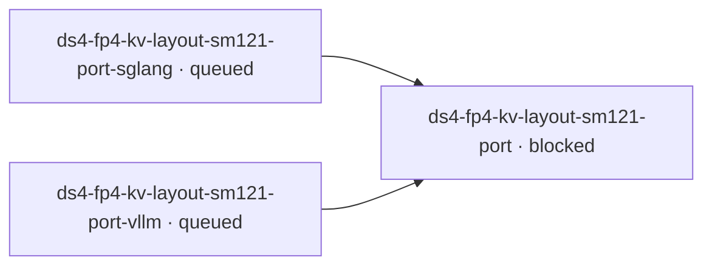

# Board
_Generated 2026-11-22 12:00 ET_

## In flight
| where | owner | what |
|---|---|---|
| census | read-only in tick — booted nothing, claimed nothing, stopped nothing, evicted nothing | read `2026-11-22T17:00:01Z`–`2026-11-22T17:00:03Z` (each node's own `date -u`) on the base census `2026-11-22T16:52:11Z`, **0 h 7 min 50 s** after it: **5 containers, 0 volumes** fleet-wide; **no research rank**; the fenced hosts hold running containers on `.31`, `.32`, `.33`, `.34`, excluded from research accounting; `/v1/models` **200**, `/health` **200** on `.31` |
| pool | — (nobody drives it; head units re-proved each tick) | head: `beegfs-mgmtd` **active** (Result success, NRestarts 0, **+0** on the base) · `beegfs-meta` **active** (Result success, NRestarts 0, **+0** on the base) · `beegfs-storage` **active** (Result success, NRestarts 0, **+0** on the base); worker unit states and the pool's through-mount reads are not part of this census |
| queue | register snapshot `2442fbcd…`; both blocks below rendered from it | `mad-science/queue.json` sha256 **`2442fbcdab4f968d236b2b20052778fe4ea78e3d0a2d51bd081b14b1aee9654c`** read locally: **228 tasks: 218 done, 6 queued, 4 blocked, 0 running — 10 open**; the head clone reads **`2442fbcd…`**, identical |
| window | **no manual lock** at this read | `.local/fleet-window.lock` is **absent** on the head (read `2026-11-22T17:00:04Z`) |
| campaign | `sparkrun-campaign` — active, no lease | head user unit `sparkrun-campaign` reads **`active`** / **`running`** (`MainPID` **3,930,275**, `NRestarts` **0**, **+0** on the base); the lease ledger holds **0 lease(s)** and fence(s) `tp-le2-20261120` |
| lease | **1 fence(s), 0 lease(s)** | the head's repo ledger `.local/fleet-leases.json` (389 B, sha **`ec09509d…`**, mtime **`2026-11-21 03:04:12.907935197 -0500`** local) holds fence **`tp-le2-20261120`** on `.31`, `.32`, `.33`, `.34` (`fenced_at` `2026-11-20T07:25:27Z`, owner directive 2026-11-20: production serve protected, serve `58cddf1c62ba6578_b8865cad5863` / image `986795bcd7f4`) and **0 lease(s)** |
| publication | tick | fresh census (`2026-11-22T17:00:01Z`–`2026-11-22T17:00:03Z`) written to `2026-11-22T170000Z.json` and composed on the base census `2026-11-22T16:52:11Z`; the queue blocks are rendered from `mad-science/queue.json` sha **`2442fbcd…`**, and the landed rows from `git log --since=2026-11-22T16:52:11Z` |
| .30 | **nothing live (no reservation)** — idle | `2026-11-22T17:00:01Z` (`spark-41e1`): `docker ps -aq` **1**, running **0**, volumes **0**, `:8000` listeners **0** root **1,219,341,197,312 B avail** (-102,559,744, fell) · **2,607,689,621,504 B used** (+102,559,744, rose) boot **`2026-11-19T20:06:40Z`** (`btime`), `uptime` **248,001 s** `MemTotal` **127,598,704 kB** (+0), `MemAvailable` **122,132,920 kB** (+78,780), `Cached` **7,705,696 kB** (+100,980), `AnonPages` **981,204 kB** (-82,048) ring **256** events all-types (+0), **0** in-window lifecycle and **0** in-window `exec`, oldest `2026-11-22T11:23:40.626769558-05:00 container start 049f5ed6`, newest `2026-11-22T11:51:05.985082629-05:00 container die ee1f4311be` |
| .31 | **fenced serve** — excluded from the research census | `2026-11-22T17:00:01Z` (`spark-d325`): `docker ps -aq` **1**, running **1**, volumes **0**, `:8000` listeners **2**, `/v1/models` **200**, `/health` **200** root **1,559,425,445,888 B avail** (-872,448, fell) · **2,267,605,372,928 B used** (+872,448, rose) boot **`2026-11-19T20:11:15Z`** (`btime`), `uptime` **247,726 s** `MemTotal` **127,598,700 kB** (+0), `MemAvailable` **9,056,800 kB** (-6,536), `Cached` **3,921,728 kB** (+2,072), `AnonPages` **6,373,088 kB** (+236) ring **256** events all-types (+0), **0** in-window lifecycle and **48** in-window `exec`, oldest `2026-11-22T11:17:45.640496801-05:00 container exec_start: ta`, newest `2026-11-22T11:59:45.704169874-05:00 container exec_die d9d79` |
| .32 | **fenced serve** — excluded from the research census | `2026-11-22T17:00:02Z` (`spark-ec1d`): `docker ps -aq` **1**, running **1**, volumes **0**, `:8000` listeners **0** root **1,625,059,934,208 B avail** (-786,432, fell) · **2,201,970,769,920 B used** (+786,432, rose) boot **`2026-11-19T20:14:21Z`** (`btime`), `uptime` **247,540 s** `MemTotal` **127,598,640 kB** (+0), `MemAvailable` **11,632,088 kB** (-36,420), `Cached` **9,516,972 kB** (+3,200), `AnonPages` **5,302,780 kB** (-180) ring **256** events all-types (+0), **0** in-window lifecycle and **48** in-window `exec`, oldest `2026-11-22T11:17:16.136817879-05:00 container exec_die 7641b`, newest `2026-11-22T11:59:46.139307429-05:00 container exec_die 7641b` |
| .33 | **fenced serve** — excluded from the research census | `2026-11-22T17:00:02Z` (`spark-3578`): `docker ps -aq` **1**, running **1**, volumes **0**, `:8000` listeners **0** root **1,521,635,258,368 B avail** (-782,336, fell) · **2,305,395,445,760 B used** (+782,336, rose) boot **`2026-11-19T20:12:55Z`** (`btime`), `uptime` **247,627 s** `MemTotal` **127,598,636 kB** (+0), `MemAvailable` **11,637,252 kB** (-67,680), `Cached` **8,760,364 kB** (+2,824), `AnonPages` **5,305,384 kB** (+5,052) ring **256** events all-types (+0), **0** in-window lifecycle and **48** in-window `exec`, oldest `2026-11-22T11:17:16.557175193-05:00 container exec_die d98d0`, newest `2026-11-22T11:59:46.558935214-05:00 container exec_die d98d0` |
| .34 | **fenced serve** — excluded from the research census | `2026-11-22T17:00:02Z` (`spark-324e`): `docker ps -aq` **1**, running **1**, volumes **0**, `:8000` listeners **0** root **1,107,027,718,144 B avail** (-778,240, fell) · **2,720,003,100,672 B used** (+778,240, rose) boot **`2026-11-19T20:09:04Z`** (`btime`), `uptime` **247,858 s** `MemTotal` **127,598,704 kB** (+0), `MemAvailable` **11,625,980 kB** (+5,664), `Cached` **9,529,012 kB** (+2,620), `AnonPages` **5,298,904 kB** (+4,228) ring **256** events all-types (+0), **0** in-window lifecycle and **48** in-window `exec`, oldest `2026-11-22T11:17:16.964419565-05:00 container exec_die ff75e`, newest `2026-11-22T11:59:46.929140913-05:00 container exec_die ff75e` |
| .35 | **nothing live (no reservation)** — idle | `2026-11-22T17:00:03Z` (`spark-383f`): `docker ps -aq` **0**, running **0**, volumes **0**, `:8000` listeners **0** root **1,041,805,254,656 B avail** (-679,936, fell) · **2,785,225,564,160 B used** (+679,936, rose) boot **`2026-11-19T20:07:56Z`** (`btime`), `uptime` **247,926 s** `MemTotal` **127,598,700 kB** (+0), `MemAvailable` **123,145,592 kB** (+18,556), `Cached` **5,629,068 kB** (+2,300), `AnonPages` **225,048 kB** (-1,572) ring **256** events all-types (+0), **0** in-window lifecycle and **0** in-window `exec`, oldest `2026-11-22T06:03:40.672336005-05:00 container exec_create: b`, newest `2026-11-22T06:20:39.466944765-05:00 container destroy 5a5f12` |

## Work Queue

| job | node cost | blockers | holds | status | summary |
|---|---|---|---|---|---|
| `ds4-fp4-kv-layout-sm121-port-vllm` — DS4 1017 SM121 vLLM: carry nvfp4_ds_mla through the SM12x sparse-MLA backend so fp4 KV is selectable | single | — | ds4-fp4-kv-layout-sm121-port | queued | Queued engine work: upstream vLLM already ships nvfp4_ds_mla at 352 B/token against fp8 packed 976; the gap is the SM120 sparse-MLA backend selecting it on GB10, patched in the fork overlay, then the parent TP4 boot. |
| `ds4-fp4-kv-layout-sm121-port-sglang` — DS4 1017 SM121 SGLang: port the V41_FP4 KV layout and the fp4 pool-sizing term so fp4 KV is admissible | single | — | ds4-fp4-kv-layout-sm121-port | queued | — CHECKPOINT 2026-11-22 (sglang-fp4-kv-port-20261122): the engine patch and local image are delivered and the STORE numerics are proven on one GB10; the READER cell is not proven, so the row stays queued. DELIVERED: recipes/ds4/patch_dsv41_fp… (full note: queue.json) |
| `beegfs-meta-restart-loop-non-meta-hosts` — beegfs-meta restart-loops every 5 s on .31-.35, and the loop hides a failed state behind "activating" | single | — | — | blocked | Blocked, owner 2026-11-22: the OOM drop-in Restart=on-failure loops beegfs-meta every 5 s on .31-.35 (NRestarts 3431, 956.6 MB journal) while is-active reads activating; remedy is masking the unit there, .30 untouched. |
| `hf-cache-20261110-docs-only-repin-bundle` — Docs-only model drift from the 2026-11-10 cache update: 22 recipe rows across 10 repos ride their lane’s next boot (no boot of its own) | — | — | — | queued | Queued: the docs-only drift bundle is 14 live rows (8 retired to attic), no live pin moved since the sweep, so each lane re-pins at its next boot - needs a live window, not a decision. |
| `campaign-leases-tp4-onto-30` — The campaign leases memory-heavy TP4 quartets onto .30, which the owner ruling excludes | quartet | — | — | queued | Lease ledger and holder/id claim identity landed offline (d0cf704, no live director-driven TP4 lease yet); .30 is waivable for a memory-heavy quartet only inside a declared window with the six guardrails, else refused. Row open. |
| `mem-guard-outlives-its-task` — A window arm's 6.0 GiB stop-rule guard outlives the arm, so the runner accumulates guards for tasks whose containers are gone | — | — | — | blocked | Blocked on a live boot: a leaked guard is a stale no-op (stops only its own task id), the harness kill and stub test are proven, and closing needs one real stop that leaves no guard process behind. |
| `fleet-boot-without-lease-record` — A four-rank boot serves with no lease in either ledger and no window lock | — | — | — | blocked | Blocked on a live window: the unleased quartet is the shipped production serve (digest and argv match), not a research boot, so the open question is whether a protected production boot must carry a lease under S9. |
| `inkling-tp4-first-boot` — Inkling-2-Small TP=4 first boot: nightly pull and the unproven sm_121 Triton path | quartet | — | — | queued | Inkling-2-Small TP4 first boot: nightly digest c17e9d88 is on no node so the boot includes the pull, and sm_121 runs the Hopper/Triton path (attention_sm90, Humming expert GEMMs) unproven here; needs an owner-declared window. |
| `weightless-dsgb10-tp4-boot-gate` — Boot the weightless-dsgb10 arm four-rank: the α=0 golden hash must equal stock bit-for-bit before any steered request is quoted | quartet | — | — | queued | Boot gate, weightless image: at α=0 output must be byte-identical to stock before any steered request is quoted, then a second-name request must project while a stock one keeps its text; four ranks, .31-.34 unfenced, --cluster WOPR. |
| `ds4-fp4-kv-layout-sm121-port` — DS4 1017 SM121: port the V41/V41_FP4 KV layout so fp4 KV is admissible — dtype is not a lever today, and sizing lies about fp4 | quartet | ds4-fp4-kv-layout-sm121-port-sglang, ds4-fp4-kv-layout-sm121-port-vllm | — | blocked | Blocked on engine work: fp4 KV needs the is_sm100 gate relaxed, the V41/V41_FP4 layout ported and an fp4 branch in the pool configurator, and nvfp4 is unsafe today because sizing has no fp4 term; it buys 2-4x tokens per GiB but no floor. |

## Completed Work
Window: commits since `2026-11-22T16:52:11Z` — the base census stamp, later than the 24 h start `2026-11-21T17:00:00Z`; older rows are not shown.

| time ET | commit | one clause |
|---|---|---|
| 11-22 11:52 | `ec253dcd` | Refresh the status board: a 2026-11-22T165211Z census |
| 11-22 11:54 | `442b7031` | Port the V4.1 KV layouts to SM121: gate, sizing, reader wiring |
| 11-22 11:55 | `8990a43e` | Give the board a durable timer, a gate, and the operator's title |
