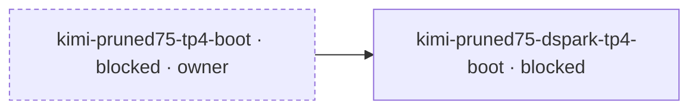

# Board — generated 2026-11-19 16:13 ET
## In flight

| where | owner | what |
|---|---|---|
| census | read-only in tick — booted nothing, claimed nothing, stopped nothing, evicted nothing | `2026-11-19T21:05:40Z`–`2026-11-19T21:05:42Z` on all six (each node's own `date -u`), **2 h 03 min 14 s** after the base's first node read (`2026-11-19T19:02:28Z`): **all six roots read 0 containers, 0 volumes and no `:8000` listener**, but the interval was not empty — the whole fleet power-cycled between `20:04Z` and `20:14Z` and a picom boot ran on `.31`–`.34` (both dated below); no serve anywhere at the read, so no `/v1/models` probe applies
| pool | — (nobody drives it; units and reads re-proved each tick) | **serving.** Head units mgmtd/meta/storage `active`, `Result=success`, `NRestarts` **0**; mount listed (`SOURCE=default`, `fstype beegfs` — the documented `findmnt -M` artifact); reads proved on the head, `df -B1` on mount `used`: **14,057,512,370,176 B**, avail **10,133,717,385,216 B** at `2026-11-19T21:05:43Z`, i.e. **−1,248,329,728 B** on base's `14,058,760,699,904 B` over **2 h 03 min 14 s**; **103** hub entries and `stat -L` on `models--deepseek-ai--DeepSeek-V4.1-Flash-1017/snapshots/*/config.json` **3311 B**
| queue | register snapshot `b6fe77a7…` both blocks below rendered from | `mad-science/queue.json` sha256 **`b6fe77a7…`** — unchanged since base and still equal the live file this tick rendered from; **201 tasks: 159 done, 34 queued, 8 blocked, 0 running — 42 open**; `task-queue.py check` prints **`ok: 201 task(s)`**
| window | **none — released `18:32Z`, re-proved this tick** | `.local/fleet-window.lock` **absent** in clone and on head; `.local/fleet-leases.json` **48 B, sha `34eed267…`**, byte-identical in both, body `{"fenced":[],"leases":[],"version":1}` — zero leases and zero fenced records now, the file's own mtime `20:46:32Z` being the picom boot's release; that boot's lease is named by the director's journal below, not by a live record here
| campaign | `h2h-20261107` — **unit live again since the reboot** | user unit `sparkrun-campaign` reads `ActiveState=active`/`SubState=running` since **`20:06:54Z`** (enabled, started with the boot), argv `serve --queue --hosts .30,.35 --root …/h2h-20261107 --max-parallel 1`, journal `queue: no runnable rows; polling every 30s`; one recursive glob over head's `/home/red/benchmarks/**/state.json` returns **49 paths → 9 files** by `(st_dev, st_ino)`, `arms` objects total **38 arms**, carrying **0 leases**; its journal observed manual leases `picom-env-wiring:manual:1795120720` on `.31`–`.34` at `20:38:51Z` and freed them `20:46:41Z`; arm `status` across those nine files: **16 measured, 14 blocked, 5 skipped, 3 failed — 0 pending, 0 queued, 0 running**, so the live director has nothing runnable to claim and `.30`/`.35` are advertised rather than taken |
| publication | tick | base = **`14:11 ET`** board, content sha256 **`a5c1b67b…`**, blob `daedefbb…`; composes `--base` that copy, `--expect-sha` and `--expect-remote-sha` both carry `a5c1b67b…`; the board blob `daedefbb…` is unchanged across `0b7adda`→`126d8ff` (`origin/main` moved one README line and no board byte); the reboot, the campaign's return, the picom boot and the by-name ssh failure are re-derived this tick, not carried, and both queue blocks render snapshot `b6fe77a7…`
| .30 | nothing live (no reservation) | `2026-11-19T21:05:40Z` (`spark-41e1`): `docker ps -aq` **0**, running **0**, volumes **0**, `:8000` listeners **0** nothing running root **1,453,344,329,728 B avail** (−235,126,784 base census) · **2,373,686,489,088 B used** `MemAvailable` **122,472,756 kB** (+1,600,300 base), `Cached` **1,439,948 kB** (−99,756,852), `AnonPages` **751,368 kB** (−618,940), `MemTotal` **127,598,704 kB** mgmtd **active** (success, 0) · meta **active** (success, 0) · storage **active** (success, 0) boot **2026-11-19 15:06:40 local** = **2026-11-19T20:06:40Z** (rebooted this interval), `uptime` **3,540 s**, `kho=off` **1**, CMA **0/0**, `nr_free_cma` **0**; kernel `7.0.0-1025-nvidia` |
| .31 | nothing live (no reservation) | `2026-11-19T21:05:41Z` (`spark-d325`): `docker ps -aq` **0**, running **0**, volumes **0**, `:8000` listeners **0** nothing running root **1,691,361,910,784 B avail** (+575,127,552 base census) · **2,135,668,908,032 B used** `MemAvailable` **123,324,600 kB** (+256,456 base), `Cached` **1,054,928 kB** (+192,596), `AnonPages` **142,156 kB** (−180,164), `MemTotal` **127,598,700 kB** mgmtd **inactive** (success, 0) · meta **activating** (exit-code, 623) · storage **active** (success, 0) boot **2026-11-19 15:11:15 local** = **2026-11-19T20:11:15Z** (rebooted this interval), `uptime` **3,266 s**, `kho=off` **1**, CMA **0/0**, `nr_free_cma` **0**; kernel `7.0.0-1025-nvidia` |
| .32 | nothing live (no reservation) | `2026-11-19T21:05:41Z` (`spark-ec1d`): `docker ps -aq` **0**, running **0**, volumes **0**, `:8000` listeners **0** nothing running root **1,752,332,763,136 B avail** (+650,330,112 base census) · **2,074,697,940,992 B used** `MemAvailable` **123,379,236 kB** (+336,492 base), `Cached` **413,576 kB** (−7,564), `AnonPages` **140,296 kB** (−99,036), `MemTotal` **127,598,640 kB** mgmtd **inactive** (success, 0) · meta **activating** (exit-code, 587) · storage **active** (success, 0) boot **2026-11-19 15:14:21 local** = **2026-11-19T20:14:21Z** (rebooted this interval), `uptime` **3,080 s**, `kho=off` **1**, CMA **0/0**, `nr_free_cma` **0**; kernel `7.0.0-1025-nvidia` |
| .33 | nothing live (no reservation) | `2026-11-19T21:05:41Z` (`spark-3578`): `docker ps -aq` **0**, running **0**, volumes **0**, `:8000` listeners **0** nothing running root **1,666,697,674,752 B avail** (+85,127,168 base census) · **2,160,333,029,376 B used** `MemAvailable` **123,328,108 kB** (+189,228 base), `Cached` **409,596 kB** (−8,312), `AnonPages` **138,492 kB** (−103,792), `MemTotal` **127,598,636 kB** mgmtd **inactive** (success, 0) · meta **activating** (exit-code, 604) · storage **active** (success, 0) boot **2026-11-19 15:12:55 local** = **2026-11-19T20:12:55Z** (rebooted this interval), `uptime` **3,166 s**, `kho=off` **1**, CMA **0/0**, `nr_free_cma` **0**; kernel `7.0.0-1025-nvidia` |
| .34 | nothing live (no reservation) | `2026-11-19T21:05:42Z` (`spark-324e`): `docker ps -aq` **0**, running **0**, volumes **0**, `:8000` listeners **0** nothing running root **1,141,433,643,008 B avail** (+57,393,152 base census) · **2,685,597,175,808 B used** `MemAvailable` **123,353,672 kB** (+201,920 base), `Cached` **414,288 kB** (+38,264), `AnonPages` **140,932 kB** (−92,956), `MemTotal` **127,598,704 kB** mgmtd **inactive** (success, 0) · meta **activating** (exit-code, 648) · storage **active** (success, 0) boot **2026-11-19 15:09:04 local** = **2026-11-19T20:09:04Z** (rebooted this interval), `uptime` **3,398 s**, `kho=off` **1**, CMA **0/0**, `nr_free_cma` **0**; kernel `7.0.0-1025-nvidia` |
| .35 | nothing live (no reservation) | `2026-11-19T21:05:42Z` (`spark-383f`): `docker ps -aq` **0**, running **0**, volumes **0**, `:8000` listeners **0** nothing running root **1,199,501,926,400 B avail** (+115,167,232 base census) · **2,627,528,892,416 B used** `MemAvailable` **123,431,504 kB** (+1,083,200 base), `Cached` **1,081,476 kB** (−111,523,036), `AnonPages` **164,168 kB** (−21,920), `MemTotal` **127,598,700 kB** mgmtd **inactive** (success, 0) · meta **activating** (exit-code, 661) · storage **active** (success, 0) boot **2026-11-19 15:07:56 local** = **2026-11-19T20:07:56Z** (rebooted this interval), `uptime` **3,466 s**, `kho=off` **1**, CMA **0/0**, `nr_free_cma` **0**; kernel `7.0.0-1025-nvidia` |

## Work queue

| job | node cost | holds | state |
|---|---|---|---|
| `campaign-does-not-honour-the-.30-exclusion` — The campaign places tp>=4 work on .30 regardless of the memory-risk exclusion: a leaseable row that needs .30 is a live risk, so placement must be a field the director refuses to violate | — | — | queued — MECHANISM LANDED OFFLINE 2026-11-11 (commits `aa54000`, `ebf5c8e`, `298098d`, `08ff156`; no live lease and no live six-node boot has run, so the row stays open). One ledger, `<repo>/.local/fleet-leases.json` (flock + atomic write), and one … (full note: queue.json) |
| `sm121-ladder-acceptsampling-dflash` — SM121 survey ladder dies in llama-benchy warm-up: dflash_utils.build_dflash_verify_target_probs missing | single | — | queued — DENSE: the ladder leg cannot run on dsv41-sm121-dg:0.2.1. llama-benchy's first warm-up request takes the adapter's AcceptSampling top-k branch and /opt/dsv41/adapter/block_verify.py:106 calls dflash_utils.build_dflash_verify_target_probs, w… (full note: queue.json) |
| `kimi-pruned75-tp4-boot` — Kimi-K3.1-Pro pruned75 MXFP4: boot and ladder at TP=4 | quartet | — | blocked — OWNER 2026-11-11 (#3/#2): the owner chose the six-machine route (S3a) and does NOT authorize another four-machine attempt, so the "RE-BLOCKED on placement" paragraph above is superseded in both of its halves: no four-rank retry is ordered, … (full note: queue.json) — evidence: `receipts/kimi-k3.1-pro-pruned75-mxfp4-vllm-tp4.json` |
| `beegfs-meta-restart-loop-non-meta-hosts` — beegfs-meta restart-loops every 5 s on .31-.35, and the loop hides a failed state behind "activating" | single | — | queued — Measured 2026-11-09 07:03-07:05 ET, and it is the side effect of the fix `beegfs-units-restart-no` (done) blessed: /etc/systemd/system/beegfs-meta.service.d/oom.conf (mtime 2026-11-08 16:03 on .30, 16:05 on .31) sets OOMScoreAdjust plus Res… (full note: queue.json) |
| `head-mesh-cannot-reach-30` — head's ssh cannot reach .30 by name: the alias fails host key verification while the node's own address answers | single | — | queued — Measured 2026-11-09 08:02-08:06 ET and re-probed 08:23:46 ET, read-only from the head: ssh to the .30 name fails 'Host key verification failed', while the same node answers 'ok spark-41e1' when addressed by its own address from the same hea… (full note: queue.json) |
| `hf-cache-20261110-docs-only-repin-bundle` — Docs-only model drift from the 2026-11-10 cache update: 22 recipe rows across 10 repos ride their lane’s next boot (no boot of its own) | — | — | queued — Classes measured with refresh-sweep report mode + Hub tree diff: only README/LICENSE/LICENSE-GLM-5.3-Flash/.eval_results/images files differ between the pin and the Hub head for orcarouter/Nex-N2.5-mini-Uncensored-NVFP4, orcarouter/Qwen3.8-… (full note: queue.json) |
| `hf-cache-20261110-orcacyber-new-quant` — OrcaCyber-Nano-1.0 head adds a Q8_0 DFlash2 GGUF: decide whether the new quant earns an arm (shipped arms unaffected) | single | — | queued — The 2026-11-10 sweep: orcarouter/OrcaCyber-Nano-1.0 head 97140f3ff7e2 adds OrcaCyber-Nano-1.0-AI-Defense-DFlash2-Q8_0.gguf (~2.05 GB, + README/.gitattributes) over pin 1af1635aa22b. The two shipped arms (recipes/cybersec/orcacyber-nano-1.0-… (full note: queue.json) |
| `lane-survey-edge0-audio8-tts` — Media-lane survey: Edge0/Audio8-TTS-Realistic-Air - 0.6B DualAR TTS + bundled codec, TP<4 so surveyed only | — | — | queued — License class: Apache-2.0, unrestricted - ships as a normal arm with no eval-only banner. Weights: 601,159,424 params BF16 in model.safetensors 1.20 GB plus a separate 44.1 kHz codec.pth 1.35 GB; repo 2.39 GiB. Architecture: model_type arkt… (full note: queue.json) |
| `lane-survey-viggle-viggle-remake` — Media-lane survey: Viggle/Viggle-Remake - MiniMax-H3 video-to-video pipeline (GGUF/int8 + ComfyUI node), TP<4 so surveyed only | — | — | queued — License class: community/restricted - license_name minimax-h3-community-license, base_model MiniMaxAI/MiniMax-H3; the media lane already ships MiniMax-H3 arms under the same family and any arm must carry that license note. Repo 167,573,265,… (full note: queue.json) |
| `lane-survey-webai-official-twil-8b` — Explore-lane survey: webAI-Official/TwIL-8B - 8.8B Granite-family reasoning model, TP<4 so surveyed only | — | — | queued — License class: RESTRICTED / NON-COMMERCIAL - card license_name webai-non-commercial-license-ver.-1.0 (LICENSE.md), so any future arm ships with the eval-only banner plus an explicit non-commercial note in the recipe description and the lane… (full note: queue.json) |
| `queue-mode-done-sibling-holds-canary-row` — Queue mode will not lease a row whose recipe a done sibling already holds | single | — | queued — Measured 2026-11-10 00:05-00:16 ET, read-only: arm3-control-cell-canary-line (registered 23:21 by df9d40b) is the register's first queued row carrying both recipe: and tp: (quartet, tp 4, recipes/ds4/deepseek-v4.1-flash-knapcio-tp4-1m-sglan… (full note: queue.json) — evidence: `mad-science/STATUS.md 2026-11-10 00:15 ET queue row; commit 52b99ef` |
| `campaign-leases-tp4-onto-30` — The campaign leases memory-heavy TP4 quartets onto .30, which the owner ruling excludes | — | — | queued — MECHANISM LANDED OFFLINE 2026-11-11 (commits `aa54000`, `ebf5c8e`, `298098d`, `08ff156`; no live lease and no live six-node boot has run, so the row stays open). One ledger, `<repo>/.local/fleet-leases.json` (flock + atomic write), and one … (full note: queue.json) |
| `campaign-state-copy-re-nests` — The director's receipts root copies state.json back into a window subdir, so one campaign now holds 40 nested copies | — | — | queued — Measured 2026-11-11 05:1x ET, read-only on the head: `h2h-20261107/state.json` and 40 byte-identical copies at `h2h-20261107/tp12-window/state.json`, `.../tp12-window/tp12-window/state.json` and so on, one level deeper per run under that wi… (full note: queue.json) |
| `hf-cache-20261110-cache-consistency-defects` — HF cache consistency defects: four repos hf ignores on a refs/main byte defect, one on a broken absolute symlink, plus 204 GB of stray non-cache trees in the hub root | single | — | queued — Measured 2026-11-10 with `hf cache ls --no-truncate --show-warnings` on .30 after the update loop finished a pass. (1) refs/main carries a trailing newline in models--lodestones--Kromoss (41 B; ref a4fe9744, snapshots 0c5417ec + a4fe9744), … (full note: queue.json) |
| `hf-cache-20261110-template-ab-ifm-k2` — K2-Horizon template/code drift A/B: head c4f92a0d (0.9B) and 240f2de3 (7B-FP8) vs the shipped pins, template identity + one fixed request | single | — | queued — Class (b) from the 2026-11-10 cache sweep: no weight file changed, but IFM/K2-Horizon-0.9B head moves 383cb66347be -> c4f92a0d66e2 changing chat_template.jinja AND modeling_k2_horizon.py and REMOVING chat_template_asst_tool_gen.jinja + chat… (full note: queue.json) |
| `kimi-superexpert-ref-probe` — Probe shashanth-27xA9 Kimi-K3.1-Pro-SuperExpert-12GB through the transformers reference route | single | — | blocked — OWNER 2026-11-11 (directive): parked until the production serve returns — see `mad-science/TODO.md` §"Settled questions" `## Owner directive 2026-11-11 — TP1/TP2 parked until production returns`; no state change and no unblocking. \| estimat… (full note: queue.json) — evidence: `receipts/zz-kimi-k3.1-pro-superexpert-24b-q4p-ref-vllm.json` |
| `mem-guard-outlives-its-task` — A window arm's 6.0 GiB stop-rule guard outlives the arm, so the runner accumulates guards for tasks whose containers are gone | single | — | queued — CORRECTED 2026-11-11: the premise that a leaked guard can stop a future boot is false. `mem-guard.sh` issues `sparkrun stop` only for the TID in its own argv, so a guard whose task is gone is a stale no-op and cannot touch the next boot. Wh… (full note: queue.json) |
| `pool-target-probe-beegfs-ctl-absent` — Pool storage-target byte accounting is unreachable: beegfs-ctl is absent from .30 though beegfs-utils 20:8.4.1 is installed | single | — | queued — Measured 2026-11-10 15:05:59Z and again 15:06:29Z on .30: beegfs-ctl exits 127 (command not found) as the red user, and no binary named beegfs-ctl exists under /usr, /opt or /sbin at depth <=5, although dpkg lists beegfs-utils 20:8.4.1 plus… (full note: queue.json) |
| `pool-window-invalid-cells` — Gate every boot on a pool half-probe: a cell written while beegfs was down is invalid, not weak | single | — | queued — Pre-registered 2026-11-08 13:22 ET. Invalid windows: 11:27:56-12:07:30 and at/after 12:57:32 (B still open, Restart=no); admissible middle 12:07:30-12:57:31. Acceptance: run-arm (and any lane's harness) probes … (full note: queue.json) |
| `hf-cache-20261110-pool-fetch-gaps` — Pool gaps left by the 2026-11-10 cache update: two Hub heads, two pinned revisions, three absent repos, one private repo needing an org token | single | — | queued — CENSUS 2026-11-11 (`.scratch/tp4-20261111/RECEIPT-boot-a-and-pool-census-20261111.md`): the ds4 1017 body's 'double-count' is now an artifact, named: two revisions share one index — `08c8657f` (a link farm) and `1bae0e10` (the in-body revis… (full note: queue.json) |
| `n35-unreferenced-image-gc` — Delete .35's 455.3 GB of unreferenced images and its 43 GB ComfyUI cache | single | — | queued — BATCH 2 RAN 2026-11-16T15:12:45Z AND DELETED NOTHING, and that does not close this row: its object is a deletion, so it stays 'queued' and the batch settles only what the 455.3 GB figure was. 44 images inspected on '.35' under the any-tree-… (full note: queue.json) |
| `board-publish-accepts-weaker-replacement` — publish replaces a better-grounded In-flight composition with a fresher byte-compatible one, and no guard notices | — | — | queued — The publish guards compare BYTES, so they cannot see that a replacement carried FEWER facts than the rows it removed. Measured 2026-11-11 20:18 ET on mad-science/STATUS.md: this tick's composition was accepted (publish rc=0, lint ok) while … (full note: queue.json) — evidence: `mad-science/STATUS.md@e4bea70` |
| `board-publish-keeps-in-flight-row-set` — A board published without one of the In-flight state rows passes every guard, because publish compares bytes and never the row set | single | — | queued — Measured 2026-11-11 03:17-03:25 ET. The 03:14 board (blob 2249062c) carried a `\| queue \|` row; the 03:17 board (commit `8e160b2`, blob 0f54622c) carried none, and a tick that composes on it and keeps the In flight body verbatim inherits the… (full note: queue.json) — evidence: `mad-science/STATUS.md at 8e160b2 / bc2cc38 / 9ae7cd4` |
| `cache-audit-pool-budget` — `tools/cache-audit.py --budget-gb`: add a pool mode that judges the one shared HF pool against 90 % of capacity | single | — | queued — `tools/cache-audit.py --budget-gb` still measures per node, but the HF cache is one shared pool: all six nodes report the same usage through the shared hub, so the audit flags the whole fleet at once and no node can be read as over- or unde… (full note: queue.json) |
| `executor-release-host-claim-on-failure` — An executor that stops observing a launch must release the sparkrun host claims it holds | single | — | queued — Measured 2026-11-08 04:09-04:13 ET: kimi-k3.1-pro-pruned75-mxfp4-dspark-vllm-tp4 attempt 1 launcher (pid 1883449) held .30-.33 while its own registry distribution failed at 414.7 s (637.1 MiB at 1.6 MiB/s from docker.io, then … (full note: queue.json) |
| `fleet-boot-without-lease-record` — A four-rank boot serves with no lease in either ledger and no window lock | — | — | queued — Measured 2026-11-11 19:15:59Z-19:31Z, read-only: task `b020d2dd178343a5_55dafcf24cde` runs one rank each on `.31`-`.34` (image `littlecedar/dgx-spark-dsv41:canary-roce-aff52fa5`, id `3f4480818acb`, `Up` and healthy, `/v1/models` 200 serving… (full note: queue.json) |
| `pool-content-fall-20261116` — Pool used fell 501 GB in 6.5 h while every repo entry stayed: name the deletion before the next budget claim | — | — | queued — Measured read-only from the head at 2026-11-16T19:07:40Z: df -B1 on /mnt/beegfs reads used 13,459,970,326,528 B, which is 501,316,845,568 B BELOW the 13,961,287,172,096 B the 06:39 board carried at 11:23:54Z. It is not HF content vanishing:… (full note: queue.json) |
| `ripple-65b-nvfp4-dflash2-tp1` — Ripple-65B Preview NVFP4 TP=1 + DFlash2 drafter: ladder + suite (zz- probe) | single | — | blocked — OWNER 2026-11-11 (directive): parked until the production serve returns — see `mad-science/TODO.md` §"Settled questions" `## Owner directive 2026-11-11 — TP1/TP2 parked until production returns`; no state change and no unblocking. \| The dra… (full note: queue.json) |
| `ripple-65b-nvfp4-tp1` — Ripple-65B Preview NVFP4 TP=1: first boot, ladder + suite (zz- probe) | single | — | blocked — OWNER 2026-11-11 (directive): parked until the production serve returns — see `mad-science/TODO.md` §"Settled questions" `## Owner directive 2026-11-11 — TP1/TP2 parked until production returns`; no state change and no unblocking. \| First b… (full note: queue.json) |
| `runtime-cache-stale-tree-gc` — Delete the stale runtime-cache trees the 2026-11-12 audit approved (732 GB planned, never executed) | single | — | queued — BATCH 1 EXECUTED 2026-11-16T16:33:28Z — 52 items / 554.54 GB deleted on '.30'-'.34' ('.30' 22.53, '.31' 96.38, '.32' 143.49, '.33' 143.68, '.34' 148.46 GB) and '.35' released 0.00 GB — receipt '.scratch/gc-20261116/census.md' rev 3 §Executi… (full note: queue.json) |
| `sparkrun-single-gid-index-for-two-hcas` — sparkrun injects one GID index across two HCAs whose tables disagree | — | — | queued — REPORT-ONLY IN THIS REPO (sparkrun-side defect; no `recipe`/`tp`, not bootable). One derived `NCCL_IB_GID_INDEX` applied to every HCA the probe names is wrong when the rails' GID tables disagree: `scripts/ib_detect.sh:44-45` derives the ind… (full note: queue.json) |
| `media-idol-3dgs-boot` — Idol single-image 3DGS trial: SDK on the tracked fixture, receipt = .ply 3DGS header + Gaussian count + wall, one node | single | — | blocked — Authored, not booted. TP=1 single-node script arm; a four-rank measurement is what needs a declared window and this is not one, so no lease applies. BLOCKER NAMED 2026-11-09 (owner answer `#81`): the facebook DINOv3 licence is not accepted … (full note: queue.json) — evidence: `head:~/benchmarks/tp1-20261112/idol-dinov3-gate-probe.log` |
| `campaign-ignores-declared-window` — The campaign leases and launches onto ranks another session has declared in .local/fleet-window.lock | — | — | queued — MECHANISM LANDED OFFLINE 2026-11-11 (commits `aa54000`, `ebf5c8e`, `298098d`, `08ff156`; no live lease and no live six-node boot has run, so the row stays open). One ledger, `<repo>/.local/fleet-leases.json` (flock + atomic write), and one … (full note: queue.json) |
| `kimi-pruned75-dspark-tp4-boot` — Kimi-K3.1-Pro pruned75 + DSpark k=5 drafter: boot, acceptance and ladder vs the plain arm | quartet | kimi-pruned75-tp4-boot | blocked — OWNER 2026-11-11 (#3/#2): the owner chose the six-machine route (S3a) and does NOT authorize another four-machine attempt, so no four-rank drafter boot is ordered either; any future rank on `.30` is legal only inside an explicitly declared … (full note: queue.json) — evidence: `receipts/kimi-k3.1-pro-pruned75-mxfp4-dspark-vllm-tp4.json` |
| `ripple-65b-bf16-tp2` — Ripple-65B Preview BF16 TP=2: quality control + the 1M-context cell (zz- probe) | pair | — | blocked — OWNER 2026-11-11 (directive): parked until the production serve returns — see `mad-science/TODO.md` §"Settled questions" `## Owner directive 2026-11-11 — TP1/TP2 parked until production returns`; no state change and no unblocking. \| The unq… (full note: queue.json) — evidence: `receipts/zz-ripple-65b-preview-bf16-tp2-vllm.json` |
| `webai-twil-8b-eval-only-arm` — Author and ship the webAI 8.8B eval-only arm (webAI-Official/TwIL-8B): recipe, license banner, lane README notice, index row | — | — | queued — Authoring work, no hardware yet and no recipe, so not machine-runnable. LICENSE (owner 2026-11-12: "Accept and ship it."): card `license_name: webai-non-commercial-license-ver.-1.0`, so the arm ships EVAL-ONLY under AGENTS.md §Recipes, with… (full note: queue.json) |
| `campaign-six-node-claim` — The director claims and leases a six-node tp 2 x pp 3 shape: the register cannot express six ranks, so the claim itself is the work | — | — | queued — MECHANISM LANDED OFFLINE 2026-11-11 (commits `aa54000`, `ebf5c8e`, `298098d`, `08ff156`; no live lease and no live six-node boot has run, so the row stays open). One ledger, `<repo>/.local/fleet-leases.json` (flock + atomic write), and one … (full note: queue.json) |
| `kimi-k31-indexer-block-vs-blhnc-layout` — Kimi K3.1 indexer needs 64-token kernel blocks; KDA/mamba forces a 5,760-token block and BLHNC | — | — | queued — AUTHORING 2026-11-11, estimate 4 h provisional. Engine-side blocker, not a memory one: the DeepSeek-V32 indexer needs 64-token kernel blocks, while the KDA/mamba alignment forces the KV manager block to 5,760 tokens (`interface.py:1115`, 'S… (full note: queue.json) — evidence: ``.scratch/kimi-six-engine-verdict-20261111.md`: the pinned image's engine `v0.33.0rc1.dev1016+g06129ab02` (boot6 rank-1 log), #66037 merged as `4088c283` 2026-11-09T04:31Z and absent from the pinned tree and from every release, GHCR tags ending at `2026110702` both resolving to the pinned digest, Docker Hub `eugr/spark-vllm` latest 2026-11-07, and the knob audit that leaves only the rebuild; the row stays queued on an image built from main ≥ `4088c283`` |
| `mech-cites-0-4-3` — Re-derive the remaining 117 recipes/MECHANICS.md citations against the installed sparkrun build | — | — | queued — d0d050f landed 27 moved anchors + 13 byte-identical controls for §The one rule and §Key reference §Format and identity, then stopped. Remaining 117 anchors still carry 0.4.2/0.4.0 numbering: the rest of §Key reference (from §Model and servi… (full note: queue.json) |
| `metrics-instrument-confound` — Metrics knob decomposition: one identical recipe, metrics-on vs metrics-off, name the performance-impacting knobs (`#68` ROM bar) | — | — | queued — Owner's `#68` authorises the decomposition that makes the comparability bar checkable, and it must separate THREE regimes, because only one of them can bias a cell: (1) `tools/run-arm.sh`'s scrape is a single exec AFTER the cell and before … (full note: queue.json) |
| `minimax-viggle-remake-eval-only-arm` — Author and ship the MiniMax video eval-only arm (Viggle/Viggle-Remake): ComfyUI node route, license banner, lane README notice, index row | — | — | queued — Authoring work, no hardware yet and no recipe, so not machine-runnable. LICENSE (owner 2026-11-12: "Accept and ship it."): card `license_name: minimax-h3-community-license`, base_model MiniMaxAI/MiniMax-H3 — community-restricted, so the arm… (full note: queue.json) |
| `ds4-fp4-kv-layout-sm121-port` — DS4 1017 SM121: port the V41/V41_FP4 KV layout so fp4 KV is admissible — dtype is not a lever today, and sizing lies about fp4 | quartet | — | blocked — RECIPE RETIRED 2026-11-18: the `zz-` arm this row booted is archived at `attic/ds4/zz-ds4-1017-sm121-indexer-scoring.yaml` (it was run or refused on record; see the lane attic index), so the row is no longer bootable. CORRECTION TO THE FP8-… (full note: queue.json) |

## Landed session

| time ET | commit | one clause |
|---|---|---|
| 10:26 | `ff25ad6` | Keep the address-hygiene gate green in the vision cell's usage line |
| 10:32 | `251e7ae` | Ship the long-context and vision cells as instruments, with their traps named |
| 11:05 | board refresh | census re-read `2026-11-19T16:04:03Z`–`2026-11-19T16:05:46Z` on the `10:15 ET` base, **61 min 5 s** after the base's node read (`2026-11-19T15:04:41Z`): the stalled quartet the base carried is **gone and replaced twice** — the base's `…_907303a0d0e8` left before every surviving ring (`.31` back to `2026-11-19T15:55:58Z`, `.32` `2026-11-19T15:55:24Z`, `.33`/`.34` `2026-11-19T15:54:59Z`), an intermediate `b020d2dd178343a5_7af57d7186e7` reached container-healthy **`15:58:54Z`** and was killed **`16:00:13Z`** (`die`+`destroy` `16:00:15Z`/`16:00:16Z`), and a third boot `b020d2dd178343a5_6a7e0d618bcc` is **loading** one rank each on `.31`–`.34` (`create`+`start` **`16:01:09Z`**, `Up` 2–4 minutes with health `starting`, serve child **170/218/212/212**, `:8000` closed, `/v1/models` **000**) while `.30`/`.35` stay at **0/0/0**; the window changed hands to `prefill-cudnn-20261119` (lock mtime `2026-11-19 10:34 ET`, one lease to `19:34:02Z`); the pool is re-proved by head units and six identical through-mount reads (**14,059,042,766,848 B**, **−1,551,892,480 B** on the base over **61 min 6 s**), **103** hub entries and `config.json` **3311 B**; nine campaign roots, 38 arms, **0 live leases**; queue register unchanged at b6fe77a7… (`ok: 201 task(s)`, 42 open) |
| 11:05 | board measurement | the replacement's two predecessors are dated by what survives: `…_7af57d7186e7` is observed only from **`15:57:43Z`** (health `unhealthy`), **`15:58:54Z`** (health `healthy`) and its `kill` **`16:00:13Z`** on `.31`, so its own `create`/`start` are **evicted, not absent** — bounded to `(2026-11-19T15:54:59Z, 15:57:43Z]` by the oldest entries `.33`/`.34` retain — and the base's `…_907303a0d0e8` teardown lies before every surviving ring, so it is left undated rather than claimed. All four rings hold **256** events; `.30` (oldest `2026-11-17T06:12:27Z`) and `.35` (`2026-11-12T05:50:09Z`) both predate the window, so their **0** in-window counts are measurements |
| 11:05 | board measurement | the loading quartet's page cache refilled to the same ~35–40 GB-per-rank shape the `09:38` boot showed: `Cached` **38,944,252 / 40,058,420 / 40,578,776 / 41,072,408 kB** on `.31`–`.34` with `AnonPages` **3,729,436–5,884,080 kB**, and `MemAvailable` 38,682,672 / 40,866,784 / 40,962,252 / 41,191,816 kB — moved **+30,911,228 / +34,034,900 / +32,941,368 / −81,749,812 kB** against the base, .34's fall being the only one of its own class because the base read it already empty after its engine died at `15:00:55Z`; `.30` moved **−43,684 kB** and `.35` **+24,076 kB** |
| 11:05 | board measurement | the base's boot left and two replacements ran inside this interval; the six roots moved net **+1,552,011,264 B** in avail (`.30` −5,603,328, `.31` −31,666,176, `.32` −31,760,384, `.33` −31,768,576, `.34` +1,675,214,848, `.35` −22,405,120 — `.34` the one that gained, **+1,675,214,848 B**) while the pool's `used` fell **−1,551,892,480 B**; nothing running outside the window explains the pool's fall (`Cached` on all four serving ranks is page cache of the boot's own weight load, not a deletion), so the roots-and-pool pair does **not** cancel this hour and the mover is **not identified** by this tick |
| 11:05 | board measurement | five one-shot containers on `.30` between **`15:27:16Z`** and **`15:30:04Z`** are **not sparkrun tasks**: docker's random names (`hopeful_elbakyan`, `cranky_blackburn`, `funny_banach`, `musing_hoover`, `inspiring_darwin`), each `create`+`start` within a second and `die`+`destroy` 5–23 s later, bracketing the interval before the window lock's own mtime (`2026-11-19 10:34 ET`) — no lease, lock or receipt line names them, so their issuer stays unidentified by this tick |
| 11:13 | board refresh | census re-read `2026-11-19T16:11:52Z`–`2026-11-19T16:11:54Z` on the peer's `11:09 ET` base, **0 h 07 min 49 s** after its first node read (`2026-11-19T16:04:03Z`): the replacement boot is **unchanged and still loading** — `b020d2dd178343a5_6a7e0d618bcc` (image `3f4480818acb`) `Up 10 minutes (health: starting)`, no `:8000` listener, rank 0 **000** at `16:11:55Z`, while every rank's engine log reached `Dummy health check server started … 0.0.0.0:80` **`16:12:35Z`** and `Waiting for application startup` **`16:12:36Z`**; `.30`/`.35` at **0/0/0**; the pool is re-proved on all six nodes (`used` **14,059,048,009,728 B** at `2026-11-19T16:11:52Z`–`2026-11-19T16:11:54Z`, **+5,242,880 B** on the base over **0 h 07 min 49 s**, and **14,059,053,252,608 B** on `.30` `2026-11-19T16:12:37Z` as a growing read); window and lease byte-identical |
| 11:13 | board correction | the four rank rows the previous composition carried are **not** serve-child counts: on the same containers in the same second the bare `pgrep -c -f sglang.launch_server` reads **2** and the bracketed `pgrep -c -f '[s]glang.launch_server'` reads **1** on all four ranks (`16:07:03Z`–`16:07:04Z` and again at the `16:11:52Z`–`16:11:54Z` read), because `pgrep -f` scans the `docker exec sh -c` wrapper's own argv — the earlier `170`/`218`/`212` figures exceed even the self-match and no process evidence supports them. The rows now publish `serve child alive` with the bracketed count |
| 11:13 | board measurement | headroom settled into the loading shape the `09:38` boot showed rather than the stalled one: `MemAvailable` **37,900,132 / 38,640,696 / 38,151,548 / 38,927,860 kB** on `.31`–`.34` with `Cached` **6,396,792 / 35,747,336 / 35,653,172 / 37,080,800 kB** (`.31` still refilling, `.32`–`.34` already at ~36 GB) and `AnonPages` **1,802,924 / 1,072,916 / 1,107,300 / 976,876 kB**; every rank is far above the 6.0 GiB (`6,291,456 kB`) stop-rule floor, and nothing was stopped by this tick |
| 11:22 | board refresh | census re-read `2026-11-19T16:21:08Z`–`2026-11-19T16:21:10Z` on the `11:13 ET` base, **0 h 09 min 16 s** after its first node read (`2026-11-19T16:11:52Z`): the boot the base carried loading now **serves** — `b020d2dd178343a5_6a7e0d618bcc` (image `3f4480818acb`), `StartedAt` **2026-11-19T16:01:09Z**, ready **`2026-11-19T16:12:48Z`** by rank 0's own `The server is fired up and ready to roll!` (**699 s** TTR), rank 0 `/v1/models` **200** and `/health` **000** at `16:21:12Z`, `.31` `Up 19 minutes (unhealthy)` against `.32`–`.34` `healthy`, all four serve children bracketed **1**; `.30`/`.35` at **0/0/0**; the pool is re-proved on all six nodes (`used` **14,059,067,408,384 B** on five at `2026-11-19T16:21:08Z`–`2026-11-19T16:21:10Z`, **+19,398,656 B** on the base over **0 h 09 min 16 s**); window and lease byte-identical |
| 11:22 | board measurement | the serve is **under live long-context load**, not merely ready: rank 0 logged **64** `completion` lines by `16:21:0xZ` and prefill batches at **`16:20:44Z`–`16:21:01Z`** carrying `#pending-token` **797,599** → **764,831**, i.e. a request chunking through the 16,384-token prefill path at ~3.6 k token/s while `.32`–`.34` log Engram layer work (`lookups` ~0.9 M, `hit_rate=100.0%`) |
| 11:22 | board correction | the previous cycle's row said **every** rank's engine log reached `Waiting for application startup`; the probe tails at `16:12:3x` showed it on `.31` only, with `.32`–`.34` still at the `Dummy health check server started … 0.0.0.0:80` line. Readiness is rank 0's own `The server is fired up and ready to roll!` at **`2026-11-19T16:12:48Z`**; the other ranks' logs are not a readiness witness on this arm |
| 11:22 | board measurement | headroom under that load: `MemAvailable` **10,083,084 / 11,154,452 / 11,595,356 / 11,706,412 kB** on `.31`–`.34` (**−27,817,048 / −27,486,244 / −26,556,192 / −27,221,448 kB** against the base's loading cells) with `AnonPages` **5,066,796 / 3,681,512 / 3,716,660 / 3,618,660 kB** and `Cached` **6,006,540 / 7,042,836 / 4,321,452 / 5,739,960 kB**; `.31` is the lowest rank at **3,791,628 kB above** the 6.0 GiB (`6,291,456 kB`) stop-rule floor, so the sampler would not fire on any of the four — state reading only, nothing stopped by this tick |
| 12:11 | board refresh | census re-read `2026-11-19T17:02:19Z`–`2026-11-19T17:02:23Z` on the `11:22 ET` base, **0 h 41 min 11 s** after its first node read (`2026-11-19T16:21:08Z`): the base's serving quartet `b020d2dd178343a5_6a7e0d618bcc` left before every surviving ring, so its stop is bounded to `(16:21:12Z, 16:51:58Z]` rather than dated; a picom/dsgb10 arm `58cddf1c62ba6578_816d0ad2fd50` (image `986795bcd7f4`) was the live boot at the read, `StartedAt` `17:01:01Z`, with `dsfront` listening on `.31:8000`; `.30`/`.35` at **0/0/0**; the pool is re-proved on all six (`used` 14,059,122,982,912 B identical on all six, **+55,574,528 B** on the base) and the register is unchanged (`b6fe77a7…`, 42 open) |
| 12:11 | board measurement | the window and its lease were **replaced** at `2026-11-19 11:35:58 ET` (`16:35:58Z`): `prefill-cudnn-20261119` → `final-ladder-20261119` (lock 255 B sha `80d1c4f1…`, lease 428 B sha `fab7b287…`, one lease on `.31`–`.34`, TTL 6 h expiring `22:35:58Z`), and the new lock declares `window-end=2026-11-19T08:00:00Z`, already past — `director status` prints it **STALE at its declared end**, which is the holder's to clear or re-declare; tick took no action on it |
| 12:11 | board measurement | the churn behind that read is dated by ring events on all four ranks: `58cddf1c62ba6578_cbfd22ed89fc` `kill` `17:00:34Z` (`die`/`destroy` `17:00:36Z`, its own `create`/`start` evicted → bounded `(16:51:58Z, 17:00:34Z]`); `58cddf1c62ba6578_816d0ad2fd50` `create`/`start` `17:01:01Z` and `kill` `17:03:10Z` (`die`/`destroy` `17:03:12Z`, **2 min 9 s** alive, and it answered: `dsfront` listening with `req 55`–`req 60` prefix-plan lines in its serve log); the replacement `b020d2dd178343a5_3bbc743576a1` (image `3f4480818acb`) `create`/`start` `17:04:12Z` and reading shard-load **35 %** at `17:06:17Z`. Rings hold **254/250/252/251** (.31–.34) with oldest `16:51:58Z`/`16:51:28Z`/`16:51:29Z`/`16:51:27Z`, and **256** on `.30`/`.35` with oldest `2026-11-17T06:12:27Z`/`2026-11-12T05:50:09Z`, so their **0** in-window counts are measurements |
| 12:11 | board measurement | roots moved net **−55,480,320 B** in avail across the six (`.30` −36,474,880, `.31` +49,209,344, `.32` −13,090,816, `.33` −13,094,912, `.34` −21,475,328, `.35` −20,553,728) while the pool's `used` **moved +55,574,528 B** in the opposite direction, so the roots-and-pool pair does not cancel this cycle and no mover is named by this tick |
| 12:11 | board measurement | headroom against the base follows the boot, not a leak: `MemAvailable` moved **+5,307,072 kB** on `31`, **+4,572,652 kB** on `32`, **+4,160,324 kB** on `33`, **+4,024,784 kB** on `34` and **+85,428 kB** on `.35`, while `.30` moved **−247,068 kB**; the four ranks hold `Cached` **1,789,596 / 1,353,704 / 1,357,912 / 1,335,420 kB** against the base's 6,006,540 / 7,042,836 / 4,321,452 / 5,739,960 kB, i.e. the new boot has not yet refilled page cache. Every serving rank reads **9,098,700 kB or more** above the 6.0 GiB (`6,291,456 kB`) stop-rule floor, so the sampler would not fire; state reading only, nothing stopped by this tick |
| 11:42 | `d623c35` | Record the cudnn MXFP8 route as inadmissible in `recipes/ds4/README.md`: same-window two-boot A/B against the shipped b12x boot gives pp2048 c1 **4,040.9 → 3,791.2** tok/s (−6.2 %), pp256k **+9.1 %**, pp998k **−21.5 %** (both rungs n=1 — direction, not magnitude) and greedy text **differs** at `temperature 0` (capture sha256 `5c6ba7cd…` → `b1941545…`) with 19/19 on both boots, so the verdict is "keep b12x" for correctness; receipts `~/benchmarks/prefill-cudnn-20261119/` |
| 12:14 | board refresh | census re-read `2026-11-19T17:07:00Z` on the peer's `12:11 ET` base, **0 h 04 min 41 s** after its first node read (`2026-11-19T17:02:19Z`): the picom boot the base carried live `58cddf1c62ba6578_816d0ad2fd50` was **killed `17:03:10Z`** and the window's next boot `b020d2dd178343a5_3bbc743576a1` (image `3f4480818acb`, `littlecedar/dgx-spark-dsv41:canary-roce-aff52fa5`) **loading** one rank each on `.31`–`.34` (`create` `17:04:11Z`, `start` `17:04:12Z`, `Up 4 minutes (health: starting)`, serve child bracketed **1**/bare **2**, no `:8000` listener, rank 0 **000** at `17:09:15Z`); shard load **48/48** then `Finished streaming dequant fp8 wo_a` **`17:07:07Z`–`17:07:21Z`**; `.30`/`.35` at **0/0/0**; pool re-proved on all six (`used` **14,058,781,671,424 B** at `2026-11-19T17:07:00Z`, **−341,311,488 B** on base) |
| 12:14 | board measurement | the picom boot's own start is dated by the ring: at the `17:03:49Z` read `.31` held **251** events with oldest `16:52:23Z` (an `exec_start` of `/opt/dsv41/boot.py health`, a probe of the boot that had already left), and the ring carried `…7b3fc726cfec` `kill` **`16:55:58Z`** (`die`/`destroy` `16:56:01Z`, its `create`/`start` evicted — bounded, not absent), then `…cbfd22ed89fc` `create`/`start` `16:56:41Z`/`16:56:42Z` and `kill` `17:00:34Z`, then `…816d0ad2fd50` `create`/`start` `17:01:01Z` and `kill` `17:03:10Z`. By `17:07:00Z` the ring had advanced to **255** events with its oldest at `17:04:12Z` — the current boot's own `start` — so the earlier history is evicted, not absent |
| 12:14 | board measurement | the picom arm's engine is **not** `sglang.launch_server`, so the bracketed probe is the wrong instrument for it: at `17:01:38Z` the `816d0ad2fd50` rank on `.31` listened on **`.31`:8000** and `127.0.0.1:8000` through a `dsfront` front end (`pid 2946242`), `/health` returned **200** and `/v1/models` **401** (auth enforced), `ps` showed no `sglang.launch_server`, and its serve log carried completed cells (`req 61`–`70`, `prompt 2048 (cached 0), completion 128`, ttft `0.391`–`3.852 s`, `9.1`–`24.2 tok/s`). A **0** from the bracketed pattern on this arm means a dead serve only after the front end is also gone |
| 12:14 | board measurement | roots and the pool nearly cancel this interval: avail moved net **+341,262,336 B** across six roots (`.30` −1,236,992, `.31` −974,848, `.32` −860,160, `.33` −851,968, `.34` +273,248,256, `.35` +71,938,048) while the pool's `used` moved **−341,311,488 B** — the two differ by **49,152 B** with opposite signs, so this interval's movers are consistent with the ladder's own per-boot weight traffic; that reading is **LIKELY**, not proved, since nothing ties an inode to the pair and the base read the pool **−524,288 B** higher again mid-tick at `17:01:38Z` |
| 12:14 | board measurement | headroom reset with the teardown: `MemAvailable` **40,108,816 / 40,958,784 / 41,048,612 / 40,809,976 kB** on `.31`–`.34` (**+24,718,660 / +25,231,680 / +25,292,932 / +25,078,780 kB** against the base's picom cells) with `Cached` back to ~40 GB per rank — the page cache of the new boot's own shard load; every rank is far above the 6.0 GiB stop-rule floor and nothing was stopped by this tick |
| 12:27 | board correction | the `12:14 ET` composition's `.32`–`.34` rows each claimed `shard load **48/48**` on `17:07:0xZ`; only `.31`'s own log showed it (its log reading `96%`→`100% Completed 48/48`), while `.32`–`.34` were captured as a **three-line tail** ending at `Finished streaming dequant fp8 wo_a` — that tail cannot falsify the line but it also never showed it, so the claim was **one rank's observation repeated four times**. Those containers were torn down at `17:15:46Z` and their logs are gone, so the `.32`–`.34` shard progress stays unverified rather than retro-proved; this composition asserts shard progress only per rank, from that rank's own `LOG` fields |
| 12:27 | board refresh | census re-read `2026-11-19T17:22:49Z` on the `12:14 ET` base, **0 h 15 min 49 s** after its first node read (`2026-11-19T17:07:00Z`): **all six roots read 0 containers** — the base's loading boot `b020d2dd178343a5_3bbc743576a1` (image `3f4480818acb`) ran **`17:04:12Z`→ killed `17:15:46Z`** (**11 min 34 s**, `die`/`destroy` `17:15:48Z`) and the next boot `b020d2dd178343a5_d13d6d59090d` `create`/`start` **`17:23:36Z`/`17:23:37Z`**, i.e. **47 s after** the census, `Up 27 seconds (health: starting)` at `17:24:04Z`; so the tick caught a between-boots gap rather than a stalled window |
| 12:27 | board measurement | the teardown released the boot's memory back: `MemAvailable` **122,839,972 / 122,989,256 / 122,996,080 / 122,964,032 kB** on `.31`–`.34` (**+82,731,156 / +82,030,472 / +81,947,468 / +82,154,056 kB** against the base) with `Cached` fallen to **17,158,420 / 13,966,228 / 13,222,656 / 13,671,320 kB** and `AnonPages` to **338,820 / 254,532 / 261,916 / 251,392 kB** — the engine's page cache went with the container, and nothing was stopped by this tick |
| 12:27 | board measurement | roots and the pool still cancel across the boot boundary: avail moved net **−50,348,032 B** across six roots (`.30` −692,224, `.31` −9,949,184, `.32` −18,345,984, `.33` −18,341,888, `.34` −1,560,576, `.35` −1,458,176) while the pool's `used` moved **+50,331,648 B**, a difference of **16,384 B** with opposite signs — consistent with the ladder's own per-boot weight traffic; **LIKELY**, not proved, since nothing ties an inode to the pair |
| 12:58 | `accafb1` | Record the final ladder window: six boots `E, K, L, L, K, E` on `benchmarks/concurrency-ladder.yaml` (pp 2048, tg 128, c 1/2/5/10, 5 runs/cell), gate 2 **stays open** — the C5 lossy lead **6.87 %** sits under the exact pair's own boot-to-boot spread **7.27 %**, while C10's **5.92 %** clears **1.46 %**, so the arm ships without a throughput claim; MATCHED cell table (`picom exact` / `picom lossy` / `knapcio`) in `recipes/ds4/README.md` + `MATCHED-BENCHMARK.md`, receipts `~/benchmarks/final-ladder-20261119/` |
| 13:00 | board refresh | census re-read `2026-11-19T18:01:36Z`–`2026-11-19T18:01:39Z` on the `12:27 ET` base, **0 h 38 min 47 s** after its first node read (`2026-11-19T17:22:49Z`): the base's loading boot `b020d2dd178343a5_d13d6d59090d` served **`17:41:52Z`** and was torn down **`17:46:35Z`**, E2 `58cddf1c62ba6578_b4cf43815a3e` ran **`17:46:52Z`→`17:51:13Z`**, and the window released **`17:53Z`**, so **all six roots read 0 containers** with no claim behind it, not a between-boots gap; pool re-proved on all six (`used` 14,058,891,247,616 B on `.30`–`.32` / 14,058,891,771,904 B on `.33`–`.35`, **+110,100,480 / +109,576,192 B** on base), register unchanged (`b6fe77a7…`, 42 open), and `a05a6e0` landed the evening close-out in `mad-science/SESSION-RECORD.md` |
| 13:00 | board measurement | both boots inside the interval finished on their own ladder rather than being stopped by anything: K2's readiness was **698.979 s** to port and **712.232 s** to HTTP with `ladder_rc=0` and `retry=[2]`, E2's **26.216 / 26.237 s** with `ladder_rc=0` and `retry=[1]`, and each boot's `post-teardown.txt` reads 0 containers, 0 volumes and no `:8000` listener on `.30`–`.35` — the fleet is empty because the holder stopped it by literal task id, and this tick stopped nothing |
| 13:00 | board measurement | headroom sits at the idle shape the teardown left: `MemAvailable` **120,884,408 / 122,988,664 / 123,048,868 / 123,062,304 / 123,119,332 / 122,325,372 kB** on `.30`–`.35` (**−21,660 / +148,692 / +59,612 / +66,224 / +155,300 / +7,176 kB** against the base) with `Cached` **101,238,772 / 819,324 / 377,296 / 371,700 / 381,236 / 112,584,672 kB** — the four ranks the window ran on keep only a few hundred MB of page cache after the E2 teardown, and `AnonPages` is back to **1,344,676 / 342,024 / 262,880 / 262,884 / 256,896 / 220,428 kB** |
| 13:00 | board measurement | roots fell net **−59,506,688 B** in avail across the six (`.30` −3,244,032, `.31` −21,762,048, `.32` −4,718,592, `.33` −4,702,208, `.34` −13,103,104, `.35` −11,976,704) while the pool's `used` rose **+109,576,192 / +110,100,480 B**, so the pair does not cancel this interval and its movers are **not identified** by this tick |
| 13:10 | board refresh | census re-read `2026-11-19T18:09:16Z`–`2026-11-19T18:09:19Z` on the peer's `13:07 ET` base, **0 h 07 min 40 s** after its first node read (`2026-11-19T18:01:36Z`): all six roots **0 containers, 0 volumes, no `:8000` listener**, and no window, lease or campaign claim — the fleet has stayed dark since the window released at `17:53:56Z`; roots moved net **+41,734,144 B** in avail (`.30` -1,470,464, `.31` -745,472, `.32` -9,113,600, `.33` -9,117,696, `.34` +62,914,560, `.35` -733,184) and the pool's `used` **fell 41,418,752 B** against the base's lower read — both sides *freeing* space (roots gained avail, pool used fell), magnitudes **315,392 B** apart, so no single transfer explains the pair and no mover is named by this tick |
| 13:10 | board correction | the base's `.31` cell reads the `.31`–`.34` rings as **256** events with oldest **`17:47:18Z`** and concludes K2's `create`/`kill` are evicted there; **`.31`'s own ring** read **33 s earlier** at `18:01:03Z` held **253** events with oldest **`17:34:43Z`** — an `exec_die` of `sparkrun_b020d2dd178343a5_d13d6d59090d_node_0`'s `boot.py health` probe — and **178** events for that container name including its `kill`/`die`/`destroy` at `17:46:27Z`/`17:46:30Z`. A bounded ring cannot hold 256 then 253, so the two reads cannot both describe `.31` at those instants; this tick reports what it read and leaves the base's figure unattributed rather than reconciled |
| 13:16 | board correction | the `13:07 ET` board's `campaign` cell named **37 arms** and cited **21 paths → 9 files**; neither came from this tick's own scan. The register's `state.json` set sums **38 arms** (7 + 1 + 1 + 1 + 24 + 1 + 1 + 1 + 1) — the figure the `12:27 ET` board already carried — and the path count **21** belonged to the `11:05 ET` cycle's `find -maxdepth 8`: this tick's recursive `**/state.json` glob returns **49 paths → 9 files** by `(st_dev, st_ino)`. One scan's count published as another's |
| 13:16 | board correction | the peer's correction above leaves the `256` vs `253` ring reads unattributed; the cause is on this tick's side. `.31`'s count came from `docker events … \| wc -l` (**256**, the ring's true size) but the **`17:47:18Z` "oldest"** line was the **first of a `tail -n 45`**, i.e. the oldest of the last 45 events, not the ring's oldest. The ring at `18:01:03Z` holding `253` with oldest `17:34:43Z` is the correct reading, and the two figures are the same ring 33 s and 44 events apart — not two readings that cannot both be true. The K2 container's `kill`/`die`/`destroy` (`17:46:27Z`/`17:46:30Z`) were therefore **in** the ring, and the `13:07 ET` claim that they were evicted is withdrawn |
| 13:16 | board measurement | the pool's `used` does not move monotonically while the fleet idles: three reads in 9 min give **14,058,891,247,616 B** at `18:01:38Z` (the `13:07 ET` board), **14,058,910,121,984 B** at `18:03:40Z` (this tick's first read), **14,058,849,828,864 B** at `18:09:19Z` (the `13:10 ET` board) and **14,058,851,401,728 B** at `2026-11-19T18:12:21Z` — a **+18,874,368 B** rise then a **−60,292,352 B** fall, with 0 containers on all six at every read, so the writer is host-side or off-fleet and no single interval's delta is a leak; the roots moved net **−1,740,800 B** against the `13:10 ET` base |
| 14:05 | board refresh | census re-read `2026-11-19T19:01:03Z`–`2026-11-19T19:01:06Z` on the peer's `13:16 ET` base, **0 h 48 min 42 s** after its first node read (`2026-11-19T18:12:21Z`): **all six roots read 0 containers, 0 volumes, no `:8000` listener** and no claim on any node — but the interval was **not empty**: a declared picom window `cheap-cells-20261119` ran `.31`–`.34` and completed inside it (next row), so the idle reads are a released window rather than an absence of work; pool re-proved on all six (`used` **14,058,810,507,264 B** identical on all six, **-40,894,464 B** on base), register unchanged (`b6fe77a7…`, 201 tasks / 42 open), campaign `inactive` with 0 leases |
| 14:05 | board measurement | the interval's boot is dated by the rings on `.31`–`.34`, all four agreeing: `sparkrun_58cddf1c62ba6578_138e3611a0f9` (task `58cddf1c62ba6578_138e3611a0f9`) `create` **`2026-11-19T18:19:44Z`**, `start` **`18:19:45Z`**, `kill` **`18:31:53Z`** and `die`/`destroy` **`18:31:53Z`** — **12 min 9 s** alive, i.e. after the `final-ladder` release and before this read, so the rings rule out a stalled run and the tick stopped nothing |
| 14:05 | board measurement | that boot's own receipt attributes it and shows it was claimed: `~/benchmarks/cheap-cells-20261119/` (last write `13:32 ET` = `18:32Z`, `task-id.txt` carries the same id) names the shipped picom arm `recipes/ds4/deepseek-v4.1-flash-1017-picom-tp4-1m.yaml` at pin `ghcr.io/littlecedar/dgx-picom-ds41f@sha256:1e529c67…` on `.31`–`.34`, and its README records a lease `cheap-cells-20261119` on those ranks **released 18:32Z** and a window lock written before the boot and deleted after — matching the ledger's return to `{"fenced":[],"leases":[],"version":1}` (file mtime `18:32Z`) and the lock's absence; TTR **27.047 s** to HTTP |
| 14:05 | board measurement | roots and the pool nearly cancel this interval: avail moved net **+41,111,552 B** across the six (`.30` -2,777,088, `.31` -13,004,800, `.32` +49,795,072, `.33` +49,725,440, `.34` -12,959,744, `.35` -29,667,328) while the pool's `used` moved **-40,894,464 B**, the two differ by **217,088 B** with opposite signs; with the picom boot's weight load and teardown inside the interval that is consistent with the arm's own churn, but nothing ties an inode to the pair, so the mover is **LIKELY**, not proved |
| 14:05 | board measurement | headroom is back at the idle shape the teardown left, and `Cached` on the four ranks the window used is a few hundred MB: `MemAvailable` **120,927,504**, **123,008,704**, **123,074,400**, **123,118,152**, **123,154,044**, **122,329,176** kB on `.30`–`.35` (+86,404, +86,092, +67,668, +53,408, +82,996, +19,900 kB against base) with `Cached` **101,245,676**, **861,164**, **420,120**, **417,016**, **375,348**, **112,604,140** kB; every rank is far above the 6.0 GiB (`6,291,456 kB`) stop-rule floor and nothing was stopped by this tick |
| 14:11 | `1cfce76` | Report ms/step over the decode window it shares with `decode_s`: `tools/longctx-cell.py` 1.3 makes `ms_per_step` `decode_s` over its own gaps so `decode_steps × ms_per_step` reproduces `decode_s` (the raw gap median stays `ms_per_step_gap_median`, 18.3 against 12.2 mean on the 2026-11-19 cold cell with 220 × 18.3 ms written beside 2.685 s), `--selftest` now drives a bursty SSE stub serve that fails when the window rate misses `decode_s` by more than one step, and `PICOM-VS-KNAPCIO.md` labels the 131,072 varied second cold cell 136.7 as a client integral rather than an engine line |
| 14:11 | `787fbf8` | Record the shipped-arm 40,000-token grant and the picom prefix-cache hit: 40,000 completion tokens ending on `finish_reason` length in 210.235 / 210.581 s (190.26 / 189.95 tok/s client, engine 190.4 / 190.1) with identical text sha256, receipt `head:~/benchmarks/cheap-cells-20261119/`, superseding the probe-era 192.4 tok/s figure; a verbatim repeated ~4.75k prefix reports `cached_tokens` 4752 against `reused` 0 cold at TTFT 0.0284 s vs 0.5706 s, so the all-zero readings were cache-defeating cells |
| 14:11 | `5d4c3b8` | Close the protocol's unmeasured list: the grant and shared-prefix cells land measured, and the long-context fan-out leg becomes deliberately out of scope because the SGLang arm wedges at 2–4 cold ~1M requests in flight, so 16-way fan-out would drive a failing path; admission and void rules unchanged |
| 14:11 | `020f4c9` | Ledger the two cheap cells in `mad-science/SESSION-RECORD.md`: grant and shared-prefix receipt and commit SHAs, the corrected `cached_tokens` claim, the `longctx-cell` instrument fix and one client-derived cell, fan-out left out of scope, and the picom long-context cells as engine-reported provenance |
| 14:11 | board refresh | census re-read `2026-11-19T19:02:28Z`–`2026-11-19T19:02:30Z` on the peer's `14:05 ET` base, **0 h 01 min 25 s** after its first node read (`2026-11-19T19:01:03Z`): all six roots still read **0 containers, 0 volumes and no `:8000` listener** with no new `create` behind them, so nothing was booted or stopped by this tick; pool re-proved on all six (`used` **14,058,760,699,904 B** identical there, **−49,807,360 B** on base) and the register is unchanged (`b6fe77a7…`, 42 open) with `task-queue.py check` ok |
| 14:11 | board measurement | the interval's space movement is one node's, not the fleet's: `.30`'s root gained **50,167,808 B** avail while the other five moved −106,496 / −110,592 / −110,592 / −118,784 / −114,688 B, and the pool's `used` fell **49,807,360 B** over the same **0 h 01 min 25 s** with 0 containers on every node at both reads — the two magnitudes differ by **360,448 B**, so a host-side shift on `.30` is **LIKELY** and nothing ties an inode to the pair, so the mover is not identified |
| 14:11 | board measurement | the non-meta hosts' `beegfs-meta` loop is still turning at one restart per ~5 s: `NRestarts` gained **16 / 17 / 16 / 17 / 17** on `.31`–`.35` across **85 s** (5.31 / 5.00 / 5.31 / 5.00 / 5.00 s per restart), every one of them left `activating` with `Result=exit-code`, and the head's own mgmtd/meta/storage stay `active`/`success`/0 — queue row `beegfs-meta-restart-loop-non-meta-hosts` is not closed by this reading |
| 14:21 | `cf02f47` | Correct the picom protocol's thinking and prefix-cache cells against pin `7c123ad4`: thinking is implemented (switches `server.rs:491-513`, off by default `main.rs:257-260`) and `cached_tokens` is reported (4752/4753 ids, TTFT 0.0284 s against 0.5706 s cold), so the old `PICOM-VS-KNAPCIO.md` claim that neither exists was false; run-history sentences trim to behaviour |
| 14:28 | `dab23e4` | Anchor every request-surface row of that protocol to pinned source or a receipt: launcher always passes `--max-tokens` (32,768 default, 262,144 shipped), `top_k`/`seed` cite `ops.h:92`/`config.h:8` and `sample.cu:167,344`, logprobs joins keys that are silently dropped, `model` is replaced rather than echoed |
| 14:41 | `2d6f015` | Measure picom's thinking channel on the shipped arm: non-empty `reasoning_content` (64 chars) and content (391 chars) with `reasoning_tokens` 19 at temperature 0, reasoning deltas preceding content deltas (0.026 s vs 0.244 s), controls emitting no reasoning key; receipt `head:~/benchmarks/picom-thinking-20261119/` |
| 14:41 | `926a15c` | Document the picom thinking switch as an operator knob — per-request `chat_template_kwargs.thinking` (plus `reasoning_effort`) or `PICOM_FRONT_ARGS=--thinking` for the whole serve, off by default — and that re-injected reasoning costs prompt bytes on later tool turns |
| 14:41 | `0ee92f6` | Record the picom thinking probe in `mad-science/SESSION-RECORD.md`: token counts, stream order, cache counters, the mock-engine shape check and the `PICOM_FRONT_ARGS`-to-argv proof named before the boot |
| 15:52 | `0b7adda` | Wire the picom fabric from sparkrun's RoCE detection instead of recipe literals: `recipes/ds4/mods/picom-launcher` derives each device's own `/24` and GID index from sysfs per node and the launcher reads back the rendered fleet file; booted on `.31`–`.34` with no fabric override, ring up **4.4 s**, one chat request answered (receipt `head:~/benchmarks/picom-fabric-derive-20261119/`) |
| 16:13 | board refresh | census re-read `2026-11-19T21:05:40Z`–`2026-11-19T21:05:42Z` on the `14:11 ET` base, **2 h 03 min 14 s** after its first node read (`2026-11-19T19:02:28Z`): **all six roots read 0 containers, 0 volumes and no `:8000` listener**, and the interval was **not** empty — the fleet power-cycled and a picom boot ran on `.31`–`.34`, both dated below; pool re-proved from the head (`used` 14,057,512,370,176 B, −1,248,329,728 B on base; 103 hub entries; `stat -L` 3311 B), register unchanged (`b6fe77a7…`, 201 tasks / 42 open), no window lock and an empty lease ledger |
| 16:13 | board measurement | the interval's dominant event is a clean fleet power-cycle: `apt -y full-upgrade` at `14:57:59` local on all six, then on `.31` `fwupdmgr refresh --force` / `fwupdmgr upgrade` / `/usr/sbin/reboot` at `14:58:5x` and `/usr/sbin/poweroff` at `15:04:18`, every node reaching `poweroff.target` (no crash, no `reboot.target`); `journalctl -k -b -1` OOM matches **0** on `.30`, kernel unchanged `7.0.0-1025-nvidia` on all six, `kho=off` **1** and CMA **0/0** after it, BIOS `5.36_0ACUM028` (2026-09-04) on `.30`/`.31` with no pre-cycle baseline in this tick, so a firmware byte change is **not established** — but every pre-cycle cell now sits on a different boot, so a cross-window comparison must say so |
| 16:13 | board measurement | the campaign came back with the reboot: `sparkrun-campaign` is enabled and `active`/`running` since `20:06:54Z`, serving `--queue --hosts .30,.35` over `h2h-20261107` and logging `queue: no runnable rows; polling every 30s`; its journal also observed a manual lease `picom-env-wiring:manual:1795120720` held on `.31`–`.34` from `20:38:51Z` and freed at `20:46:41Z`, which is how the picom boot below was claimed even though the ledger now reads empty |
| 16:13 | board measurement | the rings on `.31`–`.34` date that boot: a one-shot `ubuntu` container lived **0.27 s** at `20:31:29Z` (a host-side probe; no receipt names it), then image `986795bcd7f4` `create`/`start` **`20:43:51Z`**, `kill` **`20:46:02Z`**, `destroy` **`20:46:03Z`** — **2 min 11 s** — matching `~/benchmarks/picom-fabric-derive-20261119/` (`fleet.conf` + `engine-fabric.txt`, `ring up after 4.4 s`, written `20:45Z`) and the landed `0b7adda`; `.30` and `.35` rings are empty since their own dockerd start (`20:07:00Z`/`20:08:11Z`), so their 0 counts are measurements |
| 16:13 | board measurement | space moved on both planes in the same direction and nearly cancelled: root avail net **+1,248,018,432 B** across the six (.30 −235,126,784, .31 +575,127,552, .32 +650,330,112, .33 +85,127,168, .34 +57,393,152, .35 +115,167,232) while the pool's `used` moved **−1,248,329,728 B**, the two magnitudes **311,296 B** apart; with a fleet reboot and one picom boot's weight load inside the interval that is consistent with the boot's own churn, but nothing ties an inode to the pair, so the mover is **LIKELY**, not proved |
| 16:13 | board measurement | the head cannot reach **any** node by name, not only `.30`: `ssh spark-d325` and `ssh spark-383f` fail `Host key verification failed` while all six answer from the same head in the same second by address (`ok-spark-325`… by IP), and `/home/red/.ssh/known_hosts` holds **1** name entry but **3** IP entries per node — the by-name entries are stale, so this tick's census hops by IP; queue row `head-mesh-cannot-reach-30` therefore understates its scope (opened for `.30`, true for all six) |
| 16:13 | board measurement | the non-meta hosts' `beegfs-meta` loop survived the reboot with reset counters and the same rate: `NRestarts` **623 / 587 / 604 / 648** on `.31`–`.34` since their own dockerd start, i.e. one restart every **5.2 / 5.3 / 5.2 / 5.1 s**, every one left `activating` with `Result=exit-code`, while the head's mgmtd/meta/storage stay `active`/`success`/0 and the mount serves reads on all six — queue row `beegfs-meta-restart-loop-non-meta-hosts` is not closed by this reading |
| 16:23 | board correction | the `16:13` attribution row said `apt -y full-upgrade` at `14:57:59` local "on all six", but that second came from `.30`/`.31` alone; every node's own last `Start-Date` is **`14:57:58`–`14:58:02`** (`.32` `14:58:00`, `.33`/`.34` `14:57:58`, `.35` `14:58:02`) with the same `Commandline: apt -y full-upgrade`; the `poweroff.target` half is now read on the other four as well — `.32`–`.35` each show `Reached target poweroff.target` **2** times, `reboot.target` **0** and kernel-log OOM matches **0**
| 16:23 | board correction | "same kernel" is not "same platform": the same upgrade moved `libnvidia-container1` **1.20.1-1 → 1.20.2-1** (`/var/log/apt/history.log` on `.30`), which is the container runtime, and all six now read `driver=580.178.04`, `lnc=1.20.2-1`; no pre-cycle driver or runtime version was captured, so a cell measured before `20:04Z` and one after cross a runtime pin boundary whatever the kernel says
| 16:23 | board measurement | the live campaign's arm states are now on the board: **16 measured, 14 blocked, 5 skipped, 3 failed** across the nine `state.json` files, with **no** arm pending, queued or running, which is why the director logs `no runnable rows` — an `active` unit with an empty work list rather than a claim on `.31`–`.34`
