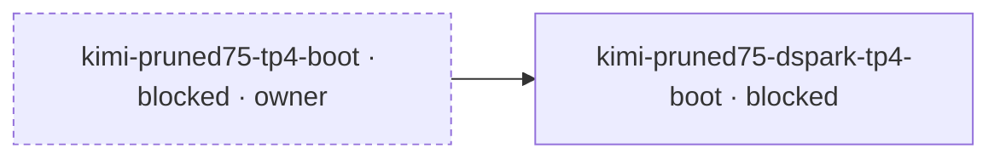

# Board — generated 2026-11-18 20:20 ET
## In flight
| where | owner | what |
|---|---|---|
| census | read-only in tick — booted nothing, claimed nothing, stopped nothing, evicted nothing | `2026-11-19T01:09:33Z`–`01:09:37Z` (head `date -u`, six hosts): the picom tp=4 launch `sparkrun_58cddf1c62ba6578_6dcd54690e18` holds `.31`–`.34`, `Up 22 minutes`, and **serves under live load** — `dsfront` bound on rank 0, `/v1/models` **200** with the image's key naming `deepseek-ai/DeepSeek-V4.1-Flash-1017` (`max_model_len` **1,048,576**), **952** completions in rank 0's log by `01:11Z` — while `.30`/`.35` read **0** containers, **0** volumes, **0** listeners. The engine is `dsgb10_rank`+`dsfront`, so the sglang/vllm serve-child patterns read **0** on every rank: an absent match, not a dead serve. |
| pool | — (nobody drives it; units and reads re-proved each tick) | **serving.** Head units mgmtd/meta/storage `active`, `Result=success`, `NRestarts` **0**; `findmnt -M /mnt/beegfs` prints `SOURCE default`/`FSTYPE beegfs`, so the mount is *listed*, and serving is proved by reads instead: mount `used` **14,060,912,377,856 B** at `01:11:16Z`, **+20,971,520 B** on the base's `01:05:35Z` read (`14,060,891,406,336 B`) and **+23,592,960 B** over this tick's own `01:02:18Z` read; **103** hub entries; `stat -L` on the ds4 arm's `config.json` **3,311 B** in both of its snapshots. |
| queue | register snapshot `0b28a919…` — both blocks below rendered from it | `mad-science/queue.json` sha256 **`0b28a919…`** — the snapshot the base and the previous tick both carried, re-checked live immediately before compose and **still matching**. **201 tasks: 159 done, 34 queued, 8 blocked, 0 running — 42 open**; `task-queue.py check` prints `ok: 201 task(s)`. |
| window | **`session:lossless-roce` holds ranks `.31`–`.34`, declared and leased** | **`session:lossless-roce` holds ranks `.31`–`.34`, declared and leased** — `.local/fleet-window.lock` **241 B, sha `d6d0a1bd…`**, byte-identical here and on the head: job `fabric-lossless-20261118 — PFC proof (.31) + lossless A/B E,K,L,L,K,E on .31-.34`, declared **`2026-11-18T22:09:43Z`**, expires **`2026-11-19T04:09:43Z`** — 2 h 58 min out — ranks `.31`–`.34`, `.30`/`.35` free. `.local/fleet-leases.json` **350 B, sha `b355b319…`** (same on both), one unfenced lease `fabric-lossless-20261118` whose `expires_at` **1795061383.11** resolves to the same instant; its `hosts` span all six while the lock bounds four ranks. The serving quartet sits inside the window, so the load above is the holder's. |
| campaign | `h2h-20261107` inactive, zero leases its own | `h2h-20261107` inactive, zero leases its own — user unit `sparkrun-campaign` reads `ActiveState=inactive`, `SubState=dead`; a non-hidden recursive scan under `/home/red/benchmarks` finds **49** `state.json` paths → **9** distinct files by `(st_dev, st_ino)` (quoted as the dedupe scan, not the hidden-inclusive one), carrying **38 arms** and **0 live leases** (each `lease.expires_at` parsed as a float epoch against wall clock), **0 string-valued**. The fleet's only live lease is the manual one in the row above. |
| publication | tick | base = **`20:11`** board, content sha256 **`baba6c56…`**, board blob **`6b8401fb`** identical to the clone's `HEAD` and to `origin/main` (`bd6a394`). `--expect-sha` and `--expect-remote-sha` both carry that content sha256, and `git fetch` ran before compose showed the peer publish that superseded the first base this tick had read. Both queue blocks render one snapshot (`0b28a919…`). |
| .30 | nothing live (no reservation) | `2026-11-19T01:09:33Z`: `docker ps -aq` **0**, running **0**, volumes **0**, `:8000` listeners **0** root **1,453,755,838,464 B avail** (-1,261,568 vs base census) · **2,373,274,980,352 B used** `MemAvailable` **120,995,120 kB** (-42,516 vs base) beegfs active/active/active; `NRestarts` mgmtd **0**, meta **0**/success boot **2026-11-11 20:02:53 local → 605,200 s up by `/proc/uptime`**; `kho=off` **1**, CMA **0/0**, `nr_free_cma` **0**; kernel `7.0.0-1025-nvidia` container events in window **0** (no container event in window), ring holds **197**, oldest **`2026-11-17T06:05:11Z`** |
| .31 | session:lossless-roce | `2026-11-19T01:09:34Z`: `docker ps -aq` **1**, running **1**, volumes **0**, `:8000` listeners **2** root **1,690,794,143,744 B avail** (-1,253,376 vs base census) · **2,136,236,675,072 B used** `MemAvailable` **15,273,824 kB** (-51,084 vs base) beegfs inactive/activating/active; `NRestarts` mgmtd **0**, meta **115950**/exit-code boot **2026-11-11 20:03:52 local → 605,142 s up by `/proc/uptime`**; `kho=off` **1**, CMA **0/0**, `nr_free_cma` **0**; kernel `7.0.0-1025-nvidia` container events in window **254** (**83** `exec_die`, **82** `exec_create`, **82** `exec_start`, **1** `kill`, **1** `die`, **1** `destroy`, **1** `create`, **1** `start`, **1** `extract-to-dir`, **1** `top`), ring holds **254**, oldest **`2026-11-19T00:42:17Z`** `sparkrun_58cddf1c62ba6578_6dcd54690e18_node_0` image `986795bcd7f4`, started **00:47:22Z** |
| .32 | session:lossless-roce | `2026-11-19T01:09:35Z`: `docker ps -aq` **1**, running **1**, volumes **0**, `:8000` listeners **0** root **1,751,678,681,088 B avail** (-696,320 vs base census) · **2,075,352,023,040 B used** `MemAvailable` **15,378,852 kB** (-316,240 vs base) beegfs inactive/activating/active; `NRestarts` mgmtd **0**, meta **115953**/exit-code boot **2026-11-11 20:02:52 local → 605,202 s up by `/proc/uptime`**; `kho=off` **1**, CMA **0/0**, `nr_free_cma` **0**; kernel `7.0.0-1025-nvidia` container events in window **254** (**83** `exec_die`, **82** `exec_create`, **82** `exec_start`, **1** `kill`, **1** `die`, **1** `destroy`, **1** `create`, **1** `start`, **1** `extract-to-dir`, **1** `top`), ring holds **254**, oldest **`2026-11-19T00:40:28Z`** `sparkrun_58cddf1c62ba6578_6dcd54690e18_node_1` image `986795bcd7f4`, started **00:47:22Z** |
| .33 | session:lossless-roce | `2026-11-19T01:09:36Z`: `docker ps -aq` **1**, running **1**, volumes **0**, `:8000` listeners **0** root **1,666,617,217,024 B avail** (-704,512 vs base census) · **2,160,413,487,104 B used** `MemAvailable` **15,479,736 kB** (-95,304 vs base) beegfs inactive/activating/active; `NRestarts` mgmtd **0**, meta **115954**/exit-code boot **2026-11-11 20:02:52 local → 605,203 s up by `/proc/uptime`**; `kho=off` **1**, CMA **0/0**, `nr_free_cma` **0**; kernel `7.0.0-1025-nvidia` container events in window **254** (**83** `exec_die`, **82** `exec_create`, **82** `exec_start`, **1** `kill`, **1** `die`, **1** `destroy`, **1** `create`, **1** `start`, **1** `extract-to-dir`, **1** `top`), ring holds **254**, oldest **`2026-11-19T00:40:29Z`** `sparkrun_58cddf1c62ba6578_6dcd54690e18_node_2` image `986795bcd7f4`, started **00:47:22Z** |
| .34 | session:lossless-roce | `2026-11-19T01:09:37Z`: `docker ps -aq` **1**, running **1**, volumes **0**, `:8000` listeners **0** root **1,138,958,860,288 B avail** (-17,473,536 vs base census) · **2,688,071,958,528 B used** `MemAvailable` **15,448,456 kB** (-157,404 vs base) beegfs inactive/activating/active; `NRestarts` mgmtd **0**, meta **115952**/exit-code boot **2026-11-11 20:02:51 local → 605,205 s up by `/proc/uptime`**; `kho=off` **1**, CMA **0/0**, `nr_free_cma` **0**; kernel `7.0.0-1025-nvidia` container events in window **254** (**83** `exec_die`, **82** `exec_create`, **82** `exec_start`, **1** `kill`, **1** `die`, **1** `destroy`, **1** `create`, **1** `start`, **1** `extract-to-dir`, **1** `top`), ring holds **254**, oldest **`2026-11-19T00:40:29Z`** `sparkrun_58cddf1c62ba6578_6dcd54690e18_node_3` image `986795bcd7f4`, started **00:47:22Z** |
| .35 | nothing live (no reservation) | `2026-11-19T01:09:37Z`: `docker ps -aq` **0**, running **0**, volumes **0**, `:8000` listeners **0** root **1,199,469,387,776 B avail** (-679,936 vs base census) · **2,627,561,431,040 B used** `MemAvailable` **122,344,084 kB** (+69,832 vs base) beegfs inactive/activating/active; `NRestarts` mgmtd **0**, meta **115932**/exit-code boot **2026-11-11 20:02:52 local → 605,205 s up by `/proc/uptime`**; `kho=off` **1**, CMA **0/0**, `nr_free_cma` **0**; kernel `7.0.0-1025-nvidia` container events in window **0** (no container event in window), ring holds **245**, oldest **`2026-11-12T05:50:09Z`** |
## Work queue

| job | node cost | holds | state |
|---|---|---|---|
| `campaign-does-not-honour-the-.30-exclusion` — The campaign places tp>=4 work on .30 regardless of the memory-risk exclusion: a leaseable row that needs .30 is a live risk, so placement must be a field the director refuses to violate | — | — | queued — MECHANISM LANDED OFFLINE 2026-11-11 (commits `aa54000`, `ebf5c8e`, `298098d`, `08ff156`; no live lease and no live six-node boot has run, so the row stays open). One ledger, `<repo>/.local/fleet-leases.json` (flock + atomic write), and one … (full note: queue.json) |
| `sm121-ladder-acceptsampling-dflash` — SM121 survey ladder dies in llama-benchy warm-up: dflash_utils.build_dflash_verify_target_probs missing | single | — | queued — DENSE: the ladder leg cannot run on dsv41-sm121-dg:0.2.1. llama-benchy's first warm-up request takes the adapter's AcceptSampling top-k branch and /opt/dsv41/adapter/block_verify.py:106 calls dflash_utils.build_dflash_verify_target_probs, w… (full note: queue.json) |
| `kimi-pruned75-tp4-boot` — Kimi-K3.1-Pro pruned75 MXFP4: boot and ladder at TP=4 | quartet | — | blocked — OWNER 2026-11-11 (#3/#2): the owner chose the six-machine route (S3a) and does NOT authorize another four-machine attempt, so the "RE-BLOCKED on placement" paragraph above is superseded in both of its halves: no four-rank retry is ordered, … (full note: queue.json) — evidence: `receipts/kimi-k3.1-pro-pruned75-mxfp4-vllm-tp4.json` |
| `beegfs-meta-restart-loop-non-meta-hosts` — beegfs-meta restart-loops every 5 s on .31-.35, and the loop hides a failed state behind "activating" | single | — | queued — Measured 2026-11-09 07:03-07:05 ET, and it is the side effect of the fix `beegfs-units-restart-no` (done) blessed: /etc/systemd/system/beegfs-meta.service.d/oom.conf (mtime 2026-11-08 16:03 on .30, 16:05 on .31) sets OOMScoreAdjust plus Res… (full note: queue.json) |
| `head-mesh-cannot-reach-30` — head's ssh cannot reach .30 by name: the alias fails host key verification while the node's own address answers | single | — | queued — Measured 2026-11-09 08:02-08:06 ET and re-probed 08:23:46 ET, read-only from the head: ssh to the .30 name fails 'Host key verification failed', while the same node answers 'ok spark-41e1' when addressed by its own address from the same hea… (full note: queue.json) |
| `hf-cache-20261110-docs-only-repin-bundle` — Docs-only model drift from the 2026-11-10 cache update: 22 recipe rows across 10 repos ride their lane’s next boot (no boot of its own) | — | — | queued — Classes measured with refresh-sweep report mode + Hub tree diff: only README/LICENSE/LICENSE-GLM-5.3-Flash/.eval_results/images files differ between the pin and the Hub head for orcarouter/Nex-N2.5-mini-Uncensored-NVFP4, orcarouter/Qwen3.8-… (full note: queue.json) |
| `hf-cache-20261110-orcacyber-new-quant` — OrcaCyber-Nano-1.0 head adds a Q8_0 DFlash2 GGUF: decide whether the new quant earns an arm (shipped arms unaffected) | single | — | queued — The 2026-11-10 sweep: orcarouter/OrcaCyber-Nano-1.0 head 97140f3ff7e2 adds OrcaCyber-Nano-1.0-AI-Defense-DFlash2-Q8_0.gguf (~2.05 GB, + README/.gitattributes) over pin 1af1635aa22b. The two shipped arms (recipes/cybersec/orcacyber-nano-1.0-… (full note: queue.json) |
| `lane-survey-edge0-audio8-tts` — Media-lane survey: Edge0/Audio8-TTS-Realistic-Air - 0.6B DualAR TTS + bundled codec, TP<4 so surveyed only | — | — | queued — License class: Apache-2.0, unrestricted - ships as a normal arm with no eval-only banner. Weights: 601,159,424 params BF16 in model.safetensors 1.20 GB plus a separate 44.1 kHz codec.pth 1.35 GB; repo 2.39 GiB. Architecture: model_type arkt… (full note: queue.json) |
| `lane-survey-viggle-viggle-remake` — Media-lane survey: Viggle/Viggle-Remake - MiniMax-H3 video-to-video pipeline (GGUF/int8 + ComfyUI node), TP<4 so surveyed only | — | — | queued — License class: community/restricted - license_name minimax-h3-community-license, base_model MiniMaxAI/MiniMax-H3; the media lane already ships MiniMax-H3 arms under the same family and any arm must carry that license note. Repo 167,573,265,… (full note: queue.json) |
| `lane-survey-webai-official-twil-8b` — Explore-lane survey: webAI-Official/TwIL-8B - 8.8B Granite-family reasoning model, TP<4 so surveyed only | — | — | queued — License class: RESTRICTED / NON-COMMERCIAL - card license_name webai-non-commercial-license-ver.-1.0 (LICENSE.md), so any future arm ships with the eval-only banner plus an explicit non-commercial note in the recipe description and the lane… (full note: queue.json) |
| `queue-mode-done-sibling-holds-canary-row` — Queue mode will not lease a row whose recipe a done sibling already holds | single | — | queued — Measured 2026-11-10 00:05-00:16 ET, read-only: arm3-control-cell-canary-line (registered 23:21 by df9d40b) is the register's first queued row carrying both recipe: and tp: (quartet, tp 4, recipes/ds4/deepseek-v4.1-flash-knapcio-tp4-1m-sglan… (full note: queue.json) — evidence: `mad-science/STATUS.md 2026-11-10 00:15 ET queue row; commit 52b99ef` |
| `campaign-leases-tp4-onto-30` — The campaign leases memory-heavy TP4 quartets onto .30, which the owner ruling excludes | — | — | queued — MECHANISM LANDED OFFLINE 2026-11-11 (commits `aa54000`, `ebf5c8e`, `298098d`, `08ff156`; no live lease and no live six-node boot has run, so the row stays open). One ledger, `<repo>/.local/fleet-leases.json` (flock + atomic write), and one … (full note: queue.json) |
| `campaign-state-copy-re-nests` — The director's receipts root copies state.json back into a window subdir, so one campaign now holds 40 nested copies | — | — | queued — Measured 2026-11-11 05:1x ET, read-only on the head: `h2h-20261107/state.json` and 40 byte-identical copies at `h2h-20261107/tp12-window/state.json`, `.../tp12-window/tp12-window/state.json` and so on, one level deeper per run under that wi… (full note: queue.json) |
| `hf-cache-20261110-cache-consistency-defects` — HF cache consistency defects: four repos hf ignores on a refs/main byte defect, one on a broken absolute symlink, plus 204 GB of stray non-cache trees in the hub root | single | — | queued — Measured 2026-11-10 with `hf cache ls --no-truncate --show-warnings` on .30 after the update loop finished a pass. (1) refs/main carries a trailing newline in models--lodestones--Kromoss (41 B; ref a4fe9744, snapshots 0c5417ec + a4fe9744), … (full note: queue.json) |
| `hf-cache-20261110-template-ab-ifm-k2` — K2-Horizon template/code drift A/B: head c4f92a0d (0.9B) and 240f2de3 (7B-FP8) vs the shipped pins, template identity + one fixed request | single | — | queued — Class (b) from the 2026-11-10 cache sweep: no weight file changed, but IFM/K2-Horizon-0.9B head moves 383cb66347be -> c4f92a0d66e2 changing chat_template.jinja AND modeling_k2_horizon.py and REMOVING chat_template_asst_tool_gen.jinja + chat… (full note: queue.json) |
| `kimi-superexpert-ref-probe` — Probe shashanth-27xA9 Kimi-K3.1-Pro-SuperExpert-12GB through the transformers reference route | single | — | blocked — OWNER 2026-11-11 (directive): parked until the production serve returns — see `mad-science/TODO.md` §"Settled questions" `## Owner directive 2026-11-11 — TP1/TP2 parked until production returns`; no state change and no unblocking. \| estimat… (full note: queue.json) — evidence: `receipts/zz-kimi-k3.1-pro-superexpert-24b-q4p-ref-vllm.json` |
| `mem-guard-outlives-its-task` — A window arm's 6.0 GiB stop-rule guard outlives the arm, so the runner accumulates guards for tasks whose containers are gone | single | — | queued — CORRECTED 2026-11-11: the premise that a leaked guard can stop a future boot is false. `mem-guard.sh` issues `sparkrun stop` only for the TID in its own argv, so a guard whose task is gone is a stale no-op and cannot touch the next boot. Wh… (full note: queue.json) |
| `pool-target-probe-beegfs-ctl-absent` — Pool storage-target byte accounting is unreachable: beegfs-ctl is absent from .30 though beegfs-utils 20:8.4.1 is installed | single | — | queued — Measured 2026-11-10 15:05:59Z and again 15:06:29Z on .30: beegfs-ctl exits 127 (command not found) as the red user, and no binary named beegfs-ctl exists under /usr, /opt or /sbin at depth <=5, although dpkg lists beegfs-utils 20:8.4.1 plus… (full note: queue.json) |
| `pool-window-invalid-cells` — Gate every boot on a pool half-probe: a cell written while beegfs was down is invalid, not weak | single | — | queued — Pre-registered 2026-11-08 13:22 ET. Invalid windows: 11:27:56-12:07:30 and at/after 12:57:32 (B still open, Restart=no); admissible middle 12:07:30-12:57:31. Acceptance: run-arm (and any lane's harness) probes … (full note: queue.json) |
| `hf-cache-20261110-pool-fetch-gaps` — Pool gaps left by the 2026-11-10 cache update: two Hub heads, two pinned revisions, three absent repos, one private repo needing an org token | single | — | queued — CENSUS 2026-11-11 (`.scratch/tp4-20261111/RECEIPT-boot-a-and-pool-census-20261111.md`): the ds4 1017 body's 'double-count' is now an artifact, named: two revisions share one index — `08c8657f` (a link farm) and `1bae0e10` (the in-body revis… (full note: queue.json) |
| `n35-unreferenced-image-gc` — Delete .35's 455.3 GB of unreferenced images and its 43 GB ComfyUI cache | single | — | queued — BATCH 2 RAN 2026-11-16T15:12:45Z AND DELETED NOTHING, and that does not close this row: its object is a deletion, so it stays 'queued' and the batch settles only what the 455.3 GB figure was. 44 images inspected on '.35' under the any-tree-… (full note: queue.json) |
| `board-publish-accepts-weaker-replacement` — publish replaces a better-grounded In-flight composition with a fresher byte-compatible one, and no guard notices | — | — | queued — The publish guards compare BYTES, so they cannot see that a replacement carried FEWER facts than the rows it removed. Measured 2026-11-11 20:18 ET on mad-science/STATUS.md: this tick's composition was accepted (publish rc=0, lint ok) while … (full note: queue.json) — evidence: `mad-science/STATUS.md@e4bea70` |
| `board-publish-keeps-in-flight-row-set` — A board published without one of the In-flight state rows passes every guard, because publish compares bytes and never the row set | single | — | queued — Measured 2026-11-11 03:17-03:25 ET. The 03:14 board (blob 2249062c) carried a `\| queue \|` row; the 03:17 board (commit `8e160b2`, blob 0f54622c) carried none, and a tick that composes on it and keeps the In flight body verbatim inherits the… (full note: queue.json) — evidence: `mad-science/STATUS.md at 8e160b2 / bc2cc38 / 9ae7cd4` |
| `cache-audit-pool-budget` — `tools/cache-audit.py --budget-gb`: add a pool mode that judges the one shared HF pool against 90 % of capacity | single | — | queued — `tools/cache-audit.py --budget-gb` still measures per node, but the HF cache is one shared pool: all six nodes report the same usage through the shared hub, so the audit flags the whole fleet at once and no node can be read as over- or unde… (full note: queue.json) |
| `executor-release-host-claim-on-failure` — An executor that stops observing a launch must release the sparkrun host claims it holds | single | — | queued — Measured 2026-11-08 04:09-04:13 ET: kimi-k3.1-pro-pruned75-mxfp4-dspark-vllm-tp4 attempt 1 launcher (pid 1883449) held .30-.33 while its own registry distribution failed at 414.7 s (637.1 MiB at 1.6 MiB/s from docker.io, then … (full note: queue.json) |
| `fleet-boot-without-lease-record` — A four-rank boot serves with no lease in either ledger and no window lock | — | — | queued — Measured 2026-11-11 19:15:59Z-19:31Z, read-only: task `b020d2dd178343a5_55dafcf24cde` runs one rank each on `.31`-`.34` (image `littlecedar/dgx-spark-dsv41:canary-roce-aff52fa5`, id `3f4480818acb`, `Up` and healthy, `/v1/models` 200 serving… (full note: queue.json) |
| `pool-content-fall-20261116` — Pool used fell 501 GB in 6.5 h while every repo entry stayed: name the deletion before the next budget claim | — | — | queued — Measured read-only from the head at 2026-11-16T19:07:40Z: df -B1 on /mnt/beegfs reads used 13,459,970,326,528 B, which is 501,316,845,568 B BELOW the 13,961,287,172,096 B the 06:39 board carried at 11:23:54Z. It is not HF content vanishing:… (full note: queue.json) |
| `ripple-65b-nvfp4-dflash2-tp1` — Ripple-65B Preview NVFP4 TP=1 + DFlash2 drafter: ladder + suite (zz- probe) | single | — | blocked — OWNER 2026-11-11 (directive): parked until the production serve returns — see `mad-science/TODO.md` §"Settled questions" `## Owner directive 2026-11-11 — TP1/TP2 parked until production returns`; no state change and no unblocking. \| The dra… (full note: queue.json) |
| `ripple-65b-nvfp4-tp1` — Ripple-65B Preview NVFP4 TP=1: first boot, ladder + suite (zz- probe) | single | — | blocked — OWNER 2026-11-11 (directive): parked until the production serve returns — see `mad-science/TODO.md` §"Settled questions" `## Owner directive 2026-11-11 — TP1/TP2 parked until production returns`; no state change and no unblocking. \| First b… (full note: queue.json) |
| `runtime-cache-stale-tree-gc` — Delete the stale runtime-cache trees the 2026-11-12 audit approved (732 GB planned, never executed) | single | — | queued — BATCH 1 EXECUTED 2026-11-16T16:33:28Z — 52 items / 554.54 GB deleted on '.30'-'.34' ('.30' 22.53, '.31' 96.38, '.32' 143.49, '.33' 143.68, '.34' 148.46 GB) and '.35' released 0.00 GB — receipt '.scratch/gc-20261116/census.md' rev 3 §Executi… (full note: queue.json) |
| `sparkrun-single-gid-index-for-two-hcas` — sparkrun injects one GID index across two HCAs whose tables disagree | — | — | queued — REPORT-ONLY IN THIS REPO (sparkrun-side defect; no `recipe`/`tp`, not bootable). One derived `NCCL_IB_GID_INDEX` applied to every HCA the probe names is wrong when the rails' GID tables disagree: `scripts/ib_detect.sh:44-45` derives the ind… (full note: queue.json) |
| `media-idol-3dgs-boot` — Idol single-image 3DGS trial: SDK on the tracked fixture, receipt = .ply 3DGS header + Gaussian count + wall, one node | single | — | blocked — Authored, not booted. TP=1 single-node script arm; a four-rank measurement is what needs a declared window and this is not one, so no lease applies. BLOCKER NAMED 2026-11-09 (owner answer `#81`): the facebook DINOv3 licence is not accepted … (full note: queue.json) — evidence: `head:~/benchmarks/tp1-20261112/idol-dinov3-gate-probe.log` |
| `campaign-ignores-declared-window` — The campaign leases and launches onto ranks another session has declared in .local/fleet-window.lock | — | — | queued — MECHANISM LANDED OFFLINE 2026-11-11 (commits `aa54000`, `ebf5c8e`, `298098d`, `08ff156`; no live lease and no live six-node boot has run, so the row stays open). One ledger, `<repo>/.local/fleet-leases.json` (flock + atomic write), and one … (full note: queue.json) |
| `kimi-pruned75-dspark-tp4-boot` — Kimi-K3.1-Pro pruned75 + DSpark k=5 drafter: boot, acceptance and ladder vs the plain arm | quartet | kimi-pruned75-tp4-boot | blocked — OWNER 2026-11-11 (#3/#2): the owner chose the six-machine route (S3a) and does NOT authorize another four-machine attempt, so no four-rank drafter boot is ordered either; any future rank on `.30` is legal only inside an explicitly declared … (full note: queue.json) — evidence: `receipts/kimi-k3.1-pro-pruned75-mxfp4-dspark-vllm-tp4.json` |
| `ripple-65b-bf16-tp2` — Ripple-65B Preview BF16 TP=2: quality control + the 1M-context cell (zz- probe) | pair | — | blocked — OWNER 2026-11-11 (directive): parked until the production serve returns — see `mad-science/TODO.md` §"Settled questions" `## Owner directive 2026-11-11 — TP1/TP2 parked until production returns`; no state change and no unblocking. \| The unq… (full note: queue.json) — evidence: `receipts/zz-ripple-65b-preview-bf16-tp2-vllm.json` |
| `webai-twil-8b-eval-only-arm` — Author and ship the webAI 8.8B eval-only arm (webAI-Official/TwIL-8B): recipe, license banner, lane README notice, index row | — | — | queued — Authoring work, no hardware yet and no recipe, so not machine-runnable. LICENSE (owner 2026-11-12: "Accept and ship it."): card `license_name: webai-non-commercial-license-ver.-1.0`, so the arm ships EVAL-ONLY under AGENTS.md §Recipes, with… (full note: queue.json) |
| `campaign-six-node-claim` — The director claims and leases a six-node tp 2 x pp 3 shape: the register cannot express six ranks, so the claim itself is the work | — | — | queued — MECHANISM LANDED OFFLINE 2026-11-11 (commits `aa54000`, `ebf5c8e`, `298098d`, `08ff156`; no live lease and no live six-node boot has run, so the row stays open). One ledger, `<repo>/.local/fleet-leases.json` (flock + atomic write), and one … (full note: queue.json) |
| `kimi-k31-indexer-block-vs-blhnc-layout` — Kimi K3.1 indexer needs 64-token kernel blocks; KDA/mamba forces a 5,760-token block and BLHNC | — | — | queued — AUTHORING 2026-11-11, estimate 4 h provisional. Engine-side blocker, not a memory one: the DeepSeek-V32 indexer needs 64-token kernel blocks, while the KDA/mamba alignment forces the KV manager block to 5,760 tokens (`interface.py:1115`, 'S… (full note: queue.json) — evidence: ``.scratch/kimi-six-engine-verdict-20261111.md`: the pinned image's engine `v0.33.0rc1.dev1016+g06129ab02` (boot6 rank-1 log), #66037 merged as `4088c283` 2026-11-09T04:31Z and absent from the pinned tree and from every release, GHCR tags ending at `2026110702` both resolving to the pinned digest, Docker Hub `eugr/spark-vllm` latest 2026-11-07, and the knob audit that leaves only the rebuild; the row stays queued on an image built from main ≥ `4088c283`` |
| `mech-cites-0-4-3` — Re-derive the remaining 117 recipes/MECHANICS.md citations against the installed sparkrun build | — | — | queued — d0d050f landed 27 moved anchors + 13 byte-identical controls for §The one rule and §Key reference §Format and identity, then stopped. Remaining 117 anchors still carry 0.4.2/0.4.0 numbering: the rest of §Key reference (from §Model and servi… (full note: queue.json) |
| `metrics-instrument-confound` — Metrics knob decomposition: one identical recipe, metrics-on vs metrics-off, name the performance-impacting knobs (`#68` ROM bar) | — | — | queued — Owner's `#68` authorises the decomposition that makes the comparability bar checkable, and it must separate THREE regimes, because only one of them can bias a cell: (1) `tools/run-arm.sh`'s scrape is a single exec AFTER the cell and before … (full note: queue.json) |
| `minimax-viggle-remake-eval-only-arm` — Author and ship the MiniMax video eval-only arm (Viggle/Viggle-Remake): ComfyUI node route, license banner, lane README notice, index row | — | — | queued — Authoring work, no hardware yet and no recipe, so not machine-runnable. LICENSE (owner 2026-11-12: "Accept and ship it."): card `license_name: minimax-h3-community-license`, base_model MiniMaxAI/MiniMax-H3 — community-restricted, so the arm… (full note: queue.json) |
| `ds4-fp4-kv-layout-sm121-port` — DS4 1017 SM121: port the V41/V41_FP4 KV layout so fp4 KV is admissible — dtype is not a lever today, and sizing lies about fp4 | quartet | — | blocked — CORRECTION TO THE FP8-KV IDEA this lane carried: KV dtype is NOT a lever here. The line is already `kv_dtype: fp8_e4m3`, and `fp8_ds_mla` is not a value this engine knows — zero occurrences in image commit `103ad321`; it is vLLM's packed ML… (full note: queue.json) |
## Landed session
| time ET | commit | one clause |
|---|---|---|
| 15:12 | `fb3a217` | board: 15:12 ET refresh finds a knapcio quartet loading under a new window |
| 15:15 | `d832206` | ledger the 15:00 tick that stood down, and name the head's ad-hoc churn |
| 15:23 | `b0f49e5` | board: give each readiness reading its own host, and the quartet its ready state |
| 15:23 | `15b9827` | ledger the four-rank serve probe and scope the earlier count to rank 0 |
| 15:52 | `74782ed` | record knapcio's raised output ceiling and its loop guard in the engine comparison: `DSV41_MAX_NEW_TOKENS` now sets **262,144** on both shipped engines (the 32,768 cap was the image's adapter policy), the ceiling was reached only with the loop guard disabled, and a shipped-config full-262k reply stays unproven |
| 15:58 | `b387512` | pin a matched two-engine benchmark protocol for the GB10 quartet |
| 16:00 | `51e1e9e` | ds4: switch-side PFC is enabled on tc3; end-to-end priority flow control is not in effect |
| 16:04 | `491a99e` | correct the protocol's flag citations to the lines that hold them |
| 16:01 | board refresh | census re-read at `2026-11-18T21:02:04Z`–`21:02:06Z` on the `15:22 ET` base, **54 min 21 s** apart: the knapcio quartet the base carried loading had **served** (the base's own row: healthy, `/v1/models` **200** at `20:20:48Z`) and was **torn down at `20:46:49Z`** on all four ranks (`kill` then `die`/`destroy` at `20:46:51Z`), leaving all six hosts at **0 containers and 0 volumes** with head's `sparkrun status` idle everywhere; the window lock is **gone** and the lease ledger **released at `20:47Z`** (48 B, `leases: []`), 2 h 55 min before the declared `22:45Z` end; the pool re-proved by head units and a through-mount pair (`used` **14,060,845,268,992 B**, residues **-69,632 B** against the six roots and **+81,788,928 B** on the base's), **103** hub entries and the ds4 `config.json` **3,311 B**; nine campaign roots / **38 arms** with 0 live leases; the register (`0b28a919…`) unchanged with both queue blocks re-rendered from the snapshot; and the **8 commit(s)** the base did not carry folded from their own subjects |
| 16:01 | board measurement | the quartet's teardown is dated from `docker events` on all four ranks rather than inferred, and its start is cited as a **bound** `(20:07:43Z, 20:25:58Z]` because the dockerd rings on `.31`–`.34` hold **255** events with oldest `20:25:58Z`–`20:25:59Z` — the boot's own `create`/`start` were **evicted, not absent**; `/tmp/sparkrun_serve.log` is gone on `.31`, so no engine-log post-mortem exists and the issuer of the stop stays unidentified |
| 16:16 | board archive | the **245**-row `## Landed session` table earlier ticks had appended is **retired from the board** — the board is state, not history — and homed by reference: its bytes are `mad-science/STATUS.md` at `b95c5ad`, blob **`3280485e…`**, pushed; the reason and the 69-of-140 unhomed count are recorded in `mad-science/SESSION-RECORD.md` under `2026-11-18 16:16 ET` |
| 16:13 | `98f5de0` | ledger the tick that found the ceiling window closed and the quartet gone |
| 16:19 | `44ff470` | land the ledger note the board's archive row already points at |
| 16:20 | board refresh | census re-read `2026-11-18T21:07:11Z`–`21:10:34Z` on the `16:17 ET` base, **5 min 7 s** after the base's own read (`21:02:04Z`): **all six hosts empty** with `0` containers, `0` volumes and `0` `:8000` listeners, the quartet gone a second read — while `.31` ran three one-second picom containers at `21:14:26Z`/`21:14:43Z`/`21:14:48Z`, after this tick's own `.31` read, leaving nothing; the pool re-proved by units and a tight same-pass pair (mount **14,060,876,201,984 B**, roots **14,060,875,759,616 B**, residue **+442,368 B**), **103** hub entries and the ds4 `config.json` **3,311 B** in both snapshots; the window lock is **gone** and the lease ledger **released at `20:47:22Z`** (48 B, `34eed267…`) here and on the head; nine campaign roots / **38 arms** (+ twelve outside files / 24 arms) with 0 live leases; register `0b28a919…` unmoved with both queue blocks re-rendered from the snapshot; and the two commits the base does not carry (`98f5de0`, `44ff470`) folded above |
| 16:20 | board measurement | the ceiling window's last probe is a completed 262,144-token reply: `max262144-noguard` sent `max_tokens` 262,144 with `ignore_eos` at `20:16:33Z` and returned `finish_reason: length` with **262,144** completion tokens in **1,805.79 s** at **145.17 tok/s** (HTTP 200), receipt `~/benchmarks/picom-prod-20261118/knapcio-256k/probes/max262144-noguard.json` — so the raised `DSV41_MAX_NEW_TOKENS` ceiling was reached by a full generation, not only declared. Earlier probes in the same receipt root: `min40000-max40000` stopped at **2,001** tokens (`min_tokens` not enforced), `max32768-ignoreeos` ran the cap out at **32,768** in 222.91 s, and `max262144-ignoreeos`/`-loop`/`-primes` stopped early at **6,136**/**43**/**256** tokens. |
| 16:20 | board measurement | `.31`'s three containers between `21:14:26Z` and `21:14:48Z` are **not** sparkrun tasks: `docker events` names them `intelligent_neumann`, `charming_leakey`, `cool_turing` (docker's random names, no `sparkrun_` prefix) on `ghcr.io/littlecedar/dgx-picom-ds41f:ds41f-7c123ad4-pr15-pr7`, each `create`+`start` within one second and `die`+`destroy` 0–2 s later, 15 event lines total and nothing running at `21:17:24Z`; no lease, no lock and no receipt in `/home/red/benchmarks` names them |
| 16:57 | `0459cbb` | pin the lossy picom arm against a written bar rather than a hope: the `PICOM_OEA=4,12,9` twin now ships only with the identity line in the rank log, two boots per arm on the ladder, clean accuracy parity, full BFCL, a batch-shape probe, and named demotion and rollback; the lane README states what the knob approximates from the pinned kernel (`moe.cu:78,1459`; `common.cuh:366-377`), and tests pin the knob's value, the pair's single-key difference and the launcher's opt-in forwarding, each with a negative control |
| 17:05 | board refresh | census re-read `2026-11-18T22:02:46Z`–`22:03:28Z` on the `16:20 ET` base, **55 min 35 s** after the base's first node read (`21:07:11Z`) and **52 min 52 s** after its last (`21:10:34Z`): **all six hosts empty** — `0` containers, `0` volumes, `0` `:8000` listeners, head's `sparkrun status` idle — and **no container event after** the base's own three picom one-second containers (`.31`, `21:14:26Z`–`21:14:48Z`, all gone by `21:14:50Z`); the pool re-proved by head units and seven same-quantity reads (**14,060,949,602,304 B** on mount and all six nodes, `22:03:26Z`–`22:03:28Z`, **+73,400,320 B** on the base's pair); the window lock stays **absent** and the lease ledger **empty** (`34eed267…`) here and on the head; nine campaign roots carry **38 arms** and **0 live leases** |
| 17:05 | board measurement | the six dockerd rings all hold **256** with oldest events spanning `2026-11-12T05:50:09Z` (`.35`) to `2026-11-18T20:27:28Z` (`.31`), so the empty event window on `.30`/`.32`–`.35` is bounded by a ring that could not hold more: **an absent `create` is not evidence that nothing booted**, and the only start this tick can bound is `.31`'s, whose events survive because that node's ring turned over most recently |
| 17:10 | `00662d5` | ledger the tick that stood down behind the peer's `17:05 ET` board |
| 17:17 | `2682d68` | correct the tick ledger's pool series: five reads, one mean rate |
| 18:07 | board refresh | census re-read `2026-11-18T23:01:29Z` on the `17:05 ET` base, **58 min 43 s** after the base's first node read (`22:02:46Z`) and **58 min 1 s** after its last (`22:03:28Z`): a **tp=4** knapcio quartet (`b020d2dd178343a5_6944191a4b29`, image `3f4480818acb…`) now runs one rank each on `.31`–`.34` and is **loading** — health `starting`, `:8000` closed, rank-0 `curl` **000**, serve child alive, `Up 4 min 48 s` at the read — while `.30`/`.35` stay at **0 containers, 0 volumes**; the window is now **declared and leased** (`session:lossless-roce`, `fabric-lossless-20261118`, both expiring `2026-11-19T04:09:43Z`); the pool is re-proved by seven identical reads (**14,060,924,436,480 B**, −25,165,824 B on the base's pair), **103** hub entries and the quartet's `config.json` at **3,311 B**; register snapshot unchanged (`0b28a919…`, 42 open); campaign roots 49 paths → 9 files, 38 arms, 0 live leases; **no `boot-watchdog` armed** for the loading quartet. |
| 18:07 | board measurement | the quartet's boot is **observed** rather than inferred: `create` `22:56:41Z` and `start` `22:56:42Z` on all four ranks, immediately after the attempt it replaced was torn down (`kill` `22:55:53Z`, `die`/`destroy` `22:55:55Z`, `sparkrun_58cddf1c62ba6578_2d5dd8b4990b_node_*`). That predecessor's own `create` is **evicted, not absent** — each rank ring holds **256** events whose oldest is only `22:51:28Z`–`22:52:58Z` — so its start stays a bound `(22:51:28Z, 22:55:53Z]`. `.30` and `.35` each hold 256 events with oldest `2026-11-17T06:05:11Z` and `2026-11-12T05:50:09Z` and logged **0** in the window, so their emptiness is not a ring artefact. |
| 18:08 | `78c7821` | ledger the tick that found the knapcio quartet loading under a declared window |
| 18:14 | board refresh | census re-read `2026-11-18T23:10:53Z`–`23:13:39Z` on the `18:07 ET` base, **9 min 24 s** after its single read (`23:01:29Z`): the quartet the base carried loading now **serves** — four ranks healthy, `:8000` listening on each, `/v1/models` **200** naming `deepseek-ai/DeepSeek-V4.1-Flash-1017` — and readiness is pinned at **`23:08:26Z`** by the engine's own `The server is fired up and ready to roll!`, **705 s** after `StartedAt` `22:56:41Z`, with `000` still observed at `23:02:33Z`; `.30`/`.35` remain empty; pool re-proved by head units and five identical worker reads (14,060,953,796,608 B, +29,360,128 B on the base), head read -58,195,968 B above them 164 s later; 103 hub entries and the quartet's `config.json` 3,311 B; nine campaign files, 38 arms, 0 live leases; register `0b28a919…` unchanged, 42 open rows |
| 18:14 | board measurement | the ring no longer carries the quartet's `create`/`start` at all: at this tick's read `.31`'s 253 surviving events are its own health probes (the previous pass classified all 256 as 85 `exec_create` + 85 `exec_start` + 85 `exec_die` + 1 `top`) and the oldest entry has advanced to `2026-11-18T23:03:04Z` — so the boot is dated from `StartedAt` (22:56:41Z) and the base's direct observation, never from a ring-window absence |
| 19:12 | board refresh | census re-read `2026-11-19T00:02:10Z`–`2026-11-19T00:02:12Z` on the `18:14 ET` base, **51 min 17 s** after the base's first node read (`2026-11-18T23:10:53Z`) and **48 min 33 s** after its last (`2026-11-18T23:13:39Z`): the quartet is unchanged — four ranks **healthy**, serve child **1** each, `:8000` listening, `/v1/models` **200** naming `deepseek-ai/DeepSeek-V4.1-Flash-1017`, `StartedAt` **22:56:41Z** — while `.30`/`.35` stay at **0 containers, 0 volumes**; `MemAvailable` on the four serving ranks fell **-8,318,776 / -8,249,036 / -8,518,112 / -9,098,228 kB**, while `.30`/`.35` moved only **-13,364 / -26,928 kB**; root avail moved **-13,455,360 / +46,899,200 / -13,279,232 / -13,287,424 / -13,316,096 / -13,127,680 B** on `.30`–`.35` — one riser (`.31`) against five fallers, net **-19,566,592 B**; pool re-proved by seven reads (**14,060,974,768,128 B** on the mount, **14,060,975,292,416 B** identically on all six nodes, **+79,167,488 B** on the base's head read), **103** hub entries; lock and lease ledger byte-identical to the base (`d6d0a1bd…`, `b355b319…`); nine campaign files, **38 arms**, **0 live leases**; `.31`–`.34` rings hold **253** each, oldest `2026-11-18T23:40:58Z`–`2026-11-18T23:41:22Z`, so the quartet's `22:56:41Z` `create` stays **evicted, not absent** |
| 19:12 | board measurement | the four serving ranks' memory fall is **inside the engine, not a new workload**: container count, health, serve child and `:8000` listener are identical to the base on every rank, no `create`/`start`/`die`/`destroy` event appears in the window on any node, and yet `MemAvailable` dropped **8,249,036**–**9,098,228 kB** per rank while `.30`/`.35` moved under 27 MB — so the growth is KV pool and page cache belonging to the running quartet (LIKELY, by exclusion: no other process set changed within this tick's observations) |
| 19:13 | board refresh | census re-read `2026-11-19T00:01:59Z`–`00:02:01Z` on the `18:14 ET` base, **51 min 6 s** after its first node read (`23:10:53Z`) and **48 min 20 s** after its last (`23:13:39Z`): the knapcio quartet the base left serving **still serves** — four ranks healthy, serve child **pid 1** each, `/v1/models` **200** naming `deepseek-ai/DeepSeek-V4.1-Flash-1017` from rank 0's loopback and from head — and rank 0's serve log shows **2,803** completions (first `23:08:19Z`, last `00:04:33Z`, all `200 OK`) from head `.30`, so the window is under live traffic; `.30`/`.35` remain at **0** containers, **0** volumes, **0** listeners; pool re-proved by head units and a through-mount read (**14,060,975,292,416 B**, +79,691,776 B on the base's head read), **103** hub entries and the ds4 `config.json` **3,311 B**; window lock (`d6d0a1bd…`) and lease ledger (`b355b319…`) byte-identical here and on the head; nine campaign roots carry **38 arms** and **0 live leases** |
| 19:13 | board measurement | the quartet's **first hour cost each rank ~8–9 GB of `MemAvailable`** — `.31` **−8,306,880 kB**, `.32` **−8,222,024 kB**, `.33` **−8,524,996 kB**, `.34` **−9,095,960 kB** against the base's `23:10:53Z`–`23:10:55Z` reads — while `.30` (**−20,336 kB**) and `.35` (**−23,540 kB**) barely moved: the drain is on the four serving ranks only, the mechanism is named in the `19:12` measurement row above (no process-set change in the window), and the completions above are what that engine was doing. Root `avail` fell **13.1–13.4 MB** on every node including the two idle ones, so that part is not attributable to the serve |
| 19:27 | board measurement | the four serving ranks' memory fall was **reclaimable page cache, not consumption**: `/proc/meminfo` at `00:26:10Z`–`00:26:12Z`, 24 min after the read that showed 8.6–9.8 GiB, reads `MemAvailable` **35,420,652 / 36,366,348 / 38,092,216 / 37,105,256 kB** on `.31`–`.34` with `Cached` **26,350,984 / 35,215,964 / 36,218,780 / 36,244,336 kB** against `AnonPages` only **6,962,668 / 5,687,104 / 6,130,152 / 5,625,716 kB** — so the fall had already been reclaimed by the kernel and the ranks' anonymous footprint never approached it; `.30` holds the pool's page cache (`Cached` **103,054,676 kB**, `MemAvailable` **121,053,328 kB**) |
| 19:27 | board correction | the `19:12` measurement row's `KV pool and page cache … LIKELY, by exclusion` is superseded by that decomposition: the mover is **page cache**, and `AnonPages` on the four ranks (5.6–7.0 GiB) sits well below the 8.2–9.1 GiB the row recorded as lost. The headroom warning carried in that tick does not hold a read later — no rank approaches the 6.0 GiB `MemAvailable` sampler floor. The cause the earlier row guessed at by process-set exclusion is now named by a measurement instead |
| 2026-11-18 20:11 | board refresh | census re-read `2026-11-19T01:02:09Z`–`01:02:21Z` on the `19:27 ET` base, **60 min 10 s** after the base first node read (`00:01:59Z`) and **60 min 20 s** after its last (`00:02:01Z`): the knapcio quartet is gone and a **picom (dsgb10) TP=4 quartet** runs on `.31`–`.34` — task `58cddf1c62ba6578_6dcd54690e18`, recipe `recipes/ds4/deepseek-v4.1-flash-1017-picom-tp4-1m-oea.yaml`, image `986795bcd7f4` = the recipe pin `ghcr.io/littlecedar/dgx-picom-ds41f@sha256:1e529c67…` — **serving** (`/health` 200, `dsfront` at `.31:8000`, 678 completions, 539 with tool calls); `.30`/`.35` idle at **0/0/0**; the window lock and lease are **unchanged** (`d6d0a1bd…`/`b355b319…`, expiring `04:09:43Z`), so the boot is inside the declared window; pool re-proved by units and a through-mount read (**14,060,891,406,336 B**, −83,886,080 B on the base); **103** hub entries, `config.json` **3,311 B**; register `0b28a919…` unchanged, **42 open**. |
| 2026-11-18 20:11 | board measurement | the quartet change is **observed, not inferred**: `.31`–`.34` each carry the predecessor's `kill` `00:46:46Z` (`.34` `00:46:47Z`) with `die`+`destroy` `00:46:49Z`, then the replacement's `create`+`start` `00:47:22Z`, and rank 0's serve log is born `00:47:29Z`. Those rings hold only **87–89** events with oldest `00:35:50Z`–`00:36:34Z` while dockerd reports `NRestarts` **0** since the `2026-11-11` boot, so events between the base read and ~`00:36Z` aged out — an absence inside that span is unprovable and none is claimed. `.30` (139 events, oldest `2026-11-17T06:05:11Z`) and `.35` (99, oldest `2026-11-12T05:50:10Z`) both predate the window, so their **0** in-window counts hold. |
| 2026-11-18 20:11 | board measurement | the serving ranks' memory moved the other way for a nameable reason: `MemAvailable` on `.31`–`.34` **rose** +6,322,080 / +5,372,972 / +5,451,116 / +6,237,588 kB against the base (`00:01:59Z`–`00:02:01Z`) because the knapcio serve was killed at `00:46:46Z`, not because anything was reclaimed from the picom arm; at `01:05:34Z` the picom ranks hold `AnonPages` **1,733,464 / 1,417,812 / 1,497,900 / 1,552,588 kB** with `MemAvailable` **15.32–15.61 GiB**, far above the 6.0 GiB sampler floor. Root `avail` moved −30,535,680 B on `.31` while `.32`–`.34` each gained ~50.8–51.0 MB. |
| 20:19 | board refresh | census re-read `2026-11-19T01:09:33Z`–`01:09:37Z` on the `20:11` base, **7 min 24 s** after its first node read (`01:02:09Z`) and **7 min 16 s** after its last (`01:02:21Z`): the picom tp=4 quartet the base left serving is **unchanged and under live load** — the same launch `sparkrun_58cddf1c62ba6578_6dcd54690e18` holds `.31`–`.34`, `Up 22 minutes` at the read, with **952** completions in rank 0's log by `01:11Z`; `.30`/`.35` stay at **0 containers, 0 volumes, 0 listeners**; pool re-proved by head units and a through-mount read (`used` **14,060,912,377,856 B** at `01:11:16Z`, **+20,971,520 B** on the base's `01:05:35Z` read and **+23,592,960 B** on this tick's own `01:02:18Z` read), **103** hub entries and `config.json` **3,311 B** in both ds4 snapshots; the window lock (`d6d0a1bd…`, 241 B) and lease ledger (`b355b319…`, 350 B) are byte-identical here and on the head; nine campaign roots carry **38** arms and **0 live leases**, `sparkrun-campaign` `inactive/dead`; register `0b28a919…` unchanged, **201** tasks / **42** open |
| 20:19 | board measurement | readiness on this arm must be probed by the **key**, not by the sglang/vllm patterns: the engine is `dsgb10_rank` served by `dsfront` (bound `127.0.0.1:8000` and `.31:8000` on rank 0), so `pgrep -c -f '[s]glang.launch_server'` and `'[v]llm.entrypoints'` both return **0** on all four ranks — an absent match, not a dead serve. `/v1/models` answers **401 invalid API key** unauthenticated and **200** with the image's own `/cache/runtime/picom/run/api-key` (48 B), naming `deepseek-ai/DeepSeek-V4.1-Flash-1017` with `max_model_len` **1,048,576**; rank 0's serve log counts completions as `req N session … completion NN`, not `POST /v1/chat/completions` |
| 20:19 | board measurement | the quartet's footprint is **~19–22 GiB of each serving rank's reclaimable headroom**: `MemAvailable` reads **15,273,824 / 15,378,852 / 15,479,736 / 15,448,456 kB** on `.31`–`.34` at `01:09:34Z`–`01:09:37Z`, **−20,146,828 / −20,987,496 / −22,612,480 / −21,656,800 kB** against the base board's pre-boot post-reclaim `00:26:10Z`–`00:26:12Z` reading, while `.30` (**120,995,120 kB**) and `.35` (**122,344,084 kB**) hold the pool's page cache outside the window |
