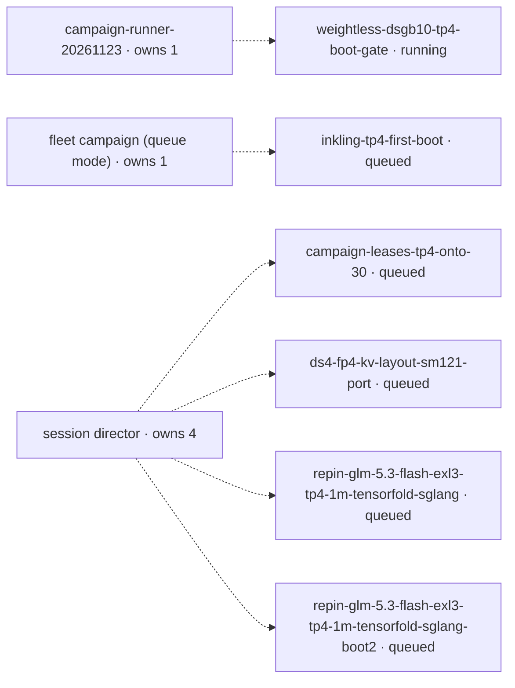

# Board
_Generated 2026-11-22 23:16 ET_

## In flight
| where | owner | what |
|---|---|---|
| census | read-only in tick — booted nothing, claimed nothing, stopped nothing, evicted nothing | read `2026-11-23T04:16:03Z`–`2026-11-23T04:16:05Z` (each node's own `date -u`) on the base census `2026-11-23T03:07:46Z`, **1 h 8 min 17 s** after it: **4 containers, 0 volumes** fleet-wide; **no research rank**; the fenced hosts hold running containers on `.31`, `.32`, `.33`, `.34`, excluded from research accounting; no node probed a serve |
| pool | — (nobody drives it; head units re-proved each tick) | head: `beegfs-mgmtd` **active** (Result success, NRestarts 0, **+0** on the base) · `beegfs-meta` **active** (Result success, NRestarts 0, **+0** on the base) · `beegfs-storage` **active** (Result success, NRestarts 0, **+0** on the base); worker unit states and the pool's through-mount reads are not part of this census |
| queue | register snapshot `15c6fae5…`; both blocks below rendered from it | `origin/main:mad-science/queue.json` sha256 **`15c6fae5138fa07db1cbf38992fad6db1b1d54f63ea5aa478785e807f468410d`** read locally: **253 tasks: 247 done, 5 queued, 0 blocked, 1 running — 6 open**; the head clone reads **`15c6fae5…`**, identical |
| window | **no manual lock** at this read | `.local/fleet-window.lock` is **absent** on the head (read `2026-11-23T04:16:06Z`) |
| campaign | `sparkrun-campaign` — active, no lease | head user unit `sparkrun-campaign` reads **`active`** / **`running`** (`MainPID` **3,930,275**, `NRestarts` **0**, **+0** on the base); the lease ledger holds **0 lease(s)** and fence(s) `tp-le2-20261120` |
| lease | **1 fence(s), 0 lease(s)** | the head's repo ledger `.local/fleet-leases.json` (389 B, sha **`ec09509d…`**, mtime **`2026-11-21 03:04:12.907935197 -0500`** local) holds fence **`tp-le2-20261120`** on `.31`, `.32`, `.33`, `.34` (`fenced_at` `2026-11-20T07:25:27Z`, owner directive 2026-11-20: production serve protected, serve `58cddf1c62ba6578_b8865cad5863` / image `986795bcd7f4`) and **0 lease(s)** |
| publication | tick | fresh census (`2026-11-23T04:16:03Z`–`2026-11-23T04:16:05Z`) written to `2026-11-23T041602Z.json` and composed on the base census `2026-11-23T03:07:46Z`; the queue blocks are rendered from `origin/main:mad-science/queue.json` sha **`15c6fae5…`**, and the landed rows from `git log --since=2026-11-23T03:07:46Z` |
| .30 | **nothing live (no reservation)** — idle | `2026-11-23T04:16:03Z` (`spark-41e1`): `docker ps -aq` **0**, running **0**, volumes **0**, `:8000` listeners **0** root **1,213,459,365,888 B avail** (-25,595,904, fell) · **2,613,571,452,928 B used** (+25,595,904, rose) boot **`2026-11-19T20:06:40Z`** (`btime`), `uptime` **288,563 s** `MemTotal` **127,598,704 kB** (+0), `MemAvailable` **122,317,120 kB** (+210,148), `Cached` **52,729,656 kB** (+700,152), `AnonPages` **780,968 kB** (-116,280) ring **256** events all-types (+0), **0** in-window lifecycle and **0** in-window `exec`, oldest `2026-11-22T21:19:19.549437425-05:00 container exec_create: s`, newest `2026-11-22T21:29:27.688470769-05:00 container destroy ce2ab1` |
| .31 | **fenced serve** — excluded from the research census | `2026-11-23T04:16:03Z` (`spark-d325`): `docker ps -aq` **1**, running **1**, volumes **0**, `:8000` listeners **0** root **1,551,100,383,232 B avail** (-8,254,660,608, fell) · **2,275,930,435,584 B used** (+8,254,660,608, rose) boot **`2026-11-19T20:11:15Z`** (`btime`), `uptime` **288,288 s** `MemTotal` **127,598,700 kB** (+0), `MemAvailable` **122,491,004 kB** (+113,841,288), `Cached` **14,256,412 kB** (+5,314,332), `AnonPages` **578,940 kB** (-6,161,680) ring **256** events all-types (+0), **0** in-window lifecycle and **75** in-window `exec`, oldest `2026-11-22T21:38:48.840396631-05:00 container exec_start: ta`, newest `2026-11-22T23:15:36.541345722-05:00 container start 27e541d1` |
| .32 | **fenced serve** — excluded from the research census | `2026-11-23T04:16:04Z` (`spark-ec1d`): `docker ps -aq` **1**, running **1**, volumes **0**, `:8000` listeners **0** root **1,616,624,963,584 B avail** (-8,359,804,928, fell) · **2,210,405,740,544 B used** (+8,359,804,928, rose) boot **`2026-11-19T20:14:21Z`** (`btime`), `uptime` **288,102 s** `MemTotal` **127,598,640 kB** (+0), `MemAvailable` **122,303,892 kB** (+110,569,884), `Cached` **19,208,992 kB** (+6,792,668), `AnonPages` **605,896 kB** (-4,722,396) ring **256** events all-types (+0), **0** in-window lifecycle and **54** in-window `exec`, oldest `2026-11-22T21:35:19.154528421-05:00 container exec_start: ta`, newest `2026-11-22T23:15:39.651911659-05:00 container start 5525ff1c` |
| .33 | **fenced serve** — excluded from the research census | `2026-11-23T04:16:04Z` (`spark-3578`): `docker ps -aq` **1**, running **1**, volumes **0**, `:8000` listeners **0** root **1,514,463,514,624 B avail** (-7,096,492,032, fell) · **2,312,567,189,504 B used** (+7,096,492,032, rose) boot **`2026-11-19T20:12:55Z`** (`btime`), `uptime` **288,189 s** `MemTotal` **127,598,636 kB** (+0), `MemAvailable` **122,649,576 kB** (+111,039,352), `Cached` **15,367,264 kB** (+3,113,812), `AnonPages` **517,660 kB** (-4,803,464) ring **256** events all-types (+0), **0** in-window lifecycle and **54** in-window `exec`, oldest `2026-11-22T21:35:19.519940691-05:00 container exec_start: ta`, newest `2026-11-22T23:15:42.489324879-05:00 container start cb712858` |
| .34 | **fenced serve** — excluded from the research census | `2026-11-23T04:16:05Z` (`spark-324e`): `docker ps -aq` **1**, running **1**, volumes **0**, `:8000` listeners **0** root **1,100,694,700,032 B avail** (-6,257,725,440, fell) · **2,726,336,118,784 B used** (+6,257,725,440, rose) boot **`2026-11-19T20:09:04Z`** (`btime`), `uptime` **288,420 s** `MemTotal` **127,598,704 kB** (+0), `MemAvailable` **122,598,684 kB** (+110,926,324), `Cached` **15,520,668 kB** (+4,399,512), `AnonPages` **569,352 kB** (-4,736,920) ring **256** events all-types (+0), **0** in-window lifecycle and **53** in-window `exec`, oldest `2026-11-22T21:35:19.914236985-05:00 container exec_create: t`, newest `2026-11-22T23:15:45.390459865-05:00 container start 3d1a61b9` |
| .35 | **nothing live (no reservation)** — idle | `2026-11-23T04:16:05Z` (`spark-383f`): `docker ps -aq` **0**, running **0**, volumes **0**, `:8000` listeners **0** root **1,040,813,547,520 B avail** (-22,388,736, fell) · **2,786,217,271,296 B used** (+22,388,736, rose) boot **`2026-11-19T20:07:56Z`** (`btime`), `uptime` **288,488 s** `MemTotal` **127,598,700 kB** (+0), `MemAvailable` **123,230,360 kB** (+5,060), `Cached` **2,355,996 kB** (+547,288), `AnonPages` **249,972 kB** (+2,424) ring **256** events all-types (+0), **0** in-window lifecycle and **0** in-window `exec`, oldest `2026-11-22T21:05:06.535546060-05:00 container exec_start: sh`, newest `2026-11-22T21:19:48.088204374-05:00 container destroy 8b4cc1` |

## Work Queue

| job | node cost | blockers | holds | status | summary |
|---|---|---|---|---|---|
| `repin-glm-5.3-flash-exl3-tp4-1m-tensorfold-sglang` — Boot glm-5.3-flash-exl3-tp4-1m-tensorfold-sglang with the refreshed pin and move its pins | quartet | — | — | queued | — PIN MOVE 2026-11-22 (owner rule, ViBoard thread t24): updated pins are boot-tested as soon as a window of the correct size is free for them, and the pin moves in that boot's commit — no carrier-lane ride-along. This row boots recipes/glm/gl… (full note: queue.json) |
| `repin-glm-5.3-flash-exl3-tp4-1m-tensorfold-sglang-boot2` — Boot glm-5.3-flash-exl3-tp4-1m-tensorfold-sglang-boot2 with the refreshed pin and move its pins | quartet | — | — | queued | — PIN MOVE 2026-11-22 (owner rule, ViBoard thread t24): updated pins are boot-tested as soon as a window of the correct size is free for them, and the pin moves in that boot's commit — no carrier-lane ride-along. This row boots recipes/glm/gl… (full note: queue.json) |
| `campaign-leases-tp4-onto-30` — The campaign leases memory-heavy TP4 quartets onto .30, which the owner ruling excludes | quartet | — | — | queued | — MECHANISM LANDED OFFLINE 2026-11-11 (commits `aa54000`, `ebf5c8e`, `298098d`, `08ff156`; no live lease and no live six-node boot has run, so the row stays open). One ledger, `<repo>/.local/fleet-leases.json` (flock + atomic write), and one … (full note: queue.json) |
| `inkling-tp4-first-boot` — Inkling-2-Small TP=4 first boot: nightly pull and the unproven sm_121 Triton path | quartet | — | — | queued | — No node holds the pinned nightly digest c17e9d88, so the first boot includes the pull. GB10 is sm_121 and the Blackwell path gates on capability family 100, so the engine runs the Hopper/Triton half (attention_sm90 plus the Humming expert G… (full note: queue.json) — evidence: `recipes/explore/README.md section zz-inkling-2-small-nvfp4-thinking-tools-tp4-vllm` |
| `weightless-dsgb10-tp4-boot-gate` — Boot the weightless-dsgb10 arm four-rank: the α=0 golden hash must equal stock bit-for-bit before any steered request is quoted | quartet | — | — | running | — Boot gate for the image closed by weightless-image-build-publish-pin (1bc6b5cb). Image ghcr.io/littlecedar/dgx-picom-ds41f:ds41f-7c123ad4-pr15-pr7-weightless, digest sha256:305b6e5151a2cfd13b85f18c36bccf9062af83e28917fd11a0f151691c5e83df, p… (full note: queue.json) — evidence: `recipes/ds4/zz-deepseek-v4.1-flash-1017-weightless-dsgb10-tp4.yaml (container pinned by digest at line 30); recipes/ds4/README.md lines 2890-2911 (two-name contract, alpha=0 identity) and 2990-2996 (the boot gate)` |
| `ds4-fp4-kv-layout-sm121-port` — DS4 1017 SM121: port the V41/V41_FP4 KV layout so fp4 KV is admissible — dtype is not a lever today, and sizing lies about fp4 | quartet | — | — | queued | — RECIPE RETIRED 2026-11-18: the `zz-` arm this row booted is archived at `attic/ds4/zz-ds4-1017-sm121-indexer-scoring.yaml` (it was run or refused on record; see the lane attic index), so the row is no longer bootable. CORRECTION TO THE FP8-… (full note: queue.json) |

## Completed Work
Window: commits since `2026-11-23T03:07:46Z` — the base census stamp, later than the 24 h start `2026-11-22T04:16:02Z`; older rows are not shown.

| time ET | commit | one clause |
|---|---|---|
| 11-22 22:07 | `ba7c387a` | Refresh the status board: a 2026-11-23T030745Z census |
| 11-22 23:07 | `81ad6bce` | Unblock the TP4 window: close the ask, clear blocked_by, set six rows to queued |
| 11-22 23:12 | `ae058438` | BeeGFS meta fix (masked beegfs-meta on .31-.35; beegfs-meta-window-scheduling done); weightless-dsgb10-tp4-boot-gate claimed running |
| 11-22 23:15 | `46a885b4` | Merge remote-tracking branch 'origin/main' |
