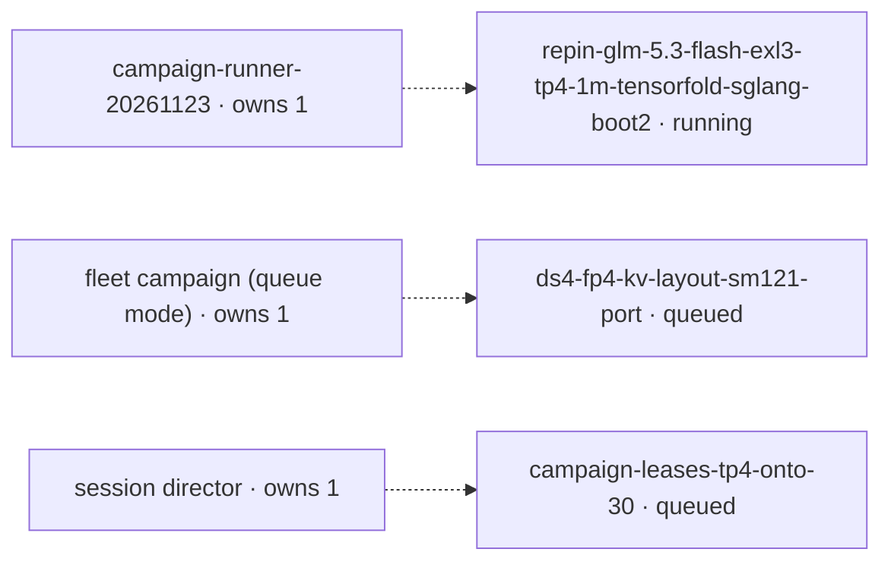

# Board
_Generated 2026-11-23 04:02 ET_

## In flight
| where | owner | what |
|---|---|---|
| census | read-only in tick — booted nothing, claimed nothing, stopped nothing, evicted nothing | read `2026-11-23T09:02:36Z`–`2026-11-23T09:02:39Z` (each node's own `date -u`) on the base census `2026-11-23T09:00:01Z`, **0 h 2 min 35 s** after it: **4 containers, 0 volumes** fleet-wide; **no research rank**; the fenced hosts hold running containers on `.31`, `.32`, `.33`, `.34`, excluded from research accounting; no node probed a serve |
| pool | — (nobody drives it; head units re-proved each tick) | head: `beegfs-mgmtd` **active** (Result success, NRestarts 0, **+0** on the base) · `beegfs-meta` **active** (Result success, NRestarts 0, **+0** on the base) · `beegfs-storage` **active** (Result success, NRestarts 0, **+0** on the base); worker unit states and the pool's through-mount reads are not part of this census |
| queue | register snapshot `fe40c3a7…`; both blocks below rendered from it | `mad-science/queue.json` sha256 **`fe40c3a7a23415d141eda74e810baa430f31bb978cc116adba8ebcc212de8335`** read locally: **253 tasks: 250 done, 2 queued, 0 blocked, 1 running — 3 open**; the head clone reads **`fe40c3a7…`**, identical |
| window | **no manual lock** at this read | `.local/fleet-window.lock` is **absent** on the head (read `2026-11-23T09:02:39Z`) |
| campaign | `sparkrun-campaign` — active, no lease | head user unit `sparkrun-campaign` reads **`active`** / **`running`** (`MainPID` **3,930,275**, `NRestarts` **0**, **+0** on the base); the lease ledger holds **0 lease(s)** and fence(s) `tp-le2-20261120` |
| lease | **1 fence(s), 0 lease(s)** | the head's repo ledger `.local/fleet-leases.json` (389 B, sha **`ec09509d…`**, mtime **`2026-11-21 03:04:12.907935197 -0500`** local) holds fence **`tp-le2-20261120`** on `.31`, `.32`, `.33`, `.34` (`fenced_at` `2026-11-20T07:25:27Z`, owner directive 2026-11-20: production serve protected, serve `58cddf1c62ba6578_b8865cad5863` / image `986795bcd7f4`) and **0 lease(s)** |
| publication | tick | fresh census (`2026-11-23T09:02:36Z`–`2026-11-23T09:02:39Z`) written to `2026-11-23T090236Z.json` and composed on the base census `2026-11-23T09:00:01Z`; the queue blocks are rendered from `mad-science/queue.json` sha **`fe40c3a7…`**, and the landed rows from `git log --since=2026-11-23T09:00:01Z` |
| .30 | **nothing live (no reservation)** — idle | `2026-11-23T09:02:36Z` (`spark-41e1`): `docker ps -aq` **0**, running **0**, volumes **0**, `:8000` listeners **0** root **1,063,041,249,280 B avail** (-233,472, fell) · **2,763,989,569,536 B used** (+233,472, rose) boot **`2026-11-19T20:06:40Z`** (`btime`), `uptime` **305,756 s** `MemTotal` **127,598,704 kB** (+0), `MemAvailable` **121,817,600 kB** (-45,960), `Cached` **83,268,216 kB** (+608), `AnonPages` **1,022,548 kB** (+15,844) ring **256** events all-types (+0), **0** in-window lifecycle and **0** in-window `exec`, oldest `2026-11-22T21:20:20.734482151-05:00 container die 74fbcbeab8`, newest `2026-11-23T03:49:08.974501878-05:00 image import sha256:a104` |
| .31 | **fenced serve** — excluded from the research census | `2026-11-23T09:02:37Z` (`spark-d325`): `docker ps -aq` **1**, running **1**, volumes **0**, `:8000` listeners **0** root **1,297,357,037,568 B avail** (-901,120, fell) · **2,529,673,781,248 B used** (+901,120, rose) boot **`2026-11-19T20:11:15Z`** (`btime`), `uptime` **305,482 s** `MemTotal` **127,598,700 kB** (+0), `MemAvailable` **25,425,244 kB** (-97,610,828), `Cached` **9,086,656 kB** (+4,123,068), `AnonPages` **7,552,912 kB** (+7,255,372) ring **256** events all-types (+0), **0** in-window lifecycle and **81** in-window `exec`, oldest `2026-11-23T01:58:30.954786310-05:00 container exec_die 97b00`, newest `2026-11-23T04:02:31.006833091-05:00 container exec_die 44f10` |
| .32 | **fenced serve** — excluded from the research census | `2026-11-23T09:02:37Z` (`spark-ec1d`): `docker ps -aq` **1**, running **1**, volumes **0**, `:8000` listeners **0** root **1,381,552,730,112 B avail** (-851,968, fell) · **2,445,477,974,016 B used** (+851,968, rose) boot **`2026-11-19T20:14:21Z`** (`btime`), `uptime` **305,295 s** `MemTotal` **127,598,640 kB** (+0), `MemAvailable` **27,033,188 kB** (-96,070,296), `Cached` **8,220,380 kB** (+4,051,044), `AnonPages` **7,154,024 kB** (+6,901,412) ring **256** events all-types (+0), **0** in-window lifecycle and **76** in-window `exec`, oldest `2026-11-23T01:57:41.669973350-05:00 container exec_create: s`, newest `2026-11-23T04:02:31.400198939-05:00 container exec_die cb6a0` |
| .33 | **fenced serve** — excluded from the research census | `2026-11-23T09:02:38Z` (`spark-3578`): `docker ps -aq` **1**, running **1**, volumes **0**, `:8000` listeners **0** root **1,252,249,124,864 B avail** (-847,872, fell) · **2,574,781,579,264 B used** (+847,872, rose) boot **`2026-11-19T20:12:55Z`** (`btime`), `uptime` **305,383 s** `MemTotal` **127,598,636 kB** (+0), `MemAvailable` **26,764,932 kB** (-96,421,372), `Cached` **7,715,712 kB** (+7,509,604), `AnonPages` **7,286,732 kB** (+7,044,152) ring **256** events all-types (+0), **0** in-window lifecycle and **76** in-window `exec`, oldest `2026-11-23T01:57:42.026567710-05:00 container exec_create: s`, newest `2026-11-23T04:02:31.777961996-05:00 container exec_die f3d7a` |
| .34 | **fenced serve** — excluded from the research census | `2026-11-23T09:02:38Z` (`spark-324e`): `docker ps -aq` **1**, running **1**, volumes **0**, `:8000` listeners **0** root **1,094,299,971,584 B avail** (-851,968, fell) · **2,732,730,847,232 B used** (+851,968, rose) boot **`2026-11-19T20:09:04Z`** (`btime`), `uptime` **305,614 s** `MemTotal` **127,598,704 kB** (+0), `MemAvailable` **26,570,276 kB** (-96,604,532), `Cached` **8,076,556 kB** (+7,862,816), `AnonPages` **7,356,416 kB** (+7,105,472) ring **256** events all-types (+0), **0** in-window lifecycle and **76** in-window `exec`, oldest `2026-11-23T01:57:42.394200434-05:00 container exec_start: sh`, newest `2026-11-23T04:02:32.164361491-05:00 container exec_die 78208` |
| .35 | **nothing live (no reservation)** — idle | `2026-11-23T09:02:39Z` (`spark-383f`): `docker ps -aq` **0**, running **0**, volumes **0**, `:8000` listeners **0** root **971,353,477,120 B avail** (+74,731,520, rose) · **2,855,677,341,696 B used** (-74,731,520, fell) boot **`2026-11-19T20:07:56Z`** (`btime`), `uptime` **305,682 s** `MemTotal` **127,598,700 kB** (+0), `MemAvailable` **122,858,288 kB** (-45,620), `Cached` **115,749,900 kB** (+4,124), `AnonPages` **293,740 kB** (+2,236) ring **256** events all-types (+0), **0** in-window lifecycle and **0** in-window `exec`, oldest `2026-11-22T21:05:06.535546060-05:00 container exec_start: sh`, newest `2026-11-22T21:19:48.088204374-05:00 container destroy 8b4cc1` |

## Work Queue

| job | node cost | blockers | holds | status | summary |
|---|---|---|---|---|---|
| `repin-glm-5.3-flash-exl3-tp4-1m-tensorfold-sglang-boot2` — Boot glm-5.3-flash-exl3-tp4-1m-tensorfold-sglang-boot2 with the refreshed pin and move its pins | quartet | — | — | running | Running (campaign-runner-20261123): the TP4 pin-move boot of the GLM boot2 recipe tests the docs-only revision delta 078455ff -> 76c0b517, unblocked by the 2026-11-23 t1 window; no result yet. |
| `campaign-leases-tp4-onto-30` — The campaign leases memory-heavy TP4 quartets onto .30, which the owner ruling excludes | quartet | — | — | queued | Queued, awaiting a TP4 lease: t20 (2026-11-22) lets .30 host a memory-risky quartet inside a declared window under the six 2026-11-11 guardrails; the t1 window (2026-11-23) lifted the hold, unblocking all six dependents. |
| `ds4-fp4-kv-layout-sm121-port` — DS4 1017 SM121: port the V41/V41_FP4 KV layout so fp4 KV is admissible — dtype is not a lever today, and sizing lies about fp4 | quartet | — | — | queued | Queued, boot pending: the SGLang V41_FP4 KV-layout port landed (9d2c2166, kernel gate 2026-11-22) and the FP4-KV image is built/pushed (aneda@b5de5272); the quartet boot validates 528/288 B/token plus a needle cell. |

## Completed Work
Window: commits since `2026-11-23T09:00:01Z` — the base census stamp, later than the 24 h start `2026-11-22T09:02:36Z`; older rows are not shown.

| time ET | commit | one clause |
|---|---|---|
| 11-23 04:00 | `1f246b5f` | Refresh the status board: a 2026-11-23T090000Z census |
