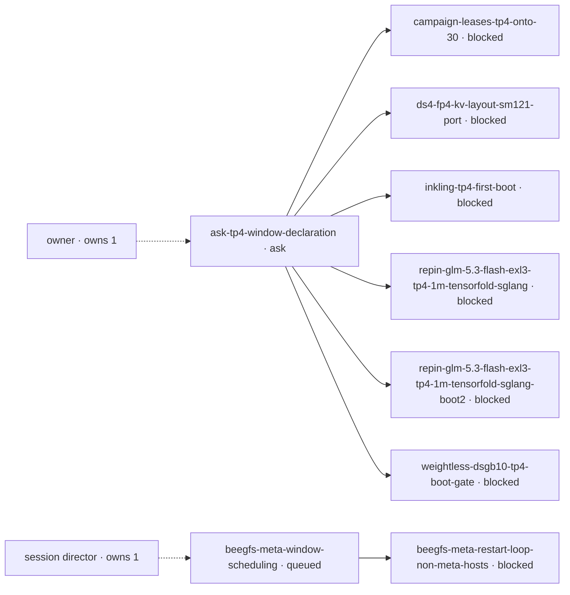

# Board
_Generated 2026-11-22 21:57 ET_

## In flight
| where | owner | what |
|---|---|---|
| census | read-only in tick — booted nothing, claimed nothing, stopped nothing, evicted nothing | read `2026-11-23T02:57:54Z`–`2026-11-23T02:57:57Z` (each node's own `date -u`) on the base census `none`, **no base** after it: **4 containers, 0 volumes** fleet-wide; **no research rank**; the fenced hosts hold running containers on `.31`, `.32`, `.33`, `.34`, excluded from research accounting; `/v1/models` **200**, `/health` **200** on `.31` |
| pool | — (nobody drives it; head units re-proved each tick) | head: `beegfs-mgmtd` **active** (Result success, NRestarts 0) · `beegfs-meta` **active** (Result success, NRestarts 0) · `beegfs-storage` **active** (Result success, NRestarts 0); worker unit states and the pool's through-mount reads are not part of this census |
| queue | register snapshot `892c492b…`; both blocks below rendered from it | `origin/main:mad-science/queue.json` sha256 **`892c492b7bfc77a4210ab99e56fe9eb954ad32354956b6b22341ff5361759333`** read locally: **253 tasks: 244 done, 1 queued, 7 blocked, 0 running, 1 ask — 9 open**; the head clone reads **`d3ce705a…`**, **differs** |
| window | **no manual lock** at this read | `.local/fleet-window.lock` is **absent** on the head (read `2026-11-23T02:57:57Z`) |
| campaign | `sparkrun-campaign` — active, no lease | head user unit `sparkrun-campaign` reads **`active`** / **`running`** (`MainPID` **3,930,275**, `NRestarts` **0**); the lease ledger holds **0 lease(s)** and fence(s) `tp-le2-20261120` |
| lease | **1 fence(s), 0 lease(s)** | the head's repo ledger `.local/fleet-leases.json` (389 B, sha **`ec09509d…`**, mtime **`2026-11-21 03:04:12.907935197 -0500`** local) holds fence **`tp-le2-20261120`** on `.31`, `.32`, `.33`, `.34` (`fenced_at` `2026-11-20T07:25:27Z`, owner directive 2026-11-20: production serve protected, serve `58cddf1c62ba6578_b8865cad5863` / image `986795bcd7f4`) and **0 lease(s)** |
| publication | tick | fresh census (`2026-11-23T02:57:54Z`–`2026-11-23T02:57:57Z`) written to `2026-11-23T025754Z.json` and composed on the base census `none`; the queue blocks are rendered from `origin/main:mad-science/queue.json` sha **`892c492b…`**, and the landed rows from `git log --since=none` |
| .30 | **nothing live (no reservation)** — idle | `2026-11-23T02:57:54Z` (`spark-41e1`): `docker ps -aq` **0**, running **0**, volumes **0**, `:8000` listeners **0** root **1,213,599,748,096 B avail** (no base, unmeasured) · **2,613,431,070,720 B used** (no base, unmeasured) boot **`2026-11-19T20:06:40Z`** (`btime`), `uptime` **283,874 s** `MemTotal` **127,598,704 kB** (no base), `MemAvailable` **122,221,968 kB** (no base), `Cached` **51,520,268 kB** (no base), `AnonPages` **896,992 kB** (no base) ring **256** events all-types (no base), **0** in-window lifecycle and **0** in-window `exec`, oldest `2026-11-22T21:19:19.549437425-05:00 container exec_create: s`, newest `2026-11-22T21:29:27.688470769-05:00 container destroy ce2ab1` |
| .31 | **fenced serve** — excluded from the research census | `2026-11-23T02:57:55Z` (`spark-d325`): `docker ps -aq` **1**, running **1**, volumes **0**, `:8000` listeners **2**, `/v1/models` **200**, `/health` **200** root **1,559,364,513,792 B avail** (no base, unmeasured) · **2,267,666,305,024 B used** (no base, unmeasured) boot **`2026-11-19T20:11:15Z`** (`btime`), `uptime` **283,600 s** `MemTotal` **127,598,700 kB** (no base), `MemAvailable` **8,730,604 kB** (no base), `Cached` **9,043,700 kB** (no base), `AnonPages` **6,712,004 kB** (no base) ring **256** events all-types (no base), **0** in-window lifecycle and **0** in-window `exec`, oldest `2026-11-22T21:15:19.274165881-05:00 container exec_die d9d79`, newest `2026-11-22T21:57:48.898607753-05:00 container exec_die d9d79` |
| .32 | **fenced serve** — excluded from the research census | `2026-11-23T02:57:55Z` (`spark-ec1d`): `docker ps -aq` **1**, running **1**, volumes **0**, `:8000` listeners **0** root **1,624,985,796,608 B avail** (no base, unmeasured) · **2,202,044,907,520 B used** (no base, unmeasured) boot **`2026-11-19T20:14:21Z`** (`btime`), `uptime` **283,414 s** `MemTotal` **127,598,640 kB** (no base), `MemAvailable` **11,724,196 kB** (no base), `Cached` **12,413,016 kB** (no base), `AnonPages` **5,324,132 kB** (no base) ring **256** events all-types (no base), **0** in-window lifecycle and **0** in-window `exec`, oldest `2026-11-22T21:15:19.637623298-05:00 container exec_die 7641b`, newest `2026-11-22T21:57:49.316448430-05:00 container exec_die 7641b` |
| .33 | **fenced serve** — excluded from the research census | `2026-11-23T02:57:56Z` (`spark-3578`): `docker ps -aq` **1**, running **1**, volumes **0**, `:8000` listeners **0** root **1,521,561,030,656 B avail** (no base, unmeasured) · **2,305,469,673,472 B used** (no base, unmeasured) boot **`2026-11-19T20:12:55Z`** (`btime`), `uptime` **283,501 s** `MemTotal` **127,598,636 kB** (no base), `MemAvailable` **11,622,596 kB** (no base), `Cached` **12,249,944 kB** (no base), `AnonPages` **5,322,808 kB** (no base) ring **256** events all-types (no base), **0** in-window lifecycle and **0** in-window `exec`, oldest `2026-11-22T21:15:20.006564721-05:00 container exec_die d98d0`, newest `2026-11-22T21:57:49.717043861-05:00 container exec_die d98d0` |
| .34 | **fenced serve** — excluded from the research census | `2026-11-23T02:57:56Z` (`spark-324e`): `docker ps -aq` **1**, running **1**, volumes **0**, `:8000` listeners **0** root **1,106,953,449,472 B avail** (no base, unmeasured) · **2,720,077,369,344 B used** (no base, unmeasured) boot **`2026-11-19T20:09:04Z`** (`btime`), `uptime` **283,732 s** `MemTotal` **127,598,704 kB** (no base), `MemAvailable` **11,685,448 kB** (no base), `Cached` **11,117,824 kB** (no base), `AnonPages` **5,308,696 kB** (no base) ring **256** events all-types (no base), **0** in-window lifecycle and **0** in-window `exec`, oldest `2026-11-22T21:15:20.521355429-05:00 container exec_die ff75e`, newest `2026-11-22T21:57:50.117830415-05:00 container exec_die ff75e` |
| .35 | **nothing live (no reservation)** — idle | `2026-11-23T02:57:57Z` (`spark-383f`): `docker ps -aq` **0**, running **0**, volumes **0**, `:8000` listeners **0** root **1,040,845,172,736 B avail** (no base, unmeasured) · **2,786,185,646,080 B used** (no base, unmeasured) boot **`2026-11-19T20:07:56Z`** (`btime`), `uptime` **283,800 s** `MemTotal` **127,598,700 kB** (no base), `MemAvailable` **123,203,096 kB** (no base), `Cached` **1,805,212 kB** (no base), `AnonPages` **248,940 kB** (no base) ring **256** events all-types (no base), **0** in-window lifecycle and **0** in-window `exec`, oldest `2026-11-22T21:05:06.535546060-05:00 container exec_start: sh`, newest `2026-11-22T21:19:48.088204374-05:00 container destroy 8b4cc1` |

## Work Queue

| job | node cost | blockers | holds | status | summary |
|---|---|---|---|---|---|
| `ask-tp4-window-declaration` — Ask: declare the four-rank TP4 window that two blocked quartet boots wait on | — | — | weightless-dsgb10-tp4-boot-gate, inkling-tp4-first-boot, campaign-leases-tp4-onto-30, repin-glm-5.3-flash-exl3-tp4-1m-tensorfold-sglang, repin-glm-5.3-flash-exl3-tp4-1m-tensorfold-sglang-boot2, ds4-fp4-kv-layout-sm121-port | ask | — QUESTION FOR THE OWNER: when may a four-rank TP4 boot run? Two arms are otherwise ready — weightless-dsgb10-tp4-boot-gate (the alpha=0 golden hash must equal stock before any steered request is quoted) and inkling-tp4-first-boot (first boot… (full note: queue.json) |
| `beegfs-meta-window-scheduling` — Propose and declare the maintenance window for the beegfs-meta fix | — | — | beegfs-meta-restart-loop-non-meta-hosts | queued | — OWNER ANSWER 2026-11-22 (ViBoard thread t22): the beegfs-meta restart-loop fix is deferred — its own session, no window yet. This row is the step that makes a window possible without pushing one: propose one or two candidate maintenance win… (full note: queue.json) |
| `beegfs-meta-restart-loop-non-meta-hosts` — beegfs-meta restart-loops every 5 s on .31-.35, and the loop hides a failed state behind "activating" | single | ask-beegfs-meta-window, beegfs-meta-window-scheduling | — | blocked | — Measured 2026-11-09 07:03-07:05 ET, and it is the side effect of the fix beegfs-units-restart-no (done) blessed: /etc/systemd/system/beegfs-meta.service.d/oom.conf (mtime 2026-11-08 16:03 on .30, 16:05 on .31) sets OOMScoreAdjust plus Resta… (full note: queue.json) — evidence: `.scratch/infra-chores-20261122/beegfs-meta/RECEIPT.md` |
| `repin-glm-5.3-flash-exl3-tp4-1m-tensorfold-sglang` — Boot glm-5.3-flash-exl3-tp4-1m-tensorfold-sglang with the refreshed pin and move its pins | quartet | ask-tp4-window-declaration | — | blocked | — PIN MOVE 2026-11-22 (owner rule, ViBoard thread t24): updated pins are boot-tested as soon as a window of the correct size is free for them, and the pin moves in that boot's commit — no carrier-lane ride-along. This row boots recipes/glm/gl… (full note: queue.json) |
| `repin-glm-5.3-flash-exl3-tp4-1m-tensorfold-sglang-boot2` — Boot glm-5.3-flash-exl3-tp4-1m-tensorfold-sglang-boot2 with the refreshed pin and move its pins | quartet | ask-tp4-window-declaration | — | blocked | — PIN MOVE 2026-11-22 (owner rule, ViBoard thread t24): updated pins are boot-tested as soon as a window of the correct size is free for them, and the pin moves in that boot's commit — no carrier-lane ride-along. This row boots recipes/glm/gl… (full note: queue.json) |
| `campaign-leases-tp4-onto-30` — The campaign leases memory-heavy TP4 quartets onto .30, which the owner ruling excludes | quartet | ask-placement-policy-30, ask-tp4-window-declaration | — | blocked | — MECHANISM LANDED OFFLINE 2026-11-11 (commits `aa54000`, `ebf5c8e`, `298098d`, `08ff156`; no live lease and no live six-node boot has run, so the row stays open). One ledger, `<repo>/.local/fleet-leases.json` (flock + atomic write), and one … (full note: queue.json) |
| `inkling-tp4-first-boot` — Inkling-2-Small TP=4 first boot: nightly pull and the unproven sm_121 Triton path | quartet | ask-tp4-window-declaration | — | blocked | — No node holds the pinned nightly digest c17e9d88, so the first boot includes the pull. GB10 is sm_121 and the Blackwell path gates on capability family 100, so the engine runs the Hopper/Triton half (attention_sm90 plus the Humming expert G… (full note: queue.json) — evidence: `recipes/explore/README.md section zz-inkling-2-small-nvfp4-thinking-tools-tp4-vllm` |
| `weightless-dsgb10-tp4-boot-gate` — Boot the weightless-dsgb10 arm four-rank: the α=0 golden hash must equal stock bit-for-bit before any steered request is quoted | quartet | ask-tp4-window-declaration | — | blocked | — Boot gate for the image closed by weightless-image-build-publish-pin (1bc6b5cb). Image ghcr.io/littlecedar/dgx-picom-ds41f:ds41f-7c123ad4-pr15-pr7-weightless, digest sha256:305b6e5151a2cfd13b85f18c36bccf9062af83e28917fd11a0f151691c5e83df, p… (full note: queue.json) — evidence: `recipes/ds4/zz-deepseek-v4.1-flash-1017-weightless-dsgb10-tp4.yaml (container pinned by digest at line 30); recipes/ds4/README.md lines 2890-2911 (two-name contract, alpha=0 identity) and 2990-2996 (the boot gate)` |
| `ds4-fp4-kv-layout-sm121-port` — DS4 1017 SM121: port the V41/V41_FP4 KV layout so fp4 KV is admissible — dtype is not a lever today, and sizing lies about fp4 | quartet | ask-tp4-window-declaration, ds4-fp4-kv-layout-sm121-port-sglang, ds4-fp4-kv-layout-sm121-port-vllm | — | blocked | — RECIPE RETIRED 2026-11-18: the `zz-` arm this row booted is archived at `attic/ds4/zz-ds4-1017-sm121-indexer-scoring.yaml` (it was run or refused on record; see the lane attic index), so the row is no longer bootable. CORRECTION TO THE FP8-… (full note: queue.json) |

## Completed Work
Window: commits since `2026-11-22T02:57:54Z` — the 24 h before this census.

| time ET | commit | one clause |
|---|---|---|
| 11-21 22:07 | `72fc0e40` | Let a queue row carry a board summary that its own fields invalidate |
| 11-21 22:17 | `627a57a4` | Refresh the status board: a 03:03Z census and a bounded serving-ring zero |
| 11-21 22:28 | `63cbf46a` | Add the census collector and board renderer, so a tick writes no cell by hand |
| 11-21 22:35 | `871215c2` | Refresh the status board: a 03:26Z census on an untouched fenced serve |
| 11-21 22:40 | `1aff26ba` | Stop the board subtracting ring counts taken over two different windows |
| 11-21 22:43 | `dd73b3c2` | Refresh the status board: a 03:39Z census on an unchanged fenced serve |
| 11-21 23:07 | `38062830` | Add the single-flight board tick so an hour costs no model call |
| 11-21 23:09 | `55b4d2d8` | Keep Landed to a rolling 24 hours and state the window it used |
| 11-21 23:11 | `a48d2bf2` | Refresh the status board: a 2026-11-22T041127Z census |
| 11-21 23:17 | `6e405c0d` | Refresh the status board: a 04:14Z census on an unchanged fenced serve |
| 11-21 23:19 | `ec11c572` | Record the board refresh and the head clone's refs outrunning its objects |
| 11-21 23:21 | `0cdc6166` | Re-publish the status board on a census document that exists |
| 11-21 23:26 | `a0b5c624` | Write board summaries for the 32 stale queue rows |
| 11-21 23:27 | `523c01e7` | Refresh the status board: a 2026-11-22T042712Z census |
| 11-21 23:33 | `5d3b761d` | Heal the head clone's missing objects and register the unnamed cause |
| 11-21 23:33 | `497ea4f8` | Derive the census head fixture's register sha so a queue edit cannot redden it |
| 11-21 23:44 | `b9ad5662` | Write the head-clone object-loss row's board summary from its own notes |
| 11-21 23:44 | `080e5346` | Refresh the status board: a 2026-11-22T044421Z census |
| 11-21 23:45 | `622d6ce6` | Record that the head clone loses objects on every new commit |
| 11-21 23:45 | `f9ef1427` | Split the board's state word and edges into their own columns |
| 11-21 23:46 | `6bd6f3be` | Regenerate the board fixture for the six-column work queue |
| 11-21 23:59 | `c7cd2bfb` | Restate the head-clone summary after the row's notes and evidence changed |
| 11-21 23:59 | `b5eda762` | Refresh the status board: a 2026-11-22T045929Z census |
| 11-22 00:37 | `f5b96501` | Close the single-node infra chores: pool fall named, cache gaps filled |
| 11-22 01:00 | `c7dcea5c` | Refresh the status board: a 2026-11-22T060000Z census |
| 11-22 01:13 | `97d6d35c` | Close the Sage trick-1 repeat: the empty reply is a reasoning loop |
| 11-22 01:17 | `72080ae9` | Author MOSS-Image-SFT and Audio8 TTS arms; settle the MiniMax license ruling |
| 11-22 01:18 | `0acdd8ca` | Queue the two DS4 fp4-KV engine rows and load out the NC<=2 candidates |
| 11-22 01:19 | `906d3afd` | Point the register at the settled licence ruling and the Audio8 recipe |
| 11-22 01:23 | `b73c9d52` | Queue the MOSS-Image first boot and make the Audio8 row its own boot row |
| 11-22 01:27 | `ef24035f` | Index the two new media arms and re-take the strict roster snapshot |
| 11-22 01:40 | `9678f38e` | Fix the cache-audit selftest's stale ds4 EXL3 key after the re-pin |
| 11-22 01:46 | `fc630c0b` | Close probe A as a measured negative and the two cache-cleanup rows |
| 11-22 02:00 | `0cc9f550` | Refresh the status board: a 2026-11-22T070000Z census |
| 11-22 02:02 | `7ee93c23` | Refresh the status board: a 2026-11-22T070224Z census |
| 11-22 02:04 | `342860e6` | Give sixteen stale register rows a board summary that matches them |
| 11-22 02:17 | `2fde2b1f` | Close probe B, the DFlash2 cell and the Audio8 TTS first boot |
| 11-22 02:30 | `e5f65650` | Retire the three measured-rejected Ornith 122B survey arms to the attic |
| 11-22 02:39 | `ed9fe631` | Add update --unset so a retired recipe cannot redden the register |
| 11-22 03:00 | `0177ecbd` | Refresh the status board: a 2026-11-22T080000Z census |
| 11-22 03:49 | `192291ad` | Close the first MiniMax-H3 single-node cell and DaisyRose, requeue two arm-side walls |
| 11-22 03:51 | `a78eec0f` | Drop address literals from the register notes and the drain record |
| 11-22 03:51 | `f870ad9c` | Re-derive the stated test total after the --unset work added six tests |
| 11-22 04:00 | `1cb8a398` | Refresh the status board: a 2026-11-22T090000Z census |
| 11-22 04:01 | `084a14a6` | Refresh the status board: a 2026-11-22T090126Z census |
| 11-22 04:03 | `bc7ef372` | Give five register rows a board summary that matches their drain outcomes |
| 11-22 04:16 | `1cd3ff11` | Close the voice isolator and return the LoRA probe with its measurement |
| 11-22 04:30 | `be66ae5a` | Correct the LoRA selector contract the probe tripped over |
| 11-22 04:31 | `b5713ad9` | Correct the probe arm's served-id row to the real LoRA selector |
| 11-22 04:32 | `afeea5d2` | Fix the viggle stage's offline fetch and the MOSS pipeline identity |
| 11-22 04:48 | `26030a86` | Close TwIL and the LoRA probe, and return Edge0 with its apt finding |
| 11-22 05:00 | `772756de` | Refresh the status board: a 2026-11-22T100000Z census |
| 11-22 05:01 | `fb2499e1` | Refresh the status board: a 2026-11-22T100115Z census |
| 11-22 05:08 | `84390c76` | Run the Edge0 build stage as root and hand its tree back |
| 11-22 05:33 | `0a7b310e` | Close the MOSS image and Viggle arms, return Edge0 with three operational walls |
| 11-22 05:34 | `2ae744ab` | Use the dot-alias form for the Edge0 claim error |
| 11-22 05:36 | `9aa80af4` | Record that the Edge0 build tree survives its container |
| 11-22 05:42 | `256e2cd9` | Record that Edge0 now reaches the serve and needs a model path |
| 11-22 05:49 | `43f35b95` | Resolve the Edge0 pack from its repo id under the mounted HF cache |
| 11-22 06:00 | `7890fb59` | Refresh the status board: a 2026-11-22T110000Z census |
| 11-22 06:01 | `cdf196fe` | Refresh the status board: a 2026-11-22T110145Z census |
| 11-22 06:21 | `9fa0895a` | Close Edge0 on one node and the Laguna pair on v0.32.0 |
| 11-22 06:26 | `2a2456e4` | Score a sentence-final number as a number |
| 11-22 06:28 | `783d27b7` | Report a reasoning-only reply as reasoning, not empty |
| 11-22 06:31 | `bcd010ec` | Heal the head clone and record how it is repaired |
| 11-22 06:32 | `fba29737` | Record that no queued row is held by a done sibling |
| 11-22 06:33 | `36d69d30` | Make the docs-only re-pin bundle readable from the register |
| 11-22 06:33 | `31238382` | Mask the head hostname in the clone-repair row |
| 11-22 06:37 | `73ae87b6` | Record the one shape the stall rule calls a freeze |
| 11-22 06:38 | `db4b4165` | Pin that a campaign's record stays at its root |
| 11-22 06:40 | `c930d7a3` | Close the board row, block three on their gates, record the drain |
| 11-22 06:46 | `ffe446a5` | Give the HF cache a pool verdict |
| 11-22 06:48 | `383ccbed` | Refuse a board that shrinks a row without a newer read |
| 11-22 06:52 | `de5f8fed` | Release a failed launch's host claim, and name a refused one |
| 11-22 06:54 | `9bd47bf0` | Close the GID row upstream and record the second batch |
| 11-22 07:00 | `809c2428` | Refresh the status board: a 2026-11-22T120000Z census |
| 11-22 07:02 | `d8c12b1f` | Refresh the status board: a 2026-11-22T120158Z census |
| 11-22 07:04 | `3e607419` | Give six stale register rows a board summary that matches them |
| 11-22 07:08 | `0112b0b6` | Re-derive 59 MECHANICS anchors against the installed build |
| 11-22 07:10 | `c28ebf08` | Guard that every MECHANICS cite still resolves |
| 11-22 07:10 | `3e70ea51` | Count the new test module |
| 11-22 07:12 | `abd4e908` | Correct the /metrics port in the scrape's rationale |
| 11-22 07:17 | `30325774` | Finish the MECHANICS anchor sweep |
| 11-22 07:17 | `fc561595` | Close the anchor sweep on its receipt |
| 11-22 11:06 | `b40b5774` | Apply both campaign-rules decisions: reuse a done recipe, refuse a declared window |
| 11-22 11:16 | `4cfa86fc` | Unshare the head's .git so syncing cannot corrupt its object store |
| 11-22 11:52 | `ec253dcd` | Refresh the status board: a 2026-11-22T165211Z census |
| 11-22 11:54 | `442b7031` | Port the V4.1 KV layouts to SM121: gate, sizing, reader wiring |
| 11-22 11:55 | `8990a43e` | Give the board a durable timer, a gate, and the operator's title |
| 11-22 12:00 | `d29f6202` | Refresh the status board: a 2026-11-22T170000Z census |
| 11-22 12:01 | `d06d7222` | Refresh the status board: a 2026-11-22T170107Z census |
| 11-22 12:04 | `7f3ce4ab` | Make the board's new headings a contract, and gate the board's own tests |
| 11-22 12:12 | `ff87d31b` | Refresh the status board: a 2026-11-22T171242Z census |
| 11-22 12:22 | `d1e2f01e` | Make a blocked row name its blocker |
| 11-22 12:24 | `85940356` | Refresh the status board: a 2026-11-22T172443Z census |
| 11-22 16:19 | `019b8c96` | Relabel the queued rows that no scheduler can start |
| 11-22 16:24 | `5d0babd6` | Refresh the status board: a 2026-11-22T212442Z census |
| 11-22 16:31 | `867ad395` | Add the scheduled and ask states, and make every hold name its blocker |
| 11-22 16:32 | `4924aa6f` | Migrate the owner gates to ask rows and block their dependents |
| 11-22 16:33 | `f7c6a45a` | Re-take the stated suite total after the state-model tests |
| 11-22 16:35 | `a28fa068` | Prove the window guard exits with its task, live |
| 11-22 16:35 | `011a78a5` | Use the dot-alias form for the guard receipt's host |
| 11-22 16:36 | `c372865a` | Refresh the status board: a 2026-11-22T213643Z census |
| 11-22 16:39 | `25fdc986` | Clear the mem-guard hold its own proof answered |
| 11-22 16:45 | `9d2c2166` | Read the V4.1 cache with FlashInfer's footer format, not the inline one |
| 11-22 16:46 | `e0604960` | Close the SM121 V4.1 KV-layout port on its gate receipt |
| 11-22 16:48 | `a8690f9f` | Refresh the status board: a 2026-11-22T214842Z census |
| 11-22 17:04 | `89cb8ed1` | Give a blocked arm the ask row that names its human |
| 11-22 17:30 | `eacf7a60` | Implement the session/code director the register never had |
| 11-22 17:31 | `3ba6f3a4` | Re-derive the test-module count now that the new module is tracked |
| 11-22 17:40 | `11b483ff` | Make the ask rows the only home for owner questions |
| 11-22 17:47 | `6841e2d6` | Retire the questions key from the board fixture |
| 11-22 17:57 | `d45da516` | Hold the docs-only re-pin bundle on the sequencing decision it needs |
| 11-22 17:57 | `b8451a4d` | Assign the vLLM fp4-KV port to its worker |
| 11-22 18:06 | `4d22dbb3` | Close the SGLang FP4-KV port and checkpoint the vLLM twin |
| 11-22 18:08 | `76f486a1` | Ask the owner for the vLLM nvfp4 ABI, and restore the bundle's hold |
| 11-22 18:16 | `1e83e87d` | Restore the two questions-migration asks and guard the register against drops |
| 11-22 18:56 | `08c9bc91` | Apply the .30 standing rule: the placement ask is answered |
| 11-22 18:59 | `de9dfd32` | Record the lease scope decision: campaign-only, direct boots exempt |
| 11-22 19:01 | `6e00845f` | Ship the Muse-Glimmer arm on the owner's licence answer |
| 11-22 19:01 | `38a33aeb` | Close the fence-deletion ask and give its rule a row |
| 11-22 19:03 | `51655951` | Hold the .30 lease proof on the TP4 window it needs |
| 11-22 19:11 | `b32521bb` | Claim the two ready session rows for their workers |
| 11-22 19:33 | `8eb800d2` | Boot-test every refreshed pin on its own window, and split the bundle |
| 11-22 19:35 | `01cc0f61` | Defer the beegfs-meta fix behind a row that proposes its window |
| 11-22 19:35 | `a8730bac` | Record the four-rank window hold: keep the fence, no window now |
| 11-22 19:36 | `262e1b05` | Record fence removals in the lease ledger with who, when and why |
| 11-22 19:41 | `8c41edcd` | Make the repin rows session work, and close the fence-removal row |
| 11-22 19:50 | `496d1049` | Merge remote-tracking branch 'origin/main' |
| 11-22 19:51 | `cc9fee62` | Boot spark-x2.6-4b-fp8-sglang at the refreshed pin |
| 11-22 19:54 | `8ee876ba` | Boot spark-x2.6-4b-bf16-sglang at the refreshed pin |
| 11-22 19:53 | `9a297e81` | Sweep a window's stale guards before arming a new one |
| 11-22 19:56 | `df5ba3f4` | Read the board's gate and register from origin, not from this replica |
| 11-22 19:57 | `217b63bb` | Merge remote-tracking branch 'origin/main' |
| 11-22 19:57 | `e11e1d2a` | Re-derive the suite total after the merge |
| 11-22 19:58 | `1b7ee81e` | Refresh the status board: a 2026-11-23T005821Z census |
| 11-22 19:58 | `c3d0d694` | Close the memory-guard lifetime row on its fix |
| 11-22 20:00 | `7c3be130` | Refresh the status board: a 2026-11-23T010000Z census |
| 11-22 20:01 | `cdbc467e` | Name every register state and the register's provenance in the queue cell |
| 11-22 20:02 | `8f72f707` | Merge remote-tracking branch 'origin/main' |
| 11-22 20:02 | `6e289723` | Refresh the status board: a 2026-11-23T010235Z census |
| 11-22 20:02 | `e4a2bc17` | Close the fp8 Spark boot on its receipt |
| 11-22 20:03 | `f6421073` | Boot ternary-bonsai-2-9b-q2_0-llamacpp at the refreshed pin |
| 11-22 20:04 | `b7fe4a07` | Boot clef-flash-decision-sglang at the refreshed pin |
| 11-22 20:05 | `e01ca29a` | Close the bf16 Spark boot on its receipt |
| 11-22 20:05 | `cf74d9c5` | Boot nex-n2.5-mini-uncensored-nvfp4-sglang at the refreshed pin |
| 11-22 20:06 | `5de5cb07` | Boot nex-n2.5-mini-uncensored-nvfp4-vllm at the refreshed pin |
| 11-22 20:09 | `6f6edff0` | Close the ternary Bonsai boot on its receipt |
| 11-22 20:10 | `c2f4b68e` | Boot qwen3.8-27b-uncensored-nvfp4-sglang at the refreshed pin |
| 11-22 20:10 | `9ad74071` | Boot qwen3.8-27b-uncensored-nvfp4-nextn-sglang at the refreshed pin |
| 11-22 20:16 | `578e3cb0` | Close the Nex SGLang boot on its receipt |
| 11-22 20:15 | `63a5529d` | Adopt FlashInfer's 384-byte nvfp4 ABI for the vLLM fp4-KV path |
| 11-22 20:20 | `597175e5` | Boot zz-sage-a1.5-35b-a3b-fp8-sglang at the refreshed pin |
| 11-22 20:21 | `c88e54c2` | Boot zz-minimax-h3-fl2va-t2va-sglang at the refreshed pin |
| 11-22 20:24 | `af359f61` | Checkpoint the vLLM FP4-KV row on the 384-byte ABI |
| 11-22 20:30 | `21b1fd3d` | Close the vLLM FP4-KV port on the 384-byte store |
| 11-22 20:31 | `1acbf4f4` | Point the fp4-KV parent at the window it now waits on |
| 11-22 20:39 | `81e8a2de` | Correct the Nex SGLang boot note to its final receipt |
| 11-22 20:40 | `7bab881c` | Restore the repin rows a stale register write reverted |
| 11-22 20:44 | `c543488e` | Close the Nex vLLM boot on its receipt |
| 11-22 20:56 | `28221999` | Close the Qwen3.8-27B SGLang boot on its receipt |
| 11-22 20:56 | `9939717c` | Draw every runner and its set, and refuse a row that names neither |
| 11-22 21:00 | `9dc5561c` | Close the Qwen3.8-27B NEXTN boot on its receipt |
| 11-22 21:01 | `1f6ccd4f` | Return the three unbooted repins to queued with their pins reverted |
| 11-22 21:03 | `b3055a12` | Boot zz-sage-a1.5-35b-a3b-fp8-sglang at the refreshed pin |
| 11-22 21:03 | `075a772a` | Boot clef-flash-decision-sglang at the refreshed pin |
| 11-22 21:03 | `e2f8d0f1` | Fail the gate when a done row is reverted |
| 11-22 21:12 | `ecc82c8c` | Close the clef-flash decision boot on its receipt |
| 11-22 21:12 | `58f1e207` | Boot qwen3.8-flash-next-uncensored-nvfp4-sglang at the refreshed pin |
| 11-22 21:14 | `ad2484e3` | Close the Sage-A1.5 boot on its receipt |
| 11-22 21:15 | `8996c901` | Boot qwen3.8-flash-next-uncensored-nvfp4-vllm at the refreshed pin |
| 11-22 21:18 | `6f679f7c` | Revert the pair SGLang pin: the image rejects the checkpoint's quant method |
| 11-22 21:19 | `3c904a29` | Revert the pair vLLM pin: the engine rejects the checkpoint's layer types |
| 11-22 21:20 | `4357b221` | Boot zz-minimax-h3-fl2va-t2va-sglang at the refreshed pin |
| 11-22 21:29 | `4858ed5e` | Close the MiniMax-H3 media boot on its receipt |
| 11-22 21:31 | `775e05cb` | Close the two pair repins as recorded engine-support negatives |
| 11-22 21:42 | `3608720c` | Restore the vLLM ABI ask a stale replica reopened |
| 11-22 21:45 | `78341d30` | Merge origin before publishing, so a diverged replica can still ship a board |
