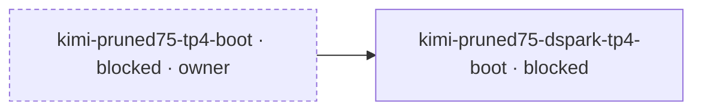

# Board — generated 2026-11-17 18:12 ET
## In flight
| where | owner | what |
|---|---|---|
| census | read-only in tick — booted nothing, claimed nothing, stopped nothing | six-node census `2026-11-17T23:03:18Z`–`2026-11-17T23:03:20Z` (one pass) reads `docker ps -aq` **0**, running **0**, volumes **0** and `:8000` listeners **0** on `.30`–`.35`; `docker events --filter type=container` over `2026-11-17T21:04:00Z`–`23:03:20Z` returns **0 B on `.30` and `.35`** and, on each of `.31`–`.34`, **2 `create`, 2 `start`, 2 `die`, 2 `destroy`, 2 `kill`** plus exec churn (**64** `exec_create`/`exec_start`/`exec_die` on `.31`, **53–54** on `.32`–`.34`) — two four-rank boots of `sha256:986795bc…`: A `58cddf1c62ba6578_23ca9ac7647c` `22:46:13Z`→`22:55:33Z`, B `58cddf1c62ba6578_628c29fd7fb4` `22:56:11Z`→`23:00:35Z`, both gone and `0` containers at the read. Retention checked per node before leaning on the window — each host's oldest retained event precedes the window start, so no node's zero is a rolled-out buffer: head `2026-11-16T12:47:57Z` (157 lines retained), `.31` `2026-11-17T16:03:33Z` (241), `.32` `15:31:36Z` (249), `.33`/`.34` `15:31:34Z` (249 each), `.35` `2026-11-12T05:50:09Z` (245). The older `15:55Z`–`16:05Z` control has since rolled out of `.31`'s buffer (**18,941 B at 18:03Z → 765 B now, its tail**), so the retained sensitivity controls are the head's `05:50Z`–`06:15Z` **7,106 B** and `.31`'s `20:40Z`–`20:50Z` **2,260 B**; `.35` answers **0 B** on the head's own control window, which is inside its 5-day-deep retention, so its in-window zero is an absence inside a covered interval rather than a test of sensitivity |
| pool | — (nobody drives it; units and reads re-proved each tick) | **serving on every host; through-mount reads made on head.** head units `active`/`active`/`active`, `NRestarts` meta **0**; `.31`–`.35` keep the known ~5 s `beegfs-meta` loop — .31 **97,937** (+1,372) · .32 **97,940** (+1,372) · .33 **97,943** (+1,372) · .34 **97,940** (+1,372) · .35 **97,924** (+1,371) over `7,161` s from the base's own pool read (**5.22** per restart), `.31` reading `active` this pass and `.32`–`.35` `activating`, storage `active` fleet-wide. Read `2026-11-17T23:04:30Z`: `/home/red/.cache/huggingface` symlink to `/mnt/beegfs/huggingface`, hub **103 entries**, both `DeepSeek-V4.1-Flash-1017` snapshots (`08c8657f…` **57** entries, `1bae0e10…` **56**) `config.json` **3,311 B** through the mount; `df -B1 /mnt/beegfs` used **14,168,734,302,208 B**, **+228,589,568 B** on the base's pair, the six roots' own net **-230,445,056 B**, residue **1,855,488 B**; `findmnt` reports `FSTYPE beegfs` with `SOURCE` reading `default`, which is not a mount proof — the through-mount reads above are |
| queue | register snapshot `e5e8445b…` both blocks below | register snapshot `mad-science/queue.json` sha256 **`e5e8445b…`** (unchanged on the base's) both blocks below it; **198 tasks: 157 done, 33 queued, 8 blocked, 0 running — 41 open**, `task-queue.py check` rc=0, **0 live claims**. graph's counts line `8 blocked, 1 edges, 7 prose-gated, 0 question-gated, 0 question, 39 rows not drawn (--all)`, byte-identical to the base's fence. Register still **dirty against `origin/main`** (`mad-science/queue.json` on disk `e5e8445b…` vs blob `ba1d6604…` at the tip), so the table shows text no commit carries yet |
| window | no live lease — ledger empty, no fence record, no declared window | `.local/fleet-leases.json` **48 B** sha **`34eed267…`**, mtime **2026-11-17 18:01 -0500** (`23:01Z`), byte-identical and on head's copy: **`leases: []` and `fenced: []`**. No `.local/fleet-window.lock` in this clone or on head's. The window's two picom boots were **leased**, not unaccounted: their own receipt (`~/benchmarks/picom-gap-20261117/README.md`) records `Ledger.acquire` with holder `session:picom-gap-20261117`, hosts `.31`–`.34` in rank order, ttl 21600, released through `Ledger.release` after a six-host zero-state proof to this same empty-ledger sha |
| campaign | `h2h-20261107` inactive since 2026-11-12 01:27:16 ET, zero leases its own | `h2h-20261107` — inactive since 2026-11-12 01:27:16 ET. user unit `sparkrun-campaign` reads **inactive**/`success`, `MainPID` **0**, `NRestarts` **0**, `Result` **success**, `ExecMainStartTimestamp` **Wed 2026-11-11 20:03:08 EST**, `InactiveEnterTimestamp` **Thu 2026-11-12 01:27:16 EST**. Scan `2026-11-17T23:04:30Z`: **49 `state.json` paths decompose to 9 real files / 9 campaign roots / 38 arms** — 41 of the paths are one inode (**39203529**) reached through `h2h-20261107/tp12-window -> .`, a symlink self-reference, so the base's *nested-copy chain has been cleaned up* clause is wrong: the chain is present and is one file, 40 aliases deep — **0 leases future `expires_at`** (float-epoch, 0 string-valued) |
| .30 | nothing live (no reservation) | `2026-11-17T23:03:18Z`: `docker ps -aq` **0**, running **0**, volumes **0**, `:8000` listeners **0**; container events in window **0 B** root **1,454,125,727,744 B avail** (-40,275,968 B vs base board's own census) `MemAvailable` **121,047,100 kB** (-136,960 kB) beegfs mgmtd=active / meta=active / storage=active; `NRestarts` meta **0** uptime `2026-11-11`; `kho=off` **1**, CMA **0/0**, `nr_free_cma` **0**; kernel `7.0.0-1025-nvidia` |
| .31 | nothing live (no reservation) | `2026-11-17T23:03:19Z`: `docker ps -aq` **0**, running **0**, volumes **0**, `:8000` listeners **0**; container events in window **290,010 B / 204 lines (the picom pair above)** root **1,584,092,680,192 B avail** (-28,348,416 B vs base board's own census) `MemAvailable` **123,180,512 kB** (-76,480 kB) beegfs mgmtd=inactive / meta=activating / storage=active; `NRestarts` meta **97,937** uptime `2026-11-11`; `kho=off` **1**, CMA **0/0**, `nr_free_cma` **0**; kernel `7.0.0-1025-nvidia` |
| .32 | nothing live (no reservation) | `2026-11-17T23:03:19Z`: `docker ps -aq` **0**, running **0**, volumes **0**, `:8000` listeners **0**; container events in window **216,794 B / 173 lines (the picom pair above)** root **1,751,688,790,016 B avail** (-36,306,944 B vs base board's own census) `MemAvailable` **122,917,588 kB** (-193,448 kB) beegfs mgmtd=inactive / meta=activating / storage=active; `NRestarts` meta **97,940** uptime `2026-11-11`; `kho=off` **1**, CMA **0/0**, `nr_free_cma` **0**; kernel `7.0.0-1025-nvidia` |
| .33 | nothing live (no reservation) | `2026-11-17T23:03:20Z`: `docker ps -aq` **0**, running **0**, volumes **0**, `:8000` listeners **0**; container events in window **214,407 B / 171 lines (the picom pair above)** root **1,666,126,168,064 B avail** (-36,302,848 B vs base board's own census) `MemAvailable` **122,808,404 kB** (-125,268 kB) beegfs mgmtd=inactive / meta=activating / storage=active; `NRestarts` meta **97,943** uptime `2026-11-11`; `kho=off` **1**, CMA **0/0**, `nr_free_cma` **0**; kernel `7.0.0-1025-nvidia` |
| .34 | nothing live (no reservation) | `2026-11-17T23:03:20Z`: `docker ps -aq` **0**, running **0**, volumes **0**, `:8000` listeners **0**; container events in window **214,407 B / 171 lines (the picom pair above)** root **1,137,816,915,968 B avail** (-44,683,264 B vs base board's own census) `MemAvailable` **122,971,976 kB** (-210,740 kB) beegfs mgmtd=inactive / meta=activating / storage=active; `NRestarts` meta **97,940** uptime `2026-11-11`; `kho=off` **1**, CMA **0/0**, `nr_free_cma` **0**; kernel `7.0.0-1025-nvidia` |
| .35 | nothing live (no reservation) | `2026-11-17T23:03:20Z`: `docker ps -aq` **0**, running **0**, volumes **0**, `:8000` listeners **0**; container events in window **0 B** root **1,199,601,197,056 B avail** (-44,527,616 B vs base board's own census) `MemAvailable` **122,119,968 kB** (-131,652 kB) beegfs mgmtd=inactive / meta=activating / storage=active; `NRestarts` meta **97,924** uptime `2026-11-11`; `kho=off` **1**, CMA **0/0**, `nr_free_cma` **0**; kernel `7.0.0-1025-nvidia` |
| publication | tick | base = newest published board, titled `2026-11-17 16:13 ET` (content sha256 **`ad11b578…`**), copied `.scratch/tick-1801-oJbM/base.md`; the board blob is **`b9beca42…`** (content sha256 **`ad11b578…`**) and it is unchanged across the tip move `c22ff6a`→`ccfa1c07`, so `--expect-sha` and `--expect-remote-sha` both carry `ad11b578…` (the tool hashes board content, not the git blob). Every census, pool, campaign, window and node cell above is this tick's own read `2026-11-17T23:03:18Z`–`23:08:16Z`; both queue blocks are `task-queue.py` output over that snapshot. The 2 commits the base board did not carry are folded below, with two measurements and two corrections |
## Work queue

| job | node cost | holds | state |
|---|---|---|---|
| `campaign-does-not-honour-the-.30-exclusion` — The campaign places tp>=4 work on .30 regardless of the memory-risk exclusion: a leaseable row that needs .30 is a live risk, so placement must be a field the director refuses to violate | — | — | queued — MECHANISM LANDED OFFLINE 2026-11-11 (commits `aa54000`, `ebf5c8e`, `298098d`, `08ff156`; no live lease and no live six-node boot has run, so the row stays open). One ledger, `<repo>/.local/fleet-leases.json` (flock + atomic write), and one … (full note: queue.json) |
| `sm121-ladder-acceptsampling-dflash` — SM121 survey ladder dies in llama-benchy warm-up: dflash_utils.build_dflash_verify_target_probs missing | single | — | queued — DENSE: the ladder leg cannot run on dsv41-sm121-dg:0.2.1. llama-benchy's first warm-up request takes the adapter's AcceptSampling top-k branch and /opt/dsv41/adapter/block_verify.py:106 calls dflash_utils.build_dflash_verify_target_probs, w… (full note: queue.json) |
| `kimi-pruned75-tp4-boot` — Kimi-K3.1-Pro pruned75 MXFP4: boot and ladder at TP=4 | quartet | — | blocked — OWNER 2026-11-11 (#3/#2): the owner chose the six-machine route (S3a) and does NOT authorize another four-machine attempt, so the "RE-BLOCKED on placement" paragraph above is superseded in both of its halves: no four-rank retry is ordered, … (full note: queue.json) — evidence: `receipts/kimi-k3.1-pro-pruned75-mxfp4-vllm-tp4.json` |
| `beegfs-meta-restart-loop-non-meta-hosts` — beegfs-meta restart-loops every 5 s on .31-.35, and the loop hides a failed state behind "activating" | single | — | queued — Measured 2026-11-09 07:03-07:05 ET, and it is the side effect of the fix `beegfs-units-restart-no` (done) blessed: /etc/systemd/system/beegfs-meta.service.d/oom.conf (mtime 2026-11-08 16:03 on .30, 16:05 on .31) sets OOMScoreAdjust plus Res… (full note: queue.json) |
| `head-mesh-cannot-reach-30` — head's ssh cannot reach .30 by name: the alias fails host key verification while the node's own address answers | single | — | queued — Measured 2026-11-09 08:02-08:06 ET and re-probed 08:23:46 ET, read-only from the head: ssh to the .30 name fails 'Host key verification failed', while the same node answers 'ok spark-41e1' when addressed by its own address from the same hea… (full note: queue.json) |
| `hf-cache-20261110-docs-only-repin-bundle` — Docs-only model drift from the 2026-11-10 cache update: 22 recipe rows across 10 repos ride their lane’s next boot (no boot of its own) | — | — | queued — Classes measured with refresh-sweep report mode + Hub tree diff: only README/LICENSE/LICENSE-GLM-5.3-Flash/.eval_results/images files differ between the pin and the Hub head for orcarouter/Nex-N2.5-mini-Uncensored-NVFP4, orcarouter/Qwen3.8-… (full note: queue.json) |
| `hf-cache-20261110-orcacyber-new-quant` — OrcaCyber-Nano-1.0 head adds a Q8_0 DFlash2 GGUF: decide whether the new quant earns an arm (shipped arms unaffected) | single | — | queued — The 2026-11-10 sweep: orcarouter/OrcaCyber-Nano-1.0 head 97140f3ff7e2 adds OrcaCyber-Nano-1.0-AI-Defense-DFlash2-Q8_0.gguf (~2.05 GB, + README/.gitattributes) over pin 1af1635aa22b. The two shipped arms (recipes/cybersec/orcacyber-nano-1.0-… (full note: queue.json) |
| `lane-survey-edge0-audio8-tts` — Media-lane survey: Edge0/Audio8-TTS-Realistic-Air - 0.6B DualAR TTS + bundled codec, TP<4 so surveyed only | — | — | queued — License class: Apache-2.0, unrestricted - ships as a normal arm with no eval-only banner. Weights: 601,159,424 params BF16 in model.safetensors 1.20 GB plus a separate 44.1 kHz codec.pth 1.35 GB; repo 2.39 GiB. Architecture: model_type arkt… (full note: queue.json) |
| `lane-survey-viggle-viggle-remake` — Media-lane survey: Viggle/Viggle-Remake - MiniMax-H3 video-to-video pipeline (GGUF/int8 + ComfyUI node), TP<4 so surveyed only | — | — | queued — License class: community/restricted - license_name minimax-h3-community-license, base_model MiniMaxAI/MiniMax-H3; the media lane already ships MiniMax-H3 arms under the same family and any arm must carry that license note. Repo 167,573,265,… (full note: queue.json) |
| `lane-survey-webai-official-twil-8b` — Explore-lane survey: webAI-Official/TwIL-8B - 8.8B Granite-family reasoning model, TP<4 so surveyed only | — | — | queued — License class: RESTRICTED / NON-COMMERCIAL - card license_name webai-non-commercial-license-ver.-1.0 (LICENSE.md), so any future arm ships with the eval-only banner plus an explicit non-commercial note in the recipe description and the lane… (full note: queue.json) |
| `queue-mode-done-sibling-holds-canary-row` — Queue mode will not lease a row whose recipe a done sibling already holds | single | — | queued — Measured 2026-11-10 00:05-00:16 ET, read-only: arm3-control-cell-canary-line (registered 23:21 by df9d40b) is the register's first queued row carrying both recipe: and tp: (quartet, tp 4, recipes/ds4/deepseek-v4.1-flash-knapcio-tp4-1m-sglan… (full note: queue.json) — evidence: `mad-science/STATUS.md 2026-11-10 00:15 ET queue row; commit 52b99ef` |
| `campaign-leases-tp4-onto-30` — The campaign leases memory-heavy TP4 quartets onto .30, which the owner ruling excludes | — | — | queued — MECHANISM LANDED OFFLINE 2026-11-11 (commits `aa54000`, `ebf5c8e`, `298098d`, `08ff156`; no live lease and no live six-node boot has run, so the row stays open). One ledger, `<repo>/.local/fleet-leases.json` (flock + atomic write), and one … (full note: queue.json) |
| `campaign-state-copy-re-nests` — The director's receipts root copies state.json back into a window subdir, so one campaign now holds 40 nested copies | — | — | queued — Measured 2026-11-11 05:1x ET, read-only on the head: `h2h-20261107/state.json` and 40 byte-identical copies at `h2h-20261107/tp12-window/state.json`, `.../tp12-window/tp12-window/state.json` and so on, one level deeper per run under that wi… (full note: queue.json) |
| `hf-cache-20261110-cache-consistency-defects` — HF cache consistency defects: four repos hf ignores on a refs/main byte defect, one on a broken absolute symlink, plus 204 GB of stray non-cache trees in the hub root | single | — | queued — Measured 2026-11-10 with `hf cache ls --no-truncate --show-warnings` on .30 after the update loop finished a pass. (1) refs/main carries a trailing newline in models--lodestones--Kromoss (41 B; ref a4fe9744, snapshots 0c5417ec + a4fe9744), … (full note: queue.json) |
| `hf-cache-20261110-template-ab-ifm-k2` — K2-Horizon template/code drift A/B: head c4f92a0d (0.9B) and 240f2de3 (7B-FP8) vs the shipped pins, template identity + one fixed request | single | — | queued — Class (b) from the 2026-11-10 cache sweep: no weight file changed, but IFM/K2-Horizon-0.9B head moves 383cb66347be -> c4f92a0d66e2 changing chat_template.jinja AND modeling_k2_horizon.py and REMOVING chat_template_asst_tool_gen.jinja + chat… (full note: queue.json) |
| `kimi-superexpert-ref-probe` — Probe shashanth-27xA9 Kimi-K3.1-Pro-SuperExpert-12GB through the transformers reference route | single | — | blocked — OWNER 2026-11-11 (directive): parked until the production serve returns — see `mad-science/TODO.md` §"Settled questions" `## Owner directive 2026-11-11 — TP1/TP2 parked until production returns`; no state change and no unblocking. \| estimat… (full note: queue.json) — evidence: `receipts/zz-kimi-k3.1-pro-superexpert-24b-q4p-ref-vllm.json` |
| `mem-guard-outlives-its-task` — A window arm's 6.0 GiB stop-rule guard outlives the arm, so the runner accumulates guards for tasks whose containers are gone | single | — | queued — CORRECTED 2026-11-11: the premise that a leaked guard can stop a future boot is false. `mem-guard.sh` issues `sparkrun stop` only for the TID in its own argv, so a guard whose task is gone is a stale no-op and cannot touch the next boot. Wh… (full note: queue.json) |
| `pool-target-probe-beegfs-ctl-absent` — Pool storage-target byte accounting is unreachable: beegfs-ctl is absent from .30 though beegfs-utils 20:8.4.1 is installed | single | — | queued — Measured 2026-11-10 15:05:59Z and again 15:06:29Z on .30: beegfs-ctl exits 127 (command not found) as the red user, and no binary named beegfs-ctl exists under /usr, /opt or /sbin at depth <=5, although dpkg lists beegfs-utils 20:8.4.1 plus… (full note: queue.json) |
| `pool-window-invalid-cells` — Gate every boot on a pool half-probe: a cell written while beegfs was down is invalid, not weak | single | — | queued — Pre-registered 2026-11-08 13:22 ET. Invalid windows: 11:27:56-12:07:30 and at/after 12:57:32 (B still open, Restart=no); admissible middle 12:07:30-12:57:31. Acceptance: run-arm (and any lane's harness) probes … (full note: queue.json) |
| `hf-cache-20261110-pool-fetch-gaps` — Pool gaps left by the 2026-11-10 cache update: two Hub heads, two pinned revisions, three absent repos, one private repo needing an org token | single | — | queued — CENSUS 2026-11-11 (`.scratch/tp4-20261111/RECEIPT-boot-a-and-pool-census-20261111.md`): the ds4 1017 body's 'double-count' is now an artifact, named: two revisions share one index — `08c8657f` (a link farm) and `1bae0e10` (the in-body revis… (full note: queue.json) |
| `board-publish-accepts-weaker-replacement` — publish replaces a better-grounded In-flight composition with a fresher byte-compatible one, and no guard notices | — | — | queued — The publish guards compare BYTES, so they cannot see that a replacement carried FEWER facts than the rows it removed. Measured 2026-11-11 20:18 ET on mad-science/STATUS.md: this tick's composition was accepted (publish rc=0, lint ok) while … (full note: queue.json) — evidence: `mad-science/STATUS.md@e4bea70` |
| `board-publish-keeps-in-flight-row-set` — A board published without one of the In-flight state rows passes every guard, because publish compares bytes and never the row set | single | — | queued — Measured 2026-11-11 03:17-03:25 ET. The 03:14 board (blob 2249062c) carried a `\| queue \|` row; the 03:17 board (commit `8e160b2`, blob 0f54622c) carried none, and a tick that composes on it and keeps the In flight body verbatim inherits the… (full note: queue.json) — evidence: `mad-science/STATUS.md at 8e160b2 / bc2cc38 / 9ae7cd4` |
| `cache-audit-pool-budget` — `tools/cache-audit.py --budget-gb`: add a pool mode that judges the one shared HF pool against 90 % of capacity | single | — | queued — `tools/cache-audit.py --budget-gb` still measures per node, but the HF cache is one shared pool: all six nodes report the same usage through the shared hub, so the audit flags the whole fleet at once and no node can be read as over- or unde… (full note: queue.json) |
| `executor-release-host-claim-on-failure` — An executor that stops observing a launch must release the sparkrun host claims it holds | single | — | queued — Measured 2026-11-08 04:09-04:13 ET: kimi-k3.1-pro-pruned75-mxfp4-dspark-vllm-tp4 attempt 1 launcher (pid 1883449) held .30-.33 while its own registry distribution failed at 414.7 s (637.1 MiB at 1.6 MiB/s from docker.io, then … (full note: queue.json) |
| `fleet-boot-without-lease-record` — A four-rank boot serves with no lease in either ledger and no window lock | — | — | queued — Measured 2026-11-11 19:15:59Z-19:31Z, read-only: task `b020d2dd178343a5_55dafcf24cde` runs one rank each on `.31`-`.34` (image `littlecedar/dgx-spark-dsv41:canary-roce-aff52fa5`, id `3f4480818acb`, `Up` and healthy, `/v1/models` 200 serving… (full note: queue.json) |
| `pool-content-fall-20261116` — Pool used fell 501 GB in 6.5 h while every repo entry stayed: name the deletion before the next budget claim | — | — | queued — Measured read-only from the head at 2026-11-16T19:07:40Z: df -B1 on /mnt/beegfs reads used 13,459,970,326,528 B, which is 501,316,845,568 B BELOW the 13,961,287,172,096 B the 06:39 board carried at 11:23:54Z. It is not HF content vanishing:… (full note: queue.json) |
| `ripple-65b-nvfp4-dflash2-tp1` — Ripple-65B Preview NVFP4 TP=1 + DFlash2 drafter: ladder + suite (zz- probe) | single | — | blocked — OWNER 2026-11-11 (directive): parked until the production serve returns — see `mad-science/TODO.md` §"Settled questions" `## Owner directive 2026-11-11 — TP1/TP2 parked until production returns`; no state change and no unblocking. \| The dra… (full note: queue.json) |
| `ripple-65b-nvfp4-tp1` — Ripple-65B Preview NVFP4 TP=1: first boot, ladder + suite (zz- probe) | single | — | blocked — OWNER 2026-11-11 (directive): parked until the production serve returns — see `mad-science/TODO.md` §"Settled questions" `## Owner directive 2026-11-11 — TP1/TP2 parked until production returns`; no state change and no unblocking. \| First b… (full note: queue.json) |
| `runtime-cache-stale-tree-gc` — Delete the stale runtime-cache trees the 2026-11-12 audit approved (732 GB planned, never executed) | single | — | queued — BATCH 1 EXECUTED 2026-11-16T16:33:28Z — 52 items / 554.54 GB deleted on '.30'-'.34' ('.30' 22.53, '.31' 96.38, '.32' 143.49, '.33' 143.68, '.34' 148.46 GB) and '.35' released 0.00 GB — receipt '.scratch/gc-20261116/census.md' rev 3 §Executi… (full note: queue.json) |
| `sparkrun-single-gid-index-for-two-hcas` — sparkrun injects one GID index across two HCAs whose tables disagree | — | — | queued — REPORT-ONLY IN THIS REPO (sparkrun-side defect; no `recipe`/`tp`, not bootable). One derived `NCCL_IB_GID_INDEX` applied to every HCA the probe names is wrong when the rails' GID tables disagree: `scripts/ib_detect.sh:44-45` derives the ind… (full note: queue.json) |
| `media-idol-3dgs-boot` — Idol single-image 3DGS trial: SDK on the tracked fixture, receipt = .ply 3DGS header + Gaussian count + wall, one node | single | — | blocked — Authored, not booted. TP=1 single-node script arm; a four-rank measurement is what needs a declared window and this is not one, so no lease applies. BLOCKER NAMED 2026-11-09 (owner answer `#81`): the facebook DINOv3 licence is not accepted … (full note: queue.json) — evidence: `head:~/benchmarks/tp1-20261112/idol-dinov3-gate-probe.log` |
| `campaign-ignores-declared-window` — The campaign leases and launches onto ranks another session has declared in .local/fleet-window.lock | — | — | queued — MECHANISM LANDED OFFLINE 2026-11-11 (commits `aa54000`, `ebf5c8e`, `298098d`, `08ff156`; no live lease and no live six-node boot has run, so the row stays open). One ledger, `<repo>/.local/fleet-leases.json` (flock + atomic write), and one … (full note: queue.json) |
| `kimi-pruned75-dspark-tp4-boot` — Kimi-K3.1-Pro pruned75 + DSpark k=5 drafter: boot, acceptance and ladder vs the plain arm | quartet | kimi-pruned75-tp4-boot | blocked — OWNER 2026-11-11 (#3/#2): the owner chose the six-machine route (S3a) and does NOT authorize another four-machine attempt, so no four-rank drafter boot is ordered either; any future rank on `.30` is legal only inside an explicitly declared … (full note: queue.json) — evidence: `receipts/kimi-k3.1-pro-pruned75-mxfp4-dspark-vllm-tp4.json` |
| `ripple-65b-bf16-tp2` — Ripple-65B Preview BF16 TP=2: quality control + the 1M-context cell (zz- probe) | pair | — | blocked — OWNER 2026-11-11 (directive): parked until the production serve returns — see `mad-science/TODO.md` §"Settled questions" `## Owner directive 2026-11-11 — TP1/TP2 parked until production returns`; no state change and no unblocking. \| The unq… (full note: queue.json) — evidence: `receipts/zz-ripple-65b-preview-bf16-tp2-vllm.json` |
| `webai-twil-8b-eval-only-arm` — Author and ship the webAI 8.8B eval-only arm (webAI-Official/TwIL-8B): recipe, license banner, lane README notice, index row | — | — | queued — Authoring work, no hardware yet and no recipe, so not machine-runnable. LICENSE (owner 2026-11-12: "Accept and ship it."): card `license_name: webai-non-commercial-license-ver.-1.0`, so the arm ships EVAL-ONLY under AGENTS.md §Recipes, with… (full note: queue.json) |
| `campaign-six-node-claim` — The director claims and leases a six-node tp 2 x pp 3 shape: the register cannot express six ranks, so the claim itself is the work | — | — | queued — MECHANISM LANDED OFFLINE 2026-11-11 (commits `aa54000`, `ebf5c8e`, `298098d`, `08ff156`; no live lease and no live six-node boot has run, so the row stays open). One ledger, `<repo>/.local/fleet-leases.json` (flock + atomic write), and one … (full note: queue.json) |
| `kimi-k31-indexer-block-vs-blhnc-layout` — Kimi K3.1 indexer needs 64-token kernel blocks; KDA/mamba forces a 5,760-token block and BLHNC | — | — | queued — AUTHORING 2026-11-11, estimate 4 h provisional. Engine-side blocker, not a memory one: the DeepSeek-V32 indexer needs 64-token kernel blocks, while the KDA/mamba alignment forces the KV manager block to 5,760 tokens (`interface.py:1115`, 'S… (full note: queue.json) — evidence: ``.scratch/kimi-six-engine-verdict-20261111.md`: the pinned image's engine `v0.33.0rc1.dev1016+g06129ab02` (boot6 rank-1 log), #66037 merged as `4088c283` 2026-11-09T04:31Z and absent from the pinned tree and from every release, GHCR tags ending at `2026110702` both resolving to the pinned digest, Docker Hub `eugr/spark-vllm` latest 2026-11-07, and the knob audit that leaves only the rebuild; the row stays queued on an image built from main ≥ `4088c283`` |
| `mech-cites-0-4-3` — Re-derive the remaining 117 recipes/MECHANICS.md citations against the installed sparkrun build | — | — | queued — d0d050f landed 27 moved anchors + 13 byte-identical controls for §The one rule and §Key reference §Format and identity, then stopped. Remaining 117 anchors still carry 0.4.2/0.4.0 numbering: the rest of §Key reference (from §Model and servi… (full note: queue.json) |
| `metrics-instrument-confound` — Metrics knob decomposition: one identical recipe, metrics-on vs metrics-off, name the performance-impacting knobs (`#68` ROM bar) | — | — | queued — Owner's `#68` authorises the decomposition that makes the comparability bar checkable, and it must separate THREE regimes, because only one of them can bias a cell: (1) `tools/run-arm.sh`'s scrape is a single exec AFTER the cell and before … (full note: queue.json) |
| `minimax-viggle-remake-eval-only-arm` — Author and ship the MiniMax video eval-only arm (Viggle/Viggle-Remake): ComfyUI node route, license banner, lane README notice, index row | — | — | queued — Authoring work, no hardware yet and no recipe, so not machine-runnable. LICENSE (owner 2026-11-12: "Accept and ship it."): card `license_name: minimax-h3-community-license`, base_model MiniMaxAI/MiniMax-H3 — community-restricted, so the arm… (full note: queue.json) |
| `ds4-fp4-kv-layout-sm121-port` — DS4 1017 SM121: port the V41/V41_FP4 KV layout so fp4 KV is admissible — dtype is not a lever today, and sizing lies about fp4 | quartet | — | blocked — CORRECTION TO THE FP8-KV IDEA this lane carried: KV dtype is NOT a lever here. The line is already `kv_dtype: fp8_e4m3`, and `fp8_ds_mla` is not a value this engine knows — zero occurrences in image commit `103ad321`; it is vLLM's packed ML… (full note: queue.json) |
## Landed session

| time ET | commit | one clause |
|---|---|---|
| 08:10 | `e79b489` | feat(qwen4): boot-verified UD-Q3_K_XL GGUF arm for Qwen3.8-Flash-Next at TP=1 |
| 09:03 | `dcf98a2` | docs(qwen4): GGUF viability arm in the lane index; register row answered by boot |
| 10:01 | `276c149` | ship two owner-approved eval-only arms: TwIL-8B and Viggle Remake |
| 10:18 | `10ed155` | rule the head-node launch precondition, with its reason attached |
| 11:02 | `ba7b9b3` | the six roots' fall is the BeeGFS pool intake, measured to 311 KB |
| 11:24 | `07485e0` | mask the head hostname the GGUF register note carried |
| 13:03 | `417ad7e` | ledger: record the board tick that landed and the push it could not make |
| 13:37 | `bf59c0d` | note the GGUF arm's launch host and cluster resolution in the lane doc and register row |
| 14:34 | `2865aa2` | drop the head hostname from the GGUF arm's launch-host line |
| 14:50 | `24aae67` | drop the second count from the unpinned-model-revision note |
| 14:52 | `05944df` | record two stand-down board ticks and close the pool fall to an identity |
| 14:52 | `e3a2839` | board: 13:47 ET refresh, and the pool lost half a terabyte unattributed |
| 14:54 | `cc7b292` | name the half-terabyte pool fall: the `sparkrun/` tree is gone |
| 08:59 | runtime-cache GC (no commit) | the approved `runtime-cache-stale-tree-gc` executed against its own 52-row sidecar: health gate PASS first (the fenced serve answering), then **52 of 52 planned items deleted, 554.54 GB freed** — node-local `runtime-cache` trees for non-1017 and vision variants plus dangling images, no `docker image prune`, no list expansion; receipt `.scratch/gc-20261116/run-20261116T135644Z.md`, register row left open for its owner |
| 14:55 | board refresh | census re-read at `2026-11-16T19:52:54Z`–`2026-11-16T19:52:59Z` on the `13:47 ET` base, the served ranks' readiness and engine children probed, the pool re-proved by a through-mount `stat -L` on the head and `.35` (103 hub entries), the fence and all nine campaign roots re-read, the register re-snapshotted with both queue blocks re-rendered from it, and the 14 commit(s) the base board did not carry folded from their own subjects |
| 14:59 | `f2344ec` | ledger records the tick that stood down behind the peer's fresher board and hands the pool `df` decomposition — the six nodes' own `/srv/beegfs/storage` totals — to a cell it could not change |
| 07:15 | `2be97f0` | record that the close-out landed inside a peer's commit |
| 07:27 | `6f22bb9` | record the 07:05 tick that stood down behind a peer's 06:39 board |
| 07:35 | `ae9db99` | log the 11:24Z fleet re-read and the fence's id-as-digest |
| 07:57 | `d03d519` | queue the rest of the MECHANICS.md citation re-derivation |
| 09:21 | `055b491` | board: refresh on the 06:39 base with an `11:28:25Z` census |
| 12:09 | `e2ef062` | re-take the stated recipe counts for the three arms that landed |
| 15:03 | `e274094` | record the tick that stood down at the publish guard, and the GC arithmetic it cannot close |
| 15:08 | `91ed9f7` | ledger: record the tick that stood down behind a fresher peer board |
| 15:11 | `7651da1` | record the tick that stood down and refute the board's uptime cell |
| 15:23 | board refresh | census re-read at `2026-11-16T20:18:36Z`–`2026-11-16T20:18:39Z` on the base board it replaces, whose own cells were read `2026-11-16T20:18:36Z` — `0 h 00 min` apart: the production serve alone on `.31`–`.34` with every rank's `sglang.launch_server` matching and rank 0 answering `/v1/models` 200 in-container, `.30`/`.35` empty, research containers 0 and volumes 0 fleet-wide; the pool re-proved by units and two through-mount `stat -L` reads on the head and on `.35` (103 hub entries, up one from the base, newest `models--unsloth--Qwen3.8-Flash-Next-GGUF`); the fence re-read and its identity checked against this tick's own `StartedAt`; the campaign and register re-read (register `e84d7bf6…`, 41 open) with both queue blocks re-rendered from the snapshot |
| 15:05 | `f297d2b` | name the pool GC in the stand-down note and drop its `Up 3 days` clause |
| 15:10 | `10790ee` | ledger: record the tick that stood down behind a fresher peer board |
| 08:59 | runtime-cache GC (no commit) | the approved `runtime-cache-stale-tree-gc` executed against its own 52-row sidecar: health gate PASS first (the fenced serve answering), then **52 of 52 planned items deleted, 554.54 GB freed** — node-local `runtime-cache` trees for non-1017 and vision variants plus dangling images, no `docker image prune`, no list expansion; receipt `.scratch/gc-20261116/run-20261116T135644Z.md`, register row left open for its owner |
| 15:25 | board refresh | census re-read at `2026-11-16T20:24:27Z`–`2026-11-16T20:24:32Z` on the `13:47 ET` base, the served ranks' readiness and engine children probed, the pool re-proved by a through-mount `stat -L` on the head and `.35` (103 hub entries), the fence and all nine campaign roots re-read, the register re-snapshotted with both queue blocks re-rendered from it, and the 3 commit(s) the base board did not carry folded from their own subjects |
| 15:13 | `112f1f7` | record the stand-down and name the `pgrep` self-match before it ships |
| 15:23 | `716d42f` | disclose the peer sections the stand-down commit published |
| 15:25 | `f922c23` | record the seventh stand-down of this hour's board ticks |
| 15:28 | `2ff99cc` | queue the 501 GB pool fall the GC batch did not cause, and record standing down |
| 21:07 | `edd48b1` | re-land the ledger note this clone's reset onto `origin/main` would otherwise have dropped |
| 21:07 | board refresh | census re-read at `2026-11-17T02:07:02Z`–`02:07:06Z` on the `15:25 ET` base after a `5 h 43 min` gap (the workstation rebooted at `15:33 ET`), the served ranks' readiness and engine children probed, the pool re-proved by through-mount `stat -L` reads on the head and `.35`, the fence and all nine campaign roots re-read, the register re-snapshotted with both queue blocks re-rendered from it, and the 4 commit(s) the base board did not carry folded from their own subjects |
| 21:42 | `72e292b` | Serve the ds4 production arm from the stock loader's 6.85M-token pool: the recipe pins `DSV41_FAST_LOAD=0` against the launcher's `1` default, so boot takes ~544 s TTR instead of ~290 s, that commit's own measurement — this relaunch's `StartedAt` to engine pool print ran 703 s; live container carries `MAX_TOTAL_TOKENS=6849792` and the engine granted **6,138,368** tokens at `03:00:39Z`; numbers land in `recipes/ds4/README.md` §"Measured: ds4 prefix-cache remediation (2026-11-17)" with receipts under `~/benchmarks/ds4-prefix-cache-20261117/` |
| 22:11 | board refresh | census re-read at `2026-11-17T03:02:26Z` on the `21:29 ET` base, `0 h 55 min` apart, which caught the **production serve relaunch** (`b020d2dd178343a5_510ded98367b`, rank-0 `StartedAt` `2026-11-17T02:48:56Z`) mid-window and re-proved it live: every rank's `sglang.launch_server` child present and rank 0's `/v1/models` **200** naming `deepseek-ai/DeepSeek-V4.1-Flash-1017` at `2026-11-17T03:05:51Z`; `103` hub entries through the mount on head and `.35`; nine campaign roots / `38` arms with 0 live leases; register `e5e8445b…` unchanged with both queue blocks re-rendered from that copy; and the 1 commit the base did not carry folded from its own subject |
| 22:15 | `d22633a` | ledger: record the 22:11 tick that caught the production relaunch |
| 22:25 | `8be3fba` | record the stock loader's measured pool and the window's gates in the ds4 lane, its overlay README and the ledger |
| 22:26 | `d3f58a8` | make the ds4 live census gate executable by the next session, deriving HiCache's ratio from post-warm `MemAvailable` |
| 22:34 | `9b7b476` | assert the container-appearance verdict rather than the raced elapsed second in `tools/run-arm.sh`'s test |
| 22:36 | `cd2a0f5` | ledger: record the red push and its flake fix |
| 22:46 | `5919ef3` | correct the ds4 stock-loader numbers to what the serve measured (`11.80 GB -> 6,138,368 tokens`), and trim the recipe comment to the one property an operator would get wrong |
| 23:11 | board refresh | census re-read at `2026-11-17T04:02:20Z` on the `22:11 ET` base, `0 h 59 min` apart, which finds the **same production task** still serving (no relaunch): every rank's `sglang.launch_server` child present and rank 0's `/v1/models` **200** naming `deepseek-ai/DeepSeek-V4.1-Flash-1017` by `2026-11-17T04:02:23Z`; `103` hub entries through the mount on head and `.35` with the ds4 arm's `config.json` **3,311 B** on both; nine campaign roots / `38` arms with 0 live leases; the fence **corrected at `03:23:28Z`** to the current task, retiring the base board's "names the previous launch" clause; register `e5e8445b…` unchanged with both queue blocks re-rendered from that copy; and the 6 commit(s) the base did not carry folded from their own subjects |
| 23:16 | board correction | retired the `LIKELY` KV/radix-pool explanation this tick had written for the `MemAvailable` fall on `.31`–`.34`: the falsifier is one `/metrics` read, and it returns `sglang:num_used_tokens` **0.0** / `num_running_reqs` **0.0** against **6.138368e+06** available at `04:15:19Z` and `04:16:04Z`, with `.31`'s `MemAvailable` rising `+4,088 kB` between them — an empty pool cannot carry a 4.4 GB hourly fall, so the row now states the delta and names page cache as the unmeasured candidate |
| 23:22 | `7c6aa5f` | reschedule the ds4 live census gate to the next declared TP≥4 window (owner call): the armed +3 h/+24 h capture was stopped before it fired with no receipt written, and the gate is now window-scoped rather than wall-clock — thresholds, the derived HiCache sizing and the SWA-tails discriminator unchanged |
| 00:11 | board refresh | censuses at `05:02:39Z` and `05:09:10Z` on the `23:16 ET` base — **the production serve the base carried is gone from `.31`–`.34`**, teardown inside `(04:02:23Z, 05:02:39Z]` with no mechanism anywhere on the fleet, all six nodes idle and unclaimed, the pool **growing 5.32 GB** this hour, and the fence still refusing placement for the stopped task |
| 00:19 | board correction | replaced the campaign cell's carried `find` **49** / 40-nested-copy clause with this tick's own read at `2026-11-17T05:02:54Z`: 21 `state.json` under `/home/red` with and without `-L`, and `h2h-20261107/tp12-window` a **symlink to `.`** whose `state.json` is inode **39203529**, the same file as `h2h-20261107/state.json` — so the register row `campaign-state-copy-re-nests` that premises 40 real copies needs its owner's re-check. Also this tick's own measurements, no board change: `.31`–`.34` each carry a dockerd `task-delete` between `04:32:25.05Z` and `04:32:25.66Z` (0.61 s across four hosts — a launcher teardown, not a crash), no kernel OOM and no earlyoom kill line on `.31` since `03:30Z`, no watchdog process or log for the task, and head's `.bash_history` mtime `2026-11-15 01:08:50Z`; `.31`'s earlyoom logged 9.31–9.41 % avail with swap `10,923/16,383 MiB` free in the four minutes before it, and the pool's `df -B1` used read `13,461,907,046,400 B` at `05:06:37Z`, `+5,332,008,960 B` over `3,327` s with no repo added and nothing served — stated, attributed to nothing, and folds `9164433` (retiring the board's own `LIKELY` pool-fill explanation of the served ranks' memory fall) which the base's landed table did not carry |
| 00:30 | board correction | retired this tick's *"mechanism unattributed"* clause for the production serve's disappearance: the falsifier behind it searched `--since "2026-11-17 04:00:00"`, which `journalctl` reads as **local** time (5 h past the window), so *No entries* was the probe's bug and not an absent log — re-run in UTC, `.31`–`.34` each carry a dockerd `task-delete` at **`04:32:25Z`** (0.43 s across the four), naming a stop call rather than a crash; the window narrows to that second; the issuer is **unidentified** — `00:31` withdrew the `sparkrun cluster monitor` inference, since an anonymous `ssh … 'sparkrun stop'` writes no shell history either and the head's sshd accepted off-cluster sessions across the gap |
| 00:31 | board correction | withdrew the `LIKELY` issuer this tick's `00:19` row and the peer's `00:30` row both carry for the teardown. The clause behind it — that the attached `sparkrun cluster monitor` TUI is *the one surface with a stop action that leaves no shell history* — is false: an anonymous `ssh <host> 'sparkrun stop …'` writes no history either, and head's sshd accepted `red@100.64.23.3` sessions throughout the gap. With no discriminator between those callers the issuer is **unidentified**, and the discriminator that would settle it — the head's auth/journal for the `04:32:25Z` second — has not been run. Also narrowed this tick's campaign cell: the self-symlink explains the **nested-copy shape**, not the base's `49` total, which reproduces as **21** under both predicates and is left unattributed |
| 01:07 | board refresh | census re-read at `2026-11-17T06:01:57Z`–`2026-11-17T06:01:59Z` on the `00:31 ET` base, `0 h 59 min` apart: all six nodes idle, `0` containers and `0` volumes fleet-wide with head's `sparkrun status` listing every host idle, so the production serve the base found gone at `04:32:25Z` is absent a second hour; the pool re-proved by units and a through-mount read on all six (103 hub entries, ds4 `config.json` 3311 B, `df -B1` used **13,468,383,576,064 B**, **+6,487,539,712 B** on the base's pair); the lease ledger identical here and on the head with its single fence record and no window lock; nine campaign roots / 38 arms with 0 live leases; the register (`e5e8445b…`) unchanged with both queue blocks re-rendered from the snapshot; and **no commit** landed since the base board, so this table gained no commit row |
| 01:11 | `e7d8179` | ledger records the 01:07 stand-down and scopes the pool's six-node agreement to a single pass, with the 3 s-separated read that disagreed by 221,249,536 B |
| 01:22 | `292e377` | `board_stamp` now prefers the ISO census read over the cited base title, so `publish` orders by the read its own guard exists to check, pinned by `BoardStampConvention` with an ET-fallback negative control |
| 02:00 | board refresh | census re-read at `2026-11-17T07:02:53Z`–`07:02:56Z` on the `01:07 ET` base, `1 h 01 min` apart: all six nodes read **0** containers and **0** volumes at the read, so the production serve is absent a third hour — but `.30` was **not idle this hour**, logging 19 container `create` events between `05:53:45Z` and `06:12:27Z` of which 15 started and were torn down (14 inside 18 s, one held 689 s); every node's root fell, net **-5,053,841,408 B**, and the pool gained **+5,063,049,216 B** by a through-mount `df -B1` on the head with `103` hub entries and the ds4 `config.json` **3,311 B** read on head and `.35`; the lease ledger is byte-identical here and on the head with its single fence record and no window lock; nine campaign roots / 38 arms with 0 live leases; the register (`e5e8445b…`) unchanged with both queue blocks re-rendered from the snapshot; and the 2 commit(s) the base did not carry folded from their own subjects |
| 02:20 | board correction | re-derived `.30`'s churn rather than trusting the first breakdown: **19 `create` events** in the window, **15 started and torn down** (14 inside 18 s, one held **689 s**), local `picom-build-test` **3** not 4, and **4 classic-builder intermediates carrying no `image`** — the reason `create` and `start`/`task-delete` counts differ; the cell's per-image figures now sum to its stated total |
| 03:18 | board refresh | census re-read at `2026-11-17T08:04:50Z`–`2026-11-17T08:04:52Z` and container state re-read at `2026-11-17T08:13:44Z`–`2026-11-17T08:13:46Z` on the `02:00 ET` base, `1 h 02 min` apart: all six nodes idle with **0 containers and 0 volumes** at both reads and **0 docker `create`/`start`/`task-delete` events in the hour** (against last hour's 19 on `.30`), so the production serve's `04:32:25Z` teardown is absent a fourth hour; the pool re-proved by units and a through-mount `df -B1`/`stat -L` on the head (`103` hub entries, ds4 `config.json` 3,311 B, used **13,473,555,152,896 B**, **+108,527,616 B** on the base's pair); the lease ledger **changed mid-tick** — the production fence was deleted and `session:picom-boot-20261117` took a 4 h lease on `.31`–`.34` at `2026-11-17T08:06:52Z` with no container visible 7 min later — so the `window` row was recomposed and a lease row added; nine campaign roots / 38 arms with 0 live leases, and the `find -L` total of 21 shown to be 11 foreign repo-tooling files plus a peer tick's byte-identical scratch copy; the register re-snapshotted with both queue blocks re-rendered from that copy. |
| 03:31 | board correction | retired this tick's *no docker `create`/`start`/`task-delete` events in the hour* clause, and the *nothing is serving under the lease yet* clause that depended on it. The falsifier was the instrument, not the world: `journalctl -u docker` held **1 line in 65 min** (dockerd logs container lifecycle only at debug level), while `docker events --filter type=container` returns **76** events on `.30` for `05:50Z`–`06:15Z` — its own positive control — and shows the six-node window `07:02:53Z`–`08:29Z` as: nothing anywhere until `2026-11-17T08:13:26Z`, then `.32`/`.33`/`.34` **2 create, 2 start, 2 die, 2 destroy, 2 kill** each and `.31` **13 create, 13 start, 14 die, 14 destroy, 1 kill**, all on `ghcr.io/littlecedar/dgx-picom-ds41f` (local tag `ds41f-7c123ad4-pr15-pr7`, pinned `@sha256:5b09a688…`), last event `2026-11-17T08:26:51Z`; `.30` and `.35` stayed at 0. The point-in-time zeros were true and both reads fell between attempts, so the cells now carry the churn beside the zeros instead of an idleness claim. |
| 09:39 | `ddb7d80` | picom TP=4 boot receipt recorded and its failure text corrected |
| 09:42 | `6d99354` | rank 0's stale engine socket cleared before the readiness wait |
| 09:42 | `d3ca094` | picom recovery close-out recorded in the session ledger |
| 09:42 | `1a8c9ca` | the two new socket guards counted in the stated suite total |
| 10:09 | — | measurement: the head's name-keyed ssh aliases carry stale host keys — `ssh` to the `.31` and `.30` names fail *host key has changed*, while the same node answers by its own address; `ssh-keygen -F` finds 1 entry per name and 3 per address, so queue row `head-mesh-cannot-reach-30` is five names wide, not one node (census cell) |
| 10:18 | — | measurement: the pool's `used` delta **is** the six node roots' own fall — Σ roots **`694,866,194,432 B`** vs mount **`694,866,673,664 B`**, residue **`479,232 B`** over the same 7 h, so no separate volume backs it (`pool` cell) |
| 10:24 | — | measurement: the picom TP=4 verify boot reached ready and served — TTR **25.581 s** port-open, engine ready 13–17 s per rank, smoke `/v1/models` + chat + streaming tool call + image **all 200**, stale `engine.sock`/`front.admin` re-created by the boot (inode 39732318→39732317, 39732320→39732318), then `sparkrun stop` verified 0 containers and 0 volumes on six nodes; `~/benchmarks/picom-verify-20261117/` |
| 10:27 | board correction | withdrew the causal clause `10:18` published for the pool's `+694,866,673,664 B` rise: `/srv/beegfs/storage` is empty on `.31`/`.34` (`du -sx` **4 KB**, readable as `red`) so those roots hold no chunks, the head is the only non-empty store and is root-owned, and its root fell only `-5,047,095,296 B`; the four rank roots' ~172.5 GB falls are dated conversion artifacts (**160.4 GB** of `.31`'s). Also recorded this tick's own `lease` correction — the picom boot's receipt shows a verified serve stopped by `sparkrun stop`, not an unaccounted loss, and the live lease over idle ranks since `14:57:47Z` is the part that escalates. |
| 10:38 | board correction | restated this tick's pool withdrawal as a **bound** rather than a store inventory: each rank root fell ~172 GB while holding `162,768,970,368 B` of in-window files, so ≤ `9,065,737,600`–`9,910,001,024 B` per root is everything else including chunk store — a `43,789,383,168 B` fleet cap against the mount's `694,866,673,664 B`. Retired the *empty store* / *only non-empty store* clauses (the head's store is root-owned and unread as `red`) |
| 10:38 | measurement | the picom lease is running a ladder, not sitting idle: four-rank boots at `15:20:00Z`→`15:23:05Z` and `15:24:56Z`→`15:31:37Z`, receipt root `~/benchmarks/picom-ladder-20261117` (`15:32:45Z`), ranks empty again at `15:38:00Z`; corrects the `10:27` *idle ranks since `14:57:47Z`* clause |
| 11:24 | board refresh | census re-read at `2026-11-17T16:04:24Z`–`16:04:27Z` on the `10:38 ET` base, `1 h 00 min` apart: all six nodes empty at the read with `0` containers and `0` volumes and `0` `:8000` listeners, but `.31`–`.34` ran **three** four-rank picom boots since the base read, the last destroyed `16:03:39Z`; the pool re-proved through the mount on the head (103 hub entries, ds4 `config.json` 3,311 B in both snapshots, used `14,168,228,364,288 B`, `−193,462,272 B` on the base's pair) with the node roots' opposite move and a 20 MB in-tick bounce named; the lease ledger byte-identical here and on the head with its single lease and `fenced: []`; nine campaign roots / 0 live leases; the register (`e5e8445b…`) unchanged with both queue blocks re-rendered from the snapshot; and the 2 commit(s) the base did not carry folded from their own subjects |
| 10:48 | `3e4a090` | watchdog holds a serve-pattern miss while the container is up and the endpoint answers — keyless `/health` 2xx, or any `<500` on `/v1/models` so a keyed front-end's 401/403 reads live — and still reaps a miss nothing answers; `SERVE_PATTERN` learns the registry's `dsgb10_rank\|dsfront` |
| 10:49 | `dc43f61` | picom ladder depth-0 cell and standard suite recorded: c1 **87.4** t/s (74.8–99.4), c4/c8/c16 **108.6/33.6**, **120.4/22.0**, **141.0/13.4** aggregate/per-stream, prefill **49.4k** tok/s at c1, suite **93/100** and **28/30** with no transport errors |
| 11:24 | board correction | corrects this tick's own composition: a parse defect wrote the raw `ts=` / `up=` / `kernel=` lines into the timestamp, uptime and kernel fields of all six node rows, and the `lease` row described a ledger four minutes out of date — `.local/fleet-leases.json` released at `2026-11-17T16:07:25Z` to **48 B** sha `34eed267…` with `leases: []` and `fenced: []`, 6 h 45 min before the lease's `22:52:42Z` expiry, so that row leaves the table and the release is recorded here |
| 11:24 | measurement | the pattern-miss fix's live proof: boot `58cddf1c62ba6578_a0644a22b097` `15:58:21Z`–`16:03:39Z` under the picom lease, watchdog verdict `healthy` at t=1 s with `serve_pid=alive`, TTR **27.248 s** port-open / **27.275 s** HTTP-ready, text and streaming tool call **200**, image **400** by design at `PICOM_VISION=0`, teardown `0` containers / `0` volumes / `0` `:8000` listeners on six hosts; `~/benchmarks/picom-watchdog-20261117/` |
| 11:17 | `e8754d9` | key the picom recipe's artifact markers to the served snapshot in `recipes/ds4/mods/picom-launcher/launch.sh`, guarded by 30 new test lines in `tests/test_ds4_recipes.py`, with the stated counts re-taken in `AGENTS.md` |
| 11:18 | `b2f9009` | record the picom peak caveat and the reaped boot in `recipes/ds4/README.md` (11 lines, that file alone) |
| 11:29 | — | measurement: a re-read `16:09:17Z`–`16:09:19Z` five minutes after the base's census keeps the fleet quiet and the memory back — all six `0` containers / `0` volumes, `MemAvailable` `122.3`–`123.4 GB` on every node (`.31`–`.33` had sat at `≈19.0 GB` under the boot), and the mount's `used` drifting to **14,168,249,335,808 B**, `524,288 B` above the base's own second read |
| 11:32 | `9529a6b` | let a keyed arm name its key in `tools/run-arm.sh` and keep the suite's state in the receipt — 174 new test lines in `tests/test_run_arm_tool.py`, stated suite total 1727 → 1733 in `AGENTS.md` |
| 11:39 | `84f342f` | ledger: reconcile this tick's reads with the entry above's later ones |
| 12:05 | — | measurement: the fleet spent the hour idle on evidence that can see churn — `docker events --filter type=container` returns **0** events over `16:05:00Z`–`17:03:00Z` on all six nodes while `docker ps -aq` reads 0 everywhere; the mount's hour rise **+130,547,712 B** is the six roots' own fall **−130,093,056 B** with **454,656 B** residue (`census`, `pool` cells) |
| 12:05 | — | measurement: the `.31`–`.35` `beegfs-meta` restart-loop counter advanced **+597/+598/+598/+597/+597** in `3,117` s, one restart per **5.22 s** — the loop's rate held, and storage read `active` on all six |
| 12:10 | board correction | proved the `docker events` instrument before leaning on its zero: `.31`'s same query over `15:55:00Z`–`16:05:00Z` returns **78** events naming its own picom `create`/`start` on `sha256:986795bc…` and the `16:03:37Z` kill/destroy, and the head's over `05:50:00Z`–`06:15:00Z` returns **76**; also relabelled each node's delta to the base cell it was actually diffed from (`.30` `16:09:17Z`, `.31`/`.32` `16:09:18Z`, `.33`–`.35` `16:09:19Z`), added the five-host same-second mount reading, and put both worktree hashes on the queue cell |
| 13:00 | — | measurement: `docker events --filter type=container` returns **no events on any of the six nodes** over `17:00:00Z`–`2026-11-17T18:03:52Z` while `docker ps -aq` reads 0 everywhere, and the same query is proved sensitive in this tick (`.31` `15:55:00Z`–`16:05:00Z` **78**, head `05:50:00Z`–`06:15:00Z` **76**); the mount's **+82,837,504 B** rise is the six roots' own **-83,177,472 B** fall with **339,968 B** residue (`census`, `pool` cells) |
| 13:00 | board refresh | census re-read at `2026-11-17T18:03:52Z`–`2026-11-17T18:03:56Z` on the `12:09 ET` base, `1 h 02 min` apart: all six nodes empty at the read with `0` containers, `0` volumes and `0` `:8000` listeners, and **zero container events on any node** across the hour; the pool re-proved through the mount on the head (**103** hub entries, both ds4 `config.json` **3,311 B**, used **14,168,462,721,024 B**, **+82,837,504 B** on the base's pair); the lease ledger byte-identical here and on the head with **no lease and no fence** and no window lock; nine campaign roots / 38 arms / 0 live leases; register (`e5e8445b…`) unchanged with both queue blocks re-rendered from the snapshot. |
| 13:12 | board correction | re-proved the census's zero with the **identical** invocation the cell itself runs, not a `wc -l` variant: the same `--format '{{.Time}} {{.Action}} {{.Actor.Attributes.image}}'` + `sed` + `paste` pipeline with `2>&1` (so an error would read as bytes) returns **18,940 B** on `.31` over `15:55:00Z`–`16:05:00Z`, naming its own `sha256:986795bc…` `create`/`start`, **7,106 B** on the head over `05:50:00Z`–`06:15:00Z` naming `picom-build-test`, and **0 B** on both over the census window `17:00:00Z`–`18:03:52Z` — so the window's absence is measured by the pipeline that can see events, and an empty template or a quoting error can no longer hide inside it |
| 13:14 | board correction | corrected the **method** behind this cell's *0 leases with a future `expires_at`*: the first scan parsed `expires_at` with `fromisoformat` inside a bare `except`, but the field is **float epoch seconds** (`campaign/sparkrun_campaign/state.py:336`, `protocol.py:41`), so every value raised and the zero was a parse failure rather than a reading. Re-run against `float(e) > time.time()` over `(d.get("arms") or {}).items()` (a dict keyed by arm name, `state.py:137`): **9 roots, 38 arms, 0 leases future**, 0 string-valued — the published figure holds, and the campaign cell's claim now rests on an instrument that could have contradicted it |
| 14:03 | board refresh | census re-read at `2026-11-17T19:02:43Z`–`2026-11-17T19:02:45Z` on the `13:16 ET` base, `0 h 59 min` apart: all six nodes idle at the read with `0` containers, `0` volumes and `0` `:8000` listeners, and **zero container events on any node** over `2026-11-17T18:03:52Z`–`2026-11-17T19:02:45Z` (pipeline proved sensitive in-tick, `.31` 18,941 B / head 7,106 B); the pool re-proved through the mount on the head (**103** hub entries, both ds4 `config.json` **3,311 B**, used **14,168,587,501,568 B**, **+124,780,544 B** on the base's pair, the six roots' own net **-124,862,464 B**, residue **249,643,008 B**); the lease ledger byte-identical here and on the head with **no lease and no fence** and no window lock; nine campaign roots / 38 arms / 0 live leases; register (`e5e8445b…`) unchanged with both queue blocks byte-identical to the base's. |
| 15:08 | board refresh | census re-read at `2026-11-17T20:02:10Z`–`2026-11-17T20:02:13Z` on the `14:06 ET` base, `0 h 59 min` apart: all six nodes idle at the read with **0** containers, **0** volumes and **0** `:8000` listeners, and **0 container events on any node** over `2026-11-17T19:02:43Z`–`2026-11-17T20:02:13Z` (pipeline proved sensitive in-tick, `.31` 18,941 B / head 7,106 B); the pool re-proved through the mount on the head (**103** hub entries, both ds4 `config.json` **3,311 B** read with the real second snapshot id `1bae0e10…70`, used **14,168,605,851,648 B**, **+18,350,080 B** on the base's pair, the six roots' own net **-18,489,344 B**, residue **36,839,424 B**); the lease ledger byte-identical here and on the head with **no lease and no fence** and no window lock; nine campaign roots / 38 arms / 0 live leases; register (`e5e8445b…`) unchanged with both queue blocks re-rendered from the snapshot. |
| 15:52 | `f9fdf74` | Name the vision encoder's supervised life, not the image path, as unexercised |
| 15:49 | `dbdd230` | Re-derive the stated suite total to 1738 after the picom disk-gate guard |
| 15:49 | `c93ef66` | Gate the picom re-convert on one extra artifact copy, not a fresh 150 GiB |
| 15:46 | `eccf011` | Drop raw rank addresses from the picom gate-2 evidence line |
| 15:46 | `a7de910` | Clear the picom arm's --plan and CF-MLP boot gates with the code that proves them |
| 15:40 | `5e7eed7` | Reflow the picom arm's --api-key-env bullet to one inline span per line |
| 15:37 | `24a886d` | Document the picom arm's --api-key-env handoff from the runtime-cache leaf |
| 15:15 | `c8a4dd5` | Ledger: close out the 15:08 ET tick and the probe id that lied |
| 15:14 | `2015d1f` | Guard the keyed-arm API-key env handoff from row to executor |
| 16:13 | — | measurement: `.31` was **not idle** this hour — `docker events` over `20:02:13Z`–`2026-11-17T21:04:00Z` returns 29 lines naming only `ghcr.io/littlecedar/dgx-picom-ds41f:ds41f-7c123ad4-pr15-pr7` (6 create / 5 attach / 5 start / 5 die / 6 destroy / 2 archive-path) between `2026-11-17T20:44:46Z` and `2026-11-17T20:46:38Z`, five of them living under 5 s and the longest 4 s, with nothing left at the read; the five other nodes return 0 B on the same query, so this is a single-node iteration with no lease and no receipt in `/home/red/benchmarks` newer than the window start (`census` cell) |
| 16:13 | — | board correction: replaced the campaign cell's carried *49 `state.json` collapsing to 9 inodes / 40 nested copies / 38 arms* with this tick's own scan — 21 files decomposing to 9 campaign roots / 38 arms plus 12 foreign files (`/home/red/src` repo tooling and a peer tick's scratch copy), `find -L` reading the same 21 so the nested-copy chain has been cleaned up and the base's 49 no longer reproduces |
| 16:13 | board refresh | census re-read at `2026-11-17T21:03:58Z`–`2026-11-17T21:04:00Z` on the `15:08 ET` base, `0 h 59 min` apart: five nodes idle with **0** containers, **0** volumes and **0** `:8000` listeners, and **0 container events on five of six hosts** while `.31` records 29 event lines in the window that all landed before the read; the pool re-proved through the mount on head (hub **103**, both ds4 `config.json` **3311 B**, used **14,168,505,712,640 B**, -100,139,008 B on the base's pair, roots' net **+103,010,304 B**); the lease ledger byte-identical here and on the head with no lease and no fence; 9 campaign roots / 38 arms / 0 live leases; register (`e5e8445b…`) unchanged with both queue blocks re-rendered from the snapshot; and the 9 commits the base did not carry folded from their own subjects |
| 16:17 | board correction | three defects in this tick's own composition. (1) The census cell's event breakdown summed to 24 under a *29 lines* claim: the five `attach` events were omitted — re-counted on `.31` with `--format '{{.Action}}' \| sort \| uniq -c` over the same window, which returns **2 archive-path, 5 attach, 6 create, 6 destroy, 5 die, 5 start = 29**, and both the census cell and the measurement row now carry all six actions. (2) The campaign cell's *839 depth 2* mixed two `find` forms: `-maxdepth 2` is cumulative (271 depth-1 + 568 depth-2), so the cell now quotes **568** at true depth 2 and names 839 as the cumulative form; the base's *576 depth 2* was that same `-mindepth 2` form, so the depth-2 pool fell 8 and the base figure was not contradicted by growth. (3) The pool cell's **2,871,296 B mismatch** is the *difference* between the roots' net **+103,010,304 B** and the mount's **-100,139,008 B**, which is the formula the 12:05 and 13:00 rows used; the 14:03 and 15:08 rows printed the *sum* of the two magnitudes (249,643,008 B and 36,839,424 B), so their residue overstated the disagreement and those two figures should be read as bounds, not residuals. This cell's own figure is additionally inflated by the 2,621,440 B in-tick mount drift named in it, so with same-second reads it would read ~249,856 B. |
| 17:43 | `c22ff6a` | Point the `--api-key-env` bullet at the leaf `model_key` actually names, on rank 0 |
| 18:08 | `ccfa1c07` | Measure upstream's 376 on their own harness and land the gap as two instruments plus one knob |
| 18:01 | — | measurement: the picom TP=4 gap run's two leased boots — A `58cddf1c62ba6578_23ca9ac7647c` `22:46:13Z`→`22:55:33Z` and B `58cddf1c62ba6578_628c29fd7fb4` `22:56:11Z`→`23:00:35Z` — measured `distinct 16` medians **325.9 → 377.5 tok/s (+15.8 %)** across three runs each with the fixed greedy prompt returning byte-identical text on both, c1 within ±1.3 %; receipt `~/benchmarks/picom-gap-20261117/` (census and campaign cells) |
| 2026-11-17 18:12 | board refresh | census re-read at `2026-11-17T23:03:18Z`–`23:03:20Z` on the `16:13 ET` base, `1 h 59 min` apart: all six nodes empty at the read with **0** containers, **0** volumes and **0** `:8000` listeners, while `.31`–`.34` ran **two** four-rank picom boots in the window (the last destroyed `23:00:35Z`); the pool re-proved through the mount on the head (**103** hub entries, both ds4 `config.json` **3,311 B**, used **14,168,734,302,208 B**, **+228,589,568 B** on the base's pair, the six roots' own net **-230,445,056 B**, residue **1,855,488 B**); the lease ledger byte-identical here and on the head with **no lease and no fence** and no window lock; nine campaign roots / 38 arms / 0 live leases; register (`e5e8445b…`) unchanged with both queue blocks re-rendered from the snapshot |
| 2026-11-17 18:12 | board correction | two clauses the base carried are wrong. (1) Its campaign cell said the nested-copy chain *has been cleaned up and the base's 49 no longer reproduces*; `49` reproduces exactly, and it is not 40 copies: `h2h-20261107/tp12-window` is a **symlink to `.`**, so 41 of the 49 paths resolve to inode **39203529**, one file. (2) Its census cell's positive control does not re-read: the same `.31` `15:55Z`–`16:05Z` query that returned **18,941 B** at 18:03Z returns **765 B** now, because `docker events` retention has rolled past it — so a control has to be re-armed inside retention (head `05:50Z`–`06:15Z` **7,106 B**, `.31` `20:40Z`–`20:50Z` **2,260 B**) and a zero over a long window is only a bound unless the rank's oldest retained event precedes the window, which it does here |
