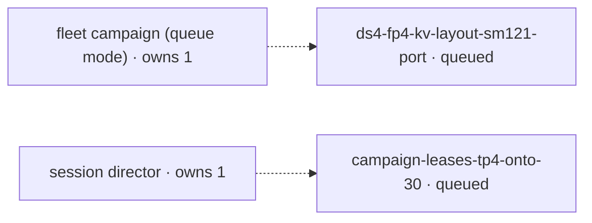

# Board
_Generated 2026-11-23 04:12 ET_

## In flight
| where | owner | what |
|---|---|---|
| census | read-only in tick — booted nothing, claimed nothing, stopped nothing, evicted nothing | read `2026-11-23T09:12:29Z`–`2026-11-23T09:12:31Z` (each node's own `date -u`) on the base census `2026-11-23T09:02:36Z`, **0 h 9 min 53 s** after it: **0 containers, 0 volumes** fleet-wide; **no research rank**; no node probed a serve |
| pool | — (nobody drives it; head units re-proved each tick) | head: `beegfs-mgmtd` **active** (Result success, NRestarts 0, **+0** on the base) · `beegfs-meta` **active** (Result success, NRestarts 0, **+0** on the base) · `beegfs-storage` **active** (Result success, NRestarts 0, **+0** on the base); worker unit states and the pool's through-mount reads are not part of this census |
| queue | register snapshot `33f48cad…`; both blocks below rendered from it | `mad-science/queue.json` sha256 **`33f48cad63bb06304b789076ac9d51a56c77beae993201ba1f655ffabb914382`** read locally: **253 tasks: 251 done, 2 queued, 0 blocked, 0 running — 2 open**; the head clone reads **`33f48cad…`**, identical |
| window | **no manual lock** at this read | `.local/fleet-window.lock` is **absent** on the head (read `2026-11-23T09:12:32Z`) |
| campaign | `sparkrun-campaign` — active, no lease | head user unit `sparkrun-campaign` reads **`active`** / **`running`** (`MainPID` **3,930,275**, `NRestarts` **0**, **+0** on the base); the lease ledger holds **0 lease(s)** and fence(s) `tp-le2-20261120` |
| lease | **1 fence(s), 0 lease(s)** | the head's repo ledger `.local/fleet-leases.json` (389 B, sha **`ec09509d…`**, mtime **`2026-11-21 03:04:12.907935197 -0500`** local) holds fence **`tp-le2-20261120`** on `.31`, `.32`, `.33`, `.34` (`fenced_at` `2026-11-20T07:25:27Z`, owner directive 2026-11-20: production serve protected, serve `58cddf1c62ba6578_b8865cad5863` / image `986795bcd7f4`) and **0 lease(s)** |
| publication | tick | fresh census (`2026-11-23T09:12:29Z`–`2026-11-23T09:12:31Z`) written to `2026-11-23T091228Z.json` and composed on the base census `2026-11-23T09:02:36Z`; the queue blocks are rendered from `mad-science/queue.json` sha **`33f48cad…`**, and the landed rows from `git log --since=2026-11-23T09:02:36Z` |
| .30 | **nothing live (no reservation)** — idle | `2026-11-23T09:12:29Z` (`spark-41e1`): `docker ps -aq` **0**, running **0**, volumes **0**, `:8000` listeners **0** root **1,063,040,401,408 B avail** (-847,872, fell) · **2,763,990,417,408 B used** (+847,872, rose) boot **`2026-11-19T20:06:40Z`** (`btime`), `uptime` **306,348 s** `MemTotal` **127,598,704 kB** (+0), `MemAvailable` **121,923,032 kB** (+105,432), `Cached` **83,292,280 kB** (+24,064), `AnonPages` **937,044 kB** (-85,504) ring **256** events all-types (+0), **0** in-window lifecycle and **0** in-window `exec`, oldest `2026-11-22T21:20:21.353970718-05:00 container create ce2ab1f`, newest `2026-11-23T04:06:26.010951395-05:00 image create sha256:ff62` |
| .31 | **nothing live (no reservation)** — idle | `2026-11-23T09:12:29Z` (`spark-d325`): `docker ps -aq` **0**, running **0**, volumes **0**, `:8000` listeners **0** root **1,297,356,804,096 B avail** (-233,472, fell) · **2,529,674,014,720 B used** (+233,472, rose) boot **`2026-11-19T20:11:15Z`** (`btime`), `uptime` **306,074 s** `MemTotal` **127,598,700 kB** (+0), `MemAvailable` **122,981,392 kB** (+97,556,148), `Cached` **5,341,488 kB** (-3,745,168), `AnonPages` **299,168 kB** (-7,253,744) ring **256** events all-types (+0), **0** in-window lifecycle and **36** in-window `exec`, oldest `2026-11-23T03:41:53.785945910-05:00 image pull ghcr.io/miaai`, newest `2026-11-23T04:06:51.057898412-05:00 container destroy 44f102` |
| .32 | **nothing live (no reservation)** — idle | `2026-11-23T09:12:30Z` (`spark-ec1d`): `docker ps -aq` **0**, running **0**, volumes **0**, `:8000` listeners **0** root **1,381,552,517,120 B avail** (-212,992, fell) · **2,445,478,187,008 B used** (+212,992, rose) boot **`2026-11-19T20:14:21Z`** (`btime`), `uptime` **305,888 s** `MemTotal` **127,598,640 kB** (+0), `MemAvailable` **123,158,164 kB** (+96,124,976), `Cached` **4,156,616 kB** (-4,063,764), `AnonPages` **240,772 kB** (-6,913,252) ring **256** events all-types (+0), **0** in-window lifecycle and **35** in-window `exec`, oldest `2026-11-23T01:59:33.460397050-05:00 container exec_start: sh`, newest `2026-11-23T04:06:50.410818381-05:00 container destroy cb6a01` |
| .33 | **nothing live (no reservation)** — idle | `2026-11-23T09:12:30Z` (`spark-3578`): `docker ps -aq` **0**, running **0**, volumes **0**, `:8000` listeners **0** root **1,252,248,903,680 B avail** (-221,184, fell) · **2,574,781,800,448 B used** (+221,184, rose) boot **`2026-11-19T20:12:55Z`** (`btime`), `uptime` **305,975 s** `MemTotal` **127,598,636 kB** (+0), `MemAvailable` **123,155,404 kB** (+96,390,472), `Cached` **3,651,104 kB** (-4,064,608), `AnonPages` **230,432 kB** (-7,056,300) ring **256** events all-types (+0), **0** in-window lifecycle and **35** in-window `exec`, oldest `2026-11-23T01:59:33.876997831-05:00 container exec_start: sh`, newest `2026-11-23T04:06:50.728996479-05:00 container destroy f3d7af` |
| .34 | **nothing live (no reservation)** — idle | `2026-11-23T09:12:31Z` (`spark-324e`): `docker ps -aq` **0**, running **0**, volumes **0**, `:8000` listeners **0** root **1,094,299,746,304 B avail** (-225,280, fell) · **2,732,731,072,512 B used** (+225,280, rose) boot **`2026-11-19T20:09:04Z`** (`btime`), `uptime` **306,206 s** `MemTotal` **127,598,704 kB** (+0), `MemAvailable` **122,853,256 kB** (+96,282,980), `Cached` **4,400,488 kB** (-3,676,068), `AnonPages` **247,492 kB** (-7,108,924) ring **256** events all-types (+0), **0** in-window lifecycle and **35** in-window `exec`, oldest `2026-11-23T01:59:34.307824457-05:00 container exec_die 1b8d4`, newest `2026-11-23T04:06:50.706483124-05:00 container destroy 78208a` |
| .35 | **nothing live (no reservation)** — idle | `2026-11-23T09:12:31Z` (`spark-383f`): `docker ps -aq` **0**, running **0**, volumes **0**, `:8000` listeners **0** root **971,352,653,824 B avail** (-823,296, fell) · **2,855,678,164,992 B used** (+823,296, rose) boot **`2026-11-19T20:07:56Z`** (`btime`), `uptime` **306,274 s** `MemTotal` **127,598,700 kB** (+0), `MemAvailable` **122,844,216 kB** (-14,072), `Cached` **115,752,748 kB** (+2,848), `AnonPages` **297,832 kB** (+4,092) ring **256** events all-types (+0), **0** in-window lifecycle and **0** in-window `exec`, oldest `2026-11-22T21:05:06.535546060-05:00 container exec_start: sh`, newest `2026-11-22T21:19:48.088204374-05:00 container destroy 8b4cc1` |

## Work Queue

| job | node cost | blockers | holds | status | summary |
|---|---|---|---|---|---|
| `campaign-leases-tp4-onto-30` — The campaign leases memory-heavy TP4 quartets onto .30, which the owner ruling excludes | quartet | — | — | queued | Queued, awaiting a TP4 lease: t20 (2026-11-22) lets .30 host a memory-risky quartet inside a declared window under the six 2026-11-11 guardrails; the t1 window (2026-11-23) lifted the hold, unblocking all six dependents. |
| `ds4-fp4-kv-layout-sm121-port` — DS4 1017 SM121: port the V41/V41_FP4 KV layout so fp4 KV is admissible — dtype is not a lever today, and sizing lies about fp4 | quartet | — | — | queued | Queued, boot pending: the SGLang V41_FP4 KV-layout port landed (9d2c2166, kernel gate 2026-11-22) and the FP4-KV image is built/pushed (aneda@b5de5272); the quartet boot validates 528/288 B/token plus a needle cell. |

## Completed Work
Window: commits since `2026-11-23T09:02:36Z` — the base census stamp, later than the 24 h start `2026-11-22T09:12:28Z`; older rows are not shown.

| time ET | commit | one clause |
|---|---|---|
| 11-23 04:02 | `6f57c7e7` | Refresh the status board: a 2026-11-23T090236Z census |
| 11-23 04:12 | `9f24ff0e` | Close both GLM repin boots; release the leases-row claim |
