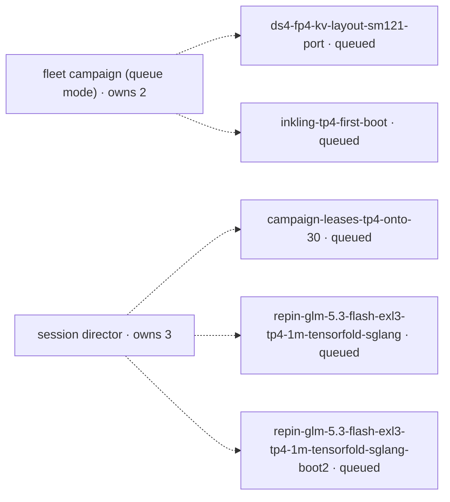

# Board
_Generated 2026-11-23 02:24 ET_

## In flight
| where | owner | what |
|---|---|---|
| census | read-only in tick — booted nothing, claimed nothing, stopped nothing, evicted nothing | read `2026-11-23T07:24:19Z`–`2026-11-23T07:24:21Z` (each node's own `date -u`) on the base census `2026-11-23T06:48:43Z`, **0 h 35 min 36 s** after it: **0 containers, 0 volumes** fleet-wide; **no research rank**; no node probed a serve |
| pool | — (nobody drives it; head units re-proved each tick) | head: `beegfs-mgmtd` **active** (Result success, NRestarts 0, **+0** on the base) · `beegfs-meta` **active** (Result success, NRestarts 0, **+0** on the base) · `beegfs-storage` **active** (Result success, NRestarts 0, **+0** on the base); worker unit states and the pool's through-mount reads are not part of this census |
| queue | register snapshot `a1f90d68…`; both blocks below rendered from it | `mad-science/queue.json` sha256 **`a1f90d683b72abe95e19555041eff7ae7d49d8116837cbfc3794d2fe087b23e4`** read locally: **253 tasks: 248 done, 5 queued, 0 blocked, 0 running — 5 open**; the head clone reads **`a1f90d68…`**, identical |
| window | **no manual lock** at this read | `.local/fleet-window.lock` is **absent** on the head (read `2026-11-23T07:24:21Z`) |
| campaign | `sparkrun-campaign` — active, no lease | head user unit `sparkrun-campaign` reads **`active`** / **`running`** (`MainPID` **3,930,275**, `NRestarts` **0**, **+0** on the base); the lease ledger holds **0 lease(s)** and fence(s) `tp-le2-20261120` |
| lease | **1 fence(s), 0 lease(s)** | the head's repo ledger `.local/fleet-leases.json` (389 B, sha **`ec09509d…`**, mtime **`2026-11-21 03:04:12.907935197 -0500`** local) holds fence **`tp-le2-20261120`** on `.31`, `.32`, `.33`, `.34` (`fenced_at` `2026-11-20T07:25:27Z`, owner directive 2026-11-20: production serve protected, serve `58cddf1c62ba6578_b8865cad5863` / image `986795bcd7f4`) and **0 lease(s)** |
| publication | tick | fresh census (`2026-11-23T07:24:19Z`–`2026-11-23T07:24:21Z`) written to `2026-11-23T072418Z.json` and composed on the base census `2026-11-23T06:48:43Z`; the queue blocks are rendered from `mad-science/queue.json` sha **`a1f90d68…`**, and the landed rows from `git log --since=2026-11-23T06:48:43Z` |
| .30 | **nothing live (no reservation)** — idle | `2026-11-23T07:24:19Z` (`spark-41e1`): `docker ps -aq` **0**, running **0**, volumes **0**, `:8000` listeners **0** root **1,098,197,573,632 B avail** (-16,076,419,072, fell) · **2,728,833,245,184 B used** (+16,076,419,072, rose) boot **`2026-11-19T20:06:40Z`** (`btime`), `uptime` **299,858 s** `MemTotal` **127,598,704 kB** (+0), `MemAvailable` **121,759,784 kB** (-191,320), `Cached` **116,392,312 kB** (+7,197,708), `AnonPages` **903,668 kB** (-58,512) ring **256** events all-types (+0), **0** in-window lifecycle and **0** in-window `exec`, oldest `2026-11-22T21:19:21.626576043-05:00 container exec_die fbebd`, newest `2026-11-23T02:21:42.007109607-05:00 image tag sha256:6949fd8` |
| .31 | **nothing live (no reservation)** — idle | `2026-11-23T07:24:19Z` (`spark-d325`): `docker ps -aq` **0**, running **0**, volumes **0**, `:8000` listeners **0** root **1,301,889,802,240 B avail** (+112,939,008, rose) · **2,525,141,016,576 B used** (-112,939,008, fell) boot **`2026-11-19T20:11:15Z`** (`btime`), `uptime` **299,584 s** `MemTotal` **127,598,700 kB** (+0), `MemAvailable` **122,949,048 kB** (+109,116,616), `Cached` **2,560,544 kB** (-18,605,536), `AnonPages` **275,372 kB** (-2,840,260) ring **256** events all-types (+0), **0** in-window lifecycle and **231** in-window `exec`, oldest `2026-11-23T01:47:52.367027994-05:00 container exec_create: s`, newest `2026-11-23T01:59:48.812052804-05:00 container destroy 97b002` |
| .32 | **nothing live (no reservation)** — idle | `2026-11-23T07:24:20Z` (`spark-ec1d`): `docker ps -aq` **0**, running **0**, volumes **0**, `:8000` listeners **0** root **1,385,416,323,072 B avail** (+104,681,472, rose) · **2,441,614,381,056 B used** (-104,681,472, fell) boot **`2026-11-19T20:14:21Z`** (`btime`), `uptime` **299,398 s** `MemTotal` **127,598,640 kB** (+0), `MemAvailable` **123,139,168 kB** (+109,916,680), `Cached` **5,466,608 kB** (-15,002,704), `AnonPages` **233,640 kB** (-3,551,944) ring **256** events all-types (+0), **0** in-window lifecycle and **227** in-window `exec`, oldest `2026-11-23T01:47:31.342696990-05:00 container exec_die 8bde4`, newest `2026-11-23T01:59:48.849551700-05:00 container destroy 8bde48` |
| .33 | **nothing live (no reservation)** — idle | `2026-11-23T07:24:20Z` (`spark-3578`): `docker ps -aq` **0**, running **0**, volumes **0**, `:8000` listeners **0** root **1,256,186,843,136 B avail** (+180,514,816, rose) · **2,570,843,860,992 B used** (-180,514,816, fell) boot **`2026-11-19T20:12:55Z`** (`btime`), `uptime` **299,485 s** `MemTotal` **127,598,636 kB** (+0), `MemAvailable` **123,132,772 kB** (+109,994,644), `Cached` **12,013,020 kB** (-8,347,900), `AnonPages` **232,976 kB** (-3,620,724) ring **256** events all-types (+0), **0** in-window lifecycle and **230** in-window `exec`, oldest `2026-11-23T01:47:31.725456999-05:00 container exec_die 68938`, newest `2026-11-23T01:59:48.825181963-05:00 container destroy 689386` |
| .34 | **nothing live (no reservation)** — idle | `2026-11-23T07:24:20Z` (`spark-324e`): `docker ps -aq` **0**, running **0**, volumes **0**, `:8000` listeners **0** root **862,622,556,160 B avail** (+113,078,272, rose) · **2,964,408,262,656 B used** (-113,078,272, fell) boot **`2026-11-19T20:09:04Z`** (`btime`), `uptime` **299,716 s** `MemTotal` **127,598,704 kB** (+0), `MemAvailable` **122,752,160 kB** (+110,719,388), `Cached` **8,054,484 kB** (-11,243,620), `AnonPages` **229,348 kB** (-4,680,176) ring **256** events all-types (+0), **0** in-window lifecycle and **230** in-window `exec`, oldest `2026-11-23T01:47:32.117404345-05:00 container exec_die 1b8d4`, newest `2026-11-23T01:59:48.846518189-05:00 container destroy 1b8d41` |
| .35 | **nothing live (no reservation)** — idle | `2026-11-23T07:24:21Z` (`spark-383f`): `docker ps -aq` **0**, running **0**, volumes **0**, `:8000` listeners **0** root **971,303,288,832 B avail** (-11,296,768, fell) · **2,855,727,529,984 B used** (+11,296,768, rose) boot **`2026-11-19T20:07:56Z`** (`btime`), `uptime` **299,784 s** `MemTotal` **127,598,700 kB** (+0), `MemAvailable` **122,840,828 kB** (-23,552), `Cached` **115,071,332 kB** (+15,812), `AnonPages` **304,692 kB** (+16,708) ring **256** events all-types (+0), **0** in-window lifecycle and **0** in-window `exec`, oldest `2026-11-22T21:05:06.535546060-05:00 container exec_start: sh`, newest `2026-11-22T21:19:48.088204374-05:00 container destroy 8b4cc1` |

## Work Queue

| job | node cost | blockers | holds | status | summary |
|---|---|---|---|---|---|
| `repin-glm-5.3-flash-exl3-tp4-1m-tensorfold-sglang` — Boot glm-5.3-flash-exl3-tp4-1m-tensorfold-sglang with the refreshed pin and move its pins | quartet | — | — | queued | — PIN MOVE 2026-11-22 (owner rule, ViBoard thread t24): updated pins are boot-tested as soon as a window of the correct size is free for them, and the pin moves in that boot's commit — no carrier-lane ride-along. This row boots recipes/glm/gl… (full note: queue.json) — evidence: `head:~/benchmarks/glm-repin-20261123/repin-1/head-boot.log` |
| `repin-glm-5.3-flash-exl3-tp4-1m-tensorfold-sglang-boot2` — Boot glm-5.3-flash-exl3-tp4-1m-tensorfold-sglang-boot2 with the refreshed pin and move its pins | quartet | — | — | queued | — PIN MOVE 2026-11-22 (owner rule, ViBoard thread t24): updated pins are boot-tested as soon as a window of the correct size is free for them, and the pin moves in that boot's commit — no carrier-lane ride-along. This row boots recipes/glm/gl… (full note: queue.json) |
| `campaign-leases-tp4-onto-30` — The campaign leases memory-heavy TP4 quartets onto .30, which the owner ruling excludes | quartet | — | — | queued | — MECHANISM LANDED OFFLINE 2026-11-11 (commits `aa54000`, `ebf5c8e`, `298098d`, `08ff156`; no live lease and no live six-node boot has run, so the row stays open). One ledger, `<repo>/.local/fleet-leases.json` (flock + atomic write), and one … (full note: queue.json) |
| `inkling-tp4-first-boot` — Inkling-2-Small TP=4 first boot: nightly pull and the unproven sm_121 Triton path | quartet | — | — | queued | — No node holds the pinned nightly digest c17e9d88, so the first boot includes the pull. GB10 is sm_121 and the Blackwell path gates on capability family 100, so the engine runs the Hopper/Triton half (attention_sm90 plus the Humming expert G… (full note: queue.json) — evidence: `head:~/benchmarks/inkling-20261123/` |
| `ds4-fp4-kv-layout-sm121-port` — DS4 1017 SM121: port the V41/V41_FP4 KV layout so fp4 KV is admissible — dtype is not a lever today, and sizing lies about fp4 | quartet | — | — | queued | — FP4-KV image built and pushed. SGLang side: ghcr.io/littlecedar/aneda@sha256:b5de5272edd983e41059154f10d862a44c25f8f5f403fafd48ad0778b95ceed6 (the dsv41-sm121-dg:0.2.1-fi073e base + patch_dsv41_fp4kv.py + fp4kv_kv_format.py). Recipe at reci… (full note: queue.json) |

## Completed Work
Window: commits since `2026-11-23T06:48:43Z` — the base census stamp, later than the 24 h start `2026-11-22T07:24:18Z`; older rows are not shown.

| time ET | commit | one clause |
|---|---|---|
| 11-23 01:48 | `19490c42` | Refresh the status board: a 2026-11-23T064842Z census |
| 11-23 02:14 | `cafc7bed` | Record the Inkling-2-Small engine failure on sm_121 |
