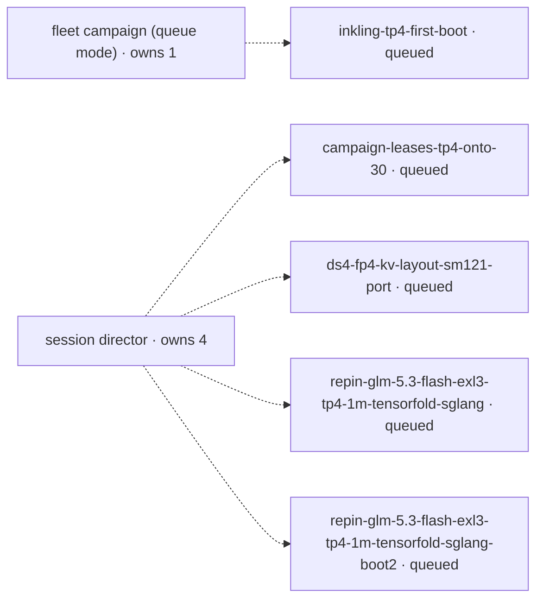

# Board
_Generated 2026-11-23 00:12 ET_

## In flight
| where | owner | what |
|---|---|---|
| census | read-only in tick — booted nothing, claimed nothing, stopped nothing, evicted nothing | read `2026-11-23T05:12:18Z`–`2026-11-23T05:12:21Z` (each node's own `date -u`) on the base census `2026-11-23T04:31:40Z`, **0 h 40 min 38 s** after it: **0 containers, 0 volumes** fleet-wide; **no research rank**; no node probed a serve |
| pool | — (nobody drives it; head units re-proved each tick) | head: `beegfs-mgmtd` **active** (Result success, NRestarts 0, **+0** on the base) · `beegfs-meta` **active** (Result success, NRestarts 0, **+0** on the base) · `beegfs-storage` **active** (Result success, NRestarts 0, **+0** on the base); worker unit states and the pool's through-mount reads are not part of this census |
| queue | register snapshot `aed4b72a…`; both blocks below rendered from it | `mad-science/queue.json` sha256 **`aed4b72a815cede58a0216276bef78d323e192f0e76a32d283b56599fff2504f`** read locally: **253 tasks: 248 done, 5 queued, 0 blocked, 0 running — 5 open**; the head clone reads **`aed4b72a…`**, identical |
| window | **no manual lock** at this read | `.local/fleet-window.lock` is **absent** on the head (read `2026-11-23T05:12:21Z`) |
| campaign | `sparkrun-campaign` — active, no lease | head user unit `sparkrun-campaign` reads **`active`** / **`running`** (`MainPID` **3,930,275**, `NRestarts` **0**, **+0** on the base); the lease ledger holds **0 lease(s)** and fence(s) `tp-le2-20261120` |
| lease | **1 fence(s), 0 lease(s)** | the head's repo ledger `.local/fleet-leases.json` (389 B, sha **`ec09509d…`**, mtime **`2026-11-21 03:04:12.907935197 -0500`** local) holds fence **`tp-le2-20261120`** on `.31`, `.32`, `.33`, `.34` (`fenced_at` `2026-11-20T07:25:27Z`, owner directive 2026-11-20: production serve protected, serve `58cddf1c62ba6578_b8865cad5863` / image `986795bcd7f4`) and **0 lease(s)** |
| publication | tick | fresh census (`2026-11-23T05:12:18Z`–`2026-11-23T05:12:21Z`) written to `2026-11-23T051218Z.json` and composed on the base census `2026-11-23T04:31:40Z`; the queue blocks are rendered from `mad-science/queue.json` sha **`aed4b72a…`**, and the landed rows from `git log --since=2026-11-23T04:31:40Z` |
| .30 | **nothing live (no reservation)** — idle | `2026-11-23T05:12:18Z` (`spark-41e1`): `docker ps -aq` **0**, running **0**, volumes **0**, `:8000` listeners **0** root **1,213,539,180,544 B avail** (+85,479,424, rose) · **2,613,491,638,272 B used** (-85,479,424, fell) boot **`2026-11-19T20:06:40Z`** (`btime`), `uptime` **291,938 s** `MemTotal` **127,598,704 kB** (+0), `MemAvailable` **122,288,388 kB** (+15,560), `Cached` **102,007,180 kB** (-246,472), `AnonPages` **828,592 kB** (-14,760) ring **256** events all-types (+0), **0** in-window lifecycle and **0** in-window `exec`, oldest `2026-11-22T21:19:19.549437425-05:00 container exec_create: s`, newest `2026-11-22T21:29:27.688470769-05:00 container destroy ce2ab1` |
| .31 | **nothing live (no reservation)** — idle | `2026-11-23T05:12:19Z` (`spark-d325`): `docker ps -aq` **0**, running **0**, volumes **0**, `:8000` listeners **0** root **1,396,732,047,360 B avail** (+110,997,504, rose) · **2,430,298,771,456 B used** (-110,997,504, fell) boot **`2026-11-19T20:11:15Z`** (`btime`), `uptime` **291,664 s** `MemTotal` **127,598,700 kB** (+0), `MemAvailable` **123,004,076 kB** (-122,752), `Cached` **1,270,772 kB** (+428,140), `AnonPages` **336,672 kB** (+49,248) ring **256** events all-types (+0), **0** in-window lifecycle and **39** in-window `exec`, oldest `2026-11-22T22:09:48.773758086-05:00 container exec_start: ta`, newest `2026-11-22T23:46:19.806196189-05:00 container destroy a5b372` |
| .32 | **nothing live (no reservation)** — idle | `2026-11-23T05:12:19Z` (`spark-ec1d`): `docker ps -aq` **0**, running **0**, volumes **0**, `:8000` listeners **0** root **1,462,236,430,336 B avail** (+106,713,088, rose) · **2,364,794,273,792 B used** (-106,713,088, fell) boot **`2026-11-19T20:14:21Z`** (`btime`), `uptime` **291,478 s** `MemTotal` **127,598,640 kB** (+0), `MemAvailable` **123,205,548 kB** (+144), `Cached` **726,872 kB** (+289,096), `AnonPages` **272,204 kB** (+38,784) ring **256** events all-types (+0), **0** in-window lifecycle and **33** in-window `exec`, oldest `2026-11-22T22:02:19.264735318-05:00 container exec_start: ta`, newest `2026-11-22T23:46:19.836012090-05:00 container destroy 00f849` |
| .33 | **nothing live (no reservation)** — idle | `2026-11-23T05:12:20Z` (`spark-3578`): `docker ps -aq` **0**, running **0**, volumes **0**, `:8000` listeners **0** root **1,358,811,574,272 B avail** (+106,606,592, rose) · **2,468,219,129,856 B used** (-106,606,592, fell) boot **`2026-11-19T20:12:55Z`** (`btime`), `uptime` **291,565 s** `MemTotal` **127,598,636 kB** (+0), `MemAvailable` **123,184,568 kB** (-59,600), `Cached` **483,564 kB** (+49,728), `AnonPages` **269,536 kB** (+45,420) ring **256** events all-types (+0), **0** in-window lifecycle and **33** in-window `exec`, oldest `2026-11-22T22:02:19.682627203-05:00 container exec_start: ta`, newest `2026-11-22T23:46:19.848882875-05:00 container destroy 6a0a3b` |
| .34 | **nothing live (no reservation)** — idle | `2026-11-23T05:12:20Z` (`spark-324e`): `docker ps -aq` **0**, running **0**, volumes **0**, `:8000` listeners **0** root **944,204,177,408 B avail** (+106,823,680, rose) · **2,882,826,641,408 B used** (-106,823,680, fell) boot **`2026-11-19T20:09:04Z`** (`btime`), `uptime` **291,796 s** `MemTotal` **127,598,704 kB** (+0), `MemAvailable` **123,183,848 kB** (-58,684), `Cached` **1,132,996 kB** (+663,664), `AnonPages` **270,076 kB** (+58,736) ring **256** events all-types (+0), **0** in-window lifecycle and **33** in-window `exec`, oldest `2026-11-22T22:02:20.053640646-05:00 container exec_create: t`, newest `2026-11-22T23:46:19.827378291-05:00 container destroy d7c445` |
| .35 | **nothing live (no reservation)** — idle | `2026-11-23T05:12:21Z` (`spark-383f`): `docker ps -aq` **0**, running **0**, volumes **0**, `:8000` listeners **0** root **1,040,927,944,704 B avail** (+115,638,272, rose) · **2,786,102,874,112 B used** (-115,638,272, fell) boot **`2026-11-19T20:07:56Z`** (`btime`), `uptime` **291,864 s** `MemTotal` **127,598,700 kB** (+0), `MemAvailable` **123,187,924 kB** (+31,640), `Cached` **51,879,412 kB** (+15,532), `AnonPages` **274,156 kB** (-14,572) ring **256** events all-types (+0), **0** in-window lifecycle and **0** in-window `exec`, oldest `2026-11-22T21:05:06.535546060-05:00 container exec_start: sh`, newest `2026-11-22T21:19:48.088204374-05:00 container destroy 8b4cc1` |

## Work Queue

| job | node cost | blockers | holds | status | summary |
|---|---|---|---|---|---|
| `repin-glm-5.3-flash-exl3-tp4-1m-tensorfold-sglang` — Boot glm-5.3-flash-exl3-tp4-1m-tensorfold-sglang with the refreshed pin and move its pins | quartet | — | — | queued | — PIN MOVE 2026-11-22 (owner rule, ViBoard thread t24): updated pins are boot-tested as soon as a window of the correct size is free for them, and the pin moves in that boot's commit — no carrier-lane ride-along. This row boots recipes/glm/gl… (full note: queue.json) |
| `repin-glm-5.3-flash-exl3-tp4-1m-tensorfold-sglang-boot2` — Boot glm-5.3-flash-exl3-tp4-1m-tensorfold-sglang-boot2 with the refreshed pin and move its pins | quartet | — | — | queued | — PIN MOVE 2026-11-22 (owner rule, ViBoard thread t24): updated pins are boot-tested as soon as a window of the correct size is free for them, and the pin moves in that boot's commit — no carrier-lane ride-along. This row boots recipes/glm/gl… (full note: queue.json) |
| `campaign-leases-tp4-onto-30` — The campaign leases memory-heavy TP4 quartets onto .30, which the owner ruling excludes | quartet | — | — | queued | — MECHANISM LANDED OFFLINE 2026-11-11 (commits `aa54000`, `ebf5c8e`, `298098d`, `08ff156`; no live lease and no live six-node boot has run, so the row stays open). One ledger, `<repo>/.local/fleet-leases.json` (flock + atomic write), and one … (full note: queue.json) |
| `inkling-tp4-first-boot` — Inkling-2-Small TP=4 first boot: nightly pull and the unproven sm_121 Triton path | quartet | — | — | queued | — No node holds the pinned nightly digest c17e9d88, so the first boot includes the pull. GB10 is sm_121 and the Blackwell path gates on capability family 100, so the engine runs the Hopper/Triton half (attention_sm90 plus the Humming expert G… (full note: queue.json) — evidence: `head:~/benchmarks/inkling-20261123/` |
| `ds4-fp4-kv-layout-sm121-port` — DS4 1017 SM121: port the V41/V41_FP4 KV layout so fp4 KV is admissible — dtype is not a lever today, and sizing lies about fp4 | quartet | — | — | queued | — RECIPE RETIRED 2026-11-18: the `zz-` arm this row booted is archived at `attic/ds4/zz-ds4-1017-sm121-indexer-scoring.yaml` (it was run or refused on record; see the lane attic index), so the row is no longer bootable. CORRECTION TO THE FP8-… (full note: queue.json) |

## Completed Work
Window: commits since `2026-11-23T04:31:40Z` — the base census stamp, later than the 24 h start `2026-11-22T05:12:18Z`; older rows are not shown.

| time ET | commit | one clause |
|---|---|---|
| 11-22 23:31 | `680446d7` | Refresh the status board: a 2026-11-23T043140Z census |
| 11-22 23:33 | `acd77aa9` | Simplify board-tick: read worktree register, commit only STATUS.md, remove merge step |
| 11-22 23:52 | `e849677f` | Close the weightless DSV4.1 quartet gate |
| 11-22 23:54 | `05f9e512` | Re-derive the stated test total after peer commits added tests |
| 11-23 00:11 | `c7360a1c` | Rename weightless-dsgb10 arm to aneda |
