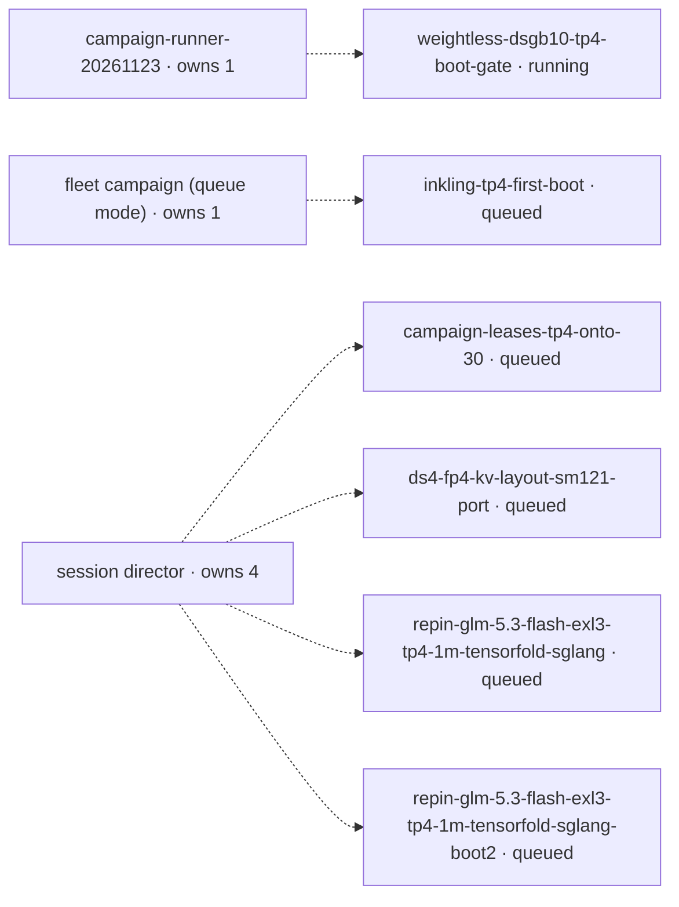

# Board
_Generated 2026-11-22 23:31 ET_

## In flight
| where | owner | what |
|---|---|---|
| census | read-only in tick — booted nothing, claimed nothing, stopped nothing, evicted nothing | read `2026-11-23T04:31:40Z`–`2026-11-23T04:31:42Z` (each node's own `date -u`) on the base census `2026-11-23T04:31:29Z`, **0 h 0 min 11 s** after it: **0 containers, 0 volumes** fleet-wide; **no research rank**; no node probed a serve |
| pool | — (nobody drives it; head units re-proved each tick) | head: `beegfs-mgmtd` **active** (Result success, NRestarts 0, **+0** on the base) · `beegfs-meta` **active** (Result success, NRestarts 0, **+0** on the base) · `beegfs-storage` **active** (Result success, NRestarts 0, **+0** on the base); worker unit states and the pool's through-mount reads are not part of this census |
| queue | register snapshot `15c6fae5…`; both blocks below rendered from it | `mad-science/queue.json` sha256 **`15c6fae5138fa07db1cbf38992fad6db1b1d54f63ea5aa478785e807f468410d`** read locally: **253 tasks: 247 done, 5 queued, 0 blocked, 1 running — 6 open**; the head clone reads **`15c6fae5…`**, identical |
| window | **no manual lock** at this read | `.local/fleet-window.lock` is **absent** on the head (read `2026-11-23T04:31:43Z`) |
| campaign | `sparkrun-campaign` — active, no lease | head user unit `sparkrun-campaign` reads **`active`** / **`running`** (`MainPID` **3,930,275**, `NRestarts` **0**, **+0** on the base); the lease ledger holds **0 lease(s)** and fence(s) `tp-le2-20261120` |
| lease | **1 fence(s), 0 lease(s)** | the head's repo ledger `.local/fleet-leases.json` (389 B, sha **`ec09509d…`**, mtime **`2026-11-21 03:04:12.907935197 -0500`** local) holds fence **`tp-le2-20261120`** on `.31`, `.32`, `.33`, `.34` (`fenced_at` `2026-11-20T07:25:27Z`, owner directive 2026-11-20: production serve protected, serve `58cddf1c62ba6578_b8865cad5863` / image `986795bcd7f4`) and **0 lease(s)** |
| publication | tick | fresh census (`2026-11-23T04:31:40Z`–`2026-11-23T04:31:42Z`) written to `2026-11-23T043140Z.json` and composed on the base census `2026-11-23T04:31:29Z`; the queue blocks are rendered from `mad-science/queue.json` sha **`15c6fae5…`**, and the landed rows from `git log --since=2026-11-23T04:31:29Z` |
| .30 | **nothing live (no reservation)** — idle | `2026-11-23T04:31:40Z` (`spark-41e1`): `docker ps -aq` **0**, running **0**, volumes **0**, `:8000` listeners **0** root **1,213,453,701,120 B avail** (-4,096, fell) · **2,613,577,117,696 B used** (+4,096, rose) boot **`2026-11-19T20:06:40Z`** (`btime`), `uptime` **289,500 s** `MemTotal` **127,598,704 kB** (+0), `MemAvailable` **122,272,828 kB** (+17,952), `Cached` **102,253,652 kB** (-12), `AnonPages` **843,352 kB** (+460) ring **256** events all-types (+0), **0** in-window lifecycle and **0** in-window `exec`, oldest `2026-11-22T21:19:19.549437425-05:00 container exec_create: s`, newest `2026-11-22T21:29:27.688470769-05:00 container destroy ce2ab1` |
| .31 | **nothing live (no reservation)** — idle | `2026-11-23T04:31:40Z` (`spark-d325`): `docker ps -aq` **0**, running **0**, volumes **0**, `:8000` listeners **0** root **1,396,621,049,856 B avail** (-8,192, fell) · **2,430,409,768,960 B used** (+8,192, rose) boot **`2026-11-19T20:11:15Z`** (`btime`), `uptime` **289,225 s** `MemTotal` **127,598,700 kB** (+0), `MemAvailable` **123,126,828 kB** (-5,652), `Cached` **842,632 kB** (+560), `AnonPages` **287,424 kB** (-252) ring **256** events all-types (+0), **0** in-window lifecycle and **0** in-window `exec`, oldest `2026-11-22T22:01:48.762282688-05:00 container exec_start: ta`, newest `2026-11-22T23:29:21.578480362-05:00 container destroy 4d49e6` |
| .32 | **nothing live (no reservation)** — idle | `2026-11-23T04:31:41Z` (`spark-ec1d`): `docker ps -aq` **0**, running **0**, volumes **0**, `:8000` listeners **0** root **1,462,129,717,248 B avail** (-8,192, fell) · **2,364,900,986,880 B used** (+8,192, rose) boot **`2026-11-19T20:14:21Z`** (`btime`), `uptime` **289,039 s** `MemTotal` **127,598,640 kB** (+0), `MemAvailable` **123,205,404 kB** (-30,160), `Cached` **437,776 kB** (+576), `AnonPages` **233,420 kB** (-512) ring **256** events all-types (+0), **0** in-window lifecycle and **0** in-window `exec`, oldest `2026-11-22T21:55:19.281655796-05:00 container exec_start: ta`, newest `2026-11-22T23:29:21.413812456-05:00 container destroy 0e5337` |
| .33 | **nothing live (no reservation)** — idle | `2026-11-23T04:31:41Z` (`spark-3578`): `docker ps -aq` **0**, running **0**, volumes **0**, `:8000` listeners **0** root **1,358,704,967,680 B avail** (-8,192, fell) · **2,468,325,736,448 B used** (+8,192, rose) boot **`2026-11-19T20:12:55Z`** (`btime`), `uptime` **289,126 s** `MemTotal` **127,598,636 kB** (+0), `MemAvailable` **123,244,168 kB** (+30,220), `Cached` **433,836 kB** (+628), `AnonPages` **224,116 kB** (+792) ring **256** events all-types (+0), **0** in-window lifecycle and **0** in-window `exec`, oldest `2026-11-22T21:55:19.803738731-05:00 container exec_start: ta`, newest `2026-11-22T23:29:21.456400888-05:00 container destroy 6b3803` |
| .34 | **nothing live (no reservation)** — idle | `2026-11-23T04:31:42Z` (`spark-324e`): `docker ps -aq` **0**, running **0**, volumes **0**, `:8000` listeners **0** root **944,097,353,728 B avail** (-8,192, fell) · **2,882,933,465,088 B used** (+8,192, rose) boot **`2026-11-19T20:09:04Z`** (`btime`), `uptime` **289,357 s** `MemTotal` **127,598,704 kB** (+0), `MemAvailable` **123,242,532 kB** (+8,888), `Cached` **469,332 kB** (+528), `AnonPages` **211,340 kB** (-276) ring **256** events all-types (+0), **0** in-window lifecycle and **0** in-window `exec`, oldest `2026-11-22T21:55:20.174481654-05:00 container exec_create: t`, newest `2026-11-22T23:29:21.417272030-05:00 container destroy 2268a2` |
| .35 | **nothing live (no reservation)** — idle | `2026-11-23T04:31:42Z` (`spark-383f`): `docker ps -aq` **0**, running **0**, volumes **0**, `:8000` listeners **0** root **1,040,812,306,432 B avail** (-8,192, fell) · **2,786,218,512,384 B used** (+8,192, rose) boot **`2026-11-19T20:07:56Z`** (`btime`), `uptime` **289,425 s** `MemTotal` **127,598,700 kB** (+0), `MemAvailable` **123,156,284 kB** (+6,432), `Cached` **51,863,880 kB** (+4), `AnonPages` **288,728 kB** (+348) ring **256** events all-types (+0), **0** in-window lifecycle and **0** in-window `exec`, oldest `2026-11-22T21:05:06.535546060-05:00 container exec_start: sh`, newest `2026-11-22T21:19:48.088204374-05:00 container destroy 8b4cc1` |

## Work Queue

| job | node cost | blockers | holds | status | summary |
|---|---|---|---|---|---|
| `repin-glm-5.3-flash-exl3-tp4-1m-tensorfold-sglang` — Boot glm-5.3-flash-exl3-tp4-1m-tensorfold-sglang with the refreshed pin and move its pins | quartet | — | — | queued | — PIN MOVE 2026-11-22 (owner rule, ViBoard thread t24): updated pins are boot-tested as soon as a window of the correct size is free for them, and the pin moves in that boot's commit — no carrier-lane ride-along. This row boots recipes/glm/gl… (full note: queue.json) |
| `repin-glm-5.3-flash-exl3-tp4-1m-tensorfold-sglang-boot2` — Boot glm-5.3-flash-exl3-tp4-1m-tensorfold-sglang-boot2 with the refreshed pin and move its pins | quartet | — | — | queued | — PIN MOVE 2026-11-22 (owner rule, ViBoard thread t24): updated pins are boot-tested as soon as a window of the correct size is free for them, and the pin moves in that boot's commit — no carrier-lane ride-along. This row boots recipes/glm/gl… (full note: queue.json) |
| `campaign-leases-tp4-onto-30` — The campaign leases memory-heavy TP4 quartets onto .30, which the owner ruling excludes | quartet | — | — | queued | — MECHANISM LANDED OFFLINE 2026-11-11 (commits `aa54000`, `ebf5c8e`, `298098d`, `08ff156`; no live lease and no live six-node boot has run, so the row stays open). One ledger, `<repo>/.local/fleet-leases.json` (flock + atomic write), and one … (full note: queue.json) |
| `inkling-tp4-first-boot` — Inkling-2-Small TP=4 first boot: nightly pull and the unproven sm_121 Triton path | quartet | — | — | queued | — No node holds the pinned nightly digest c17e9d88, so the first boot includes the pull. GB10 is sm_121 and the Blackwell path gates on capability family 100, so the engine runs the Hopper/Triton half (attention_sm90 plus the Humming expert G… (full note: queue.json) — evidence: `recipes/explore/README.md section zz-inkling-2-small-nvfp4-thinking-tools-tp4-vllm` |
| `weightless-dsgb10-tp4-boot-gate` — Boot the aneda arm four-rank: the α=0 golden hash must equal stock bit-for-bit before any steered request is quoted | quartet | — | — | running | — Boot gate for the image closed by weightless-image-build-publish-pin (1bc6b5cb). Image ghcr.io/littlecedar/aneda@sha256:305b6e5151a2cfd13b85f18c36bccf9062af83e28917fd11a0f151691c5e83df, p… (full note: queue.json) — evidence: `recipes/ds4/zz-deepseek-v4.1-flash-1017-aneda-tp4.yaml (container pinned by digest at line 30); recipes/ds4/README.md lines 2890-2911 (two-name contract, alpha=0 identity) and 2990-2996 (the boot gate)` |
| `ds4-fp4-kv-layout-sm121-port` — DS4 1017 SM121: port the V41/V41_FP4 KV layout so fp4 KV is admissible — dtype is not a lever today, and sizing lies about fp4 | quartet | — | — | queued | — RECIPE RETIRED 2026-11-18: the `zz-` arm this row booted is archived at `attic/ds4/zz-ds4-1017-sm121-indexer-scoring.yaml` (it was run or refused on record; see the lane attic index), so the row is no longer bootable. CORRECTION TO THE FP8-… (full note: queue.json) |

## Completed Work
Window: commits since `2026-11-23T04:31:29Z` — the base census stamp, later than the 24 h start `2026-11-22T04:31:40Z`; older rows are not shown.

| time ET | commit | one clause |
|---|---|---|
