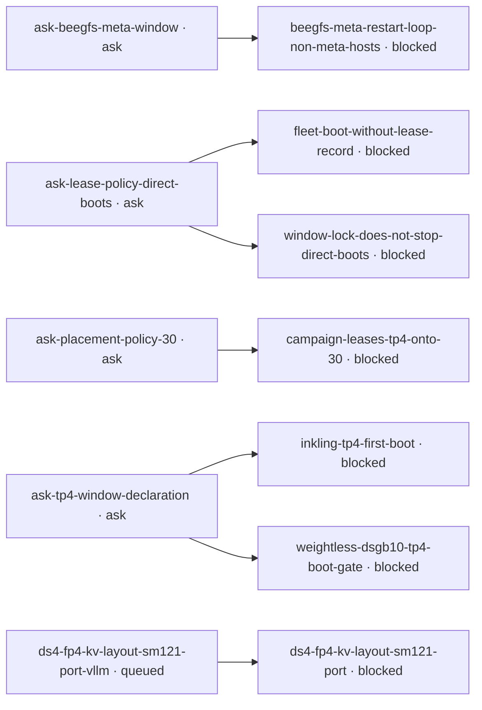

# Board
_Generated 2026-11-22 16:48 ET_

## In flight
| where | owner | what |
|---|---|---|
| census | read-only in tick — booted nothing, claimed nothing, stopped nothing, evicted nothing | read `2026-11-22T21:48:43Z`–`2026-11-22T21:48:46Z` (each node's own `date -u`) on the base census `2026-11-22T21:36:43Z`, **0 h 12 min 0 s** after it: **4 containers, 0 volumes** fleet-wide; **no research rank**; the fenced hosts hold running containers on `.31`, `.32`, `.33`, `.34`, excluded from research accounting; `/v1/models` **200**, `/health` **200** on `.31` |
| pool | — (nobody drives it; head units re-proved each tick) | head: `beegfs-mgmtd` **active** (Result success, NRestarts 0, **+0** on the base) · `beegfs-meta` **active** (Result success, NRestarts 0, **+0** on the base) · `beegfs-storage` **active** (Result success, NRestarts 0, **+0** on the base); worker unit states and the pool's through-mount reads are not part of this census |
| queue | register snapshot `c0102989…`; both blocks below rendered from it | `mad-science/queue.json` sha256 **`c01029897d2da83ed0e31c95a41d3b7ded78d13636add6a657099cdc016b94a1`** read locally: **233 tasks: 219 done, 3 queued, 7 blocked, 0 running — 14 open**; the head clone reads **`c0102989…`**, identical |
| window | **no manual lock** at this read | `.local/fleet-window.lock` is **absent** on the head (read `2026-11-22T21:48:46Z`) |
| campaign | `sparkrun-campaign` — active, no lease | head user unit `sparkrun-campaign` reads **`active`** / **`running`** (`MainPID` **3,930,275**, `NRestarts` **0**, **+0** on the base); the lease ledger holds **0 lease(s)** and fence(s) `tp-le2-20261120` |
| lease | **1 fence(s), 0 lease(s)** | the head's repo ledger `.local/fleet-leases.json` (389 B, sha **`ec09509d…`**, mtime **`2026-11-21 03:04:12.907935197 -0500`** local) holds fence **`tp-le2-20261120`** on `.31`, `.32`, `.33`, `.34` (`fenced_at` `2026-11-20T07:25:27Z`, owner directive 2026-11-20: production serve protected, serve `58cddf1c62ba6578_b8865cad5863` / image `986795bcd7f4`) and **0 lease(s)** |
| publication | tick | fresh census (`2026-11-22T21:48:43Z`–`2026-11-22T21:48:46Z`) written to `2026-11-22T214842Z.json` and composed on the base census `2026-11-22T21:36:43Z`; the queue blocks are rendered from `mad-science/queue.json` sha **`c0102989…`**, and the landed rows from `git log --since=2026-11-22T21:36:43Z` |
| .30 | **nothing live (no reservation)** — idle | `2026-11-22T21:48:43Z` (`spark-41e1`): `docker ps -aq` **0**, running **0**, volumes **0**, `:8000` listeners **0** root **1,218,049,970,176 B avail** (-41,353,216, fell) · **2,608,980,848,640 B used** (+41,353,216, rose) boot **`2026-11-19T20:06:40Z`** (`btime`), `uptime` **265,323 s** `MemTotal` **127,598,704 kB** (+0), `MemAvailable` **122,069,296 kB** (-82,188), `Cached` **3,922,192 kB** (+1,504,156), `AnonPages` **1,030,960 kB** (+20,560) ring **256** events all-types (+0), **0** in-window lifecycle and **51** in-window `exec`, oldest `2026-11-22T16:26:22.166554010-05:00 container exec_start: ba`, newest `2026-11-22T16:45:15.720390111-05:00 container destroy a53131` |
| .31 | **fenced serve** — excluded from the research census | `2026-11-22T21:48:44Z` (`spark-d325`): `docker ps -aq` **1**, running **1**, volumes **0**, `:8000` listeners **2**, `/v1/models` **200**, `/health` **200** root **1,559,387,635,712 B avail** (-1,277,952, fell) · **2,267,643,183,104 B used** (+1,277,952, rose) boot **`2026-11-19T20:11:15Z`** (`btime`), `uptime` **265,049 s** `MemTotal` **127,598,700 kB** (+0), `MemAvailable` **8,874,188 kB** (+29,308), `Cached` **3,237,132 kB** (+6,492), `AnonPages` **6,558,416 kB** (+1,092) ring **256** events all-types (+0), **0** in-window lifecycle and **72** in-window `exec`, oldest `2026-11-22T16:05:45.638230828-05:00 container exec_die d9d79`, newest `2026-11-22T16:48:15.747827514-05:00 container exec_die d9d79` |
| .32 | **fenced serve** — excluded from the research census | `2026-11-22T21:48:44Z` (`spark-ec1d`): `docker ps -aq` **1**, running **1**, volumes **0**, `:8000` listeners **0** root **1,625,015,808,000 B avail** (-1,175,552, fell) · **2,202,014,896,128 B used** (+1,175,552, rose) boot **`2026-11-19T20:14:21Z`** (`btime`), `uptime` **264,862 s** `MemTotal` **127,598,640 kB** (+0), `MemAvailable` **11,698,112 kB** (-868), `Cached` **9,928,912 kB** (+4,736), `AnonPages` **5,309,340 kB** (-544) ring **256** events all-types (+0), **0** in-window lifecycle and **72** in-window `exec`, oldest `2026-11-22T16:05:46.000924043-05:00 container exec_die 7641b`, newest `2026-11-22T16:48:16.143449717-05:00 container exec_die 7641b` |
| .33 | **fenced serve** — excluded from the research census | `2026-11-22T21:48:45Z` (`spark-3578`): `docker ps -aq` **1**, running **1**, volumes **0**, `:8000` listeners **0** root **1,521,582,628,864 B avail** (-9,576,448, fell) · **2,305,448,075,264 B used** (+9,576,448, rose) boot **`2026-11-19T20:12:55Z`** (`btime`), `uptime` **264,950 s** `MemTotal` **127,598,636 kB** (+0), `MemAvailable` **11,650,640 kB** (+428), `Cached` **8,879,264 kB** (+5,088), `AnonPages` **5,308,532 kB** (-2,180) ring **256** events all-types (+0), **0** in-window lifecycle and **72** in-window `exec`, oldest `2026-11-22T16:05:46.360024142-05:00 container exec_die d98d0`, newest `2026-11-22T16:48:16.549737853-05:00 container exec_die d98d0` |
| .34 | **fenced serve** — excluded from the research census | `2026-11-22T21:48:45Z` (`spark-324e`): `docker ps -aq` **1**, running **1**, volumes **0**, `:8000` listeners **0** root **1,106,983,469,056 B avail** (-1,179,648, fell) · **2,720,047,349,760 B used** (+1,179,648, rose) boot **`2026-11-19T20:09:04Z`** (`btime`), `uptime` **265,181 s** `MemTotal` **127,598,704 kB** (+0), `MemAvailable` **11,607,608 kB** (-85,892), `Cached` **9,646,768 kB** (+4,448), `AnonPages` **5,300,764 kB** (+480) ring **256** events all-types (+0), **0** in-window lifecycle and **72** in-window `exec`, oldest `2026-11-22T16:05:46.710834695-05:00 container exec_die ff75e`, newest `2026-11-22T16:48:16.938681567-05:00 container exec_die ff75e` |
| .35 | **nothing live (no reservation)** — idle | `2026-11-22T21:48:46Z` (`spark-383f`): `docker ps -aq` **0**, running **0**, volumes **0**, `:8000` listeners **0** root **1,041,782,104,064 B avail** (-1,015,808, fell) · **2,785,248,714,752 B used** (+1,015,808, rose) boot **`2026-11-19T20:07:56Z`** (`btime`), `uptime` **265,249 s** `MemTotal` **127,598,700 kB** (+0), `MemAvailable` **123,125,028 kB** (+12,516), `Cached` **6,020,132 kB** (+2,972), `AnonPages` **236,636 kB** (-1,136) ring **256** events all-types (+0), **0** in-window lifecycle and **0** in-window `exec`, oldest `2026-11-22T06:03:40.672336005-05:00 container exec_create: b`, newest `2026-11-22T06:20:39.466944765-05:00 container destroy 5a5f12` |

## Work Queue

| job | node cost | blockers | holds | status | summary |
|---|---|---|---|---|---|
| `ds4-fp4-kv-layout-sm121-port-vllm` — DS4 1017 SM121 vLLM: carry nvfp4_ds_mla through the SM12x sparse-MLA backend so fp4 KV is selectable | single | — | ds4-fp4-kv-layout-sm121-port | queued | — ENGINE WORK on the dev host, not a fleet boot: the quartet boot that proves it is the parent row's, which this row unblocks. UPSTREAM ALREADY HAS THE LAYOUT: vllm/config/cache.py:47-48 lists fp8_ds_mla and nvfp4_ds_mla, vllm/_custom_ops.py:… (full note: queue.json) |
| `ask-tp4-window-declaration` — Ask: declare the four-rank TP4 window that two blocked quartet boots wait on | — | — | weightless-dsgb10-tp4-boot-gate, inkling-tp4-first-boot | ask | — QUESTION FOR THE OWNER: when may a four-rank TP4 boot run? Two arms are otherwise ready — weightless-dsgb10-tp4-boot-gate (the alpha=0 golden hash must equal stock before any steered request is quoted) and inkling-tp4-first-boot (first boot… (full note: queue.json) |
| `ask-lease-policy-direct-boots` — Ask: must a direct boot consult the window lock and the lease ledger? | — | — | fleet-boot-without-lease-record, window-lock-does-not-stop-direct-boots | ask | — QUESTION FOR THE OWNER: must a direct boot consult the window lock and the lease ledger before it launches? Measured 2026-11-11 19:15:59Z-19:31Z: a four-rank production boot served with .local/fleet-leases.json empty and no window lock, and… (full note: queue.json) |
| `ask-placement-policy-30` — Ask: may .30 host a memory-risky TP4 quartet inside a declared window? | — | — | campaign-leases-tp4-onto-30 | ask | — QUESTION FOR THE OWNER: is the .30 exclusion permanent, or may a memory-risky TP4 quartet sit there inside a declared window under the six 2026-11-11 guardrails? The lease mechanism that would enforce either answer is landed (commits aa5400… (full note: queue.json) |
| `ask-beegfs-meta-window` — Ask: declare the window for the beegfs-meta restart-loop fix on .31-.35 | — | — | beegfs-meta-restart-loop-non-meta-hosts | ask | — QUESTION FOR THE OWNER: when may the beegfs-meta restart-loop fix run on .31-.35? The fix is known and its acceptance is stated in the dependent row (Restart=no or mask beegfs-meta where storeMetaDirectory is empty, NRestarts flat over 10 m… (full note: queue.json) |
| `beegfs-meta-restart-loop-non-meta-hosts` — beegfs-meta restart-loops every 5 s on .31-.35, and the loop hides a failed state behind "activating" | single | ask-beegfs-meta-window | — | blocked | — Measured 2026-11-09 07:03-07:05 ET, and it is the side effect of the fix beegfs-units-restart-no (done) blessed: /etc/systemd/system/beegfs-meta.service.d/oom.conf (mtime 2026-11-08 16:03 on .30, 16:05 on .31) sets OOMScoreAdjust plus Resta… (full note: queue.json) — evidence: `.scratch/infra-chores-20261122/beegfs-meta/RECEIPT.md` |
| `hf-cache-20261110-docs-only-repin-bundle` — Docs-only model drift from the 2026-11-10 cache update: 22 recipe rows across 10 repos ride their lane’s next boot (no boot of its own) | — | — | — | queued | — Classes measured with refresh-sweep report mode + Hub tree diff: only README/LICENSE/LICENSE-GLM-5.3-Flash/.eval_results/images files differ between the pin and the Hub head for orcarouter/Nex-N2.5-mini-Uncensored-NVFP4, orcarouter/Qwen3.8-… (full note: queue.json) |
| `campaign-leases-tp4-onto-30` — The campaign leases memory-heavy TP4 quartets onto .30, which the owner ruling excludes | quartet | ask-placement-policy-30 | — | blocked | — MECHANISM LANDED OFFLINE 2026-11-11 (commits `aa54000`, `ebf5c8e`, `298098d`, `08ff156`; no live lease and no live six-node boot has run, so the row stays open). One ledger, `<repo>/.local/fleet-leases.json` (flock + atomic write), and one … (full note: queue.json) |
| `mem-guard-outlives-its-task` — A window arm's 6.0 GiB stop-rule guard outlives the arm, so the runner accumulates guards for tasks whose containers are gone | — | mem-guard-teardown-live-proof | — | queued | — CORRECTED 2026-11-11: the premise that a leaked guard can stop a future boot is false. `mem-guard.sh` issues `sparkrun stop` only for the TID in its own argv, so a guard whose task is gone is a stale no-op and cannot touch the next boot. Wh… (full note: queue.json) |
| `fleet-boot-without-lease-record` — A four-rank boot serves with no lease in either ledger and no window lock | — | ask-lease-policy-direct-boots | — | blocked | — Measured 2026-11-11 19:15:59Z-19:31Z, read-only: task `b020d2dd178343a5_55dafcf24cde` runs one rank each on `.31`-`.34` (image `littlecedar/dgx-spark-dsv41:canary-roce-aff52fa5`, id `3f4480818acb`, `Up` and healthy, `/v1/models` 200 serving… (full note: queue.json) |
| `window-lock-does-not-stop-direct-boots` — A declared window holds campaign placement and `director lease`, but a direct `sparkrun run` boot bypasses both | — | ask-lease-policy-direct-boots | — | blocked | — FOUND 2026-11-21 while closing `campaign-ignores-declared-window`. A declared window (`<repo>/.local/fleet-window.lock` with a future `window-end`) reaches `_assign` -> `held_hosts` and `director lease`, so the campaign places nothing and a… (full note: queue.json) — evidence: `tools/run-arm.sh:121 window-lock block (exit 19); tests/test_run_arm_tool.py:627 DeclaredWindow` |
| `inkling-tp4-first-boot` — Inkling-2-Small TP=4 first boot: nightly pull and the unproven sm_121 Triton path | quartet | ask-tp4-window-declaration | — | blocked | — No node holds the pinned nightly digest c17e9d88, so the first boot includes the pull. GB10 is sm_121 and the Blackwell path gates on capability family 100, so the engine runs the Hopper/Triton half (attention_sm90 plus the Humming expert G… (full note: queue.json) — evidence: `recipes/explore/README.md section zz-inkling-2-small-nvfp4-thinking-tools-tp4-vllm` |
| `weightless-dsgb10-tp4-boot-gate` — Boot the weightless-dsgb10 arm four-rank: the α=0 golden hash must equal stock bit-for-bit before any steered request is quoted | quartet | ask-tp4-window-declaration | — | blocked | — Boot gate for the image closed by weightless-image-build-publish-pin (1bc6b5cb). Image ghcr.io/littlecedar/dgx-picom-ds41f:ds41f-7c123ad4-pr15-pr7-weightless, digest sha256:305b6e5151a2cfd13b85f18c36bccf9062af83e28917fd11a0f151691c5e83df, p… (full note: queue.json) — evidence: `recipes/ds4/zz-deepseek-v4.1-flash-1017-weightless-dsgb10-tp4.yaml (container pinned by digest at line 30); recipes/ds4/README.md lines 2890-2911 (two-name contract, alpha=0 identity) and 2990-2996 (the boot gate)` |
| `ds4-fp4-kv-layout-sm121-port` — DS4 1017 SM121: port the V41/V41_FP4 KV layout so fp4 KV is admissible — dtype is not a lever today, and sizing lies about fp4 | quartet | ds4-fp4-kv-layout-sm121-port-sglang, ds4-fp4-kv-layout-sm121-port-vllm | — | blocked | Blocked on engine work: fp4 KV needs the is_sm100 gate relaxed, the V41/V41_FP4 layout ported and an fp4 branch in the pool configurator, and nvfp4 is unsafe today because sizing has no fp4 term; it buys 2-4x tokens per GiB but no floor. |

## Completed Work
Window: commits since `2026-11-22T21:36:43Z` — the base census stamp, later than the 24 h start `2026-11-21T21:48:42Z`; older rows are not shown.

| time ET | commit | one clause |
|---|---|---|
| 11-22 16:36 | `c372865a` | Refresh the status board: a 2026-11-22T213643Z census |
| 11-22 16:39 | `25fdc986` | Clear the mem-guard hold its own proof answered |
