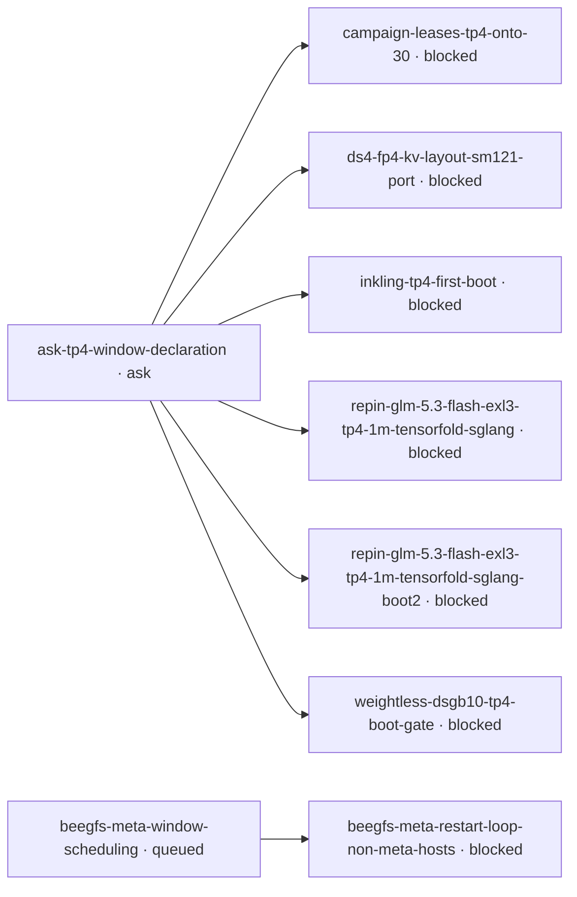

# Board
_Generated 2026-11-22 21:24 ET_

## In flight
| where | owner | what |
|---|---|---|
| census | read-only in tick — booted nothing, claimed nothing, stopped nothing, evicted nothing | read `2026-11-23T02:24:09Z`–`2026-11-23T02:24:11Z` (each node's own `date -u`) on the base census `2026-11-23T02:12:44Z`, **0 h 11 min 25 s** after it: **5 containers, 0 volumes** fleet-wide; **research rank** on `.30`; the fenced hosts hold running containers on `.31`, `.32`, `.33`, `.34`, excluded from research accounting; `/v1/models` **200**, `/health` **200** on `.31` |
| pool | — (nobody drives it; head units re-proved each tick) | head: `beegfs-mgmtd` **active** (Result success, NRestarts 0, **+0** on the base) · `beegfs-meta` **active** (Result success, NRestarts 0, **+0** on the base) · `beegfs-storage` **active** (Result success, NRestarts 0, **+0** on the base); worker unit states and the pool's through-mount reads are not part of this census |
| queue | register snapshot `d84644dc…`; both blocks below rendered from it | `origin/main:mad-science/queue.json` sha256 **`d84644dc3a22c8f1e52ce46c6e83b4cb690a1fa3c35931566fcbefd92fa07999`** read locally: **253 tasks: 240 done, 3 queued, 7 blocked, 1 running, 2 ask — 13 open**; the head clone reads **`d3ce705a…`**, **differs** |
| window | **no manual lock** at this read | `.local/fleet-window.lock` is **absent** on the head (read `2026-11-23T02:24:11Z`) |
| campaign | `sparkrun-campaign` — active, no lease | head user unit `sparkrun-campaign` reads **`active`** / **`running`** (`MainPID` **3,930,275**, `NRestarts` **0**, **+0** on the base); the lease ledger holds **0 lease(s)** and fence(s) `tp-le2-20261120` |
| lease | **1 fence(s), 0 lease(s)** | the head's repo ledger `.local/fleet-leases.json` (389 B, sha **`ec09509d…`**, mtime **`2026-11-21 03:04:12.907935197 -0500`** local) holds fence **`tp-le2-20261120`** on `.31`, `.32`, `.33`, `.34` (`fenced_at` `2026-11-20T07:25:27Z`, owner directive 2026-11-20: production serve protected, serve `58cddf1c62ba6578_b8865cad5863` / image `986795bcd7f4`) and **0 lease(s)** |
| publication | tick | fresh census (`2026-11-23T02:24:09Z`–`2026-11-23T02:24:11Z`) written to `2026-11-23T022408Z.json` and composed on the base census `2026-11-23T02:12:44Z`; the queue blocks are rendered from `origin/main:mad-science/queue.json` sha **`d84644dc…`**, and the landed rows from `git log --since=2026-11-23T02:12:44Z` |
| .30 | **live containers** — 1 running, research accounting | `2026-11-23T02:24:09Z` (`spark-41e1`): `docker ps -aq` **1**, running **1**, volumes **0**, `:8000` listeners **0** root **1,214,222,200,832 B avail** (-66,277,376, fell) · **2,612,808,617,984 B used** (+66,277,376, rose) boot **`2026-11-19T20:06:40Z`** (`btime`), `uptime` **281,849 s** `MemTotal` **127,598,704 kB** (+0), `MemAvailable` **87,822,396 kB** (+75,342,784), `Cached` **34,913,684 kB** (+27,492,416), `AnonPages` **3,456,736 kB** (-3,789,168) ring **256** events all-types (+0), **0** in-window lifecycle and **205** in-window `exec`, oldest `2026-11-22T21:16:07.873193274-05:00 container exec_die 37ea2`, newest `2026-11-22T21:24:02.000465637-05:00 container exec_die ce2ab` |
| .31 | **fenced serve** — excluded from the research census | `2026-11-23T02:24:09Z` (`spark-d325`): `docker ps -aq` **1**, running **1**, volumes **0**, `:8000` listeners **2**, `/v1/models` **200**, `/health` **200** root **1,559,384,776,704 B avail** (-1,220,608, fell) · **2,267,646,042,112 B used** (+1,220,608, rose) boot **`2026-11-19T20:11:15Z`** (`btime`), `uptime` **281,574 s** `MemTotal` **127,598,700 kB** (+0), `MemAvailable` **8,829,184 kB** (+155,104), `Cached` **8,363,020 kB** (+2,771,880), `AnonPages` **6,648,532 kB** (-11,508) ring **256** events all-types (+0), **0** in-window lifecycle and **69** in-window `exec`, oldest `2026-11-22T20:41:48.866624732-05:00 container exec_start: ta`, newest `2026-11-22T21:23:48.884861639-05:00 container exec_die d9d79` |
| .32 | **fenced serve** — excluded from the research census | `2026-11-23T02:24:10Z` (`spark-ec1d`): `docker ps -aq` **1**, running **1**, volumes **0**, `:8000` listeners **0** root **1,625,006,010,368 B avail** (-9,564,160, fell) · **2,202,024,693,760 B used** (+9,564,160, rose) boot **`2026-11-19T20:14:21Z`** (`btime`), `uptime` **281,388 s** `MemTotal` **127,598,640 kB** (+0), `MemAvailable` **11,738,412 kB** (-21,216), `Cached` **12,461,948 kB** (-7,008), `AnonPages` **5,326,136 kB** (+10,796) ring **256** events all-types (+0), **0** in-window lifecycle and **69** in-window `exec`, oldest `2026-11-22T20:41:19.227059803-05:00 container exec_die 7641b`, newest `2026-11-22T21:23:49.266541279-05:00 container exec_die 7641b` |
| .33 | **fenced serve** — excluded from the research census | `2026-11-23T02:24:10Z` (`spark-3578`): `docker ps -aq` **1**, running **1**, volumes **0**, `:8000` listeners **0** root **1,521,581,228,032 B avail** (-9,568,256, fell) · **2,305,449,476,096 B used** (+9,568,256, rose) boot **`2026-11-19T20:12:55Z`** (`btime`), `uptime` **281,475 s** `MemTotal` **127,598,636 kB** (+0), `MemAvailable` **11,652,624 kB** (-3,552), `Cached` **11,698,940 kB** (-433,724), `AnonPages` **5,326,344 kB** (-1,840) ring **256** events all-types (+0), **0** in-window lifecycle and **69** in-window `exec`, oldest `2026-11-22T20:41:19.589177114-05:00 container exec_die d98d0`, newest `2026-11-22T21:23:49.632377211-05:00 container exec_die d98d0` |
| .34 | **fenced serve** — excluded from the research census | `2026-11-23T02:24:10Z` (`spark-324e`): `docker ps -aq` **1**, running **1**, volumes **0**, `:8000` listeners **0** root **1,106,973,655,040 B avail** (-9,555,968, fell) · **2,720,057,163,776 B used** (+9,555,968, rose) boot **`2026-11-19T20:09:04Z`** (`btime`), `uptime` **281,706 s** `MemTotal` **127,598,704 kB** (+0), `MemAvailable` **11,671,176 kB** (+21,280), `Cached` **10,953,956 kB** (+246,316), `AnonPages` **5,304,796 kB** (-7,268) ring **256** events all-types (+0), **0** in-window lifecycle and **69** in-window `exec`, oldest `2026-11-22T20:41:19.950379054-05:00 container exec_die ff75e`, newest `2026-11-22T21:23:49.987851994-05:00 container exec_die ff75e` |
| .35 | **nothing live (no reservation)** — idle | `2026-11-23T02:24:11Z` (`spark-383f`): `docker ps -aq` **0**, running **0**, volumes **0**, `:8000` listeners **0** root **1,040,774,660,096 B avail** (-9,879,552, fell) · **2,786,256,158,720 B used** (+9,879,552, rose) boot **`2026-11-19T20:07:56Z`** (`btime`), `uptime` **281,774 s** `MemTotal` **127,598,700 kB** (+0), `MemAvailable` **123,259,720 kB** (+155,652), `Cached` **510,080 kB** (-12,712,732), `AnonPages` **237,192 kB** (-37,000) ring **256** events all-types (+0), **0** in-window lifecycle and **117** in-window `exec`, oldest `2026-11-22T21:05:06.535546060-05:00 container exec_start: sh`, newest `2026-11-22T21:19:48.088204374-05:00 container destroy 8b4cc1` |

## Work Queue

| job | node cost | blockers | holds | status | summary |
|---|---|---|---|---|---|
| `ask-tp4-window-declaration` — Ask: declare the four-rank TP4 window that two blocked quartet boots wait on | — | — | weightless-dsgb10-tp4-boot-gate, inkling-tp4-first-boot, campaign-leases-tp4-onto-30, repin-glm-5.3-flash-exl3-tp4-1m-tensorfold-sglang, repin-glm-5.3-flash-exl3-tp4-1m-tensorfold-sglang-boot2, ds4-fp4-kv-layout-sm121-port | ask | — QUESTION FOR THE OWNER: when may a four-rank TP4 boot run? Two arms are otherwise ready — weightless-dsgb10-tp4-boot-gate (the alpha=0 golden hash must equal stock before any steered request is quoted) and inkling-tp4-first-boot (first boot… (full note: queue.json) |
| `beegfs-meta-window-scheduling` — Propose and declare the maintenance window for the beegfs-meta fix | — | — | beegfs-meta-restart-loop-non-meta-hosts | queued | — OWNER ANSWER 2026-11-22 (ViBoard thread t22): the beegfs-meta restart-loop fix is deferred — its own session, no window yet. This row is the step that makes a window possible without pushing one: propose one or two candidate maintenance win… (full note: queue.json) |
| `ask-vllm-nvfp4-abi` — Ask: adopt FlashInfer's 384-byte nvfp4 ABI for the vLLM path, or build a 352-byte SM12x reader? | — | — | ds4-fp4-kv-layout-sm121-port-vllm | ask | — QUESTION FOR THE OWNER: does the vLLM fp4-KV path adopt FlashInfer's 384-byte nvfp4 ABI, or does someone build a 352-byte SM12x reader? The layout half is delivered (fork overlay patch/nvfp4-ds-mla/, local 0b5c1a8: the 352-byte record = 448… (full note: queue.json) |
| `beegfs-meta-restart-loop-non-meta-hosts` — beegfs-meta restart-loops every 5 s on .31-.35, and the loop hides a failed state behind "activating" | single | ask-beegfs-meta-window, beegfs-meta-window-scheduling | — | blocked | — Measured 2026-11-09 07:03-07:05 ET, and it is the side effect of the fix beegfs-units-restart-no (done) blessed: /etc/systemd/system/beegfs-meta.service.d/oom.conf (mtime 2026-11-08 16:03 on .30, 16:05 on .31) sets OOMScoreAdjust plus Resta… (full note: queue.json) — evidence: `.scratch/infra-chores-20261122/beegfs-meta/RECEIPT.md` |
| `repin-glm-5.3-flash-exl3-tp4-1m-tensorfold-sglang` — Boot glm-5.3-flash-exl3-tp4-1m-tensorfold-sglang with the refreshed pin and move its pins | quartet | ask-tp4-window-declaration | — | blocked | — PIN MOVE 2026-11-22 (owner rule, ViBoard thread t24): updated pins are boot-tested as soon as a window of the correct size is free for them, and the pin moves in that boot's commit — no carrier-lane ride-along. This row boots recipes/glm/gl… (full note: queue.json) |
| `repin-glm-5.3-flash-exl3-tp4-1m-tensorfold-sglang-boot2` — Boot glm-5.3-flash-exl3-tp4-1m-tensorfold-sglang-boot2 with the refreshed pin and move its pins | quartet | ask-tp4-window-declaration | — | blocked | — PIN MOVE 2026-11-22 (owner rule, ViBoard thread t24): updated pins are boot-tested as soon as a window of the correct size is free for them, and the pin moves in that boot's commit — no carrier-lane ride-along. This row boots recipes/glm/gl… (full note: queue.json) |
| `repin-qwen3.8-flash-next-uncensored-nvfp4-sglang` — Boot qwen3.8-flash-next-uncensored-nvfp4-sglang with the refreshed pin and move its pins | pair | — | — | queued | — PIN MOVE 2026-11-22 (owner rule, ViBoard thread t24): updated pins are boot-tested as soon as a window of the correct size is free for them, and the pin moves in that boot's commit — no carrier-lane ride-along. This row boots recipes/cybers… (full note: queue.json) |
| `repin-qwen3.8-flash-next-uncensored-nvfp4-vllm` — Boot qwen3.8-flash-next-uncensored-nvfp4-vllm with the refreshed pin and move its pins | pair | — | — | queued | — PIN MOVE 2026-11-22 (owner rule, ViBoard thread t24): updated pins are boot-tested as soon as a window of the correct size is free for them, and the pin moves in that boot's commit — no carrier-lane ride-along. This row boots recipes/cybers… (full note: queue.json) |
| `repin-zz-minimax-h3-fl2va-t2va-sglang` — Boot zz-minimax-h3-fl2va-t2va-sglang with the refreshed pin and move its pins | single | — | — | running | — PIN MOVE 2026-11-22 (owner rule, ViBoard thread t24): updated pins are boot-tested as soon as a window of the correct size is free for them, and the pin moves in that boot's commit — no carrier-lane ride-along. This row boots recipes/media/… (full note: queue.json) |
| `campaign-leases-tp4-onto-30` — The campaign leases memory-heavy TP4 quartets onto .30, which the owner ruling excludes | quartet | ask-placement-policy-30, ask-tp4-window-declaration | — | blocked | — MECHANISM LANDED OFFLINE 2026-11-11 (commits `aa54000`, `ebf5c8e`, `298098d`, `08ff156`; no live lease and no live six-node boot has run, so the row stays open). One ledger, `<repo>/.local/fleet-leases.json` (flock + atomic write), and one … (full note: queue.json) |
| `inkling-tp4-first-boot` — Inkling-2-Small TP=4 first boot: nightly pull and the unproven sm_121 Triton path | quartet | ask-tp4-window-declaration | — | blocked | — No node holds the pinned nightly digest c17e9d88, so the first boot includes the pull. GB10 is sm_121 and the Blackwell path gates on capability family 100, so the engine runs the Hopper/Triton half (attention_sm90 plus the Humming expert G… (full note: queue.json) — evidence: `recipes/explore/README.md section zz-inkling-2-small-nvfp4-thinking-tools-tp4-vllm` |
| `weightless-dsgb10-tp4-boot-gate` — Boot the weightless-dsgb10 arm four-rank: the α=0 golden hash must equal stock bit-for-bit before any steered request is quoted | quartet | ask-tp4-window-declaration | — | blocked | — Boot gate for the image closed by weightless-image-build-publish-pin (1bc6b5cb). Image ghcr.io/littlecedar/dgx-picom-ds41f:ds41f-7c123ad4-pr15-pr7-weightless, digest sha256:305b6e5151a2cfd13b85f18c36bccf9062af83e28917fd11a0f151691c5e83df, p… (full note: queue.json) — evidence: `recipes/ds4/zz-deepseek-v4.1-flash-1017-weightless-dsgb10-tp4.yaml (container pinned by digest at line 30); recipes/ds4/README.md lines 2890-2911 (two-name contract, alpha=0 identity) and 2990-2996 (the boot gate)` |
| `ds4-fp4-kv-layout-sm121-port` — DS4 1017 SM121: port the V41/V41_FP4 KV layout so fp4 KV is admissible — dtype is not a lever today, and sizing lies about fp4 | quartet | ask-tp4-window-declaration, ds4-fp4-kv-layout-sm121-port-sglang, ds4-fp4-kv-layout-sm121-port-vllm | — | blocked | — RECIPE RETIRED 2026-11-18: the `zz-` arm this row booted is archived at `attic/ds4/zz-ds4-1017-sm121-indexer-scoring.yaml` (it was run or refused on record; see the lane attic index), so the row is no longer bootable. CORRECTION TO THE FP8-… (full note: queue.json) |

## Completed Work
Window: commits since `2026-11-23T02:12:44Z` — the base census stamp, later than the 24 h start `2026-11-22T02:24:08Z`; older rows are not shown.

| time ET | commit | one clause |
|---|---|---|
| 11-22 21:12 | `3b11bcaa` | Refresh the status board: a 2026-11-23T021243Z census |
