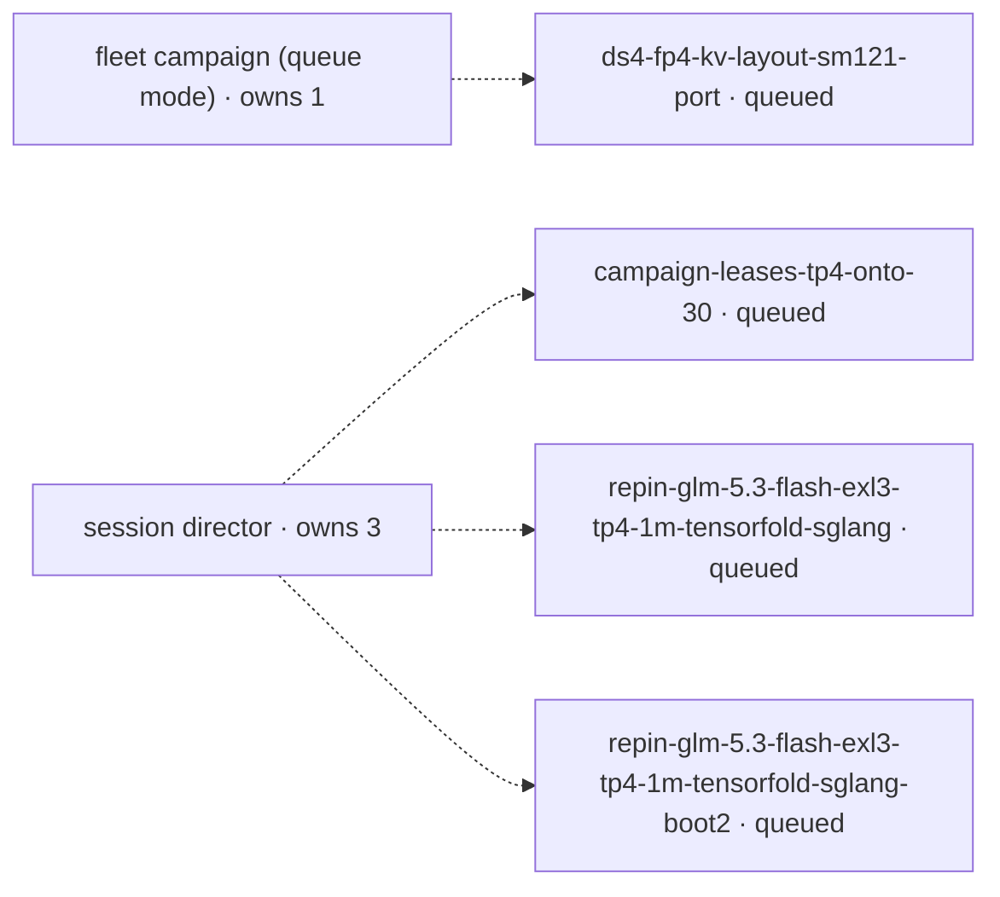

# Board
_Generated 2026-11-23 02:36 ET_

## In flight
| where | owner | what |
|---|---|---|
| census | read-only in tick — booted nothing, claimed nothing, stopped nothing, evicted nothing | read `2026-11-23T07:36:43Z`–`2026-11-23T07:36:45Z` (each node's own `date -u`) on the base census `2026-11-23T07:24:19Z`, **0 h 12 min 24 s** after it: **0 containers, 0 volumes** fleet-wide; **no research rank**; no node probed a serve |
| pool | — (nobody drives it; head units re-proved each tick) | head: `beegfs-mgmtd` **active** (Result success, NRestarts 0, **+0** on the base) · `beegfs-meta` **active** (Result success, NRestarts 0, **+0** on the base) · `beegfs-storage` **active** (Result success, NRestarts 0, **+0** on the base); worker unit states and the pool's through-mount reads are not part of this census |
| queue | register snapshot `f1857423…`; both blocks below rendered from it | `mad-science/queue.json` sha256 **`f185742374f137e3778dba2cf6e2b6d542638f691d1f4f929b8b15cf8a1e9904`** read locally: **253 tasks: 249 done, 4 queued, 0 blocked, 0 running — 4 open**; the head clone reads **`f1857423…`**, identical |
| window | **no manual lock** at this read | `.local/fleet-window.lock` is **absent** on the head (read `2026-11-23T07:36:46Z`) |
| campaign | `sparkrun-campaign` — active, no lease | head user unit `sparkrun-campaign` reads **`active`** / **`running`** (`MainPID` **3,930,275**, `NRestarts` **0**, **+0** on the base); the lease ledger holds **0 lease(s)** and fence(s) `tp-le2-20261120` |
| lease | **1 fence(s), 0 lease(s)** | the head's repo ledger `.local/fleet-leases.json` (389 B, sha **`ec09509d…`**, mtime **`2026-11-21 03:04:12.907935197 -0500`** local) holds fence **`tp-le2-20261120`** on `.31`, `.32`, `.33`, `.34` (`fenced_at` `2026-11-20T07:25:27Z`, owner directive 2026-11-20: production serve protected, serve `58cddf1c62ba6578_b8865cad5863` / image `986795bcd7f4`) and **0 lease(s)** |
| publication | tick | fresh census (`2026-11-23T07:36:43Z`–`2026-11-23T07:36:45Z`) written to `2026-11-23T073642Z.json` and composed on the base census `2026-11-23T07:24:19Z`; the queue blocks are rendered from `mad-science/queue.json` sha **`f1857423…`**, and the landed rows from `git log --since=2026-11-23T07:24:19Z` |
| .30 | **nothing live (no reservation)** — idle | `2026-11-23T07:36:43Z` (`spark-41e1`): `docker ps -aq` **0**, running **0**, volumes **0**, `:8000` listeners **0** root **1,064,670,638,080 B avail** (-33,526,935,552, fell) · **2,762,360,180,736 B used** (+33,526,935,552, rose) boot **`2026-11-19T20:06:40Z`** (`btime`), `uptime` **300,603 s** `MemTotal` **127,598,704 kB** (+0), `MemAvailable` **120,843,504 kB** (-916,280), `Cached` **54,206,988 kB** (-62,185,324), `AnonPages` **882,612 kB** (-21,056) ring **256** events all-types (+0), **0** in-window lifecycle and **0** in-window `exec`, oldest `2026-11-22T21:19:30.420316810-05:00 container exec_die fbebd`, newest `2026-11-23T02:32:00.782227478-05:00 image save sha256:7f8f1b` |
| .31 | **nothing live (no reservation)** — idle | `2026-11-23T07:36:43Z` (`spark-d325`): `docker ps -aq` **0**, running **0**, volumes **0**, `:8000` listeners **0** root **1,301,888,811,008 B avail** (-991,232, fell) · **2,525,142,007,808 B used** (+991,232, rose) boot **`2026-11-19T20:11:15Z`** (`btime`), `uptime` **300,328 s** `MemTotal` **127,598,700 kB** (+0), `MemAvailable` **122,954,464 kB** (+5,416), `Cached` **2,568,044 kB** (+7,500), `AnonPages` **273,952 kB** (-1,420) ring **256** events all-types (+0), **0** in-window lifecycle and **0** in-window `exec`, oldest `2026-11-23T01:47:52.367027994-05:00 container exec_create: s`, newest `2026-11-23T01:59:48.812052804-05:00 container destroy 97b002` |
| .32 | **nothing live (no reservation)** — idle | `2026-11-23T07:36:44Z` (`spark-ec1d`): `docker ps -aq` **0**, running **0**, volumes **0**, `:8000` listeners **0** root **1,385,491,161,088 B avail** (+74,838,016, rose) · **2,441,539,543,040 B used** (-74,838,016, fell) boot **`2026-11-19T20:14:21Z`** (`btime`), `uptime` **300,142 s** `MemTotal` **127,598,640 kB** (+0), `MemAvailable` **123,142,824 kB** (+3,656), `Cached` **5,475,452 kB** (+8,844), `AnonPages` **235,240 kB** (+1,600) ring **256** events all-types (+0), **0** in-window lifecycle and **0** in-window `exec`, oldest `2026-11-23T01:47:31.342696990-05:00 container exec_die 8bde4`, newest `2026-11-23T01:59:48.849551700-05:00 container destroy 8bde48` |
| .33 | **nothing live (no reservation)** — idle | `2026-11-23T07:36:44Z` (`spark-3578`): `docker ps -aq` **0**, running **0**, volumes **0**, `:8000` listeners **0** root **1,256,185,856,000 B avail** (-987,136, fell) · **2,570,844,848,128 B used** (+987,136, rose) boot **`2026-11-19T20:12:55Z`** (`btime`), `uptime` **300,229 s** `MemTotal` **127,598,636 kB** (+0), `MemAvailable` **123,136,544 kB** (+3,772), `Cached` **12,017,788 kB** (+4,768), `AnonPages` **233,444 kB** (+468) ring **256** events all-types (+0), **0** in-window lifecycle and **0** in-window `exec`, oldest `2026-11-23T01:47:31.725456999-05:00 container exec_die 68938`, newest `2026-11-23T01:59:48.825181963-05:00 container destroy 689386` |
| .34 | **nothing live (no reservation)** — idle | `2026-11-23T07:36:45Z` (`spark-324e`): `docker ps -aq` **0**, running **0**, volumes **0**, `:8000` listeners **0** root **862,688,935,936 B avail** (+66,379,776, rose) · **2,964,341,882,880 B used** (-66,379,776, fell) boot **`2026-11-19T20:09:04Z`** (`btime`), `uptime` **300,460 s** `MemTotal` **127,598,704 kB** (+0), `MemAvailable` **122,768,440 kB** (+16,280), `Cached` **8,062,780 kB** (+8,296), `AnonPages` **228,720 kB** (-628) ring **256** events all-types (+0), **0** in-window lifecycle and **0** in-window `exec`, oldest `2026-11-23T01:47:32.117404345-05:00 container exec_die 1b8d4`, newest `2026-11-23T01:59:48.846518189-05:00 container destroy 1b8d41` |
| .35 | **nothing live (no reservation)** — idle | `2026-11-23T07:36:45Z` (`spark-383f`): `docker ps -aq` **0**, running **0**, volumes **0**, `:8000` listeners **0** root **971,302,293,504 B avail** (-995,328, fell) · **2,855,728,525,312 B used** (+995,328, rose) boot **`2026-11-19T20:07:56Z`** (`btime`), `uptime` **300,528 s** `MemTotal` **127,598,700 kB** (+0), `MemAvailable` **122,838,068 kB** (-2,760), `Cached` **115,074,336 kB** (+3,004), `AnonPages` **298,880 kB** (-5,812) ring **256** events all-types (+0), **0** in-window lifecycle and **0** in-window `exec`, oldest `2026-11-22T21:05:06.535546060-05:00 container exec_start: sh`, newest `2026-11-22T21:19:48.088204374-05:00 container destroy 8b4cc1` |

## Work Queue

| job | node cost | blockers | holds | status | summary |
|---|---|---|---|---|---|
| `repin-glm-5.3-flash-exl3-tp4-1m-tensorfold-sglang` — Boot glm-5.3-flash-exl3-tp4-1m-tensorfold-sglang with the refreshed pin and move its pins | quartet | — | — | queued | — PIN MOVE 2026-11-22 (owner rule, ViBoard thread t24): updated pins are boot-tested as soon as a window of the correct size is free for them, and the pin moves in that boot's commit — no carrier-lane ride-along. This row boots recipes/glm/gl… (full note: queue.json) — evidence: `head:~/benchmarks/glm-repin-20261123/repin-1/head-boot.log` |
| `repin-glm-5.3-flash-exl3-tp4-1m-tensorfold-sglang-boot2` — Boot glm-5.3-flash-exl3-tp4-1m-tensorfold-sglang-boot2 with the refreshed pin and move its pins | quartet | — | — | queued | — PIN MOVE 2026-11-22 (owner rule, ViBoard thread t24): updated pins are boot-tested as soon as a window of the correct size is free for them, and the pin moves in that boot's commit — no carrier-lane ride-along. This row boots recipes/glm/gl… (full note: queue.json) |
| `campaign-leases-tp4-onto-30` — The campaign leases memory-heavy TP4 quartets onto .30, which the owner ruling excludes | quartet | — | — | queued | — MECHANISM LANDED OFFLINE 2026-11-11 (commits `aa54000`, `ebf5c8e`, `298098d`, `08ff156`; no live lease and no live six-node boot has run, so the row stays open). One ledger, `<repo>/.local/fleet-leases.json` (flock + atomic write), and one … (full note: queue.json) |
| `ds4-fp4-kv-layout-sm121-port` — DS4 1017 SM121: port the V41/V41_FP4 KV layout so fp4 KV is admissible — dtype is not a lever today, and sizing lies about fp4 | quartet | — | — | queued | — FP4-KV image built and pushed. SGLang side: ghcr.io/littlecedar/aneda@sha256:b5de5272edd983e41059154f10d862a44c25f8f5f403fafd48ad0778b95ceed6 (the dsv41-sm121-dg:0.2.1-fi073e base + patch_dsv41_fp4kv.py + fp4kv_kv_format.py). Recipe at reci… (full note: queue.json) |

## Completed Work
Window: commits since `2026-11-23T07:24:19Z` — the base census stamp, later than the 24 h start `2026-11-22T07:36:42Z`; older rows are not shown.

| time ET | commit | one clause |
|---|---|---|
| 11-23 02:24 | `22f65e97` | Refresh the status board: a 2026-11-23T072418Z census |
| 11-23 02:25 | `2a6897dc` | Close inkling-tp4-first-boot as a measured negative |
