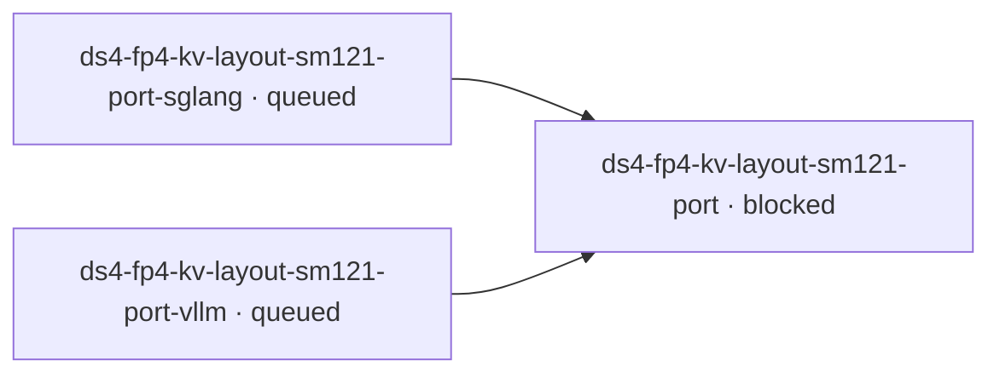

# Board — generated 2026-11-22 07:01 ET

## In flight
| where | owner | what |
|---|---|---|
| census | read-only in tick — booted nothing, claimed nothing, stopped nothing, evicted nothing | read `2026-11-22T12:01:58Z`–`2026-11-22T12:02:01Z` (each node's own `date -u`) on the base census `2026-11-22T12:00:01Z`, **0 h 1 min 57 s** after it: **4 containers, 0 volumes** fleet-wide; **no research rank**; the fenced hosts hold running containers on `.31`, `.32`, `.33`, `.34`, excluded from research accounting; `/v1/models` **200**, `/health` **200** on `.31` |
| pool | — (nobody drives it; head units re-proved each tick) | head: `beegfs-mgmtd` **active** (Result success, NRestarts 0, **+0** on the base) · `beegfs-meta` **active** (Result success, NRestarts 0, **+0** on the base) · `beegfs-storage` **active** (Result success, NRestarts 0, **+0** on the base); worker unit states and the pool's through-mount reads are not part of this census |
| queue | register snapshot `fa683255…`; both blocks below rendered from it | `mad-science/queue.json` sha256 **`fa6832554eee539758258d17710de09826f35ed282dca3444e973cca7e9f77e5`** read locally: **228 tasks: 214 done, 7 queued, 7 blocked, 0 running — 14 open**; the head clone reads **`255a95ab…`**, **differs** |
| window | **no manual lock** at this read | `.local/fleet-window.lock` is **absent** on the head (read `2026-11-22T12:02:02Z`) |
| campaign | `sparkrun-campaign` — active, no lease | head user unit `sparkrun-campaign` reads **`active`** / **`running`** (`MainPID` **3,930,275**, `NRestarts` **0**, **+0** on the base); the lease ledger holds **0 lease(s)** and fence(s) `tp-le2-20261120` |
| lease | **1 fence(s), 0 lease(s)** | the head's repo ledger `.local/fleet-leases.json` (389 B, sha **`ec09509d…`**, mtime **`2026-11-21 03:04:12.907935197 -0500`** local) holds fence **`tp-le2-20261120`** on `.31`, `.32`, `.33`, `.34` (`fenced_at` `2026-11-20T07:25:27Z`, owner directive 2026-11-20: production serve protected, serve `58cddf1c62ba6578_b8865cad5863` / image `986795bcd7f4`) and **0 lease(s)** |
| publication | tick | fresh census (`2026-11-22T12:01:58Z`–`2026-11-22T12:02:01Z`) written to `2026-11-22T120158Z.json` and composed on the base census `2026-11-22T12:00:01Z`; the queue blocks are rendered from `mad-science/queue.json` sha **`fa683255…`**, and the landed rows from `git log --since=2026-11-22T12:00:01Z` |
| .30 | **nothing live (no reservation)** — idle | `2026-11-22T12:01:58Z` (`spark-41e1`): `docker ps -aq` **0**, running **0**, volumes **0**, `:8000` listeners **0** root **1,220,587,438,080 B avail** (-21,229,568, fell) · **2,606,443,380,736 B used** (+21,229,568, rose) boot **`2026-11-19T20:06:40Z`** (`btime`), `uptime` **230,118 s** `MemTotal` **127,598,704 kB** (+0), `MemAvailable` **122,326,380 kB** (-47,312), `Cached` **1,253,540 kB** (+22,164), `AnonPages` **739,264 kB** (+4,164) ring **256** events all-types (+0), **0** in-window lifecycle and **0** in-window `exec`, oldest `2026-11-22T06:04:11.906324228-05:00 container exec_die 957b8`, newest `2026-11-22T06:20:39.839141796-05:00 container destroy 957b85` |
| .31 | **fenced serve** — excluded from the research census | `2026-11-22T12:01:59Z` (`spark-d325`): `docker ps -aq` **1**, running **1**, volumes **0**, `:8000` listeners **2**, `/v1/models` **200**, `/health` **200** root **1,559,414,579,200 B avail** (-139,264, fell) · **2,267,616,239,616 B used** (+139,264, rose) boot **`2026-11-19T20:11:15Z`** (`btime`), `uptime` **229,844 s** `MemTotal` **127,598,700 kB** (+0), `MemAvailable` **9,240,620 kB** (+21,532), `Cached` **9,356,072 kB** (-8,624), `AnonPages` **6,285,804 kB** (+2,688) ring **256** events all-types (+0), **0** in-window lifecycle and **0** in-window `exec`, oldest `2026-11-22T01:22:20.316343646-05:00 container exec_create: t`, newest `2026-11-22T02:03:50.216539739-05:00 container exec_die d9d79` |
| .32 | **fenced serve** — excluded from the research census | `2026-11-22T12:01:59Z` (`spark-ec1d`): `docker ps -aq` **1**, running **1**, volumes **0**, `:8000` listeners **0** root **1,625,048,563,712 B avail** (-94,208, fell) · **2,201,982,140,416 B used** (+94,208, rose) boot **`2026-11-19T20:14:21Z`** (`btime`), `uptime` **229,658 s** `MemTotal` **127,598,640 kB** (+0), `MemAvailable` **11,792,840 kB** (+12,536), `Cached` **12,541,852 kB** (+524), `AnonPages` **5,315,448 kB** (+3,592) ring **256** events all-types (+0), **0** in-window lifecycle and **0** in-window `exec`, oldest `2026-11-22T01:21:20.669666082-05:00 container exec_die 7641b`, newest `2026-11-22T02:03:50.609980136-05:00 container exec_die 7641b` |
| .33 | **fenced serve** — excluded from the research census | `2026-11-22T12:02:00Z` (`spark-3578`): `docker ps -aq` **1**, running **1**, volumes **0**, `:8000` listeners **0** root **1,521,623,785,472 B avail** (-135,168, fell) · **2,305,406,918,656 B used** (+135,168, rose) boot **`2026-11-19T20:12:55Z`** (`btime`), `uptime` **229,745 s** `MemTotal` **127,598,636 kB** (+0), `MemAvailable` **11,736,852 kB** (-4,816), `Cached` **12,453,316 kB** (+384), `AnonPages` **5,309,884 kB** (+808) ring **256** events all-types (+0), **0** in-window lifecycle and **0** in-window `exec`, oldest `2026-11-22T01:21:21.059279363-05:00 container exec_die d98d0`, newest `2026-11-22T02:03:50.958560605-05:00 container exec_die d98d0` |
| .34 | **fenced serve** — excluded from the research census | `2026-11-22T12:02:00Z` (`spark-324e`): `docker ps -aq` **1**, running **1**, volumes **0**, `:8000` listeners **0** root **1,107,016,261,632 B avail** (-143,360, fell) · **2,720,014,557,184 B used** (+143,360, rose) boot **`2026-11-19T20:09:04Z`** (`btime`), `uptime` **229,976 s** `MemTotal` **127,598,704 kB** (+0), `MemAvailable` **11,749,356 kB** (-1,580), `Cached` **12,375,272 kB** (+300), `AnonPages` **5,301,556 kB** (+2,712) ring **256** events all-types (+0), **0** in-window lifecycle and **0** in-window `exec`, oldest `2026-11-22T01:21:21.472607032-05:00 container exec_die ff75e`, newest `2026-11-22T02:03:51.331148782-05:00 container exec_die ff75e` |
| .35 | **nothing live (no reservation)** — idle | `2026-11-22T12:02:01Z` (`spark-383f`): `docker ps -aq` **0**, running **0**, volumes **0**, `:8000` listeners **0** root **1,041,849,077,760 B avail** (-102,400, fell) · **2,785,181,741,056 B used** (+102,400, rose) boot **`2026-11-19T20:07:56Z`** (`btime`), `uptime` **230,044 s** `MemTotal` **127,598,700 kB** (+0), `MemAvailable` **123,020,060 kB** (-54,760), `Cached` **5,117,292 kB** (+1,204), `AnonPages` **251,964 kB** (+6,684) ring **256** events all-types (+0), **0** in-window lifecycle and **0** in-window `exec`, oldest `2026-11-22T06:03:40.672336005-05:00 container exec_create: b`, newest `2026-11-22T06:20:39.466944765-05:00 container destroy 5a5f12` |

## Work queue

| job | node cost | blockers | holds | status | summary |
|---|---|---|---|---|---|
| `ds4-fp4-kv-layout-sm121-port-vllm` — DS4 1017 SM121 vLLM: carry nvfp4_ds_mla through the SM12x sparse-MLA backend so fp4 KV is selectable | single | — | ds4-fp4-kv-layout-sm121-port | queued | Queued engine work: upstream vLLM already ships nvfp4_ds_mla at 352 B/token against fp8 packed 976; the gap is the SM120 sparse-MLA backend selecting it on GB10, patched in the fork overlay, then the parent TP4 boot. |
| `ds4-fp4-kv-layout-sm121-port-sglang` — DS4 1017 SM121 SGLang: port the V41_FP4 KV layout and the fp4 pool-sizing term so fp4 KV is admissible | single | — | ds4-fp4-kv-layout-sm121-port | queued | Queued engine work: three SGLang edits at image commit 103ad321 (relax the is_sm100 gate, port the V41_FP4 layout, size the pool in fp4 bytes) so fp4 KV is admissible; a numerics gate before the parent TP4 boot. |
| `beegfs-meta-restart-loop-non-meta-hosts` — beegfs-meta restart-loops every 5 s on .31-.35, and the loop hides a failed state behind "activating" | single | — | — | blocked | Blocked, owner 2026-11-22: the OOM drop-in Restart=on-failure loops beegfs-meta every 5 s on .31-.35 (NRestarts 3431, 956.6 MB journal) while is-active reads activating; remedy is masking the unit there, .30 untouched. |
| `head-clone-object-store-incomplete` — The head clone loses git objects continuously (healed twice on 2026-11-21, gap reopens on every new commit), so `git ls-tree HEAD` and any `git pull` fail there until it is re-healed | — | — | — | blocked | Blocked on an owner choice: the head clone keeps losing loose git objects (packs agree), healed 2026-11-22 by one `git fetch origin main` + `git read-tree HEAD` (7 missing to 0); stop sharing .git or fetch periodically. |
| `hf-cache-20261110-docs-only-repin-bundle` — Docs-only model drift from the 2026-11-10 cache update: 22 recipe rows across 10 repos ride their lane’s next boot (no boot of its own) | — | — | — | queued | Queued: the docs-only drift bundle is 14 live rows (8 retired to attic), no live pin moved since the sweep, so each lane re-pins at its next boot - needs a live window, not a decision. |
| `queue-mode-done-sibling-holds-canary-row` — Queue mode will not lease a row whose recipe a done sibling already holds | — | — | — | blocked | Blocked on whether a done sibling keeps holding a recipe: today's instance is resolved (both rows done, no queued row held), the behavior is documented as designed, and an env-only re-run still needs its own recipe file. |
| `campaign-leases-tp4-onto-30` — The campaign leases memory-heavy TP4 quartets onto .30, which the owner ruling excludes | quartet | — | — | queued | Lease ledger and holder/id claim identity landed offline (d0cf704, no live director-driven TP4 lease yet); .30 is waivable for a memory-heavy quartet only inside a declared window with the six guardrails, else refused. Row open. |
| `mem-guard-outlives-its-task` — A window arm's 6.0 GiB stop-rule guard outlives the arm, so the runner accumulates guards for tasks whose containers are gone | — | — | — | blocked | Blocked on a live boot: a leaked guard is a stale no-op (stops only its own task id), the harness kill and stub test are proven, and closing needs one real stop that leaves no guard process behind. |
| `fleet-boot-without-lease-record` — A four-rank boot serves with no lease in either ledger and no window lock | — | — | — | blocked | Blocked on a live window: the unleased quartet is the shipped production serve (digest and argv match), not a research boot, so the open question is whether a protected production boot must carry a lease under S9. |
| `window-lock-does-not-stop-direct-boots` — A declared window holds campaign placement and `director lease`, but a direct `sparkrun run` boot bypasses both | — | — | — | blocked | Blocked on an owner decision: a declared window holds campaign placement and leases but not a direct `sparkrun run` (a solo boot ran on .35 inside it with no lease record), so decide whether launch must read the lock. |
| `inkling-tp4-first-boot` — Inkling-2-Small TP=4 first boot: nightly pull and the unproven sm_121 Triton path | quartet | — | — | queued | Inkling-2-Small TP4 first boot: nightly digest c17e9d88 is on no node so the boot includes the pull, and sm_121 runs the Hopper/Triton path (attention_sm90, Humming expert GEMMs) unproven here; needs an owner-declared window. |
| `mech-cites-0-4-3` — Re-derive the remaining 117 recipes/MECHANICS.md citations against the installed sparkrun build | — | — | — | queued | 117 recipes/MECHANICS.md anchors still carry 0.4.2/0.4.0 numbering after d0d050f landed 27 plus 13 controls; not mechanically renumberable since core/recipe.py grew to 3080 lines, so each sentence is re-read and its claim re-located. |
| `weightless-dsgb10-tp4-boot-gate` — Boot the weightless-dsgb10 arm four-rank: the α=0 golden hash must equal stock bit-for-bit before any steered request is quoted | quartet | — | — | queued | Boot gate, weightless image: at α=0 output must be byte-identical to stock before any steered request is quoted, then a second-name request must project while a stock one keeps its text; four ranks, .31-.34 unfenced, --cluster WOPR. |
| `ds4-fp4-kv-layout-sm121-port` — DS4 1017 SM121: port the V41/V41_FP4 KV layout so fp4 KV is admissible — dtype is not a lever today, and sizing lies about fp4 | quartet | ds4-fp4-kv-layout-sm121-port-sglang, ds4-fp4-kv-layout-sm121-port-vllm | — | blocked | Blocked on engine work: fp4 KV needs the is_sm100 gate relaxed, the V41/V41_FP4 layout ported and an fp4 branch in the pool configurator, and nvfp4 is unsafe today because sizing has no fp4 term; it buys 2-4x tokens per GiB but no floor. |

## Landed session
Window: commits since `2026-11-22T12:00:01Z` — the base census stamp, later than the 24 h start `2026-11-21T12:01:58Z`; older rows are not shown.

| time ET | commit | one clause |
|---|---|---|
| 11-22 07:00 | `809c2428` | Refresh the status board: a 2026-11-22T120000Z census |
