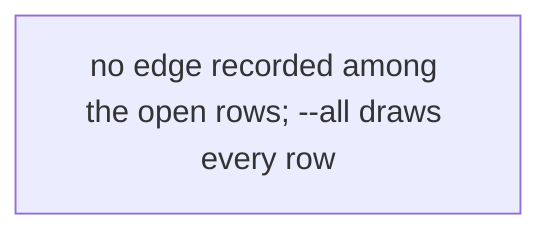

# Board — generated 2026-11-22 01:00 ET

## In flight
| where | owner | what |
|---|---|---|
| census | read-only in tick — booted nothing, claimed nothing, stopped nothing, evicted nothing | read `2026-11-22T06:00:01Z`–`2026-11-22T06:00:03Z` (each node's own `date -u`) on the base census `2026-11-22T04:59:30Z`, **1 h 0 min 31 s** after it: **5 containers, 0 volumes** fleet-wide; **research rank** on `.30`; the fenced hosts hold running containers on `.31`, `.32`, `.33`, `.34`, excluded from research accounting; `/v1/models` **200**, `/health` **200** on `.30`; `/v1/models` **200**, `/health` **200** on `.31` |
| pool | — (nobody drives it; head units re-proved each tick) | head: `beegfs-mgmtd` **active** (Result success, NRestarts 0, **+0** on the base) · `beegfs-meta` **active** (Result success, NRestarts 0, **+0** on the base) · `beegfs-storage` **active** (Result success, NRestarts 0, **+0** on the base); worker unit states and the pool's through-mount reads are not part of this census |
| queue | register snapshot `97607350…`; both blocks below rendered from it | `mad-science/queue.json` sha256 **`976073501829f10479975de9301b051a3d1c852ac436e30585ea38d95366327a`** read locally: **214 tasks: 184 done, 25 queued, 4 blocked, 1 running — 30 open**; the head clone reads **`97607350…`**, identical |
| window | **no manual lock** at this read | `.local/fleet-window.lock` is **absent** on the head (read `2026-11-22T06:00:04Z`) |
| campaign | `sparkrun-campaign` — active, no lease | head user unit `sparkrun-campaign` reads **`active`** / **`running`** (`MainPID` **3,930,275**, `NRestarts` **0**, **+0** on the base); the lease ledger holds **0 lease(s)** and fence(s) `tp-le2-20261120` |
| lease | **1 fence(s), 0 lease(s)** | the head's repo ledger `.local/fleet-leases.json` (389 B, sha **`ec09509d…`**, mtime **`2026-11-21 03:04:12.907935197 -0500`** local) holds fence **`tp-le2-20261120`** on `.31`, `.32`, `.33`, `.34` (`fenced_at` `2026-11-20T07:25:27Z`, owner directive 2026-11-20: production serve protected, serve `58cddf1c62ba6578_b8865cad5863` / image `986795bcd7f4`) and **0 lease(s)** |
| publication | tick | fresh census (`2026-11-22T06:00:01Z`–`2026-11-22T06:00:03Z`) written to `2026-11-22T060000Z.json` and composed on the base census `2026-11-22T04:59:30Z`; the queue blocks are rendered from `mad-science/queue.json` sha **`97607350…`**, and the landed rows from `git log --since=2026-11-22T04:59:30Z` |
| .30 | **live containers** — 1 running, research accounting | `2026-11-22T06:00:01Z` (`spark-41e1`): `docker ps -aq` **1**, running **1**, volumes **0**, `:8000` listeners **1**, `/v1/models` **200**, `/health` **200** root **1,364,242,755,584 B avail** (-5,356,802,048, fell) · **2,462,788,063,232 B used** (+5,356,802,048, rose) boot **`2026-11-19T20:06:40Z`** (`btime`), `uptime` **208,401 s** `MemTotal` **127,598,704 kB** (+0), `MemAvailable` **86,481,660 kB** (-34,660,020), `Cached` **1,792,068 kB** (-24,492,404), `AnonPages` **7,500,800 kB** (+6,415,432) ring **256** events all-types (+0), **0** in-window lifecycle and **141** in-window `exec`, oldest `2026-11-21T01:14:21.861951811-05:00 container start 94f3ad32`, newest `2026-11-22T00:59:49.886791972-05:00 container exec_die 30b91` |
| .31 | **fenced serve** — excluded from the research census | `2026-11-22T06:00:01Z` (`spark-d325`): `docker ps -aq` **1**, running **1**, volumes **0**, `:8000` listeners **2**, `/v1/models` **200**, `/health` **200** root **1,634,193,182,720 B avail** (-15,569,289,216, fell) · **2,192,837,636,096 B used** (+15,569,289,216, rose) boot **`2026-11-19T20:11:15Z`** (`btime`), `uptime` **208,126 s** `MemTotal` **127,598,700 kB** (+0), `MemAvailable` **9,402,632 kB** (+1,321,460), `Cached` **9,597,944 kB** (+6,993,908), `AnonPages` **6,042,860 kB** (-1,399,068) ring **256** events all-types (+0), **0** in-window lifecycle and **256** in-window `exec`, oldest `2026-11-22T00:17:50.204944778-05:00 container exec_start: ta`, newest `2026-11-22T00:59:50.320862021-05:00 container exec_die d9d79` |
| .32 | **fenced serve** — excluded from the research census | `2026-11-22T06:00:02Z` (`spark-ec1d`): `docker ps -aq` **1**, running **1**, volumes **0**, `:8000` listeners **0** root **1,695,107,375,104 B avail** (-14,739,427,328, fell) · **2,131,923,329,024 B used** (+14,739,427,328, rose) boot **`2026-11-19T20:14:21Z`** (`btime`), `uptime` **207,940 s** `MemTotal` **127,598,640 kB** (+0), `MemAvailable` **11,737,848 kB** (+99,736), `Cached` **11,294,936 kB** (+565,136), `AnonPages` **5,310,404 kB** (-23,212) ring **256** events all-types (+0), **0** in-window lifecycle and **256** in-window `exec`, oldest `2026-11-22T00:17:20.535178782-05:00 container exec_die 7641b`, newest `2026-11-22T00:59:50.716973165-05:00 container exec_die 7641b` |
| .33 | **fenced serve** — excluded from the research census | `2026-11-22T06:00:02Z` (`spark-3578`): `docker ps -aq` **1**, running **1**, volumes **0**, `:8000` listeners **0** root **1,608,019,918,848 B avail** (-17,643,196,416, fell) · **2,219,010,785,280 B used** (+17,643,196,416, rose) boot **`2026-11-19T20:12:55Z`** (`btime`), `uptime` **208,027 s** `MemTotal` **127,598,636 kB** (+0), `MemAvailable` **11,676,208 kB** (-14,324), `Cached` **12,379,856 kB** (+2,012,612), `AnonPages` **5,309,764 kB** (-712) ring **256** events all-types (+0), **0** in-window lifecycle and **256** in-window `exec`, oldest `2026-11-22T00:17:20.898465441-05:00 container exec_die d98d0`, newest `2026-11-22T00:59:51.125483247-05:00 container exec_die d98d0` |
| .34 | **fenced serve** — excluded from the research census | `2026-11-22T06:00:03Z` (`spark-324e`): `docker ps -aq` **1**, running **1**, volumes **0**, `:8000` listeners **0** root **1,086,909,300,736 B avail** (-15,585,570,816, fell) · **2,740,121,518,080 B used** (+15,585,570,816, rose) boot **`2026-11-19T20:09:04Z`** (`btime`), `uptime` **208,259 s** `MemTotal` **127,598,704 kB** (+0), `MemAvailable` **11,682,040 kB** (+2,612), `Cached` **11,925,580 kB** (+2,751,020), `AnonPages` **5,289,288 kB** (-14,576) ring **256** events all-types (+0), **0** in-window lifecycle and **256** in-window `exec`, oldest `2026-11-22T00:17:21.244294243-05:00 container exec_die ff75e`, newest `2026-11-22T00:59:51.539476776-05:00 container exec_die ff75e` |
| .35 | **nothing live (no reservation)** — idle | `2026-11-22T06:00:03Z` (`spark-383f`): `docker ps -aq` **0**, running **0**, volumes **0**, `:8000` listeners **0** root **1,108,612,509,696 B avail** (-3,516,665,856, fell) · **2,718,418,309,120 B used** (+3,516,665,856, rose) boot **`2026-11-19T20:07:56Z`** (`btime`), `uptime` **208,326 s** `MemTotal` **127,598,700 kB** (+0), `MemAvailable` **123,099,868 kB** (+74,368), `Cached` **14,865,168 kB** (+8,741,700), `AnonPages` **241,108 kB** (-7,876) ring **256** events all-types (+0), **0** in-window lifecycle and **0** in-window `exec`, oldest `2026-11-20T19:46:09.290987692-05:00 container exec_die 2f39b`, newest `2026-11-20T20:56:32.651557975-05:00 container destroy 26b0f5` |

## Work queue

| job | node cost | blockers | holds | status | summary |
|---|---|---|---|---|---|
| `beegfs-meta-restart-loop-non-meta-hosts` — beegfs-meta restart-loops every 5 s on .31-.35, and the loop hides a failed state behind "activating" | single | — | — | blocked | — Measured 2026-11-09 07:03-07:05 ET, and it is the side effect of the fix `beegfs-units-restart-no` (done) blessed: /etc/systemd/system/beegfs-meta.service.d/oom.conf (mtime 2026-11-08 16:03 on .30, 16:05 on .31) sets OOMScoreAdjust plus Res… (full note: queue.json) — evidence: `.scratch/infra-chores-20261122/beegfs-meta/RECEIPT.md` |
| `head-clone-object-store-incomplete` — The head clone loses git objects continuously (healed twice on 2026-11-21, gap reopens on every new commit), so `git ls-tree HEAD` and any `git pull` fail there until it is re-healed | — | — | — | queued | Head clone loses loose objects (packs agree) so git reads fail there; healed twice on 2026-11-21 (91 objects), yet the gap reopens on every commit and one 743 B tree never syncs, so the mechanism is unnamed. |
| `hf-cache-20261110-docs-only-repin-bundle` — Docs-only model drift from the 2026-11-10 cache update: 22 recipe rows across 10 repos ride their lane’s next boot (no boot of its own) | — | — | — | queued | Docs-only drift bundle over 14 live recipe rows (8 of the 22 retired to attic): only README/LICENSE/eval_results differ from the head, no pin bumped since the sweep, each lane moves its pin at its next boot and records it. |
| `house-num-scorer-trailing-period` — House battery scores a correct number with a trailing period as a miss | — | — | — | queued | score() for kind=num keeps the sentence-final dot, so a correct 74 ending a sentence scores false (Ripple 2026-11-20 hard-arith-1); fix is stripping trailing punctuation plus a regression test over 74, 74. and 7.5. |
| `lane-survey-edge0-audio8-tts` — Media-lane survey: Edge0/Audio8-TTS-Realistic-Air - 0.6B DualAR TTS + bundled codec, TP<4 so surveyed only | — | — | — | queued | Edge0/Audio8-TTS survey: Apache-2.0, 0.6B DualAR TTS plus a 1.35 GB 44.1 kHz codec, trust_remote_code required, SGLang Omni adapter unverified; TP<4, so surveyed only with no recipe per the owner rule. |
| `queue-mode-done-sibling-holds-canary-row` — Queue mode will not lease a row whose recipe a done sibling already holds | — | — | — | queued | Canary row (tp4 quartet recipe) never leases because plan.sibling_hold keys arms on the recipe stem and done sibling h2h-second-boot-ds4-1017 holds it, fleet idle meanwhile; open choice: close sibling, own recipe file, or change the hold. |
| `sage-q4km-trick1-empty-repeat` — Sage Q4_K_M: repeat the trick-1 house cell — one empty reply in the 37-case run | single | — | — | running | — The 2026-11-20 boot scored 36/37 on the 37-case house; the single miss is trick-1, which returned empty content (house.json). Empty content is a serving event, not a capability miss. Repeat that cell n=3 on the same boot shape (--parallel 1… (full note: queue.json) — evidence: `head:~/benchmarks/tp2-completion-20261120/sage-a1.5-35b/house.json` |
| `campaign-ingest-freezes-on-an-unplaceable-pending-arm` — The campaign never re-reads the register while any arm is pending, so one unplaceable pending arm silently stops new rows from ever being seen | — | — | — | queued | Campaign refreshes only when drained; a pending memory-risky TP4 arm that cannot fit .30/.35 with .31-.34 fenced holds drained() false, so rows queued after 00:12 were never ingested; fix: idle-poll refresh or unplaceable state. |
| `campaign-leases-tp4-onto-30` — The campaign leases memory-heavy TP4 quartets onto .30, which the owner ruling excludes | — | — | — | queued | Lease ledger and holder/id claim identity landed offline (d0cf704, no live director-driven TP4 lease yet); .30 is waivable for a memory-heavy quartet only inside a declared window with the six guardrails, else refused. Row open. |
| `campaign-state-copy-re-nests` — The director's receipts root copies state.json back into a window subdir, so one campaign now holds 40 nested copies | — | — | — | queued | One campaign holds 40 byte-identical nested state.json copies because --receipts-root equals --root, so each run under tp12-window re-nests; no stale state is read today, but a **/state.json census counted 49 files for 9 campaigns. |
| `hf-cache-20261110-cache-consistency-defects` — HF cache consistency defects: four repos hf ignores on a refs/main byte defect, one on a broken absolute symlink, plus 204 GB of stray non-cache trees in the hub root | single | — | — | blocked | — Measured 2026-11-10 with `hf cache ls --no-truncate --show-warnings` on .30 after the update loop finished a pass. (1) refs/main carries a trailing newline in models--lodestones--Kromoss (41 B; ref a4fe9744, snapshots 0c5417ec + a4fe9744), … (full note: queue.json) — evidence: `.scratch/infra-chores-20261122/consistency/RECEIPT.md` |
| `hf-cache-20261110-template-ab-ifm-k2` — K2-Horizon template/code drift A/B: head c4f92a0d (0.9B) and 240f2de3 (7B-FP8) vs the shipped pins, template identity + one fixed request | single | — | — | queued | — Class (b) from the 2026-11-10 cache sweep: no weight file changed, but IFM/K2-Horizon-0.9B head moves 383cb66347be -> c4f92a0d66e2 changing chat_template.jinja AND modeling_k2_horizon.py and REMOVING chat_template_asst_tool_gen.jinja + chat… (full note: queue.json) |
| `mem-guard-outlives-its-task` — A window arm's 6.0 GiB stop-rule guard outlives the arm, so the runner accumulates guards for tasks whose containers are gone | — | — | — | queued | Corrected: a leaked guard is a stale no-op because mem-guard stops only its own task id; what accumulates is processes and ssh sessions — three guards alive on 2026-11-10 with one task container; fix is guard lifetime and harness refusal. |
| `watchdog-stall-mmap-flat-residual` — Watchdog stall rule: mmap load with flat io/log and sub-128-MiB memory progress | — | — | — | queued | boot-watchdog counts memory as progress only past a 128 MiB floor, so an mmap load with flat io/log and smaller per-check deltas is still classified stalled at 600 s; fix is cumulative progress or a test plus a recorded risk. |
| `wopr-cache-dir-runtime-regression` — Verify SGLang and llama.cpp still resolve models through the WOPR cache_dir profile | single | — | — | queued | — The 2026-11-20 Hy4 launch added cache_dir: /mnt/beegfs/huggingface to the WOPR cluster profile (sparkrun cluster update WOPR --cache-dir ...), because the head cache symlink resolved outside the workload mounts. Only the vLLM runtime was pr… (full note: queue.json) — evidence: `recipes/ds4/README.md section zz-deepseek-v4.1-flash-1017-weightless-tp4-1m (cache_dir change, task 261430353ba2889a_9e41b9e252af)` |
| `board-publish-accepts-weaker-replacement` — publish replaces a better-grounded In-flight composition with a fresher byte-compatible one, and no guard notices | — | — | — | queued | Publish guards compare bytes, so a replacement with fewer facts passes: on 2026-11-11 a composition replaced the peer's 4 captures ending 01:16 with 3 ending 01:06; acceptance is a pre-publish check on capture count, state labels, teardown. |
| `board-publish-keeps-in-flight-row-set` — A board published without one of the In-flight state rows passes every guard, because publish compares bytes and never the row set | — | — | — | queued | A base missing an In-flight state row is indistinguishable from a good one: bc2cc38 published 0 queue rows and passed publish, lint and the gate; acceptance: refuse an In-flight lacking an expected row key or a strict subset of its base. |
| `cache-audit-pool-budget` — `tools/cache-audit.py --budget-gb`: add a pool mode that judges the one shared HF pool against 90 % of capacity | — | — | — | queued | cache-audit --budget-gb measures per node but the HF cache is one shared pool, so every node reads the same and the fleet flags at once; it needs a pool mode judging usage against 90% of capacity with one pass/fail. Not bootable. |
| `executor-release-host-claim-on-failure` — An executor that stops observing a launch must release the sparkrun host claims it holds | — | — | — | queued | A launcher that stops observing its boot still holds sparkrun host claims: pid 1883449 held .30-.33 after a 414.7 s registry failure, the next three arms refused rc=5; unfixed at 4927a7fe — nothing kills the launcher to drop the claim. |
| `fleet-boot-without-lease-record` — A four-rank boot serves with no lease in either ledger and no window lock | — | — | — | queued | Corrected: the unleased four-rank serve measured on 2026-11-11 is the shipped production arm (image digest and argv match), not a research quartet; open is whether a protected production boot must carry a lease under the S9 answer. |
| `runtime-cache-stale-tree-gc` — Delete the stale runtime-cache trees the 2026-11-12 audit approved (732 GB planned, never executed) | single | — | — | blocked | — BATCH 1 EXECUTED 2026-11-16T16:33:28Z — 52 items / 554.54 GB deleted on '.30'-'.34' ('.30' 22.53, '.31' 96.38, '.32' 143.49, '.33' 143.68, '.34' 148.46 GB) and '.35' released 0.00 GB — receipt '.scratch/gc-20261116/census.md' rev 3 §Executi… (full note: queue.json) |
| `sparkrun-single-gid-index-for-two-hcas` — sparkrun injects one GID index across two HCAs whose tables disagree | — | — | — | queued | Report-only sparkrun defect: one derived NCCL_IB_GID_INDEX is applied to both HCAs, and a 2026-11-11 carrier flap vacated plane A's index 3, failing ncclCommInitRank (ibv_modify_qp 61) on boot 2 and the control; fix per HCA or fail closed. |
| `window-lock-does-not-stop-direct-boots` — A declared window holds campaign placement and `director lease`, but a direct `sparkrun run` boot bypasses both | — | — | — | queued | A declared window stops campaign placement and lease but not a direct sparkrun run: inside the 01:04-01:16 window a solo container started on .35 with no lease record and no assign line; decide whether direct boots consult the lock. |
| `webai-twil-8b-eval-only-arm` — Author and ship the webAI 8.8B eval-only arm (webAI-Official/TwIL-8B): recipe, license banner, lane README notice, index row | — | — | — | queued | No recipe yet: webAI/TwIL-8B is webai-non-commercial, so the arm ships eval-only with license banner, description note and lane README notice; 8.79B BF16 in balanced and verbose variants plus GGUF quants; closes when both are tracked. |
| `inkling-tp4-first-boot` — Inkling-2-Small TP=4 first boot: nightly pull and the unproven sm_121 Triton path | quartet | — | — | queued | Inkling-2-Small TP4 first boot: nightly digest c17e9d88 is on no node so the boot includes the pull, and sm_121 runs the Hopper/Triton path (attention_sm90, Humming expert GEMMs) unproven here; needs an owner-declared window. |
| `mech-cites-0-4-3` — Re-derive the remaining 117 recipes/MECHANICS.md citations against the installed sparkrun build | — | — | — | queued | 117 recipes/MECHANICS.md anchors still carry 0.4.2/0.4.0 numbering after d0d050f landed 27 plus 13 controls; not mechanically renumberable since core/recipe.py grew to 3080 lines, so each sentence is re-read and its claim re-located. |
| `metrics-instrument-confound` — Metrics knob decomposition: one identical recipe, metrics-on vs metrics-off, name the performance-impacting knobs (`#68` ROM bar) | single | — | — | queued | — Owner's `#68` authorises the decomposition that makes the comparability bar checkable, and it must separate THREE regimes, because only one of them can bias a cell: (1) `tools/run-arm.sh`'s scrape is a single exec AFTER the cell and before … (full note: queue.json) |
| `minimax-viggle-remake-eval-only-arm` — Author and ship the MiniMax video eval-only arm (Viggle/Viggle-Remake): ComfyUI node route, license banner, lane README notice, index row | — | — | — | queued | No recipe yet: Viggle-Remake is under the minimax-h3 community license, so the ComfyUI-node arm ships eval-only with banner and README notice; tiers Q8_0 20.72 GiB to Q4_K_M 13.35 GiB, repo 156 GiB so staging is a pool transfer. |
| `weightless-dsgb10-tp4-boot-gate` — Boot the weightless-dsgb10 arm four-rank: the α=0 golden hash must equal stock bit-for-bit before any steered request is quoted | quartet | — | — | queued | Boot gate, weightless image: at α=0 output must be byte-identical to stock before any steered request is quoted, then a second-name request must project while a stock one keeps its text; four ranks, .31-.34 unfenced, --cluster WOPR. |
| `ds4-fp4-kv-layout-sm121-port` — DS4 1017 SM121: port the V41/V41_FP4 KV layout so fp4 KV is admissible — dtype is not a lever today, and sizing lies about fp4 | quartet | — | — | blocked | Blocked on engine work: fp4 KV needs the is_sm100 gate relaxed, the V41/V41_FP4 layout ported and an fp4 branch in the pool configurator, and nvfp4 is unsafe today because sizing has no fp4 term; it buys 2-4x tokens per GiB but no floor. |

## Landed session
Window: commits since `2026-11-22T04:59:30Z` — the base census stamp, later than the 24 h start `2026-11-21T06:00:00Z`; older rows are not shown.

| time ET | commit | one clause |
|---|---|---|
| 11-21 23:59 | `b5eda762` | Refresh the status board: a 2026-11-22T045929Z census |
| 11-22 00:37 | `f5b96501` | Close the single-node infra chores: pool fall named, cache gaps filled |
