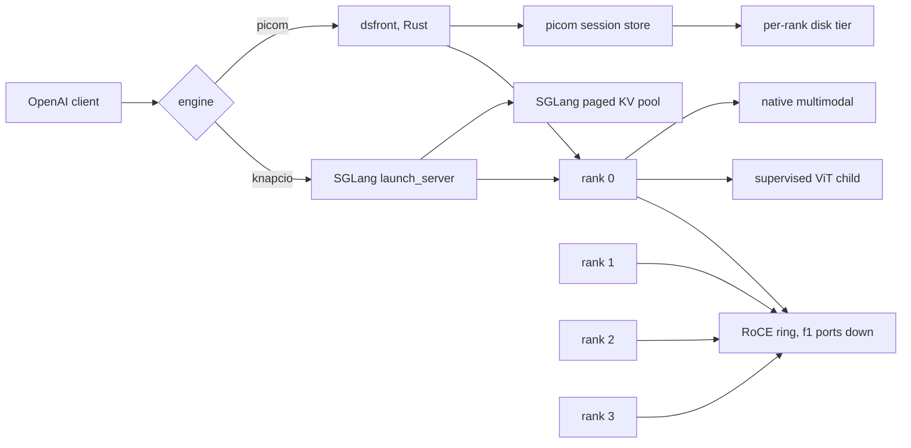
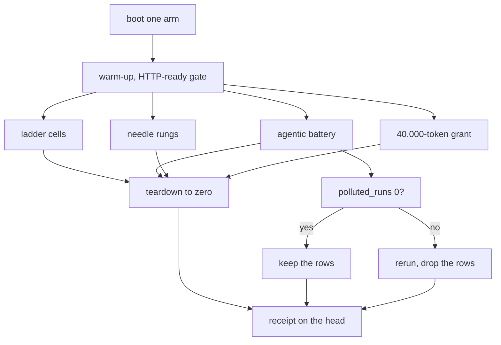

# picom vs knapcio: one model, two engines on four GB10s

The lane record (arms, boots, measurement tables) is
[the lane README](README.md#deepseek-v41-flash-knapcio-tp4-1m-sglang); this page only
compares the two engines serving the same checkpoint on the same four ranks. Every numeric cell
names its receipt; every mechanism cell names a source line or the flag that carries it. Nothing
here is a leaderboard row — the two arms do not run the same budgets and no cell was measured
interleaved.

## The answer, in ten lines

- **One stream: picom.** 84.5 against 64.8 tok/s chat and 142.5 against 119.8 code, same
  instrument, same day (section 3); both engines draft 5 tokens, so this is per-step cost.
- **Two streams: a tie.** 90.8 against **90.3** tok/s on the same-day knapcio rerun (+0.6 %, inside
  the 6.2 % within-boot spread) and 83.4 on the October row (+8.9 %), so the ordering does not
  survive the same-day column.
- **Five to ten users: knapcio.** 111.5 against **122.6 and 127.3** tok/s at C5, and 129.2 against
  **153.3 and 160.9** at C10 (same-day rerun, then October); the direction holds on either column.
- **Agentic tool loop: picom.** Total wall clock 110.2–133.4 s and 108.1–136.7 s against
  147.1–152.9 s, ranges disjoint — LIKELY, one boot per arm.
- **Fast restart matters: picom.** 27.7 s to HTTP-ready against 708.4 s.
- **Client contract matters: knapcio.** It echoes token ids, has a real thinking channel and
  reports prefix-cache hits; picom drops unknown fields silently and clamps `max_tokens`.
- **Exact vs lossy picom: a tie on this evidence.** Same wall clock inside either arm's spread;
  the lossy arm is ahead **+5.5 % at C5 and +3.9 % at C10** (section 5).
- **What would change the answer: one interleaved A/B and a second boot per arm.** Every ordering
  here rests on a single boot per side; the agentic gap is disjoint in sample, not established.

## Which engine, by workload

| workload shape | pick | cell that supports it | confidence |
|:--|:--|:--|:--|
| Single stream, chat | picom | `c1 9` chat 84.5 vs 64.8 tok/s (section 3) | measured, one boot per side |
| Single stream, code | picom | `c1 9` code 142.5 vs 119.8 tok/s (section 3) | measured, one boot per side |
| 2 users | either | shipped exact C2 90.8 vs knapcio 90.3 rerun / 83.4 October (section 3) | tie on the same-day column |
| 5–10 fan-out | knapcio | C5 111.5 vs 122.6 / 127.3, C10 129.2 vs 153.3 / 160.9 (rerun / October) | holds on both columns — other boots |
| Agentic tool loop | picom | totals 110.2–133.4 / 108.1–136.7 vs 147.1–152.9 s | LIKELY, one boot per arm |
| Million-token context | either | 983,040 needle PASS at depth 10 on both shipped arms | PASS measured; decode unmeasured |
| Vision | knapcio | native in-engine stack; picom needs a supervised child | functional on both, no cost cell |
| Long-form generation | picom | 40,000 tokens in 207.9 s (192.4 tok/s) under a 262,144 cap | measured on picom, no cap probed on knapcio |
| Restart-sensitive work | picom | 27.7 s warm-cached vs 708.4 s cold | one boot each, not like-for-like |

## Architecture



knapcio (`deepseek-v4.1-flash-knapcio-tp4-1m-sglang.yaml`) is SGLang `sglang.launch_server` from
the image's `dev-dsv41` build (`da64c5cb`, staged tree `f80c91a4b`), TP=4 / EP=1 over 2×
ConnectX-7 RoCEv2, with RoCEnante doing the one-shot all-reduce and all-gather, 1M context,
DSpark k=5, driven by a lane mod that owns the memory line and the extra flags
(`mods/dsv41-sglang-overlay/launcher.py`). It optimizes the production serve line: one long-lived
process holding a 1M-token KV pool, 16 uniform request slots, a 16384-token prefill chunk, and
SGLang's paged attention, radix prefix cache and in-process multimodal stack as the tuning surface
(`launcher.py:148-300`).

picom (`zz-deepseek-v4.1-flash-1017-picom-tp4-1m.yaml` as the probe, shipped as
`deepseek-v4.1-flash-1017-picom-tp4-1m.yaml` with a lossy twin
`…-picom-tp4-1m-oea.yaml`) is a from-scratch C++/CUDA engine (`dsgb10_rank`, one process per node,
its own RDMA ring) behind a Rust front-end (`dsfront`), from `Picom-code/pico-dgx-ds4@7c123ad4`
with two integrated PR patches (`Dockerfile.picom-ds41f`). It optimizes per-token decode cost at
single stream: every rank holds one quarter of a 1M model GPU-resident, 16 session slots of which
4 hold the full window, drafts verify 5 tokens a step, and session state migrates to a 12 GiB store
plus a per-rank disk tier instead of a pre-sized KV pool (`engine/server/main.cpp:295-296`,
`docs/engine.md:451-523`).

The fabric is one switch and both f1 ports are down on this fleet, so a ring's two directions share
the same two f0 devices (`mods/picom-launcher/README.md:104`).

## How each was measured



One boot per configuration, cells run in a fixed order, then torn down to 0 containers, 0 volumes
and no `:8000` listener before the next start (`post-teardown.txt` beside each phase's cells). The
pollution rule is the whole reason the agentic section exists in its current form: runs whose
report carries a non-zero `polluted_runs` are dropped and re-measured, because a mixed-fixture
table once read a harness timeout as an engine property (section 3, old fixture's rows).

## 1. Same model, different machine

| axis | knapcio (SGLang) | picom (dsgb10) |
|:--|:--|:--|
| Context budget | 1,048,576 served (`--context-length` from `defaults.max_model_len`); KV pool profiled at boot and pinned to 6,849,792 tokens on the stock loader under `MEM_FRACTION_STATIC` 0.78 (`launcher.py:148,156`, `launcher.py:217-236`) | 1,048,576 for the 4 big slots; the other 12 hold `max_ctx / 8` = 131,072 each (`engine/model/model.cu:79-88`, `kUnitMul` 8 at `engine/model/config.h:39`); no `max_model_len` in the recipe, no KV pool to pin |
| Output ceiling | no front-end clamp found in the probed surface: `max_tokens` honored, a negative value draws an OpenAI-shaped 400 (`knapcio-live-20261117/README.md` probe 02) | **262,144** on the production arm (`PICOM_MAX_TOKENS`, `launch.sh:311,324`), which binds each long request to the four big slots — `engine/server/serve.cpp:1195` admits a request only where `prompt + max_new` fits, so a fifth 262k reply queues silently instead of being refused; the front-end's own default stays 32,768 (`frontend/src/main.rs:126`) and clamps a larger value rather than refusing it (`frontend/src/server.rs:522-528`), which is the silent clamp the shipped arm used to report as `finish_reason: length` |
| KV / session memory | one paged KV+SHA pool sized from MemAvailable at boot; fp8 KV; 128 SWA prefix tails reserved inside that budget (`launcher.py:268`, recipe `metadata.kv_dtype: fp8`) | compressed KV + index keys, ~890 B per position across all 40 layers, replicated (`docs/engine.md:90-116`); 12 GiB session-store pool, blocks of 64 KiB, spill to a per-rank 32 GiB disk tier (`docs/engine.md:451-523`) |
| Scheduler / admission | `MAX_RUNNING_REQUESTS=16` uniform slots; `--cuda-graph-max-bs-decode` follows the same number (`launcher.py:167`, live flags in `head:~/benchmarks/knapcio-live-20261117/README.md`) | 16 slots with 4 big (`--slots 16 --big-slots 4`, `recipes/ds4/mods/picom-launcher/launch.sh:190`); smallest-fit pick, small slots first so big ones stay for long requests (`engine/server/serve.cpp:1198-1205`); more requests than slots take turns of `--slice` 64 tokens (`docs/engine.md:615-700`) |
| Prefill | chunked at 16384 tokens (`CHUNKED_PREFILL_SIZE`, `launcher.py:178`); decode-between-chunks ships **off** (`PREFILL_DECODE_INTERVAL` 0, `launcher.py:278`) | whole request in `--prefill-rows` chunks: 8192 on the probe arm, 16384 on the shipped arms; decode between chunks not built, so other requests wait one chunk (`docs/engine.md:451-460`) |
| Speculative decoding | DSpark, verify-all, k=5 (`SPEC_ALGO DSPARK` `launcher.py:219`, `DSPARK_BLOCK_SIZE` `launcher.py:240`); decoded accepts 3.9–5.8 tokens/step on the measured boot (`knapcio-bench-20261117/boot/serve-rank0.log`) | DSpark, 5 drafts (6 rows per session step including the bonus, `engine/dspark/dspark.h:27`, `engine/model/ops.h:34`); drafts in a one-request run or a batch of ≤8, a larger batch takes the plain loop (`docs/engine.md:615-700`); levers `DSGB10_BUDGET`, `DSGB10_DRAFT1`, `DSGB10_WIDE` (`launch.sh:190`, `engine/server/cmd.cpp:662-664`, `engine/model/spec.cu:38`) |
| Weights as served | checkpoint as shipped: native MXFP4/F8, 510 GB resident, Engram read from NVMe (`recipes/ds4/README.md` knapcio table; arm `metadata.model_dtype: mxfp4`) | same checkpoint converted once per rank to a 72.38 GiB `.dsw` file (≈289.5 GiB across 4 ranks) plus 50.7 GB Engram shards on that rank's SSD (`docs/engine.md:90-116`; lane README artifacts row) |
| Vision | in-engine native multimodal; the measured boot's gate line records full-budget native vision passing (`knapcio-bench-20261117/boot/serve-rank0.log:447`) | separate supervised ViT child on rank 0, `127.0.0.1:18950`, ~0.90 GiB, front-end reaches it by `--vision-addr` (`launch.sh:269-271`, PR #15 patch) |
| Tool calls | `--tool-call-parser deepseekv41` with `--reasoning-parser deepseek-v41`; name then argument pieces, `finish_reason: tool_calls` (`knapcio-live-20261117/README.md` probes 4 and 8) | dsfront parses the model's own tool-call text (`frontend/src/server.rs:1006`) and streams argument pieces (`server.rs:1073-1076`; `--stream-tool-args` at `launch.sh:242`, PR #7 patch) |
| Prefix / cache behavior | radix prefix cache with 128 SWA tails and cache reporting on; a repeated ~4.8k prompt reports `prompt_tokens_details.cached_tokens: 4608` (`launcher.py:268`, `knapcio-live-20261117/README.md` probe 6) | session table matched by longest shared *text* prefix, 64 shared bytes minimum (`frontend/src/session.rs:17`), state spilled per slot; every measured cell ran cold — `reused 0 (cold)`, `cached_tokens: 0` (`picom-ladder-20261117/README.md` falsifiers, `knapcio-live-20261117/README.md` probe 6) |
| Readiness (container start → HTTP ready) | 696.2 s port-open / **708.4 s** HTTP-ready, one cold boot (`knapcio-bench-20261117/README.md`) | **27.7 s** with per-rank artifacts cached; 166.4 s on the boot that had to convert weights and Engram (`picom-gap-20261117/README.md`) |

## 2. Request surface

The live probe pair: the 2026-11-18 knapcio serve and the pinned picom front-end.
Receipts: `head:~/benchmarks/knapcio-live-20261117/` (17 files, keyless anonymous probes) and the
picom front-end read at `7c123ad4` (`frontend/src/server.rs:522-538`, `frontend/src/main.rs:126-132`).

| axis | knapcio (SGLang) | picom (dsfront) |
|:--|:--|:--|
| Defaults when the request omits them | samples: three runs, three distinct answers (`02-defaults.json`) | `temperature` 1.0, `top_p` 0.95, `max_tokens` = its cap, 32,768 with no launcher flag (`frontend/src/main.rs:126,130-131`) |
| Honored sampling / limits | vendor surface: `temperature`, `top_p`, `stop` (`matched_stop: 1`), `max_tokens` floor-checked with a 400 | `temperature`, `top_p`, `top_k` (approximate past ~256: candidate union capped at 64 logits/rank), `seed` (`mix64(seed) ^ pos`, reproducible), `max_tokens` / `max_completion_tokens`, `stop` (held-back partial tail), `stop_token_ids`, `ignore_eos` (`server.rs:522-545`) |
| Silently dropped | none found in the probed set | `min_p`, `presence_penalty`, `frequency_penalty`, `repetition_penalty`, `logit_bias`, `return_token_ids` — hand-written `r.get(...)` list, no unknown-key refusal (`server.rs:522-545`) |
| Token-id echo | honored: `prompt_token_ids` + `response_token_ids` present (`03-greedy`/probe 3) | ignored: 200 with no ids (`picom-ladder-20261117/preflight-transcript.txt:18,23`) |
| Thinking / reasoning channel | `chat_template_kwargs.thinking: true` turns it on: non-empty `reasoning_content`, `reasoning_tokens: 25`; the default emits none (`08-reasoning.json`, `09-thinking-true.json`) | the same kwargs select prompt *encoding* only; no reasoning channel is ever emitted, `completion_tokens_details.reasoning_tokens: 0` (`frontend/src/server.rs:510-519`, `frontend/src/main.rs:129`) |
| Prefix-cache visibility | reports a hit: `cached_tokens: 4608` on the repeat, `null` on the first (`07-long-prefix-cache.json`) | reports 0 and never a hit in our receipts (match needs 64 shared bytes, `session.rs:17`) |
| Errors | OpenAI-shaped 400 (`BadRequestError` on `max_tokens: -1`); unknown model name served and echoed | 400 with its own message strings; `max_tokens` above the cap is clamped, not refused (`server.rs:523-528`) |
| Loop guard | none | on by default: truncates 4 repeats of a 32–256-token n-gram, 64 identical tokens, or 8 identical lines (`frontend/src/guard.rs:63-67`; `--no-loop-guard` unset in the launcher) |
| Against the vendor card (`08c8657f`) | — | matches vendor temperature 1.0, one notch tighter on `top_p` (0.95 vs 1.0); deviates on `max_tokens` (32,768 default and clamp vs ≥256K recommended) only until the launcher's `PICOM_MAX_TOKENS` raises the cap, as the production arm's 262,144 does |

## 3. The measured cells

### One instrument, three configurations

One script on both arms — upstream's own `tools/bench/bench.py`, sha256 `4aff8517…b97967`,
byte-identical in both receipts, unpatched: 16 distinct code prompts, 512 output tokens, greedy,
thinking off, random prefix per request so no cache can help, completion tokens ÷ wall clock. Same
four ranks (`.31`–`.34`), same day. Run order was **picom lossless, picom `PICOM_OEA=4,12,9`,
knapcio** — sequential boots, one per configuration, not interleaved.

| cell | knapcio SGLang | picom, lossless | picom, `PICOM_OEA=4,12,9` | receipt |
|:--|--:|--:|--:|:--|
| `distinct 16` run 1 | 354.1 | 321.4 | 372.6 | `knapcio-bench-20261117/boot/distinct-16-run1.txt`; `picom-gap-20261117/boot-{a,b}/distinct-16-run1.txt` |
| `distinct 16` run 2 | 352.9 | 325.9 | 380.1 | `…/distinct-16-run2.txt` both receipts |
| `distinct 16` run 3 | 368.6 | 327.6 | 377.5 | `…/distinct-16-run3.txt` both receipts |
| `distinct 16` median / spread | **354.1 / 15.7** | 325.9 / 6.2 | 377.5 / 7.5 | `knapcio-bench-20261117/README.md`; `picom-gap-20261117/README.md` |
| `copies 16` (prompt-content locality; random prefix still defeats the cache, so not a caching cell) | 334.8 | 360.4 | 429.0 | `knapcio-bench-20261117/boot/copies-16.txt`; `picom-gap-20261117/boot-{a,b}/copies-16.txt` |
| `c1 9` chat median | 64.8 | 84.5 | 83.4 | `knapcio-bench-20261117/boot/c1-9.txt`; `picom-gap-20261117/boot-{a,b}/c1-9.txt` |
| `c1 9` code median | 119.8 | 142.5 | 144.3 | same files |
| fixed greedy prompt, 48 tokens, temp 0 | `picom arm online.`, 16+6 = 22 | same text, 15+6 = 21 | same text, 15+6 = 21 | `knapcio-bench-20261117/boot/fixed-prompt.json`; `picom-gap-20261117/boot-{a,b}/fixed-prompt.json` |
| llama-benchy `tg t/s`, depth 0 C4 / C8 / C16 | 118.9 / 107.5 / 115.9, 3 runs/cell, `ds4-sglang-depth0-ladder.yaml` (`~/benchmarks/ds4-knapcio-1017-20261018/arm-1017/`) | 108.6 / 120.4 / 141.0, 3 runs/cell, same profile (`picom-ladder-20261117/`) | — | per column |
| llama-benchy C1 aggregate | 67.18 ± 6.97, n=25, `concurrency-ladder.yaml` (`~/benchmarks/tp4-20261018/`) | 87.4, 3 runs, depth-0 ladder (`picom-ladder-20261117/`) | 159.6 is c16, not c1 (`picom-gap-20261117/boot-a/cell5-benchy.txt`) | per column |

Read the table as three separate one-boot measurements, never as a row of a leaderboard:

- **The budgets differ.** knapcio carries a 1M-context KV pool at `MEM_FRACTION_STATIC` 0.78
  (6,849,792 tokens), 16 uniform slots and DSpark k=5; picom carries 4 full-window + 12
  eighth-window slots and no KV pool. `distinct 16` is the same *demand* on both, not the same
  batch size.
- **One boot per configuration**, in a fixed order, so only each boot's own spread bounds its
  number; no boot-to-boot drift is controlled.
- **The llama-benchy rows are not paired cells** — different days, different serve lines and, for
  C1, different profiles; the picom ladder and the knapcio ladder were never run in one window.
- **The fixed-prompt equality is a smoke check**, one 48-token greedy prompt, not a quality
  measurement.

### Shipped-arm ladder

The two shipped artifacts, booted back to back on the same image:
`deepseek-v4.1-flash-1017-picom-tp4-1m.yaml` (exact, task `…053127e6543a`) and
`deepseek-v4.1-flash-1017-picom-tp4-1m-oea.yaml` (lossy, task `…2f2f42a6d68f`), both on
`ghcr.io/littlecedar/dgx-picom-ds41f@sha256:1e529c67…` with the 262,144-token reply ceiling and
`--prefill-rows 16384`. Instrument: `benchmarking/concurrency-ladder.yaml`, depth 0, 2048-token
prompts, 128-token replies, 5 runs/cell, `--skip-run --fresh`.

| cell | shipped exact | shipped lossy (OEA) | knapcio (rerun boot) | knapcio (October recorded row) |
|:--|--:|--:|--:|--:|
| C1 | 83.4 | 87.1 | 64.8 | 70.4 |
| C2 | 90.8 | 90.9 | 90.3 | 83.4 |
| C5 | 111.5 | 117.6 | 122.6 | 127.3 |
| C10 | 129.2 | 134.4 | 153.3 | 160.9 |

Receipts: `head:~/benchmarks/picom-prod-20261118/phase5/ladder.csv` (exact) and
`head:~/benchmarks/picom-prod-20261118/phase6/ladder.csv` (lossy), each beside `ladder.json` and
`ladder.log`. The knapcio columns are two different boots and are not interchangeable: the rerun
boot's own cells are `head:~/benchmarks/picom-prod-20261118/rerun-20261118/boot1-knapcio/ladder.csv`
(same day, separate window, 5 runs/cell, decode-phase rows only) and the October row is
[the lane README](README.md)'s (`head:~/benchmarks/ds4-1017-parity-20261027/armC/armC-ladder.csv`).
The exact-vs-lossy pair is the only same-window comparison; both knapcio columns are a shape to read
the picom columns against. Within-boot spread: C1 6.2 % exact vs 3.4 % lossy; rerun knapcio 8.8 %
C1, 5.3 % C10.

### Probe-window ladder (history)

These came first: `zz-ds4-1017-picom-out256k.yaml`, the shipped engine plus `PICOM_MAX_TOKENS=262144`
but with 8192-row prefill and a probe name, so its cells are not interchangeable with the shipped
arms above — same image and instrument, different engine shape.

| cell | probe exact | probe OEA | knapcio (recorded row) |
|:--|--:|--:|--:|
| C1 | 87.5 | 85.1 | 70.4 |
| C2 | 90.4 | 93.8 | 83.4 |
| C5 | 112.9 | 121.2 | 127.3 |
| C10 | 125.8 | 135.8 | 160.9 |

Receipts: `head:~/benchmarks/picom-prod-20261118/phase1/ladder.csv` (exact) and
`head:~/benchmarks/picom-prod-20261118/phase2/ladder.csv` (OEA), each with `ladder.json` and
`ladder.log`; knapcio as above. Within-boot spread: C1 14.3 % exact vs 8.6 % OEA, C10 1.8 %
vs 2.7 %.

### Agentic battery

`tools/agentic-battery.py --tier all`, 13 tasks (8 easy, 5 hard), fixed `max_tokens: 4096`,
single-flight. Three runs of the same battery per configuration, one boot per configuration. All
nine runs come from the post-fix fixture (the `start_stub.sh` launcher plus the run report's
pollution flag), so the three configurations are comparable to each other and to nothing measured
earlier on this page.

| configuration | run | pass | median | worst | total wall |
|:--|:--|:--|--:|--:|--:|
| knapcio SGLang (production) | 1 | 13/13 | 9.2 s | 31.1 s | 152.9 s |
| | 2 | 13/13 | 11.4 s | 29.7 s | 147.1 s |
| | 3 | **12/13** | 9.8 s | 30.6 s | 152.9 s |
| | totals range | — | — | — | **147.1–152.9 s** |
| picom exact (shipped) | 1 | 13/13 | 10.0 s | 25.5 s | 125.1 s |
| | 2 | 13/13 | 9.9 s | 31.9 s | 133.4 s |
| | 3 | **12/13** | 8.6 s | 14.9 s | 110.2 s |
| | totals range | — | — | — | **110.2–133.4 s** |
| picom OEA (shipped) | 1 | 13/13 | 9.7 s | 11.8 s | 108.1 s |
| | 2 | **12/13** | 7.9 s | 45.7 s | 136.7 s |
| | 3 | **12/13** | 8.7 s | 30.6 s | 131.8 s |
| | totals range | — | — | — | **108.1–136.7 s** |

Receipts: knapcio `head:~/benchmarks/picom-prod-20261118/knapcio-newfix-20261118/run{1,2,3}/
summary.json` (boot `b020d2dd178343a5`, `ttr.txt` 710 s, keyless), exact
`final-20261118/bootA-exact/agentic-run{1,2,3}/summary.json`, lossy
`final-20261118/bootB-oea/agentic-run{1,2,3}/summary.json`, one boot and one summary per run. All
nine `summary.json` files carry `polluted_runs` 0 and `harness_timeouts` 0.

**The totals separate picom from SGLang in this sample, and nothing finer.** The medians are 125.1 s
(exact) and 131.8 s (OEA) against 152.9 s (SGLang) — 18.2 % and 13.8 % below — and the totals ranges
are disjoint: 110.2–133.4 s and 108.1–136.7 s against 147.1–152.9 s. That is LIKELY rather than
established: one boot per arm with three runs each, and the battery's own inter-boot floor is ~7 %,
so a second boot per arm is what would convert it. Between the two picom arms the totals ranges
overlap almost completely (medians 125.1 against 131.8, inside either arm's 21–24 % run-to-run
spread), so exact and lossy stay indistinguishable on total wall clock and the agentic choice still
rests on the concurrency curve and the lossy construction.

### The old fixture's rows (history)

This section used to carry a mixed-instrument table: the knapcio rows **127.7 / 160.2 / 149.4 s**
(`rerun-20261118/README.md`) came from the pre-fix battery while the picom rows came from the
post-fix one, and mixing fixtures is the earlier error — it made a ~50 % agentic gap read as an
engine property. The gap was the harness's own 60 s tool timeout: repeating `stub-service-client`
on both shipped arms puts wall time in two modes, exact **12.8 / 13.1 / 12.8 s** fast against
**109.8 / 120.2 / 75.3 s** slow (3 of 6 draws), lossy **12.6 / 13.2 / 14.8 s** fast against
**76.9 s** slow (1 of 6), every slow draw's wire log carrying `command timed out 60s` while the
engine's `ttft` stayed 0.10–0.33 s at 130–160 tok/s throughout
(`head:~/benchmarks/picom-prod-20261118/socket-repro-20261118/`). The launcher fix removed that
path, and under `stub-service-client` the cell now runs **14.9 / 12.6 / 14.6 s** on SGLang against
**11.4 / 11.1 / 8.7 s** exact and **11.4 / 11.0 / 10.8 s** lossy, so the 75–120 s regime is gone.
Those old-fixture totals are not comparable to the table above.

Arm identity is the engine log, not the run label: rank 0's leaf
`…/vllm/deepseek-ai__DeepSeek-V4.1-Flash-1017-b03807ac/picom/logs/rank.0.log` on `.31` prints
`moe: DSGB10_OEA re-routing on: keep top 4, prefer the batch's core among top 12, from 9 rows` at
line 11405 inside the final boot (lines 11389–12503, its one `starting dsfront … max_tokens 262144`
at 11414), while the exact arm's own boot section (lines 10258–11388, one start line at 10282)
holds 0 `DSGB10_OEA` lines — that absence is its proof (`final-20261118/bootB-oea/proof.txt`).

Every configuration still loses a task once or twice in three runs — knapcio run 3 and both later
OEA runs miss `shell-repro-rounding` on the hidden sweep's `AssertionError: (75, 1, [89], 88)` on
`sum(shares) == due` while the visible suite and `repro.py` pass, and exact run 3 misses
`golden-regression` — so pass counts do not separate the arms at 12–13 of 13 everywhere. The probe
pair's agentic cells remain one boot each (13/13 both, totals 126.2 and 108.1 s,
`phase1`/`phase2` receipts above) and are not comparable to this table.

### The production window

Every receipt in this section is on the head: `head:~/benchmarks/picom-prod-20261118/` holds the
probe phases, the two shipped-arm confirmations and the extra boot, and
`head:~/benchmarks/agentic-battery-20261118/knapcio-v2/` holds the knapcio reference — the one cell
measured from a workstation against the remote endpoint, so its files were created locally and
archived there, while every other receipt was written on the head itself. All cells ran on
`ghcr.io/littlecedar/dgx-picom-ds41f@sha256:1e529c67…` over ranks `.31`–`.34`, in this order: one
exact probe boot (`…9aea1006d19f`) ran the ladder, agentic battery, both needle rungs and the
40,000-token grant; one OEA probe boot (`…b2aaddef7ada`) repeated the same four groups; a third,
lossless boot (`…1f1549d1421d`) was taken only to pair the house battery; then the shipped exact arm
(`…053127e6543a`) and the shipped lossy arm (`…2f2f42a6d68f`) each ran the same cells, adding the
983,040-token needle rung. Every boot reached HTTP-ready in 25.2–26.3 s, armed its watchdog with
`unprobeable=0`, and was torn down to 0 containers, 0 volumes and no `:8000` listener before the
next start (`post-teardown.txt` beside each phase's cells).

The three-run agentic table is a later window of the same day: one boot per configuration — exact
`…da567c594d37`, OEA `…0b23560656a9` — each torn down to 0 containers, 0 volumes and no `:8000`
listener before the next. Its SGLang row was re-measured on the post-fix battery as its own boot,
`b020d2dd178343a5` (cluster `sparkrun_b020d2dd178343a5_11628c2281a4`) on
`ghcr.io/littlecedar/dgx-spark-dsv41@sha256:7c3cb394…`, launch 12:17:33Z and HTTP-ready 12:29:29Z —
**TTR 710 s**, keyless, watchdog `unprobeable=0` throughout, torn down to 0 containers, 0 volumes
and no `:8000` listener. The superseded old-fixture knapcio rows (`…d143959e5792`) and the rerun
ladder stay in `rerun-20261118/README.md`, and the new boot's own receipts are
`head:~/benchmarks/picom-prod-20261118/knapcio-newfix-20261118/` (`README.md`, `ttr.txt`,
`watchdog.log`, `run{1,2,3}/summary.json`).

## 4. The same numbers as bars

Mermaid cannot draw a value axis honestly, so the quantitative comparisons are fixed-width bars.
Every bar is the section 3 number rounded to the nearest character; the value is printed beside it.

### Shipped-arm ladder, one character = 3 tok/s, origin = column 19 (the first `#`)

```
C1  picom exact   ############################                            83.4
C1  picom OEA     #############################                           87.1
C1  knapcio rerun ######################                                  64.8
C1  knapcio Oct   #######################                                 70.4
C2  picom exact   ##############################                          90.8
C2  picom OEA     ##############################                          90.9
C2  knapcio rerun ##############################                          90.3
C2  knapcio Oct   ############################                            83.4
C5  picom exact   #####################################                  111.5
C5  picom OEA     #######################################                117.6
C5  knapcio rerun #########################################              122.6
C5  knapcio Oct   ##########################################             127.3
C10 picom exact   ###########################################            129.2
C10 picom OEA     #############################################          134.4
C10 knapcio rerun ###################################################    153.3
C10 knapcio Oct   ###################################################### 160.9
```

The two picom bars of a level come from one boot each in a single window, the two knapcio bars from
other boots. Reading down a level compares engines, reading across compares the two picom arms.

### Agentic totals, one character = 3 s, origin = the `0` column

`├`–`┤` is the three-run range, `┿` the median total.

```
            |         |         |         |         |         |
            0        30        60        90        120       150
SGLang                                                       ├─┿ 147.1-152.9 s
picom exact                                      ├────┿─┤        110.2-133.4 s
picom OEA                                       ├───────┿─┤      108.1-136.7 s
```

The SGLang range ends at its own median (152.9 s is both), so that bar closes on `┿`. The picom
ranges overlap each other almost completely and neither touches the SGLang range; that non-overlap
is the whole of the LIKELY ordering in section 3, and one boot per arm is why it is LIKELY.

### Readiness, one character = 0.05 in log10 of seconds

Twenty characters is a 10× step, so the bars compare orders of magnitude, not time.

```
picom cached    27.7 #############################
picom convert  166.4 ############################################
knapcio cold   708.4 #########################################################
```

27.7 s is with per-rank artifacts already cached; 166.4 s is the boot that had to convert weights
and Engram; 708.4 s is knapcio's one cold boot. Three different boots, not a like-for-like start.

## 5. Where each wins and why

- **Shipped pair, same window: picom ahead at one stream, level at two, behind at five and
  ten.** Against knapcio's October recorded row the shipped exact arm is **+18.5 % at C1**
  (83.4 vs 70.4) and **+8.9 % at C2** (90.8 vs 83.4), and **−12.4 % at C5** (111.5 vs 127.3) and
  **−19.7 % at C10** (129.2 vs 160.9); the shipped lossy arm is **+23.8 / +8.9 / −7.6 / −16.5 %**
  (`phase5/ladder.csv`, `phase6/ladder.csv`). Against the rerun boot's own knapcio ladder
  the shape holds and C1 widens:
  exact **+28.7 / +0.6 / −9.1 / −15.7 %**, lossy **+34.4 / +0.7 / −4.1 / −12.3 %**
  (`rerun-20261118/boot1-knapcio/ladder.csv`). Only the exact-vs-lossy pair is same-window; both
  knapcio columns are other boots and are read as the shape of the trade, not a margin — and both
  come from the old-fixture boot, so these are ladder cells, not the agentic comparison section 3
  now makes on one battery.
- **Agentic totals now favor picom over SGLang, and keep the two picom arms tied.** On the single
  post-fix battery (section 3) one boot per arm, three runs each: SGLang totals **147.1–152.9 s**
  against exact **110.2–133.4 s** and OEA **108.1–136.7 s**, ranges disjoint, medians 152.9 / 125.1
  / 131.8 s — 18.2 % and 13.8 % below SGLang. Read as LIKELY, not established: the battery's
  inter-boot floor is ~7 % and there is one boot per arm, so a second boot per arm is what would
  convert it. Between the picom arms the ranges overlap over almost their whole extent (a ~5 %
  median gap smaller than either arm's own 21–24 % run-to-run spread) and pass counts differ by a
  task or two on different tasks, so exact and lossy are indistinguishable on total wall clock and
  the choice between them rests on the concurrency curve and the lossy construction. The earlier
  50 % OEA deficit was the harness, not the knob: a 60 s tool-timeout path fired on either arm
  (section 3's historical rows), and no ranking from that table survives. Under concurrency OEA is
  still the faster arm — **+5.4 % at C5, +4.0 % at C10** against exact, one boot per side — and that
  ladder result is untouched by this.
- **Probe window, 16 concurrent users: knapcio ahead of the lossless picom arm (354.1 vs 325.9,
  +8.7 %) and 6.6 % behind the lossy one (377.5).** Drafting was **not** off on the picom side: the
  16-user window's request lines report multi-row verify steps with 3.08–4.90 drafts verified per
  step (`picom-gap-20261117/boot-a/rank.0.log:675,679,683,687`), and that boot captured a batch spec
  graph of up to 16 entries (`rank.0.log:44`; `DSGB10_DRAFT1=6` and `DSGB10_WIDE=64` at
  `launch.sh:190` are what extend drafting past one session). So the deficit is per-step cost at
  2–6 rows plus whatever scheduling difference remains — INFERRED, because no cell decomposes step
  time on either engine and the two engines' step sizes at 16 requests are not the same quantity.
- **Single stream (the 2026-11-17 probe window): picom ahead (84.5 vs 64.8 chat, +30.4 %; 142.5 vs
  119.8 code, +19.0 %).** Both engines speculate with 5 drafts, so this is a per-step cost
  difference, not a different strategy. INFERRED mechanism: picom's step is one hand-written graph
  with no host-side scheduler hop per token and its own ring, while SGLang's decode passes through
  its Python scheduler and TP collectives. Neither receipt decomposes the step. The lane's
  llama-benchy C1 rows point the same way (87.4 with a 74.8–99.4 spread against 67.18 ± 6.97), a
  different instrument and window, so it corroborates rather than confirms.
- **OEA is a measured knob on this arm, not an engine property.** `PICOM_OEA=4,12,9` — a batch-aware
  MoE re-route that keeps each row's top 4 experts but prefers the batch's core among top 12, from
  9 rows (`engine/kernels/moe.cu:1452-1455`) — moves the depth-0 ladder **+7.4 % at C5** (121.2 vs
  112.9) and **+8.0 % at C10** (135.8 vs 125.8) against the exact boot of the same window, and
  **−2.7 % at C1** (85.1 vs 87.5), inside that cell's 14.3 % spread (`phase1/ladder.csv`,
  `phase2/ladder.csv`). In the shipped pair the same knob reads +4.4 % C1, +0.1 % C2, **+5.5 % C5**
  (117.6 vs 111.5) and **+3.9 % C10** (134.4 vs 129.2; `phase5/ladder.csv`, `phase6/ladder.csv`), so
  the gain lands where the probe said it would, smaller because the shipped exact control read high
  at C5. Both gains exceed the within-boot spread on either side, but each side is one boot, so this
  is a same-window LIKELY effect, not an interleaved A/B. On accuracy the knob now loses nothing:
  three rerun runs of the OEA arm drop `shell-repro-rounding` zero times, while exact and knapcio
  each drop it once in three (section 3), so the pass counts do not separate the arms. The knob is
  lossy by construction and ships as a separate arm, never as the default.
- **The shortcut cost nothing on this lane's accuracy cells.** On the shipped pair: needle 3/3 at
  131,072 (12.1 s per cell) and the **983,040 rung PASS** at depth 10 on both (980,868 prompt tokens,
  97.1 s, `phase5/needle-983k-d10.json`, `phase6/needle-983k-d10.json`); house battery 37/37 on both
  (19 easy + 18 hard, all stable-pass, `phase5/house-exact.json`, `phase6/house-oea.json`; `hard-rev`
  answers `nurkraps`, the one item the knapcio line misses). The probe boots' 32,768 and 131,072
  cells were already 3/3 on both (12.8–12.9 s per 131k cell), and the 40,000-token grant returns
  byte-identical text on both probes (content sha256 `3616f8ac…`). That bounds the cost on exact-match
  retrieval and this fixed task set; it is not a free-form code-quality measurement.
- **The output ceiling is measured, and it is a slot question.** The shipped front end clamps
  `max_tokens` at its `--max-tokens` (`frontend/src/server.rs:522-528`), which used to be 32,768, so
  a longer request ended at 32,768 with `finish_reason: length` and no way to tell that from a stop.
  The shipped arms pass 262,144 (`launch.sh:311,324`): a 40,000-token request returns
  `completion_tokens` 40,000 and `finish_reason` `length` in 207.9 s (192.4 tok/s) on both
  configurations. Because `engine/server/serve.cpp:1195` admits only where `prompt + max_new` fits,
  every request that budgets 262k needs one of the four big slots, and a fifth waits in `wait_`
  rather than drawing a refusal or a timeout.
- **Prefill chunking is a budget, not a win.** knapcio's 16384-token chunk is 2.35× its 8192 control
  on 1M prefills (`launcher.py:170-178`, `~/benchmarks/tp4-window-20261024/`), and its
  decode-between-chunks feature costs 17–28 % of ladder throughput and therefore ships off
  (`launcher.py:270-278`). The shipped picom arms prefill 16384 rows (`--prefill-rows 16384`) and have
  no interleave at all (`docs/engine.md:451-460`); the probe arm's 8192 rows is the one engine
  difference between the two ladder tables. No cell here measures a long-context prefill on both
  engines, so no direction is claimed.
- **The client contract is where the engines differ most in kind.** SGLang's surface honors
  `return_token_ids`, a real thinking channel and cache accounting; picom's front-end is a thin
  hand-written parser that drops unknown fields silently, has no reasoning channel, and takes its
  output ceiling from a launcher flag (section 2). For an agent workload that matters more than 10 %
  of decode, and it is the one difference here that is demonstrated by receipts rather than inferred
  from a total.

## 6. What is not comparable, and why

_Instrument._

- **No interleaved A/B.** The shipped exact and lossy boots ran back to back in one window but never
  alternated, and every knapcio ladder is from a different window.
- **One boot per arm: the agentic gap is disjoint in sample but not established.** All nine runs are
  unpolluted (`polluted_runs` 0, section 3) and the totals ranges do not overlap — exact
  110.2–133.4 s and lossy 108.1–136.7 s against SGLang 147.1–152.9 s — which is why the 18.2 % and
  13.8 % median gaps read as LIKELY. The battery's own inter-boot floor is ~7 % and each arm was
  booted once, so a gap of that size would stay unmeasured, and a second boot per arm is what would
  convert the ordering to established. Within picom, the ~5 % median difference is smaller than
  either arm's 21–24 % run-to-run spread.
- **Two picom ladder generations and two knapcio ladders, no power/thermal/RDMA capture**, and the
  readiness comparison is one cold boot against one warm-cached boot, not a like-for-like start. The
  knapcio rerun boot and the picom ladder boots are separate boots, so no knapcio-vs-picom ladder
  margin here is interleaved.

_Coverage._

- **The 983,040 needle gap closed, not widened.** Both shipped boots pass it at depth 10; what stays
  unmeasured at that length is decode throughput, since the reply is a few tokens and no ladder
  covers depth > 0.
- **No long-context decode ladder.** The 131k and 983k needles are one retrieval probe each, and no
  repeated-prefix / multi-turn cell exists — so the prefix-cache difference (SGLang reports hits,
  picom ran cold in every receipt) is unmeasured as a cost.
- **BFCL tools leg still absent.** Tool calling is demonstrated functional (section 2), not scored.
- **Vision is functional only.** The path answers; no cost, latency or quality cell exists.
- **No free-form quality metric.** The needle and house cells are exact-match and pass/fail; nothing
  here scores generated code or prose.
- **OEA's accuracy question is answered on this battery only.** It loses `shell-repro-rounding` in
  two of three runs where exact loses `golden-regression` once and knapcio loses
  `shell-repro-rounding` once (section 3), which bounds the cost at this fixed task set and says
  nothing about tasks that are not in it.
- **`copies 16` is not a prefix-sharing cell** on either engine: the instrument randomizes the prefix.

_Design._

- **Different budgets by construction**: KV pool vs session store, 16 uniform slots vs 4 big + 12
  small, chunked prefill at 16384 tokens vs whole-request prefill of 16384-row chunks.

## 7. What to try next

1. **Run one interleaved A/B, boot for boot** — exact, lossy, lossy, exact on the same image and
   window, both the ladder's C5 and C10 (where the lossy margin is largest) plus C1, 5 runs/cell,
   and the agentic battery on the same alternation, reading total wall clock as the cell that
   currently separates picom from SGLang. The pollution re-run is done (section 3); what remains is
   that every arm comparison here still rests on a single boot per side — the agentic ordering is
   disjoint in sample but LIKELY, not established — and that is where the shipped +5.5 % / +3.9 %
   has to settle into the shortcut or the boot order.
2. **Run the BFCL tools leg** on both engines with the same tasks and turn budget. Settles whether
   the client-contract differences in section 2 (thinking channel, token-id echo, unknown-field
   handling) cost anything an agent can feel.
